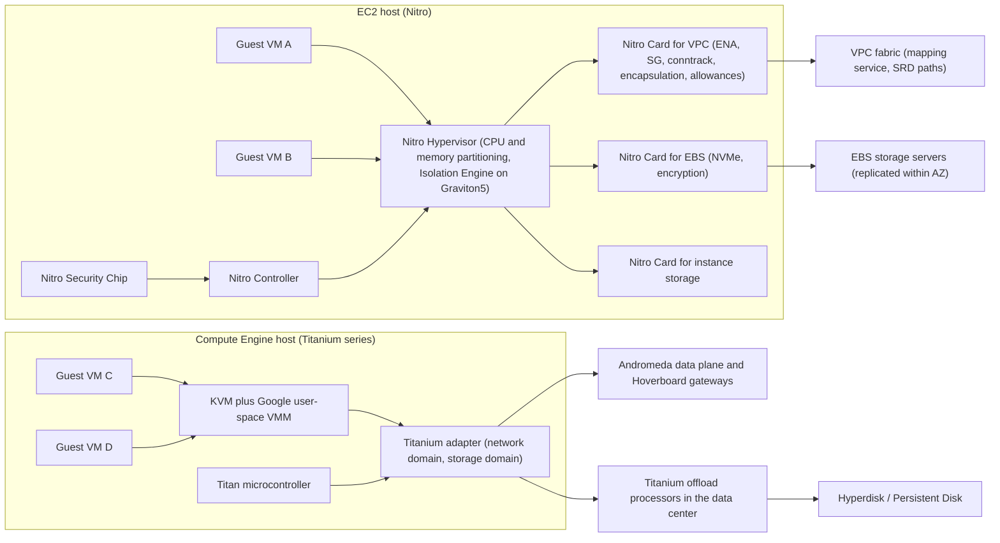
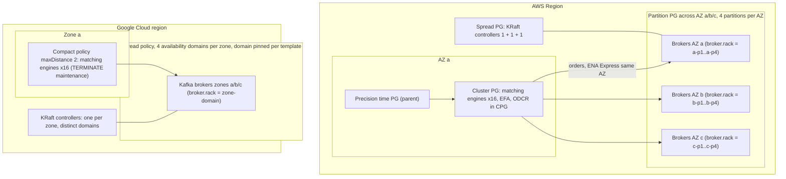
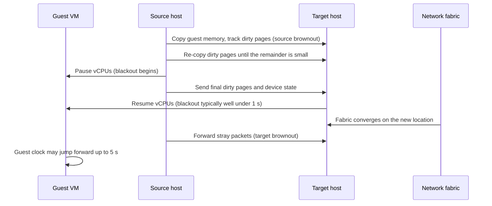

# 01.1 · AWS Nitro and EC2 Placement Groups vs Google Titanium Compute

> **Folder 01 · File 1 of 3.** This file covers what happens beneath the instance API on both clouds: where the hypervisor tax goes, how I/O offload changes the security and performance contract, how each cloud exposes physical failure domains (placement groups vs placement policies), and how each one maintains hosts under running workloads (no-migration plus scheduled events vs live migration). Read it before the networking folder, because the VPC data plane in Folder 02 (file 02.1) starts where §3.5 stops.

| Listing | What it shows | Language |
|---|---|---|
| `placement_planner.py` | Checks 9 placement plans against the documented EC2 and Compute Engine limits. Shows how Compute Engine spread-policy auto placement drifts out of balance after 8 VMs. Counts RF=3 replica sets that lose their majority when a rack fails, with and without a partition placement group. Works out the parallel-flow math for EC2 per-flow limits | Python 3 (stdlib) |

**Verification.** The listing is embedded byte-identical to its source. The gate reruns it on this final file and checks that the output still matches and still ends in `verdict: OK`. Platform facts are pinned to public AWS and Google Cloud documentation as of **2026-10-31**, and each one is linked in §11.

**Labels used throughout.**
- **[D]** documented by the provider.
- **[E]** an estimate or model output, with its inputs stated.
- **⚠** a mechanic that is not publicly documented, or is inferred from talks and papers. Never present a ⚠ item as fact in an interview without saying how you know it.

---

## 0. Orientation

**The questions this file answers.**

1. Why did AWS move the hypervisor's I/O work onto cards? What does the tenant gain, in performance, in security, and in the ability to buy bare metal with VPC and EBS still attached?
2. What does Google run instead? The pieces are KVM with a proprietary VMM, VMs as Borg tasks, Andromeda in software, and then Titanium offload. Which differences actually matter to an architect?
3. How do you ask each cloud for "close together" or "far apart", and what are the hard numeric limits? On AWS that's cluster, partition, spread and precision-time placement groups. On Google it's compact and spread placement policies.
4. What happens to your VM when the host needs maintenance? AWS sends scheduled events and live-updates the hypervisor without migrating you. Compute Engine live-migrates by default and terminates where it can't. How do you design for each?
5. Which hidden per-instance allowances and quotas break production first? The usual ones are PPS, conntrack, link-local, per-flow limits, capacity errors and vCPU-quota families.
6. How do you translate a compute architecture from one cloud to the other without carrying an assumption that only holds on the source cloud?

**Three reading paths.**

| You are preparing for | Read | Skip on first pass |
|---|---|---|
| FAANG L7 infrastructure interview | §1, §2, §3.2, §4.3–4.5, §7, §9 Q-chains | §5.5 capacity detail |
| AWS SAP-C02 | §2, §5.1, §6.1, §7, §9 S-scenarios | §4.2 Borg |
| Building or migrating production | §3–§8 in order, then run the listing on your own plan | none |

**Assumed background.** VPC and subnet basics, what an AZ/zone is, what a replication factor is. The Kubernetes data plane is in [01.2](02-eks-vs-gke-datapath-v2-ebpf-cilium-pod-ip-cni-and-karpenter-autoscaling.md). Firecracker and serverless isolation are in [01.3](03-serverless-internals-aws-lambda-firecracker-microvms-vs-cloud-run-borg.md).

---

## 1. First principles: what virtualization costs and where the cost moves

### 1.1 The three taxes

Every multi-tenant compute platform pays three taxes. The architecture of Nitro and Titanium is a story of moving those taxes somewhere cheaper.

1. **The CPU tax.** Privileged guest operations trap to the hypervisor (VM exits). The cost is the exit plus the handler. Modern hardware virtualization (VT-x/AMD-V, EPT/NPT nested paging, posted interrupts, Arm VHE) makes most exits rare. What's left of the CPU tax is mostly the hypervisor's *own* work: device emulation, management daemons, monitoring agents.
2. **The I/O tax.** A virtual NIC or virtual disk has to be implemented somewhere. With a software model (Xen dom0, QEMU/virtio back ends, a host vSwitch), every packet and every block request burns host CPU cycles on cores the provider can't sell. It also adds latency variance, because those cores are shared and scheduled.
3. **The jitter tax.** Anything on the host that isn't the tenant's workload can preempt the tenant's vCPUs. That includes the vSwitch, storage back ends, telemetry, live-migration dirty-page tracking and firmware housekeeping. For a p50 workload this is noise. For a p99.9 matching engine it's the whole problem.

Security is the fourth axis, and it's tied to the first three. The **trusted computing base (TCB)** is every line of code that can read tenant memory. A full VMM with device emulation is a large TCB. A hypervisor that only partitions CPU and memory is a small one.

### 1.2 Two starting points

| | AWS (2006 → 2017) | Google Compute Engine (2012 →) |
|---|---|---|
| Hypervisor | Xen, with a privileged dom0 running device back ends | KVM from day one, with a **proprietary user-space VMM instead of QEMU** [D] |
| I/O path | dom0 software back ends, then SR-IOV NICs (2013) and EBS offload (2015) | Host software data plane (Andromeda) on dedicated host cores |
| Where the tax went | Host cores reserved for dom0 | Host cores reserved for Andromeda and the storage client |
| End state | **Nitro**: all I/O on cards, minimal hypervisor (C5, 2017 onward) | **Titanium**: network and storage offloaded to an adapter and to data-center offload processors (C3, 2023 onward) |

Both clouds reached the same conclusion: **take the I/O data plane off the host CPUs, and keep the code that touches guest state small.** They arrived from different directions. AWS acquired Annapurna Labs (2015) and built a card for each function. Google ran a very strong software SDN for a decade and then moved it into silicon. The difference still shows up in what each cloud documents, in its maintenance model and in its failure-domain APIs.

### 1.3 Four design axes to compare any two compute platforms

1. **Where the I/O data plane runs:** host cores, a card on the host, or a remote processor pool.
2. **What the hypervisor does:** a full VMM with emulated devices, or CPU and memory partitioning only.
3. **How hosts are maintained:** live update in place, live migration, or reboot-with-notice.
4. **How physical failure domains are exposed:** named partitions you can read back, best-effort hints, or nothing.

A Principal answer to any "compare EC2 and GCE" question names all four. A Senior answer names services.

### 1.4 Physical constants worth carrying

These are order-of-magnitude **[E]** anchors for whiteboard math, not SLAs.

| Quantity | Order of magnitude | Why it matters here |
|---|---|---|
| Local NVMe read (instance store / Local SSD) | ~100 µs | The baseline that network block storage is compared against |
| Network block I/O (EBS / Hyperdisk) | sub-ms to low-ms | The latency floor is the network round trip plus replication |
| Same-AZ/zone RTT | ~100 µs–0.5 ms | Synchronous replication inside an AZ is cheap |
| Cross-AZ RTT within a region | ~0.5–2 ms | Majority quorums across AZs pay this on every write |
| Live-migration blackout (Compute Engine) | "typically much less than 1 second" **[D]** | Timeouts and leases shorter than this will flap |
| Guest clock jump after blackout | up to 5 s **[D]** | Wall-clock-based leases and lock expiries |

### 1.5 The architect's invariant: rely only on the contract

The provider can change anything that isn't in the API contract, and it will. So learn the documented contract precisely. Nitro and Titanium internals matter because they **explain** the contract, not because you can depend on them.

| Contract item | AWS | Google Cloud |
|---|---|---|
| Network bandwidth per instance | Published per type. Sizes "up to" X burst on a credit mechanism | Per-VM egress cap by vCPU count and series. Tier_1 raises it |
| Per-flow throughput | 5 Gbps outside a cluster PG, 10 Gbps inside, up to 25 Gbps with ENA Express **[D]** | Governed by per-VM caps and the series. Check the bandwidth page for your series |
| Packet and connection allowances | Exposed as ENA `*_allowance_exceeded` counters | Not exposed as separate counters. Watch drop and latency metrics |
| Placement limits | Spread ≤ 7 running per AZ per group. Partition ≤ 7 per AZ | Spread 1–8 availability domains. Compact limits by max distance |
| Maintenance | Scheduled events with notice. Hypervisor live updates | Live migration by default. TERMINATE for GPUs, bare metal and others |

---

## 2. Side-by-side architectural Rosetta matrix

Read the last column first: it's the part interviewers probe.

| Concern | AWS | GCP | What actually differs |
|---|---|---|---|
| Hypervisor | Nitro Hypervisor: minimal, partitions CPU and memory, no device back ends. On Graviton5, the **Nitro Isolation Engine** mediates all guest-state access (GA 2026-06-11) **[D]** | KVM plus Google's own user-space VMM (no QEMU). VMs run inside Borg-managed hosts ⚠ (Borg paper) | AWS publishes a formally verified isolation component. Google publishes a hardened KVM plus a custom VMM |
| I/O offload hardware | Nitro Cards: VPC/ENA, EBS (NVMe), instance storage, controller | Titanium adapter (separate network and storage domains) plus **Titanium offload processors (TOPs)** in the data center | Google also offloads into a *remote* pool. AWS's cards sit in each host |
| Hardware root of trust | Nitro Security Chip on the motherboard | Titan security microcontrollers | Both gate firmware and boot. Neither exposes them to tenants except through attestation features |
| Bare metal | `*.metal` instances. Nitro still provides VPC, EBS and security groups | Bare-metal shapes (for example C3 metal and Z3 metal). Titanium provides the network and Hyperdisk | Both keep the cloud network and storage on bare metal *because* I/O is off-host |
| Network virtualization | Encapsulation, security groups and routing on the Nitro card. Mapping service ⚠ | Andromeda: host SDN with Hoverboard gateways for the long tail. Offloaded to Titanium on new series | Andromeda's design is published (NSDI 2018). AWS's VPC fabric is described mostly in re:Invent talks ⚠ |
| Enhanced networking | ENA (SR-IOV), ENA Express (SRD), EFA (OS bypass, SRD) | gVNIC, Tier_1 bandwidth, Cloud RDMA / RoCE on specific HPC and AI series | SRD is AWS's multipath transport. Google's HPC fabrics are series-specific |
| Block storage | EBS via the Nitro card (NVMe namespace) | Persistent Disk and **Hyperdisk** via Titanium. Several new series attach Hyperdisk only | Hyperdisk provisions performance per disk. Check whether a series supports PD before migrating |
| Local storage | Instance store NVMe (ephemeral, lost on stop) | Local SSD / Titanium SSD. Can live-migrate on many types | GCE Local SSD can survive host maintenance through live migration. AWS instance store can't survive a stop |
| Host maintenance | No live migration of customer VMs. Hypervisor live updates. Scheduled events (reboot, retirement). Simplified automatic recovery | **Live migration by default** (`MIGRATE`). TERMINATE for GPUs, TPUs, bare metal, most Confidential VMs, RDMA | Design for reboot-with-notice on AWS. Design for brownout plus clock jump on GCP |
| Close placement | Cluster placement group (one AZ) | Compact placement policy (`maxDistance` 1/2/3) | GCE gives graded distance with hard VM caps. AWS gives one level |
| Failure-domain placement | Partition PG (≤ 7 per AZ, visible partition numbers). Spread PG (≤ 7 running per AZ) | Spread placement policy: 1–8 availability domains | AWS spread is per AZ. GCE domains apply within a zone, and auto placement is random beyond 8 VMs |
| Clock | Amazon Time Sync. **Precision time PG** gives a PTP hardware clock (PHC) | Google NTP (leap smear). TrueTime is internal to Spanner | Both run precision clocks underneath. AWS sells the PHC as a placement feature |
| Capacity assurance | On-Demand Capacity Reservations (also in a cluster PG), Capacity Blocks for ML, zonal RIs | Reservations (specific or automatic), future reservations, Dynamic Workload Scheduler (flex-start / calendar) | Reservations don't cover a partition or spread PG on AWS **[D]**, or a spread policy on GCE **[D]** |
| Sole tenancy | Dedicated Hosts and Dedicated Instances | Sole-tenant nodes | Both serve BYOL per-core licensing and compliance |
| Spot | 2-minute interruption notice plus rebalance recommendation | Spot VMs: 30-second preemption notice | Checkpointing budgets differ by 4× |
| Arm CPUs | Graviton4/5 (Graviton5: 192 cores; M9g/M9gd) | Axion (C4A and later) | A vCPU is a physical core on both Arm lines. On x86 it's a hyperthread |
| Metadata service | IMDSv2: PUT session token, hop limit | Metadata server with a required `Metadata-Flavor: Google` header | Both defeat naive SSRF. IMDSv2 hop limit 1 also blocks containers by default |
| Fleet diversification | EC2 Fleet / ASG with attribute-based instance types and price-capacity-optimized allocation | MIG instance flexibility, regional MIG target distribution shapes | Both cure capacity errors by widening the instance-type and zone set |
| Confidential compute | Nitro Enclaves, NitroTPM, AMD SEV-SNP on some types | Confidential VMs (AMD SEV / SEV-SNP, Intel TDX), Shielded VM vTPM | Covered in depth in Folder 05 |
| Commitments | Savings Plans, Reserved Instances | Committed use discounts (resource- or spend-based). Sustained-use discounts on some series | Covered in Folder 06 |
| vCPU quota unit | On-Demand vCPU quotas by instance-family class | Regional CPU quotas by family (for example `C3_CPUS`) plus a global CPU cap | Both fail launches with a quota error, not a capacity error. Tell them apart |
| API throttling | EC2 API token buckets (`RequestLimitExceeded`) | Compute Engine API rate quotas per project per minute | Autoscalers and IaC loops hit these during incidents |

---

## 3. Internal mechanics: the AWS Nitro System

### 3.1 Evolution in one paragraph

EC2 launched on Xen. Device back ends ran in a privileged domain (dom0) that used host cores AWS couldn't rent. Over several generations AWS moved work off the host:
- SR-IOV networking (2013);
- EBS processing on dedicated hardware (C4, 2015, after the Annapurna Labs acquisition);
- in 2017, with C5, the whole design: every I/O function on Nitro cards, a new lightweight hypervisor, and bare-metal instances (`i3.metal`) that keep VPC and EBS because neither depends on host software.

Later generations raised network bandwidth and added SRD-based transports (ENA Express, EFA). The generation that ships with Graviton5 added the **Nitro Isolation Engine**, generally available on all Graviton5 instances on **2026-06-11** **[D]**.

### 3.2 Components and responsibilities

| Component | Where it sits | Responsibility | Tenant-visible consequence |
|---|---|---|---|
| **Nitro Card for VPC** | PCIe card | Presents ENA (SR-IOV virtual functions) to the guest. Encapsulation and routing, security groups and connection tracking, rate limiting, flow telemetry | Security-group evaluation costs no guest CPU. PPS and conntrack limits are *card* allowances |
| **Nitro Card for EBS** | PCIe card | Presents EBS volumes as NVMe namespaces. Encrypts with the volume's data key, then ships I/O to EBS storage servers | EBS encryption is free of guest CPU. Instance EBS bandwidth is a published per-type limit |
| **Nitro Card for instance storage** | PCIe card | Local NVMe with at-rest encryption keyed per instance. The key is destroyed on stop or terminate | Instance store data doesn't survive stop, hibernate or terminate |
| **Nitro Controller** | Card | Talks to the EC2 control plane, manages the other cards and the hypervisor | Launches, attachments and metadata all flow here. No tenant API |
| **Nitro Security Chip** | Motherboard | Controls access to non-volatile storage and firmware. Measured boot of the host | The basis of AWS's "no operator access" claims |
| **Nitro Hypervisor** | Host CPU | Partitions memory and CPUs, programs the IOMMU and hardware virtualization. No networking stack, no storage drivers, no general-purpose shell ⚠ (AWS describes it as minimal) | Near-bare-metal performance. Hypervisor updates without rebooting instances |
| **Nitro Isolation Engine** (Graviton5) | Inside the hypervisor | Mediates *every* access to guest memory, vCPU register state and I/O devices through a minimal API. The hypervisor keeps policy (scheduling); the engine does the touching **[D]** | Isolation backed by machine-checked proofs (below) |

**The Isolation Engine's verification scope [D].** Ali Saidi's 2026-06-11 post says the engine is written in Rust and formally verified for four properties:
1. confidentiality and integrity of guest data;
2. functional correctness of each verified hypercall against its specification;
3. absence of runtime errors;
4. memory safety.

The proofs currently cover the core VM lifecycle hypercalls (create, run, tear down). They assume the Rust compiler and the hardware are correct.

The interview point: this is the first major cloud to put a **machine-checked isolation boundary** under general-purpose VMs. State its scope precisely: lifecycle hypercalls, with stated assumptions. Don't claim "the whole hypervisor is proven".

### 3.3 The "no operator access" design

AWS states the Nitro System was designed from 2017 so that privileged operators reach hosts only through authenticated, audited administrative APIs that can't access customer memory or storage **[D]**. Three mechanisms give that claim teeth:
1. **No interactive access:** there's no SSH to the hypervisor ⚠ (AWS describes the absence of a shell in talks and its Nitro security whitepaper).
2. **Firmware integrity:** the Security Chip gates writes to firmware and non-volatile storage, so an attacker can't persist below the hypervisor.
3. **Encryption on the cards:** EBS and instance-store data are encrypted before they leave the card, and EC2 encrypts in-transit traffic between supported Nitro instance types automatically.

For the regulated-workload question ("can the cloud operator read my data?"), pair this with Nitro Enclaves (attested, network-less sub-VMs), covered in Folder 05.

### 3.4 Where the guest CPU goes on Nitro

On a virtualized Nitro instance, the guest sees almost all host cores. The hypervisor keeps very little for itself, and no cores are reserved for a software vSwitch or storage back end. The mental model is that a `.metal` instance and the largest virtualized size of the same family offer about the same usable CPU. What `.metal` adds:
- access to hardware features such as performance counters and nested virtualization;
- licensing by physical socket and core;
- no hypervisor at all.

**Graviton vs x86 vCPUs.** On Graviton, one vCPU is one physical core: there's no simultaneous multithreading. On Intel and AMD instances, one vCPU is one hardware thread, two per core. A Java service sized at "8 vCPUs" on `m7i` (4 physical cores) and on `m7g` (8 physical cores) are different machines. Benchmark per workload. Compute Engine's Axion has the same split: Axion vCPUs are cores, x86 vCPUs are threads unless you set `threads-per-core=1`. EC2 exposes the equivalent knob through **CPU options** (core count, threads per core) at launch.

### 3.5 The I/O paths, step by step

**Packet egress (guest to another instance in the VPC).**
1. The guest ENA driver writes a descriptor into a ring in guest memory and rings a doorbell.
2. The VPC card DMAs the frame (the IOMMU restricts it to this guest's memory).
3. The card evaluates security-group rules, using connection tracking for stateful rules, and the network ACL.
4. It looks up the destination host for the destination private IP ⚠ (a mapping service, cached on the card), encapsulates, and rate-limits against the instance's bandwidth and PPS allowances.
5. The frame crosses the physical fabric. The receiving card decapsulates, checks the inbound rules, and DMAs into the destination guest's ring.

**EBS write.**
1. The guest NVMe driver submits a write to a namespace on the EBS card.
2. The card encrypts with the volume's data key, which was decrypted at attach time through KMS.
3. It sends the write to the EBS storage servers that replicate the volume within the AZ.
4. It completes the NVMe command once the write is durable. The transport between the card and EBS is SRD on current generations ⚠ (stated in AWS talks about io2 Block Express).

**Why this matters for the architect.** Every limit you hit is *enforced by the card*: bandwidth, PPS, conntrack table size and the link-local packet rate. These limits are per network interface or per instance, and they're independent of how idle the guest CPU looks. That's why a box at "20% CPU" can drop packets. §7 lists the counters.

### 3.6 Contracts that fall out of the design

| Contract | Value | Consequence |
|---|---|---|
| Single-flow TCP bandwidth | 5 Gbps outside a cluster PG. 10 Gbps inside. Up to 25 Gbps with ENA Express (same AZ) **[D]** | One TCP stream across AZs can't fill a 50 Gbps NIC. Use parallel streams |
| Traffic to the internet or other Regions | Limited relative to the instance's bandwidth (a published fraction, with a lower cap on small sizes) **[D]** | Bulk egress jobs need either many instances or larger sizes |
| "Up to" bandwidth sizes | Smaller sizes get a baseline plus network I/O credits for bursting **[D]** | A benchmark that runs for 5 minutes overstates sustained throughput |
| Link-local services | 1,024 packets per second per ENI to the Route 53 Resolver, IMDS, Amazon Time Sync and similar **[D]** | DNS-heavy pods on one node share one ENI's budget. See §7 |
| Security-group connection tracking | Tracked flows count against a per-instance table. Idle timeouts are configurable **[D]** | Many short connections can exhaust tracking before the CPU notices |
| EBS bandwidth | Per instance type, with burst balance metrics on smaller sizes (`EBSIOBalance%`, `EBSByteBalance%`) **[D]** | The disk is fast but the instance pipe is the limit |

---

## 4. Internal mechanics: Compute Engine, KVM, Borg and Titanium

### 4.1 KVM with a proprietary VMM

Google states that Compute Engine uses KVM for hardware virtualization and **does not use QEMU**. Google wrote its own user-space VMM, and moved device emulation into an unprivileged process outside the kernel. It hardened the stack with fuzzing, static analysis, a reduced instruction-emulation set and removal of unused components **[D]** (Google Cloud blog, 2017). The design goal matches Nitro's (shrink the code that can touch guest state), but the approach differs. Google kept a software VMM and made it small and sandboxed. AWS removed device emulation from the host entirely.

### 4.2 Borg underneath

Google's infrastructure security overview describes hosts as controlled by the cluster orchestration service **Borg**. The 2015 Borg paper describes hosted VMs as KVM processes running as Borg tasks ⚠ (paper-level description, not a current product contract). Cloud Run's documentation says it "runs on top of Borg" **[D]**. That's covered in [01.3](03-serverless-internals-aws-lambda-firecracker-microvms-vs-cloud-run-borg.md).

What an architect may infer, and what not:
- **May infer:** Google schedules VMs with the same machinery and failure-domain thinking it uses for its own services. Placement policies and live migration are expressions of that.
- **Don't claim:** that your VM shares a machine with Search, or anything about Borg priorities applying to your VM. Neither is documented.

### 4.3 Andromeda, the software SDN, and why it moved to silicon

Andromeda (NSDI 2018) is Google's network virtualization stack. It consists of:
- a **host fast path** that processes packets on dedicated cores using busy polling;
- a hierarchical **control plane** that programs flows into hosts;
- **Hoverboard** gateways that handle the long tail of flows not yet programmed on a host, so the control plane doesn't have to install every possible flow everywhere.

The design gives Compute Engine its distinctive properties:
- a **global VPC** (one network spanning regions; covered in 02.1);
- fast VM-to-VM programming;
- performance isolation through per-VM rate limiting in the fast path.

The cost was the I/O tax: host cores ran the data plane. Titanium moves it off the host on new machine series. Google describes the networking and storage functions as running "off host in dedicated domains of the Titanium adapter", so each service can be updated and maintained independently **[D]**.

### 4.4 Titanium: adapter, offload processors and SSD

| Titanium element | Role | Consequence |
|---|---|---|
| Titan security microcontrollers | Hardware root of trust for boot and firmware | Comparable to the Nitro Security Chip |
| Titanium adapter | On-host offload: network data plane (Andromeda) and storage client. Separate domains per service | Host cores go to the guest. Network or storage can be updated without touching the other |
| Titanium offload processors (TOPs) | Offload *deployed across the data center*, not only in the host. Serves block-storage processing | Hyperdisk performance is provisioned per disk and isn't tied to disk size |
| Titanium SSD | Local SSD built on Titanium I/O offload | High-IOPS local storage on storage-optimized series. Large configurations can't live-migrate (§4.5) |

**Hyperdisk-only series (migration trap).** Several newer series (for example C4, N4 and the Axion-based C4A) attach Hyperdisk volumes rather than Persistent Disk. A lift-and-shift that snapshots `pd-ssd` disks must restore into a Hyperdisk type, and IaC templates that hard-code `pd-balanced` fail on those series. Always check the machine series' supported disk types.

The C4 general-availability post cites up to 200 Gbps networking, and up to 500k IOPS and 10 GB/s on Hyperdisk Extreme, "with Titanium offload" **[D]**. Network- and storage-optimized variants go further. Use those figures as series-specific numbers, never as platform constants.

### 4.5 Live migration in detail

Compute Engine moves running VMs between hosts for host maintenance: hardware, network, power, host OS and BIOS work. It also does so preemptively when it detects early signs of hardware failure **[D]**.

| Stage | What happens [D] |
|---|---|
| Source brownout | The VM keeps running on the source. Memory is copied to the target while dirty pages are tracked. Duration depends on memory size and dirty rate |
| Blackout | The VM runs nowhere while the final state transfers. "Typically much less than 1 second" overall disruption. The guest clock appears to jump forward up to 5 s. Longer blackouts are corrected by a guest daemon |
| Target brownout | The VM runs on the target. The source forwards packets until the fabric converges |

Preserved: IP addresses, metadata, block storage data, application state, network settings, and Local SSD data **[D]**.

**What can't live-migrate [D].** These instances get `TERMINATE` (optionally with automatic restart):
- VMs with GPUs: 60-minute notice for most GPUs, 10 minutes for A4X, A4 and A3 Ultra;
- Cloud TPUs;
- bare-metal instances;
- most Confidential VMs (only N2D and C3D with AMD SEV live-migrate);
- instances with a Cloud RDMA interface;
- H4D;
- Z3 with more than 18,000 GiB of Titanium SSD;
- Z4D and Z4M with more than 42,000 GiB of Titanium SSD (Titanium SSD data is preserved on those).

The host maintenance policy (`onHostMaintenance: MIGRATE | TERMINATE`) is per instance. **Only instances set to `MIGRATE` are live-migrated. Others are terminated during maintenance.**

### 4.6 Sole tenancy, Shielded VM and Confidential VM in one table

| Need | AWS | GCP |
|---|---|---|
| Physical isolation, BYOL by socket or core | Dedicated Hosts (host affinity, licenses through License Manager) | Sole-tenant nodes (node groups, node affinity labels, CPU overcommit option) |
| Verified boot plus vTPM | NitroTPM plus UEFI Secure Boot | Shielded VM (Secure Boot, vTPM, integrity monitoring) |
| Memory encryption against the host | AMD SEV-SNP on supported types. The Nitro design itself excludes operator access | Confidential VMs: AMD SEV and SEV-SNP, Intel TDX |
| Isolated enclave for key handling | Nitro Enclaves (no network, no persistent storage, vsock, KMS attestation) | Confidential Space (attested workloads on Confidential VMs) |

---

## 5. Placement, failure domains and capacity

### 5.1 EC2 placement groups: the rules that matter [D]

**Cluster.**
- One AZ, packed into the same high-bisection segment of the network. It can span peered VPCs in that AZ.
- Single-flow TCP up to 10 Gbps (5 Gbps outside a group).
- Traffic to the internet or over Direct Connect is limited to 5 Gbps.
- Launch everything in **one request with one instance type**; adding instances later raises the chance of insufficient-capacity errors.
- To reserve capacity, create an On-Demand Capacity Reservation *in* the cluster PG (zonal RIs can't). Capacity Blocks don't support placement groups.
- Burstable (T) instances, Mac1 and M7i-flex aren't supported.

**Partition.**
- Up to **7 partitions per AZ**. The group can span AZs in the Region.
- Partitions never share racks. The instance count is limited only by account limits.
- Partition numbers are visible to the instance (metadata) and the API, so topology-aware systems (HDFS, HBase, Cassandra, Kafka) can map replicas to partitions.
- Even distribution isn't guaranteed.
- Capacity Reservations **don't** reserve capacity in a partition PG.
- Dedicated Instances are limited to 2 partitions.

**Spread.**
- Rack-level spread in Regions: at most **7 running instances per AZ per group**. With three AZs, that's 21 instances per group.
- An eighth launch in a full AZ fails.
- Use several groups if you need more, though instances aren't guaranteed to be spread *across* groups.
- Host-level spread exists only on Outposts.
- Not supported for Dedicated Instances. Capacity Reservations don't apply.

**Precision time (new).**
- Places instances on hardware with direct access to high-precision time sources. Instances get an enhanced local NTP source and, on Linux, a **PTP hardware clock (PHC)** device plus hardware packet timestamping.
- It can be the **parent** of a cluster PG (`--parent-group-id`), so you can get both close placement and precise time.
- There's no charge. Launches fail if suitable hardware is short.

### 5.2 Compute Engine placement policies: the rules that matter [D]

**Compact policy** (`maxDistance`; a lower value means closer and fewer machines available):

| `maxDistance` | Meaning | Max VMs per policy | Host maintenance |
|---|---|---|---|
| unset (not recommended) | best effort | 1,500 | MIGRATE or TERMINATE |
| 3 | adjacent blocks in a cluster | 1,500 | MIGRATE or TERMINATE |
| 2 | same block | 150 (256 for A3 Ultra/Mega/High/Edge) | TERMINATE |
| 1 | same sub-block | 22 (16 for Z4M) | TERMINATE |

Rules:
- `maxDistance` is in Preview.
- `maxDistance 1` can't be used with reservations.
- A policy attaches to only one reservation at a time, and only to on-demand, single-project, standalone reservations.
- Compact policies don't apply to Flex-start VMs in a MIG.
- For A3 High (8 GPUs) and later GPU types, and for H4D, Google recommends **workload policies** instead of compact policies in MIGs.

**Spread policy.**
- Up to **8 availability domains**. Google recommends at least two.
- With **8 or fewer** instances under the policy, a new instance goes to the domain with the fewest instances. **Beyond 8, a random domain is chosen** unless the instance or template names its domain.
- Applying a policy to an existing instance stops or live-migrates it according to its maintenance policy.
- A machine type and zone may not support every domain. Spread policies can't be applied to reservations.

**All policies.**
- Policies are regional. Each resource gets one policy.
- Sole-tenant instances can't use them.
- A policy can be deleted only when unused.

### 5.3 "I need…" translation table

| Requirement | AWS | GCP | Watch out |
|---|---|---|---|
| Lowest latency for tightly coupled MPI or collective comms | Cluster PG + EFA, one launch request, ODCR in the CPG | Compact policy at low `maxDistance` (≤ 22 VMs at 1, ≤ 150 at 2), or workload policies for AI/HPC MIGs, + RDMA-capable series | GCE `maxDistance` 1/2 force TERMINATE maintenance |
| Replicas never share a rack | Partition PG; map replica placement to partition numbers | Spread policy with explicit domain per instance | AWS partitions are visible. GCE domains must be set in the template to be deterministic beyond 8 VMs |
| A handful of critical nodes on distinct hardware | Spread PG (≤ 7 per AZ) | Spread policy (≤ 8 domains) | Neither scales to large fleets. Use partition/domain mapping instead |
| Microsecond-accurate clocks | Precision time PG (PHC) | No tenant PTP product. Use Google NTP; Spanner TrueTime is internal | Don't promise a PHC on GCP |
| Guaranteed capacity in the group | ODCR in a cluster PG only | Reservation + compact policy (with the restrictions above) | Partition/spread PGs and spread policies can't hold reservations |

### 5.4 Listing: placement plans and correlated failure

The listing encodes the documented limits above and checks nine plans. It then measures two claims you'd make on a whiteboard:
1. **Spread-policy drift.** Compute Engine's random placement beyond 8 VMs can put far more than 1/k of a zone's VMs in one availability domain.
2. **Rack co-location.** In a single AZ without a placement group, a single rack failure regularly takes out a majority of some RF=3 replica sets. A partition PG with rack-aware replica placement makes that impossible by construction.

Rack counts aren't published, so the listing sweeps an assumed range and prints it as an assumption.

<!-- listing:placement_planner.py -->
```python
"""placement_planner.py - check placement plans against the documented EC2 and Compute Engine
rules, then measure what each placement buys you when a rack or availability domain fails.

Rules encoded (from the public docs as of 2026-10-31):
  EC2 cluster PG    one AZ only; single-flow TCP up to 10 Gbps inside the group (5 Gbps outside)
  EC2 partition PG  <= 7 partitions per AZ, may span AZs; partitions never share racks;
                    instance count limited only by account limits
  EC2 spread PG     rack level in Regions: <= 7 running instances per AZ per group
  GCE spread policy 1..8 availability domains; while the policy covers <= 8 instances a new one
                    goes to the domain with the fewest instances, beyond 8 to a random domain
                    (unless the instance or template names its domain)
  GCE compact       max-distance 1 -> 22 VMs (16 for Z4M); 2 -> 150 (256 for A3 Ultra/Mega/High/Edge);
                    3 or unset -> 1,500
The failure simulation's rack counts are assumptions (EC2 does not publish rack counts) and are
printed as such.

Usage: python -I placement_planner.py <any path>
"""
import math
import random
import sys

COMPACT_MAX = {1: 22, 2: 150, 3: 1500, None: 1500}
COMPACT_MAX_SPECIAL = {(1, "Z4M"): 16, (2, "A3"): 256}


def check_plan(p):
    """Return (verdict, reason) for one plan dict."""
    kind = p["kind"]
    if kind == "ec2-cluster":
        if len(p["azs"]) != 1:
            return "REJECT", f"cluster PG spans {len(p['azs'])} AZs; it is single-AZ"
        return "OK", f"{p['n']} instances in {p['azs'][0]}"
    if kind == "ec2-spread":
        worst = max(p["per_az"].values())
        if worst > 7:
            return "REJECT", f"{worst} instances in one AZ > 7 per AZ per spread group"
        return "OK", f"max {worst} per AZ (limit 7)"
    if kind == "ec2-partition":
        if p["partitions_per_az"] > 7:
            return "REJECT", f"{p['partitions_per_az']} partitions per AZ > 7"
        return "OK", f"{p['partitions_per_az']} partitions x {len(p['azs'])} AZs, {p['n']} instances"
    if kind == "gce-spread":
        if not 1 <= p["domains"] <= 8:
            return "REJECT", f"{p['domains']} availability domains; allowed 1..8"
        note = "auto placement is fewest-first" if p["n"] <= 8 else "beyond 8 VMs auto placement is random: pin domains"
        return "OK", f"{p['domains']} domains, {p['n']} VMs ({note})"
    if kind == "gce-compact":
        cap = COMPACT_MAX_SPECIAL.get((p["max_distance"], p["series"]), COMPACT_MAX[p["max_distance"]])
        if p["n"] > cap:
            return "REJECT", f"{p['n']} VMs > {cap} allowed at max-distance {p['max_distance']} ({p['series']})"
        return "OK", f"{p['n']} VMs <= {cap} at max-distance {p['max_distance']} ({p['series']})"
    raise ValueError(kind)


PLANS = [
    ("P1 etcd x5, EC2 spread, 3 AZs (2/2/1)", {"kind": "ec2-spread", "per_az": {"a": 2, "b": 2, "c": 1}}, "OK"),
    ("P2 Kafka x24, ONE EC2 spread group (8/8/8)", {"kind": "ec2-spread", "per_az": {"a": 8, "b": 8, "c": 8}}, "REJECT"),
    ("P3 Kafka x24, EC2 partition, 3 AZs x 4 partitions",
     {"kind": "ec2-partition", "azs": ["a", "b", "c"], "partitions_per_az": 4, "n": 24}, "OK"),
    ("P4 MPI x64, EC2 cluster PG over 2 AZs", {"kind": "ec2-cluster", "azs": ["a", "b"], "n": 64}, "REJECT"),
    ("P5 MPI x64, EC2 cluster PG in 1 AZ", {"kind": "ec2-cluster", "azs": ["a"], "n": 64}, "OK"),
    ("P6 GCE compact max-distance 1, 32 x C4", {"kind": "gce-compact", "max_distance": 1, "series": "C4", "n": 32}, "REJECT"),
    ("P7 GCE compact max-distance 2, 128 x C4", {"kind": "gce-compact", "max_distance": 2, "series": "C4", "n": 128}, "OK"),
    ("P8 GCE spread, 10 availability domains", {"kind": "gce-spread", "domains": 10, "n": 10}, "REJECT"),
    ("P9 GCE spread, 4 domains, 24 VMs", {"kind": "gce-spread", "domains": 4, "n": 24}, "OK"),
]


def gce_auto_placement(n, domains, rng):
    """Instance counts per domain after n auto-placed creations (fewest-first while <= 8, then random)."""
    counts = [0] * domains
    for i in range(n):
        if i < 8:
            d = min(range(domains), key=lambda k: (counts[k], k))
        else:
            d = rng.randrange(domains)
        counts[d] += 1
    return counts


def quorum_loss_trial(rng, n_inst, racks, n_parts, mode):
    """One rack fails; count replica sets (RF=3) that lose >= 2 replicas (majority lost)."""
    if mode == "partition-aware":
        # 3 partitions; partition p owns its own racks; replica k of every set lives in partition k.
        per = racks // 3
        inst_rack = [(i % 3) * per + rng.randrange(per) for i in range(n_inst)]
        by_part = [[i for i in range(n_inst) if i % 3 == k] for k in range(3)]
        sets = [[rng.choice(by_part[k]) for k in range(3)] for _ in range(n_parts)]
    else:  # no placement group: hardware assignment is invisible to the application
        inst_rack = [rng.randrange(racks) for _ in range(n_inst)]
        sets = [rng.sample(range(n_inst), 3) for _ in range(n_parts)]
    failed = rng.randrange(racks)
    return sum(1 for s in sets if sum(inst_rack[i] == failed for i in s) >= 2)


def main():
    rng = random.Random(2026)
    ok = True
    print("== 1. Plan validation against documented limits ==")
    for name, plan, want in PLANS:
        got, why = check_plan(plan)
        ok &= got == want
        print(f"{name:<52} {got:<6} {why}")

    print()
    print("== 2. GCE spread policy, 4 domains: largest domain share (one domain outage) ==")
    for n in (8, 12, 24, 48):
        shares = sorted(max(gce_auto_placement(n, 4, rng)) / n for _ in range(4000))
        p99 = shares[int(0.99 * len(shares)) - 1]
        pinned = math.ceil(n / 4) / n
        print(f"n={n:>2}: auto mean {sum(shares) / len(shares):.1%}, p99 {p99:.1%}, "
              f"worst {shares[-1]:.1%} | pinned round-robin {pinned:.1%}")
        if n > 8:
            ok &= shares[-1] > pinned  # random placement beyond 8 can exceed the even share
        else:
            ok &= shares[-1] == pinned

    print()
    print("== 3. RF=3 replica sets in ONE AZ, one rack fails (500 trials, 1,000 sets, 30 instances) ==")
    print("   rack counts are ASSUMPTIONS; EC2 does not publish them")
    for racks in (12, 30, 90):
        res = {}
        for mode in ("no-placement-group", "partition-aware"):
            losses = [quorum_loss_trial(rng, 30, racks, 1000, mode) for _ in range(500)]
            res[mode] = (sum(losses) / len(losses), max(losses), sum(1 for x in losses if x) / len(losses))
        a, b = res["no-placement-group"], res["partition-aware"]
        print(f"racks={racks:>2}: no PG -> mean {a[0]:6.1f} sets lose majority, worst {a[1]:>4}, "
              f"P(any) {a[2]:.1%} | partition PG + rack-aware -> mean {b[0]:.1f}, worst {b[1]}")
        ok &= b[1] == 0 and a[0] > 0

    print()
    print("== 4. Parallel TCP flows needed for one 24 Gbps replication stream (EC2 per-flow limits) ==")
    for path, per_flow in (("outside a cluster PG", 5), ("inside a cluster PG", 10), ("ENA Express (SRD), same AZ", 25)):
        print(f"{path:<28} {per_flow:>2} Gbps/flow -> {math.ceil(24 / per_flow)} flow(s)")
    print()
    print("verdict: OK" if ok else "verdict: FAIL")


if __name__ == "__main__":
    main()
```

<!-- output:placement_planner.py -->
```text
== 1. Plan validation against documented limits ==
P1 etcd x5, EC2 spread, 3 AZs (2/2/1)                OK     max 2 per AZ (limit 7)
P2 Kafka x24, ONE EC2 spread group (8/8/8)           REJECT 8 instances in one AZ > 7 per AZ per spread group
P3 Kafka x24, EC2 partition, 3 AZs x 4 partitions    OK     4 partitions x 3 AZs, 24 instances
P4 MPI x64, EC2 cluster PG over 2 AZs                REJECT cluster PG spans 2 AZs; it is single-AZ
P5 MPI x64, EC2 cluster PG in 1 AZ                   OK     64 instances in a
P6 GCE compact max-distance 1, 32 x C4               REJECT 32 VMs > 22 allowed at max-distance 1 (C4)
P7 GCE compact max-distance 2, 128 x C4              OK     128 VMs <= 150 at max-distance 2 (C4)
P8 GCE spread, 10 availability domains               REJECT 10 availability domains; allowed 1..8
P9 GCE spread, 4 domains, 24 VMs                     OK     4 domains, 24 VMs (beyond 8 VMs auto placement is random: pin domains)

== 2. GCE spread policy, 4 domains: largest domain share (one domain outage) ==
n= 8: auto mean 25.0%, p99 25.0%, worst 25.0% | pinned round-robin 25.0%
n=12: auto mean 34.4%, p99 50.0%, worst 50.0% | pinned round-robin 25.0%
n=24: auto mean 33.9%, p99 45.8%, worst 58.3% | pinned round-robin 25.0%
n=48: auto mean 31.9%, p99 41.7%, worst 54.2% | pinned round-robin 25.0%

== 3. RF=3 replica sets in ONE AZ, one rack fails (500 trials, 1,000 sets, 30 instances) ==
   rack counts are ASSUMPTIONS; EC2 does not publish them
racks=12: no PG -> mean   20.5 sets lose majority, worst  176, P(any) 72.6% | partition PG + rack-aware -> mean 0.0, worst 0
racks=30: no PG -> mean    3.2 sets lose majority, worst   60, P(any) 27.6% | partition PG + rack-aware -> mean 0.0, worst 0
racks=90: no PG -> mean    0.3 sets lose majority, worst   24, P(any) 3.8% | partition PG + rack-aware -> mean 0.0, worst 0

== 4. Parallel TCP flows needed for one 24 Gbps replication stream (EC2 per-flow limits) ==
outside a cluster PG          5 Gbps/flow -> 5 flow(s)
inside a cluster PG          10 Gbps/flow -> 3 flow(s)
ENA Express (SRD), same AZ   25 Gbps/flow -> 1 flow(s)

verdict: OK
```

**Reading the output.**

- **Plans P2, P4, P6 and P8 fail on documented numbers**, not on judgment. In a review, that's the fastest way to stop a design: "your 24-broker spread group can't launch an eighth broker in an AZ". The fixes are P3 (partition PG), P5 (single-AZ cluster), a `maxDistance` 2 policy, and ≤ 8 domains.
- **Section 2** shows the cost of letting Compute Engine choose domains past 8 VMs:
  - With 12 VMs across 4 domains, auto placement averages a 34% largest-domain share, and the worst trial puts 50% of the zone's VMs in one domain.
  - Pinned round-robin gives 25%.
  - The fix is to set the domain per instance or per instance template.
- **Section 3** is the rack argument quantified **[E]**. The model assumes 30 instances in one AZ and an *unknown* number of racks. With no placement group and rack-unaware replica placement, a single rack failure leaves a nonzero expected count of RF=3 sets without a majority at every rack count tried. The fewer the racks, the worse it gets. Partition PG plus rack-aware assignment is 0 in every trial, because each replica sits in a different partition and partitions never share racks.
- **Section 4** is the per-flow arithmetic for a 24 Gbps replication stream. It needs 5 parallel TCP flows across AZs, 3 inside a cluster PG, or 1 with ENA Express in the same AZ.

### 5.5 Capacity: errors, reservations and diversification

| Symptom | AWS | GCP | Remedy on both |
|---|---|---|---|
| "No capacity" at launch | `InsufficientInstanceCapacity` (ICE) | `ZONE_RESOURCE_POOL_EXHAUSTED` / stockout errors | Widen instance types and zones, or reserve |
| "Quota" at launch | `VcpuLimitExceeded` (On-Demand vCPU quota by family class) | `QUOTA_EXCEEDED` (for example `C3_CPUS`, `CPUS_ALL_REGIONS`) | Raise the quota *before* the event. Quotas aren't capacity |
| Planned large event | ODCR (open or targeted), Capacity Blocks for ML (GPU) | Specific reservations, future reservations, DWS calendar mode | Reserve per AZ/zone. Test the failover zone's reservation too |
| Elastic fleet | ASG/EC2 Fleet with attribute-based instance types and `price-capacity-optimized` | MIG instance flexibility plus regional distribution shape | More types and zones means more pools and fewer errors |

**Principle.** Capacity is a pool per (instance type, AZ/zone). Every constraint you add multiplies the chance of a miss:
- a single type;
- a cluster PG or compact policy;
- one AZ;
- a GPU shape.

Every type or zone you add as an alternative divides it. Placement for latency and placement for availability pull in opposite directions; say so explicitly in design reviews.

---

## 6. Maintenance and the lifecycle contract

### 6.1 AWS: scheduled events, live updates and recovery

- **Live updates.** AWS updates Nitro components and the hypervisor without rebooting instances for most changes ⚠. AWS states it can patch the Nitro System without instance downtime, but doesn't publish the mechanism. That's why EC2 doesn't need live migration for routine host software maintenance.
- **Scheduled events [D].** When hardware must be serviced or retired, EC2 posts events with a deadline:
  - `instance-reboot`;
  - `system-reboot`;
  - `system-maintenance`;
  - `instance-stop`;
  - `instance-retirement`.

  They're visible through `DescribeInstanceStatus`, AWS Health, and EventBridge. You can usually reschedule reboot events within the window. A **stop/start** (not a reboot) moves an EBS-backed instance to new hardware. Instance store data is lost.
- **Recovery.** *Simplified automatic recovery* is on by default for supported instance types. A CloudWatch `StatusCheckFailed_System` alarm with the recover action gives explicit control. Recovery keeps the instance ID, private IPs, Elastic IPs and EBS volumes.
- **Design implication.** Plan for **reboot with notice**, not for transparent moves. Stateful singletons need EBS-backed state, idempotent startup, and an automation that reacts to Health/EventBridge events. Better still, don't run singletons.

### 6.2 Compute Engine: live migration, notices and simulation

- **Policy.** Set `scheduling.onHostMaintenance` (`MIGRATE` or `TERMINATE`) and `automaticRestart`. GPU, TPU, bare-metal and the other excluded types must use `TERMINATE`.
- **Notice.**
  - The metadata server exposes a `maintenance-event` key that a guest agent can watch (values such as `MIGRATE_ON_HOST_MAINTENANCE` / `TERMINATE_ON_HOST_MAINTENANCE`).
  - GPU VMs get 60-minute notice (10 minutes for A4X/A4/A3 Ultra) **[D]**.
  - Upcoming maintenance windows for supported types are visible through the API, and some types can trigger maintenance on their own schedule.
- **Test it.** `gcloud compute instances simulate-maintenance-event` exercises the path. Run it in staging against anything with leases or heartbeats.
- **Design implications.**
  1. **Timeouts:** any heartbeat or lease shorter than a few seconds can flap during blackout. The clock can also jump forward up to 5 s, which can prematurely expire wall-clock leases. Use monotonic clocks and leases longer than the worst blackout.
  2. **Performance brownout:** dirty-page tracking slows memory-intensive workloads during source brownout. Latency-critical services should drain or tolerate a short p99 bump.
  3. **TERMINATE types:** GPU training needs checkpointing on the notice. Size the checkpoint interval to the notice (60 or 10 minutes).

### 6.3 Side by side

```text
            t-7d ........ t-1h ......... t0 ............................ t0+N
AWS EC2     scheduled event posted       reboot / stop-start at deadline
(hardware   (Health, EventBridge,        instance down for the reboot;
 retire)    DescribeInstanceStatus)      EBS state kept, instance store lost
            you may reschedule within the window, or stop/start early

GCE MIGRATE  usually no action needed    source brownout -> blackout (<1 s typ.)
(host        maintenance-event metadata  -> target brownout; IP, disks, Local SSD,
 maint.)     flips before the move       memory preserved; clock may jump <= 5 s

GCE TERMINATE (GPU/TPU/metal/...)  notice 60 min (10 min A4X/A4/A3 Ultra) -> VM stops;
                                   optional automatic restart on new host
```

---

## 7. Failure modes, throttling limits and quota traps

| # | Symptom | Root cause | How you detect it | Fix | Cloud |
|---|---|---|---|---|---|
| 1 | Packet drops at low CPU, mostly small UDP/TCP packets | Instance **PPS allowance** reached on the Nitro card | ENA `pps_allowance_exceeded` (ethtool or CloudWatch agent) | Larger or network-optimized size, spread the load, fewer and larger packets | AWS |
| 2 | Intermittent DNS timeouts under load, resolver healthy | **Link-local allowance**: 1,024 PPS per ENI to Route 53 Resolver/IMDS/NTP | `linklocal_allowance_exceeded` | Node-local caching resolver (NodeLocal DNSCache, dnsmasq), fewer lookups (`ndots`), spread pods | AWS |
| 3 | New connections fail, existing ones fine | Security-group **conntrack** table full | `conntrack_allowance_exceeded`, `conntrack_allowance_available` | Larger size, untracked rules where safe, shorter idle timeouts | AWS |
| 4 | Cross-AZ replication stuck near 5 Gbps on a 50 Gbps instance | **Per-flow** limit | Per-connection throughput flat at ~5 Gbps | Parallel streams (listing §4), ENA Express in the same AZ, cluster PG | AWS |
| 5 | 8th instance in an AZ won't launch | **Spread PG** limit of 7 running per AZ | Launch error | Partition PG or more groups | AWS |
| 6 | Adding nodes to an HPC cluster fails | **Cluster PG** capacity fragmentation | ICE on later launches | One launch request, single type, ODCR in CPG, stop/start all to re-place | AWS |
| 7 | Reservation doesn't cover the partition/spread fleet | Capacity Reservations don't apply to partition/spread PGs | Instances launch on-demand and fail under pressure | Reserve without the PG, or accept the risk explicitly | AWS |
| 8 | T-instance latency spikes after an hour of load | **CPU credits** exhausted, throttled to baseline | `CPUCreditBalance` → 0 | Unlimited mode (paid) or a non-burstable family | AWS |
| 9 | Disk fine, instance I/O capped | **EBS instance bandwidth** or burst balance on smaller sizes | `EBSIOBalance%`, `EBSByteBalance%` | Larger size, or an EBS-optimized family with more bandwidth | AWS |
| 10 | Leader elections flap once a month, "network blip" | **Live-migration blackout** plus clock jump on GCE | Correlate with maintenance events. Simulate one | Longer leases, monotonic clocks, tolerate 1–5 s pauses | GCP |
| 11 | GPU training job dies with little notice | GPU VMs use **TERMINATE** (60/10-minute notice) | Maintenance notice in metadata | Checkpoint on notice, use the reservation's maintenance controls | GCP |
| 12 | One zone outage takes half of a "spread" fleet | **Spread policy beyond 8 VMs** places randomly | Count VMs per `availabilityDomain` | Pin domains in templates (listing §2) | GCP |
| 13 | `maxDistance 1` policy rejects the 23rd VM | **Compact policy** cap (22) | API error | `maxDistance 2` (≤ 150) or a workload policy | GCP |
| 14 | Template fails on C4/N4/C4A | **Hyperdisk-only series** | API error on disk type | Use a Hyperdisk type. Convert snapshots | GCP |
| 15 | Spot fleet loses work on interruption | Notice is **2 min (AWS)** vs **30 s (GCP)** | Interruption metrics | Checkpoint interval and drain time below the notice. Diversify pools | Both |
| 16 | Arm migration "same vCPUs, 30% slower" or "faster" | **vCPU semantics**: core (Graviton/Axion) vs thread (x86) | Benchmarks per vCPU | Size by measured throughput, not vCPU count | Both |
| 17 | Credentials stolen via SSRF | Metadata reachable from an app proxy | Unusual role usage | IMDSv2 required (hop limit 1, or 2 for containers), and GCE's `Metadata-Flavor` header | Both |
| 18 | Scale-out during an incident fails with "quota" | vCPU quotas per family class (AWS) or per family (GCP) | `VcpuLimitExceeded` / `QUOTA_EXCEEDED` | Quota headroom as a deploy gate, per Region and family | Both |
| 19 | IaC or autoscaler stalls during a mass launch | **API throttling** (EC2 token buckets, Compute Engine per-minute rate quotas) | `RequestLimitExceeded`, 429/403 rate errors | Exponential backoff with jitter, batch APIs (Fleet, bulk insert) | Both |

**The pattern behind rows 1–4.** The Nitro card enforces per-interface and per-instance allowances that are invisible to `top`. Production dashboards for EC2 fleets should graph the five ENA allowance counters next to CPU. When the brief says "the box is idle but dropping", start there.

---

## 8. Architecture diagrams: multi-service compositions

### 8.1 Host anatomy: Nitro vs Titanium



### 8.2 A latency-critical platform built on both clouds

The scenario: a market-data and matching platform.
- The **matching tier** needs minimum latency and precise time.
- The **event log** (Kafka) needs rack and AZ diversity.
- The **controllers** (KRaft quorum) need hardware diversity.



Things this diagram forces you to say out loud:
1. The GCE matching tier under `maxDistance 2` **can't** live-migrate (TERMINATE), so the matching engine needs warm standbys and a failover drill.
2. There's no tenant PTP clock on GCE, so ordering must come from the sequencer, not from host clocks.
3. On AWS, the ODCR covers only the cluster PG. The Kafka partition PG runs unreserved.

### 8.3 Kafka rack mapping (ASCII)

```text
AWS partition PG "kafka-pg"  (3 AZs x 4 partitions, partitions never share racks)

  AZ a                        AZ b                        AZ c
  +----+----+----+----+       +----+----+----+----+       +----+----+----+----+
  | p1 | p2 | p3 | p4 |       | p1 | p2 | p3 | p4 |       | p1 | p2 | p3 | p4 |
  | b0 | b1 | b2 | b3 |       | b4 | b5 | b6 | b7 |       | b8 | b9 |b10 |b11 |
  +----+----+----+----+       +----+----+----+----+       +----+----+----+----+
  broker.rack = "<az>"        (RF=3, one replica per AZ: rack-aware assignment)
  - a rack failure is inside one partition of one AZ  -> at most 1 replica of any set
  - an AZ failure removes 1 of 3 replicas             -> min.insync.replicas=2 still met

  If you need RF=3 inside ONE AZ, set broker.rack = "<az>-p<partition>" instead.
```

### 8.4 Live migration as a sequence



---

## 9. Bar-raiser chains and SAP-C02 scenarios

### 9.1 L7 bar-raiser chains

<details><summary><b>Q1 · Why can EC2 sell bare metal that still has VPC, EBS and security groups?</b></summary>

**Initial Prompt.** "We want `.metal` for a licensing reason, but the security team says bare metal can't be in our VPC with security groups. Who's right?"

**L5 Answer.** "Bare metal on AWS still runs in a VPC, so security groups work. AWS supports it."

**Why L5 Stalls.** That's correct, but it gives no mechanism. The follow-up ("so where do the security groups run if there's no hypervisor?") ends the answer. It also misses that the same reason explains the PPS and conntrack allowances.

**L7 Answer.** "On Nitro, none of the VPC or EBS function lives on the host CPU.
- The VPC card presents ENA virtual functions and does encapsulation, security-group evaluation with connection tracking, and rate limiting on the card.
- The EBS card presents volumes as NVMe namespaces and encrypts on the card.

A `.metal` instance simply has no hypervisor on the host CPU. The cards still sit between the machine and the network and storage, so the security posture is the same, and security groups are enforced outside the tenant's control even on bare metal.

Two consequences matter:
1. The allowances (PPS, conntrack, link-local) are card limits, so they apply to metal too.
2. Monitoring has to include the ENA allowance counters.

On GCP the analogous answer is Titanium: on Titanium series, bare-metal shapes get the network and Hyperdisk through the adapter and offload processors."
</details>

<details><summary><b>Q2 · The Kafka spread group can't launch an eighth broker in an AZ</b></summary>

**Initial Prompt.** "We put 24 brokers in a spread placement group across three AZs for 'maximum resilience'. Broker 22 won't launch. AWS support says it's working as designed. Redesign it."

**L5 Answer.** "Spread groups have a limit, so split the brokers across multiple spread groups."

**Why L5 Stalls.** Several groups don't spread *across* groups, so two brokers in different groups can share a rack. Spread also isn't what Kafka needs. It needs replicas of each partition in distinct failure domains, which is a mapping problem, not a "distinct host per broker" problem.

**L7 Answer.** "Spread is capped at 7 running instances per AZ per group, so 8 per AZ is a documented failure. The right primitive is a partition placement group: up to 7 partitions per AZ, partitions on disjoint racks, and partition numbers readable from instance metadata.
- **Placement:** 3 AZs × 4 partitions, `broker.rack` set from metadata at boot, and rack-aware replica assignment.
- **Rack failure:** with RF=3 and one replica per AZ, a rack failure costs at most one replica of any partition. An AZ failure costs one, and `min.insync.replicas=2` still holds.
- **KRaft controllers:** small and critical, so a spread group fits them (1 + 1 + 1).

I'd add a CI check that rejects spread groups with more than 7 per AZ (listing plan P2 vs P3). I'd also call out that Capacity Reservations don't cover partition groups. That risk needs to be on the record."
</details>

<details><summary><b>Q3 · Monthly leader-election flaps on GCE, never on AWS</b></summary>

**Initial Prompt.** "Our three-node consensus service on Compute Engine elects a new leader roughly once a month with no network alarms. The same build on EC2 is quiet. What's happening?"

**L5 Answer.** "Probably a network blip in GCP. Increase the election timeout and add monitoring."

**Why L5 Stalls.** It changes a knob without a mechanism, and it doesn't check the cheapest hypothesis: host maintenance. It also misses the clock-jump risk to leases, which a longer timeout doesn't fix.

**L7 Answer.** "Correlate the elections with maintenance events first. Compute Engine live-migrates `MIGRATE` VMs for host maintenance:
- there's a source brownout with dirty-page tracking;
- then a blackout, 'typically much less than 1 second';
- the guest clock can jump forward up to 5 s.

A leader whose heartbeat interval is below the blackout looks dead to its followers. A lease computed from wall time can expire early after the jump. EC2 doesn't live-migrate customer VMs; it live-updates the hypervisor and posts scheduled events for real hardware work, which is why the AWS fleet is quiet.

The fixes, in order:
1. Use monotonic time for leases and timeouts.
2. Set election timeouts above the worst observed blackout.
3. Have an agent watch the `maintenance-event` metadata key and transfer leadership away from a node about to migrate.
4. Run `simulate-maintenance-event` in staging every release.

I wouldn't switch to TERMINATE. That turns a sub-second pause into a reboot."
</details>

<details><summary><b>Q4 · DNS timeouts on busy EKS nodes while Route 53 Resolver is healthy</b></summary>

**Initial Prompt.** "During peak, pods on our largest nodes see `getaddrinfo` timeouts. CoreDNS looks healthy and Route 53 Resolver shows no errors. Find it."

**L5 Answer.** "Scale CoreDNS replicas and increase its cache size."

**Why L5 Stalls.** It may help by accident (more CoreDNS pods on more nodes), but it doesn't explain why the biggest nodes fail first, and it misses a per-ENI hard limit.

**L7 Answer.** "Traffic to link-local services (the VPC resolver at the .2 address, IMDS, Time Sync) is capped at 1,024 packets per second per ENI on the Nitro card. A big node packs many pods, each with `ndots:5` search-path expansion, so one query becomes several. Their upstream lookups leave through one ENI and hit the cap. The ENA counter `linklocal_allowance_exceeded` will be climbing.

Fix:
1. NodeLocal DNSCache, so each node answers most queries locally.
2. Lower `ndots`, or use fully qualified names for hot lookups.
3. Make sure CoreDNS pods are spread so their upstream traffic doesn't concentrate on one ENI.

Then put the counter on the node dashboard, because the same class of limit exists for PPS and conntrack."
</details>

<details><summary><b>Q5 · Translate an EC2 HPC design (cluster PG + EFA) to Google Cloud</b></summary>

**Initial Prompt.** "We run a 64-node CFD job on EC2 in a cluster placement group with EFA. Leadership wants a GCP option. What's your design and what changes?"

**L5 Answer.** "Use a compact placement policy on GCP. It's the equivalent of a cluster placement group."

**Why L5 Stalls.** It ignores the documented VM caps by distance, the maintenance consequence, the interconnect choice and the capacity strategy. Those are exactly where the translation breaks.

**L7 Answer.** "The primitives map, but the limits and the side effects don't.
- **Placement.** A compact policy at `maxDistance 1` caps at 22 VMs, so 64 nodes needs `maxDistance 2` (≤ 150, 'same block') or a workload policy if this is a MIG on the newer HPC series. Both lower distances force TERMINATE maintenance, so the job must checkpoint, the way it would for Spot.
- **Interconnect.** EFA's SRD-based OS bypass doesn't carry over. Choose an RDMA-capable HPC series (for example H4D with Cloud RDMA), and accept that RDMA VMs don't live-migrate.
- **Capacity.** On AWS I'd put an ODCR in the cluster PG. On GCP I'd use a standalone single-project reservation attached to the compact policy (not available at `maxDistance 1`).
- **Validation.** Benchmark MPI allreduce latency at 64 ranks on both before committing, because collective performance depends on the fabric, not the API name.

The listing's plans P6/P7 are the guardrail I'd put in the pipeline."
</details>

<details><summary><b>Q6 · "Same vCPU count, but the Arm fleet is 30% faster": believe it?</b></summary>

**Initial Prompt.** "A team moved a Java service from 16-vCPU x86 instances to 16-vCPU Graviton instances and reports a 30% throughput gain. Finance wants to move everything. Bar-raise the claim."

**L5 Answer.** "Graviton is known to be faster and cheaper, so the result is plausible. Let's migrate."

**Why L5 Stalls.** It doesn't normalize the unit. 16 x86 vCPUs are 8 cores with SMT. 16 Graviton vCPUs are 16 physical cores. The result may be real, but the attribution and the generalization are wrong.

**L7 Answer.** "First normalize. On x86, a vCPU is a hyperthread; on Graviton (and on Google's Axion), a vCPU is a core. A 16-vCPU Graviton instance has twice the physical cores of a 16-vCPU x86 one, so for a thread-parallel, cache-friendly service a 30% gain is unsurprising. For a single-thread-bound or SIMD-heavy service it may not hold.

Then decide on price-performance per workload class:
1. Run the same load test with the instance price attached.
2. Check JIT and native-dependency compatibility (JNI libraries, x86-only agents).
3. Roll out by service, not by fleet.

For the like-for-like core comparison, x86 offers CPU options (EC2) or `threads-per-core=1` (GCE)."
</details>

<details><summary><b>Q7 · Can the cloud operator read our VM's memory?</b></summary>

**Initial Prompt.** "The regulator asks: can AWS or Google personnel access our workload's memory? Give a defensible answer for each cloud."

**L5 Answer.** "No. Both clouds encrypt data and have strict access controls, and they're compliant with SOC 2 and ISO 27001."

**Why L5 Stalls.** Certifications describe processes, not mechanisms. The regulator asked about technical capability, and the answer has to separate design guarantees, attested guarantees and contractual ones.

**L7 Answer.** "Three layers, per cloud.
1. **Platform design.**
   - **AWS:** Nitro is designed with no operator access path to customer memory: no interactive host access, and only authenticated, audited administrative APIs. On Graviton5, the Nitro Isolation Engine adds formally verified isolation for the core VM lifecycle hypercalls. The proofs cover confidentiality and integrity, functional correctness, absence of runtime errors and memory safety, assuming compiler and hardware correctness.
   - **Google:** hardened KVM with a custom VMM, Titan roots of trust, and Titanium offload.
2. **Cryptographic isolation you can attest yourself.**
   - **AWS:** Nitro Enclaves with KMS attestation, or SEV-SNP instances.
   - **GCP:** Confidential VMs (SEV-SNP or TDX), with attestation reports you verify.
3. **Contract and audit:** access transparency logs and the published security design papers.

For the highest tier, I'd answer 'by design no, and additionally our keys are released only to an attested enclave or confidential VM'. That shifts the claim from trust to verification."
</details>

<details><summary><b>Q8 · The cross-AZ replication stream tops out at 5 Gbps on a 50 Gbps instance</b></summary>

**Initial Prompt.** "Our database's cross-AZ log shipping is stuck at about 5 Gbps. The instances are rated 50 Gbps. AWS says nothing is wrong. Is that right?"

**L5 Answer.** "Maybe the network is congested. Try a bigger instance or open a support case."

**Why L5 Stalls.** A bigger instance doesn't change the per-flow limit, and the support case will confirm the documented behavior. The answer doesn't separate aggregate bandwidth from per-flow bandwidth.

**L7 Answer.** "Instance bandwidth is aggregate. A single TCP flow is limited to 5 Gbps outside a cluster placement group, and the stream is one flow.
- **Shard the stream:** most replication protocols support parallel streams. 24 Gbps needs 5 flows across AZs.
- **Same-AZ data movement:** ENA Express (SRD) raises a single flow to 25 Gbps, and a cluster PG gives 10 Gbps per flow.
- **Cost check:** cross-AZ bytes are billed (Folder 06). Before adding flows, compress the log and confirm the RPO needs this throughput at all.

The broader point for reviews: separate the aggregate, per-flow, PPS and connection limits in every bandwidth claim."
</details>

<details><summary><b>Q9 · Reserve 400 GPUs for three weeks next month</b></summary>

**Initial Prompt.** "Research needs 400 high-end GPUs for a three-week training run starting next month, on whichever cloud can guarantee it. How do you secure capacity and survive maintenance?"

**L5 Answer.** "Request a quota increase and launch on-demand instances the day before."

**Why L5 Stalls.** Quota isn't capacity: a quota increase doesn't create GPUs. The answer also ignores maintenance (GPU VMs don't live-migrate on GCP) and the checkpoint budget.

**L7 Answer.**
- **Secure capacity.** On AWS, Capacity Blocks for ML reserve GPU instances for a future window in a specific AZ. ODCRs work for open-ended needs. On GCP, use future reservations, or Dynamic Workload Scheduler calendar mode for a fixed window, with a compact or workload policy for the topology.
- **Plan the topology.** On GCP, `maxDistance 2` allows up to 256 VMs for A3 Ultra, Mega, High and Edge, and 150 for other series. Larger jobs need workload policies or several blocks.
- **Plan for maintenance and failure.** GPU VMs on GCP get a 60-minute notice, or 10 minutes for A4X/A4/A3 Ultra. Checkpoint more often than the notice, and store checkpoints off-host.
- **Prove readiness.** Raise quotas first so they aren't the second failure, and run a dry launch of the reservation a week ahead.
</details>

<details><summary><b>Q10 · A security group change made a busy proxy fleet start dropping new connections</b></summary>

**Initial Prompt.** "We tightened a security group on our egress proxies from 'allow all' to specific CIDRs. Within an hour, new connections started failing at peak. Rolling back fixed it. Why?"

**L5 Answer.** "The new rules were probably missing a CIDR. Audit the rule set."

**Why L5 Stalls.** It assumes a correctness bug, but the rollback fixing a *load-dependent* failure points to a resource limit. Changing rules can change which flows are tracked.

**L7 Answer.** "Security groups are stateful, and connection tracking is a per-instance resource on the Nitro card. Some flows that are permitted by broad allow-all rules in both directions aren't tracked. Narrowing the rules made every proxied flow tracked. At peak, the tracked-connection allowance filled, so new connections were dropped while existing ones continued: the classic signature. `conntrack_allowance_exceeded` will confirm it.

Options:
1. Size up, since the allowance scales with instance size.
2. Shorten the tracked idle timeout for TCP on the proxy ENIs.
3. Keep narrow rules but move CIDR enforcement to a network firewall layer.

Process fix: security-group changes on high-connection-rate fleets need a load test, because tightening security can change capacity."
</details>

### 9.2 SAP-C02 scenarios (original)

<details><summary><b>S1 · SAP-C02 · Domain 2 · Select ONE</b></summary>

**Scenario.** A company is deploying a 90-node HDFS cluster on EC2 in one AZ for cost reasons. It needs to keep data available through the failure of any single rack and wants HDFS to make rack-aware replica placement decisions. What should a solutions architect do?

- **A.** Launch the nodes into three cluster placement groups and set the HDFS rack to the group name.
- **B.** Launch the nodes into a partition placement group with seven partitions and configure the HDFS topology script to read each node's partition number from instance metadata.
- **C.** Launch the nodes into a spread placement group and rely on EC2 to keep every node on distinct hardware.
- **D.** Launch the nodes without a placement group and use an Auto Scaling group with health checks to replace failed nodes.

**Answer: B**

- **A** — wrong: cluster placement groups pack instances close together and say nothing about rack disjointness. Three of them don't produce rack-aware isolation.
- **B** — correct: partition placement groups put each partition on its own racks, support up to seven partitions per AZ, and expose partition numbers that HDFS can use as its rack topology.
- **C** — wrong: a spread placement group allows at most seven running instances per AZ, far below 90.
- **D** — wrong: replacing failed nodes doesn't prevent two replicas from sharing a rack. A single rack failure can still remove multiple replicas.
</details>

<details><summary><b>S2 · SAP-C02 · Domain 3 · Select ONE</b></summary>

**Scenario.** A microservices platform on large EC2 instances with many containers per host reports intermittent DNS resolution timeouts during peak traffic. The VPC's Route 53 Resolver shows no errors, CPU utilization on the hosts is below 30%, and the ENA driver statistics show `linklocal_allowance_exceeded` increasing. What is the MOST effective solution?

- **A.** Create Route 53 Resolver inbound endpoints in each AZ and point the containers to them.
- **B.** Increase the instance size so that each host has more network bandwidth.
- **C.** Run a node-local DNS cache on each host so that most lookups are answered locally, and reduce search-domain expansion in the container DNS configuration.
- **D.** Move the containers to instances in a cluster placement group.

**Answer: C**

- **A** — wrong: inbound endpoints are for resolving from on-premises networks into the VPC. They add cost and don't address the per-ENI link-local packet limit on these hosts.
- **B** — wrong: the link-local allowance is a fixed per-ENI packet rate, so more bandwidth doesn't raise it.
- **C** — correct: the 1,024 PPS per-ENI limit to link-local services is being exceeded. Caching locally and cutting `ndots` expansion reduce the packet rate to the resolver.
- **D** — wrong: placement affects instance-to-instance paths, not the link-local service allowance.
</details>

<details><summary><b>S3 · SAP-C02 · Domain 2 · Select TWO</b></summary>

**Scenario.** A research team needs 48 instances for a tightly coupled MPI simulation that runs for two weeks each quarter. The simulation needs the lowest possible inter-node latency, and previous attempts failed partway through scale-out with insufficient capacity errors. Which actions should the solutions architect take? (Select TWO.)

- **A.** Launch all 48 instances of a single EFA-capable instance type in one request into a cluster placement group.
- **B.** Spread the instances across three AZs to reduce the chance of capacity errors.
- **C.** Create an On-Demand Capacity Reservation in the cluster placement group for the simulation window.
- **D.** Purchase zonal Reserved Instances in the AZ to guarantee capacity in the cluster placement group.
- **E.** Use a spread placement group so that each instance has dedicated network bandwidth.

**Answer: A, C**

- **A** — correct: one request with one instance type is the documented way to reduce capacity errors in a cluster placement group, and EFA provides the low-latency fabric.
- **B** — wrong: a cluster placement group can't span AZs, and spreading increases latency for tightly coupled MPI.
- **C** — correct: Capacity Reservations can be created in a cluster placement group to hold capacity for the window.
- **D** — wrong: zonal Reserved Instances can't reserve capacity explicitly in a placement group.
- **E** — wrong: spread groups are limited to seven running instances per AZ and maximize distance, not proximity.
</details>

<details><summary><b>S4 · SAP-C02 · Domain 3 · Select ONE</b></summary>

**Scenario.** An Auto Scaling group runs a stateless batch tier on a single instance type in one AZ. During regional demand peaks, scale-out frequently fails with `InsufficientInstanceCapacity`, and the team has already received a vCPU quota increase. What should a solutions architect recommend?

- **A.** Request a further vCPU quota increase for the instance family.
- **B.** Configure the group with attribute-based instance type selection across multiple AZs and use the price-capacity-optimized allocation strategy.
- **C.** Move the group into a cluster placement group to reserve contiguous capacity.
- **D.** Replace the Auto Scaling group with a single larger instance type that has more vCPUs.

**Answer: B**

- **A** — wrong: the failure is capacity, not quota. More quota doesn't create capacity in an exhausted pool.
- **B** — correct: more instance types and AZs mean more capacity pools, and price-capacity-optimized favors pools with available capacity at low price.
- **C** — wrong: cluster placement groups narrow the capacity pool and increase the chance of insufficient capacity errors.
- **D** — wrong: one larger type is still a single pool, and larger sizes are often scarcer.
</details>

<details><summary><b>S5 · SAP-C02 · Domain 4 · Select ONE</b></summary>

**Scenario.** A company is migrating a commercial database licensed per physical core from on-premises servers to AWS. The license terms require visibility into sockets and physical cores, and the company wants to keep using existing licenses. Performance testing showed that disabling simultaneous multithreading improves the database's per-core throughput. Which approach meets these requirements?

- **A.** Run the database on Dedicated Hosts, track licenses with AWS License Manager, and launch instances with CPU options that set one thread per core.
- **B.** Run the database on Dedicated Instances, which provide socket and core visibility for licensing.
- **C.** Run the database on Graviton instances, because each vCPU is a physical core.
- **D.** Run the database on burstable instances with unlimited mode to match the licensed core count.

**Answer: A**

- **A** — correct: Dedicated Hosts give socket and core visibility for bring-your-own-license terms, License Manager tracks usage, and CPU options can disable multithreading.
- **B** — wrong: Dedicated Instances isolate hardware per account but don't provide host-level socket and core visibility or host affinity.
- **C** — wrong: the commercial database and its license are tied to x86 cores, and Graviton doesn't satisfy the host-visibility licensing requirement.
- **D** — wrong: burstable instances throttle to baseline and don't provide licensing visibility.
</details>

<details><summary><b>S6 · SAP-C02 · Domain 3 · Select TWO</b></summary>

**Scenario.** An EBS-backed EC2 instance running a legacy single-node application has an `instance-retirement` scheduled event in five days. The application can tolerate a short outage, but the team wants to avoid this kind of surprise in the future. Which actions should a solutions architect take? (Select TWO.)

- **A.** Reboot the instance before the deadline, because a reboot moves it to new hardware.
- **B.** Stop and start the instance during a maintenance window before the deadline.
- **C.** Create an EventBridge rule for AWS Health scheduled-change events that notifies the owning team and triggers an automation runbook.
- **D.** Enable detailed monitoring so the event is cancelled automatically.
- **E.** Convert the root volume to instance store so the instance can be recovered faster.

**Answer: B, C**

- **A** — wrong: a reboot keeps the instance on the same host, so it doesn't satisfy a retirement event.
- **B** — correct: a stop/start of an EBS-backed instance places it on new hardware and clears the retirement event.
- **C** — correct: routing Health scheduled-change events through EventBridge gives notice and automated handling for future events.
- **D** — wrong: monitoring granularity doesn't affect scheduled events.
- **E** — wrong: instance store data is lost on stop, which makes recovery worse.
</details>

---

## 10. Checklist

- [ ] Every bandwidth claim in the design states **aggregate, per-flow, PPS and connection** limits separately (§3.6).
- [ ] EC2 dashboards graph the ENA allowance counters (`bw_in/out`, `pps`, `conntrack`, `linklocal`) next to CPU.
- [ ] Node-level DNS caching exists wherever many workloads share one ENI.
- [ ] No spread group exceeds 7 running instances per AZ. Replicated systems use partition PGs with rack-aware assignment.
- [ ] Cluster PG launches use one request and one type, with an ODCR in the group if capacity matters.
- [ ] Compute Engine spread policies pin `availabilityDomain` in templates once a zone holds more than 8 VMs.
- [ ] Compute Engine compact policies respect the VM caps (22 / 150 / 1,500), and the team accepts TERMINATE at `maxDistance` 1–2.
- [ ] Leases and timeouts use monotonic clocks and exceed the worst live-migration blackout. Simulate maintenance events in staging.
- [ ] GPU and TPU workloads checkpoint more often than the maintenance notice (60 or 10 minutes on GCP) and the Spot notice (2 min AWS, 30 s GCP).
- [ ] Machine-series disk support is checked (Hyperdisk-only series) before templates or migrations.
- [ ] vCPU sizing is translated by measured throughput: Arm vCPU = core, x86 vCPU = thread.
- [ ] Quotas (vCPU families, API rates) have headroom tracked as a deploy gate, separately from capacity.
- [ ] IMDSv2 is required (hop limit set for containers), and GCE metadata access is limited to what workloads need.

---

## 11. References

AWS:
- AWS Nitro System overview: <https://aws.amazon.com/ec2/nitro/>
- AWS Nitro Isolation Engine (2026-06-11): <https://aws.amazon.com/blogs/compute/aws-nitro-isolation-engine-formally-verifying-the-hypervisor-in-the-aws-nitro-system/>
- The Security Design of the AWS Nitro System (whitepaper): <https://docs.aws.amazon.com/whitepapers/latest/security-design-of-aws-nitro-system/security-design-of-aws-nitro-system.html>
- Placement strategies (cluster, partition, spread, precision time): <https://docs.aws.amazon.com/AWSEC2/latest/UserGuide/placement-strategies.html>
- EC2 instance network bandwidth: <https://docs.aws.amazon.com/AWSEC2/latest/UserGuide/ec2-instance-network-bandwidth.html>
- ENA network performance metrics (allowance counters): <https://docs.aws.amazon.com/AWSEC2/latest/UserGuide/monitoring-network-performance-ena.html>
- Security group connection tracking: <https://docs.aws.amazon.com/AWSEC2/latest/UserGuide/security-group-connection-tracking.html>
- ENA Express: <https://docs.aws.amazon.com/AWSEC2/latest/UserGuide/ena-express.html>
- Scheduled events for instances: <https://docs.aws.amazon.com/AWSEC2/latest/UserGuide/monitoring-instances-status-check_sched.html>
- Instance recovery: <https://docs.aws.amazon.com/AWSEC2/latest/UserGuide/ec2-instance-recover.html>
- CPU options: <https://docs.aws.amazon.com/AWSEC2/latest/UserGuide/instance-optimize-cpu.html>
- Capacity Reservations in cluster placement groups: <https://docs.aws.amazon.com/AWSEC2/latest/UserGuide/cr-cpg.html>
- Graviton5 / M9g announcement: <https://aws.amazon.com/blogs/aws/now-available-amazon-ec2-m9g-and-m9gd-instances-powered-by-new-aws-graviton5-processors/>

Google Cloud:
- Titanium: <https://cloud.google.com/titanium>
- C4 machine series GA (Titanium offload figures): <https://cloud.google.com/blog/products/compute/c4-machine-series-is-now-ga/>
- Placement policies overview: <https://docs.cloud.google.com/compute/docs/instances/placement-policies-overview>
- Use spread placement policies: <https://docs.cloud.google.com/compute/docs/instances/use-spread-placement-policies>
- Live migration process: <https://docs.cloud.google.com/compute/docs/instances/live-migration-process>
- Host maintenance overview: <https://docs.cloud.google.com/compute/docs/instances/host-maintenance-overview>
- 7 ways we harden our KVM hypervisor (2017): <https://cloud.google.com/blog/products/gcp/7-ways-we-harden-our-kvm-hypervisor-at-google-cloud-security-in-plaintext>
- Google infrastructure security design overview: <https://cloud.google.com/docs/security/infrastructure/design>

Papers:
- Dalton et al., *Andromeda: Performance, Isolation, and Velocity at Scale in Cloud Network Virtualization*, NSDI 2018: <https://www.usenix.org/conference/nsdi18/presentation/dalton>
- Verma et al., *Large-scale cluster management at Google with Borg*, EuroSys 2015: <https://research.google/pubs/large-scale-cluster-management-at-google-with-borg/>
