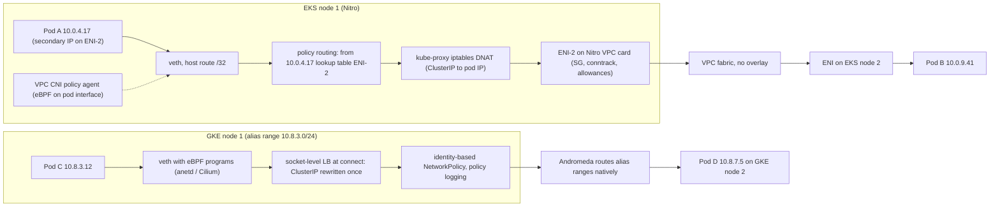
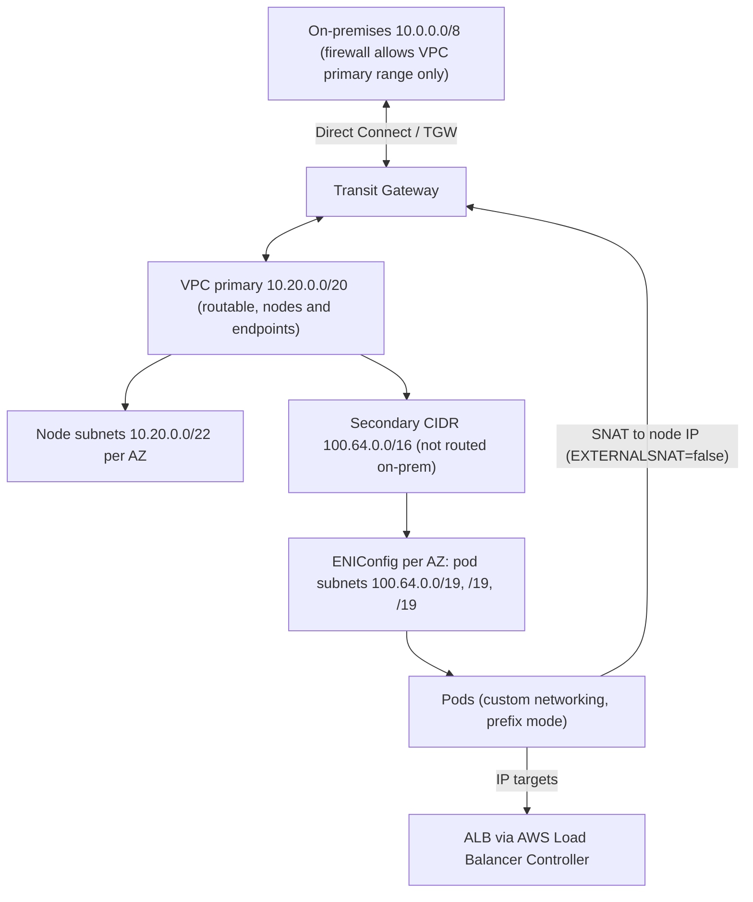
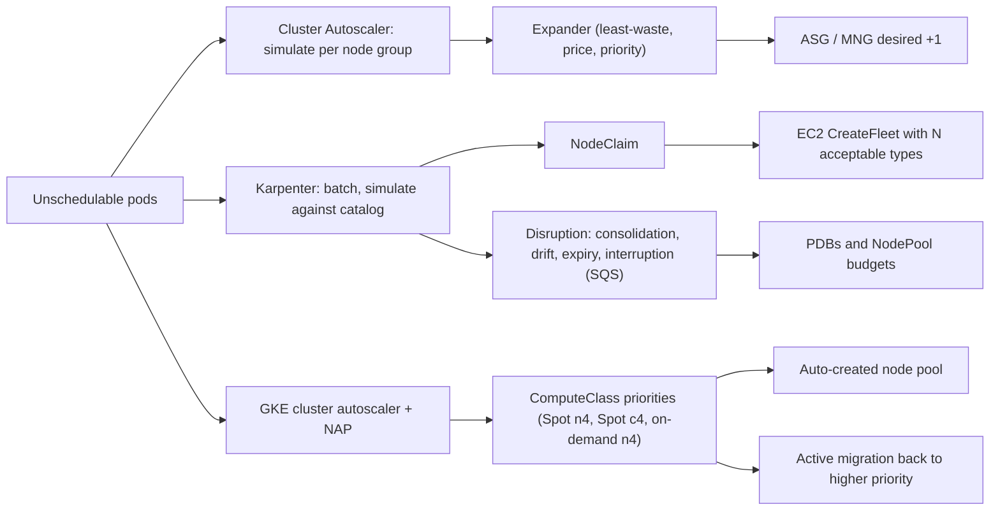

# 01.2 · EKS vs GKE: Datapath V2, eBPF/Cilium, Pod-IP CNI and Karpenter Autoscaling

> **Folder 01 · File 2 of 3.** Kubernetes looks the same on both clouds until a packet leaves a pod, an IP address runs out, or a node has to appear in 40 seconds. This file goes below the Kubernetes API:
> - how each cloud gives pods VPC-routable IPs (Amazon VPC CNI's ENI slots and /28 prefixes vs GKE's alias-IP ranges);
> - how Services and NetworkPolicy are enforced (kube-proxy and the VPC CNI's eBPF policy agent vs GKE Dataplane V2, which is Cilium);
> - how nodes are created and removed (Cluster Autoscaler node groups vs Karpenter and EKS Auto Mode vs GKE's autoscaler, node auto-provisioning and ComputeClasses).

| Listing | What it shows | Language |
|---|---|---|
| `pod_ip_planner.py` | Reproduces the published EKS max-pods values, computes prefix-mode caps, and shows the subnet addresses each warm-pool mode holds. Shows /28 prefix exhaustion on a fragmented subnet, reproduces GKE's per-node CIDR table and documented examples, and sizes one 2,000-node fleet both ways | Python 3 (stdlib) |
| `consolidation_sim.py` | Compares node-group autoscaling (Cluster Autoscaler style) with group-less provisioning plus consolidation (Karpenter style) on one mixed workload: cost, utilization and pods moved, at scale-up and after a traffic drop | Python 3 (stdlib) |

**Verification.** Both listings are embedded byte-identical to their sources. The gate reruns each one on this final file, compares the output and requires `verdict: OK`.
- `pod_ip_planner.py` asserts that it reproduces all seven published `eni-max-pods` values and all four GKE documentation examples.
- Every YAML manifest in this file parses (PyYAML `safe_load_all`).
- Facts are pinned to public docs as of **2026-10-31** (Karpenter 1.15.1, released 2026-10-23).

**Labels.** **[D]** documented · **[E]** estimate/model · ⚠ inferred or not publicly documented.

---

## 0. Orientation

**The questions this file answers.**

1. Where does a pod's IP address come from on EKS and on GKE? What does each design cost in VPC address space, API calls and pod-startup latency?
2. How does a packet get from a pod to a Service backend? What changes when kube-proxy's iptables rules are replaced by eBPF programs and maps?
3. How is NetworkPolicy enforced on each cloud, and where does it stop (security groups for pods, VPC firewall rules)?
4. How do Cluster Autoscaler, Karpenter, EKS Auto Mode, GKE's cluster autoscaler with node auto-provisioning, and ComputeClasses decide which node to create and which node to delete?
5. Which limits and quotas break large clusters first: IP exhaustion, prefix fragmentation, ENI API throttling, the conntrack table, DNS, control-plane request seats, Service map size?

**Reading paths.**

| Goal | Read |
|---|---|
| L7 interview | §1, §2, §3.3, §4.2, §5.2–5.4, §7, §9 Q-chains |
| SAP-C02 | §2, §3.1–3.4, §5.1, §7, §9 S-scenarios |
| Running a migration | §3–§6 in order, then run both listings with your numbers |

**Prerequisites.** [01.1](01-aws-nitro-hypervisor-ec2-placement-groups-vs-gcp-titanium-compute.md) for the Nitro card allowances (PPS, conntrack, link-local) that apply to every EKS node, and the Titanium/Andromeda background for GKE.

---

## 1. First principles: three problems every Kubernetes data plane must solve

### 1.1 Identity: a routable IP per pod

Kubernetes' network model requires every pod to have its own IP and every pod to reach every other pod without NAT. A cloud can satisfy that in three ways:

| Approach | How | Cost |
|---|---|---|
| **Overlay** (VXLAN/Geneve, e.g. Flannel, Calico IPIP) | Pod IPs are private to the cluster. Node-to-node traffic is encapsulated | Extra encapsulation per packet, MTU loss, and pod IPs invisible to VPC routing, load balancers and firewalls |
| **Native VPC IPs per pod** (Amazon VPC CNI) | Each pod gets a real VPC address attached to a node ENI as a secondary IP or from a /28 prefix | Consumes VPC address space and EC2 API calls. Pods are first-class VPC citizens |
| **Routed per-node ranges** (GKE VPC-native alias IPs) | Each node owns an alias range from a subnet secondary range. Pods get addresses from the node's range | Address space is reserved per node at 2× max-pods. The VPC fabric routes the ranges natively |

Both managed services chose **no overlay**: on both clouds the VPC fabric already encapsulates (Nitro card / Andromeda). A second overlay would pay twice. The price is that **pod IPs become a VPC-planning problem**, which is why IP planning dominates EKS and GKE design reviews.

### 1.2 Service: a stable virtual IP over moving endpoints

A ClusterIP is a virtual address with no interface behind it. Something on every node must translate `ClusterIP:port` into one healthy `podIP:port`. There are three generations:
1. **iptables** (kube-proxy default): NAT rules, chosen probabilistically, with connection tracking.
2. **IPVS / nftables**: hash-table lookups instead of linear rule chains.
3. **eBPF** (Cilium; GKE Dataplane V2): BPF maps keyed by service. Translation happens at **socket `connect()` time** for in-cluster clients, so there's no per-packet NAT. Per-packet programs on the tc hook handle external traffic.

### 1.3 Capacity: a node that appears before the pod times out

A pending pod triggers a decision: which instance type, in which zone, at what price, with which IP capacity? There are two control-loop families:
- **Node-group based** (Cluster Autoscaler, GKE's cluster autoscaler on node pools). The question is *which existing group to grow*. Groups are homogeneous, so the autoscaler simulates "one more node of this template".
- **Group-less** (Karpenter, GKE node auto-provisioning / ComputeClasses). The question is *what node to create for these pods*, chosen from a broad instance catalog. **Consolidation** then continuously asks whether the same pods could run cheaper.

The listing in §5.4 shows the trade. Group-less provisioning packs better and reacts to price. Consolidation saves money by **moving pods**, and every move is an eviction you must budget.

---

## 2. Side-by-side architectural Rosetta matrix

| Concern | AWS (EKS) | GCP (GKE) | What actually differs |
|---|---|---|---|
| Pod IP source | Amazon VPC CNI: ENI secondary IPs or /28 prefixes from the **node's subnet** (or ENIConfig subnets with custom networking) | Alias IP range per node from the subnet's **Pod secondary range** | EKS consumes addresses per pod plus warm pool. GKE reserves a power-of-two block per node |
| Max pods per node | `ENIs × (IPs/ENI − 1) + 2` (secondary IPs). Prefix mode: ×16, capped at 110 or 250 | Set per cluster or node pool (default 110 → /24). Autopilot picks 8–256 dynamically | EKS's cap comes from instance hardware. GKE's is a chosen parameter and fixed per node pool |
| Address efficiency | ~1 address per pod plus warm pool (§5.1) | 2× max-pods per node, rounded to a power of two | GKE spends more address space but needs no per-pod API calls |
| Pod startup IP latency | From the warm pool (fast). Pool refill calls EC2 (`AssignPrivateIpAddresses`, attach ENI ~seconds) | Local allocation from the node's range (no cloud API per pod) | EKS scaling bursts can hit EC2 API throttling. GKE can't |
| Service implementation | kube-proxy (iptables default, IPVS or nftables optional). Cilium is BYO CNI | **Dataplane V2** (anetd, Cilium, eBPF) replaces kube-proxy. Legacy dataplane uses kube-proxy + Calico for policy | GKE ships eBPF service LB as the managed default (always on in Autopilot) |
| NetworkPolicy | VPC CNI network policy agent (eBPF on pod interfaces). EKS Auto Mode has it built in | Always on with Dataplane V2. Policy logging built in | Both are eBPF in 2026. GKE also offers FQDN policies and Cilium-style features depending on version |
| L3/L4 firewall at the pod | **Security groups for pods** (branch ENIs via a trunk ENI). Otherwise pods inherit the node's SGs | VPC firewall rules target nodes (tags or service accounts), not pods | Only AWS can apply a cloud-native SG to an individual pod |
| Load balancer to pods | AWS Load Balancer Controller: ALB/NLB **IP targets** (pod IPs) or instance targets | Container-native LB with **NEGs** (pod IPs). Gateway API controller | Both skip NodePort hops because pod IPs are VPC-routable |
| Egress SNAT | Pod → outside the VPC CIDRs is SNATed to the node's primary IP unless `AWS_VPC_K8S_CNI_EXTERNALSNAT=true` or excluded CIDRs | IP masquerade rules (ip-masq-agent / egress NAT policy) decide which destinations see node IPs | On-prem firewalls see node IPs by default on EKS. Plan this before connecting to on-prem |
| IPv6 | IPv6 clusters (prefix mode only, /80 per slot). IPv4 egress via host SNAT | Dual-stack clusters and subnets | Both remove pod-IP exhaustion. On-prem IPv4 dependencies remain |
| Address exhaustion relief | Secondary VPC CIDRs (e.g. 100.64.0.0/10) with **custom networking**, prefix mode, IPv6 | Discontiguous multi-Pod CIDR (add ranges), smaller max-pods for new pools, non-RFC 1918 ranges | GKE can't change max-pods on an existing pool. EKS can't easily convert a fragmented subnet |
| Node autoscaling | Cluster Autoscaler on managed node groups/ASGs, **Karpenter** (group-less), **EKS Auto Mode** (managed Karpenter) | Cluster autoscaler on node pools, **node auto-provisioning**, **ComputeClasses** with fallback priorities and active migration, Autopilot | Karpenter and ComputeClasses converge on "describe constraints, let the system choose the node" |
| Bin-packing and consolidation | Karpenter: `WhenEmpty`, `Balanced`, `WhenEmptyOrUnderutilized` (default), deletion and replacement | Autoscaler profiles (`balanced`, `optimize-utilization`). ComputeClass active migration toward higher priorities | Karpenter replaces nodes with cheaper ones. GKE migrates toward preferred rules |
| Node lifecycle | Karpenter `expireAfter` (default 720 h). Auto Mode max 21 days. Drift on AMI/subnet/SG changes | GKE auto-upgrades with surge or blue-green node pool upgrades. Autopilot manages nodes | Both force node rotation. Set PDBs so it never stalls |
| Spot handling | Interruption queue (SQS ← EventBridge) for the 2-minute notice. Spot-to-spot consolidation needs ≥ 15 types | Spot VMs with 30 s notice. ComputeClass priorities fall back from Spot to on-demand | The checkpoint and drain budget differs by 4× |
| Control-plane scale | Standard (auto) plus **Provisioned Control Plane** tiers (XL…8XL: API request seats, pod scheduling rate). Up to 100,000 nodes | Managed control plane. 15,000 nodes standard. 65,000 in scale-optimized mode (disables network policy enforcement) | EKS sells control-plane capacity tiers. GKE trades features for scale |
| Managed "no nodes" mode | EKS Auto Mode (nodes still in your account, AWS-operated). Fargate (per-pod microVM) | Autopilot (pod-based billing, container-optimized compute platform). Autopilot features in Standard via ComputeClass | Auto Mode bills EC2 plus a management fee. Autopilot bills per pod resource requests |

---

## 3. Internal mechanics: the Amazon VPC CNI

### 3.1 The two daemons and the warm pool

The VPC CNI runs as the `aws-node` DaemonSet. It has two parts:
1. **The CNI binary.** The kubelet invokes it per pod sandbox. It creates the veth pair, assigns an IP from the local pool, and programs routes and policy-routing rules.
2. **ipamd** (L-IPAM daemon). It keeps a **warm pool** of addresses attached to the node's ENIs, so pod creation rarely waits for an EC2 API call.

Warm-pool modes [D]:

| Setting | Behavior | When to use |
|---|---|---|
| `WARM_ENI_TARGET=1` (default) | Keep one whole spare ENI's worth of secondary IPs attached | Small clusters, fast pod churn, abundant addresses |
| `WARM_IP_TARGET` / `MINIMUM_IP_TARGET` | Keep exactly N spare IPs, with a floor of M | Address-constrained subnets. Costs more EC2 API calls |
| `ENABLE_PREFIX_DELEGATION=true` + `WARM_PREFIX_TARGET=1` (default 1) | Allocate /28 prefixes (16 addresses) per ENI slot. Keep one spare prefix | High pod density, fewer API calls, Nitro instances |

**The data path for one pod.**
1. The pod's `eth0` is one end of a veth pair. The host end has no IP, and the host routes the pod's /32 to that veth.
2. If the pod's address belongs to a *secondary* ENI, a policy-routing rule (`ip rule from <podIP> lookup <table-for-ENI-n>`) makes its egress leave through that ENI. This matters because the Nitro card only accepts source addresses attached to the ENI.
3. Pod-to-pod traffic across nodes is plain VPC routing. The Nitro card handles encapsulation (01.1 §3.5), so there's **no overlay**.

### 3.2 The arithmetic: max pods, prefixes, warm pools

Secondary-IP mode: **`max_pods = ENIs × (IPv4 per ENI − 1) + 2`** [D]. The −1 is each ENI's primary address. The +2 accounts for host-network pods (`aws-node`, `kube-proxy`) that don't need pod IPs.

Prefix mode: each ENI slot holds a /28. The raw formula multiplies the slots by 16, but the recommended kubelet `max-pods` is **110 below 30 vCPUs and 250 at 30 or more** [D]. Kubelet, memory and CPU overhead, not IPs, become the binding limit.

Custom networking: the primary ENI isn't used for pods, so **`(ENIs − 1) × (IPv4 per ENI − 1) + 2`**.

**Mixed instance types in a managed node group:** the *lowest* max-pods value of any type applies to all nodes in the group [D]. Karpenter computes max-pods per node instead.

### 3.3 Prefix delegation and fragmentation

A /28 prefix must be a **free, aligned block of 16 addresses** in the subnet. A subnet that has been used in secondary-IP mode for months has single addresses scattered everywhere. It can show thousands of free IPs and still have almost no free aligned /28s. The CNI log then shows **`InsufficientCidrBlocks`** [D].

The listing (§5.1, section 3) quantifies it on a /20. With 20% of addresses randomly used, only 7 of 256 aligned blocks remain free. At 30%, none do. The free fraction of aligned blocks is about `(1 − occupancy)^16`.

The fixes [D]:
1. A **subnet CIDR reservation** of type `prefix`, which carves space only prefixes can use.
2. A **fresh subnet** dedicated to prefix-mode nodes.

Converting existing nodes in place is discouraged. Mixed secondary-IP and prefix nodes advertise inconsistent capacity, so create new node groups and drain the old ones.

### 3.4 Custom networking, IPv6 and SNAT

- **Custom networking.** Set `AWS_VPC_K8S_CNI_CUSTOM_NETWORK_CFG=true`, and create one `ENIConfig` per AZ that names a subnet (typically from a secondary VPC CIDR such as `100.64.0.0/16`) and its security groups. Pods get addresses from that CIDR, while nodes keep their routable primary addresses.
- **SNAT** (the part teams miss). With the default `AWS_VPC_K8S_CNI_EXTERNALSNAT=false`, pod traffic to destinations **outside the VPC CIDRs** is SNATed to the node's primary IP. That includes on-premises networks reached through a TGW or Direct Connect. On-prem firewalls see node IPs, which is often desirable with 100.64/10 pods.
  - If on-prem must see pod IPs, set `EXTERNALSNAT=true` (and provide NAT elsewhere for internet egress), or list on-prem ranges in `AWS_VPC_K8S_CNI_EXCLUDE_SNAT_CIDRS`.
  - Either way, the pod CIDR must then be routable from on-prem.
- **IPv6 clusters.** Prefix mode is the only mode, with a /80 per slot. Pods get IPv6, and IPv4 egress is SNATed through the host. This removes pod-IP exhaustion but not the need for IPv4 at the edges.

### 3.5 Security groups for pods

With `ENABLE_POD_ENI=true`, the CNI attaches a **trunk ENI** to supported Nitro instances. Pods whose `SecurityGroupPolicy` matches get a **branch ENI** (VLAN-tagged through the trunk) with their own security groups [D]. The main use is referencing a pod's SG from an RDS or ElastiCache SG rule. Costs:
- branch ENIs per instance are limited by instance type;
- pod start is slower (the branch ENI is created on demand);
- with `POD_SECURITY_GROUP_ENFORCING_MODE=standard` and `EXTERNALSNAT=false`, traffic leaving the VPC uses the *node's* SGs. `strict` applies the pod's SGs [D].

### 3.6 NetworkPolicy on EKS

Since VPC CNI 1.14 the CNI can enforce Kubernetes NetworkPolicy natively:
- A controller resolves policies into `PolicyEndpoint` objects; on EKS it runs on the managed control plane.
- A **network policy agent** in `aws-node` attaches **eBPF programs to each pod's interface** that allow or deny by IP and port.

EKS Auto Mode includes this as a managed component [D]. Alternatives: Cilium or Calico as a BYO CNI, or chained with the VPC CNI for policy only.

---

## 4. Internal mechanics: GKE VPC-native networking and Dataplane V2

### 4.1 Alias IPs: routing a range, not a pod

A VPC-native GKE cluster uses three ranges:
1. the subnet's primary range for **nodes**;
2. a **secondary range for Pods**;
3. a range for **Services** (Google-managed, or a secondary range).

Each node receives an **alias IP range** from the Pod range. Its size is set by max-pods per node: **at least twice as many addresses as pods** [D].

| Max pods per node | Per-node range | Addresses |
|---|---|---|
| 8 | /28 | 16 |
| 9–16 | /27 | 32 |
| 17–32 | /26 | 64 |
| 33–64 | /25 | 128 |
| 65–128 | /24 | 256 |
| 129–256 | /23 | 512 |
| 257–512 | /22 | 1,024 |

**Why 2×?** Pod churn: a terminating pod's address mustn't be reused immediately while a replacement starts. Kubernetes needs headroom so it doesn't reuse an IP that's still referenced. ⚠ The documented rule is the 2× sizing; the reuse rationale is the usual explanation.

Andromeda routes alias ranges natively, so pod-to-pod traffic needs **no routes, no overlay and no per-pod cloud API calls**. Pod creation never waits for the cloud. That's the structural advantage over the VPC CNI's warm pool.

**Capacity formulas** [D], verified by the listing:
- **Node range size:** `M = 31 − ⌈log₂ Q⌉` for Q max pods per node.
- **Node count:** `nodes = 2^(M − DS)` for a /DS Pod range.
- **Node subnet:** `node IPs = 2^(32 − S) − 4` for the /S primary subnet.

Examples: a /16 Pod range at 110 pods gives 256 nodes, and a /17 at 32 pods gives 512 nodes and 16,384 pods.

**Hard rules** [D]:
- Only VPC-native clusters can configure max pods.
- Max pods **can't be changed on an existing node pool** (create a new one).
- A node pool's Pod range must be at least /24.
- The cluster's default Pod range size is fixed at creation.
- Exhaustion is relieved with **discontiguous multi-Pod CIDR** (additional Pod ranges for new node pools).
- Autopilot chooses max pods between 8 and 256 itself.

### 4.2 Dataplane V2: what anetd actually does

GKE Dataplane V2 is implemented with **Cilium**. Its agent runs as the `anetd` DaemonSet in `kube-system`, interprets Kubernetes objects and programs eBPF [D]. Key properties:

- **Services without kube-proxy.** "GKE Dataplane V2 uses cilium instead of kube-proxy to implement Kubernetes Services" [D].
  - ClusterIP translation happens in BPF, at socket connect for local clients and per packet at tc for others. Backends live in BPF maps, so updating a Service touches map entries, not a rule table.
  - **Maglev consistent hashing** can be enabled per Service from 1.36.0-gke.2882000 with the annotation `gke.networking.io/lb-algorithm: "maglev"`, set at creation. It costs about **65.5 KB of node memory per Service** [D].
- **NetworkPolicy is always on**, and **policy logging is built in** (a logging CRD records allowed and denied connections) [D].
- **Defaults and constraints** [D]:
  - Default for all new Autopilot clusters.
  - Can only be chosen **at cluster creation**.
  - Fragmented ICMP is dropped.
  - Manually created internal passthrough NLBs on NodePort Services aren't supported.
  - `anetd` can use **2–3 vCPUs** under heavy connection churn.
  - Third-party eBPF tools can interfere.
- **Scale limits on the Dataplane V2 page** [D]:
  - 15,000 nodes standard (65,000 needs scale-optimized mode, which **disables network policy enforcement**);
  - 400,000 pods per cluster;
  - 10,000 pods behind one Service;
  - 10,000 ClusterIP Services;
  - 750 LoadBalancer Services;
  - a **260,000-entry Service map**. Past it, "your cluster may not work as intended".

### 4.3 eBPF vs iptables, mechanically

| Step | kube-proxy iptables | Cilium / Dataplane V2 eBPF |
|---|---|---|
| Lookup structure | Chains per Service (`KUBE-SVC-*`) with one rule per endpoint, chosen probabilistically | Hash maps: service → backend slots (optionally Maglev) |
| Where translation happens | Per packet in netfilter `PREROUTING`/`OUTPUT`, with conntrack entries | At `connect()` for pod clients (socket-level LB), so later packets aren't NATed. tc hooks for external and NodePort traffic |
| Update cost | Rewrites rule tables. Slow with tens of thousands of Services/endpoints | Map updates are O(1) per entry |
| Policy enforcement | Separate (Calico iptables, or the VPC CNI eBPF agent) | Identity-based: labels map to numeric security identities, checked in BPF |
| Observability | Counters per rule | Flow logs and policy verdict logs from the datapath |
| Failure signature | Rule-sync latency, conntrack exhaustion, DNS UDP races | Agent CPU under churn, map-size limits, interference from other BPF programs |

### 4.4 GKE egress, firewalls and load balancing

- **Firewalls.** VPC firewall rules target *nodes* (network tags or service accounts), not pods. Pod-level enforcement is NetworkPolicy. There's no GKE equivalent of "security group per pod", so an AWS design that references pod SGs from database SGs becomes, on GCP:
  1. NetworkPolicy for east-west traffic;
  2. firewall rules on node service accounts;
  3. for managed databases, authorized networks or Private Service Connect plus IAM database authentication (Folder 02/05).
- **Masquerade.** ip-masq-agent or the egress NAT policy controls which destinations see node IPs. Public egress uses Cloud NAT.
- **Load balancing.** Container-native load balancing registers **pod IPs as NEG endpoints**, removing the NodePort hop and the double load balancing. This mirrors the AWS Load Balancer Controller's IP target mode.

---

## 5. Internal mechanics: node autoscaling on both clouds

### 5.1 Listing: pod-IP planning for both clouds

<!-- listing:pod_ip_planner.py -->
```python
"""pod_ip_planner.py - pod IP math for EKS (Amazon VPC CNI) and GKE (VPC-native alias IPs).

EKS, secondary-IP mode:  max_pods = ENIs * (IPv4 per ENI - 1) + 2          (eni-max-pods.txt)
EKS, prefix mode:        ENIs * (IPv4 per ENI - 1) * 16 + 2, capped at 110 below 30 vCPUs, else 250
                         (max-pods-calculator.sh); each slot holds a /28 that must be a free,
                         aligned block of the subnet
EKS warm pools:          WARM_ENI_TARGET=1 (default) keeps one whole spare ENI of IPs attached;
                         WARM_IP_TARGET / MINIMUM_IP_TARGET override it; WARM_PREFIX_TARGET=1 keeps a spare /28
GKE:                     per-node Pod CIDR netmask M = 31 - ceil(log2(maxPods)); max nodes = 2^(M - DS)
                         for a /DS Pod range; usable node IPs = 2^(32 - S) - 4 for a /S primary subnet
AWS subnets reserve 5 addresses (first 4 and the last one).

Usage: python -I pod_ip_planner.py <any path>
"""
import math
import random
import sys

# instance: (max ENIs, IPv4 addresses per ENI, vCPUs) - EC2 published values
EC2 = {
    "t3.medium": (3, 6, 2),
    "m5.large": (3, 10, 2),
    "m5.xlarge": (4, 15, 4),
    "m5.2xlarge": (4, 15, 8),
    "m5.4xlarge": (8, 30, 16),
    "m5.12xlarge": (8, 30, 48),
    "m5.24xlarge": (15, 50, 96),
}
# published eni-max-pods.txt values for secondary-IP mode, used as a cross-check
PUBLISHED = {"t3.medium": 17, "m5.large": 29, "m5.xlarge": 58, "m5.2xlarge": 58,
             "m5.4xlarge": 234, "m5.12xlarge": 234, "m5.24xlarge": 737}


def max_pods_secondary(enis, ips):
    return enis * (ips - 1) + 2


def max_pods_prefix(enis, ips, vcpu):
    return min(enis * (ips - 1) * 16 + 2, 110 if vcpu < 30 else 250)


def ips_consumed(itype, pods, mode, warm_ip=None, min_ip=None):
    """Subnet addresses a node holds for `pods` pod IPs under a VPC CNI warm-pool mode."""
    enis, ips, _ = EC2[itype]
    if mode == "warm-eni":  # default: every attached ENI is filled with secondaries, plus one spare ENI
        need = math.ceil(pods / (ips - 1)) if pods else 1
        return min(enis, need + 1) * ips
    if mode == "warm-ip":
        alloc = min(max(min_ip or 0, pods + warm_ip), enis * (ips - 1))
        return alloc + math.ceil(alloc / (ips - 1))  # secondaries + one primary per ENI
    if mode == "prefix":  # WARM_PREFIX_TARGET=1
        prefixes = math.ceil(pods / 16) + 1
        return prefixes * 16 + math.ceil(prefixes / (ips - 1))
    raise ValueError(mode)


def free_aligned_28s(prefix_len, occupancy, rng):
    """Free, aligned /28 blocks left in a subnet after random single-IP allocations."""
    size = 2 ** (32 - prefix_len)
    used = [False] * size
    for i in (0, 1, 2, 3, size - 1):  # AWS reserved addresses
        used[i] = True
    free_idx = [i for i in range(size) if not used[i]]
    for i in rng.sample(free_idx, int(occupancy * len(free_idx))):
        used[i] = True
    return sum(1 for b in range(0, size, 16) if not any(used[b:b + 16])), size // 16


def gke_node_mask(max_pods):
    return 31 - math.ceil(math.log2(max_pods))


def gke_max_nodes(max_pods, pod_range, node_subnet):
    return min(2 ** (gke_node_mask(max_pods) - pod_range), 2 ** (32 - node_subnet) - 4)


def main():
    ok = True
    rng = random.Random(7)
    print("== 1. EKS max pods per node ==")
    print(f"{'instance':<12} {'ENIs':>4} {'IP/ENI':>6} {'secondary':>9} {'published':>9} {'prefix':>6}")
    for it, (enis, ips, vcpu) in EC2.items():
        sec, pre = max_pods_secondary(enis, ips), max_pods_prefix(enis, ips, vcpu)
        ok &= sec == PUBLISHED[it]
        print(f"{it:<12} {enis:>4} {ips:>6} {sec:>9} {PUBLISHED[it]:>9} {pre:>6}")

    print()
    print("== 2. Subnet addresses held per node (m5.xlarge, 4 ENIs x 15 IPs) ==")
    print(f"{'pods':>4} {'WARM_ENI=1':>10} {'WARM_IP=5':>9} {'PREFIX=1':>8}")
    for pods in (5, 20, 40, 56):
        row = (ips_consumed("m5.xlarge", pods, "warm-eni"), ips_consumed("m5.xlarge", pods, "warm-ip", warm_ip=5),
               ips_consumed("m5.xlarge", pods, "prefix"))
        print(f"{pods:>4} {row[0]:>10} {row[1]:>9} {row[2]:>8}")

    print()
    print("== 3. Prefix mode on a fragmented /20 (random single-IP use from secondary mode) ==")
    for occ in (0.0, 0.05, 0.10, 0.20, 0.30):
        free, total = free_aligned_28s(20, occ, rng)
        print(f"{occ:>4.0%} of addresses used -> {free:>3} of {total} aligned /28 blocks free "
              f"(expected ~{(total - 2) * (1 - occ) ** 16:.1f})")
        if occ >= 0.30:
            ok &= free <= 3  # effectively InsufficientCidrBlocks
    print("   -> reserve prefix space with a subnet CIDR reservation, or give Pods a fresh subnet")

    print()
    print("== 4. GKE per-node Pod CIDR and documented examples ==")
    for q in (8, 16, 32, 64, 110, 128, 256, 512):
        m = gke_node_mask(q)
        print(f"maxPods {q:>3} -> /{m} ({2 ** (32 - m)} addresses)")
    for q, ds, want_nodes in ((110, 16, 256), (110, 21, 8), (8, 21, 128), (32, 17, 512)):
        nodes = 2 ** (gke_node_mask(q) - ds)
        ok &= nodes == want_nodes
        print(f"Pod range /{ds}, maxPods {q:>3}: {nodes} nodes, {nodes * q} pods (doc: {want_nodes} nodes)")

    print()
    print("== 5. Same fleet both ways: 2,000 nodes x 110 pods ==")
    pod_range = next(ds for ds in range(24, 7, -1) if 2 ** (gke_node_mask(110) - ds) >= 2000)
    node_subnet = next(s for s in range(28, 15, -1) if 2 ** (32 - s) - 4 >= 2000)
    gke_addrs = 2 ** (32 - pod_range) + 2 ** (32 - node_subnet)
    print(f"GKE: Pod secondary range /{pod_range} + node subnet /{node_subnet} = {gke_addrs:,} addresses reserved")
    for mode, kw in (("warm-eni", {}), ("warm-ip", {"warm_ip": 10}), ("prefix", {})):
        per = ips_consumed("m5.4xlarge", 110, mode, **kw)
        total = per * 2000
        blocks = math.ceil(total / (2 ** 16 - 8 * 5))  # each /16 carved into eight /19 subnets, 5 reserved each
        print(f"EKS m5.4xlarge {mode:<8}: {per:>3} IPs/node -> {total:,} VPC addresses (>= {blocks} x /16 VPC CIDR blocks)")
    print("   VPC CIDR blocks are /16../28 and a VPC starts with a quota of 5 blocks: plan secondary CIDRs,")
    print("   100.64.0.0/10 custom networking, or IPv6 before the fleet grows")
    print()
    print("verdict: OK" if ok else "verdict: FAIL")


if __name__ == "__main__":
    main()
```

<!-- output:pod_ip_planner.py -->
```text
== 1. EKS max pods per node ==
instance     ENIs IP/ENI secondary published prefix
t3.medium       3      6        17        17    110
m5.large        3     10        29        29    110
m5.xlarge       4     15        58        58    110
m5.2xlarge      4     15        58        58    110
m5.4xlarge      8     30       234       234    110
m5.12xlarge     8     30       234       234    250
m5.24xlarge    15     50       737       737    250

== 2. Subnet addresses held per node (m5.xlarge, 4 ENIs x 15 IPs) ==
pods WARM_ENI=1 WARM_IP=5 PREFIX=1
   5         30        11       33
  20         45        27       49
  40         60        49       65
  56         60        60       81

== 3. Prefix mode on a fragmented /20 (random single-IP use from secondary mode) ==
  0% of addresses used -> 254 of 256 aligned /28 blocks free (expected ~254.0)
  5% of addresses used -> 110 of 256 aligned /28 blocks free (expected ~111.8)
 10% of addresses used ->  51 of 256 aligned /28 blocks free (expected ~47.1)
 20% of addresses used ->   7 of 256 aligned /28 blocks free (expected ~7.1)
 30% of addresses used ->   0 of 256 aligned /28 blocks free (expected ~0.8)
   -> reserve prefix space with a subnet CIDR reservation, or give Pods a fresh subnet

== 4. GKE per-node Pod CIDR and documented examples ==
maxPods   8 -> /28 (16 addresses)
maxPods  16 -> /27 (32 addresses)
maxPods  32 -> /26 (64 addresses)
maxPods  64 -> /25 (128 addresses)
maxPods 110 -> /24 (256 addresses)
maxPods 128 -> /24 (256 addresses)
maxPods 256 -> /23 (512 addresses)
maxPods 512 -> /22 (1024 addresses)
Pod range /16, maxPods 110: 256 nodes, 28160 pods (doc: 256 nodes)
Pod range /21, maxPods 110: 8 nodes, 880 pods (doc: 8 nodes)
Pod range /21, maxPods   8: 128 nodes, 1024 pods (doc: 128 nodes)
Pod range /17, maxPods  32: 512 nodes, 16384 pods (doc: 512 nodes)

== 5. Same fleet both ways: 2,000 nodes x 110 pods ==
GKE: Pod secondary range /13 + node subnet /21 = 526,336 addresses reserved
EKS m5.4xlarge warm-eni: 150 IPs/node -> 300,000 VPC addresses (>= 5 x /16 VPC CIDR blocks)
EKS m5.4xlarge warm-ip : 125 IPs/node -> 250,000 VPC addresses (>= 4 x /16 VPC CIDR blocks)
EKS m5.4xlarge prefix  : 129 IPs/node -> 258,000 VPC addresses (>= 4 x /16 VPC CIDR blocks)
   VPC CIDR blocks are /16../28 and a VPC starts with a quota of 5 blocks: plan secondary CIDRs,
   100.64.0.0/10 custom networking, or IPv6 before the fleet grows

verdict: OK
```

**Reading the output.**

- **Section 1** reproduces the published `eni-max-pods` values: `m5.large` 29, `m5.4xlarge` 234, `m5.24xlarge` 737. It also shows that in prefix mode the *recommended cap*, not IP capacity, binds: 110 below 30 vCPUs.
- **Section 2** is the number to bring to an address-planning meeting.
  - An `m5.xlarge` running 5 pods holds **30** subnet addresses under the default `WARM_ENI_TARGET=1`, **11** under `WARM_IP_TARGET=5`, and **33** in prefix mode.
  - Prefix mode isn't automatically address-efficient. It's **API-efficient** and **density-efficient**: one /28 attach replaces 16 `AssignPrivateIpAddresses` calls, and attaching a prefix typically completes in under a second where a new ENI can take up to 10 seconds [D].
- **Section 3** is why a subnet with thousands of free addresses returns `InsufficientCidrBlocks`. Reserve prefix space up front.
- **Section 4** reproduces GKE's table and all four documented examples.
- **Section 5** sizes one fleet both ways: 2,000 nodes × 110 pods.
  - **GKE** reserves a /13 Pod range plus a /21 node subnet (526,336 addresses).
  - **EKS** consumes 250,000–300,000 VPC addresses depending on the warm-pool mode, which is at least 4–5 /16 VPC CIDR blocks.

  A VPC starts with a quota of 5 CIDR blocks, so this fleet on EKS needs secondary CIDRs, custom networking on 100.64.0.0/10, or IPv6 **before** it grows. On GKE it needs a /13 that doesn't overlap any peered or on-prem range.

### 5.2 Cluster Autoscaler (node-group based)

The loop:
1. Pods are **unschedulable**.
2. For each node group, the autoscaler simulates adding a node from the group's template and checks which pending pods would fit.
3. An **expander** picks the group: `random`, `most-pods`, `least-waste`, `price` or `priority`.
4. It raises the ASG's desired capacity.

Scale-down: a node is a candidate when its requested CPU and memory are below **`scale-down-utilization-threshold` (default 0.5)** and its pods can move elsewhere. It's removed after **`scale-down-unneeded-time` (default 10 min)**.

Scale-down is blocked by:
- pods that have local storage;
- pods not backed by a controller;
- `cluster-autoscaler.kubernetes.io/safe-to-evict: "false"`;
- PDBs with no room;
- kube-system pods without PDBs.

**Structural limits.**
- Groups must be homogeneous enough for the simulation to be true. In a managed node group, the lowest max-pods applies to all nodes.
- Diversity costs one group per shape. CA never replaces a node with a cheaper type; it only deletes.

### 5.3 Karpenter and EKS Auto Mode (group-less)

**Objects.**
- A `NodePool` sets **constraints**: instance categories, generations, architectures, capacity types, zones, taints, limits and disruption policy.
- An `EC2NodeClass` sets **how to launch**: AMI selector, subnets, security groups, IAM role, kubelet configuration and metadata options.
- Each node Karpenter launches is a `NodeClaim`.

The loop:
1. Karpenter batches pending pods.
2. It simulates scheduling them against the *whole* compatible instance catalog.
3. It launches through EC2 Fleet with a list of acceptable types, so EC2 picks from multiple capacity pools.

**Disruption [D] (Karpenter 1.15 docs).**

| Mechanism | Default and behavior |
|---|---|
| Consolidation policy | `WhenEmptyOrUnderutilized` (default), `Balanced` (scores savings vs disruption, skips marginal moves), `WhenEmpty` |
| `consolidateAfter` | Default `0s`. The timer resets on pod add or remove. `Never` disables consolidation |
| Consolidation methods | Empty-node deletion, then multi-node, then single-node consolidation. Either **deletion** (pods fit elsewhere) or **replacement** with one cheaper node |
| Spot-to-spot | Deletion by default. Replacement behind `SpotToSpotConsolidation`. Single-node spot-to-spot needs **≥ 15 instance types** |
| Budgets | Default `nodes: 10%`. Percentages round up. Can be scheduled and scoped by reason (`Empty`, `Underutilized`, `Drifted`) |
| `expireAfter` | Default `720h`. A maximum lifetime, not a guarantee |
| `terminationGracePeriod` | After draining starts, force-deletes remaining pods. Max lifetime = `expireAfter` + this |
| Drift | Requirements, subnet/SG/AMI selectors changed. Behavioral fields (`weight`, `limits`, `disruption.*`) don't drift |
| Interruption | SQS queue fed by EventBridge: Spot 2-minute warnings, scheduled changes, stopping/terminating, status-check failures. Rebalance recommendations are only logged |
| `karpenter.sh/do-not-disrupt` | Pod annotation (permanent or a duration). Blocks consolidation, and drift without TGP. **Doesn't block** expiration, interruption or node repair |
| Node repair | Feature gate. Replaces nodes after a condition persists (30 min for most, 10 min for accelerator health). Stops if > 20% of a pool is unhealthy |

**EKS Auto Mode [D]** is AWS-operated Karpenter plus managed node software:
- Bottlerocket-based immutable AMIs: SELinux enforcing, read-only root, **no SSH or SSM**.
- A **21-day maximum node lifetime** (reducible).
- Built-in pod networking with network policy, load balancing, local DNS, the EBS CSI driver and GPU plug-ins. No Pod Identity agent to install.
- Integration with ARC zonal shift: it stops provisioning in an impaired AZ.
- Nodes are EC2 managed instances. From 2026-04-22 they're hidden from default EC2 console and list views, but still billable.
- Don't edit the default NodePools or NodeClasses; add custom ones.

### 5.4 Listing: node groups vs consolidation

<!-- listing:consolidation_sim.py -->
```python
"""consolidation_sim.py - node-group autoscaling (Cluster Autoscaler style) vs group-less
provisioning plus consolidation (Karpenter style), on one mixed workload.

This is a model of the two decision procedures, not their code:
  CA  : one node group of a fixed type; scale up = add nodes of that type (first-fit decreasing);
        scale down = remove a node whose max(cpu, mem) request utilization is < 0.5 and whose
        pods fit on the remaining nodes (deletion only, never a cheaper replacement).
  KARP: no node groups; each new node takes the instance type with the best
        (priced value of the pods it packs) / (hourly price); consolidation deletes any node whose
        pods fit elsewhere, then replaces a node with a cheaper single node that fits its pods.
Prices are us-east-1 Linux On-Demand list prices for m5/c5/r5 (verify before reuse). Allocatable
is the instance size minus 0.3 vCPU and 1.0 GiB (kubelet reserve + DaemonSets), an assumption.

Usage: python -I consolidation_sim.py <any path>
"""
import random
import sys

CATALOG = {  # type: (vCPU, GiB, $/h)
    "c5.large": (2, 4, 0.085), "c5.xlarge": (4, 8, 0.17), "c5.2xlarge": (8, 16, 0.34), "c5.4xlarge": (16, 32, 0.68),
    "m5.large": (2, 8, 0.096), "m5.xlarge": (4, 16, 0.192), "m5.2xlarge": (8, 32, 0.384), "m5.4xlarge": (16, 64, 0.768),
    "r5.large": (2, 16, 0.126), "r5.xlarge": (4, 32, 0.252), "r5.2xlarge": (8, 64, 0.504), "r5.4xlarge": (16, 128, 1.008),
}
A_CPU, B_MEM = 0.035667, 0.003417  # $/vCPU-h and $/GiB-h implied by c5.large and r5.large


def alloc(t):
    c, m, _ = CATALOG[t]
    return c - 0.3, m - 1.0


class Node:
    def __init__(self, t):
        self.t, self.pods = t, []

    def used(self):
        return sum(p[1] for p in self.pods), sum(p[2] for p in self.pods)

    def fits(self, pod):
        c, m = self.used()
        ac, am = alloc(self.t)
        return c + pod[1] <= ac + 1e-9 and m + pod[2] <= am + 1e-9

    def util(self):
        c, m = self.used()
        ac, am = alloc(self.t)
        return max(c / ac, m / am)


def workload():
    pods = [("web", 0.5, 1.0)] * 80 + [("batch", 2.0, 2.0)] * 30 + [("cache", 1.0, 8.0)] * 20
    return [(f"{k}-{i}", c, m) for i, (k, c, m) in enumerate(pods)]


def ffd(pods):
    return sorted(pods, key=lambda p: (-(p[1] * A_CPU + p[2] * B_MEM), p[0]))


def ca_scale_up(pods, t):
    nodes = []
    for p in ffd(pods):
        n = next((n for n in nodes if n.fits(p)), None)
        if n is None:
            n = Node(t)
            nodes.append(n)
        n.pods.append(p)
    return nodes


def karp_scale_up(pods):
    nodes, pending = [], ffd(pods)
    while pending:
        best = None
        for t in sorted(CATALOG):
            trial, packed = Node(t), []
            for p in pending:
                if trial.fits(p):
                    trial.pods.append(p)
                    packed.append(p)
            if not packed:
                continue
            value = sum(p[1] * A_CPU + p[2] * B_MEM for p in packed)
            score = value / CATALOG[t][2]
            if best is None or score > best[0] + 1e-12:
                best = (score, trial, packed)
        nodes.append(best[1])
        ids = {p[0] for p in best[2]}
        pending = [p for p in pending if p[0] not in ids]
    return nodes


def place_all(pods, nodes):
    """Try to place pods (FFD) on copies of nodes; return the copies or None."""
    copies = [Node(n.t) for n in nodes]
    for c, n in zip(copies, nodes):
        c.pods = list(n.pods)
    for p in ffd(pods):
        target = next((c for c in copies if c.fits(p)), None)
        if target is None:
            return None
        target.pods.append(p)
    return copies


def ca_scale_down(nodes):
    nodes, moved = [n for n in nodes if n.pods], 0
    changed = True
    while changed:
        changed = False
        for n in sorted(nodes, key=lambda n: (n.util(), n.t)):
            if n.util() >= 0.5:
                continue
            others = [o for o in nodes if o is not n]
            res = place_all(n.pods, others)
            if res is not None:
                moved += len(n.pods)
                nodes, changed = res, True
                break
    return nodes, moved


def karp_consolidate(nodes):
    nodes, moved = [n for n in nodes if n.pods], 0
    changed = True
    while changed:
        changed = False
        for n in sorted(nodes, key=lambda n: (len(n.pods), n.util())):  # deletion first, cheapest disruption
            res = place_all(n.pods, [o for o in nodes if o is not n])
            if res is not None:
                moved += len(n.pods)
                nodes, changed = res, True
                break
        if changed:
            continue
        for n in sorted(nodes, key=lambda n: -CATALOG[n.t][2]):  # then replacement with a cheaper type
            for t in sorted(CATALOG, key=lambda t: CATALOG[t][2]):
                if CATALOG[t][2] >= CATALOG[n.t][2] - 1e-9:
                    break
                repl = place_all(n.pods, [Node(t)])
                if repl is not None:
                    moved += len(n.pods)
                    nodes = [o for o in nodes if o is not n] + repl
                    changed = True
                    break
            if changed:
                break
    return nodes, moved


def summary(nodes):
    cost = sum(CATALOG[n.t][2] for n in nodes)
    mix = {}
    for n in nodes:
        mix[n.t] = mix.get(n.t, 0) + 1
    cpu = sum(n.used()[0] for n in nodes) / sum(alloc(n.t)[0] for n in nodes)
    mem = sum(n.used()[1] for n in nodes) / sum(alloc(n.t)[1] for n in nodes)
    return cost, len(nodes), ", ".join(f"{v}x {k}" for k, v in sorted(mix.items())), cpu, mem


def valid(nodes, pods):
    placed = sorted(p[0] for n in nodes for p in n.pods)
    return placed == sorted(p[0] for p in pods) and all(n.util() <= 1 + 1e-9 for n in nodes)


def main():
    rng = random.Random(11)
    pods = workload()
    ok = True
    print(f"workload: {len(pods)} pods, {sum(p[1] for p in pods):.0f} vCPU, {sum(p[2] for p in pods):.0f} GiB requested")
    print()
    print("== 1. Scale up from zero ==")
    plans = {"CA  m5.2xlarge group": ca_scale_up(pods, "m5.2xlarge"),
             "CA  c5.2xlarge group": ca_scale_up(pods, "c5.2xlarge"),
             "KARP any m5/c5/r5": karp_scale_up(pods)}
    for name, nodes in plans.items():
        ok &= valid(nodes, pods)
        cost, n, mix, cpu, mem = summary(nodes)
        print(f"{name:<22} ${cost:6.3f}/h {n:>3} nodes  cpu {cpu:4.0%} mem {mem:4.0%}  [{mix}]")
    base_ca = summary(plans["CA  m5.2xlarge group"])[0]
    base_k = summary(plans["KARP any m5/c5/r5"])[0]
    ok &= base_k <= base_ca

    print()
    print("== 2. Traffic drops: 60% of web and 50% of batch pods deleted ==")
    gone = set(p[0] for p in rng.sample([p for p in pods if p[0].startswith("web")], 48))
    gone |= set(p[0] for p in rng.sample([p for p in pods if p[0].startswith("batch")], 15))
    left = [p for p in pods if p[0] not in gone]
    for name, scale_down in (("CA  m5.2xlarge group", ca_scale_down), ("KARP any m5/c5/r5", karp_consolidate)):
        nodes = [Node(n.t) for n in plans[name]]
        for nn, old in zip(nodes, plans[name]):
            nn.pods = [p for p in old.pods if p[0] not in gone]
        before = summary([n for n in nodes if n.pods] or nodes)[0]
        after_nodes, moved = scale_down(nodes)
        ok &= valid(after_nodes, left)
        cost, n, mix, cpu, mem = summary(after_nodes)
        print(f"{name:<22} ${before:6.3f}/h -> ${cost:6.3f}/h {n:>3} nodes  cpu {cpu:4.0%} mem {mem:4.0%}  "
              f"pods moved {moved:>3}  [{mix}]")
        if name.startswith("KARP"):
            k_after, k_moved = cost, moved
        else:
            ca_after, ca_moved = cost, moved
    ok &= k_after <= ca_after
    print()
    print(f"finding: after the drop KARP runs ${k_after:.3f}/h vs CA ${ca_after:.3f}/h "
          f"({(ca_after - k_after) / ca_after:.0%} less); pods moved: KARP {k_moved}, CA {ca_moved}")
    print("         every move is an eviction: budget it with PDBs, NodePool budgets and consolidateAfter")
    print("verdict: OK" if ok else "verdict: FAIL")


if __name__ == "__main__":
    main()
```

<!-- output:consolidation_sim.py -->
```text
workload: 130 pods, 120 vCPU, 300 GiB requested

== 1. Scale up from zero ==
CA  m5.2xlarge group   $ 6.528/h  17 nodes  cpu  92% mem  57%  [17x m5.2xlarge]
CA  c5.2xlarge group   $ 6.800/h  20 nodes  cpu  78% mem 100%  [20x c5.2xlarge]
KARP any m5/c5/r5      $ 5.692/h  15 nodes  cpu  97% mem  93%  [8x c5.2xlarge, 2x c5.4xlarge, 2x c5.large, 1x c5.xlarge, 1x m5.4xlarge, 1x r5.2xlarge]

== 2. Traffic drops: 60% of web and 50% of batch pods deleted ==
CA  m5.2xlarge group   $ 6.528/h -> $ 3.840/h  10 nodes  cpu  86% mem  72%  pods moved  24  [10x m5.2xlarge]
KARP any m5/c5/r5      $ 5.692/h -> $ 3.652/h   7 nodes  cpu  85% mem  95%  pods moved  17  [3x c5.2xlarge, 2x c5.4xlarge, 1x m5.4xlarge, 1x r5.2xlarge]

finding: after the drop KARP runs $3.652/h vs CA $3.840/h (5% less); pods moved: KARP 17, CA 24
         every move is an eviction: budget it with PDBs, NodePool budgets and consolidateAfter
verdict: OK
```

**Reading the output [E].** The model, not the products, produced these numbers, so carry the *shape* of the result, not the dollars.

- **Scale-up.**
  - A single `m5.2xlarge` group packs CPU well (92%) but strands memory (57%).
  - A single `c5.2xlarge` group runs out of memory first, because 8 GiB cache pods fill 15 GiB nodes one at a time.
  - The group-less provisioner mixes c5 and r5 shapes and reaches 97% CPU / 93% memory at **13% lower cost** than the m5 group.
- **After the drop.** Both shrink.
  - CA can only delete m5 nodes below 50% utilization.
  - Consolidation also *replaces* nodes, which lands 5% cheaper with fewer nodes.
  - Both move pods, and each move is an eviction. Budget evictions with PDBs, NodePool disruption budgets, `consolidateAfter`, or the `Balanced` policy, which skips marginal savings.
- **What the model omits:**
  - the real scheduler's affinity and topology rules (Karpenter 1.15 makes topology-spread awareness the default);
  - Spot pricing and interruption;
  - the time dimension of consolidation and budgets;
  - the fact that EC2 Fleet chooses among the acceptable types by price and capacity.

### 5.5 GKE: cluster autoscaler, node auto-provisioning, ComputeClasses and Autopilot

- **Cluster autoscaler on node pools.** It's GKE-managed and uses the same simulation idea as CA. Profiles: `balanced` (default) and `optimize-utilization` (scales down more aggressively).
- **Node auto-provisioning (NAP).** It creates and deletes *node pools* to fit pending pods within resource limits. This makes GKE group-less in effect, but the unit it creates is a node pool.
- **ComputeClasses** [D]. A ComputeClass is a list of **priority rules**: machine family or type, Spot or not, minimum cores or memory, reservations. GKE works down the list when a higher rule's capacity or quota is unavailable.
  - With **active migration**, GKE moves workloads back up to higher-priority nodes over time.
  - Pods select a class with `nodeSelector: cloud.google.com/compute-class: <name>`. A class named `default` sets the defaults for autoscaled nodes.
  - `whenUnsatisfiable` chooses between `ScaleUpAnyway` and `DoNotScaleUp`. Use `DoNotScaleUp` for workloads that must get specific hardware.
- **Autopilot.** Google operates nodes, and billing is per pod resource requests on the container-optimized compute platform. Autopilot features (that platform and pod-based billing) are available to selected workloads in **Standard** clusters through ComputeClasses. Max pods per node is dynamic (8–256).

### 5.6 Manifests: the same intent on both clouds

Karpenter (EKS), v1 API. The intent: general stateless pool, Spot first, broad catalog, bounded disruption.

```yaml
apiVersion: karpenter.sh/v1
kind: NodePool
metadata:
  name: general
spec:
  template:
    metadata:
      labels:
        workload-class: general
    spec:
      nodeClassRef:
        group: karpenter.k8s.aws
        kind: EC2NodeClass
        name: general
      requirements:
        - key: karpenter.sh/capacity-type
          operator: In
          values: ["spot", "on-demand"]
        - key: karpenter.k8s.aws/instance-category
          operator: In
          values: ["c", "m", "r"]
        - key: karpenter.k8s.aws/instance-generation
          operator: Gt
          values: ["5"]
        - key: kubernetes.io/arch
          operator: In
          values: ["amd64", "arm64"]
      expireAfter: 720h
      terminationGracePeriod: 24h
  disruption:
    consolidationPolicy: WhenEmptyOrUnderutilized
    consolidateAfter: 5m
    budgets:
      - nodes: "10%"
      - nodes: "0"
        reasons: ["Underutilized"]
        schedule: "0 13 * * mon-fri"
        duration: 5h
  limits:
    cpu: "2000"
    memory: 8000Gi
---
apiVersion: karpenter.k8s.aws/v1
kind: EC2NodeClass
metadata:
  name: general
spec:
  role: KarpenterNodeRole-prod
  amiSelectorTerms:
    - alias: al2023@v20261015   # pin a version; "@latest" drifts every node when a new AMI ships
  subnetSelectorTerms:
    - tags:
        karpenter.sh/discovery: prod
  securityGroupSelectorTerms:
    - tags:
        karpenter.sh/discovery: prod
  metadataOptions:
    httpTokens: required
    httpPutResponseHopLimit: 1
  kubelet:
    maxPods: 110
```

The AMI alias version above is illustrative. Use a released `al2023@v…` tag that you've tested.

GKE ComputeClass with the same intent: Spot first, fall back to on-demand, migrate back when Spot returns.

```yaml
apiVersion: cloud.google.com/v1
kind: ComputeClass
metadata:
  name: general
spec:
  priorities:
    - machineFamily: n4
      spot: true
    - machineFamily: c4
      spot: true
    - machineFamily: n4
      spot: false
  activeMigration:
    optimizeRulePriority: true
  nodePoolAutoCreation:
    enabled: true
  whenUnsatisfiable: ScaleUpAnyway
---
apiVersion: apps/v1
kind: Deployment
metadata:
  name: api
spec:
  replicas: 6
  selector:
    matchLabels:
      app: api
  template:
    metadata:
      labels:
        app: api
    spec:
      nodeSelector:
        cloud.google.com/compute-class: general
      containers:
        - name: api
          image: us-docker.pkg.dev/example/api/api:1.0.0
          resources:
            requests:
              cpu: "500m"
              memory: 1Gi
```

A PodDisruptionBudget belongs with either. Consolidation, expiry and upgrades all evict through it.

```yaml
apiVersion: policy/v1
kind: PodDisruptionBudget
metadata:
  name: api
spec:
  maxUnavailable: 1
  selector:
    matchLabels:
      app: api
```

---

## 6. Internal mechanics: DNS, conntrack and the control plane

### 6.1 DNS is a data-plane workload

A pod's resolver config usually has `ndots:5` and several search domains, so `api.example.com` can turn into several queries, each sent for both A and AAAA. Three failure classes:

1. **Per-ENI link-local cap (AWS).** Upstream queries to the VPC resolver are capped at 1,024 PPS per ENI (01.1 §7, row 2). The busiest nodes fail first.
2. **The conntrack race on UDP.** With iptables NAT, parallel A and AAAA queries from one socket can race when conntrack entries are inserted. One reply is dropped, and the client waits for its resolver timeout (classically 5 s). This was a well-known kernel issue.
3. **CoreDNS hot spots.** A few CoreDNS replicas take the whole cluster's query rate.

The single fix for all three is **NodeLocal DNSCache**: a per-node caching agent on a link-local address. Pods query it, it answers from cache, and it uses TCP upstream. It's a managed add-on on GKE and part of EKS Auto Mode's built-in components. On EKS standard you deploy it yourself. Then lower `ndots` for hot paths.

### 6.2 Conntrack: two different tables

On EKS nodes there are *two* tracking tables:
1. **The Linux kernel's `nf_conntrack`** (used by iptables kube-proxy NAT).
2. **The Nitro card's security-group connection tracking** (01.1 §3.6).

Short-lived connections (HTTP/1.0 clients, per-request DB connections) can exhaust either. On GKE Dataplane V2, socket-level load balancing avoids per-packet NAT for in-cluster ClusterIP traffic, which removes most of the kernel conntrack pressure from Service traffic.

### 6.3 The control plane is a capacity tier

- **EKS.** The Standard control plane scales automatically. **Provisioned Control Plane** sells fixed tiers (XL, 2XL, 4XL, 8XL) defined by API request concurrency **seats** (API Priority and Fairness), pod scheduling rate and database size. For example, XL is 1,700 seats and 167 pods/s on 1.30–1.33. Tiers don't auto-scale between each other [D]. EKS supports clusters of up to **100,000 nodes** (2025) [D].
- **GKE.** Standard clusters support 15,000 nodes, and 65,000 in scale-optimized mode without network policy enforcement [D].
- **Both.** Controllers that LIST/WATCH everything (bad operators, mesh control planes, autoscalers) are the usual cause of API latency. APF seats and per-client QPS limits are the fix, not a bigger tier alone.

---

## 7. Failure modes, throttling limits and quota traps

| # | Symptom | Root cause | Detect | Fix | Cloud |
|---|---|---|---|---|---|
| 1 | Pods stuck `ContainerCreating`: "failed to assign an IP address" | Subnet exhausted, or node at its ENI/IP cap | ipamd logs. Subnet `AvailableIpAddressCount` | Prefix mode, larger subnets, secondary CIDR + custom networking, IPv6 | AWS |
| 2 | `InsufficientCidrBlocks` with plenty of free IPs | **Fragmented subnet**: no aligned /28 free | CNI logs (listing §3) | Subnet CIDR reservation (prefix) or a fresh subnet | AWS |
| 3 | Pod-launch latency spikes during scale-out | **EC2 API throttling** from warm-pool churn (`WARM_IP_TARGET` small, many nodes) | `RequestLimitExceeded` in ipamd logs | Prefix mode, a larger warm prefix target, fewer attach/detach cycles | AWS |
| 4 | New node group runs fewer pods than expected | Managed node group applies the **lowest max-pods** across its instance types | `kubectl describe node` capacity | Similar types per group, or Karpenter (per-node max-pods) | AWS |
| 5 | On-prem firewall sees node IPs, not pod IPs | **SNAT** to the node primary IP for destinations outside VPC CIDRs | Flow logs | `EXTERNALSNAT=true` + route pod CIDRs, or `EXCLUDE_SNAT_CIDRS` | AWS |
| 6 | Pod-to-RDS access needs per-workload control | Pods share node SGs by default | — | Security groups for pods (branch ENIs). Mind branch-ENI limits and `strict` vs `standard` | AWS |
| 7 | GKE can't create nodes: Pod range exhausted | Each node takes a 2× block (e.g. /24 for 110) even if it runs 20 pods | Cluster autoscaler events, IP utilization | New node pool with smaller max-pods. Add discontiguous Pod ranges | GCP |
| 8 | Can't change max-pods on a node pool | **Immutable** per node pool | API error | Create a new node pool and migrate workloads | GCP |
| 9 | Fragmented ICMP / PMTUD failures after moving to Dataplane V2 | DPv2 **drops fragmented ICMP** | Packet captures | Avoid fragmentation, set MTU consistently, use TCP MSS clamping | GCP |
| 10 | `anetd` consuming 2–3 vCPUs on busy nodes | Rapid open/close TCP churn | Node CPU by container | Connection reuse/pooling. Size nodes for agent overhead | GCP |
| 11 | Services behaving oddly at extreme scale | DPv2 **260k Service-map entries** exceeded | Map metrics | Reduce Services × ports × backends. Split clusters | GCP |
| 12 | Cluster needs 65k nodes and network policy | Scale-optimized mode **disables NetworkPolicy enforcement** | — | Cells (several clusters) or a different isolation boundary | GCP |
| 13 | 5-second DNS stalls | UDP **conntrack race** (A/AAAA) or link-local cap | Resolver timeouts in app logs | NodeLocal DNSCache, lower `ndots`, `single-request-reopen` | Both |
| 14 | Consolidation evicts pods all day | `WhenEmptyOrUnderutilized` with `consolidateAfter: 0s` and no budgets | Eviction events | `consolidateAfter`, budgets with schedules/reasons, `Balanced` policy, PDBs | AWS |
| 15 | Fleet-wide node roll after an AMI release | `amiSelectorTerms` alias `@latest` causes **drift** | NodeClaim drift events | Pin AMI versions. Roll with budgets | AWS |
| 16 | Nodes never expire, CVE stays unpatched | PDBs block drain. `expireAfter` alone doesn't force | NodeClaims past expiry | `terminationGracePeriod`. Fix blocking PDBs. Auto Mode's 21-day cap needs the same | AWS |
| 17 | Spot capacity churn, frequent replacements | Too few instance types | Interruption metrics | ≥ 15 types for spot-to-spot, broad categories, multiple AZs. ComputeClass Spot → on-demand fallback | Both |
| 18 | Karpenter itself unschedulable after a bad change | Controller runs on nodes it manages | Pending karpenter pods | Run it on a small managed node group or Fargate | AWS |
| 19 | API server latency at peak deploys | APF seats exhausted by LIST-heavy controllers | APF metrics (`apiserver_flowcontrol_*`) | Fix controllers. EKS Provisioned Control Plane tier. Split clusters | Both |
| 20 | Pods throttled by the cloud DNS resolver | 1,024 PPS per ENI link-local cap | `linklocal_allowance_exceeded` | NodeLocal DNSCache | AWS |

---

## 8. Architecture diagrams: multi-service compositions

### 8.1 Pod-to-pod and pod-to-Service paths



### 8.2 Address planning for a hybrid EKS estate



The GCP mirror of the same constraint: put the Pod secondary range in a non-overlapping block, which can be non-RFC 1918 if on-prem doesn't need to reach pods. Advertise only the node range through Cloud Router, and let masquerade rules present node IPs to on-prem.

### 8.3 The autoscaling control loops



### 8.4 ENI slots vs alias ranges (ASCII)

```text
EKS m5.xlarge: 4 ENIs x 15 IPv4 slots (slot 0 = ENI primary)

 secondary-IP mode                          prefix mode (WARM_PREFIX_TARGET=1)
 ENI-0 [P][ip][ip][ip]...[ip]  14 pods      ENI-0 [P][/28][/28][  ][  ]...  each /28 = 16 pods
 ENI-1 [P][ip][ip][ip]...[ip]  +14 pods           one slot -> 16 addresses, one EC2 call
 ENI-2 [P][ip]...              (warm ENI)         needs a FREE ALIGNED /28 in the subnet
 ENI-3 [ ]                                  max-pods = min(4*14*16+2, 110) = 110
 max-pods = 4*14+2 = 58

GKE: Pod secondary range 10.8.0.0/13, maxPods 110 -> each node gets a /24 alias range

 node-1  10.8.0.0/24   [ pods use .2 ... ~.110; the rest is reuse headroom ]
 node-2  10.8.1.0/24
 ...
 node-2048 10.15.255.0/24      -> 2^(24-13) = 2,048 nodes; no per-pod cloud API calls
```

---

## 9. Bar-raiser chains and SAP-C02 scenarios

### 9.1 L7 bar-raiser chains

<details><summary><b>Q1 · "The subnet is 70% free, but pods can't get IPs"</b></summary>

**Initial Prompt.** "We enabled prefix delegation on our EKS cluster last week. New nodes in AZ b can't start pods: `InsufficientCidrBlocks`. The subnet shows 2,800 free addresses. Explain and fix it."

**L5 Answer.** "The subnet is running out. Add a bigger subnet or turn prefix delegation off."

**Why L5 Stalls.** "Running out" contradicts the 2,800 free addresses, and the answer doesn't name the mechanism. Turning prefix mode off reverses a density decision instead of fixing the allocation problem.

**L7 Answer.** "Prefixes are /28s and must be free, aligned blocks of 16. This subnet ran in secondary-IP mode for months, so used addresses are scattered. Free addresses aren't the same as free aligned blocks. The free fraction of aligned /28s falls roughly as `(1 − occupancy)^16`. At 30% occupancy on a /20 there are essentially none (listing §3).

Fix:
1. Create a **subnet CIDR reservation of type prefix** for the free space that remains, or better, give prefix-mode nodes a **fresh subnet**.
2. Create new node groups (or a new Karpenter EC2NodeClass subnet selector) and drain the old ones. AWS advises against mixing secondary-IP and prefix nodes, because advertised capacity becomes inconsistent.
3. Add a check that alarms on free aligned /28s, not on free IPs."
</details>

<details><summary><b>Q2 · Plan pod addressing for a 2,000-node platform on both clouds</b></summary>

**Initial Prompt.** "We'll run about 2,000 nodes at roughly 110 pods each, on EKS in one region and GKE in another, with hybrid connectivity to a 10/8 on-prem network that's mostly allocated. Give me the address plan."

**L5 Answer.** "Use a /16 per cluster and enable IPv6 later if we run out."

**Why L5 Stalls.** A /16 is 65,536 addresses. This fleet needs about 250,000–300,000 VPC addresses on EKS and a /13 Pod range on GKE. "Later" means a cluster rebuild, because GKE's Pod range and max-pods are fixed at creation.

**L7 Answer.** "Do the arithmetic first (listing §5):
- **GKE** reserves a /13 for Pods (2,048 /24 node ranges) plus a /21 node subnet: about 526k addresses.
- **EKS** consumes 250–300k VPC addresses depending on warm-pool mode. That's 4–5 /16 CIDR blocks against a VPC that starts with a 5-block quota.

Since on-prem 10/8 is exhausted:
- **EKS:** nodes stay in a small routable range. Pods go to a 100.64.0.0/10 secondary CIDR with custom networking and prefix mode. Default SNAT presents node IPs to on-prem.
- **GKE:** the Pod range goes in non-RFC 1918 space that isn't advertised on-prem. Cloud Router advertises only node and service ranges, and masquerade rules present node IPs.

I'd also evaluate splitting into cells of ~500 nodes. That keeps each Pod range smaller and limits the blast radius of the control plane and the data plane. And I'd decide IPv6 now, not later, for whatever doesn't need on-prem IPv4."
</details>

<details><summary><b>Q3 · Why does GKE reserve 256 addresses for a node running 30 pods?</b></summary>

**Initial Prompt.** "Our GKE cluster can't add nodes. The Pod range is exhausted, but average pod density is 30 per node. Someone says GKE wastes addresses. Defend or fix it."

**L5 Answer.** "GKE gives each node a /24. Ask for a bigger Pod range."

**Why L5 Stalls.** The Pod range is fixed at cluster creation, so "ask for bigger" isn't available. The answer also misses that the per-node block comes from *max-pods*, which is a tunable parameter.

**L7 Answer.** "The per-node block is sized to at least 2× the node pool's max-pods. At the default 110 that's a /24, whatever the actual density. With 30 pods per node, a pool at max-pods 32 would take a /26, four times as many nodes per range.

Max-pods is immutable per node pool, so:
1. Create a new pool with max-pods 32 or 64.
2. Add a **discontiguous Pod range** for it.
3. Migrate workloads with PDBs.
4. Delete the old pool.

Two cautions:
- Count DaemonSets and kube-system pods in the density.
- Smaller max-pods caps how far a node can bin-pack. Size it from observed p95 pods per node, not the average."
</details>

<details><summary><b>Q4 · What actually changes when kube-proxy is replaced by eBPF?</b></summary>

**Initial Prompt.** "We're moving to GKE Dataplane V2, which is Cilium. Leadership asks what we gain and what new failure modes we inherit. Be specific."

**L5 Answer.** "eBPF is faster than iptables and gives better observability."

**Why L5 Stalls.** "Faster" isn't a mechanism, and the answer lists no new failure modes. An L7 review must name both.

**L7 Answer.**
- **Gains:**
  1. ClusterIP translation moves from per-packet netfilter NAT with conntrack to **socket-level load balancing**: the destination is rewritten once at `connect()`. That removes per-packet NAT cost and most kernel conntrack pressure.
  2. Backends live in BPF hash maps, so Service updates are O(1) map writes instead of rule-table rewrites. Big clusters stop waiting on rule syncs.
  3. Policy is identity-based and always on, with built-in allow/deny logging.
  4. Maglev consistent hashing is available per Service.
- **New failure modes:**
  1. The `anetd` agent can take 2–3 vCPUs under heavy connection churn.
  2. Fragmented ICMP is dropped, which breaks path-MTU discovery.
  3. The Service map tops out at 260,000 entries.
  4. Third-party eBPF tools can interfere.
  5. It can only be enabled at cluster creation, so the migration is a new cluster, not a toggle.
- **Plan:** connection pooling, a consistent MTU, a Services×ports budget, and a blue/green cluster migration."
</details>

<details><summary><b>Q5 · Five-second DNS stalls, intermittent, worst on busy nodes</b></summary>

**Initial Prompt.** "p99 latency for outbound calls shows a cluster at exactly ~5 seconds, a few times per minute, on both our EKS and GKE clusters. CoreDNS dashboards look fine. Diagnose."

**L5 Answer.** "Add more CoreDNS replicas and increase the cache."

**Why L5 Stalls.** An exact 5-second mode is a *timeout* signature, not a capacity one. More replicas don't fix a dropped packet that the client waits out.

**L7 Answer.** "A 5 s mode is the resolver retry timeout. Two mechanisms produce it.
1. **Both clouds:** the classic UDP conntrack race. Parallel A and AAAA queries from one socket race when conntrack entries are inserted under iptables NAT, one reply is dropped, and the client waits out the timeout.
2. **EKS only:** the per-ENI link-local cap of 1,024 PPS to the VPC resolver. It hits the busiest nodes first, and `linklocal_allowance_exceeded` proves it.

NodeLocal DNSCache fixes both: pods query a node-local cache, and upstream uses TCP from a single agent. Then cut amplification by lowering `ndots` and using fully qualified names for hot dependencies. On GKE Dataplane V2, socket LB also reduces NAT on the path. On EKS, I'd graph the ENA allowance counters per node from now on."
</details>

<details><summary><b>Q6 · Consolidation saved 20%, and on-call hates it</b></summary>

**Initial Prompt.** "After moving to Karpenter, compute cost dropped 20%, but services see constant pod restarts and a few cache warm-up incidents. Keep the savings and stop the pain."

**L5 Answer.** "Set consolidation to WhenEmpty so it only removes empty nodes."

**Why L5 Stalls.** That gives back most of the savings. It also doesn't distinguish workloads that tolerate moves from ones that don't, which is the actual design problem.

**L7 Answer.** "Treat disruption as a budgeted resource.
1. **`consolidateAfter`** of a few minutes, so short-lived dips don't trigger moves. The timer resets on pod churn.
2. **NodePool budgets:** `10%` overall, plus a `nodes: "0"` budget scoped to `Underutilized` during business hours. Empty-node deletion still runs.
3. **The `Balanced` policy**, which scores savings against disruption and skips marginal moves. That's most of the churn for little of the money.
4. **PDBs** on every service, and `karpenter.sh/do-not-disrupt` with a *duration* for cache warm-up windows.
5. **Separate NodePools** for stateful or slow-to-warm workloads, with `WhenEmpty` or `Never`.

Then measure both sides: dollars saved per eviction, by service. The listing's model shows the shape. Consolidation's extra savings come from moving pods, so the policy decides how much movement each service accepts."
</details>

<details><summary><b>Q7 · A Spot strategy that survives both clouds' notice windows</b></summary>

**Initial Prompt.** "We want 70% of stateless compute on Spot on EKS and GKE. Design it so a Spot wave doesn't cause an outage."

**L5 Answer.** "Use Spot node groups and fall back to on-demand if Spot isn't available."

**Why L5 Stalls.** It doesn't address the notice windows (2 minutes vs 30 seconds), diversification or the drain mechanics, and it says nothing about how the fallback actually happens.

**L7 Answer.**
- **Diversify:** many instance types and all AZs/zones. On Karpenter, that's broad `instance-category` and generation requirements, at least 15 types if spot-to-spot replacement is wanted. On GKE, a ComputeClass priority list with two Spot families, then on-demand.
- **Notice:** the drain and shutdown path must finish inside the shorter window.
  - **EKS:** the 2-minute warning arrives through the Karpenter interruption queue (SQS ← EventBridge).
  - **GKE:** Spot gets 30 seconds, so `terminationGracePeriodSeconds` and preStop hooks must fit in about 25 s, and load balancers must deregister fast (NEG/target-group deregistration delay).
- **Capacity floor:** keep a minimum on-demand share per service through topology spread across capacity types, so a regional Spot reclaim degrades capacity instead of availability.
- **Recovery:** ComputeClass active migration and Karpenter consolidation move pods back to Spot when it returns.
- **Test:** inject interruptions weekly."
</details>

<details><summary><b>Q8 · On-prem firewall logs show node IPs, and a team wants pod IPs</b></summary>

**Initial Prompt.** "A payments service on EKS calls an on-prem HSM. The on-prem team wants to allow-list the service's pods, not entire nodes. Make it possible."

**L5 Answer.** "Turn off SNAT in the CNI so on-prem sees pod IPs."

**Why L5 Stalls.** `EXTERNALSNAT=true` changes egress for *every* pod, including internet egress, which then needs NAT gateways in the path. The pod CIDR must also be routable from on-prem, and with 100.64/10 pods it usually isn't.

**L7 Answer.** "Three options, in order of preference.
1. **Identity at the right layer:** mTLS with a workload certificate to the HSM front end, so the firewall allows the node range and the HSM authorizes the identity. Allow-listing IPs is weak in Kubernetes anyway, because pod IPs churn.
2. **A dedicated egress path:** pin the payments pods to a small node pool (taints and tolerations) whose node IPs on-prem can allow-list. Or use an egress gateway with a fixed IP.
3. **Pod IPs visible:** `AWS_VPC_K8S_CNI_EXCLUDE_SNAT_CIDRS` for the on-prem range only, with pods in a routable subnet advertised over DX/TGW.

Option 3 couples on-prem firewall rules to pod scheduling, so I'd only use it with a dedicated subnet per service. On GKE the equivalent knobs are masquerade rules and a dedicated node pool."
</details>

<details><summary><b>Q9 · Security groups for pods vs NetworkPolicy: which one, where?</b></summary>

**Initial Prompt.** "Security wants every service isolated. Platform proposes security groups for pods everywhere. Bar-raise that, and translate it to GKE."

**L5 Answer.** "Security groups for pods give the strongest isolation, so use them everywhere."

**Why L5 Stalls.** It ignores the costs: branch-ENI limits per instance, slower pod start, and the SNAT/strict-mode subtleties. It also has no translation, because GKE has no per-pod SG.

**L7 Answer.** "Use each tool at its layer.
- **NetworkPolicy** (eBPF agent on EKS, Dataplane V2 on GKE) for east-west isolation between services: default-deny per namespace, explicit allows.
- **Security groups for pods** only where an AWS resource must reference the workload, for example an RDS SG that allows only the billing pods' SG. Use `strict` enforcement if those pods leave the VPC.
- **On GKE**, the database-side reference becomes:
  1. Private Service Connect or private IP for the database;
  2. IAM database authentication bound to the workload's Kubernetes service account through Workload Identity;
  3. firewall rules on the *node* service account.

Branch ENIs are a per-instance-type budget, so security groups for pods everywhere would cap pod density and slow scaling. Policy everywhere, SGs at AWS-resource boundaries."
</details>

<details><summary><b>Q10 · The API server slows down every Monday deploy</b></summary>

**Initial Prompt.** "Our 6,000-node EKS cluster sees kubectl timeouts and slow rollouts during the Monday deploy wave. AWS says the control plane is healthy. What do you do?"

**L5 Answer.** "Ask AWS to scale the control plane, or move to a bigger cluster tier."

**Why L5 Stalls.** A bigger tier may hide it, but the cause is usually clients. Without APF data you can't tell starvation from overload.

**L7 Answer.** "Start with API Priority and Fairness metrics: which flow schemas are queuing, and which clients hold the most seats. The usual culprits:
- controllers doing unpaginated LISTs on every reconcile;
- a mesh control plane watching every pod;
- the deploy tool polling.

Fix the clients: informers and caches, pagination, field selectors. Give the deploy pipeline its own flow schema so it can't starve controllers.

If there's a real need for more concurrency, **EKS Provisioned Control Plane** sells fixed tiers by seats and pod scheduling rate. For example, XL gives 1,700 seats and 167 pods/s on 1.30–1.33, and the 1.34+ tiers give more. Tiers don't auto-scale, so pick from measured peak.

At this size I'd also ask whether one cluster is the right blast radius. Cells of a few thousand nodes are easier to upgrade and contain. GKE's limits encode the same trade: 15,000 standard nodes, or 65,000 only by giving up NetworkPolicy enforcement."
</details>

### 9.2 SAP-C02 scenarios (original)

<details><summary><b>S1 · SAP-C02 · Domain 2 · Select ONE</b></summary>

**Scenario.** An EKS cluster uses the Amazon VPC CNI in a VPC whose primary CIDR is a /20 allocated by a central network team. The cluster can't schedule new pods because the node subnets are out of IP addresses. The central team can't allocate more routable on-premises address space, and pods only need to reach on-premises systems through the nodes. What should a solutions architect do?

- **A.** Enable IPv6 on the existing cluster so that pods receive IPv6 addresses.
- **B.** Replace the VPC CNI with an overlay CNI and keep the existing subnets.
- **C.** Add a secondary CIDR block from 100.64.0.0/10 to the VPC, create pod subnets in each AZ, and enable VPC CNI custom networking with an ENIConfig per AZ.
- **D.** Increase `WARM_ENI_TARGET` so that each node pre-allocates more addresses.

**Answer: C**

- **A** — wrong: IPv6 is chosen when a cluster is created and can't be enabled on an existing IPv4 cluster.
- **B** — wrong: an overlay removes VPC-native pod addressing and integrations such as IP target mode, and isn't the supported fix for this constraint.
- **C** — correct: custom networking places pods in non-routable secondary CIDR subnets while nodes keep routable addresses, and default SNAT presents node IPs to on-premises.
- **D** — wrong: a larger warm pool consumes more addresses and makes exhaustion worse.
</details>

<details><summary><b>S2 · SAP-C02 · Domain 3 · Select ONE</b></summary>

**Scenario.** A company runs several applications on a shared EKS cluster. An Amazon RDS for PostgreSQL database must accept connections only from the pods of one billing application, not from other pods on the same nodes. What should a solutions architect recommend?

- **A.** Create a Kubernetes NetworkPolicy that allows egress from the billing pods to the database endpoint.
- **B.** Move the billing pods to a dedicated managed node group and reference that node group's security group in the database security group.
- **C.** Store the database credentials in AWS Secrets Manager and grant access only to the billing application's IAM role.
- **D.** Enable security groups for pods, assign a dedicated security group to the billing pods through a SecurityGroupPolicy, and allow that security group in the database security group.

**Answer: D**

- **A** — wrong: NetworkPolicy controls what pods may send, but the database security group still admits traffic from any pod sharing the node's security groups.
- **B** — wrong: this works but couples the database rule to node placement, and other pods scheduled onto those nodes would also be admitted.
- **C** — wrong: credentials control authentication, not network admission. The requirement is about which pods can connect.
- **D** — correct: security groups for pods give the billing pods their own branch ENI security group, which the RDS security group can reference directly.
</details>

<details><summary><b>S3 · SAP-C02 · Domain 3 · Select TWO</b></summary>

**Scenario.** An EKS platform uses Cluster Autoscaler with one managed node group of a single general-purpose instance type. Workloads mix CPU-heavy batch pods and memory-heavy cache pods. Monitoring shows average memory utilization of 55% with CPU near 90%, and costs are rising. Interruptions are acceptable for the stateless batch tier. Which actions will reduce cost the MOST while keeping availability for the cache tier? (Select TWO.)

- **A.** Replace Cluster Autoscaler with Karpenter, using NodePools that allow multiple instance categories and generations so that nodes are chosen per pending pod shape, with consolidation enabled.
- **B.** Increase the node group's maximum size and lower the scale-down utilization threshold to 0.2.
- **C.** Move the cache pods to the same Spot capacity as the batch pods to maximize discount.
- **D.** Create a separate NodePool for the stateless batch tier that allows Spot capacity across many instance types, and keep the cache tier on on-demand capacity with PodDisruptionBudgets.
- **E.** Switch the node group to the largest instance size of the same family to improve bin-packing.

**Answer: A, D**

- **A** — correct: group-less provisioning across instance categories fits CPU-heavy and memory-heavy shapes to suitable nodes, and consolidation removes or replaces underutilized nodes.
- **B** — wrong: a lower threshold scales down less often and leaves the shape mismatch in place.
- **C** — wrong: Spot interruptions would hit the cache tier, which must stay available.
- **D** — correct: diversified Spot for the interruption-tolerant tier cuts cost, while the cache tier stays on on-demand behind PDBs.
- **E** — wrong: larger nodes of the same shape keep the memory-to-CPU mismatch and increase blast radius.
</details>

<details><summary><b>S4 · SAP-C02 · Domain 2 · Select ONE</b></summary>

**Scenario.** A latency-sensitive API runs on EKS behind an Application Load Balancer. Traffic currently flows through NodePort services, adding a hop and uneven load across pods. The team also wants health checks to target pods directly. What should a solutions architect recommend?

- **A.** Use the AWS Load Balancer Controller with an Ingress that uses IP target type so that the ALB registers pod IP addresses directly.
- **B.** Replace the ALB with a Classic Load Balancer that uses instance targets.
- **C.** Run kube-proxy in IPVS mode so that NodePort traffic is balanced more evenly.
- **D.** Configure the ALB with instance targets and enable cross-zone load balancing.

**Answer: A**

- **A** — correct: with the VPC CNI, pod IPs are VPC-routable, so IP targets let the ALB send to pods directly and health-check them, removing the NodePort hop.
- **B** — wrong: Classic Load Balancers are a previous generation, and instance targets keep the NodePort hop.
- **C** — wrong: IPVS changes the node-level balancing algorithm but keeps the extra hop.
- **D** — wrong: instance targets still route through NodePorts, and cross-zone settings don't target pods.
</details>

<details><summary><b>S5 · SAP-C02 · Domain 4 · Select ONE</b></summary>

**Scenario.** A company is migrating 300 microservices from a self-managed Kubernetes cluster on premises to EKS. Pods must call on-premises services through AWS Direct Connect and a transit gateway. The on-premises firewall allows only the VPC's primary CIDR, and the network team won't route any additional ranges. Pods will run on a secondary CIDR from 100.64.0.0/10. Which configuration lets pods reach on-premises services with the least operational effort?

- **A.** Keep the VPC CNI default external SNAT behavior so that pod traffic to destinations outside the VPC CIDRs uses the node's primary IP address.
- **B.** Set `AWS_VPC_K8S_CNI_EXTERNALSNAT=true` and advertise the 100.64.0.0/10 range over Direct Connect.
- **C.** Deploy a NAT gateway in each AZ and route on-premises traffic through it.
- **D.** Assign Elastic IP addresses to every node and allow-list them on the on-premises firewall.

**Answer: A**

- **A** — correct: by default the VPC CNI SNATs pod traffic leaving the VPC CIDRs to the node's primary IP, which sits in the allowed primary CIDR.
- **B** — wrong: this requires routing the secondary range on premises, which the network team won't do.
- **C** — wrong: a NAT gateway adds cost and components for something the default SNAT already provides.
- **D** — wrong: Elastic IPs are public addresses and don't apply to private Direct Connect paths.
</details>

<details><summary><b>S6 · SAP-C02 · Domain 3 · Select ONE</b></summary>

**Scenario.** A cluster uses Karpenter to provision Spot capacity for stateless workers. During Spot reclaim events, many pods are killed without graceful shutdown, and replacement nodes start only after the old nodes disappear. What should a solutions architect configure?

- **A.** Increase the NodePool's `expireAfter` so that nodes live longer.
- **B.** Set `consolidationPolicy: WhenEmpty` on the Spot NodePool.
- **C.** Add `karpenter.sh/do-not-disrupt: "true"` to the worker pods.
- **D.** Configure Karpenter's interruption handling with an SQS queue that receives EC2 Spot interruption warnings and related events from EventBridge rules.

**Answer: D**

- **A** — wrong: node lifetime doesn't affect Spot reclaims.
- **B** — wrong: the consolidation policy doesn't change how interruptions are handled.
- **C** — wrong: do-not-disrupt doesn't block interruption, and AWS reclaims Spot capacity anyway.
- **D** — correct: with the interruption queue, Karpenter receives the two-minute warning, cordons and drains the node, and launches replacements ahead of termination.
</details>

---

## 10. Checklist

- [ ] The pod address plan is written down per cluster: node range, Pod range(s), Service range, on-prem overlaps, and growth to the 2-year node count (listing §5).
- [ ] EKS: warm-pool mode chosen deliberately (`WARM_ENI_TARGET` vs `WARM_IP_TARGET` vs prefix), with alarms on free **aligned /28s** for prefix subnets.
- [ ] EKS: SNAT behavior to on-prem documented (`EXTERNALSNAT`, `EXCLUDE_SNAT_CIDRS`), and the firewall team agrees.
- [ ] GKE: max-pods per node pool sized from observed p95 density. Discontiguous Pod ranges kept in reserve.
- [ ] NetworkPolicy default-deny per namespace, enforced by eBPF (VPC CNI agent or Dataplane V2). Security groups for pods only at AWS-resource boundaries.
- [ ] NodeLocal DNSCache on every cluster. `ndots` reviewed for hot paths. ENA `linklocal_allowance_exceeded` graphed on EKS nodes.
- [ ] Autoscaling: PDBs on every service. Karpenter budgets and `consolidateAfter` set. AMIs pinned. `terminationGracePeriod` set so expiry can complete.
- [ ] Spot: ≥ 15 instance types where spot-to-spot replacement is wanted. Graceful shutdown fits in 25 s on GKE. Interruption queue wired on EKS.
- [ ] The Karpenter controller runs on capacity it doesn't manage.
- [ ] Control plane: APF dashboards. Deploy tools in their own flow schema. A cell-size decision recorded.
- [ ] Dataplane V2 constraints accepted: creation-time only, fragmented ICMP dropped, anetd CPU budget, 260k Service-map entries.

---

## 11. References

AWS:
- Assign more IP addresses to EKS nodes with prefixes: <https://docs.aws.amazon.com/eks/latest/userguide/cni-increase-ip-addresses.html>
- EKS Best Practices, prefix mode for Linux: <https://docs.aws.amazon.com/eks/latest/best-practices/prefix-mode-linux.html>
- `eni-max-pods.txt`: <https://github.com/aws/amazon-vpc-cni-k8s/blob/master/misc/eni-max-pods.txt>
- Amazon VPC CNI README (environment variables): <https://github.com/aws/amazon-vpc-cni-k8s/blob/master/README.md>
- Subnet CIDR reservations: <https://docs.aws.amazon.com/vpc/latest/userguide/subnet-cidr-reservation.html>
- Custom networking for pods: <https://docs.aws.amazon.com/eks/latest/userguide/cni-custom-network.html>
- Security groups for pods: <https://docs.aws.amazon.com/eks/latest/userguide/security-groups-for-pods.html>
- EKS network policies: <https://docs.aws.amazon.com/eks/latest/userguide/cni-network-policy.html>
- EKS Auto Mode: <https://docs.aws.amazon.com/eks/latest/userguide/automode.html>
- EKS Provisioned Control Plane: <https://docs.aws.amazon.com/eks/latest/userguide/eks-provisioned-control-plane.html>
- EKS 100,000-node clusters (2025): <https://aws.amazon.com/blogs/containers/amazon-eks-enables-ultra-scale-ai-ml-workloads-with-support-for-100k-nodes-per-cluster/>
- Karpenter disruption: <https://karpenter.sh/docs/concepts/disruption/>
- Karpenter NodePools: <https://karpenter.sh/docs/concepts/nodepools/>
- Karpenter releases: <https://github.com/kubernetes-sigs/karpenter/releases>

Google Cloud:
- Configure maximum Pods per node: <https://docs.cloud.google.com/kubernetes-engine/docs/how-to/flexible-pod-cidr>
- GKE Dataplane V2: <https://docs.cloud.google.com/kubernetes-engine/docs/concepts/dataplane-v2>
- About ComputeClasses: <https://docs.cloud.google.com/kubernetes-engine/docs/concepts/about-compute-classes>
- Custom ComputeClasses: <https://docs.cloud.google.com/kubernetes-engine/docs/concepts/about-custom-compute-classes>

Kubernetes and Cilium:
- Cluster Autoscaler FAQ: <https://github.com/kubernetes/autoscaler/blob/master/cluster-autoscaler/FAQ.md>
- NodeLocal DNSCache: <https://kubernetes.io/docs/tasks/administer-cluster/nodelocaldns/>
- Kubernetes scalability thresholds: <https://github.com/kubernetes/community/blob/master/sig-scalability/configs-and-limits/thresholds.md>
- Cilium kube-proxy replacement: <https://docs.cilium.io/en/stable/network/kubernetes/kubeproxy-free/>
