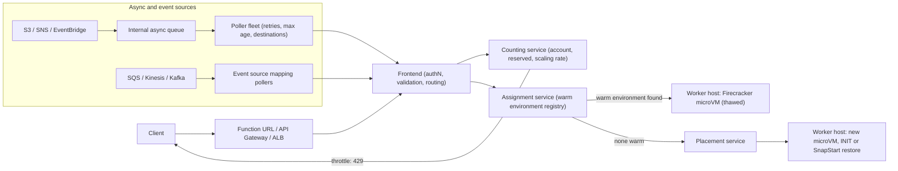
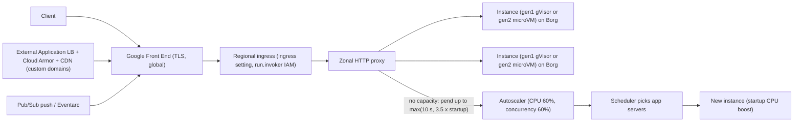
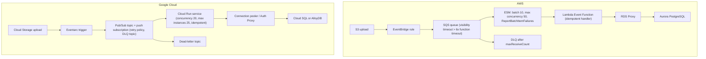
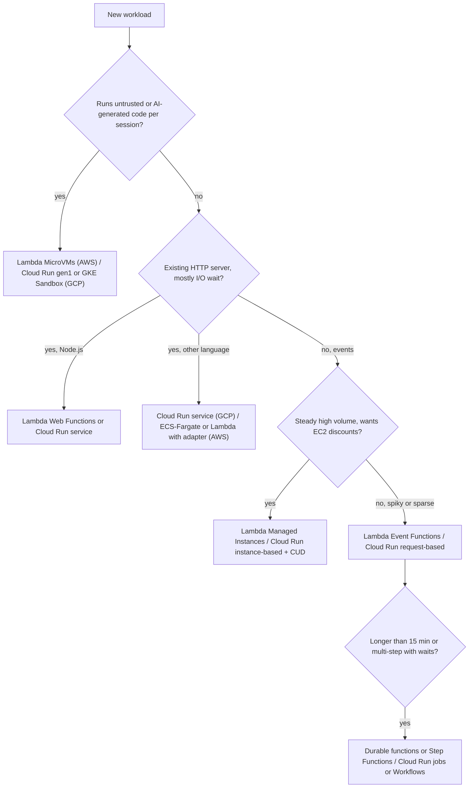

# 01.3 · Serverless Internals: AWS Lambda on Firecracker microVMs vs Cloud Run on Borg

> **Folder 01 · File 3 of 3.** "Serverless" hides three decisions every architect still owns:
> 1. the **isolation unit** (a Firecracker microVM per Lambda execution environment vs a gVisor or microVM sandbox per Cloud Run instance);
> 2. the **concurrency model** (one request per environment vs many per instance);
> 3. the **scaling contract** (a documented ramp rate vs utilization targets with a pending queue).
>
> By late 2026 AWS Lambda is a *family*: Event Functions (the classic model, renamed), durable functions, Lambda Managed Instances, Lambda MicroVMs and Lambda Web Functions. This file maps each one to the right Cloud Run shape (services, jobs, worker pools, functions).

| Listing | What it shows | Language |
|---|---|---|
| `serverless_scaling_sim.py` | Environments and instances needed per workload (Little's law, Lambda's 10 RPS per environment, Cloud Run's CPU and concurrency targets). Simulates a Lambda 0 → 30,000 rps burst from the documented ramp, shows Cloud Run's pending-queue window, and compares monthly cost on five pricing models | Python 3 (stdlib) |

**Verification.** The listing is embedded byte-identical. The gate reruns it on this final file and checks the output and the `verdict: OK` line, including an analytic check of the ramp time. Limits and prices come from the AWS Lambda and Cloud Run documentation and pricing pages as of **2026-10-31**: US East (N. Virginia) for AWS, Tier 1 for Cloud Run, free tiers ignored.

**Labels.** **[D]** documented · **[E]** estimate/model · ⚠ inferred from talks or papers, not a product contract. **2026 services**: Lambda MicroVMs (2026-06-22) and Lambda Web Functions (2026-10-12) may postdate the SAP-C02 item bank. Learn them for interviews and production, and expect the exam to test the classic model.

---

## 0. Orientation

**The questions this file answers.**

1. What *is* a Lambda execution environment physically? Why did AWS build Firecracker instead of using containers or full VMs? What does "one request per environment" force on your design?
2. What *is* a Cloud Run instance (a gVisor sandbox or a Linux microVM, scheduled by Borg), and what does per-instance concurrency change?
3. How fast does each platform add capacity, what happens to requests that arrive faster than that, and how do you size for it?
4. What is a cold start made of on each platform, and which lever (SnapStart, provisioned concurrency, min instances, startup CPU boost) fixes which part?
5. Where is the cost crossover between per-invocation billing and per-instance billing?
6. Which 2026 Lambda variant answers which old Cloud Run advantage?
7. Which limits and quotas break serverless systems in production?

**Reading paths.**

| Goal | Read |
|---|---|
| L7 interview | §1, §2, §3.1–3.4, §4.2–4.4, §5, §7, §9 Q-chains |
| SAP-C02 | §2, §3.3–3.7, §6, §7, §9 S-scenarios |
| Choosing a platform for a new service | §1.2, §3.8, §4.5–4.6, §5, §10 |

**Prerequisites.** [01.1](01-aws-nitro-hypervisor-ec2-placement-groups-vs-gcp-titanium-compute.md) for Nitro and KVM. [01.2](02-eks-vs-gke-datapath-v2-ebpf-cilium-pod-ip-cni-and-karpenter-autoscaling.md) for the container alternative (EKS/GKE) that serverless competes with.

---

## 1. First principles: isolation, concurrency and the economics of zero

### 1.1 The isolation spectrum

| Isolation unit | Kernel shared with other tenants? | Startup | Density | TCB that can leak tenant data |
|---|---|---|---|---|
| Process / container (namespaces, cgroups) | Yes, the host kernel | Fastest | Highest | The whole host kernel syscall surface |
| **gVisor** (user-space kernel) | No. A Go "Sentry" implements Linux syscalls and makes few host syscalls | Fast | High | The Sentry plus a small, filtered host syscall set |
| **microVM** (KVM + minimal VMM, e.g. Firecracker) | No. Each microVM has its own guest kernel | ~100s of ms | High | KVM plus a tiny device model |
| Full VM (KVM/QEMU, Nitro, Compute Engine) | No | Seconds | Lower | Hypervisor plus VMM |

Multi-tenant serverless has to run code from mutually distrusting customers on the same hosts at high density. Containers fail the isolation requirement and full VMs fail the density and startup requirement. **AWS** built a VMM for exactly the middle: Firecracker. **Google** used two middles: gVisor (Cloud Run first generation) and a Linux microVM (second generation). In both cases Google wraps the instance in "a boundary enforced by a virtual machine monitor" [D].

### 1.2 Concurrency is the design variable

Little's law: **environments in use = arrival rate × time in the handler**. Each platform starts from it differently.

- **One request per environment** (Lambda Event Functions). Environments = λ·W. The function's memory is billed for the whole wall time, *including I/O wait*. Global state is safe from concurrent access, but it's reused across sequential invocations.
- **N requests per instance** (Cloud Run; Lambda Web Functions; Lambda Managed Instances). Instances = λ·W / (N × target utilization), or the CPU-bound count, whichever is larger. I/O wait overlaps across requests in one instance. Handlers must be thread-safe and must bound shared resources such as DB pools and memory.

The listing (§5) shows the consequence on a 30,000 rps API with 120 ms wall time and 15 ms CPU:
- **Lambda:** 3,600 environments.
- **Cloud Run:** 750 one-vCPU instances. CPU binds, not concurrency: 3,600 concurrent requests need only 75 instances by concurrency.

### 1.3 The economics of scale-to-zero

Scale-to-zero trades **idle cost** for **cold-start latency**. The levers are the same on both clouds: pre-initialized capacity (provisioned concurrency, min instances), faster initialization (SnapStart, startup CPU boost, smaller artifacts), and routing around cold capacity (queues). What differs is *who pays for the wait*:
- Lambda Event Functions bill per environment-millisecond, including INIT since 2025-08-01 [D].
- Cloud Run request-based billing charges an instance while at least one request is active.
- Cloud Run instance-based billing charges for the instance's whole life, at lower unit prices.

---

## 2. Side-by-side architectural Rosetta matrix

| Concern | AWS | GCP | What actually differs |
|---|---|---|---|
| Isolation unit | Firecracker microVM per execution environment (Event Functions, MicroVMs). Containers on Nitro EC2 for Managed Instances [D] | Gen1: gVisor sandbox. Gen2: Linux microVM. Instance boundary enforced by a VMM [D] | Lambda gives every environment its own guest kernel. Cloud Run gen1 shares none but emulates syscalls |
| Substrate | Lambda worker fleet ⚠ (Firecracker on EC2 bare metal per AWS talks) | **Borg**: "Cloud Run runs on top of Borg" [D] | Google documents the cluster manager. AWS documents the VMM |
| Requests per environment | 1 (Event Functions). Many for Managed Instances and Web Functions (default 64, range 1–128) | Default 80, up to 1,000 per instance [D] | Concurrency sets how much you pay for I/O wait |
| Scale-out rate | Per function: +1,000 environments per 10 s, refilled continuously, never banked above 1,000 [D] | Utilization targets (60% CPU and concurrency). No published ramp rate. Can throttle in exceptional cases [D] | Lambda's ramp is a contract you can compute against. Cloud Run's is a behavior |
| Over-capacity requests | Throttled immediately with 429 | Pend up to max(10 s, 3.5 × average startup), then 429 [D] | Cloud Run absorbs short bursts in a queue. Lambda pushes back on the caller |
| Sync request rate cap | 10 requests/s per environment, i.e. 10 × concurrency limit [D] | None per instance beyond concurrency and CPU | Very short Lambda functions are bounded by request rate, not by Little's law |
| Max duration | 15 min (Event Functions). 90 min for Managed Instances async/ESM. Durable functions up to one year. MicroVMs 8 h [D] | 60 min per request. Jobs 168 h (12 h with GPU) [D] | Long work goes to Step Functions or durable functions on AWS, to jobs or worker pools on GCP |
| Compute size | 128–10,240 MB. CPU proportional (1,769 MB = 1 vCPU, up to 6 vCPUs) [D] | Up to 8 vCPU and 32 GiB per instance. CPU and memory set independently | Lambda couples CPU to memory. Cloud Run decouples them |
| Payload | Sync 6 MB request and response. Streamed response 200 MB. Async 1 MB [D] | HTTP/1 request and response 32 MiB. No limit on HTTP/2 or streamed responses [D] | Large payloads go through object storage presigned/signed URLs on Lambda |
| Packaging | Zip (50 MB zipped, 250 MB unzipped with layers) or container image ≤ 10 GB [D] | Container image (no direct size limit) or source deploy [D] | Any OCI image runs on Cloud Run. Lambda images need the runtime interface |
| Cold-start levers | Provisioned concurrency, SnapStart (Java, Python, .NET), smaller packages, Arm | Min instances, startup CPU boost, gen1 for faster cold start, smaller images | SnapStart restores a memory snapshot. Cloud Run has no snapshot restore |
| Billing | GB-s at 1 ms granularity + $0.20/M requests. INIT billed since 2025-08-01 [D] | Request-based ($0.000024/vCPU-s, $0.0000025/GiB-s, $0.40/M) or instance-based ($0.000018/vCPU-s, $0.000002/GiB-s, no request fee) | Cloud Run charges once for overlapping requests. Lambda Event Functions charge each one |
| CPU outside a request | Environment frozen between invocations. Background threads pause | Request-based: CPU throttled outside requests. Instance-based: CPU always allocated | Fire-and-forget work after the response fails on Lambda and on request-based Cloud Run |
| VPC access | Hyperplane ENIs shared per (subnet, security groups). VPC ENI quota 3,000 shared with other services [D] | Direct VPC egress (instance IPs in a subnet; regional instance quota) or Serverless VPC Access connectors | Lambda doesn't burn one IP per environment. Direct VPC egress uses subnet IPs per instance |
| Event sources | Event source mappings (pollers for SQS, Kinesis, DynamoDB Streams, Kafka, MQ, DocumentDB). Async invoke queue with retries | Eventarc triggers, Pub/Sub push subscriptions, Cloud Tasks, Cloud Scheduler | AWS polls for you. GCP pushes HTTP requests to the service |
| Orchestration | Step Functions. Lambda durable functions | Workflows. Cloud Run jobs for batch | Durable functions put checkpointed workflows inside Lambda |
| GPU | Not on Event Functions | Cloud Run GPUs (NVIDIA L4) for services and jobs [D] | Serverless GPU inference is a Cloud Run feature |
| Untrusted-code sandboxes | **Lambda MicroVMs**: Firecracker, suspend/resume up to 8 h, HTTPS URL per MicroVM (2026-06-22) [D] | Cloud Run instances (gen1 gVisor). GKE Sandbox (gVisor) for Kubernetes | AWS now sells a first-class per-session sandbox primitive |
| HTTP-server model | **Lambda Web Functions**: run an HTTP server, multi-concurrency, Node.js only at launch (2026-10-12) [D] | Cloud Run services (any language, any server) | Web Functions narrows Cloud Run's biggest historical advantage, for Node.js |
| Steady high-volume on owned capacity | **Lambda Managed Instances**: EC2 capacity providers in your account, Savings Plans, +15% management fee [D] | Cloud Run instance-based billing with CUDs, or GKE | Both let a serverless programming model run on discounted always-on capacity |

---

## 3. Internal mechanics: AWS Lambda

### 3.1 Firecracker

Firecracker (Agache et al., NSDI 2020) is a VMM written in Rust that runs on KVM. It was built for Lambda and Fargate. Its design choices are a list of things it **doesn't** do:
- no BIOS;
- no PCI bus in the original design;
- no USB, no graphics, no general device emulation.

It does provide virtio network and block devices, a serial console and a minimal keyboard controller used for reset. Each microVM process runs inside a **jailer** (cgroups, namespaces, chroot, seccomp filters). Network and disk I/O are rate-limited per microVM.

The paper reports:
- boot to guest user space in as little as **125 ms**;
- under **5 MiB** of memory overhead per microVM;
- creation of up to **150 microVMs per second per host**.

Firecracker also supports **snapshot and restore**, which SnapStart is built on.

Why not containers? The paper's argument is the security trade. Containers share a kernel, and the Linux syscall surface is too large to defend between mutually distrusting tenants. Firecracker gives each environment a guest kernel while keeping the VMM small enough to audit.

### 3.2 The invoke path ⚠

AWS's re:Invent deep dives describe a pipeline. The component names are from talks, not a product contract.

1. **Frontend.** Authenticates and validates the invoke, and routes synchronous requests.
2. **Counting service.** Enforces the concurrency limits: account limit, reserved concurrency, and the scaling rate.
3. **Assignment service.** Successor of the original Worker Manager. Tracks which warm environments exist on which workers and hands an idle one to the request. If none exists, it asks for a new one.
4. **Placement service.** Chooses a worker host and slot for a new environment.
5. **Worker hosts.** Many Firecracker microVMs per host, each with the runtime and your code. A microVM is frozen between invocations and thawed for the next.

Asynchronous invokes are accepted into internal queues, and a poller fleet turns them into synchronous invokes with retries. Event source mappings are pollers that read SQS, Kinesis, DynamoDB Streams, Kafka, MQ or DocumentDB and invoke synchronously.

### 3.3 Execution environment lifecycle [D]

```text
 INIT (billed since 2025-08-01)          INVOKE (repeats, one at a time)              SHUTDOWN
 +---------------------------------+     +-------------------------------+           +-----------+
 | extension init | runtime init | |     | handler runs; environment is  |  idle ... | extensions|
 | function init (your globals)    | --> | frozen between invokes; state | --------> | get up to |
 | limit 10 s on-demand; if it     |     | in /tmp and globals is reused |  reaped   | ~2 s      |
 | overruns, INIT retries inside   |     | by the NEXT request (not a    |  when idle|           |
 | the first invoke's timeout      |     | concurrent one)               |  or aged  |           |
 +---------------------------------+     +-------------------------------+           +-----------+
 SnapStart: INIT runs once at publish -> Firecracker snapshot -> cold starts RESTORE instead of INIT
```

Consequences:
1. Expensive setup (SDK clients, connection pools of size 1, model loading) belongs in INIT. It's paid once per environment and is billed.
2. Don't keep work running after returning. The environment freezes, and timers and background threads stop until the next invoke.
3. Environments are recycled periodically and on deploys ⚠ (the lifetime isn't published), so caches are opportunistic.

### 3.4 The scaling contract [D]

- **Rate.** Per function and Region: **1,000 execution environments every 10 seconds**, equivalently 10,000 rps per 10 s. Refill is continuous, and the bucket never holds more than 1,000.
- **Ceiling.** The account's concurrent executions quota: default **1,000**, raisable to tens of thousands. New accounts start lower and rise automatically with usage.
- **Request-rate cap.** Synchronous invocations are limited to **10 rps per environment**, so the total is 10 × the concurrency limit. A 20 ms function at 30,000 rps is busy at only 600 concurrency but needs a limit of 3,000. The listing computes it.
- **Reserved concurrency** carves a function's guaranteed share out of the account limit and caps it. Setting it to 0 throttles the function, which makes a kill switch.
- **Provisioned concurrency** keeps N environments initialized. It's priced separately ($0.0000041667 per GB-s while enabled, plus a lower $0.0000097222 per GB-s duration rate [D]) and can be scheduled or target-tracked with Application Auto Scaling.
- **Throttles** return 429 (`TooManyRequestsException`). Synchronous callers must back off. Async invokes and event sources retry internally.

### 3.5 SnapStart

When you publish a version, Lambda runs INIT, takes a Firecracker **snapshot** of memory and disk state, and caches it in tiers. Cold starts then restore from the snapshot instead of running INIT. It supports **Java, Python and .NET** [D]. Java has no extra charge; Python and .NET pay for caching and restores. The cautions:
- **Uniqueness.** Anything computed in INIT is now *shared by every restored environment*: random seeds, UUID generators, cached credentials with expiry, open network connections. Use the runtime hooks to regenerate them: CRaC `beforeCheckpoint`/`afterRestore` on Java, before-snapshot/after-restore hooks on Python and .NET.
- **Scope.** It covers zip-packaged functions on supported managed runtimes, and it's configured per published version.

### 3.6 VPC networking: Hyperplane ENIs

A function attached to a VPC doesn't get an ENI per environment. Lambda creates a **Hyperplane ENI per unique (subnet, security-group set)** when the function is created or its VPC configuration changes, and all environments share it through a NAT-like layer in Hyperplane, the same internal service family behind NLB, NAT Gateway and PrivateLink ⚠.

Consequences:
1. The function shows **Pending** while ENIs are created, and changing subnets or SGs creates new ones.
2. The ENIs count against the VPC's ENI quota (3,000 by default, shared).
3. VPC functions have **no public IP**: internet access needs a NAT gateway, and AWS service access should use VPC endpoints.
4. Functions idle for long periods have their ENIs reclaimed and become inactive until the next invoke.

### 3.7 Event sources and async semantics

| Source | Mechanism | Scaling levers [D] | Failure handling |
|---|---|---|---|
| Async invoke (S3, SNS, EventBridge) | Internal queue → poller → sync invoke | Concurrency limits | Up to 2 retries, max event age up to 6 h, on-failure destination or DLQ |
| SQS | ESM long-polls and batches | Batch size and window, **maximum concurrency** per ESM | Partial batch responses (`ReportBatchItemFailures`), redrive to DLQ |
| Kinesis / DynamoDB Streams | ESM reads per shard | Batch size, **parallelization factor 1–10** per shard | Bisect on error, max retries, max record age, on-failure destination |
| Kafka (MSK / self-managed) | ESM consumer group | Pollers scale with partitions (provisioned mode available) | On-failure destination |

All of these are **at-least-once**, so handlers must be idempotent. Lambda also detects and stops recursive loops through SQS, SNS and S3 after about 16 recursive invocations [D].

### 3.8 The 2026 Lambda family

| Shape | Launch | Isolation | Concurrency | Scaling | Billing | Use it when |
|---|---|---|---|---|---|---|
| **Event Functions** (classic, renamed 2026) | 2014 | Firecracker microVM per environment | 1 per environment | +1,000 envs / 10 s per function | GB-s (1 ms) + requests, INIT billed | Event-driven glue, spiky traffic, scale-to-zero |
| **Durable functions** | 2025-12 (re:Invent) | As Event Functions | As Event Functions | As Event Functions | As Event Functions | Long-running, checkpointed workflows up to one year. Each invocation still has the 15-min limit, and waits accrue no compute charges. Limits: 30,000 operations and 100 MB checkpointed state per execution, 1 MB per operation [D] |
| **Lambda Managed Instances** | 2025-12 (re:Invent) | **Containers on Nitro EC2 instances in your account**. The capacity provider is the security boundary [D] | Many per environment | Asynchronous, **on CPU utilization only**, no cold starts. Handles a traffic doubling within 5 min by default. Starts 3 instances and 3 environments per version for AZ resiliency [D] | EC2 price + **15% management fee**. Savings Plans and RIs apply to the EC2 part [D] | Steady high volume, needs Graviton4 or network-optimized hardware, wants EC2 discounts |
| **Lambda MicroVMs** | 2026-06-22 | Firecracker VM per MicroVM [D] | Per-MicroVM connection limits (8 at 1 vCPU … 128 at 16 vCPU) [D] | API-driven (`RunMicrovm` default 5 TPS) | Baseline compute while running + active extra resources [D] | Per-session sandboxes for user- or AI-generated code. Suspend and resume up to 8 h. Dedicated HTTPS URL (HTTP/2, gRPC, WebSockets). Arm64 |
| **Lambda Web Functions** | 2026-10-12 | Not stated in the launch material ⚠ | `maxConcurrencyPerEnvironment` default 64 (1–128) [D] | Endpoint scaling. Per-endpoint default 10,000 rps. Account default 100,000 rps [D] | Active vCPU $0.0000276944/s + memory $0.0000036667/GB-s for the environment's life + $0.30/M requests [D] | An existing Node.js HTTP server (Express, Hono, Fastify, Next.js) with no adapter. 2 vCPU / 2 GB per environment. CloudFront in front for custom domains or WAF |

Lambda Managed Instances functions are hidden from default EC2 console and list views but remain billable. They're identified by an `Operator` field and the `aws:lambda:capacity-provider` tag [D].

---

## 4. Internal mechanics: Cloud Run

### 4.1 Substrate and API

Cloud Run "runs on top of Borg in the same environment where Google deploys billions of containers a week" [D]. The Admin API's v1 surface follows the **Knative Serving** resource model (`serving.knative.dev/v1` Service YAML with `gcloud run services replace`). The implementation is Google's own, not open-source Knative on Kubernetes, and the newer v2 API is Cloud Run native.

### 4.2 The two execution environments [D]

| | First generation | Second generation |
|---|---|---|
| Sandbox | **gVisor** (small codebase, reduced attack surface; seccomp-hardened) | **Linux microVM** (seccomp + Sandbox2 namespaces) |
| Linux compatibility | Most, not all, syscalls emulated | Full: all syscalls, namespaces, cgroups |
| Cold start | Faster | Longer for some services |
| Performance | Baseline | Faster CPU and network |
| Network file systems (NFS, Cloud Storage FUSE) | No | Yes |
| Memory minimum | — | 512 MiB |
| Where it's required | — | **Jobs and worker pools always use gen2** |
| Price | Same | Same |

Both run inside "a hardware-backed layer equivalent to individual VMs (x86 virtualization)". The instance boundary is enforced by a VMM, and containers *within* one instance are less strongly separated than instances are [D]. Services pick an environment automatically by feature use unless you set it.

### 4.3 The request path [D]

1. **Google Front End (GFE).** Global. Terminates TLS for `run.app` URLs (or sits behind an external Application Load Balancer for custom domains, Cloud Armor and CDN) and forwards to the service's region.
2. **Regional ingress.** Ingress settings (`all`, `internal`, `internal-and-cloud-load-balancing`) and IAM (`roles/run.invoker`) are enforced here.
3. **Zonal HTTP proxy.** Load-balances requests to instances.
4. **Scheduler.** Picks the app servers that host sandboxed instances.
5. **Image serving.** Images are exposed through a storage file-server interface ⚠ (Google doesn't document whether layers are loaded lazily, though behavior suggests it).

### 4.4 The autoscaler, exactly as documented [D]

- **Targets.** 60% CPU utilization and 60% request concurrency by default. No change while utilization stays within ±10% of target (54–66%). **Memory doesn't drive scaling.**
- **CPU-based count.** Average CPU over the last minute ÷ CPUs per instance ÷ target, rounded up.
- **Concurrency-based count.** The higher of the 1-minute and 10-minute average concurrent requests ÷ max concurrency ÷ target, rounded up. The service runs the larger of the two counts.
- **Adaptive concurrency tuning.** If an instance's CPU exceeds 90% over the last second, its concurrency limit drops by 1. If it's at the limit and CPU stays under 70% for a second, the limit rises by 1.
- **Scale-down.** Instances are removed in two groups: those below 10% one-minute utilization first, the rest after an idle timeout. Idle instances can be kept up to **15 minutes** (10 for GPUs) to avoid cold starts.
- **Scale from zero** happens only on a request.
- **Pending queue.** A request waits up to **max(10 s, 3.5 × average startup time)**. If no instance frees up at max instances, it fails with **429**.
- **Max instances is soft.** During spikes or replacements, instances can **temporarily exceed max instances**, "normally less than twice" the limit, for a grace period that "usually lasts up to 15 minutes". Don't use max instances as a hard downstream connection cap. See §7.
- **Deploys.** Cloud Run starts enough instances of a new revision before shifting 100% of traffic.

### 4.5 CPU allocation and billing modes

| Mode | CPU outside requests | Price (Tier 1) [D] | Use when |
|---|---|---|---|
| Request-based (default) | Throttled to near zero | $0.000024/vCPU-s, $0.0000025/GiB-s, **$0.40/M requests** | Spiky traffic. Work happens only inside requests |
| Instance-based | Always allocated | $0.000018/vCPU-s, $0.000002/GiB-s, **no request fee** | Steady traffic, background threads, streaming, high request rates |

**Startup CPU boost** gives extra CPU during instance startup. **Min instances** keep instances warm.

### 4.6 The Cloud Run resource family [D]

| Resource | What it is | Key limits |
|---|---|---|
| Service | HTTP or gRPC endpoint, revisions, traffic splitting | 60-min request timeout. Concurrency up to 1,000. 8 vCPU / 32 GiB per instance |
| Job | Run-to-completion tasks with parallelism | Tasks up to 168 h (12 h with GPU). 10,000 tasks per execution. Up to 10 retries |
| Worker pool | Always-on, non-HTTP, pull-based workers (e.g. Pub/Sub pull, Kafka consumers) | Gen2 only |
| Cloud Run functions | Source-based functions deployed as Cloud Run services (formerly Cloud Functions 2nd gen) | Same platform limits as services |
| GPUs | NVIDIA L4 attached to services or jobs | Regional GPU quotas. New projects get a small automatic quota |

VPC egress has two options:
- **Direct VPC egress:** each instance gets an IP from a subnet. No connector VMs. Subject to a regional quota on instances using it (100–200 depending on region) [D].
- **Serverless VPC Access connectors:** connector VMs whose size and count cap throughput.

---

## 5. Scaling and cost: listing

<!-- listing:serverless_scaling_sim.py -->
```python
"""serverless_scaling_sim.py - Lambda vs Cloud Run: how many environments, how fast they arrive,
and what a month costs, from the documented scaling rules and list prices.

Rules encoded (public docs, 2026-10-31):
  Lambda Event Functions  one request per environment; per function, +1,000 environments per 10 s,
                          refilled continuously, never banked above 1,000; up to 10 sync requests
                          per second per environment; 429 when demand outruns scaling or the limit
  Lambda Web Functions    many requests per environment (maxConcurrencyPerEnvironment default 64),
                          2 vCPU / 2 GB per environment, billed on active vCPU + memory for the
                          environment's life + requests (environment count here is a lower bound)
  Cloud Run               per-instance concurrency (default 80); instances = max(CPU-based,
                          concurrency-based), each = load / per-instance capacity / 0.6 target, rounded up;
                          request-based billing charges an instance only while >= 1 request is active
                          (modeled as 1 - exp(-lambda*W) per instance, M/G/inf); pending requests wait
                          max(10 s, 3.5 x average startup) before a 429
Prices (USD): Lambda x86 0.0000166667 / Arm 0.0000133334 per GB-s + 0.20 per 1M requests;
  Lambda Web Functions 0.0000276944 per active vCPU-s, 0.0000036667 per GB-s, 0.30 per 1M;
  Cloud Run Tier 1 request-based 0.000024 per vCPU-s, 0.0000025 per GiB-s, 0.40 per 1M;
  instance-based 0.000018 per vCPU-s, 0.000002 per GiB-s. Free tiers ignored.

Usage: python -I serverless_scaling_sim.py <any path>
"""
import math
import sys

MONTH = 30 * 86400


def lambda_needs(rps, wall_s):
    busy = rps * wall_s  # Little's law: L = lambda * W
    return busy, max(busy, rps / 10)  # 10 sync requests/s per environment caps short functions


def web_fn_envs(rps, wall_s, cpu_s):
    """Lower bound: 64 concurrent requests per environment, or 2 vCPUs run flat out."""
    return max(1, math.ceil(rps * wall_s / 64), math.ceil(rps * cpu_s / 2))


def cloud_run_instances(rps, wall_s, cpu_s, vcpu=1.0, concurrency=80, target=0.6):
    by_conc = math.ceil(rps * wall_s / (concurrency * target))
    by_cpu = math.ceil(rps * cpu_s / (vcpu * target))
    return max(by_conc, by_cpu, 1), by_conc, by_cpu


def lambda_ramp(rps, wall_s, limit, horizon=60):
    """Step from 0 to rps at t=0; 1 s ticks. Returns (seconds to steady state, throttled, cold starts)."""
    need = math.ceil(max(rps * wall_s, rps / 10))
    envs, bucket, throttled, colds, t_ss = 0, 1000.0, 0.0, 0, None
    for t in range(horizon):
        add = int(min(bucket, max(0, min(need, limit) - envs)))
        envs += add
        bucket -= add
        colds += add
        served = min(rps, envs / wall_s, envs * 10)
        throttled += rps - served
        if t_ss is None and served >= rps - 1e-6:
            t_ss = t
        bucket = min(1000.0, bucket + 100.0)  # continuous refill: 1,000 per 10 s
    return t_ss, throttled, colds


def monthly(rps, wall_s, cpu_s, lam_mem_gb):
    req_m = rps * MONTH / 1e6
    out = {}
    gbs = rps * wall_s * lam_mem_gb * MONTH
    out["Lambda x86"] = gbs * 0.0000166667 + req_m * 0.20
    out["Lambda Arm"] = gbs * 0.0000133334 + req_m * 0.20
    envs = web_fn_envs(rps, wall_s, cpu_s)
    out["Lambda Web Fn"] = rps * cpu_s * MONTH * 0.0000276944 + envs * 2 * MONTH * 0.0000036667 + req_m * 0.30
    n, _, _ = cloud_run_instances(rps, wall_s, cpu_s)
    busy_frac = 1 - math.exp(-(rps / n) * wall_s)
    inst_s = n * busy_frac * MONTH
    out["Cloud Run req-based"] = inst_s * (1 * 0.000024 + 0.5 * 0.0000025) + req_m * 0.40
    out["Cloud Run inst-based"] = n * MONTH * (1 * 0.000018 + 0.5 * 0.000002)
    return out, n, busy_frac


def main():
    ok = True
    print("== 1. Environments needed at steady state ==")
    print(f"{'workload':<34} {'Lambda busy':>11} {'Lambda limit':>12} {'CR inst':>7} {'(conc/cpu)':>10} {'WebFn env>=':>11}")
    for name, rps, wall, cpu in (("30k rps, 120 ms wall, 15 ms CPU", 30000, 0.120, 0.015),
                                 ("30k rps, 20 ms wall, 15 ms CPU", 30000, 0.020, 0.015),
                                 ("2k rps, 900 ms wall, 600 ms CPU", 2000, 0.900, 0.600)):
        busy, limit = lambda_needs(rps, wall)
        n, bc, bp = cloud_run_instances(rps, wall, cpu)
        web = web_fn_envs(rps, wall, cpu)
        print(f"{name:<34} {busy:>11,.0f} {limit:>12,.0f} {n:>7,} {bc:>4,}/{bp:<5,} {web:>11,}")
    ok &= lambda_needs(30000, 0.020) == (600.0, 3000.0)

    print()
    print("== 2. Lambda burst: 0 -> 30,000 rps step, account limit 5,000 ==")
    for wall in (0.120, 0.020):
        t_ss, thr, colds = lambda_ramp(30000, wall, 5000)
        print(f"wall {wall * 1000:>4.0f} ms: steady after {t_ss:>2} s, {thr:>11,.0f} requests throttled (429), "
              f"{colds:,} cold starts")
    t_ss, _, _ = lambda_ramp(30000, 0.120, 5000)
    ok &= t_ss == math.ceil((3600 - 1000) / 100)  # analytic: (need - initial 1,000) / 100 per second
    print("   Cloud Run instead queues: a request pends up to max(10 s, 3.5 x avg startup) before a 429")
    for startup in (1.0, 2.0, 5.0, 8.0):
        print(f"   avg startup {startup:>3.0f} s -> pending window {max(10.0, 3.5 * startup):4.1f} s")

    print()
    print("== 3. Monthly cost at steady load (USD, list prices, no free tier) ==")
    cases = (("I/O-bound API: 200 rps, 120 ms wall, 15 ms CPU", 200, 0.120, 0.015, 0.5),
             ("CPU-bound: 50 rps, 400 ms wall, 300 ms CPU", 50, 0.400, 0.300, 1.769),
             ("trickle: 2 rps, 200 ms wall, 20 ms CPU", 2, 0.200, 0.020, 0.5))
    for name, rps, wall, cpu, mem in cases:
        costs, n, frac = monthly(rps, wall, cpu, mem)
        print(f"{name}  (Lambda {mem:g} GB; Cloud Run {n} x 1 vCPU/0.5 GiB, busy {frac:.0%})")
        for k, v in sorted(costs.items(), key=lambda kv: kv[1]):
            print(f"   {k:<22} ${v:>10,.2f}")
        ok &= all(v > 0 for v in costs.values())
    io = monthly(200, 0.120, 0.015, 0.5)[0]
    ok &= io["Cloud Run inst-based"] < io["Lambda x86"]  # wait time is billed per invocation on Lambda
    print()
    print("verdict: OK" if ok else "verdict: FAIL")


if __name__ == "__main__":
    main()
```

<!-- output:serverless_scaling_sim.py -->
```text
== 1. Environments needed at steady state ==
workload                           Lambda busy Lambda limit CR inst (conc/cpu) WebFn env>=
30k rps, 120 ms wall, 15 ms CPU          3,600        3,600     750   75/750           225
30k rps, 20 ms wall, 15 ms CPU             600        3,000     750   13/750           225
2k rps, 900 ms wall, 600 ms CPU          1,800        1,800   2,000   38/2,000         600

== 2. Lambda burst: 0 -> 30,000 rps step, account limit 5,000 ==
wall  120 ms: steady after 26 s,     292,500 requests throttled (429), 3,600 cold starts
wall   20 ms: steady after 20 s,     210,000 requests throttled (429), 3,000 cold starts
   Cloud Run instead queues: a request pends up to max(10 s, 3.5 x avg startup) before a 429
   avg startup   1 s -> pending window 10.0 s
   avg startup   2 s -> pending window 10.0 s
   avg startup   5 s -> pending window 17.5 s
   avg startup   8 s -> pending window 28.0 s

== 3. Monthly cost at steady load (USD, list prices, no free tier) ==
I/O-bound API: 200 rps, 120 ms wall, 15 ms CPU  (Lambda 0.5 GB; Cloud Run 5 x 1 vCPU/0.5 GiB, busy 99%)
   Cloud Run inst-based   $    246.24
   Lambda Web Fn          $    408.89
   Lambda Arm             $    518.40
   Cloud Run req-based    $    531.91
   Lambda x86             $    622.08
CPU-bound: 50 rps, 400 ms wall, 300 ms CPU  (Lambda 1.769 GB; Cloud Run 25 x 1 vCPU/0.5 GiB, busy 55%)
   Cloud Run req-based    $    952.85
   Cloud Run inst-based   $  1,231.20
   Lambda Arm             $  1,248.66
   Lambda Web Fn          $  1,267.70
   Lambda x86             $  1,554.34
trickle: 2 rps, 200 ms wall, 20 ms CPU  (Lambda 0.5 GB; Cloud Run 1 x 1 vCPU/0.5 GiB, busy 33%)
   Lambda Arm             $      7.95
   Lambda x86             $      9.68
   Lambda Web Fn          $     23.43
   Cloud Run req-based    $     23.65
   Cloud Run inst-based   $     49.25

verdict: OK
```

**Reading the output.**

- **Section 1, environments.** For the 30k rps, 120 ms API:
  - Lambda needs **3,600** concurrent environments.
  - Cloud Run needs **750** one-vCPU instances. CPU binds (15 ms × 30,000 rps = 450 vCPU-seconds per second at a 60% target). By concurrency alone, 75 would do.
  - Web Functions needs at least **225** two-vCPU environments, CPU-bound.

  For the 20 ms function, Lambda is busy at only **600** but needs a concurrency *limit* of **3,000** because of the 10 rps per environment cap. That's a quota request most teams don't know to make.
- **Section 2, the burst.** A step to 30,000 rps:
  - At 120 ms, Lambda reaches steady state after **26 s**: (3,600 − the initial 1,000) ÷ 100 per second, which the gate checks analytically.
  - **292,500 requests are throttled** on the way, and every new environment is a cold start.

  Cloud Run behaves differently: requests pend for up to 10 s (or 3.5 × startup) before failing. A queue absorbs short bursts, but callers see latency instead of fast 429s.

  The AWS fixes:
  - provisioned concurrency sized to the burst;
  - a queue (SQS) in front of the function so the burst becomes backlog;
  - pre-warming by scheduled scaling before known events.
- **Section 3, cost [E]** (list prices, no free tier, steady load):
  - **I/O-bound API** (15 ms CPU of 120 ms wall). Cloud Run instance-based is cheapest ($246/month), then Web Functions ($390). Lambda Event Functions cost the most ($518 Arm, $622 x86), because each invocation pays memory for its own I/O wait. Cloud Run *request-based* is the second most expensive ($532), almost all of it the $0.40/M request fee on 518M requests.
  - **CPU-bound** (300 ms of 400 ms). Cloud Run request-based wins: each instance is busy only 55% of the time and billed only then. Instance-based, Lambda Arm and Web Functions land within about 3% of each other.
  - **Trickle** (2 rps). Lambda is cheapest by 3–6×. Scale-to-zero billing is what it's for, and the free tiers would make it nearly free.
  - **The rule:** concurrency pays when handlers wait, per-invocation billing pays when traffic is sparse, and instance-based billing pays when traffic is steady. Model *your* CPU:wall ratio before choosing.

---

## 6. Cold starts in depth

| Phase | Lambda Event Functions | Cloud Run | Lever |
|---|---|---|---|
| Capacity acquisition | Placement finds a slot, Firecracker boots a microVM | Scheduler places a sandbox on Borg | Pre-provision: provisioned concurrency / min instances |
| Artifact fetch | Zip from Lambda storage, or a container image (cached, chunked) ⚠ | Image from Artifact Registry via the storage interface ⚠ | Smaller artifacts, fewer layers, regional registries |
| Runtime start | Runtime init (JVM, Python interpreter) | Container entrypoint, server start | Arm, lighter runtimes, GraalVM native, tiered compilation |
| App init | Function init (globals) – **billed** | App startup until the port listens | SnapStart (Lambda), startup CPU boost (Cloud Run), lazy init |
| First request | Possibly slower (JIT warm-up) | Same | Warm-up requests in INIT or startup probes |

**Order of preference for latency-critical paths:**
1. Remove the cold start from the critical path: queue in front, async processing.
2. Make it cheap: SnapStart or startup CPU boost, smaller artifacts.
3. Pay to avoid it: provisioned concurrency or min instances, scheduled to traffic.

---

## 7. Failure modes, throttling limits and quota traps

| # | Symptom | Root cause | Detect | Fix | Cloud |
|---|---|---|---|---|---|
| 1 | 429s during a launch spike, then fine | **Scaling rate**: +1,000 envs / 10 s per function | `Throttles`, `ConcurrentExecutions` | Provisioned concurrency (scheduled), SQS in front, pre-warm | AWS |
| 2 | An unrelated function throttles the critical one | **Shared account concurrency** (default 1,000) | `Throttles` on the critical function | Reserved concurrency for critical functions. Separate accounts per domain. Raise the quota | AWS |
| 3 | A very short function throttles below Little's-law concurrency | **10 rps per environment** sync cap | Throttles with low `ConcurrentExecutions` | Raise the concurrency limit to rps ÷ 10 (listing §1) | AWS |
| 4 | Whole function stops | Reserved concurrency set to 0 (the kill switch) | Config audit | Intentional only. Alarm on it | AWS |
| 5 | Duplicates in downstream tables | **At-least-once** async invokes and ESMs, retries | Idempotency-key collisions | Idempotency keys (Powertools idempotency), conditional writes | AWS |
| 6 | Job killed at 15 minutes | Event Functions **timeout** | `Timeout` in logs | Step Functions, durable functions, Managed Instances (90 min async/ESM), Fargate/ECS | AWS |
| 7 | `413`/payload errors at 6 MB | **Sync payload** limit | API errors | Presigned S3 URLs, response streaming (200 MB) | AWS |
| 8 | VPC function can't reach the internet | No public IP in VPC | Timeouts | NAT gateway, or VPC endpoints for AWS services | AWS |
| 9 | Deploys stuck in Pending, or ENI quota errors | **Hyperplane ENI** creation for new (subnet, SG) combinations. ENI quota 3,000/VPC shared | Function state, `ENILimitReached` | Reuse subnet/SG combinations. Raise the ENI quota | AWS |
| 10 | Cost jump on functions with heavy init | **INIT billed** since 2025-08-01 | Init duration metrics | Trim init, SnapStart, fewer cold starts | AWS |
| 11 | Same "random" token across environments | **SnapStart uniqueness** | Duplicate IDs | Restore hooks to reseed and reconnect | AWS |
| 12 | Runaway S3 → Lambda → S3 loop | Recursive trigger | Recursive loop detection stops after ~16 | Separate buckets/prefixes. Loop detection stays on | AWS |
| 13 | Managed Instances can't absorb a flash spike | Scales **asynchronously on CPU only**, a doubling in ~5 min by default | Latency, CPU | Keep spiky paths on Event Functions. Raise minimum environments | AWS |
| 14 | Race conditions after moving to Web Functions or Managed Instances | **Multi-concurrency** breaks single-request assumptions | Corrupted shared state | Request-scoped state, thread-safe clients, bounded pools | AWS |
| 15 | Background work stops after the response | Cloud Run **request-based CPU** throttled outside requests | Work never completes | Instance-based billing, Cloud Tasks, jobs or worker pools | GCP |
| 16 | p99 rises with load at constant instance count | Concurrency 80 on CPU-bound handlers | Latency vs concurrency | Set concurrency from load tests. ACT helps but is per-second | GCP |
| 17 | 429s at a ceiling | **Max instances** / regional instance quota (100 per project-region, adjustable) | 429s, instance count | Raise the quota and max instances. Smaller instances with higher concurrency | GCP |
| 18 | Database connection storm despite max instances | Instances can **exceed max instances (< 2×) for up to ~15 min** | DB connections | Size DB pools for 2× max. Use a connection pooler | GCP |
| 19 | Requests time out after 10 s on cold start | **Pending window** max(10 s, 3.5 × startup) exhausted | 429 with cold starts | Min instances, startup CPU boost, faster startup | GCP |
| 20 | Uploads over 32 MiB fail | HTTP/1 **32 MiB** request limit | 413 | HTTP/2 end to end, or signed URLs to Cloud Storage | GCP |
| 21 | Deploy pipeline throttled | **Admin API writes 180/min per region** | API 429s | Batch deploys, backoff | GCP |
| 22 | Direct VPC egress scale-out fails | Regional **instance quota** for Direct VPC egress (100–200) and subnet IP space | Scaling errors | Raise the quota. Larger subnet. Or a connector | GCP |
| 23 | Both clouds: database melts on scale-out | Serverless fan-out × per-instance pools | DB CPU and connections | RDS Proxy / pooler. Cap concurrency (reserved concurrency, ESM max concurrency, Cloud Run max instances × pool size) | Both |

---

## 8. Architecture diagrams: multi-service compositions

### 8.1 Lambda invoke path ⚠ (component names from AWS talks)



### 8.2 Cloud Run request path



### 8.3 The same event pipeline on both clouds

The task: ingest object uploads, transform them, write results, never overload the database, and survive poison messages.



**The invariant on both sides:** the database's connection budget must be at least the *maximum concurrent handlers* times *connections per handler*.
- **AWS:** ESM maximum concurrency (50) × 1, through RDS Proxy.
- **GCP:** max instances (25) × a pool of 2 × **2 for the max-instances overshoot**.

Both pipelines are at-least-once, so the handler must be idempotent.

### 8.4 Choosing among the 2026 shapes



---

## 9. Bar-raiser chains and SAP-C02 scenarios

### 9.1 L7 bar-raiser chains

<details><summary><b>Q1 · Why does Lambda use microVMs when containers start faster?</b></summary>

**Initial Prompt.** "Containers start in milliseconds. Why would AWS build a VMM for Lambda instead of running functions in containers?"

**L5 Answer.** "For security. VMs are more isolated than containers."

**Why L5 Stalls.** It names the goal without the trade-off. It doesn't say what makes containers insufficient, what makes full VMs unacceptable, or how Firecracker resolves both. It also doesn't connect to the GCP design.

**L7 Answer.** "Multi-tenant serverless runs mutually distrusting customers' code on the same hosts at high density.
- **Containers** share the host kernel, so the defensive surface is the whole Linux syscall interface. That's too large between tenants.
- **Full VMs** isolate well, but they boot in seconds and carry device-emulation overhead and memory cost that kill density.

Firecracker is the middle: KVM isolation with a Rust VMM that has almost no device model (virtio net and block, serial, a minimal keyboard controller), runs in a jailer with seccomp, and reaches guest user space in about 125 ms with under 5 MiB overhead. That's the NSDI 2020 data.

Google solved the same problem twice:
1. **gVisor** for Cloud Run gen1: a user-space kernel, so the host kernel sees few syscalls.
2. **A Linux microVM** for gen2, when full Linux compatibility and NFS mattered.

In both cases the instance boundary is VMM-enforced. The design trade for us: Lambda's per-environment guest kernel makes one-request-per-environment natural, and Cloud Run's per-instance sandbox makes concurrency natural. That difference drives cost (§5)."
</details>

<details><summary><b>Q2 · A product launch takes Lambda from 0 to 30,000 rps and the first minute is a wall of 429s</b></summary>

**Initial Prompt.** "We launch at 09:00 with a TV spot. Last time the first 30 seconds were mostly 429s on our Lambda API, then it recovered. What happened and what do we change?"

**L5 Answer.** "Lambda has cold starts. Increase memory so it starts faster, and ask AWS for a higher concurrency limit."

**Why L5 Stalls.** Memory doesn't change the scaling rate, and a higher concurrency limit only raises the ceiling. It doesn't speed the ramp. The answer never computes how long the ramp takes.

**L7 Answer.** "Lambda adds at most 1,000 environments per 10 seconds per function, refilled continuously and never banked above 1,000. At 120 ms per request, 30,000 rps needs 3,600 environments, so after the instant 1,000 it takes (3,600 − 1,000) ÷ 100 per second = 26 seconds. The listing counts about 290,000 throttled requests in that window.

Fixes, by certainty:
1. **Provisioned concurrency of ~3,600** on the alias, scheduled through Application Auto Scaling from 08:50 to 10:00. It's paid only for the window.
2. **Make the edge absorb it:** serve static or cacheable responses from CloudFront, and put SQS in front of anything that doesn't need a synchronous answer.
3. **Check the other caps:**
   - the account concurrency quota must exceed 3,600 plus everything else in the Region;
   - if any function is very short, the 10 rps per environment cap means its limit must be rps ÷ 10;
   - downstream connection budgets must hold at 3,600 concurrent environments.

On Cloud Run the same spike would queue rather than fail fast, so set min instances and test that the pending window doesn't time out clients."
</details>

<details><summary><b>Q3 · Lambda or Cloud Run for an I/O-bound API at 200 rps?</b></summary>

**Initial Prompt.** "A 200 rps API spends 120 ms per request, mostly waiting on a database and two downstream calls. CPU is about 15 ms. Pick a platform on cost and justify it with numbers."

**L5 Answer.** "Lambda is pay-per-use, so it'll be cheapest."

**Why L5 Stalls.** Pay-per-use bills *wall time*. At steady load with 87% wait, per-invocation billing pays for the waiting 200 times a second.

**L7 Answer.** "Model the CPU:wall ratio (listing §3):
- Lambda Event Functions at 512 MB cost about $622/month on x86 and $518 on Arm, because every invocation pays memory for its own 120 ms.
- Cloud Run instance-based needs 5 one-vCPU instances by CPU target, about $246/month.
- Cloud Run request-based lands at $532, because $207 of it is the $0.40 per million request fee on 518M requests.
- Lambda Web Functions, which shares environments across concurrent requests and bills active vCPU, comes to about $390.

So on GCP: Cloud Run with instance-based billing and concurrency set from a load test. On AWS: Web Functions if the service is Node.js, or Managed Instances or ECS/Fargate for steady volume.

Two caveats change it:
1. Free tiers and traffic shape. A diurnal 10× swing favors request-based billing or Event Functions.
2. Thread safety. Concurrency means shared state and bounded pools."
</details>

<details><summary><b>Q4 · A Cloud Run service sends emails "after responding", and some never go out</b></summary>

**Initial Prompt.** "Our Cloud Run handler returns 202 and then sends a notification email in a goroutine. About 20% of emails never send, with no errors. Why?"

**L5 Answer.** "The container is probably crashing. Add retries and better logging."

**Why L5 Stalls.** There's no crash. The answer doesn't know the CPU allocation model, so it can't explain silent non-execution.

**L7 Answer.** "With request-based billing (the default), CPU is throttled to near zero outside active requests. A goroutine that runs after the response may never get CPU, and if the instance idles out, the work is lost. Lambda has the same failure mode: the environment freezes after the handler returns.

Fixes, in order of correctness:
1. **Make it durable:** enqueue the email to Cloud Tasks or Pub/Sub *before* responding, and process it in a handler that has its own request. That gives retries and dead-lettering for free.
2. If the work must stay in-process, use **instance-based billing**, where CPU is always allocated. Even then, instance shutdown can still lose it.
3. For batch-style work, use **Cloud Run jobs** or a **worker pool**.

On AWS the equivalent is SQS, or EventBridge plus a second function, never work after `return`."
</details>

<details><summary><b>Q5 · Serverless scale-out melted the database</b></summary>

**Initial Prompt.** "A queue backlog drained through our serverless consumers and the PostgreSQL primary hit max connections and fell over. It happened on both our AWS and GCP stacks. Design it so it can't happen."

**L5 Answer.** "Increase max_connections on the database and add a read replica."

**Why L5 Stalls.** More connections on PostgreSQL cost memory and contention per connection. The real issue is an unbounded number of concurrent handlers, each with its own pool.

**L7 Answer.** "Write the invariant: **max concurrent handlers × connections per handler ≤ database connection budget**, and enforce each factor with a hard control.
- **AWS:**
  - set **maximum concurrency on the SQS event source mapping** (or reserved concurrency on the function) to the number the database can serve;
  - give each environment one connection;
  - put **RDS Proxy** in between to multiplex.
- **GCP:**
  - max instances × per-instance pool size, **doubled**, because Cloud Run can temporarily exceed max instances by up to 2× for about 15 minutes;
  - use a pooler or the Auth Proxy;
  - set concurrency per instance to what one pool can serve.

Then let the queue absorb the backlog. A slower drain is the system working. Add an alarm on queue age, not on connections, so we see the backlog before it matters."
</details>

<details><summary><b>Q6 · Java functions cold-start in 6 seconds</b></summary>

**Initial Prompt.** "Our Spring-based Java Lambda takes about 6 s to cold start, and p99 is unacceptable for a checkout API. Fix it without rewriting in Go."

**L5 Answer.** "Turn on provisioned concurrency for all functions."

**Why L5 Stalls.** It may work but it's expensive, and it doesn't address *why* INIT takes 6 s. Since August 2025 that INIT time is also billed on every cold start.

**L7 Answer.** "Three layers.
1. **Make INIT cheaper:**
   - trim the classpath and dependency injection scanning;
   - initialize SDK clients eagerly but lazily connect;
   - use tiered compilation settings suited to short-lived JVMs;
   - try Arm.
2. **Skip INIT with SnapStart:** INIT runs once at publish, and cold starts restore a Firecracker snapshot. The catch is uniqueness, so move random seeds, credentials and connections into CRaC `afterRestore` hooks, and verify nothing time-sensitive is captured. SnapStart for Java has no extra charge.
3. **Provisioned concurrency only for the checkout alias**, sized to the p95 concurrency and scheduled to traffic.

On Cloud Run the equivalents are min instances, startup CPU boost and a native image. Cloud Run has no snapshot restore, so JVM services there lean harder on min instances."
</details>

<details><summary><b>Q7 · Run customer-supplied code safely in a multi-tenant SaaS</b></summary>

**Initial Prompt.** "Our product lets customers run Python notebooks and AI-generated scripts. We need per-session isolation, state that survives a user pausing for an hour, and fast resume. AWS and GCP options, please."

**L5 Answer.** "Run each script in a Lambda function. Lambda is isolated with Firecracker."

**Why L5 Stalls.** Event Functions reuse an environment across sequential invocations *of the same function*. If tenants share a function, they share environments over time. The 15-minute limit and the lack of a suspend/resume model also fail the stated requirements.

**L7 Answer.**
- **AWS (2026): Lambda MicroVMs** were built for this.
  - **Isolation:** a Firecracker VM per session. Build the images from Dockerfiles.
  - **Session state:** suspend and resume with memory and disk preserved, for up to 8 hours.
  - **Access:** a dedicated HTTPS URL per MicroVM, with HTTP/2, gRPC and WebSockets for the notebook kernel.
  - **Billing:** baseline compute only while running.
  - **Watch:** the API rate quotas, for example `RunMicrovm` at 5 TPS by default. A launch storm needs a queue, or a quota raise before the event.
- **GCP:**
  - a Cloud Run service per session on gen1 gVisor, which drops state when idle; or
  - **GKE Sandbox** (gVisor) pods with a persistent volume if sessions must pause and resume.
- **Either cloud:**
  - no credentials inside the sandbox;
  - egress through an allow-listed proxy;
  - per-tenant quotas;
  - kill on CPU-time budget."
</details>

<details><summary><b>Q8 · The Kinesis → Lambda consumer's iterator age keeps growing</b></summary>

**Initial Prompt.** "A Kinesis stream with 40 shards feeds a Lambda consumer. IteratorAge grows all afternoon, and the function isn't throttled. What do you change?"

**L5 Answer.** "Add more shards and increase the function's memory."

**Why L5 Stalls.** Resharding is slow and costly, and memory helps only if the handler is CPU-bound. The answer ignores the event source mapping's own concurrency controls and error handling.

**L7 Answer.** "With Kinesis the ESM runs one concurrent batch per shard by default, so 40 shards means 40 concurrent invocations no matter how much Lambda capacity exists. Before resharding:
1. Raise the **parallelization factor** (up to 10 per shard, ordering kept per partition key).
2. Tune batch size and window.
3. Check whether a **poison record** is being retried. Enable bisect-on-error, max retry attempts, max record age and an on-failure destination, so one bad record can't stall a shard.

If it's still behind, the handler is the bottleneck: profile it, batch the downstream writes. On GCP the equivalent pipeline uses Pub/Sub with flow control and a Cloud Run worker pool or push subscription. Scaling comes from subscriber count, and ordering keys play the role of shards."
</details>

<details><summary><b>Q9 · A VPC Lambda deploy hangs in Pending and then fails</b></summary>

**Initial Prompt.** "We moved 400 functions into a VPC, each with its own security group for 'least privilege'. Deploys now hang in Pending and some fail with ENI errors. Why?"

**L5 Answer.** "Lambda creates an ENI per invocation in a VPC, so we're running out. Use bigger subnets."

**Why L5 Stalls.** That's the pre-2019 model. Hyperplane ENIs are per (subnet, security-group set), not per invocation, so the fix is in the configuration, not the subnet size.

**L7 Answer.** "Lambda creates one Hyperplane ENI per unique combination of subnet and security groups, shared by every environment using that combination. 400 functions × a unique SG each × 3 subnets is up to 1,200 ENIs, created at deploy, which is why functions sit in Pending. It also counts against the VPC's ENI quota (3,000 by default, shared with everything else).

Fix:
1. Group functions into a small number of SG profiles by what they actually reach. Least privilege belongs mainly in IAM and resource policies.
2. Reuse the same subnet set.
3. Raise the ENI quota if needed.

Also confirm:
- the functions need the VPC at all: AWS services are reachable without it, or through VPC endpoints if they're in the VPC;
- internet egress goes through a NAT gateway, because VPC functions have no public IP."
</details>

<details><summary><b>Q10 · Which 2026 Lambda shape replaces our Cloud Run workloads in an AWS migration?</b></summary>

**Initial Prompt.** "We're moving three Cloud Run services to AWS: a Node.js API at steady 2,000 rps, a Python image-processing job triggered by uploads, and a Go WebSocket gateway. Map each one."

**L5 Answer.** "Put everything on Lambda behind API Gateway."

**Why L5 Stalls.** It ignores concurrency (the Node.js API's cost profile), duration and connection semantics (WebSockets), and the 2026 shapes designed for exactly these cases.

**L7 Answer.**
- **Node.js API at steady 2,000 rps → Lambda Web Functions.** It runs the Express/Hono server unmodified, with up to 64 concurrent requests per environment by default and billing on active vCPU. Put CloudFront in front for the custom domain and WAF. It's Node.js-only and in five Regions at launch, so check the Region. The alternative is Lambda Managed Instances, if Savings Plans coverage matters more.
- **Upload-triggered Python processing → Lambda Event Functions**, from S3 through EventBridge to SQS with an ESM maximum concurrency. If a file can take over 15 minutes, use durable functions, or Managed Instances' 90-minute async limit.
- **Go WebSocket gateway → ECS on Fargate behind an NLB/ALB.** Long-lived connections don't fit Event Functions, and Web Functions is Node.js-only. API Gateway WebSocket APIs are an option if the gateway logic can become per-message functions.

The rule: map on the concurrency model, duration and connection semantics, not on the product name."
</details>

### 9.2 SAP-C02 scenarios (original)

<details><summary><b>S1 · SAP-C02 · Domain 2 · Select ONE</b></summary>

**Scenario.** A ticketing company runs its purchase API on AWS Lambda behind Amazon API Gateway. Sales open at a known time each week, and traffic rises from near zero to 20,000 requests per second within seconds. Each request takes about 150 ms. During the first minute customers receive throttling errors, after which the API stabilizes. What should a solutions architect do to remove the errors at the lowest cost?

- **A.** Increase the function's memory to the maximum to shorten cold starts.
- **B.** Configure provisioned concurrency on the function alias with a scheduled Application Auto Scaling action that raises it before each sale and lowers it afterward.
- **C.** Request a higher account concurrency quota for the Region.
- **D.** Move the API to Amazon EC2 instances in an Auto Scaling group with target tracking.

**Answer: B**

- **A** — wrong: more memory doesn't change how fast Lambda adds execution environments, which is what causes throttling at the start.
- **B** — correct: scheduled provisioned concurrency pre-initializes about 3,000 environments (20,000 × 0.15 s) before the known spike and is paid only during the window.
- **C** — wrong: a higher quota raises the ceiling but not the per-function scaling rate, so the first seconds still throttle.
- **D** — wrong: EC2 Auto Scaling reacts more slowly than Lambda to a step change and adds operational overhead.
</details>

<details><summary><b>S2 · SAP-C02 · Domain 3 · Select TWO</b></summary>

**Scenario.** A Lambda function consumes messages from an Amazon SQS queue and writes to an Amazon Aurora PostgreSQL database. When a large backlog accumulates, the function scales out and the database exhausts its connections, causing failures across other applications that share the cluster. Which combination of actions will resolve this? (Select TWO.)

- **A.** Increase the SQS visibility timeout to 12 hours.
- **B.** Increase the database instance size so it supports more connections.
- **C.** Configure maximum concurrency on the SQS event source mapping to a value the database can sustain.
- **D.** Switch the queue to an SQS FIFO queue to process one message at a time.
- **E.** Route the function's database connections through Amazon RDS Proxy.

**Answer: C, E**

- **A** — wrong: the visibility timeout controls redelivery, not how many concurrent invocations the mapping starts.
- **B** — wrong: a larger instance only moves the limit, and backlog-driven scale-out can still exceed it.
- **C** — correct: maximum concurrency on the event source mapping caps concurrent invocations, so the backlog drains at a rate the database can handle.
- **D** — wrong: FIFO changes ordering semantics and throughput, which isn't the requirement, and doesn't directly bound connections.
- **E** — correct: RDS Proxy pools and multiplexes connections, protecting the shared cluster from connection storms.
</details>

<details><summary><b>S3 · SAP-C02 · Domain 2 · Select ONE</b></summary>

**Scenario.** *(2026 service; may postdate the exam item bank.)* A learning platform lets students run code in interactive sessions. Each session must be isolated from other users at the virtual-machine level, must keep its in-memory state when the student is idle for up to an hour, and must expose a WebSocket endpoint to the browser. Which solution meets these requirements with the least operational overhead?

- **A.** Run each session in a shared Lambda Event Function and store state in Amazon ElastiCache.
- **B.** Run each session in a container on a shared Amazon ECS cluster with one task per student.
- **C.** Launch a dedicated EC2 instance per student and stop it when idle.
- **D.** Run sessions on Lambda Managed Instances with multi-concurrency enabled.
- **E.** Launch a Lambda MicroVM per session from a prebuilt image, use its dedicated HTTPS URL for WebSocket traffic, and suspend it when idle.

**Answer: E**

- **A** — wrong: a shared function reuses execution environments across invocations, has a 15-minute limit, and provides no per-session WebSocket endpoint or suspend semantics.
- **B** — wrong: containers on shared hosts share a kernel, which doesn't meet VM-level isolation.
- **C** — wrong: per-student EC2 instances meet isolation but carry high operational overhead and slow resume.
- **D** — wrong: Managed Instances isolate with containers on shared instances, and multi-concurrency mixes requests in one environment.
- **E** — correct: Lambda MicroVMs provide a Firecracker VM per session, suspend and resume with state preserved, and a dedicated HTTPS URL that supports WebSockets.
</details>

<details><summary><b>S4 · SAP-C02 · Domain 4 · Select ONE</b></summary>

**Scenario.** A company is modernizing a Java batch application that processes uploaded files. Processing a single file can take up to 40 minutes. The team wants serverless operations, automatic retries per step, and visibility into each step's progress. What should a solutions architect recommend?

- **A.** Run the batch as a single Lambda Event Function with the maximum timeout.
- **B.** Increase the Lambda timeout through a Service Quotas request.
- **C.** Run the application on an EC2 Spot Instance launched by an S3 event.
- **D.** Orchestrate the processing as AWS Step Functions steps, splitting the work into Lambda tasks that each finish within the Lambda timeout, with retries configured per state.

**Answer: D**

- **A** — wrong: Event Functions time out at 15 minutes, below the 40-minute processing time.
- **B** — wrong: the 15-minute timeout is a hard limit and can't be raised through Service Quotas.
- **C** — wrong: Spot instances can be interrupted and add operational work, and they don't give per-step visibility.
- **D** — correct: Step Functions provides durable orchestration with per-state retries and visibility, and each Lambda task stays within its timeout.
</details>

<details><summary><b>S5 · SAP-C02 · Domain 3 · Select ONE</b></summary>

**Scenario.** A Java 21 Lambda function behind API Gateway has cold starts of about 5 seconds caused by framework initialization. Traffic is unpredictable, and the team wants to reduce cold-start latency without paying to keep environments running continuously. What should a solutions architect recommend?

- **A.** Configure provisioned concurrency equal to the peak concurrency.
- **B.** Enable Lambda SnapStart on the function's published versions and move uniqueness-sensitive initialization into restore hooks.
- **C.** Increase the function memory to 10,240 MB.
- **D.** Package the function as a container image to speed up startup.

**Answer: B**

- **A** — wrong: provisioned concurrency removes cold starts but bills continuously for the environments.
- **B** — correct: SnapStart restores a snapshot of the initialized environment instead of running initialization, with no continuously running capacity. Restore hooks handle uniqueness.
- **C** — wrong: more memory adds CPU but doesn't remove framework initialization, and raises cost.
- **D** — wrong: container image packaging doesn't make initialization faster, and SnapStart supports zip-packaged functions.
</details>

<details><summary><b>S6 · SAP-C02 · Domain 1 · Select ONE</b></summary>

**Scenario.** Several product teams deploy Lambda functions into one shared AWS account. A data team's backfill job recently scaled out and consumed most of the Regional concurrency, throttling the payment team's critical functions. Leadership wants to prevent cross-team impact and give each team its own quota and cost boundary. What should a solutions architect recommend?

- **A.** Configure provisioned concurrency for the backfill job.
- **B.** Ask AWS Support to raise the account's concurrency quota.
- **C.** Add an SQS queue in front of the payment functions.
- **D.** Move each team's workloads into separate AWS accounts in AWS Organizations, and set reserved concurrency on critical functions within each account.

**Answer: D**

- **A** — wrong: provisioned concurrency keeps environments warm for the backfill and makes contention worse.
- **B** — wrong: a higher shared quota postpones the problem, and the backfill can still consume it.
- **C** — wrong: a queue delays payment processing instead of guaranteeing capacity.
- **D** — correct: separate accounts give each team independent Lambda quotas and cost boundaries, and reserved concurrency guarantees capacity for critical functions.
</details>

---

## 10. Checklist

- [ ] For each workload, write down the CPU:wall ratio, the steady and peak rps, and the traffic shape, then choose the concurrency model (listing §3).
- [ ] Lambda: account concurrency quota > the sum of the peaks. The concurrency limit is ≥ rps ÷ 10 for short functions. Reserved concurrency is set on critical functions.
- [ ] Known spikes: provisioned concurrency scheduled through Application Auto Scaling, or a queue in front. The 1,000-per-10-s ramp has been computed.
- [ ] No work after the response (Lambda freeze, Cloud Run request-based CPU). Durable work goes through queues or tasks.
- [ ] Idempotency keys on every at-least-once consumer. DLQ or on-failure destinations configured. Poison-record handling on stream ESMs.
- [ ] Database budget ≥ max concurrent handlers × connections each (Cloud Run: × 2 for the max-instances overshoot). RDS Proxy or a pooler in place.
- [ ] Cold starts: SnapStart (with restore hooks) or startup CPU boost before paying for provisioned concurrency or min instances.
- [ ] VPC Lambdas: few SG/subnet combinations, ENI quota headroom, NAT or VPC endpoints. Cloud Run: Direct VPC egress quota and subnet IPs, or a connector.
- [ ] Payload limits: 6 MB (Lambda sync), 32 MiB (Cloud Run HTTP/1). Large objects go through signed URLs.
- [ ] 2026 shapes considered: Web Functions for Node.js HTTP servers, Managed Instances for steady volume on EC2 pricing, MicroVMs for untrusted per-session code, durable functions for long workflows.

---

## 11. References

AWS:
- Lambda scaling behavior: <https://docs.aws.amazon.com/lambda/latest/dg/scaling-behavior.html>
- Lambda quotas: <https://docs.aws.amazon.com/lambda/latest/dg/gettingstarted-limits.html>
- Lambda execution environment lifecycle: <https://docs.aws.amazon.com/lambda/latest/dg/lambda-runtime-environment.html>
- Lambda Managed Instances: <https://docs.aws.amazon.com/lambda/latest/dg/lambda-managed-instances.html>
- Lambda MicroVMs announcement (2026-06-22): <https://aws.amazon.com/about-aws/whats-new/2026/06/aws-lambda-microvms>
- AWS Weekly Roundup with Lambda Web Functions (2026-10-19): <https://aws.amazon.com/blogs/aws/aws-weekly-roundup-aws-lambda-web-functions-amazon-s3-on-the-vercel-marketplace-and-more-october-19-2026/>
- Lambda pricing: <https://aws.amazon.com/lambda/pricing/>
- INIT phase billing standardization: <https://aws.amazon.com/blogs/compute/aws-lambda-standardizes-billing-for-init-phase/>
- Lambda SnapStart: <https://docs.aws.amazon.com/lambda/latest/dg/snapstart.html>
- Lambda VPC networking: <https://docs.aws.amazon.com/lambda/latest/dg/configuration-vpc.html>
- Firecracker: <https://firecracker-microvm.github.io/>
- Agache et al., *Firecracker: Lightweight Virtualization for Serverless Applications*, NSDI 2020: <https://www.usenix.org/conference/nsdi20/presentation/agache>

Google Cloud:
- Cloud Run instance autoscaling: <https://docs.cloud.google.com/run/docs/about-instance-autoscaling>
- Cloud Run execution environments: <https://docs.cloud.google.com/run/docs/about-execution-environments>
- Cloud Run security design: <https://docs.cloud.google.com/run/docs/securing/security>
- Cloud Run quotas and limits: <https://docs.cloud.google.com/run/quotas>
- Cloud Run pricing: <https://cloud.google.com/run/pricing>
- gVisor: <https://gvisor.dev/docs/>
