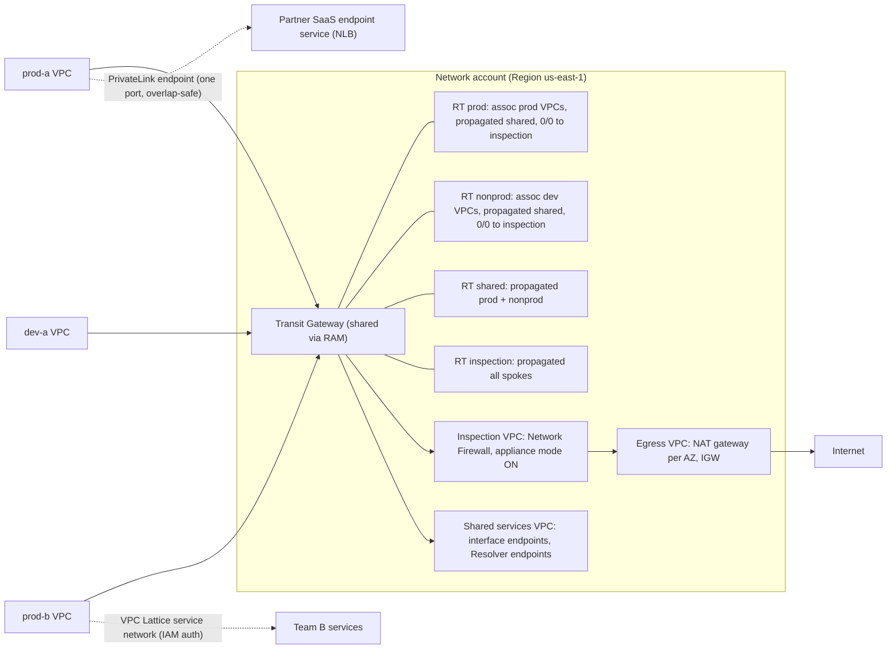
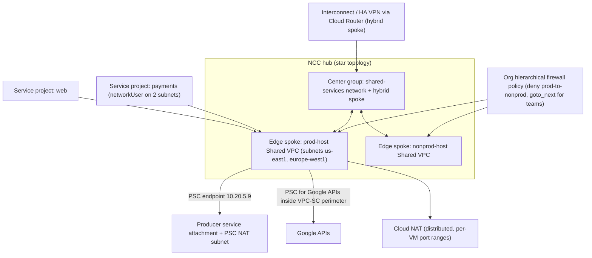

# 02.1 · AWS Regional VPC, Transit Gateway and PrivateLink vs Google's Global Andromeda VPC and Private Service Connect

> **Folder 02 · File 1 of 3.** A VPC is a routing and isolation domain implemented by a distributed data plane. The Nitro card on AWS and Andromeda (now on Titanium) on Google, both covered in 01.1, do the encapsulation. The two clouds then made opposite choices about the *scope* of that domain:
> - **AWS:** a VPC is **regional**, so connecting VPCs is your job (peering, Transit Gateway, Cloud WAN).
> - **Google:** a VPC network is **global**, so the work moves to project and IAM structure (Shared VPC), to hub design (Network Connectivity Center) and to firewall policy.
>
> Both offer a second way to connect that **doesn't route networks at all** but publishes a single service behind NAT: PrivateLink and Private Service Connect. Choosing between *routing a network* and *publishing a service* is the most important decision in this file.

| Listing | What it shows | Language |
|---|---|---|
| `reachability_model.py` | CIDR overlap detection. Non-transitive peering on both clouds. Transit Gateway segmentation (associate/propagate, with a blackhole guard) checked in both directions. NCC mesh vs star reachability. Monthly cost of mesh peering vs TGW at N = 5 to 126 VPCs. PrivateLink vs routing a whole VPC for one service | Python 3 (stdlib) |

**Verification.** The listing is embedded byte-identical. The gate re-runs it on this file and requires `verdict: OK`, which asserts the expected reachability matrix. Quotas and prices come from the AWS VPC, Transit Gateway and PrivateLink docs and pricing pages, and from Google's VPC, NCC and Cloud NAT docs, all as of **2026-10-31**.

**Labels.** **[D]** documented · **[E]** estimate/model · ⚠ inferred, not a product contract.

---

## 0. Orientation

**The questions this file answers.**

1. What does "global VPC" mean mechanically? Which parts are global (the routing table, firewall policy) and which stay regional (subnets, Cloud Routers, most load balancers)?
2. Why is VPC peering non-transitive on both clouds, and what replaces it at scale: Transit Gateway, Cloud WAN, NCC or Shared VPC?
3. How does a Transit Gateway actually choose a path? Association vs propagation, route evaluation order, AZ affinity, appliance mode.
4. When should you **route** two networks together, and when should you **publish** a service (PrivateLink, PSC, VPC Lattice)?
5. Which quotas and per-GB charges dominate multi-VPC designs, and how do they change the topology choice?

**Reading paths.**

| Goal | Read |
|---|---|
| L7 interview | §1, §2, §3.3–3.5, §4.1–4.5, §7, Q-chains |
| SAP-C02 | §2, §3.2–3.7, §6, §7, S-scenarios |
| Designing a landing-zone network | §3, §4, §6, then run the listing on your CIDR plan |

**Prerequisites.** [01.1](../01-Virtualization-Compute-and-Kubernetes-Internals/01-aws-nitro-hypervisor-ec2-placement-groups-vs-gcp-titanium-compute.md) for the Nitro card and Andromeda data planes, and [01.2](../01-Virtualization-Compute-and-Kubernetes-Internals/02-eks-vs-gke-datapath-v2-ebpf-cilium-pod-ip-cni-and-karpenter-autoscaling.md) for pod address planning, which consumes most VPC address space.

---

## 1. First principles: networks, routes and published services

### 1.1 Three ways to let A talk to B

| Mechanism | What crosses the boundary | Address constraint | Direction | Blast radius |
|---|---|---|---|---|
| **Same network** (one VPC / Shared VPC) | Everything L3 | One address plan | Any | The whole network |
| **Routed interconnect** (peering, TGW, Cloud WAN, NCC) | Prefixes you route | **No overlaps** among routed prefixes | Any, subject to firewalls | Everything routable |
| **Published service** (PrivateLink, PSC, VPC Lattice) | One service's port(s) | **Overlaps allowed**; the consumer gets a local IP | Consumer → producer only | One service |

Routing is about reachability, and firewalls then subtract. Publishing is about exposing one thing, and nothing else becomes reachable. Most multi-account networks need both:
- **routing** for shared infrastructure, hybrid links and inspection;
- **publishing** for team-to-team and vendor-to-customer service consumption.

### 1.2 Why peering is non-transitive

A peering connection installs routes for the peer's CIDRs **in each side's routing table**, with the peer as the next hop. The receiving side's data plane accepts packets only if the destination is local to it. It never re-forwards them to a third network, so A–B plus B–C doesn't give A–C.

On AWS the same rule forbids **edge-to-edge routing**: a VPC can't use its peer's internet gateway, NAT gateway, VPN or Direct Connect. It's a design choice that keeps the data plane stateless and the blast radius pairwise. The listing (§5, section 2) checks it. Transitivity has to come from a **router**: Transit Gateway, Cloud WAN, an NCC hub, or an appliance you run.

### 1.3 Regional vs global control planes

- **AWS** made the VPC regional. That bounds the blast radius of control-plane faults to a Region and matches the Region-as-failure-domain model, but cross-region connectivity becomes an explicit construct (inter-region peering, TGW peering, Cloud WAN).
- **Google** made the VPC network global: one routing table and one firewall policy space. Subnets are regional resources inside it. A VM in `us-east1` reaches a VM in `europe-west1` by internal IP with no extra construct.

The cost of Google's choice: **a global configuration surface**. A bad route or firewall change is global unless policy structure contains it. The architect's job becomes containment through structure (separate networks per environment, hierarchical firewall policies, IAM on subnets), where on AWS the boundary comes free with the Region.

---

## 2. Side-by-side architectural Rosetta matrix

| Concern | AWS | GCP | What actually differs |
|---|---|---|---|
| Network scope | VPC is regional. Subnets are zonal (one AZ) | VPC network is global. Subnets are regional (span zones) | GCP subnets don't force per-AZ subnet planning, and one GCP network spans regions |
| Address plan | Up to 5 IPv4 CIDR blocks per VPC by default (up to 50), /16–/28 each [D] | Subnet primary range plus secondary ranges (up to 170 per subnet) [D] | Secondary ranges are how GKE gets pod/service space (01.2) |
| Route table | Per subnet. Local route always wins. Longest prefix. Static over propagated [D] | One global table per network. Priority field. Longest prefix first | GCP routes carry priority and can be scoped by network tags |
| Dynamic routing scope | VGW/TGW routes per Region | Cloud Router **regional or global dynamic routing mode** | Global mode makes on-prem routes learned in one region usable network-wide (02.2) |
| Peering | VPC peering: non-transitive, no edge-to-edge routing. 50 active per VPC by default, up to 125 | VPC Network Peering: non-transitive. Exchanges subnet routes (and optional custom routes). A per-network peering quota plus **peering-group** quotas | GCP peering-group quotas (instances, forwarding rules, routes summed across peers) bite at scale |
| Transitive hub | **Transit Gateway** (regional router). **Cloud WAN** (global, policy-defined segments) | **Network Connectivity Center** hub: VPC spokes (mesh or star), hybrid spokes, router appliances | TGW has explicit route tables. NCC has topology presets and export filters |
| Segmentation in the hub | TGW route tables: associate + propagate. Blackhole routes | NCC star topology (center/edge groups). Separate networks per segment | AWS segments by route table. GCP segments by network and group |
| Share one network across accounts/projects | **VPC sharing** (AWS RAM shares subnets with participant accounts) | **Shared VPC** (host project, service projects attach. IAM per subnet) | Both centralize network ownership. GCP's model is the default enterprise pattern |
| Publish a service privately | **PrivateLink**: NLB/GWLB-backed endpoint service → interface endpoints (ENIs) in consumer VPCs. Cross-region since 2024 | **Private Service Connect**: service attachment (producer NAT subnet) → PSC endpoint (consumer IP) or PSC backend | Both tolerate overlapping CIDRs. Consumer-initiated only |
| Service-to-service network | **VPC Lattice**: service networks, IAM auth policies, HTTP/gRPC/TCP | PSC plus internal Application LBs. Cloud Service Mesh | Lattice adds L7 identity-aware routing across VPCs/accounts |
| Reach cloud APIs privately | Gateway endpoints (S3, DynamoDB; free, route-table based). Interface endpoints for the rest | Private Google Access (subnet flag). PSC endpoints for Google APIs | The S3 gateway endpoint isn't reachable from on-prem or peers. Interface endpoints are |
| Firewall model | Security groups (stateful, per ENI, can reference SGs). Network ACLs (stateless, per subnet) | VPC firewall rules and **firewall policies** (hierarchical at org/folder, network, regional). Targets by tag, service account or secure tag | GCP has inheritable org-level policy. AWS needs Firewall Manager to centralize |
| Rule limits | 60 rules per SG (in/out each) × 5 SGs per ENI ≤ 1,000. Prefix lists count by *max entries* [D] | Rules per policy and attribute limits per policy (check quotas) | Prefix-list sizing silently consumes SG rule quota |
| Egress NAT | NAT gateway (zonal, per-AZ deploy). $0.045/h plus per-GB processing | **Cloud NAT**: distributed, software-defined in Andromeda. No proxy VMs | AWS NAT is a zonal resource you place. Cloud NAT is a configuration |
| Inspection insertion | GWLB + endpoints, AWS Network Firewall (TGW-native attachment), TGW **appliance mode** | Internal passthrough NLB as next hop. Cloud NGFW (incl. IPS). Policy-based routes | Both need symmetric flows to stateful appliances |
| Load-balancer substrate | Hyperplane (NLB, NAT GW, PrivateLink) ⚠ | **Maglev** (passthrough) and **GFE / Envoy** proxies | Maglev is published (NSDI 2016). Hyperplane is described only in talks |
| Inter-AZ / inter-zone traffic | $0.01/GB each direction across AZs | $0.01/GiB between zones in a region | Same order of magnitude. Both bill both directions in practice |
| Hub data processing | TGW **$0.02/GB** on the sending side. $0.05 per attachment-hour [D] | NCC: spoke-hours plus data transfer (check pricing) | TGW processing is the line item that makes chatty cross-VPC designs expensive |
| Cross-region private routing | Inter-region VPC peering. TGW peering (static routes only). Cloud WAN | Built in: one global network. Inter-region egress ~$0.02/GiB within North America | GCP needs no construct. AWS needs one, but bounds blast radius |
| IPv6 | Dual-stack VPCs, IPv6-only subnets, egress-only IGW | Dual-stack and IPv6-only subnets. Internal and external IPv6 ranges | Similar. Both still need IPv4 at the edges for most estates |

---

## 3. Internal mechanics: AWS VPC, Transit Gateway, PrivateLink and Lattice

### 3.1 The VPC data plane in one paragraph

Packets are encapsulated by the source host's Nitro card toward the destination host. The card learns where an address lives from a mapping service ⚠. Every VPC "device" that isn't an instance is a distributed function in that fabric, not a box you can see: the router, the DHCP and DNS (`.2`) resolver, the gateways. The **route table** is therefore a forwarding policy evaluated on the card, and the **security group** is a stateful filter on the same card (01.1 §3.6). Two things follow:
1. There's no single router to fail.
2. The limits are per-ENI and per-instance allowances: PPS, conntrack, and the 1,024 PPS link-local DNS budget.

### 3.2 Route table semantics [D]

1. **The local route always wins**, even over a more specific propagated route. You can't route a subset of your own VPC CIDR elsewhere unless you use the route-table features for middlebox insertion (routes more specific than local to a firewall endpoint are supported for that purpose).
2. **Longest prefix match.**
3. For equal prefixes, **static beats propagated** (IGW, VGW, ENI, peering, NAT, TGW and gateway endpoint targets).
4. A route table holds **500 non-propagated routes by default** (up to 1,000, with possible performance impact) and **100 propagated routes, not adjustable**. With more than 100 on-prem prefixes, advertise a summary or a default route.

### 3.3 VPC peering

- Pairwise and non-transitive. **No edge-to-edge routing** through the peer's IGW, NAT, VGW or DX.
- Same-Region or inter-Region.
- Same-Region peers can reference each other's security groups.
- No data processing fee. Inter-AZ transfer applies.
- **50 active peerings per VPC by default, up to 125.** A full mesh therefore tops out at 126 VPCs and needs n(n−1)/2 connections, each with route entries on both sides. The listing prints 7,875 peerings at 126 VPCs.
- Peering preserves the jumbo-frame MTU within a Region. When migrating from peering to TGW, mismatched MTU can drop asymmetric jumbo packets: update both VPCs together [D].

### 3.4 Transit Gateway: a regional router you configure

**Attachments.** VPCs, VPN, Direct Connect gateways, Connect (GRE + BGP to SD-WAN appliances), peering (other TGWs and Cloud WAN), and Network Firewall. In each attached VPC, the TGW places an ENI in one subnet per AZ you enable. **Traffic can reach the TGW only from AZs that have an attachment subnet** [D].

**Routing model.**
- Each attachment is **associated** with exactly one TGW route table. That table decides where its *outbound* packets go.
- Attachments **propagate** their routes into any number of tables.
- Static routes and **blackhole** routes override.
- Segmentation is therefore a matrix: an attachment can reach what is propagated into the table it's associated with, and the *return* path requires the reverse to hold. The listing checks both directions (§5, section 3).

**Route evaluation order [D].**
1. Most specific prefix.
2. For the same CIDR, by attachment type: static → system (1:1 NAT) → prefix-list → VPC → Direct Connect gateway → Connect → VPN over DX → VPN → VPN Concentrator → Client VPN → peering (Cloud WAN).
3. Within one type: shorter AS_PATH, then lower MED, then eBGP over iBGP.

Routes without MED default to 0 on DX and 100 on VPN and Connect. The TGW route table shows only the *preferred* route. A backup VPN route appears only once the DX route is withdrawn (02.2 builds on this).

**AZ affinity and appliance mode [D].**
- Without appliance mode, the TGW keeps traffic in the **originating AZ** until it reaches its destination, and crosses AZs only on AZ failure or when an AZ has no attachment subnet.
- That breaks **stateful** appliances in a central inspection VPC: the forward path enters AZ-1's firewall, and the return path can enter AZ-2's, which drops it.
- **Appliance mode** on the inspection VPC's attachment pins a flow (by flow hash) to one appliance ENI in both directions.
- Network Firewall attachments enable it automatically.

**Capacity and quotas [D].**

| Item | Value |
|---|---|
| Attachments per TGW | 5,000 |
| Route tables per TGW | 20 (adjustable) |
| Total routes across tables | 10,000 |
| Bandwidth per VPC attachment per AZ | up to 100 Gbps each direction |
| Packets per second per VPC attachment per AZ | up to 7.5 million |
| Connect peer (GRE) | up to 5 Gbps and 300,000 pps. 4 peers per Connect attachment |
| MTU | 8,500 bytes for VPC, DX, Connect and peering. 1,500 for VPN |
| PMTUD | Supported for traffic entering on VPC and Connect attachments. Not on VPN, DX or peering |
| Peering attachments | 50 per TGW. Static routes only |
| TGWs per DX gateway / DX gateways per TGW | 6 / 20 |

**Pricing [D].** $0.05 per attachment-hour plus **$0.02 per GB processed**, charged on data *sent into* the TGW from VPC, DX or VPN. On peering, data processing is charged on the sending side only.

**1:1 NAT** on TGW attachments (50 rules per attachment, 1,000 per TGW) handles limited overlapping-CIDR cases. It isn't a replacement for PrivateLink when overlaps are broad.

### 3.5 Cloud WAN

Cloud WAN is a **global** network you define with a JSON policy:
- **core network edges** in chosen Regions;
- **segments** (isolated routing domains, like TGW route tables but global);
- **attachment policies** that place VPCs, VPNs and Connect peers into segments by tag.

It's the AWS answer to "I want Google's global network, but as segments". Use it when you have many Regions and want policy-driven segmentation. Use TGW per Region when a Region-local design and explicit route tables are enough.

### 3.6 PrivateLink: publishing, not routing

1. The **producer** creates an **endpoint service** backed by a Network Load Balancer (or a Gateway Load Balancer, for appliances).
2. A **consumer** creates an **interface endpoint**: ENIs in its own subnets, one per AZ, with consumer-side IPs and optional private DNS.
3. Traffic is **consumer-initiated only**. The producer sees connections from its NLB, so source IPs are NLB-side; enable proxy protocol if it needs client identity.
4. **CIDR overlap is irrelevant**, because nothing is routed.
5. Cross-region PrivateLink lets consumers reach endpoint services in another Region.
6. **Resource endpoints** (with VPC Lattice resource configurations) expose a single resource such as a database without an NLB.

**Pricing [D].** About **$0.01 per endpoint per AZ-hour** plus **$0.01/GB** for the first PB. The listing (§5, section 6) shows a 3-AZ endpoint carrying 2 TB/month costs ~$42, against ~$113 for attaching both VPCs to a TGW just to reach one service. Exposure is also limited to one port.

### 3.7 VPC Lattice and VPC sharing

- **VPC Lattice.**
  - A **service network** groups services, which are HTTP, HTTPS, gRPC or TCP listeners with target groups, across VPCs and accounts.
  - Clients in associated VPCs reach services by DNS name.
  - **Auth policies** evaluate IAM (SigV4) identity per request.
  - It's an application-layer alternative to routing VPCs together for service-to-service traffic, and it handles overlapping CIDRs.
- **VPC sharing** (AWS RAM).
  - A central network account owns the VPC and **shares subnets** with participant accounts (up to 100 participants per VPC by default).
  - Participants launch resources into shared subnets but can't modify the network.
  - Fewer VPCs means fewer TGW attachments and less processing.
  - It's AWS's equivalent of Shared VPC.

---

## 4. Internal mechanics: Google's global VPC, Andromeda, NCC and PSC

### 4.1 Andromeda's global network

Andromeda programs each host with the network's routing and firewall state (NSDI 2018, 01.1 §4.3). Because the control plane is global, **a VPC network is global**:
- Subnets are regional and span all zones of their region.
- Routes are network-wide objects with priorities, optionally scoped to instances by **network tags**.
- Firewall rules and policies are evaluated by Andromeda at the VM's virtual NIC.

Long-tail flows go through Hoverboard gateways until host programming catches up. On Titanium machine series the data plane runs on the adapter.

**Route types.**
- Subnet routes (system-generated).
- Static routes: next hop can be a gateway, an instance, an IP, a VPN tunnel, or an **internal passthrough Network Load Balancer**, which is the NVA insertion pattern.
- **Dynamic routes** from Cloud Router (BGP).
- **Policy-based routes**, which match on source and protocol as well as destination.

Selection is by **longest prefix, then priority**. Dynamic routing mode decides whether routes learned by a Cloud Router in one region apply only there (**regional**) or across the network (**global**). In global mode, routes learned in another region carry an added inter-region cost ⚠ (the value is Google-defined; see 02.2).

### 4.2 Firewalls as a hierarchy

Evaluation order:
1. **Hierarchical firewall policies** at the organization and folders. These can `allow`, `deny` or `goto_next`.
2. **VPC firewall rules** and the **global network firewall policy**. Their relative order is configurable; by default VPC rules come first.
3. **Regional network firewall policies**.

Targets can be **secure tags** (IAM-governed tags bound to VMs), service accounts or network tags. **Implied rules** deny all ingress and allow all egress.

Cloud NGFW adds FQDN and geolocation objects, threat-intelligence lists and **IPS** (Enterprise tier). This is where Google's global-network risk is contained:
- the org-level policy enforces guardrails that no project can override;
- project teams get only `goto_next` delegation.

### 4.3 Shared VPC

A **host project** owns the network. **Service projects** attach, and their resources use the host's subnets. IAM grants `compute.networkUser` **per subnet**, so a team can deploy only into its own subnets. Limits [D]:
- 100 Shared VPC host projects per organization;
- a service project attaches to **one** host project.

The enterprise default is one Shared VPC host per environment (prod, non-prod), optionally per region group. That puts the global network's blast radius on environment boundaries.

### 4.4 VPC Network Peering and NCC

**VPC Network Peering.**
- Exchanges subnet routes, plus optional import/export of custom (static and dynamic) routes.
- It's non-transitive.
- **Peering-group quotas** sum resources across a network and its direct peers: instances, internal forwarding rules, routes and subnet ranges. A hub network peered with many spokes hits these quotas long before the peering count, which is why large estates move to NCC or Shared VPC.

**NCC hubs** [D].
- **VPC spokes** export and import subnet routes through the hub. Only *export* filters are supported, with include and exclude ranges.
- **Topologies:**
  - **mesh:** all spokes connect;
  - **star:** center-group spokes connect to edge-group spokes, but **edge spokes aren't connected to each other**.
- **Hybrid spokes** carry dynamic routes from Interconnect, HA VPN and router appliances to VPC spokes.
- **Producer VPC spokes** extend reach to PSC producers.
- **Peering inside a hub:** two VPC spokes on the same hub can't also use VPC Network Peering, except for producer spokes, spokes peered with outside networks, and edge spokes in a star.
- **Dynamic-route overflow:** if dynamic routes exceed the quota, NCC **drops routes by destination**.

### 4.5 Private Service Connect

- **Producer.** A **service attachment** fronts an internal load balancer and uses a dedicated **PSC NAT subnet**. A consumer accept list controls who may connect.
- **Consumer.** A **PSC endpoint** is a forwarding rule with an internal IP in the consumer's network. **PSC backends** put a consumer-side load balancer in front, for policy, logging and failover.
- **PSC for Google APIs.** An endpoint that brings Google APIs onto an internal IP. It pairs with VPC Service Controls (Folder 05).
- **PSC interfaces.** The producer side gets a NIC into the consumer network, for producer-initiated flows.
- **Overlaps.** As with PrivateLink, **overlapping CIDRs are fine**, because only NAT'd service traffic crosses.
- **Pricing.** Per-endpoint for consumers, per-GB for producers; check the VPC pricing page for current rates.

### 4.6 Cloud NAT and load balancers

- **Cloud NAT** is distributed and software-defined: there are no NAT VMs. Andromeda translates on each host using allocated NAT IPs and **port ranges per VM**.
  - The levers are minimum and maximum ports per VM, dynamic port allocation and endpoint-independent mapping.
  - Port exhaustion shows up as **dropped new connections per VM** and is visible in NAT logs.
- **AWS NAT gateway** is a zonal managed resource. Deploy one per AZ to avoid cross-AZ dependency and charges. Each one has a published connection limit **per destination** (IP, port, protocol). Add EIPs or secondary IPs (up to 8) to scale.
- **Maglev** (NSDI 2016) underlies Google's passthrough load balancers:
  - routers ECMP packets to a pool of Maglev machines;
  - each machine uses **Maglev consistent hashing**, a lookup table of prime size, to pick a backend;
  - a per-flow connection-tracking table makes the choice sticky;
  - packets are GRE-encapsulated to the backend, which replies directly to the client.

  Because every Maglev machine computes the same table, a flow survives a Maglev machine failure without shared state. Proxy load balancers (GFE, Envoy-based) sit above it.

---

## 5. Listing: reachability, segmentation and topology cost

<!-- listing:reachability_model.py -->
```python
"""reachability_model.py - who can reach whom: VPC peering, Transit Gateway route tables,
GCP VPC Network Peering and Network Connectivity Center (mesh and star), plus CIDR overlap
and the monthly cost of each topology.

Rules encoded (public docs, 2026-10-31):
  AWS VPC peering / GCP VPC Network Peering: non-transitive (A-B and B-C never give A-C)
  AWS TGW: a packet from attachment X is routed by the route table X is ASSOCIATED with;
           routes appear there by PROPAGATION or static entry; blackhole drops; return
           traffic needs the reverse lookup to succeed too
  GCP NCC VPC spokes: mesh = every spoke reaches every spoke; star = center <-> edge only
           (edge spokes are not connected to each other)
  Prices (USD, us-east-1 / list): TGW 0.05 per attachment-hour + 0.02/GB processed on the
  sending side; VPC peering no processing fee (inter-AZ transfer 0.01/GB each way applies to
  both); PrivateLink interface endpoint 0.01 per AZ-hour + 0.01/GB (first PB)

Usage: python -I reachability_model.py <any path>
"""
import ipaddress
import itertools
import sys

HOURS = 730

VPCS = {  # name: CIDR
    "shared": "10.0.0.0/16", "prod-a": "10.1.0.0/16", "prod-b": "10.2.0.0/16",
    "dev-a": "10.10.0.0/16", "dev-b": "10.11.0.0/16", "acquired": "10.1.128.0/17",
}


class TGW:
    def __init__(self):
        self.assoc, self.tables = {}, {}

    def table(self, name):
        self.tables.setdefault(name, [])
        return self.tables[name]

    def associate(self, att, table):
        self.assoc[att] = table

    def propagate(self, att, table):
        self.table(table).append((ipaddress.ip_network(VPCS[att]), att, "propagated"))

    def static(self, table, cidr, att):
        self.table(table).append((ipaddress.ip_network(cidr), att, "static"))

    def lookup(self, src_att, dst_ip):
        routes = [r for r in self.tables.get(self.assoc.get(src_att), []) if dst_ip in r[0]]
        if not routes:
            return None
        routes.sort(key=lambda r: (-r[0].prefixlen, r[2] != "static"))  # longest prefix, static first
        return routes[0][1]

    def reach(self, a, b):
        dst = ipaddress.ip_network(VPCS[b]).network_address + 10
        src = ipaddress.ip_network(VPCS[a]).network_address + 10
        return self.lookup(a, dst) == b and self.lookup(b, src) == a  # both directions


def peering_reach(edges, a, b):
    return (a, b) in edges or (b, a) in edges  # one hop only: non-transitive


def ncc_reach(topology, spokes, center, a, b):
    if a not in spokes or b not in spokes:
        return False
    if topology == "mesh":
        return True
    return center in (a, b)  # star: center <-> edge only


def main():
    ok = True
    print("== 1. CIDR overlaps (cannot be routed directly; use PrivateLink / PSC or NAT) ==")
    overlaps = [(a, b) for a, b in itertools.combinations(VPCS, 2)
                if ipaddress.ip_network(VPCS[a]).overlaps(ipaddress.ip_network(VPCS[b]))]
    for a, b in overlaps:
        print(f"{a} {VPCS[a]}  overlaps  {b} {VPCS[b]}")
    ok &= overlaps == [("prod-a", "acquired")]

    print()
    print("== 2. AWS VPC peering: shared<->prod-a, prod-a<->prod-b ==")
    edges = {("shared", "prod-a"), ("prod-a", "prod-b")}
    for a, b in (("shared", "prod-a"), ("prod-a", "prod-b"), ("shared", "prod-b")):
        r = peering_reach(edges, a, b)
        print(f"{a:>7} -> {b:<7} {'reachable' if r else 'NOT reachable (peering is non-transitive)'}")
    ok &= not peering_reach(edges, "shared", "prod-b")

    print()
    print("== 3. AWS Transit Gateway segmentation: tables prod / dev / shared ==")
    tgw = TGW()
    for v in ("prod-a", "prod-b"):
        tgw.associate(v, "prod")
        tgw.propagate(v, "prod")
        tgw.propagate(v, "shared")
    for v in ("dev-a", "dev-b"):
        tgw.associate(v, "dev")
        tgw.propagate(v, "dev")
        tgw.propagate(v, "shared")
    tgw.associate("shared", "shared")
    for t in ("prod", "dev"):
        tgw.propagate("shared", t)
    tgw.static("prod", "10.10.0.0/15", "blackhole")  # belt and braces: prod can never route to dev
    want = {("prod-a", "prod-b"): True, ("dev-a", "dev-b"): True, ("prod-a", "shared"): True,
            ("dev-b", "shared"): True, ("prod-a", "dev-a"): False, ("prod-b", "dev-b"): False}
    for (a, b), w in want.items():
        r = tgw.reach(a, b)
        ok &= r == w
        print(f"{a:>7} -> {b:<7} {'reachable' if r else 'isolated':<10} (expected {'reachable' if w else 'isolated'})")

    print()
    print("== 4. GCP: VPC Network Peering vs NCC hub (mesh / star) ==")
    gedges = {("shared", "prod-a"), ("prod-a", "prod-b")}
    spokes = {"shared", "prod-a", "prod-b", "dev-a"}
    for a, b in (("shared", "prod-b"), ("prod-a", "dev-a"), ("prod-b", "dev-a")):
        print(f"{a:>7} -> {b:<7} peering {'yes' if peering_reach(gedges, a, b) else 'no ':<3}  "
              f"NCC mesh {'yes' if ncc_reach('mesh', spokes, 'shared', a, b) else 'no '}  "
              f"NCC star(center=shared) {'yes' if ncc_reach('star', spokes, 'shared', a, b) else 'no'}")
    ok &= ncc_reach("mesh", spokes, "shared", "prod-b", "dev-a") and not ncc_reach("star", spokes, "shared", "prod-b", "dev-a")

    print()
    print("== 5. Monthly cost: N VPCs all-to-all, 2 TB/month per VPC sent to others (USD) ==")
    print(f"{'N':>4} {'peerings':>8} {'peering $':>10} {'TGW $':>9} {'TGW = attach + processing':>28}")
    for n in (5, 20, 60, 126):
        peerings = n * (n - 1) // 2
        processed_gb = n * 2048
        tgw_cost = n * HOURS * 0.05 + processed_gb * 0.02
        print(f"{n:>4} {peerings:>8} {0.0:>10.2f} {tgw_cost:>9.2f} {f'{n * HOURS * 0.05:.0f} + {processed_gb * 0.02:.0f}':>28}")
    ok &= 126 * 125 // 2 == 7875
    print("   peering has no processing fee but 125 active peerings per VPC caps a full mesh at 126 VPCs,")
    print("   and every peering needs routes in both VPCs; inter-AZ transfer is billed on both designs")

    print()
    print("== 6. One PrivateLink endpoint (3 AZs) vs routing a whole VPC for one service ==")
    for gb in (100, 2000, 20000):
        pl = 3 * HOURS * 0.01 + gb * 0.01
        tg = 2 * HOURS * 0.05 + gb * 0.02
        print(f"{gb:>6} GB/month: PrivateLink ${pl:8.2f}  vs TGW (2 attachments) ${tg:8.2f}")
    print()
    print("verdict: OK" if ok else "verdict: FAIL")


if __name__ == "__main__":
    main()
```

<!-- output:reachability_model.py -->
```text
== 1. CIDR overlaps (cannot be routed directly; use PrivateLink / PSC or NAT) ==
prod-a 10.1.0.0/16  overlaps  acquired 10.1.128.0/17

== 2. AWS VPC peering: shared<->prod-a, prod-a<->prod-b ==
 shared -> prod-a  reachable
 prod-a -> prod-b  reachable
 shared -> prod-b  NOT reachable (peering is non-transitive)

== 3. AWS Transit Gateway segmentation: tables prod / dev / shared ==
 prod-a -> prod-b  reachable  (expected reachable)
  dev-a -> dev-b   reachable  (expected reachable)
 prod-a -> shared  reachable  (expected reachable)
  dev-b -> shared  reachable  (expected reachable)
 prod-a -> dev-a   isolated   (expected isolated)
 prod-b -> dev-b   isolated   (expected isolated)

== 4. GCP: VPC Network Peering vs NCC hub (mesh / star) ==
 shared -> prod-b  peering no   NCC mesh yes  NCC star(center=shared) yes
 prod-a -> dev-a   peering no   NCC mesh yes  NCC star(center=shared) no
 prod-b -> dev-a   peering no   NCC mesh yes  NCC star(center=shared) no

== 5. Monthly cost: N VPCs all-to-all, 2 TB/month per VPC sent to others (USD) ==
   N peerings  peering $     TGW $    TGW = attach + processing
   5       10       0.00    387.30                    182 + 205
  20      190       0.00   1549.20                    730 + 819
  60     1770       0.00   4647.60                  2190 + 2458
 126     7875       0.00   9759.96                  4599 + 5161
   peering has no processing fee but 125 active peerings per VPC caps a full mesh at 126 VPCs,
   and every peering needs routes in both VPCs; inter-AZ transfer is billed on both designs

== 6. One PrivateLink endpoint (3 AZs) vs routing a whole VPC for one service ==
   100 GB/month: PrivateLink $   22.90  vs TGW (2 attachments) $   75.00
  2000 GB/month: PrivateLink $   41.90  vs TGW (2 attachments) $  113.00
 20000 GB/month: PrivateLink $  221.90  vs TGW (2 attachments) $  473.00

verdict: OK
```

**Reading the output.**

- **Section 1.** An acquired company's `10.1.128.0/17` overlaps `prod-a` (`10.1.0.0/16`). No routed construct can join them without renumbering or NAT, so publish services across that boundary with PrivateLink or PSC. TGW 1:1 NAT works for small, enumerable sets.
- **Section 2.** Peering `shared–prod-a` and `prod-a–prod-b` doesn't give `shared → prod-b`. Teams rediscover non-transitivity in production when a "hub" VPC turns out not to route.
- **Section 3** proves the TGW segmentation matrix both ways:
  - prod↔prod, dev↔dev and everything↔shared are reachable;
  - prod↔dev is isolated, because neither side's table propagates the other;
  - a blackhole static route for `10.10.0.0/15` in the prod table makes that isolation survive a mistaken propagation.
- **Section 4.**
  - Peering gives nothing transitive.
  - An NCC **mesh** connects every spoke.
  - A **star** (center = shared) lets edges reach the center but not each other. It's GCP's built-in equivalent of the TGW prod/dev/shared pattern.
- **Section 5.** A peering mesh has **no data processing fee**, but needs 1,770 connections at 60 VPCs and hits the 125-peering ceiling at 126. A TGW costs attachment-hours plus $0.02/GB: ~$4,650/month at 60 VPCs sending 2 TB each, about half of it processing. The money isn't the reason to choose TGW. Operability and segmentation are.
- **Section 6.** Publishing one service with PrivateLink costs roughly half of routing two VPCs through a TGW at every volume tried, and exposes one port instead of a network.

---

## 6. Reference designs

### 6.1 AWS multi-account hub-and-spoke with central inspection and egress

The design:
- **Per Region:** one TGW, shared through AWS RAM from the network account.
- **TGW route tables:** `prod`, `nonprod` and `shared`, plus `inspection` for traffic that must pass the firewall.
- **Spoke VPCs:** associate with their environment table and propagate into `shared`. Their default route (0.0.0.0/0) points to the **inspection VPC** attachment. That attachment runs AWS Network Firewall or GWLB appliances, with **appliance mode** on.
- **Central egress VPC:** a NAT gateway per AZ.
- **Centralized interface endpoints** in the shared-services VPC (with Route 53 private hosted zones shared through Resolver rules) avoid per-VPC endpoint costs. Weigh that against the TGW processing it adds (Folder 06 does the math).
- **Service-to-service across accounts:** PrivateLink or VPC Lattice, not routing.

### 6.2 GCP Shared VPC plus NCC plus PSC

The design:
- **Host projects:** one Shared VPC host per environment (`prod-host`, `nonprod-host`). Subnets per region. Service projects attach with subnet-level `networkUser`.
- **Hybrid:** Cloud Interconnect and HA VPN land in a **hybrid spoke** on an NCC hub. Prod and non-prod networks are VPC spokes; use a **star** if they must not reach each other but both need on-prem and shared services.
- **Org-level hierarchical firewall policy:** deny-by-default between environments, and allow only from approved secure tags.
- **Inspection:** route `0.0.0.0/0` (or specific prefixes) to an internal passthrough NLB in front of NVAs, or use Cloud NGFW Enterprise endpoints.
- **Vendor SaaS and cross-team services:** PSC endpoints. Google APIs through PSC for Google APIs inside VPC Service Controls perimeters.

---

## 7. Failure modes, throttling limits and quota traps

| # | Symptom | Root cause | Detect | Fix | Cloud |
|---|---|---|---|---|---|
| 1 | "Hub" VPC doesn't route spoke-to-spoke | **Non-transitive peering**; no edge-to-edge routing | Reachability Analyzer / Connectivity Tests | TGW / Cloud WAN / NCC, or PrivateLink / PSC | Both |
| 2 | Stateful firewall drops ~50% of flows after centralizing inspection | TGW **AZ affinity** sends the return path to a different AZ's appliance | Firewall logs show half-open flows | **Appliance mode** on the inspection attachment. GWLB | AWS |
| 3 | A VPC in an AZ can't reach the TGW | No **attachment subnet in that AZ** | Blackholed traffic per AZ | Add a TGW attachment subnet in every AZ in use | AWS |
| 4 | On-prem prefixes vanish from VPC route tables | **100 propagated routes per route table** (not adjustable) | Missing routes | Summarize, or advertise a default. Use TGW (more routes) | AWS |
| 5 | Jumbo frames drop after moving from peering to TGW | **MTU** mismatch during migration. PMTUD absent on some attachments | Asymmetric drops of large packets | Move both VPCs together. Set the MTU consistently. MSS clamping | AWS |
| 6 | VPN traffic hits fragmentation | TGW VPN MTU 1,500 vs 8,500 elsewhere. Site-to-Site VPN 1,446 | Fragmentation counters | MSS clamping on the customer gateway | AWS |
| 7 | Security group "out of rules" with few rules visible | **Prefix lists count by max entries** against the SG quota | `RulesPerSecurityGroupLimitExceeded` | Right-size prefix lists. 60 × 5 ≤ 1,000 | AWS |
| 8 | NAT gateway drops connections to one popular API | Connections **per destination** limit | `ErrorPortAllocation` | More NAT IPs (up to 8), spread destinations, or VPC endpoints | AWS |
| 9 | Surprise five-figure TGW bill | **$0.02/GB processing** on chatty cross-VPC microservice traffic | Cost and usage report by TGW attachment | Co-locate chatty services (VPC sharing), PrivateLink/Lattice, or peering for the heaviest pairs | AWS |
| 10 | Overlapping CIDRs after an acquisition | Routed constructs need unique prefixes | Overlap check (listing §1) | PrivateLink/PSC, TGW 1:1 NAT, private NAT gateway, or renumber | Both |
| 11 | A firewall change broke three regions at once | **Global** VPC configuration surface | Audit logs | Hierarchical policies with org guardrails. Separate networks per environment. Change control | GCP |
| 12 | Peered spokes can't add VMs or forwarding rules | **Peering-group quotas** sum across a network and its peers | Quota errors in a spoke | NCC VPC spokes or Shared VPC instead of hub peering | GCP |
| 13 | Routes from on-prem silently missing in some spokes | NCC **drops routes by destination** past the dynamic-route quota | Missing destinations | Summarize. Export filters | GCP |
| 14 | VMs behind Cloud NAT fail new connections under load | **NAT port exhaustion per VM** | NAT logs (`OUT_OF_RESOURCES`), dropped-sent-packets metric | Dynamic port allocation, more ports per VM, more NAT IPs | GCP |
| 15 | Spoke traffic hairpins through a distant region | **Global dynamic routing** picked the best route across regions; cost and latency differ | Path analysis | Regional mode or route priorities per region (02.2) | GCP |
| 16 | PSC endpoint works, but the producer sees only NAT IPs | PSC/PrivateLink **source NAT** by design | Producer logs | Proxy protocol (PrivateLink) or PSC connection metadata | Both |
| 17 | DNS for private endpoints resolves publicly from some VPCs | Private DNS not shared or associated | Wrong IPs returned | Route 53 PHZ association or Resolver rules via RAM. Cloud DNS peering zones | Both |

---

## 8. Architecture diagrams: multi-service compositions

### 8.1 AWS: segmented TGW with inspection and central egress



### 8.2 GCP: Shared VPC hosts on an NCC star with PSC



### 8.3 Route evaluation, side by side (ASCII)

```text
AWS subnet route table (per subnet)            GCP network routes (one global table)
------------------------------------           -------------------------------------
1. local route always wins                     1. longest prefix
2. longest prefix                              2. lowest priority value wins
3. static beats propagated (same CIDR)         3. (ties: ECMP across next hops)
   -> TGW route table (by ASSOCIATION):         applies to all VMs, or to tagged VMs
      longest prefix                            dynamic routes: Cloud Router BGP
      -> attachment type order                  (regional / global dynamic routing;
         (static > ... > VPC > DXGW > Connect   global adds inter-region cost)
          > VPN-over-DX > VPN > ... > peering)
      -> AS_PATH -> MED -> eBGP over iBGP     firewall: hierarchical policy -> network
security group + NACL on the Nitro card         policy -> VPC rules / network policies,
                                                at the VM's vNIC
```

---

## 9. Bar-raiser chains and SAP-C02 scenarios

### 9.1 L7 bar-raiser chains

<details><summary><b>Q1 · "GCP has a global VPC, so it's simpler." Defend or attack.</b></summary>

**Initial Prompt.** "A team wants to standardize on Google Cloud partly because 'one global VPC is simpler than AWS's regional VPCs plus Transit Gateways'. Evaluate the claim."

**L5 Answer.** "It's simpler: you don't need peering or Transit Gateway between regions, and VMs reach each other across regions by internal IP."

**Why L5 Stalls.** It counts constructs but not risk. The global network also means a global configuration surface and a global blast radius, and the work moves into firewall policy, IAM and project structure.

**L7 Answer.** "Mechanically, Google's VPC network is global because Andromeda's control plane programs every host with one network's routes and firewall policy. Subnets are regional. Routes and firewall rules are network-wide, and cross-region internal traffic needs no construct.

That *is* simpler for connectivity. It also means a bad route or firewall change in one network applies everywhere. On AWS the Region bounds that for free. So the simplicity is real only if we:
1. split networks by environment (a Shared VPC host each for prod and non-prod);
2. put guardrails in **hierarchical firewall policies** at the org and folder level, with teams delegated through `goto_next`;
3. scope dynamic routing deliberately (regional vs global mode, 02.2);
4. control who can change routes with IAM.

AWS's equivalent of 'global' is Cloud WAN segments: global, but expressed as isolated segments by policy.

The honest summary: GCP has less *plumbing* and more *policy design*, and AWS has the reverse."
</details>

<details><summary><b>Q2 · Connect 200 VPCs across 60 accounts in one Region</b></summary>

**Initial Prompt.** "We have 200 VPCs in one Region across 60 accounts. Today it's a tangle of peerings. Design the target connectivity and justify it."

**L5 Answer.** "Replace the peerings with a Transit Gateway and attach all VPCs."

**Why L5 Stalls.** It's the right primitive with no design. It says nothing about segmentation, return paths, inspection, cost per GB, or which traffic shouldn't be routed at all.

**L7 Answer.**
- **The limits first.** A full mesh is impossible here: 125 peerings per VPC, and 19,900 connections. A TGW takes 5,000 attachments.
- **Design:**
  - one TGW shared through RAM from a network account;
  - route tables per segment (`prod`, `nonprod`, `shared`, `inspection`), with association for outbound and propagation for reachability;
  - blackhole routes guarding the prod/non-prod boundary;
  - an inspection VPC with appliance mode for north-south and selected east-west flows;
  - attachment subnets in every AZ in use.
- **What not to route:**
  - team-to-team service calls go over **PrivateLink or VPC Lattice**, which exposes one service, tolerates overlaps and has IAM auth on Lattice;
  - the chattiest pairs stay in shared VPCs through RAM subnet sharing, because TGW processing is $0.02/GB on every byte sent into it.
- **Operations:**
  - route tables as code;
  - Reachability Analyzer checks in CI against an expected matrix, like the listing's;
  - a 100-propagated-route budget for VPC route tables.

If we're also in five Regions, Cloud WAN segments replace per-Region TGW peering."
</details>

<details><summary><b>Q3 · Overlapping CIDRs after an acquisition</b></summary>

**Initial Prompt.** "We acquired a company whose VPCs overlap ours (both used 10.1.0.0/16 slices). Integration starts next month. Options?"

**L5 Answer.** "Renumber the acquired company's VPCs to a non-overlapping range."

**Why L5 Stalls.** Renumbering is right long-term and impossible in a month for stateful estates. The answer offers no bridge, and it doesn't ask which flows actually need to cross.

**L7 Answer.** "Start from the flows, not the networks. Most integration needs are a few services in each direction. For those, **publish instead of route**:
- PrivateLink endpoint services on AWS, or PSC on GCP, in each direction;
- consumers get local IPs, so overlap is irrelevant;
- exposure is one port.

For a small, enumerable set of hosts that must be routed, TGW **1:1 NAT** (up to 50 rules per attachment) or a private NAT gateway translates at the boundary. For broad shared infrastructure (AD, monitoring), stand up translated shared endpoints.

In parallel, plan the renumbering by moving workloads into new non-overlapping VPCs as they're modernized. Run the overlap check (listing section 1) in CI on every new VPC CIDR request from now on, and allocate from IPAM pools, so this never recurs."
</details>

<details><summary><b>Q4 · Half the flows die after we centralized inspection</b></summary>

**Initial Prompt.** "We moved east-west traffic through a firewall VPC on the TGW. Some connections work, others hang after the SYN-ACK. The firewall shows half-open sessions. Explain it."

**L5 Answer.** "The firewall rules are probably incomplete. Check the policy for the failing flows."

**Why L5 Stalls.** Half-open sessions with a correct rule set point to asymmetric routing, which is a property of the TGW, not the firewall policy.

**L7 Answer.** "Without appliance mode, a TGW keeps traffic in the originating AZ. A flow from VPC A in AZ-1 enters the firewall in AZ-1. The return from VPC B in AZ-2 enters the firewall in AZ-2, which never saw the SYN, and drops it.

Enable **appliance mode** on the inspection VPC's attachment. The TGW then hashes each flow to one appliance ENI in both directions. Network Firewall attachments enable it automatically, and GWLB gives the same symmetry for third-party appliances.

Two follow-ons:
1. Appliance mode lets traffic cross AZs, so budget the inter-AZ charge.
2. Test the AZ-failure path, because the flow hash moves.

On GCP the equivalent is an internal passthrough NLB as the next hop in front of the appliances, with symmetric hashing so both directions pick the same backend."
</details>

<details><summary><b>Q5 · PrivateLink/PSC vs routing for internal platforms</b></summary>

**Initial Prompt.** "Our platform team runs 40 internal services consumed by 300 application VPCs. Should consumers reach them over the TGW or through PrivateLink?"

**L5 Answer.** "Use the TGW, since all VPCs are already attached. PrivateLink costs extra per endpoint."

**Why L5 Stalls.** It compares price lines without comparing exposure, overlap tolerance, ownership or the per-GB processing that routing also pays.

**L7 Answer.**
- **Routing:** every consumer VPC can reach every platform IP the firewalls allow. CIDRs must be unique. The platform can see consumer IPs. Every byte pays $0.02/GB of TGW processing.
- **PrivateLink:** each consumer sees one local endpoint per service, overlaps don't matter, the producer controls who connects through allow-listed principals, and cost is ~$0.01 per AZ-hour plus $0.01/GB. That's cheaper per GB than TGW processing, but endpoint-hours scale with consumers × services: 300 × 40 × 3 AZs is 36,000 endpoint-AZs, about $263k a month in hours alone.

So:
- **Consolidate.** Put the 40 services behind **VPC Lattice** (one service-network association per consumer VPC, IAM auth per request), or behind a small number of NLB-fronted endpoint services with path routing.
- **Route only infrastructure-level dependencies.**

On GCP the same reasoning applies to PSC endpoints, and PSC connection propagation through NCC lets one endpoint serve spokes."
</details>

<details><summary><b>Q6 · The TGW bill is larger than the compute bill for one product</b></summary>

**Initial Prompt.** "FinOps flagged $38k/month of Transit Gateway data processing for one product. Engineering says that's 'just the network'. What happened, and what's the redesign?"

**L5 Answer.** "Negotiate a discount, or buy a Savings Plan for the TGW."

**Why L5 Stalls.** Savings Plans don't cover TGW processing, and the bill is a symptom of where services were placed relative to each other.

**L7 Answer.** "$38k at $0.02/GB is about 1.9 PB a month entering the TGW. That's chatty microservices split across VPCs per team. Every call and response is processed once on entry, and again for each additional attachment hop.

The redesign, from cheapest to most effort:
1. **Co-locate** the chattiest services in one VPC through RAM subnet sharing, keeping account separation. Same-AZ traffic inside a VPC has no processing or transfer charge.
2. **Peer** the two or three heaviest VPC pairs directly. Peering has no processing fee, and TGW stays for everything else.
3. Move service-to-service traffic to **VPC Lattice** where L7 policy matters, and price it first.
4. **Compress and batch** (gRPC plus compression).

Then add per-attachment cost allocation tags, so the next team sees the cost of its topology at design review."
</details>

<details><summary><b>Q7 · Shared VPC (GCP) vs VPC sharing (AWS) for a platform team</b></summary>

**Initial Prompt.** "We want a central network team to own networks, while app teams own their accounts or projects and can only deploy into their own subnets. Translate the design across both clouds."

**L5 Answer.** "Use Shared VPC on GCP and RAM sharing on AWS. They're the same thing."

**Why L5 Stalls.** They're close, but the IAM granularity, scope and limits differ, and so does what participants can control.

**L7 Answer.**
- **GCP Shared VPC.**
  - Host project per environment. Service projects attach to exactly one host.
  - `compute.networkUser` granted **per subnet**, so team A can only use its two subnets.
  - Firewall rules and policies live in the host, plus org-level hierarchical policies. Teams can be given secure tags to target.
  - Limits: 100 hosts per organization.
- **AWS VPC sharing.**
  - The network account owns the VPC and shares **subnets** through RAM with participant accounts (100 per VPC by default).
  - Participants create their own security groups and resources in the shared subnets, but can't modify the VPC, route tables or NACLs.
  - Teams keep their own **IAM and billing boundary**, because resources live in their account.
- **What differs in practice.**
  - On AWS, security groups stay team-owned and NACLs or the network firewall are central.
  - On GCP, firewall control is central unless delegated through tags.
- **Both cases:**
  1. pair the sharing with an IPAM allocation process;
  2. alarm on subnet exhaustion;
  3. keep prod and non-prod in different shared networks."
</details>

<details><summary><b>Q8 · Private DNS across 300 VPCs and on-prem</b></summary>

**Initial Prompt.** "Every VPC must resolve `*.corp.internal` (on-prem) and the private names of interface endpoints, and on-prem must resolve our AWS private zones. How do you wire DNS?"

**L5 Answer.** "Create Route 53 private hosted zones and associate them with all VPCs."

**Why L5 Stalls.** Associating 300 VPCs manually doesn't scale. It also ignores on-prem in both directions, and the per-ENI resolver packet limit.

**L7 Answer.**
- **AWS.**
  - Centralize in a shared-services VPC with **Route 53 Resolver inbound and outbound endpoints**.
  - **Forwarding rules** for `corp.internal` → on-prem DNS, shared to all accounts through RAM and associated with each VPC by automation.
  - Private hosted zones (including centralized interface-endpoint zones) associated with spokes, through cross-account association authorization.
  - On-prem conditional forwarders point at the inbound endpoint IPs.
  - Size endpoints by query rate per ENI, and keep NodeLocal caches on Kubernetes nodes (01.2).
- **GCP.**
  - **DNS peering zones** from service networks into a hub network, which holds **forwarding zones** to on-prem.
  - An **inbound server policy** gives on-prem forwarders IPs in the hub.
  - Response policies for overrides.
  - On-prem must allow Cloud DNS's forwarding source range.

Both designs keep one authoritative path per zone and one forwarding path per domain, and validate it with synthetic queries from each spoke."
</details>

<details><summary><b>Q9 · Global dynamic routing sent European traffic to Virginia</b></summary>

**Initial Prompt.** "Our GCP VMs in europe-west1 reach on-prem Frankfurt over an Interconnect in us-east4. Latency is awful. The Frankfurt Interconnect exists and is up. Why?"

**L5 Answer.** "Lower the MED on the Frankfurt Interconnect so it's preferred."

**Why L5 Stalls.** Possibly part of the fix, but without understanding dynamic routing mode and inter-region cost, it's guesswork. It also needs checking which direction is wrong.

**L7 Answer.** "In **global dynamic routing** mode, every region can use routes learned by any region's Cloud Router. Routes from another region get an inter-region cost added to their priority. If Frankfurt advertises the prefix with a worse base priority (MED) than us-east4, or doesn't advertise it at all, europe-west1 picks us-east4.

1. Check what each Cloud Router *learns* for the Frankfurt prefixes.
2. Set on-prem advertisements so the nearby attachment advertises with the better MED.
3. Confirm the return path, since on-prem's choice of Google region comes from Cloud Router's advertised priorities.

If regions should never use each other's hybrid links, **regional dynamic routing** is simpler, at the cost of losing automatic cross-region failover. AWS has the inverse problem: hybrid routes are per Region unless the DX gateway is associated across Regions, and AWS prefers the DX location's associated home Region (02.2)."
</details>

<details><summary><b>Q10 · Firewall policy at 500 projects without drift</b></summary>

**Initial Prompt.** "Security wants consistent network policy across 500 GCP projects and 400 AWS accounts, and wants to stop teams opening 0.0.0.0/0. Design the control."

**L5 Answer.** "Write a standard set of firewall rules and security groups, and apply them with Terraform everywhere."

**Why L5 Stalls.** Copy-paste baselines drift, and teams can still add their own permissive rules. It needs an enforcement point teams can't override.

**L7 Answer.**
- **GCP.**
  - **Hierarchical firewall policies** at the organization and environment folders: deny inbound from 0.0.0.0/0 except to approved load balancers, deny prod↔non-prod, and `goto_next` for everything delegated.
  - Teams write network policies against **secure tags**, which are IAM-governed, so a team can't tag itself into a privileged group.
  - Org Policy constraints block creating external IPs on VMs.
- **AWS.**
  - **Firewall Manager** policies for security-group baselines and audit (auto-remediating 0.0.0.0/0 ingress), **Network Firewall** at the inspection layer, and SCPs that deny `ec2:AuthorizeSecurityGroupIngress` for 0.0.0.0/0 outside network-owned accounts (Folder 05).
  - Watch the quota interplay: prefix lists consume SG rule quota by max entries.
- **Both clouds:**
  1. rules-as-code with a policy test suite;
  2. flow logs to detect what's actually used;
  3. a quarterly unused-rule cleanup."
</details>

### 9.2 SAP-C02 scenarios (original)

<details><summary><b>S1 · SAP-C02 · Domain 1 · Select ONE</b></summary>

**Scenario.** A company has 150 VPCs across 40 AWS accounts in one Region, connected today with VPC peering. Production VPCs must not communicate with development VPCs, but both must reach a shared-services VPC. The network team wants central control of routing with the least operational overhead. What should a solutions architect recommend?

- **A.** Keep VPC peering and add network ACLs in each VPC to block production-to-development traffic.
- **B.** Create a transit gateway in a network account, share it with AWS RAM, attach all VPCs, and use separate transit gateway route tables for production, development and shared services with associations and propagations that allow only the required paths.
- **C.** Create a single transit gateway route table and use security groups to block production-to-development traffic.
- **D.** Use AWS PrivateLink between every pair of VPCs that need to communicate.

**Answer: B**

- **A** — wrong: peering doesn't scale to this mesh (at most 125 peerings per VPC), and ACLs spread across 150 VPCs aren't central control.
- **B** — correct: transit gateway route tables segment routing centrally. Associations and propagations allow production and development to reach shared services while staying isolated from each other.
- **C** — wrong: one route table makes everything routable, and security-group controls in every VPC aren't central routing control.
- **D** — wrong: PrivateLink publishes individual services. It isn't a general network connectivity design for 150 VPCs.
</details>

<details><summary><b>S2 · SAP-C02 · Domain 2 · Select ONE</b></summary>

**Scenario.** A SaaS provider wants to offer its API privately to hundreds of customer VPCs in the same Region. Many customers use overlapping CIDR ranges, and customers must not be able to reach any other resources in the provider's VPC. What should the solutions architect do?

- **A.** Create VPC peering connections to each customer VPC.
- **B.** Attach all customer VPCs to a shared transit gateway.
- **C.** Place the API behind a Network Load Balancer, create a VPC endpoint service, and let customers create interface VPC endpoints after the provider accepts them.
- **D.** Expose the API through a public Application Load Balancer protected by AWS WAF.

**Answer: C**

- **A** — wrong: peering requires non-overlapping CIDRs and exposes the whole VPC to routing.
- **B** — wrong: routing through a transit gateway also needs unique CIDRs and exposes more than the API.
- **C** — correct: PrivateLink gives each customer a local endpoint, works with overlapping CIDRs, and exposes only the service behind the NLB.
- **D** — wrong: the requirement is private connectivity, and a public endpoint doesn't meet it.
</details>

<details><summary><b>S3 · SAP-C02 · Domain 3 · Select ONE</b></summary>

**Scenario.** A company routes traffic between spoke VPCs through a centralized inspection VPC that runs stateful firewall appliances in two Availability Zones behind a transit gateway. Some connections between spokes in different Availability Zones fail after the initial handshake, while connections within one AZ work. What should a solutions architect do?

- **A.** Add more firewall appliances in each Availability Zone.
- **B.** Replace the transit gateway with VPC peering between the spokes and the inspection VPC.
- **C.** Disable connection tracking on the firewall appliances.
- **D.** Enable appliance mode on the inspection VPC's transit gateway attachment.

**Answer: D**

- **A** — wrong: capacity isn't the problem. The return traffic reaches a different appliance than the forward traffic.
- **B** — wrong: peering is non-transitive and can't route spoke-to-spoke traffic through the inspection VPC.
- **C** — wrong: disabling state tracking defeats stateful inspection.
- **D** — correct: appliance mode keeps both directions of a flow on the same appliance network interface, fixing the asymmetric routing caused by AZ affinity.
</details>

<details><summary><b>S4 · SAP-C02 · Domain 1 · Select ONE</b></summary>

**Scenario.** A central networking team wants to own and manage VPCs, subnets, route tables and network ACLs, while application teams in separate AWS accounts deploy EC2 instances and databases into specific subnets and keep their own billing and IAM boundaries. What should a solutions architect recommend?

- **A.** Share specific subnets from the network account's VPC with the application accounts using AWS Resource Access Manager.
- **B.** Create a VPC in each application account and peer it with the network account's VPC.
- **C.** Give application teams IAM roles in the network account so they can launch resources there.
- **D.** Use AWS Control Tower to deploy identical VPCs into every application account.

**Answer: A**

- **A** — correct: VPC sharing lets participant accounts launch resources into shared subnets while the owner account controls the network, and resources stay billed to and controlled by each participant account.
- **B** — wrong: peering keeps network ownership in each application account and adds a mesh to manage.
- **C** — wrong: resources launched in the network account lose the per-team billing and IAM boundaries.
- **D** — wrong: per-account VPCs give the network team no central ownership of the shared network.
</details>

<details><summary><b>S5 · SAP-C02 · Domain 2 · Select TWO</b></summary>

**Scenario.** A global company operates in six AWS Regions. It wants a single policy-defined network where VPCs are automatically placed into isolated segments (production, development, partner) based on tags, with segments spanning all Regions, and with on-premises sites connected through SD-WAN appliances. Which components should the solutions architect use? (Select TWO.)

- **A.** VPC peering between all VPCs in all Regions.
- **B.** AWS Cloud WAN with a core network policy that defines segments and attachment policies based on tags.
- **C.** A single transit gateway in one Region attached to VPCs in all Regions.
- **D.** AWS PrivateLink endpoints for every cross-Region dependency.
- **E.** Connect attachments (GRE with BGP) from the SD-WAN appliances to the core network.

**Answer: B, E**

- **A** — wrong: peering is non-transitive, doesn't segment, and doesn't scale across six Regions.
- **B** — correct: Cloud WAN provides a global core network with policy-defined segments and tag-based attachment placement.
- **C** — wrong: a transit gateway is regional, and VPCs attach to transit gateways in their own Region.
- **D** — wrong: PrivateLink publishes services and doesn't provide segmented network connectivity.
- **E** — correct: Connect attachments run GRE and BGP to SD-WAN appliances, integrating on-premises sites into the core network.
</details>

<details><summary><b>S6 · SAP-C02 · Domain 4 · Select ONE</b></summary>

**Scenario.** During a migration, on-premises applications must upload data to Amazon S3 privately over an existing AWS Direct Connect private virtual interface into a VPC, without traversing the internet. The VPC already has an S3 gateway endpoint that works for EC2 instances. On-premises uploads fail to use it. What should the solutions architect do?

- **A.** Add the on-premises CIDR to the S3 gateway endpoint policy.
- **B.** Create a NAT gateway and route on-premises S3 traffic through it.
- **C.** Enable route propagation for the gateway endpoint to the virtual private gateway.
- **D.** Create an S3 interface VPC endpoint and have on-premises clients resolve and use the endpoint's DNS names over Direct Connect.

**Answer: D**

- **A** — wrong: gateway endpoints work through VPC route tables and can't be reached from on premises, whatever the policy says.
- **B** — wrong: a NAT gateway sends traffic to S3 over public addressing, and on-premises traffic arriving over DX can't use the VPC's NAT for this purpose.
- **C** — wrong: gateway endpoint routes aren't propagated to on premises. Edge-to-edge routing through a gateway endpoint isn't supported.
- **D** — correct: interface endpoints have private IPs in the VPC that are reachable over Direct Connect, giving on-premises clients private access to S3.
</details>

---

## 10. Checklist

- [ ] For every cross-boundary dependency, decide **route vs publish** (PrivateLink / PSC / Lattice), and record why.
- [ ] Every new CIDR comes from IPAM pools, and CI runs an overlap check (listing §1).
- [ ] TGW: segment route tables as code, a blackhole guard between environments, attachment subnets in every AZ, appliance mode on inspection attachments, and a reachability matrix test.
- [ ] VPC route tables stay under the 100-propagated-route limit (summarize or default-route).
- [ ] MTU plan written: 8,500 on TGW VPC/DX/peering, 1,500 on TGW VPN, 1,446 on Site-to-Site VPN, MSS clamping.
- [ ] TGW processing ($0.02/GB) allocated per product. The chattiest pairs are co-located or peered.
- [ ] GCP: one Shared VPC host per environment, `networkUser` per subnet, hierarchical firewall guardrails, secure tags for delegation.
- [ ] GCP: NCC star (or separate networks) for environment isolation. Peering-group quotas tracked. Export filters for on-prem routes.
- [ ] Cloud NAT port allocation sized (dynamic ports). AWS NAT gateway per AZ, with per-destination connection headroom.
- [ ] Private DNS: Resolver rules through RAM / Cloud DNS peering zones. On-prem forwarding in both directions tested from every spoke.

---

## 11. References

AWS:
- Amazon VPC quotas: <https://docs.aws.amazon.com/vpc/latest/userguide/amazon-vpc-limits.html>
- How transit gateways work (routing, AZs, appliance mode): <https://docs.aws.amazon.com/vpc/latest/tgw/how-transit-gateways-work.html>
- Transit gateway quotas: <https://docs.aws.amazon.com/vpc/latest/tgw/transit-gateway-quotas.html>
- Transit Gateway pricing: <https://aws.amazon.com/transit-gateway/pricing/>
- VPC peering quotas: <https://docs.aws.amazon.com/vpc/latest/peering/vpc-peering-connection-quotas.html>
- AWS PrivateLink pricing: <https://aws.amazon.com/privatelink/pricing/>
- AWS PrivateLink concepts: <https://docs.aws.amazon.com/vpc/latest/privatelink/concepts.html>
- AWS Cloud WAN: <https://docs.aws.amazon.com/network-manager/latest/cloudwan/what-is-cloudwan.html>
- Amazon VPC Lattice: <https://docs.aws.amazon.com/vpc-lattice/latest/ug/what-is-vpc-lattice.html>
- VPC sharing: <https://docs.aws.amazon.com/vpc/latest/userguide/vpc-sharing.html>

Google Cloud:
- VPC quotas and limits: <https://docs.cloud.google.com/vpc/docs/quota>
- NCC VPC spokes overview: <https://docs.cloud.google.com/network-connectivity/docs/network-connectivity-center/concepts/vpc-spokes-overview>
- Private Service Connect overview: <https://docs.cloud.google.com/vpc/docs/private-service-connect>
- Shared VPC overview: <https://docs.cloud.google.com/vpc/docs/shared-vpc>
- Hierarchical firewall policies: <https://docs.cloud.google.com/firewall/docs/firewall-policies>
- Cloud NAT overview: <https://docs.cloud.google.com/nat/docs/overview>
- Routes overview: <https://docs.cloud.google.com/vpc/docs/routes>

Papers:
- Eisenbud et al., *Maglev: A Fast and Reliable Software Network Load Balancer*, NSDI 2016: <https://www.usenix.org/conference/nsdi16/technical-sessions/presentation/eisenbud>
- Dalton et al., *Andromeda*, NSDI 2018: <https://www.usenix.org/conference/nsdi18/presentation/dalton>
