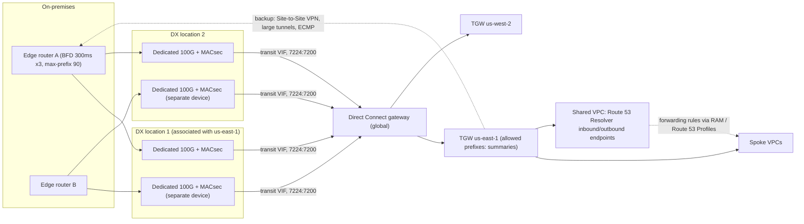
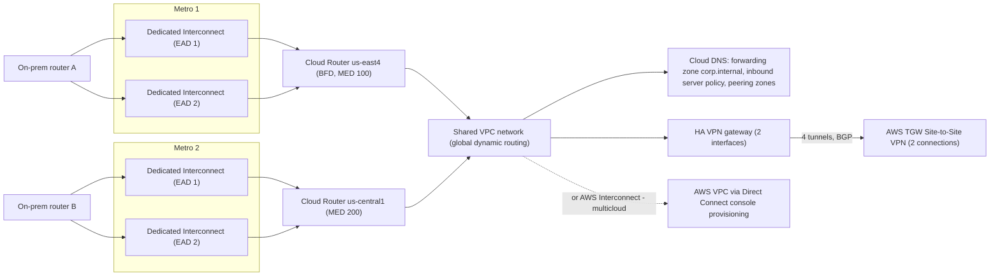

# 02.2 · Hybrid BGP Routing: Direct Connect VIFs and MACsec vs Cloud Interconnect and HA VPN

> **Folder 02 · File 2 of 3.** Hybrid connectivity is a BGP problem with physical failure domains attached. Get the topology, the timers and the **path-selection rules** wrong, and the "redundant" second circuit either carries nothing or carries everything at the wrong moment. This file covers:
> - AWS Direct Connect: dedicated and hosted connections, private, public and transit VIFs, Direct Connect gateway, SiteLink, MACsec, resiliency models.
> - Site-to-Site VPN, including large-bandwidth tunnels.
> - Google Cloud Interconnect: Dedicated, Partner, Cross-Cloud, VLAN attachments, MACsec, and the SLA topologies.
> - HA VPN and Cloud Router.
> - Hybrid DNS: Route 53 Resolver endpoints, rules and Profiles vs Cloud DNS forwarding and peering zones, and server policies.
> - **AWS Interconnect – multicloud** (GA 2026-04-14), the first jointly engineered AWS↔Google private link.

| Listing | What it shows | Language |
|---|---|---|
| `hybrid_path_sim.py` | The Transit Gateway route evaluation order on DX vs VPN vs a more-specific prefix. Why AS_PATH prepending on DX can't move traffic to a VPN. AWS→on-prem choice with local-preference communities (active/passive vs ECMP). Failure-detection times (BGP hold vs BFD). Hybrid-path unavailability for 1–2 locations × 1–2 links. Tunnel counts for 10 Gbps by packet size | Python 3 (stdlib) |

**Verification.** The listing is embedded byte-identical. The gate re-runs it on this file and requires `verdict: OK`, which asserts the documented selection results. Quotas, timers and communities come from the Direct Connect, Site-to-Site VPN, Transit Gateway, Cloud VPN and Cloud Router documentation as of **2026-10-31**.

**Labels.** **[D]** documented · **[E]** estimate/model · ⚠ inferred, not a product contract.

---

## 0. Orientation

**The questions this file answers.**

1. Which physical and logical objects make up a hybrid link on each cloud? Connection/port, LAG, VIF or VLAN attachment, gateway or router, BGP session.
2. How does each side choose a path when the same prefix arrives over several links? Which BGP attributes are honored, in what order, and which attachment *type* beats which?
3. How long does traffic black-hole when a link fails, and how do BFD and timers change that?
4. What do the 99.9% and 99.99% topologies require, and why is "two links in one building" not two failure domains?
5. When do you encrypt (MACsec, IPsec over DX/Interconnect, HA VPN), and what does it cost in throughput?
6. How do you make DNS work in both directions without per-VPC sprawl?
7. How do you connect AWS and Google Cloud to *each other*?

**Reading paths.**

| Goal | Read |
|---|---|
| L7 interview | §1, §3.3–3.5, §4.3–4.4, §5, §7, Q-chains |
| SAP-C02 (heavy here) | §2, §3 entire, §6, §7, S-scenarios |
| Building a hybrid edge | §3–§6, run the listing, then §10 |

**Prerequisites.** [02.1](01-aws-regional-vpc-tgw-privatelink-vs-gcp-global-andromeda-vpc-psc.md) covers TGW route tables and GCP dynamic routing mode.

---

## 1. First principles: BGP is policy, physics is failure domains

### 1.1 What BGP actually decides

BGP doesn't pick the "fastest" path. It applies an **ordered list of tie-breakers** to routes for the *same* prefix, after the router has already preferred the **longest prefix**. Three consequences dominate hybrid designs:
1. **A more specific prefix always wins**, whatever the attributes, so de-aggregation is the strongest traffic-engineering tool you have.
2. **Each direction is decided by a different router.**
   - The cloud decides cloud → on-prem, using the attributes *you send* (communities, AS_PATH, MED).
   - Your routers decide on-prem → cloud, using what the cloud sends plus your local preference.

   Symmetric routing is something you engineer. It doesn't happen by default.
3. **Cloud routers add their own rules ahead of BGP.**
   - On AWS, a Transit Gateway ranks *attachment types* before AS_PATH [D]: DX beats VPN for the same prefix, whatever the prepending.
   - On GCP, Cloud Router's route priority (MED-derived) and the inter-region cost in global routing mode come first.

### 1.2 Failure domains in hybrid networking

| Layer | Failure domain | Mitigation |
|---|---|---|
| Fiber / cross-connect | One port | Second connection |
| Device | The provider's router at the location, your router | Connections that land on different devices (AWS) or edge availability domains (GCP) |
| Location / metro | A colocation facility, a metro power or fiber event | **A second location/metro** |
| Provider region attachment | One Region's gateway or router | Gateways/routers in two regions (GCP 99.99%) |
| Control plane | A BGP misconfiguration (prefix limit exceeded, a filter) | Prefix budgets, staged changes, monitoring of learned routes |

The listing's section 4 makes the location point numerically. With an assumed link unavailability of 1e-3 and location unavailability of 2e-4 [E]:
- **two links in one location** still leave ~106 minutes a year of total outage, bounded by the location itself;
- **two locations** cut it to under a minute.

### 1.3 Detection time is downtime

When a link dies silently (a fiber cut behind a still-lit optical device), BGP notices only when the **hold timer** expires. Direct Connect's default is **90 s** [D]. **BFD** detects in under a second: AWS supports 300 ms × 3 = 0.9 s [D]. Cloud Router's BFD detect timer expires at 5,000 ms [D]. Every hybrid design review should ask: *is BFD on, on both ends?*

---

## 2. Side-by-side architectural Rosetta matrix

| Concern | AWS | GCP | What actually differs |
|---|---|---|---|
| Dedicated port | **Direct Connect dedicated connection**: 1, 10, 100, 400 Gbps (single-mode fiber LR optics) [D] | **Dedicated Interconnect**: 10, 100, 400 Gbps (400G GA 2026-03-03) | Similar speeds. GCP has no 1G dedicated port |
| Partner-provided capacity | **Hosted connection** from a DX partner. One VIF per hosted connection [D] | **Partner Interconnect**: VLAN attachments from 50 Mbps to 50 Gbps through a partner | Hosted connections are a connection. Partner VLAN attachments are an attachment |
| Aggregation | **LAG**: up to 4 connections below 100G, 2 at 100G [D] | Multiple connections and VLAN attachments with ECMP through Cloud Router | — |
| Logical attachment | **VIF**: private (to VGW or DXGW), public (AWS public prefixes), transit (DXGW → TGW/Cloud WAN). 50 private/public + up to 4 transit per dedicated connection [D] | **VLAN attachment** (802.1Q) on an Interconnect, bound to a **Cloud Router** in a region | A GCP VLAN attachment is regional. A DXGW is global |
| Gateway object | **Direct Connect gateway** (global): 20 VGWs or 6 TGWs per DXGW. 30 private/transit VIFs per DXGW [D] | **Cloud Router** (regional BGP speaker). Dynamic routing mode decides regional vs global use | DXGW reaches any Region. GCP reaches the network through Cloud Router plus global mode |
| Prefixes on-prem → cloud | 100 per BGP session on private/transit VIFs by default (prefix controls up to 1,000). **Exceeding it puts the session in idle (DOWN)** [D] | Learned-route quotas per Cloud Router / per region per network (check quotas) | AWS drops the *whole session* on overflow |
| Prefixes cloud → on-prem | Transit VIF: 200 prefixes per TGW (IPv4 + IPv6) [D]. DXGW allowed prefixes control what's advertised | Cloud Router advertises subnets by default, or custom ranges | Summarize on both sides |
| Public cloud services over the private link | **Public VIF**: AWS public prefixes, scoped by communities 7224:9100/9200/9300 [D] | **Private Google Access for on-premises hosts** (`private.googleapis.com` / `restricted.googleapis.com` ranges advertised by Cloud Router) | AWS gives public-IP peering. Google advertises a VIP range into your network |
| Steering cloud → on-prem | Local-preference communities **7224:7100 / 7200 / 7300**, then AS_PATH, then MED [D] | On-prem advertises MED. Cloud Router uses learned-route priority | Both honor your attributes, through different knobs |
| Steering on-prem → cloud | Your routers' local preference. AWS sets AS_PATH and MED on what it advertises | Cloud Router **advertised route priority** (base priority) plus custom advertisements | — |
| Link-layer encryption | **MACsec** (IEEE 802.1AE) on dedicated 10/100/400 Gbps at supporting locations | **MACsec for Cloud Interconnect** on supported Dedicated Interconnect connections | Both encrypt line-rate at L2. Key management is per connection |
| IPsec over the private link | Private IP VPN over DX (TGW VPN attachment using DX transport) | **HA VPN over Cloud Interconnect** | Adds encryption above L2, costs throughput per tunnel |
| Internet VPN | Site-to-Site VPN: 2 tunnels per connection. **1.25 Gbps / 140k pps per standard tunnel, 5 Gbps / 400k pps per large-bandwidth tunnel** [D]. ECMP only on TGW with BGP | **HA VPN**: 99.99% SLA with two interfaces/tunnels properly configured. **250k pps per tunnel, ingress + egress combined (~1–3 Gbps)** [D] | AWS caps a standard tunnel at 1.25 Gbps. GCP caps by packets, summed both ways |
| VPN routing | Static or BGP (VGW). BGP for ECMP on TGW | HA VPN: **BGP only**. Classic VPN: static only (99.9%) [D] | — |
| BGP timers | Keepalive 30 s, hold 90 s default. Min hold 3 s. BFD 300 ms × 3 [D] | BFD on Interconnect VLAN attachments: detect timer expires at 5,000 ms. Graceful restart 120 s [D] | AWS BFD is ~6× faster to declare down |
| SLA topologies | **Maximum resiliency**: 2 connections at each of 2 locations (99.99%). High resiliency: 1 at each of 2 locations (99.9%) | **99.9%**: 2 connections in one metro, different edge availability domains. **99.99%**: 4 connections in 2 metros, Cloud Routers in 2 regions. A single-metro 99.99% option (4 connections, connection group) GA 2026 | Both demand location or metro diversity for four nines |
| Site-to-site over the cloud backbone | **SiteLink** (DX location to DX location over AWS backbone) | NCC hybrid spokes with site-to-site data transfer | Both can replace a WAN segment |
| Hybrid DNS | Route 53 Resolver **inbound/outbound endpoints**, forwarding rules shared through RAM, **Route 53 Profiles** | Cloud DNS **forwarding zones**, **DNS server policies** (inbound), **DNS peering zones**, response policies | AWS: endpoints are ENIs with QPS per IP. GCP: inbound forwarders per subnet region |
| AWS ↔ Google | **AWS Interconnect – multicloud** (GA 2026-04-14) | **Partner Cross-Cloud Interconnect for AWS**, plus Cross-Cloud Interconnect (dedicated) to other clouds | First managed private link engineered by both providers |

---

## 3. Internal mechanics: AWS Direct Connect and Site-to-Site VPN

### 3.1 Objects, bottom to top

```text
 your router ==(fiber, LR optics)== DX location (AWS device)
        |  dedicated connection 1/10/100/400G   (or hosted connection via partner)
        |  optional LAG (up to 4 x <100G, 2 x 100G)  optional MACsec (10/100/400G)
        +-- VIF (802.1Q VLAN + BGP session + BFD)
              private VIF -> VGW (one VPC) or Direct Connect gateway (DXGW)
              transit VIF -> DXGW -> up to 6 TGWs (or Cloud WAN)   [max 4 per connection]
              public  VIF -> AWS public prefixes (scope via 7224:9100/9200/9300)
        DXGW: global; up to 20 VGWs or 6 TGWs; 30 private/transit VIFs per DXGW
```

**Associated Region.** Each DX location has an associated home Region. For identical prefixes and attributes, **AWS prefers DX locations associated with the sending Region** [D]. A Region sending to on-prem therefore uses the local location first, and a cross-continent backup carries traffic only on failure. Steer with local-preference communities if that isn't what you want.

### 3.2 Prefix budgets: the outage nobody tests

- **On-prem → AWS:** 100 IPv4 and 100 IPv6 prefixes per BGP session on private and transit VIFs by default, raisable to 1,000 with prefix controls. **If you advertise more, the session goes idle and shows DOWN** [D]. A route leak that de-aggregates a /16 into /24s can take down *all* hybrid connectivity at once.
- **AWS → on-prem over a transit VIF:** 200 prefixes per TGW (IPv4 + IPv6 combined) [D]. Summarize VPC CIDRs in DXGW allowed prefixes.
- **Site-to-Site VPN:**
  - 100 dynamic routes from the customer gateway to a VGW connection;
  - 1,000 to a TGW connection;
  - 1,000 / 5,000 routes advertised back [D].
- **VPC route tables** accept only 100 propagated routes (02.1 §3.2).

Put a **prefix-count guard** on your edge routers: max-prefix with warning below the cloud's limit. Alert on learned-route counts on both sides.

### 3.3 Path selection, both directions

**On-prem → AWS** (your router decides). AWS advertises with AS_PATH and MED. You set local preference.

**AWS → on-prem** (AWS decides), per private/transit VIF rules [D]:
1. Longest prefix.
2. **Local-preference communities:** `7224:7300` high > `7224:7200` medium > `7224:7100` low. Without tags, AWS uses medium for locations associated with the Region and lower otherwise. They're evaluated **before AS_PATH**.
3. AS_PATH length.
4. MED (not recommended, given its low priority).
5. Equal → **ECMP** across VIFs, even if the ASNs in the path differ.

For **active/passive**, tag the primary 7300 and the backup 7100. For **active/active**, tag both 7200. The listing's section 2 confirms both patterns and the prepending fallback.

**Inside the Transit Gateway** (02.1 §3.4), the same prefix from different attachment types is ranked **by type before BGP**: DX gateway beats VPN over DX, which beats VPN. The listing's section 1 shows two consequences:
- prepending AS_PATH ×4 on DX **doesn't** move traffic to a VPN backup, because type wins;
- a **more specific** prefix over the VPN does move it.

The TGW route table shows only the preferred route. The VPN route appears only when the DX route is withdrawn.

**On a VGW** (single-VPC designs) [D]:
- DX BGP routes > static VPN routes > BGP VPN routes;
- then AS_PATH, then MED;
- tunnel health takes precedence over attributes.

### 3.4 Timers and BFD [D]

| Setting | Direct Connect |
|---|---|
| BGP keepalive | 30 s default |
| BGP hold | 90 s default (minimum 3 s; 0 not supported) |
| BFD | Asynchronous BFD is enabled on the AWS side. **You must enable it on your router**. Minimum interval 300 ms, multiplier 3 |
| Negotiation | The larger (slower) of the two sides' timers is used |

Without BFD, a silent failure black-holes traffic for up to the hold time: **90 s** at default, during which the TGW keeps sending to the dead VIF. With BFD, **~0.9 s**.

### 3.5 Resiliency models and SLA

| Model | Layout | SLA | Survives |
|---|---|---|---|
| Maximum resiliency | 2 locations × 2 connections (on separate devices) | 99.99% | Device, connection *and* location failure |
| High resiliency | 2 locations × 1 connection | 99.9% | Location failure, but not a second concurrent failure |
| Development and test | 1 location × 2 connections (separate devices) | — (no location diversity) | Device or connection, **not location** |

A **VPN as backup** to DX is fine for low bandwidth. Size it honestly:
- 1.25 Gbps per standard tunnel, or 5 Gbps per large-bandwidth tunnel [D];
- ECMP across tunnels only on a TGW with BGP;
- MTU 1,446 and no PMTUD.

The listing's section 5 computes that 10 Gbps of 500-byte packets needs 18 standard tunnels (PPS-bound) or 7 large ones.

### 3.6 Encryption choices

| Option | Layer | Throughput | Notes |
|---|---|---|---|
| **MACsec** | L2, hop-by-hop on the DX connection | Line rate | Dedicated 10/100/400G at supporting locations. Your router must support 802.1AE. CKN/CAK keys per connection. `must_encrypt` vs `should_encrypt` |
| **Private IP VPN over DX** | L3 IPsec, end to end to the TGW | Per-tunnel limits (1.25 or 5 Gbps) | No public IPs. Uses DX as transport |
| **TLS in the application** | L7 | App-dependent | Often required anyway. Not a substitute for a regulatory L2/L3 mandate |

---

## 4. Internal mechanics: Google Cloud Interconnect, HA VPN and Cloud Router

### 4.1 Objects, bottom to top

```text
 your router ==(fiber)== colocation facility (Google edge, an EDGE AVAILABILITY DOMAIN)
        |  Dedicated Interconnect connection 10/100/400G  (optional MACsec)
        |  or Partner Interconnect (service provider; VLAN attachments 50M..50G)
        +-- VLAN attachment (802.1Q) -- bound to a Cloud Router in a REGION
              Cloud Router: BGP speaker; learns on-prem routes, advertises subnets/custom ranges
              VPC dynamic routing mode: REGIONAL (only this region uses learned routes)
                                         GLOBAL   (all regions; inter-region cost added)
        Cross-Cloud Interconnect: Google-provisioned links to other clouds (AWS, Azure, OCI, ...)
        Partner Cross-Cloud Interconnect for AWS: the Google side of AWS Interconnect - multicloud
```

### 4.2 SLA topologies

- **99.9%.** Two connections in the **same metro**, in **different edge availability domains**, so a single domain's maintenance or failure leaves one up.
- **99.99%.**
  - **Four connections in two metros**, two per metro in different edge availability domains.
  - Cloud Routers in **two regions**.
  - The VPC configured so both regions' routes serve the workloads (global dynamic routing, or explicit per-region design).
  - On-prem typically uses two routers, each connected to one region.
- **Single-metro 99.99%** (GA 2026): four connections in one metro grouped in a connection group. Use it where a second metro isn't available, and understand that metro-level events are now the shared risk.

### 4.3 Cloud Router path control

- **Learning.** On-prem advertises MED. Cloud Router stores it as the learned route's **priority**, where lower is preferred. Longest prefix still comes first.
- **Advertising.** Cloud Router advertises subnets by default, or custom ranges (summaries, Private Google Access VIPs), with a **base priority**, which your routers see as MED.
  - In **global dynamic routing** mode, routes learned in other regions are usable everywhere, with an **inter-region cost** added to their priority ⚠ (the value is Google-defined).
  - A region will therefore use a remote region's hybrid link only when its own is worse or absent. This is exactly the hairpin behavior in 02.1 Q9.
- **ECMP** across VLAN attachments with equal priority.
- **BFD** [D]:
  - available on Interconnect VLAN attachment BGP sessions;
  - initialization modes Disabled (default), Passive and Active;
  - the detect timer expires after **5,000 ms** without control packets;
  - the slower peer sets the rate.
- **Graceful restart** is 120 s, and planned maintenance terminates sessions with a CEASE notification [D]. Keepalive and hold defaults are documented on the BGP timers page ⚠, and the hold timer is negotiated.

### 4.4 HA VPN [D]

- An HA VPN gateway has **two interfaces**. **99.99% SLA** requires two tunnels configured to the peer per the supported topologies. A single-interface setup has no availability SLA.
- **BGP only**, through Cloud Router. (Classic VPN is static-only and 99.9%.)
- **Per tunnel:** up to **250,000 packets per second for ingress plus egress combined**, roughly 1–3 Gbps depending on packet size. Compare sent + received bytes against 375 MB/s.
- Peers must **pre-fragment**: fragment before encapsulation.
- IKEv1 and IKEv2. IPv6 needs IKEv2.
- **HA VPN over Cloud Interconnect** adds IPsec to private links.
- **To AWS:** the standard pattern is two AWS VPN connections (four tunnels) to a GCP HA VPN gateway's two interfaces, with BGP on all four. Each side's per-tunnel caps apply, with ECMP on the AWS TGW side.

### 4.5 Private access to Google APIs from on-prem

Cloud Router advertises the `private.googleapis.com` or `restricted.googleapis.com` VIP range (the latter for VPC Service Controls) to on-prem. On-prem DNS maps `*.googleapis.com` to those VIPs (a CNAME to `private.googleapis.com`), so API traffic rides the Interconnect. This is the GCP counterpart of the AWS **public VIF** and of **interface endpoints reachable over DX** (02.1 S6).

---

## 5. Listing: path selection, detection time and failure arithmetic

<!-- listing:hybrid_path_sim.py -->
```python
"""hybrid_path_sim.py - hybrid routing decisions and failure arithmetic for Direct Connect / VPN
on AWS and Cloud Interconnect / HA VPN on Google Cloud.

Rules encoded (public docs, 2026-10-31):
  TGW route evaluation: longest prefix; then by attachment type static > system (1:1 NAT) >
    prefix-list > VPC > Direct Connect gateway > Connect > VPN over DX > VPN > VPN Concentrator >
    Client VPN > peering; then shorter AS_PATH, lower MED, eBGP over iBGP. Missing MED defaults:
    0 on DX, 100 on VPN/Connect.
  AWS -> on-prem over private/transit VIFs: longest prefix, then local-preference community
    (7224:7100 low < 7224:7200 medium < 7224:7300 high), then AS_PATH, then MED; equal -> ECMP.
  Failure detection: DX BGP hold 90 s by default; BFD min 300 ms x 3. Cloud Router BFD declares
    the session down after 5,000 ms without control packets.
  Tunnel capacity: AWS standard VPN tunnel 1.25 Gbps / 140k pps, large-bandwidth tunnel 5 Gbps /
    400k pps (ECMP only on TGW with BGP); Cloud VPN tunnel 250k pps for ingress + egress combined,
    i.e. about 1-3 Gbps depending on packet size.
  The link and location unavailabilities in section 4 are ASSUMPTIONS, printed as such.

Usage: python -I hybrid_path_sim.py <any path>
"""
import ipaddress
import math
import sys

TGW_TYPE_RANK = ["static", "system", "prefix-list", "vpc", "dxgw", "connect", "vpn-over-dx",
                 "vpn", "vpn-concentrator", "client-vpn", "peering"]
DEFAULT_MED = {"dxgw": 0, "vpn": 100, "connect": 100}
LOCAL_PREF = {"7224:7100": 100, "7224:7200": 200, "7224:7300": 300, None: 200}


def tgw_best(routes, dst):
    cand = [r for r in routes if ipaddress.ip_address(dst) in ipaddress.ip_network(r["cidr"])]
    if not cand:
        return []
    def key(r):
        med = r.get("med", DEFAULT_MED.get(r["type"], 0))
        return (-ipaddress.ip_network(r["cidr"]).prefixlen, TGW_TYPE_RANK.index(r["type"]),
                len(r.get("as_path", [])), med, 0 if r.get("ebgp", True) else 1)
    best = min(key(r) for r in cand)
    return [r["name"] for r in cand if key(r) == best]


def aws_to_onprem(paths):
    """AWS outbound choice across VIFs: longest prefix, local pref (higher wins), AS_PATH, MED."""
    def key(p):
        return (-ipaddress.ip_network(p["cidr"]).prefixlen, -LOCAL_PREF[p.get("community")],
                len(p["as_path"]), p.get("med", 0))
    best = min(key(p) for p in paths)
    return [p["name"] for p in paths if key(p) == best]


def unavailability(n_sites, links_per_site, p_link, p_site):
    """Fraction of time all paths are down: sites fail independently; a site is down if the
    location fails or every link in it fails."""
    return (p_site + (1 - p_site) * p_link ** links_per_site) ** n_sites


def main():
    ok = True
    print("== 1. Transit Gateway route evaluation for 10.50.1.10 ==")
    routes = [
        {"name": "DX 10.50.0.0/16 (AS_PATH 1)", "cidr": "10.50.0.0/16", "type": "dxgw", "as_path": [65001]},
        {"name": "VPN 10.50.0.0/16 (AS_PATH 1)", "cidr": "10.50.0.0/16", "type": "vpn", "as_path": [65001]},
        {"name": "VPN 10.50.1.0/24 (more specific)", "cidr": "10.50.1.0/24", "type": "vpn", "as_path": [65001, 65001]},
    ]
    for label, rs, want in (("DX + VPN same /16", routes[:2], ["DX 10.50.0.0/16 (AS_PATH 1)"]),
                            ("plus a VPN /24", routes, ["VPN 10.50.1.0/24 (more specific)"]),
                            ("DX /16 prepended x3 vs VPN /16", [dict(routes[0], as_path=[65001] * 4), routes[1]],
                             ["DX 10.50.0.0/16 (AS_PATH 1)"])):
        got = tgw_best(rs, "10.50.1.10")
        ok &= got == want
        print(f"{label:<34} -> {got[0]}")
    print("   attachment type outranks AS_PATH: prepending on DX does not move traffic to the VPN;")
    print("   withdraw the DX route or advertise a more specific prefix over the preferred path")

    print()
    print("== 2. AWS -> on-prem across two DX locations (private/transit VIFs) ==")
    vifs = [
        {"name": "VIF-A (location 1)", "cidr": "172.16.0.0/16", "as_path": [65010], "community": "7224:7300"},
        {"name": "VIF-B (location 2)", "cidr": "172.16.0.0/16", "as_path": [65010], "community": "7224:7100"},
    ]
    act_pass = aws_to_onprem(vifs)
    act_act = aws_to_onprem([dict(v, community="7224:7200") for v in vifs])
    prepend = aws_to_onprem([dict(vifs[0], community=None), dict(vifs[1], community=None, as_path=[65010] * 3)])
    print(f"high (7300) vs low (7100) community   -> {act_pass}")
    print(f"both medium (7200)                    -> {act_act} (ECMP)")
    print(f"no communities, VIF-B prepended x2    -> {prepend}")
    ok &= act_pass == ["VIF-A (location 1)"] and len(act_act) == 2 and prepend == ["VIF-A (location 1)"]

    print()
    print("== 3. Failure detection time (how long traffic black-holes before reroute) ==")
    for name, secs in (("DX BGP hold timer default", 90.0), ("DX with BFD 300 ms x 3", 0.3 * 3),
                       ("Cloud Router BFD detect timer", 5.0), ("BGP with 10 s keepalive x 3", 30.0)):
        print(f"{name:<32} {secs:>6.1f} s")
    print("   on-prem routers must run BFD too; the slower side's timers win")

    print()
    print("== 4. Unavailability of the hybrid path, ASSUMED p_link=1e-3, p_location=2e-4 ==")
    res = {}
    for label, sites, links in (("1 location x 1 link", 1, 1), ("1 location x 2 links", 1, 2),
                                ("2 locations x 1 link", 2, 1), ("2 locations x 2 links", 2, 2)):
        u = unavailability(sites, links, 1e-3, 2e-4)
        res[label] = u
        print(f"{label:<22} {u:.2e}  ~{u * 525_600:7.1f} min/yr with every path down")
    ok &= res["1 location x 2 links"] > 2e-4 and res["2 locations x 1 link"] < res["1 location x 2 links"] / 100
    print("   a second link in the SAME location cannot go below that location's own failure rate;")
    print("   a second location is what removes the correlated failure")

    print()
    print("== 5. Tunnels needed for 10 Gbps of encrypted hybrid traffic ==")
    for pkt in (1400, 500):
        gcp_gbps = min(3.0, 250_000 * pkt * 8 / 1e9)
        aws_std = min(1.25, 140_000 * pkt * 8 / 1e9)
        aws_big = min(5.0, 400_000 * pkt * 8 / 1e9)
        print(f"avg packet {pkt:>4} B: Cloud VPN {gcp_gbps:4.2f} Gbps/tunnel -> {math.ceil(10 / gcp_gbps):>2} tunnels | "
              f"AWS standard {aws_std:4.2f} -> {math.ceil(10 / aws_std):>2} | AWS large {aws_big:4.2f} -> {math.ceil(10 / aws_big):>2} (ECMP on TGW)")
    print("   Cloud VPN's 250k pps is ingress + egress combined: halve it for symmetric traffic")
    print()
    print("verdict: OK" if ok else "verdict: FAIL")


if __name__ == "__main__":
    main()
```

<!-- output:hybrid_path_sim.py -->
```text
== 1. Transit Gateway route evaluation for 10.50.1.10 ==
DX + VPN same /16                  -> DX 10.50.0.0/16 (AS_PATH 1)
plus a VPN /24                     -> VPN 10.50.1.0/24 (more specific)
DX /16 prepended x3 vs VPN /16     -> DX 10.50.0.0/16 (AS_PATH 1)
   attachment type outranks AS_PATH: prepending on DX does not move traffic to the VPN;
   withdraw the DX route or advertise a more specific prefix over the preferred path

== 2. AWS -> on-prem across two DX locations (private/transit VIFs) ==
high (7300) vs low (7100) community   -> ['VIF-A (location 1)']
both medium (7200)                    -> ['VIF-A (location 1)', 'VIF-B (location 2)'] (ECMP)
no communities, VIF-B prepended x2    -> ['VIF-A (location 1)']

== 3. Failure detection time (how long traffic black-holes before reroute) ==
DX BGP hold timer default          90.0 s
DX with BFD 300 ms x 3              0.9 s
Cloud Router BFD detect timer       5.0 s
BGP with 10 s keepalive x 3        30.0 s
   on-prem routers must run BFD too; the slower side's timers win

== 4. Unavailability of the hybrid path, ASSUMED p_link=1e-3, p_location=2e-4 ==
1 location x 1 link    1.20e-03  ~  630.6 min/yr with every path down
1 location x 2 links   2.01e-04  ~  105.6 min/yr with every path down
2 locations x 1 link   1.44e-06  ~    0.8 min/yr with every path down
2 locations x 2 links  4.04e-08  ~    0.0 min/yr with every path down
   a second link in the SAME location cannot go below that location's own failure rate;
   a second location is what removes the correlated failure

== 5. Tunnels needed for 10 Gbps of encrypted hybrid traffic ==
avg packet 1400 B: Cloud VPN 2.80 Gbps/tunnel ->  4 tunnels | AWS standard 1.25 ->  8 | AWS large 4.48 ->  3 (ECMP on TGW)
avg packet  500 B: Cloud VPN 1.00 Gbps/tunnel -> 10 tunnels | AWS standard 0.56 -> 18 | AWS large 1.60 ->  7 (ECMP on TGW)
   Cloud VPN's 250k pps is ingress + egress combined: halve it for symmetric traffic

verdict: OK
```

**Reading the output.**

- **Section 1.**
  - With DX and VPN both advertising `10.50.0.0/16`, the TGW picks DX by **attachment type**.
  - Prepending DX's AS_PATH to length 4 doesn't change that.
  - A more specific `/24` over the VPN wins by longest prefix.

  So "fail over to VPN by prepending" doesn't work on a TGW. Failover happens when DX *withdraws*, and steering happens through prefix length.
- **Section 2.**
  - Tagging the primary VIF `7224:7300` and the backup `7224:7100` sends AWS → on-prem traffic only over the primary.
  - Tagging both `7224:7200` gives **ECMP**.
  - Without communities, AS_PATH prepending on the backup still works, because communities are evaluated before AS_PATH, not instead of it.
- **Section 3.** Black-hole time is the detection time: **90 s** with default DX timers, **0.9 s** with BFD 300 ms × 3, and **5 s** with Cloud Router BFD.
- **Section 4 [E]** (assumed per-link 1e-3 and per-location 2e-4 unavailability):
  - one link: ~631 min/yr;
  - two links in one location: ~106 min/yr, floored by the location;
  - two locations: ~0.8 min/yr.

  That's why both providers' four-nines topologies demand location or metro diversity.
- **Section 5.** 10 Gbps of encrypted traffic needs:

  | Average packet | Cloud VPN | AWS standard | AWS large |
  |---|---|---|---|
  | 1,400 B | 4 tunnels | 8 | 3 |
  | 500 B | 10 tunnels | 18 | 7 |

  Cloud VPN's 250k pps is ingress + egress combined, so halve it for symmetric traffic.

---

## 6. Hybrid DNS and cross-cloud connectivity

### 6.1 AWS: Route 53 Resolver endpoints, rules and Profiles [D]

- **Outbound endpoint + forwarding rules.** VPC resolvers forward `corp.internal` to on-prem DNS. Rules are shared through **AWS RAM** and associated with VPCs.
- **Inbound endpoint.** On-prem forwarders send `aws.corp.example` queries to endpoint IPs, which resolve private hosted zones.
- **Capacity.**
  - **10,000 UDP queries per second per endpoint IP address**;
  - the outbound QPS per interface differs because Resolver sends redundant queries;
  - **inbound endpoints can drop to ~1,500 QPS per IP when connection tracking is enforced** (restrictive security groups, or queries through an NLB).

  Use allow-all-style SG rules where safe so the flows stay untracked (01.1 §3.6). Add IPs to scale.
- **Route 53 Profiles** bundle private hosted zones, Resolver rules and DNS Firewall rule groups, and share them to many VPCs and accounts. AWS recommends Profiles beyond ~300 VPC associations [D].
- **Per-instance limit.** 1,024 packets per second per ENI to the VPC resolver (01.1).

### 6.2 GCP: Cloud DNS forwarding, peering and server policies

- **Forwarding zones** send a domain's queries to on-prem name servers.
  - On-prem must route Cloud DNS's forwarding source range (**35.199.192.0/19**) back over the hybrid link.
  - Cloud Router advertises it only if configured.
- **DNS server policy (inbound).** Creates inbound forwarder IPs in each region's subnets, so on-prem can resolve private zones.
- **DNS peering zones.** A service network resolves a domain using another network's view, typically a hub that holds the forwarding zones. This avoids configuring forwarding in every network.
- **Response policies** override answers, for example private endpoints for `*.googleapis.com`.

### 6.3 AWS ↔ Google private connectivity

| Option | How | When |
|---|---|---|
| **AWS Interconnect – multicloud** + Partner Cross-Cloud Interconnect for AWS (GA 2026-04-14) | Provisioned from the Direct Connect console: pick provider, regions, bandwidth and a Google Cloud project ID. An activation key completes the Google side | New AWS↔GCP private links. Check SLA coverage on the Google side (it wasn't listed as SLA-covered at GA) and the free 500 Mbps local interconnect per Region per account from May 2026 |
| **Cross-Cloud Interconnect** (dedicated) | Google provisions physical links to the other cloud's dedicated port in a shared facility | Large, steady bandwidth. Dedicated ports on both sides |
| **HA VPN ↔ Site-to-Site VPN** | 4 tunnels with BGP, ECMP on TGW | Quick, encrypted, low-to-moderate bandwidth |
| Colocation router (your own) | DX + Interconnect into your router in a shared metro | Existing colo presence. You own the router |

Whatever the link, **address overlap** and **DNS** decide whether the integration works. Plan the CIDRs (02.1) and the DNS forwarding (§6.1–6.2) for both clouds as one design.

---

## 7. Failure modes, throttling limits and quota traps

| # | Symptom | Root cause | Detect | Fix | Cloud |
|---|---|---|---|---|---|
| 1 | All DX sessions DOWN after an on-prem change | **Prefix limit exceeded** (100 by default per private/transit VIF session) puts the session idle | VIF BGP state, on-prem logs | Summarize. Prefix controls up to 1,000. Max-prefix guards on your routers | AWS |
| 2 | Failover to VPN takes 90 seconds | No **BFD**; hold timer 90 s | Packet loss duration on failover tests | BFD on your routers (AWS side is on). Lower hold if BFD is impossible | AWS |
| 3 | Backup VPN never carries traffic despite prepending DX | **TGW ranks attachment type before AS_PATH** | TGW route table shows the DX route only | Withdraw the DX route on failure, or use more specifics. Test real failover | AWS |
| 4 | AWS → on-prem traffic uses the far-away DX location | Default preference for the Region's **associated** location, or communities set wrongly | VIF traffic metrics | Local-pref communities 7300 / 7100. Check associated Regions | AWS |
| 5 | "Redundant" DX fails together | Both connections in **one location** (dev/test model) | Location outage | Maximum or high resiliency models. Second location | AWS |
| 6 | Transit VIF advertises only some VPCs | **200-prefix limit per TGW** to on-prem | Missing routes on-prem | Summarize in DXGW allowed prefixes | AWS |
| 7 | VPN throughput plateaus near 1.25 Gbps | **Per-tunnel cap**. VGW has no ECMP | Tunnel metrics | TGW + BGP + ECMP across tunnels, large-bandwidth tunnels, or DX | AWS |
| 8 | Fragmented or dropped large packets over VPN | MTU 1,446, no PMTUD | Fragmentation counters | MSS clamping (1,406 or lower by cipher) | AWS |
| 9 | Inbound Resolver endpoint saturates at low QPS | **Connection tracking** enforced, ~1,500 QPS per IP | Endpoint metrics, on-prem timeouts | Untracked SG rules, more IPs, avoid NLB in front | AWS |
| 10 | HA VPN "99.99%" but one tunnel down for weeks unnoticed | Single-interface peer config, so no SLA | Tunnel status | Two tunnels per supported topology. Alert on tunnel state | GCP |
| 11 | Cloud VPN throughput below 1 Gbps with small packets | **250k pps per tunnel, ingress + egress combined** | Sent + received bytes vs 375 MB/s | More tunnels with ECMP. Larger packets. Interconnect | GCP |
| 12 | Europe uses a US Interconnect | **Global dynamic routing**, MED or inter-region cost ordering | Cloud Router learned routes per region | MED per attachment, regional mode, or more specifics | GCP |
| 13 | 99.9% topology lost both links during maintenance | Both connections in the **same edge availability domain** | Maintenance notices | Different edge availability domains (99.9%), two metros (99.99%) | GCP |
| 14 | Cloud DNS forwarding to on-prem times out | On-prem lacks a return route to **35.199.192.0/19** | DNS logs | Advertise or route the range over the hybrid link | GCP |
| 15 | On-prem API calls to Google go over the internet | No Private Google Access VIP routes/DNS on-prem | Flow logs | Advertise the `private`/`restricted` VIP ranges. CNAME DNS | GCP |
| 16 | Asymmetric flows break a stateful firewall on-prem | Each side chose a different link | Firewall half-open sessions | Engineer both directions together: communities + MED/local-pref | Both |
| 17 | MACsec won't come up after a router swap | Key (CKN/CAK) or cipher mismatch | Port state | Key-rotation runbooks. `should_encrypt` during cutover | Both |

---

## 8. Architecture diagrams: multi-service compositions

### 8.1 AWS maximum-resiliency hybrid edge with transit VIFs



### 8.2 GCP 99.99% Interconnect with HA VPN to AWS



### 8.3 The two directions of a hybrid flow (ASCII)

```text
              cloud -> on-prem                         on-prem -> cloud
  decided by  the CLOUD                                YOUR routers
  AWS         longest prefix > community 7300/7200/7100 local-pref you set; AWS sends AS_PATH
              > AS_PATH > MED > ECMP                   and MED; TGW type order applies inside
  GCP         longest prefix > learned priority (MED)  Cloud Router advertised priority (MED)
              (+ inter-region cost in global mode)     you see; your local-pref decides
  tools       communities / MED you SEND               attributes the cloud SENDS + your policy
  rule        engineer both directions together, or stateful devices see half of each flow
```

---

## 9. Bar-raiser chains and SAP-C02 scenarios

### 9.1 L7 bar-raiser chains

<details><summary><b>Q1 · Design 99.99% hybrid connectivity to AWS and GCP from two data centers</b></summary>

**Initial Prompt.** "We have data centers in two metros and need 99.99% private connectivity to AWS (us-east-1, us-west-2) and GCP (us-east4, us-central1), plus encryption for PCI traffic. Design it."

**L5 Answer.** "Order two Direct Connect connections and two Dedicated Interconnects, and use VPN as backup."

**Why L5 Stalls.** Two connections don't reach four nines on either cloud unless they're in separate locations or metros, and the answer has no plan for routing, timers, encryption or DNS.

**L7 Answer.**
- **AWS:**
  - **maximum resiliency**: two DX locations, two connections each, on separate devices, with MACsec on the dedicated ports for PCI;
  - transit VIFs to one DX gateway associated with both Regions' TGWs, and `7224:7200` on all four for ECMP;
  - BFD 300 ms × 3 on our routers;
  - max-prefix guards below 100;
  - summarized allowed prefixes, staying under the 200-per-TGW limit.
- **GCP:**
  - four Dedicated Interconnects across two metros in different edge availability domains;
  - Cloud Routers in us-east4 and us-central1, with BFD;
  - MED per region so each metro prefers its nearby region, and global dynamic routing for failover;
  - MACsec where supported.
- **Shared:**
  - VPN only as a tested last-resort path (TGW ECMP on large tunnels; HA VPN with two interfaces);
  - DNS through Route 53 Resolver endpoints and Profiles on AWS, and Cloud DNS forwarding and peering zones on GCP, with 35.199.192.0/19 routed back;
  - quarterly failover drills that pull a location.
- **The math:** a second location is what moves the outage budget from ~100 minutes a year to under one (listing §4)."
</details>

<details><summary><b>Q2 · The VPN backup didn't take over</b></summary>

**Initial Prompt.** "We advertised the same prefixes over DX and a Site-to-Site VPN on our TGW, and prepended AS_PATH on DX so VPN would be preferred during a migration. Traffic stayed on DX. Why?"

**L5 Answer.** "Maybe the prepend didn't apply. Check the router config and prepend more."

**Why L5 Stalls.** No amount of prepending changes it. The TGW ranks attachment types before AS_PATH.

**L7 Answer.** "A TGW's route evaluation for an identical prefix goes: static, then VPC-propagated, then **Direct Connect gateway-propagated**, then Connect, then VPN-over-DX, then **VPN**. Only within the same type do AS_PATH and MED matter. DX wins for an equal prefix by type, and the route table shows only the preferred route.

To move traffic to the VPN, either:
1. advertise a **more specific** prefix over the VPN (longest prefix comes before type); or
2. **withdraw** the prefix from DX.

The listing reproduces all three cases. The general lesson: learn each cloud router's pre-BGP rules before using BGP attributes to engineer traffic."
</details>

<details><summary><b>Q3 · One route leak took down every Direct Connect session</b></summary>

**Initial Prompt.** "An on-prem engineer redistributed a /16 as 256 /24s by mistake. Every DX BGP session to AWS went down within seconds, and so did production. How does a single mistake have that blast radius, and how do we prevent it?"

**L5 Answer.** "Add a change review process for router configs."

**Why L5 Stalls.** Review helps, but the mechanism is a hard quota whose overflow takes the session down. That needs a technical guard.

**L7 Answer.** "Private and transit VIF sessions accept 100 prefixes by default (up to 1,000 with prefix controls). Exceeding the allocation **puts the session in idle**, reported DOWN. Every VIF received the same 256-prefix leak, so every session dropped together. The 'redundancy' shared one control-plane input.

Guards, layered:
1. **Max-prefix limits** on our routers' outbound policy, set below the AWS allocation, with a warning threshold.
2. **Prefix-list filters** that only permit approved summaries per VIF.
3. Raise the AWS allocation where the design truly needs more routes.
4. Stage changes **one location at a time**, with a timer, so a bad policy can't reach all VIFs at once.
5. Alert on learned-route counts on both sides.

On GCP, Cloud Router's learned-route quotas need the same discipline, and NCC drops routes by destination past its quota (02.1)."
</details>

<details><summary><b>Q4 · Encrypt the hybrid link for compliance without losing throughput</b></summary>

**Initial Prompt.** "Compliance requires encryption in transit for all data between our data center and AWS/GCP. We push 60 Gbps. The team proposes running IPsec over DX. Evaluate."

**L5 Answer.** "IPsec over Direct Connect is the standard way to encrypt, so set it up."

**Why L5 Stalls.** At 60 Gbps, IPsec's per-tunnel caps make it an engineering project. MACsec is built for this case, and the answer never asks what the mandate actually requires.

**L7 Answer.** "Clarify the control first: link-layer encryption between our router and the provider edge, or end-to-end encryption to the workload?
- **MACsec** on dedicated 10/100/400G DX ports (and on supported Dedicated Interconnect) encrypts at line rate. It's the right tool for 'encrypt the private link'. The costs: router support for 802.1AE, key management per connection (CKN/CAK rotation), and only supported locations.
- **IPsec over DX/Interconnect** (private IP VPN on TGW, HA VPN over Interconnect) gives end-to-end-to-the-cloud-router encryption, but per tunnel:
  - AWS large tunnels are 5 Gbps / 400k pps;
  - Cloud VPN is 250k pps summed both ways.

  60 Gbps is 12+ large AWS tunnels with ECMP and many more on GCP, each with MTU limits.
- **Most mandates** are satisfied by MACsec on the link plus TLS in the applications. I'd document that mapping with compliance, and keep IPsec for segments that terminate in third-party networks."
</details>

<details><summary><b>Q5 · The data center prefers the wrong AWS Region path</b></summary>

**Initial Prompt.** "Our DX locations are in Virginia and Oregon. Traffic from us-east-1 to our California data center goes out via Oregon, and us-west-2 traffic sometimes via Virginia. Control it."

**L5 Answer.** "Prepend AS_PATH on the routes we advertise from the wrong location."

**Why L5 Stalls.** Prepending works, but it's evaluated after local-preference communities and after AWS's associated-Region default. The answer doesn't say which direction is wrong, or which side decides it.

**L7 Answer.** "This is AWS → on-prem, so **AWS decides**, using what we advertise:
1. **Longest prefix.**
2. **Local-preference communities**, before AS_PATH. Absent communities, AWS prefers DX locations associated with the sending Region.
3. AS_PATH.
4. MED.
5. Equal means ECMP.

For deterministic control, advertise California's prefixes with `7224:7300` on the preferred VIFs and `7224:7100` on the others, per Region intent. If we want both locations used, tag both `7224:7200` and accept ECMP.

Then check the *other* direction on our routers (local preference on what AWS advertises), so flows are symmetric through any stateful device. Validate with traceroutes and VIF metrics from each Region."
</details>

<details><summary><b>Q6 · HA VPN to AWS runs at 2 Gbps, and we need 8</b></summary>

**Initial Prompt.** "We connected GCP to AWS with HA VPN (two interfaces) to an AWS VPN on a TGW. Throughput tops out around 2 Gbps per direction. We need 8 Gbps. What are the levers?"

**L5 Answer.** "Upgrade to a bigger VPN gateway."

**Why L5 Stalls.** Neither side has a bigger gateway. The limits are per tunnel, and they differ by cloud.

**L7 Answer.**
- **The caps:**
  - AWS standard tunnels: 1.25 Gbps / 140k pps; large-bandwidth tunnels: 5 Gbps / 400k pps.
  - GCP tunnels: 250k pps **ingress + egress combined**, so a symmetric flow gets roughly half each way.
- **Scale out:**
  - more VPN connections (each adds two tunnels);
  - BGP on all of them;
  - ECMP on the TGW side;
  - matching HA VPN gateways and tunnels on GCP;
  - at 500-byte packets, 10 Gbps needs ~10 Cloud VPN tunnels and ~7 large AWS tunnels (listing §5).
- **Better, since April 2026:** AWS Interconnect – multicloud, a managed private AWS↔Google link provisioned from the DX console, or Cross-Cloud Interconnect for dedicated bandwidth.
- **Whichever path:** check MTU (1,446 on AWS VPN, pre-fragmentation on GCP), and that both clouds' routes are summarized so neither side's route quota is close."
</details>

<details><summary><b>Q7 · On-prem can't resolve our AWS private zones at peak</b></summary>

**Initial Prompt.** "On-prem forwarders send `aws.corp.example` to our Route 53 Resolver inbound endpoint. During batch windows, resolution fails intermittently. The endpoint has two IPs. Diagnose."

**L5 Answer.** "Add more Resolver endpoints in other VPCs."

**Why L5 Stalls.** It adds sprawl without finding the bottleneck. Inbound endpoint capacity depends on connection tracking, which the security group design controls.

**L7 Answer.** "Each endpoint IP handles up to 10,000 UDP QPS, but **as little as ~1,500 QPS per IP when connection tracking is enforced**: restrictive security-group rules, or an NLB in front. Two IPs × 1,500 is 3,000 QPS. A batch window with chatty clients exceeds that.

Fixes:
1. Make the endpoint's security group rules permit DNS broadly enough that flows are **untracked**: allow 53/udp and 53/tcp from on-prem in both directions, consistent with the connection-tracking rules in 01.1.
2. **Add IPs** to the endpoint.
3. Have on-prem forwarders cache aggressively and spread queries across IPs.
4. Alarm on endpoint query metrics.

The same family of limit hits instances: 1,024 PPS per ENI to the VPC resolver. Cache at the edges."
</details>

<details><summary><b>Q8 · Partner Interconnect vs Dedicated Interconnect for a 5 Gbps need</b></summary>

**Initial Prompt.** "A business unit needs 5 Gbps private connectivity to GCP from a facility where Google has no presence. Options, and what would make you change your mind?"

**L5 Answer.** "Partner Interconnect, since Dedicated needs a Google colocation."

**Why L5 Stalls.** Correct on the first point, but it ignores redundancy (one partner path is one failure domain), the SLA dependency on the partner, and the growth path.

**L7 Answer.**
- **Default:** Partner Interconnect, with **two VLAN attachments** in different edge availability domains through the partner. Use two partners if the business needs independence from one provider.
- **SLA and timers:** the end-to-end SLA depends on both Google's topology and the partner's. BGP and BFD are configured per attachment (BFD is supported on Partner VLAN attachments).
- **Change my mind if:**
  - growth beyond ~20–50 Gbps is expected;
  - MACsec is mandated;
  - the BU moves into a facility with Google presence.

  Then I'd switch to Dedicated (10/100/400G ports) or Cross-Cloud Interconnect.
- **Compare TCO:** partner VLAN cost vs port plus cross-connect plus colo.
- **AWS equivalent:** hosted connections through a DX partner (one VIF per hosted connection), with the same two-path rule."
</details>

<details><summary><b>Q9 · Make on-prem reach S3 and Cloud Storage privately</b></summary>

**Initial Prompt.** "Security forbids internet egress from the data center. Backup software must write to S3 and to Cloud Storage over our private links. Design it for both."

**L5 Answer.** "Use VPC endpoints for S3 and Private Google Access for Cloud Storage."

**Why L5 Stalls.** The S3 *gateway* endpoint isn't reachable from on-prem, and Private Google Access for on-prem needs specific route advertisements and DNS. The answer misses both mechanics.

**L7 Answer.**
- **AWS:** either of two paths.
  - An **S3 interface endpoint** in a VPC reached over DX. On-prem DNS resolves the endpoint-specific names, or uses private DNS through the Resolver inbound endpoint.
  - A **public VIF** carrying AWS public prefixes, scoped with `7224:9100` to the local Region. Traffic stays on DX, but it's public addressing, so firewalls must allow it.
- **GCP:** advertise the `private.googleapis.com` (or `restricted.googleapis.com` with VPC Service Controls) VIP range from Cloud Router to on-prem, and CNAME `*.googleapis.com` to it in on-prem DNS. The Interconnect then carries the API traffic.
- **Both:**
  1. Bucket policies requiring the endpoint (`aws:SourceVpce`) or the VPC-SC perimeter, so data can't leave through another path.
  2. Size the link for backup windows.
  3. Test that internet-routed fallbacks are actually blocked."
</details>

<details><summary><b>Q10 · Interconnect AWS and GCP for a cross-cloud data platform</b></summary>

**Initial Prompt.** "Our analytics runs in BigQuery and the transactional estate is on AWS. We move 30 TB/day from Aurora CDC into GCP. Design the cross-cloud network in 2026."

**L5 Answer.** "Set up a VPN between AWS and GCP."

**Why L5 Stalls.** 30 TB/day is about 2.8 Gbps sustained, with peaks well above that. VPN tunnel caps, the cost of internet transfer, and failure domains make a single VPN design fragile.

**L7 Answer.**
- **Primary path:** AWS Interconnect – multicloud with Partner Cross-Cloud Interconnect for AWS (GA 2026-04-14), provisioned from the DX console with a Google project ID and activation key.
  - Two links in different Regions/metros for redundancy.
  - Check SLA coverage on the Google side.
- **Backup:** HA VPN with 4+ tunnels, BGP and ECMP on the TGW, sized for degraded throughput.
- **Addressing:** non-overlapping CIDRs across both clouds (02.1).
- **Routing:** summaries both ways, and communities and MED so each region pair uses its local link.
- **Data path:** Datastream or Debezium → Pub/Sub → BigQuery over the private link (Folder 06), with compression.
- **Cost model:** per-GB transfer on each side versus link capacity (Folder 06 math). At this volume, private links beat internet egress pricing.
- **DNS:** each cloud forwards the other's private zones through the Resolver endpoints and Cloud DNS forwarding."
</details>

### 9.2 SAP-C02 scenarios (original)

<details><summary><b>S1 · SAP-C02 · Domain 1 · Select ONE</b></summary>

**Scenario.** A company connects its data center to 30 VPCs in two AWS Regions through transit gateways. It requires the highest resiliency AWS offers for Direct Connect, with protection against the failure of an entire Direct Connect location. What should a solutions architect design?

- **A.** Two dedicated connections at one Direct Connect location on separate devices, with transit VIFs to a Direct Connect gateway.
- **B.** One dedicated connection at each of two Direct Connect locations, plus a Site-to-Site VPN as backup.
- **C.** A hosted connection from two partners at the same location.
- **D.** Two dedicated connections at each of two Direct Connect locations on separate devices, with transit VIFs to a Direct Connect gateway associated with both transit gateways.

**Answer: D**

- **A** — wrong: two connections at a single location don't protect against a location failure.
- **B** — wrong: this is the high-resiliency model. It survives a location failure but not an additional concurrent connection failure, and a VPN can't carry DX-scale traffic.
- **C** — wrong: a single location remains a shared failure domain whatever the number of partners.
- **D** — correct: the maximum resiliency model uses two connections at each of two locations, and the Direct Connect gateway reaches transit gateways in both Regions.
</details>

<details><summary><b>S2 · SAP-C02 · Domain 3 · Select ONE</b></summary>

**Scenario.** After an on-premises routing change, all BGP sessions on a company's private virtual interfaces went down at the same time. Investigation shows the on-premises routers started advertising 400 more-specific prefixes. Which action prevents this failure mode in the future?

- **A.** Configure BFD on the on-premises routers.
- **B.** Enable MACsec on the Direct Connect connections.
- **C.** Add AS_PATH prepending to the advertised prefixes.
- **D.** Advertise summarized prefixes, and configure maximum-prefix limits on the on-premises routers below the virtual interface's prefix allocation.

**Answer: D**

- **A** — wrong: BFD speeds up failure detection but doesn't stop a session from going idle when the prefix limit is exceeded.
- **B** — wrong: link encryption doesn't affect route counts.
- **C** — wrong: prepending changes path preference, not the number of prefixes.
- **D** — correct: exceeding the per-session prefix allocation puts the BGP session in an idle state. Summaries and max-prefix guards keep advertisements within the allowance.
</details>

<details><summary><b>S3 · SAP-C02 · Domain 2 · Select TWO</b></summary>

**Scenario.** A company has two Direct Connect connections at different locations to a Direct Connect gateway. It wants AWS to send traffic to its data center over the first connection and use the second only if the first fails. Both connections advertise the same prefixes. Which actions meet this requirement? (Select TWO.)

- **A.** Tag the prefixes advertised over the primary virtual interface with the 7224:7300 community.
- **B.** Tag the prefixes advertised over both virtual interfaces with the 7224:7200 community.
- **C.** Tag the prefixes advertised over the backup virtual interface with the 7224:7100 community.
- **D.** Advertise a larger MED over the primary virtual interface.
- **E.** Enable ECMP on the Direct Connect gateway.

**Answer: A, C**

- **A** — correct: the high local-preference community makes AWS prefer the primary path for its outbound traffic.
- **B** — wrong: equal medium preference produces ECMP across both connections, which is active/active.
- **C** — correct: the low local-preference community makes the backup path less preferred, so it's used only on failure.
- **D** — wrong: a larger MED makes a path *less* preferred, and MED is evaluated after local preference and AS_PATH.
- **E** — wrong: ECMP spreads traffic across both paths, the opposite of active/passive.
</details>

<details><summary><b>S4 · SAP-C02 · Domain 3 · Select ONE</b></summary>

**Scenario.** A company's Direct Connect failover tests show 60 to 90 seconds of packet loss when a connection fails without a link-down event. The business requires failover in under five seconds. What should the solutions architect recommend?

- **A.** Reduce the BGP keepalive to 1 second on AWS.
- **B.** Enable Bidirectional Forwarding Detection on the customer routers for the BGP sessions.
- **C.** Add a third Direct Connect connection.
- **D.** Configure static routes instead of BGP.

**Answer: B**

- **A** — wrong: BGP timers are negotiated from the customer side, with a minimum hold time of 3 seconds. Aggressive BGP timers add control-plane load and flap risk, and BFD is the intended mechanism for sub-second detection.
- **B** — correct: asynchronous BFD is enabled on the AWS side. Enabling it on the customer routers detects failures in under a second at 300 ms × 3.
- **C** — wrong: more connections don't speed up detecting a failed one.
- **D** — wrong: static routing over DX removes dynamic failover.
</details>

<details><summary><b>S5 · SAP-C02 · Domain 2 · Select ONE</b></summary>

**Scenario.** On-premises applications must resolve private hosted zone records for services in AWS, and AWS workloads in many accounts must resolve names in the on-premises `corp.internal` domain. The solution must be centrally managed. What should a solutions architect implement?

- **A.** Create Route 53 Resolver inbound and outbound endpoints in a shared-services VPC, create forwarding rules for `corp.internal`, and share the rules with all accounts using AWS RAM or Route 53 Profiles.
- **B.** Run DNS servers on EC2 in each VPC and configure them to forward to on-premises.
- **C.** Make the private hosted zones public so on-premises servers can resolve them.
- **D.** Change each VPC's DHCP options set to use the on-premises DNS servers.

**Answer: A**

- **A** — correct: inbound endpoints serve on-premises queries for private zones, outbound endpoints with shared forwarding rules send `corp.internal` queries to on-premises, and RAM or Profiles centralize the configuration.
- **B** — wrong: per-VPC DNS servers add operational burden and aren't central.
- **C** — wrong: exposing private records publicly is a security regression.
- **D** — wrong: pointing every VPC at on-premises DNS breaks private hosted zone and AWS name resolution and adds dependency on the link.
</details>

<details><summary><b>S6 · SAP-C02 · Domain 4 · Select ONE</b></summary>

**Scenario.** During a migration, a company needs temporary encrypted connectivity of about 4 Gbps between its data center and a transit gateway while Direct Connect is being provisioned. A single Site-to-Site VPN connection delivers only about 1.25 Gbps. What should a solutions architect do?

- **A.** Attach the VPN to a virtual private gateway and enable ECMP.
- **B.** Configure static routing on multiple VPN connections to the transit gateway.
- **C.** Create multiple Site-to-Site VPN connections to the transit gateway using BGP, and enable ECMP so traffic is spread across the tunnels.
- **D.** Increase the MTU on the VPN tunnels to support jumbo frames.

**Answer: C**

- **A** — wrong: virtual private gateways don't support ECMP across VPN connections.
- **B** — wrong: ECMP isn't supported for VPN connections that use static routing.
- **C** — correct: on a transit gateway, BGP-based VPN connections can use ECMP to aggregate bandwidth across multiple tunnels.
- **D** — wrong: Site-to-Site VPN doesn't support jumbo frames (MTU 1,446).
</details>

---

## 10. Checklist

- [ ] The topology meets the target SLA by **location/metro diversity**, not just connection count (AWS maximum resiliency; GCP 4 connections / 2 metros, or the single-metro connection-group option).
- [ ] BFD on every hybrid BGP session, on our routers too. Failover tested by pulling a link *without* link-down.
- [ ] Max-prefix guards and prefix filters below each cloud's per-session limits. Learned-route counts alerted.
- [ ] Summaries both directions: DXGW allowed prefixes (≤ 200 per TGW over transit VIF), Cloud Router custom advertisements.
- [ ] Both directions engineered together: communities (7224:7x00) + local preference on AWS, MED / advertised priority + learned priority on GCP.
- [ ] Encryption mapped to the actual requirement: MACsec for links, IPsec where it must terminate in the cloud, TLS in apps.
- [ ] VPN sizing done per tunnel (1.25 / 5 Gbps AWS, 250k pps GCP combined), with ECMP only on TGW + BGP. MSS clamping set.
- [ ] Hybrid DNS: Resolver endpoints with untracked flows and IP headroom, rules via RAM/Profiles. Cloud DNS forwarding with 35.199.192.0/19 routed. Inbound server policy.
- [ ] Private API access from on-prem: S3 interface endpoints or public VIF; `private`/`restricted.googleapis.com` VIPs plus DNS.
- [ ] Cross-cloud link chosen (Interconnect – multicloud, Cross-Cloud Interconnect, or HA VPN ↔ VPN), with non-overlapping CIDRs and DNS in both directions.

---

## 11. References

AWS:
- Direct Connect quotas: <https://docs.aws.amazon.com/directconnect/latest/UserGuide/limits.html>
- Direct Connect routing policies and BGP communities: <https://docs.aws.amazon.com/directconnect/latest/UserGuide/routing-and-bgp.html>
- Direct Connect BGP settings (timers, BFD): <https://docs.aws.amazon.com/directconnect/latest/UserGuide/bgp-specific-settings.html>
- Direct Connect resiliency toolkit: <https://docs.aws.amazon.com/directconnect/latest/UserGuide/resiliency_toolkit.html>
- MACsec for Direct Connect: <https://docs.aws.amazon.com/directconnect/latest/UserGuide/MACsec.html>
- Site-to-Site VPN quotas: <https://docs.aws.amazon.com/vpn/latest/s2svpn/vpn-limits.html>
- Site-to-Site VPN route priority: <https://docs.aws.amazon.com/vpn/latest/s2svpn/vpn-route-priority.html>
- Transit gateway route evaluation: <https://docs.aws.amazon.com/vpc/latest/tgw/how-transit-gateways-work.html>
- Route 53 quotas (Resolver endpoint QPS, Profiles): <https://docs.aws.amazon.com/Route53/latest/DeveloperGuide/DNSLimitations.html>
- Hybrid cloud DNS options (whitepaper): <https://docs.aws.amazon.com/whitepapers/latest/hybrid-cloud-dns-options-for-vpc/route-53-resolver-endpoints-and-forwarding-rules.html>
- AWS Interconnect – multicloud GA (InfoQ, April 2026): <https://www.infoq.com/news/2026/04/aws-interconnect-multicloud-ga/>

Google Cloud:
- Establish 99.99% availability for Dedicated Interconnect: <https://docs.cloud.google.com/network-connectivity/docs/interconnect/tutorials/dedicated-creating-9999-availability>
- Dedicated Interconnect overview: <https://docs.cloud.google.com/network-connectivity/docs/interconnect/concepts/dedicated-overview>
- Cloud VPN overview (HA VPN, tunnel limits): <https://docs.cloud.google.com/network-connectivity/docs/vpn/concepts/overview>
- Cloud Router BFD: <https://docs.cloud.google.com/network-connectivity/docs/router/concepts/bfd>
- Private Google Access for on-premises hosts: <https://docs.cloud.google.com/vpc/docs/private-google-access-hybrid>
- Cloud DNS forwarding and server policies: <https://docs.cloud.google.com/dns/docs/server-policies-overview>
