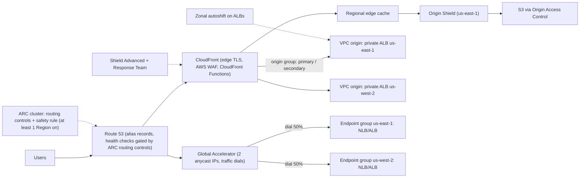
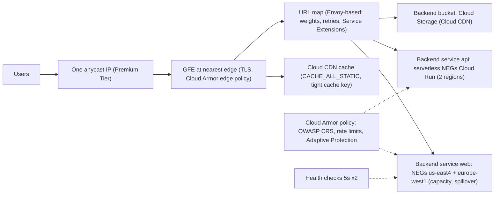

# 02.3 · The Global Edge: CloudFront, Global Accelerator and Route 53 ARC vs Google's Anycast Load Balancing, Cloud CDN and Cloud Armor

> **Folder 02 · File 3 of 3.** User traffic enters a cloud in one of two ways. On AWS, the default is **DNS points the user at a Region**: Route 53 decides, and the internet carries the packets. Anycast front doors (CloudFront, Global Accelerator) are opt-in. On Google Cloud's Premium Tier, the default is **one anycast IP everywhere**: the user enters Google's network at the nearest edge, and the global load balancer decides. That single difference sets failover speed, DDoS posture, TLS termination location and cost. This file covers the mechanisms:
> - CloudFront, with regional edge caches, Origin Shield, Functions vs Lambda@Edge, VPC origins and anycast static IPs;
> - Global Accelerator;
> - Route 53 routing, health checks and Application Recovery Controller;
> - Shield and WAF;
> - Google's GFE, global external Application Load Balancer, Network Service Tiers, Cloud CDN, Media CDN and Cloud Armor.

| Listing | What it shows | Language |
|---|---|---|
| `edge_failover_sim.py` | Share of 2,000 clients still sent to a failed region over time under Route 53 failover: TTL 60 vs 300, fast vs standard checks, and 5% "sticky" resolvers. Compared with anycast front doors that move on detection alone. Origin offload from a regional cache tier across 16 PoPs (LRU, Zipf 0.9) | Python 3 (stdlib) |

**Verification.** The listing is embedded byte-identical. The gate re-runs it on this file and requires `verdict: OK`. That asserts the 99% switch time for TTL 60 with fast checks is at most 90 s, that TTL 300 is slower, that sticky resolvers dominate the tail, and that the cache tier cuts origin load by at least 30%. Health-check semantics come from the Route 53, Global Accelerator, ARC and Google load-balancing docs as of **2026-10-31**.

**Labels.** **[D]** documented · **[E]** estimate/model · ⚠ inferred, not a product contract.

---

## 0. Orientation

**The questions this file answers.**

1. Where does a user's packet first enter each cloud's network, and who chooses the backend region: DNS, an anycast proxy, or an anycast network accelerator?
2. How long does a regional failover take with DNS (detection + TTL + resolver behavior), and with anycast (detection only)? What controls the tail?
3. How do the CDNs layer caches, and what does a regional or shield tier do to origin load?
4. Where should edge logic run (CloudFront Functions, Lambda@Edge, Cloud CDN plus Envoy-based routing), and what should never run there?
5. How do Shield/WAF and Cloud Armor differ in where they inspect and what they protect?
6. How do you build a **regional evacuation** that works when the control plane you'd normally use is impaired? (Route 53 ARC routing controls, zonal shift.)

**Reading paths.**

| Goal | Read |
|---|---|
| L7 interview | §1, §2, §3.3–3.5, §4.1–4.3, §5, §7, Q-chains |
| SAP-C02 | §2, §3 entire, §6, §7, S-scenarios |
| Designing a global front door | §3–§6, run the listing with your TTLs, then §10 |

**Prerequisites.** [02.1](01-aws-regional-vpc-tgw-privatelink-vs-gcp-global-andromeda-vpc-psc.md) for Maglev and the regional-vs-global network model.

---

## 1. First principles: who chooses the region, and when

### 1.1 Three steering mechanisms

| Mechanism | Who decides | Granularity | Failover speed | What breaks it |
|---|---|---|---|---|
| **DNS steering** (Route 53 latency/failover/geo, Cloud DNS routing policies) | The authoritative DNS, per *resolver* query | Per resolver, cached for the TTL | Detection + TTL + resolver behavior | Resolvers and runtimes that ignore TTLs. Clients that pin IPs |
| **Anycast network accelerator** (Global Accelerator, Premium Tier passthrough) | The provider's edge, per flow | Per connection | Detection only (health checks) | Long-lived connections stay on a dead endpoint until reset |
| **Anycast L7 proxy** (CloudFront, Google's global external Application LB on GFE/Envoy) | The proxy, per request | Per request (with connection reuse to origins) | Detection, plus per-request retry | Origin capacity in the surviving region |

The listing makes the DNS row concrete.
- **TTL 60 with fast checks:** 99% of clients reach the healthy region by **90 s** (30 s detection + 60 s TTL).
- **TTL 300 with standard checks:** **387 s**.
- **TTL 60 with just 5% of clients behind resolvers that hold answers 15 minutes:** the 99% point moves to **665 s**.

An anycast front door moves new flows in **~10–90 s** depending only on its health-check settings, because there's no client-side cache in the path.

### 1.2 Hot potato vs cold potato

- **Hot potato:** hand the packet to the internet as early as possible.
- **Cold potato:** carry it on your own backbone as far as possible.

Default AWS regional endpoints are reached over the internet to the Region, close to hot potato from the user's side. CloudFront and Global Accelerator bring traffic onto the AWS backbone at the edge.

Google's **Premium Tier** is cold potato by default: traffic enters at the PoP nearest the user and rides Google's backbone. **Standard Tier** is hot potato to the region and cheaper, but it's **regional-only**: no global load balancing. Picking a tier is choosing latency, DDoS posture and price together.

### 1.3 Caches are a hierarchy

A CDN miss at a PoP doesn't need to reach the origin if a **mid-tier** (a regional edge cache, Origin Shield, or Google's cache hierarchy ⚠) already holds the object. Every PoP misses a newly popular object once, and the tier collapses those misses into one origin fetch.

In the listing's model [E] (16 PoPs, Zipf 0.9, caches at 10% of the catalog), adding a regional tier cuts origin requests from **48.5% to 20.1% of all requests, a 59% reduction**, at the same edge hit ratio. Origin capacity planning should use the *tiered* miss rate. Cache-invalidation plans should remember that the tier also has to be purged.

---

## 2. Side-by-side architectural Rosetta matrix

| Concern | AWS | GCP | What actually differs |
|---|---|---|---|
| Default entry point | Regional endpoints by DNS (internet path to the Region) | Premium Tier: **anycast IP at the nearest Google edge** | GCP's default is a global anycast front door. AWS's is DNS |
| Global L7 proxy | **CloudFront** (edge locations + regional edge caches) | **Global external Application Load Balancer** (GFE / Envoy-based, one anycast IP) | CloudFront is a CDN with dynamic acceleration. Google's global LB is an L7 load balancer that can add CDN |
| L4 anycast accelerator | **Global Accelerator**: 2 static anycast IPs, TCP/UDP, endpoint groups per Region | Global external proxy Network LB (TCP/SSL proxy). Passthrough NLB is regional | GA keeps client IP visibility options and works for UDP. Google's global L4 is proxy-based |
| Static anycast IPs for the CDN | CloudFront **Anycast Static IPs** (for allow-listing) | Global LB IPs are static anycast by design | AWS added it. GCP had it inherently |
| DNS steering | Route 53: weighted, latency, failover, geolocation, geoproximity, multivalue, IP-based | Cloud DNS routing policies: weighted round robin, geolocation, failover (with health checks for supported targets) | Route 53's policy set is broader. Cloud DNS is often unnecessary behind an anycast LB |
| Health checks for DNS | Route 53 health checkers worldwide. 10 or 30 s interval. Failure threshold (default 3). **Healthy if > 18% of checkers say so** [D] | Cloud DNS health checks for routing-policy targets. LB health checks for backends | The Route 53 18% rule tolerates partial checker isolation |
| Regional evacuation control | **Route 53 ARC**: routing controls (highly available data plane, safety rules), **zonal shift / zonal autoshift**, Region switch. Readiness check closed to new customers [D] | Load balancer **capacity scaler / drain** per backend, failover policies, traffic splitting on the global LB | ARC is a dedicated "big red button". GCP uses LB configuration |
| Edge compute | **CloudFront Functions** (lightweight JS at edge locations) and **Lambda@Edge** (Node/Python at regional edge caches, origin events too) | Routing, header and URL rewrite, and **Service Extensions** (callouts/plugins) on Envoy-based LBs | AWS offers general compute at the edge. Google offers programmable proxies |
| Mid-tier cache | Regional edge caches (automatic) + optional **Origin Shield** in one Region | Cloud CDN's cache hierarchy ⚠ (not separately configured). **Media CDN** for streaming at very large scale | Origin Shield is an explicit knob |
| Private origins | **VPC origins** (private ALB/NLB/EC2), Origin Access Control for S3 | Backends are internal to the LB by design (instance groups, NEGs, serverless NEGs, buckets) | Google's LB *is* the origin's front end. CloudFront reaches into VPCs |
| WAF | **AWS WAF** (web ACLs, managed rule groups, Bot Control, rate-based rules) on CloudFront, ALB, API Gateway and others | **Cloud Armor** security policies: preconfigured WAF rules (OWASP CRS), rate limiting, bot management, Adaptive Protection. Edge policies for CDN | Both attach at the edge. Cloud Armor's Adaptive Protection is ML-driven L7 DDoS detection |
| DDoS | **Shield Standard** (always on, free). **Shield Advanced** (response team, cost protection, health-based detection) | Always-on infrastructure protection. **Cloud Armor Enterprise** (formerly Managed Protection Plus) for advanced features and support | Both absorb volumetric attacks at the edge. Paid tiers add people and cost protection |
| TLS termination | At the CloudFront PoP or GA endpoint (GA passes through to the ALB/NLB) | At the GFE nearest the user | Edge TLS shortens the handshake RTT for distant users |
| Client IP to origin | CloudFront headers. GA preserves the client IP for supported endpoints | `X-Forwarded-For` from GFE. Passthrough NLBs preserve the client IP | Matters for rate limiting and geo rules at origin |
| Network tiers | Single network. Pay per edge service | **Premium vs Standard** Network Service Tiers | Standard Tier is cheaper and regional-only |

---

## 3. Internal mechanics: AWS edge services

### 3.1 CloudFront

**Request path.**
1. The viewer resolves the distribution's domain, and Route 53-style latency steering returns the nearest edge location.
2. The edge checks its cache.
3. On a miss it asks a **regional edge cache**.
4. On a miss there, it goes to the **origin**, or first to **Origin Shield** if enabled. Origin Shield is a single designated Region-level cache in front of the origin.

Dynamic, uncacheable requests still benefit: TLS terminates at the edge, connections to the origin are persistent and pooled, and traffic rides the AWS backbone.

**Controls.**
- **Cache policies** define the cache key (headers, cookies, query strings) and TTLs. Over-broad cache keys are the main cause of low hit ratios.
- **Origin request policies** decide what's forwarded without affecting the key.
- **Origin Access Control** (OAC) restricts an S3 origin to the distribution.
- **VPC origins** reach private ALBs, NLBs and EC2 without exposing them publicly.
- **Signed URLs and cookies** protect private content.
- **Continuous deployment** tests a staging distribution with a share of traffic.
- **Anycast Static IPs** give fixed addresses for customers that must allow-list.

**Edge compute.**

| | CloudFront Functions | Lambda@Edge |
|---|---|---|
| Runs at | Edge locations | Regional edge caches |
| Events | Viewer request and response | Viewer and **origin** request and response |
| Language | JavaScript (restricted runtime) | Node.js, Python |
| Use for | Header manipulation, redirects, cache-key normalization, simple auth token checks | Origin selection, heavier auth, body manipulation, calls to other services |
| Avoid | Network calls, heavy compute | Latency-critical per-request work that a Function could do. Anything stateful |

### 3.2 Global Accelerator

- An accelerator has **two static anycast IPv4 addresses** (dual-stack is available).
- Listeners for TCP or UDP ports.
- **Endpoint groups** per Region, each with a **traffic dial** (0–100%).
- **Endpoints** (ALB, NLB, EC2, Elastic IP) with **weights**.
- Health checks per endpoint group: an interval and a threshold, with ⚠ defaults of 30 s and 3.
- **Client affinity** none or source-IP.

Traffic enters at the nearest AWS edge and rides the backbone to the chosen Region. When **all** endpoints in a group are unhealthy, GA fails open ⚠ and keeps sending to them rather than dropping traffic. **Custom routing accelerators** map ports deterministically to specific EC2 instances, for gaming and VoIP.

**GA vs CloudFront:**
- choose GA for non-HTTP protocols (UDP, MQTT, custom TCP), for static IPs at L4, and for fast regional failover without DNS;
- choose CloudFront for HTTP caching, edge TLS, WAF at the edge, and edge compute;
- many architectures use both: CloudFront for web, GA for APIs and real-time protocols.

### 3.3 Route 53 routing and health checks [D]

- **Routing policies:** simple, weighted, latency-based, failover, geolocation, geoproximity, multivalue answer and IP-based. **Alias** records point at AWS resources, with free queries for alias targets.
- **Health checks:**
  - checkers in multiple locations, at an interval of **10 or 30 s**, with a failure threshold;
  - the endpoint is **healthy if more than 18% of checkers report healthy**, which tolerates checker-side network isolation;
  - HTTP/HTTPS checks need a TCP connect within 4 s and a 2xx/3xx within 2 s, and HTTPS checks don't validate certificates;
  - **calculated** checks combine up to 255 children;
  - CloudWatch-alarm checks track the alarm's data stream.
- **Failover math.** Detection is about interval × threshold: 30 s fast, 90 s standard. Clients follow the new answer when their cached record expires, which takes up to the TTL **if resolvers honor it** (listing §1).

### 3.4 Route 53 Application Recovery Controller [D]

- **Routing controls.** On/off switches, hosted in a **cluster** with endpoints in several Regions, that drive Route 53 health checks.
  - They're designed so you can flip traffic away from a Region **without depending on the control plane of the impaired Region** or on the Route 53 control plane.
  - **Safety rules** prevent flipping everything off at once, for example "at least one Region must stay on".
- **Zonal shift and zonal autoshift.**
  - Move traffic away from an impaired **AZ** for supported resources: ALB/NLB, and EKS Auto Mode's provisioning (01.2).
  - With autoshift, AWS does it on your behalf when it detects an AZ impairment, and runs periodic practice shifts.
- **Region switch.** Orchestrates multi-Region recovery plans.
- **Readiness check.** Monitors quotas, capacity and routing policies, but it's no longer open to new customers and isn't meant for the failover critical path.

**Principle:** your failover mechanism must have **fewer dependencies** than the thing that failed. Data-plane actions (routing control flips, health-check-driven DNS, anycast health) beat control-plane actions (editing records, changing LB configuration) during regional events.

### 3.5 Shield and WAF

- **Shield Standard** protects all AWS customers at the edge against common L3/L4 attacks.
- **Shield Advanced** adds:
  - application-layer detection informed by health checks;
  - the Shield Response Team;
  - cost protection for scaling during attacks;
  - protection groups.
- **AWS WAF** web ACLs:
  - managed rule groups (core rule set, known bad inputs, IP reputation, Bot Control, account takeover prevention);
  - **rate-based rules**, custom rules, and CAPTCHA/challenge actions.

  Attach them to CloudFront for global edge enforcement, and to the ALB or API Gateway for regional enforcement.

---

## 4. Internal mechanics: Google's edge

### 4.1 GFE, the global external Application Load Balancer and Network Service Tiers

The first layer is **Google Front Ends (GFEs)**: TLS termination and HTTP processing at Google's edge, advertised by anycast from many PoPs. Beneath them, Maglev distributes packets across GFEs (02.1 §4.6). The **global external Application Load Balancer** then routes requests by host, path and headers to **backend services** in any region:
- managed instance groups;
- zonal NEGs (GKE pods, 01.2);
- serverless NEGs (Cloud Run, 01.3);
- internet NEGs;
- Cloud Storage buckets.

The Envoy-based generation adds advanced traffic management: weighted splits, retries, mirroring, header rewrites, fault injection, and **Service Extensions** for custom logic.

**Load balancing across regions** is part of the request path:
- the LB prefers the closest region with healthy capacity;
- it spills over based on backend **capacity** settings (utilization, rate, or connections per endpoint);
- a **capacity scaler** of 0 drains a backend.

That's why a regional failure on Google's global LB usually needs no DNS change at all. Detection is the backend health check interval × unhealthy threshold; the listing uses the 5 s × 2 defaults, roughly 10 s.

**Network Service Tiers.**
- **Premium** (the default): global LB, cold-potato routing on Google's backbone.
- **Standard:** regional-only, with ISP transit to the region, at a lower price.

A global anycast front door therefore requires Premium.

### 4.2 Cloud CDN and Media CDN

- **Cloud CDN** is enabled on backend services or buckets behind the global external Application LB.
  - **Cache modes:** `CACHE_ALL_STATIC`, `USE_ORIGIN_HEADERS` and `FORCE_CACHE_ALL`.
  - **Cache keys:** include or exclude host, protocol, query string and headers.
  - **Negative caching** of error responses.
  - **Signed URLs and cookies.**
  - **Request coalescing** so concurrent misses for an object become one origin fetch ⚠ (described in Cloud CDN docs as collapsing).
- **Media CDN** is a separate product on the infrastructure Google uses for YouTube, for large-scale streaming and downloads. It has its own routing and edge extensions.

### 4.3 Cloud Armor

Security policies attach to backend services of the global external Application LB, to Cloud CDN through **edge security policies**, and to passthrough load balancers through **network edge security policies**.

**Rules:**
- preconfigured WAF rules based on the OWASP Core Rule Set, with sensitivity levels;
- IP and geo allow/deny;
- **rate limiting** (throttle or ban);
- **bot management** with reCAPTCHA Enterprise;
- custom CEL expressions.

**Adaptive Protection** learns baseline L7 traffic and proposes rules during attacks. **Cloud Armor Enterprise** (formerly Managed Protection Plus) adds threat intelligence, DDoS response support and bill protection.

The key architectural point: Cloud Armor runs **at the GFE**, so blocked traffic never reaches the region, just as WAF on CloudFront never reaches the origin.

---

## 5. Listing: DNS failover vs anycast, and the value of a cache tier

<!-- listing:edge_failover_sim.py -->
```python
"""edge_failover_sim.py - how fast traffic leaves a failed region under DNS failover vs anycast,
and how much a regional cache tier (Origin Shield / tiered cache) offloads the origin.

Rules and defaults encoded (public docs, 2026-10-31):
  Route 53 health checks: interval 10 s (fast) or 30 s (standard); failure threshold default 3;
    an answer changes once the check is unhealthy; clients follow it only when their cached record
    expires (TTL)
  Global Accelerator: anycast static IPs; no client DNS change; endpoint health checks
    (interval 30 s default, threshold 3 default)
  Google global external Application LB: one anycast IP; backend health check defaults
    check interval 5 s, unhealthy threshold 2
  The share of "sticky" clients that hold answers past TTL (15 min) and the cache sizes are
  ASSUMPTIONS, printed as such.

Usage: python -I edge_failover_sim.py <any path>
"""
import bisect
import collections
import random
import sys


def dns_failover(ttl, detect, sticky_frac, sticky_hold, clients, rng, horizon=1200):
    """Fraction of clients still sending to the failed region, per second, after failure at t=0."""
    expiry, target = [], []
    for _ in range(clients):
        sticky = rng.random() < sticky_frac
        hold = sticky_hold if sticky else ttl
        expiry.append(rng.uniform(0, hold))  # cached before t=0 at a random point of its hold
        target.append(("A", hold))
    curve = []
    for t in range(horizon + 1):
        stale = 0
        for i in range(clients):
            name, hold = target[i]
            while expiry[i] <= t:  # re-resolve
                name = "A" if expiry[i] < detect else "B"
                target[i] = (name, hold)
                expiry[i] += hold
            stale += name == "A"
        curve.append(stale / clients)
    return curve


def first_below(curve, frac):
    return next(t for t, v in enumerate(curve) if v <= frac)


def lru_sim(pops, cap, shield_cap, objects, reqs_per_pop, alpha, rng):
    weights = [1 / (k ** alpha) for k in range(1, objects + 1)]
    cdf, acc = [], 0.0
    for w in weights:
        acc += w
        cdf.append(acc)
    caches = [collections.OrderedDict() for _ in range(pops)]
    shield = collections.OrderedDict()
    pop_miss = origin_no_shield = origin_shield = 0
    total = pops * reqs_per_pop
    for r in range(total):
        p = r % pops
        obj = bisect.bisect_left(cdf, rng.random() * acc)
        c = caches[p]
        if obj in c:
            c.move_to_end(obj)
            continue
        pop_miss += 1
        c[obj] = True
        if len(c) > cap:
            c.popitem(last=False)
        origin_no_shield += 1
        if obj in shield:
            shield.move_to_end(obj)
        else:
            origin_shield += 1
            shield[obj] = True
            if len(shield) > shield_cap:
                shield.popitem(last=False)
    return total, pop_miss, origin_no_shield, origin_shield


def main():
    ok = True
    rng = random.Random(9)
    print("== 1. Region A fails at t=0: share of clients still sent to A ==")
    print("   ASSUMPTION: 5% of clients sit behind resolvers/runtimes that hold answers 900 s")
    rows = []
    for name, ttl, detect, sticky in (("R53 failover, TTL 60, fast checks 10s x3", 60, 30, 0.0),
                                      ("R53 failover, TTL 300, standard 30s x3", 300, 90, 0.0),
                                      ("R53 failover, TTL 60, fast, 5% sticky", 60, 30, 0.05)):
        curve = dns_failover(ttl, detect, sticky, 900, 2000, rng)
        t50, t99 = first_below(curve, 0.5), first_below(curve, 0.01)
        rows.append((name, t50, t99))
        print(f"{name:<42} 50% moved at {t50:>4} s, 99% moved at {t99:>4} s")
    for name, detect in (("Global Accelerator (anycast) 30s x3", 90), ("Global Accelerator 10s x3", 30),
                         ("GCP global ALB (anycast) 5s x2", 10)):
        print(f"{name:<42} all new flows moved at ~{detect:>3} s (no client cache in the path)")
    ok &= rows[0][2] <= 30 + 60 and rows[1][2] > rows[0][2] and rows[2][2] > 5 * rows[0][2]
    print("   DNS failover time = detection + TTL, and the slowest resolver sets the tail;")
    print("   anycast front doors move traffic on detection alone")

    print()
    print("== 2. CDN: 16 PoPs, Zipf(0.9) over 200k objects, 40k requests per PoP ==")
    print("   ASSUMPTION: each PoP caches 20,000 objects (10%); the regional tier caches 100,000")
    total, pop_miss, no_shield, with_shield = lru_sim(16, 20_000, 100_000, 200_000, 40_000, 0.9, rng)
    print(f"edge hit ratio            {1 - pop_miss / total:6.1%}")
    print(f"origin requests, no tier  {no_shield:>8,} ({no_shield / total:5.1%} of all requests)")
    print(f"origin requests, tiered   {with_shield:>8,} ({with_shield / total:5.1%}); "
          f"origin load cut by {1 - with_shield / no_shield:.0%}")
    ok &= with_shield < no_shield * 0.7
    print("   the tier turns repeated misses for the same object at different PoPs into one origin fetch")
    print()
    print("verdict: OK" if ok else "verdict: FAIL")


if __name__ == "__main__":
    main()
```

<!-- output:edge_failover_sim.py -->
```text
== 1. Region A fails at t=0: share of clients still sent to A ==
   ASSUMPTION: 5% of clients sit behind resolvers/runtimes that hold answers 900 s
R53 failover, TTL 60, fast checks 10s x3   50% moved at   61 s, 99% moved at   90 s
R53 failover, TTL 300, standard 30s x3     50% moved at  237 s, 99% moved at  387 s
R53 failover, TTL 60, fast, 5% sticky      50% moved at   61 s, 99% moved at  665 s
Global Accelerator (anycast) 30s x3        all new flows moved at ~ 90 s (no client cache in the path)
Global Accelerator 10s x3                  all new flows moved at ~ 30 s (no client cache in the path)
GCP global ALB (anycast) 5s x2             all new flows moved at ~ 10 s (no client cache in the path)
   DNS failover time = detection + TTL, and the slowest resolver sets the tail;
   anycast front doors move traffic on detection alone

== 2. CDN: 16 PoPs, Zipf(0.9) over 200k objects, 40k requests per PoP ==
   ASSUMPTION: each PoP caches 20,000 objects (10%); the regional tier caches 100,000
edge hit ratio             51.5%
origin requests, no tier   310,402 (48.5% of all requests)
origin requests, tiered    128,434 (20.1%); origin load cut by 59%
   the tier turns repeated misses for the same object at different PoPs into one origin fetch

verdict: OK
```

**Reading the output.**

- **TTL 60 with fast checks (10 s × 3):** half the clients move after ~61 s and 99% by **90 s** (detection 30 s + TTL 60 s). The math works only if resolvers honor the TTL.
- **TTL 300 with standard checks (30 s × 3):** 99% at **387 s**. Most "DNS failover takes too long" complaints are this row.
- **TTL 60, but 5% of clients hold answers for 15 minutes [E]:** examples include JVMs with long `networkaddress.cache.ttl`, home routers, and resolvers with TTL floors. The median is unchanged, but the **99% point moves to 665 s**. The tail is set by the worst resolver, not by your TTL.
- **Anycast front doors** move new flows on detection alone:
  - ~90 s for Global Accelerator at the assumed 30 s × 3;
  - ~30 s at 10 s × 3;
  - ~10 s for Google's global ALB at its 5 s × 2 defaults.

  Existing long-lived connections still need to be reset or drained.
- **Cache tier [E]:** with the same PoP caches, adding a regional tier cuts origin requests by **59%**, from 48.5% to 20.1% of all requests. Size origins for the tiered miss rate, and protect the tier itself from cache-key explosion.

---

## 6. Reference designs and edge decisions

### 6.1 Active-active web plus API on AWS

- **Web:**
  - CloudFront with OAC to S3 for static content;
  - VPC origins for private ALBs in two Regions, with origin groups for failover;
  - AWS WAF at CloudFront;
  - CloudFront Functions for cache-key normalization and redirects.
- **APIs:** Global Accelerator with endpoint groups in both Regions (traffic dials 50/50), health checks at 10 s × 3, and client affinity none.
- **DNS:** Route 53 alias records to the CloudFront and GA endpoints. **ARC routing controls** feed health checks that gate each Region's records, plus safety rules.
- **Inside Regions:** zonal autoshift enabled on the ALBs.

### 6.2 Active-active on Google Cloud

- **One global external Application LB:**
  - backend services with NEGs in two regions;
  - capacity settings that allow spillover;
  - Cloud CDN on static backends with `CACHE_ALL_STATIC` and tight cache keys;
  - Cloud Armor (preconfigured WAF rules, rate limits, Adaptive Protection);
  - Premium Tier.
- **Failover** is backend health. **Drills** set the capacity scaler to 0 on one region.
- **DNS:** Cloud DNS holds one A record to the anycast IP. Routing policies are only needed for multi-provider or non-LB endpoints.

### 6.3 Decision table

| Need | AWS choice | GCP choice |
|---|---|---|
| Cache static and media content globally | CloudFront (+ Origin Shield) | Cloud CDN (Media CDN for very large streaming) |
| Fast regional failover for HTTP | CloudFront origin groups / GA, ARC routing controls | Global external ALB (no DNS change) |
| Static IPs for customer allow-lists | Global Accelerator, CloudFront Anycast Static IPs | Global LB anycast IP |
| UDP or custom TCP at the global edge | Global Accelerator | Global proxy NLB for TCP. UDP needs regional passthrough NLBs plus DNS |
| Per-request edge logic | CloudFront Functions / Lambda@Edge | Envoy-based LB traffic management, Service Extensions |
| L7 DDoS and WAF at the edge | AWS WAF on CloudFront + Shield Advanced | Cloud Armor (+ Enterprise) on the global LB / edge policies |

---

## 7. Failure modes, throttling limits and quota traps

| # | Symptom | Root cause | Detect | Fix | Cloud |
|---|---|---|---|---|---|
| 1 | Region evacuated, but 10% of users still hit it for 15 minutes | **Resolvers/runtimes ignoring TTL**. Clients pinning IPs | Per-region traffic after failover (listing §1) | Anycast front door (GA / global LB). Fix the JVM DNS TTL. Lower TTLs *before* events | Both |
| 2 | Failover took 6 minutes | **TTL 300 + standard checks** | Timeline | TTL 60, fast checks, ARC routing controls | AWS |
| 3 | Endpoint marked healthy while broken for most users | **18% rule**: some checkers still succeed. Shallow health URL | Synthetic tests vs health status | Deep health checks. Calculated checks. CloudWatch-alarm checks on SLOs | AWS |
| 4 | HTTPS health check passes with an expired cert | Route 53 HTTPS checks **don't validate certificates** | Cert expiry monitoring | Separate cert monitoring. String-match checks | AWS |
| 5 | Failover runbook failed during a regional event | It relied on **control-plane** edits in the impaired Region | Post-incident review | ARC routing controls (data plane), pre-provisioned capacity, safety rules | AWS |
| 6 | Global Accelerator keeps sending to a dead group | **Fail-open** when all endpoints are unhealthy ⚠ | Endpoint health | Traffic dial to 0 for the Region during evacuation. Multiple groups | AWS |
| 7 | CloudFront hit ratio of 20% | **Cache key too broad** (all headers, cookies, query strings) | Cache statistics | Cache policies with minimal keys. Normalize in CloudFront Functions | AWS |
| 8 | Origin overloaded after a purge or a viral object | No mid-tier. Thundering misses | Origin RPS spikes | Origin Shield / tiered cache. Request coalescing. Stale-while-revalidate | Both |
| 9 | Lambda@Edge cost and latency spike | Logic placed in Lambda@Edge that a Function could do | Per-event metrics | Move simple logic to CloudFront Functions | AWS |
| 10 | Private origin exposed publicly to make CloudFront work | Old pattern before **VPC origins** | Security scan | VPC origins / OAC. Restrict the origin to the CloudFront prefix list | AWS |
| 11 | Global LB sends all traffic to one region | Backend **capacity** settings not configured. Spillover thresholds | Per-backend RPS | Set max utilization, rate or connection limits. Capacity scaler | GCP |
| 12 | Global LB impossible in the chosen project | **Standard Tier** selected (regional-only) | Configuration | Premium Tier for global anycast | GCP |
| 13 | WAF blocks legitimate traffic after enabling the CRS | Preconfigured rule **sensitivity** too high | Cloud Armor logs | Preview mode, tune the sensitivity level, exclusions | GCP |
| 14 | Rate limits ineffective behind a corporate NAT | Keying on IP alone | Logs | Key on headers, cookies or JA3/JA4 where available. Combine with bot management | Both |
| 15 | Long-lived WebSocket users stay on the failed region | Anycast moves **new** flows only | Connection counts | Client reconnect with backoff. Server-initiated drain | Both |
| 16 | Allow-listing breaks when CDN IPs change | Customers allow-listed edge IP ranges | Customer reports | Anycast static IPs (CloudFront, GA, Google LB IP) | Both |

---

## 8. Architecture diagrams: multi-service compositions

### 8.1 AWS global front door with ARC-controlled evacuation



### 8.2 Google global external Application LB with CDN and Cloud Armor



### 8.3 Failover timelines (ASCII)

```text
t=0 region fails
DNS failover (TTL 60, fast checks)
  |--detect 30s--|------------ caches expire over the next 60s ------------| 99% moved ~90s
  |   5% sticky resolvers keep sending until their 900s hold expires ......................| 99% ~665s
Anycast accelerator (GA, 10s x 3)
  |--detect 30s--| new flows moved; existing TCP flows to dead endpoints reset or time out
Anycast L7 LB (Google global ALB, 5s x 2)
  |-10s-| requests rerouted per request; capacity in the surviving region must absorb the load
ARC routing control flip (pre-staged)
  |flip| -> health checks fail the Region in seconds -> then DNS TTL as above
```

---

## 9. Bar-raiser chains and SAP-C02 scenarios

### 9.1 L7 bar-raiser chains

<details><summary><b>Q1 · "Our DNS failover is set to 60 seconds, so failover takes 60 seconds"</b></summary>

**Initial Prompt.** "A team says their Route 53 failover is '60 seconds' because the TTL is 60. In the last game day, traffic took over 10 minutes to fully drain from the failed Region. Explain it, and fix the design."

**L5 Answer.** "Lower the TTL to 10 seconds."

**Why L5 Stalls.** TTL is one term in the sum, and lowering it doesn't touch the tail. That's set by detection and by clients that ignore TTLs. Very low TTLs also raise query volume and cost.

**L7 Answer.** "Failover time is **detection + TTL + resolver behavior**.
- **Detection:** fast checks at 10 s × 3 is 30 s, and standard checks would be 90 s.
- **TTL:** the next 60 s.
- **The tail** comes from resolvers and runtimes that hold answers longer: JVM DNS caching, home routers, TTL floors. In our model 5% sticky clients push the 99% point from 90 s to 665 s.

Fixes:
1. Put an **anycast front door** in the path, Global Accelerator or CloudFront, so no client cache is involved. Then failover is health-check time only.
2. Fix our own clients (set the JVM's DNS TTL).
3. Use **ARC routing controls** for evacuations, so the trigger is a data-plane flip.
4. Measure the 99th-percentile drain in every game day, not the median.

On Google Cloud, the global external ALB's anycast IP removes the DNS term entirely."
</details>

<details><summary><b>Q2 · CloudFront or Global Accelerator for a global API?</b></summary>

**Initial Prompt.** "We serve a JSON API and a real-time UDP feed to customers in 40 countries, active-active in two Regions. Some customers allow-list IPs. CloudFront, Global Accelerator, or both?"

**L5 Answer.** "CloudFront for everything, since it's the CDN and it's global."

**Why L5 Stalls.** CloudFront doesn't carry UDP. Uncacheable APIs gain less from a CDN than from fast regional failover, and allow-listing needs static IPs.

**L7 Answer.** "Split by protocol and need.
- **UDP feed → Global Accelerator.** Two static anycast IPs suit the allow-lists, it supports UDP, endpoint groups per Region use traffic dials for active-active, and health checks give ~30 s failover at 10 s × 3. No DNS is in the failover path.
- **JSON API:**
  - CloudFront wins if any responses are cacheable, or if we need WAF, edge TLS and Functions. It offers Anycast Static IPs for allow-listing.
  - Otherwise GA in front of regional ALBs, with AWS WAF on the ALBs.
- **Long-lived connections:** both move *new* flows only, so the feed protocol needs client reconnects.
- **Google Cloud:** the global external ALB covers the HTTP API with one anycast IP. UDP needs regional passthrough NLBs, with DNS steering or a client-side multi-endpoint strategy."
</details>

<details><summary><b>Q3 · Design a Region evacuation that works when the Region's control plane is degraded</b></summary>

**Initial Prompt.** "During a regional event, engineers couldn't update Route 53 records quickly and some API calls in the impaired Region timed out. Design an evacuation mechanism that doesn't depend on those."

**L5 Answer.** "Write a runbook that updates the DNS records to point at the other Region."

**Why L5 Stalls.** Editing records is a control-plane action, and so is everything in the impaired Region. The runbook has the same dependencies that failed.

**L7 Answer.** "Make the evacuation a **data-plane** action with pre-staged capacity.
1. **Route 53 ARC routing controls.** Each Region's records are gated by health checks that a routing control drives. Flipping the control goes to the ARC cluster's endpoints in multiple Regions, not to Route 53's control plane. **Safety rules** prevent turning off every Region.
2. **Capacity.** The surviving Region must already be scaled, or able to scale, for full load. ARC can't create capacity.
3. **AZ events.** **Zonal autoshift** for supported resources.
4. **Practice.** Flip in game days, and measure the drain tail (listing §1).

Google's equivalent is the global LB itself: setting the capacity scaler to 0 or failing health checks drains a region without DNS. Configuration changes there are control-plane actions too, so pre-stage them and test them."
</details>

<details><summary><b>Q4 · The CDN hit ratio is 22% for mostly static content</b></summary>

**Initial Prompt.** "Our CloudFront distribution serves product images and JS bundles. The hit ratio is 22% and the origin is melting at peak. What's wrong?"

**L5 Answer.** "Increase the TTLs so objects stay in the cache longer."

**Why L5 Stalls.** TTLs matter only if the cache key lets requests match. A key that includes cookies, all query strings or headers makes every request unique.

**L7 Answer.** "Check the **cache key** first. A cache policy that forwards all headers, cookies or query strings fragments every object into many variants. Fixes:
1. A minimal cache policy (no cookies, an allow-list of query strings) for static paths.
2. An origin request policy for whatever the origin needs but the key doesn't.
3. CloudFront Functions to normalize keys (lowercase, strip tracking parameters).
4. Long TTLs with content-hashed filenames, so deploys don't need invalidations.
5. **Origin Shield** in the origin's Region. In our model a mid-tier cut origin requests 59% at the same edge hit ratio.

On GCP the same levers are Cloud CDN cache-key policy, `CACHE_ALL_STATIC` mode and negative caching. The cache hierarchy is managed by Google, so the key is the main knob."
</details>

<details><summary><b>Q5 · Premium vs Standard Network Tier for a cost-sensitive service</b></summary>

**Initial Prompt.** "Finance wants to switch our GCP project to Standard Network Tier to cut egress costs. Our users are global, and we use a global external Application LB. Advise."

**L5 Answer.** "Standard Tier is cheaper, so switch it."

**Why L5 Stalls.** Standard Tier is regional-only, so the global ALB, one anycast IP and cross-region failover disappear. Latency for distant users changes too.

**L7 Answer.** "**Premium Tier** gives cold-potato routing: users enter Google's network at the nearest PoP, and it's required for the **global** external ALB and its anycast IP.

**Standard Tier** hands traffic to ISPs near the region, at a lower price, but only regional load balancers. Switching means:
- per-region IPs and DNS steering;
- slower failover (the listing's DNS rows);
- more latency variance for distant users.

Do it selectively:
1. Standard Tier for regional, latency-tolerant workloads (batch downloads, internal tools).
2. Premium for the global front door.
3. Push static bytes to Cloud CDN, where cache-egress pricing and hit ratio decide the bill.

Model the price difference against the incident cost of slower failover before deciding."
</details>

<details><summary><b>Q6 · Where should edge logic live?</b></summary>

**Initial Prompt.** "Product wants A/B assignment, geo-redirects, JWT validation and personalized HTML at the edge. Map each to CloudFront Functions, Lambda@Edge or the origin, and translate to GCP."

**L5 Answer.** "Put it all in Lambda@Edge, since it can do everything."

**Why L5 Stalls.** Lambda@Edge runs at regional edge caches with higher latency and cost per invocation. Personalization at the edge also often destroys cacheability.

**L7 Answer.**
- **Geo-redirects and A/B bucket assignment (cookie-based):** CloudFront Functions at viewer request. They're cheap and run at every edge location, but normalize the cache key so variants stay few.
- **JWT validation:** CloudFront Functions if it's a signature check with keys in the function. Lambda@Edge if it needs a network call, though JWKS fetches belong in deploy-time key distribution, not per request.
- **Personalized HTML:** at the origin, or through edge-side composition that keeps the cacheable shell cached and fetches personalized fragments. Rendering whole pages per user at the edge turns the CDN into an expensive proxy.
- **GCP:** the global external ALB's Envoy-based routing does header and cookie-based routing, redirects and weighted splits natively, and **Service Extensions** run custom logic such as auth callouts.

Rule on both clouds: edge code must be stateless, idempotent and fast. Anything that needs data lives at the origin."
</details>

<details><summary><b>Q7 · Absorb an L7 DDoS without taking the origin down</b></summary>

**Initial Prompt.** "We got hit by a 2M rps HTTP flood with rotating IPs. The CDN absorbed some, but cache-busting requests reached the origin. Design the defense on AWS and GCP."

**L5 Answer.** "Enable AWS Shield and add rate limiting."

**Why L5 Stalls.** Shield Standard is already on and targets L3/L4. Per-IP rate limits don't stop rotating IPs, and cache-busting needs cache-key and request-validation controls.

**L7 Answer.** "Layer it.
1. **Edge enforcement only.** AWS WAF on CloudFront, Cloud Armor at the GFE, so dropped traffic never reaches a Region.
2. **Kill cache-busting.**
   - Cache policies with allow-listed query strings, so random parameters don't create misses.
   - Reject requests for unknown paths at the edge.
   - Origin Shield / tiered caching, so remaining misses collapse.
3. **Bot signals over IPs.** AWS WAF Bot Control and challenge actions; Cloud Armor bot management with reCAPTCHA. Rate-based rules keyed on headers, cookies or tokens instead of IP alone.
4. **Adaptive detection.** Shield Advanced with health-based detection and the response team; Cloud Armor **Adaptive Protection**, which proposes signatures during the attack.
5. **Origin protection.** VPC origins / OAC on AWS, and backend services reachable only through the LB on GCP, so attackers can't bypass the edge.
6. **Cost protection** from the paid tiers for scaling during the attack.

Then rehearse it, with a runbook to switch rule sets from count to block."
</details>

<details><summary><b>Q8 · Health checks said healthy, and users saw errors</b></summary>

**Initial Prompt.** "Route 53 kept the primary Region healthy for 20 minutes while 60% of users got 500s. The health check hits `/health`. Why, and what's the better signal?"

**L5 Answer.** "The health check interval is too long. Use 10 seconds."

**Why L5 Stalls.** The interval wasn't the problem. The check measured the wrong thing, and Route 53's aggregation rule kept it healthy.

**L7 Answer.** "Two mechanisms.
1. `/health` is **shallow**: it returns 200 when the process is alive, even if a dependency is failing.
2. Route 53 considers an endpoint **healthy if more than 18% of checkers** report healthy. That's built to survive checker-side isolation, but it also means partial failure looks healthy.

Better signals:
- A **deep health endpoint** that exercises the critical path, with care to avoid cascading failure when a dependency is slow.
- A **CloudWatch-alarm health check** on the real SLI (5xx rate, p99 latency from the ALB).
- **Calculated health checks** that combine several.
- **ARC routing controls** for human-in-the-loop evacuation when signals are ambiguous.

On GCP, LB backend health checks should be deep enough to fail a broken backend. Pair them with outlier detection on Envoy-based LBs, so a backend returning errors gets ejected even while it passes probes."
</details>

<details><summary><b>Q9 · A customer needs fixed IPs for our SaaS on both clouds</b></summary>

**Initial Prompt.** "An enterprise customer's firewall team will only allow-list a handful of fixed IPs for our SaaS, which runs on CloudFront today and on a Google global LB for EU tenants. Make it work."

**L5 Answer.** "Give them CloudFront's IP ranges from the published JSON."

**Why L5 Stalls.** The published ranges are large and change. The customer wants a handful of stable addresses.

**L7 Answer.**
- **AWS:**
  - **CloudFront Anycast Static IPs** give a fixed set of anycast addresses for the distribution;
  - or put **Global Accelerator** (two static anycast IPs) in front of regional endpoints for API traffic.
- **GCP:** the **global external ALB's anycast IP** is static by design, so reserve it and publish it.
- **Both:**
  1. document the IPs as a contract;
  2. monitor that they're attached;
  3. keep TLS SNI and hostnames stable, since many firewalls also inspect SNI.

The trade-off: static anycast addresses tie the customer's allow-list to our edge configuration, so changes become customer-communication events."
</details>

<details><summary><b>Q10 · A global LB on GCP vs DNS plus regional LBs on AWS: same availability?</b></summary>

**Initial Prompt.** "An architect argues that AWS's DNS-plus-regional-ALB pattern has the same availability as Google's single global load balancer. Bar-raise the claim."

**L5 Answer.** "They're the same if both are configured with health checks."

**Why L5 Stalls.** It ignores where the decision happens: per resolver query vs per request. It also ignores the failure domain of a single global configuration.

**L7 Answer.** "They differ in failover time and in failure domain.
- **Failover time.**
  - DNS steering is bounded by detection + TTL + resolver behavior. Our model's 99% point runs from 90 s to over 10 minutes with sticky resolvers.
  - The global LB reroutes **per request** once backend health checks fail, ~10 s at defaults, with spillover by capacity.
- **Failure domain.**
  - Google's global LB is one configuration object and one anycast IP across regions. A bad URL map or certificate change can be global.
  - AWS's regional ALBs plus DNS give independent regional failure domains.

So:
- On GCP, use change management on the global LB: staged rollouts, weighted backend changes, config validation.
- On AWS, add an anycast layer (CloudFront or GA) to get request- or flow-level failover, and keep regional independence underneath.

The architectures converge when each adopts the other's strength."
</details>

### 9.2 SAP-C02 scenarios (original)

<details><summary><b>S1 · SAP-C02 · Domain 2 · Select ONE</b></summary>

**Scenario.** A gaming company runs UDP-based game servers on EC2 in three Regions. Players connect from around the world, need the lowest-latency path into AWS, and some ISPs require a small set of fixed IP addresses. If a Region fails, players must be redirected within about 30 seconds without depending on DNS caching. What should a solutions architect recommend?

- **A.** Use Route 53 latency-based routing with health checks and a TTL of 30 seconds.
- **B.** Create an AWS Global Accelerator with endpoint groups in each Region and health checks, and give players the accelerator's static anycast IP addresses.
- **C.** Use Amazon CloudFront with the game servers as origins.
- **D.** Use a Network Load Balancer in each Region and publish all their IP addresses.

**Answer: B**

- **A** — wrong: DNS-based failover depends on resolvers honoring TTLs, and some clients cache answers far longer.
- **B** — correct: Global Accelerator provides static anycast IPs, supports UDP, routes over the AWS backbone, and fails over between endpoint groups on health checks without DNS changes.
- **C** — wrong: CloudFront doesn't proxy arbitrary UDP traffic.
- **D** — wrong: publishing regional IPs gives no global steering or automatic failover.
</details>

<details><summary><b>S2 · SAP-C02 · Domain 3 · Select ONE</b></summary>

**Scenario.** A company's static website on CloudFront has a low cache hit ratio, and the S3 origin receives heavy request volume. Analysis shows requests include many marketing query parameters and cookies that don't change the response. What should a solutions architect do FIRST?

- **A.** Increase the S3 request rate by adding prefixes.
- **B.** Enable Lambda@Edge to cache responses in memory.
- **C.** Configure a cache policy that excludes cookies and unnecessary query strings from the cache key, and enable Origin Shield.
- **D.** Move the website to an Application Load Balancer.

**Answer: C**

- **A** — wrong: raising origin capacity doesn't fix cache fragmentation.
- **B** — wrong: Lambda@Edge isn't a cache layer and adds cost and latency.
- **C** — correct: a minimal cache key lets requests share cached objects, and Origin Shield collapses remaining misses before the origin.
- **D** — wrong: an ALB removes edge caching entirely.
</details>

<details><summary><b>S3 · SAP-C02 · Domain 2 · Select TWO</b></summary>

**Scenario.** A financial services company runs an active-passive application in two Regions behind Route 53. It needs a highly reliable way to shift traffic to the passive Region during a regional impairment without relying on the impaired Region's services or on changing DNS records during the event. It also wants guardrails that prevent both Regions from being turned off at once. Which actions meet these requirements? (Select TWO.)

- **A.** Create Route 53 ARC routing controls in a cluster and associate health checks driven by the routing controls with each Region's failover records.
- **B.** Write a Lambda function in the primary Region that updates the DNS records during an event.
- **C.** Create ARC safety rules that require at least one routing control to remain on.
- **D.** Lower the TTL of the records to 5 seconds.
- **E.** Use Route 53 weighted routing with weights adjusted manually during the event.

**Answer: A, C**

- **A** — correct: routing controls flip health checks through the ARC cluster's highly available data plane, shifting traffic without editing records.
- **B** — wrong: a function in the impaired Region shares its failure, and editing records is a control-plane operation.
- **C** — correct: safety rules enforce guardrails such as keeping at least one Region on.
- **D** — wrong: very low TTLs increase query load, and many resolvers impose minimums. This doesn't provide a reliable control.
- **E** — wrong: editing weights during the event is a control-plane change, with no guardrails.
</details>

<details><summary><b>S4 · SAP-C02 · Domain 3 · Select ONE</b></summary>

**Scenario.** A company exposes an internal application through CloudFront. The Application Load Balancer origin is currently internet-facing, and security wants to ensure it can't be reached except through CloudFront, without exposing it publicly. What should a solutions architect do?

- **A.** Restrict the ALB's security group to the CloudFront managed prefix list and keep it internet-facing.
- **B.** Configure a CloudFront VPC origin that points to an internal Application Load Balancer.
- **C.** Add an AWS WAF rule on the ALB that blocks non-CloudFront user agents.
- **D.** Use signed URLs for every request.

**Answer: B**

- **A** — wrong: this narrows access but leaves the ALB internet-facing, against the requirement.
- **B** — correct: VPC origins let CloudFront reach private ALBs, NLBs or EC2 instances in a VPC, so the origin has no public exposure.
- **C** — wrong: user-agent strings are trivially spoofed.
- **D** — wrong: signed URLs control viewer access, not whether the origin is publicly reachable.
</details>

<details><summary><b>S5 · SAP-C02 · Domain 2 · Select ONE</b></summary>

**Scenario.** A retailer is preparing for a large sales event. It expects application-layer DDoS attacks and wants access to AWS DDoS response experts, protection against scaling charges caused by attacks, and detection informed by application health. Which solution meets these requirements?

- **A.** Rely on AWS Shield Standard and add rate-based rules in AWS WAF.
- **B.** Deploy third-party DDoS appliances on EC2 in each Region.
- **C.** Enable VPC Flow Logs and use Amazon GuardDuty findings to block attackers.
- **D.** Enable AWS Shield Advanced for the CloudFront distributions and load balancers, associate Route 53 health checks with the protected resources, and use AWS WAF on CloudFront.

**Answer: D**

- **A** — wrong: Shield Standard doesn't include the response team, cost protection or health-based detection.
- **B** — wrong: inline appliances in Regions sit behind the edge and add operational burden.
- **C** — wrong: Flow Logs and GuardDuty are detective controls, not edge mitigation.
- **D** — correct: Shield Advanced provides the response team, cost protection and health-based detection, and AWS WAF on CloudFront enforces L7 rules at the edge.
</details>

<details><summary><b>S6 · SAP-C02 · Domain 4 · Select ONE</b></summary>

**Scenario.** A company is migrating a public web application from a single on-premises data center to two AWS Regions. During the migration it wants to shift 10% of users to AWS first, then increase gradually, with the ability to roll back quickly. The application is HTTP-based and not cacheable. What should a solutions architect use?

- **A.** Route 53 weighted records for the on-premises endpoint and the AWS endpoint, starting at 90/10, with health checks.
- **B.** Route 53 geolocation routing, sending one country at a time to AWS.
- **C.** A Route 53 failover policy with on-premises as primary.
- **D.** CloudFront with both origins and cache behaviors split by path.

**Answer: A**

- **A** — correct: weighted records shift a controlled share of resolvers to AWS and can be rolled back by changing weights, with health checks guarding each target.
- **B** — wrong: geolocation shifts by geography, not by a controlled percentage of users.
- **C** — wrong: failover routing sends traffic to the secondary only on failure, with no gradual shift.
- **D** — wrong: path-based behaviors split by URL, not by user share, and caching doesn't help here.
</details>

---

## 10. Checklist

- [ ] For each entry point, decide the steering mechanism: DNS, an anycast accelerator or an anycast L7 proxy. Compute failover time as detection + TTL + resolver tail (listing §1).
- [ ] Anycast front door in front of anything with a sub-minute regional failover objective (CloudFront/GA, or Google's global ALB on Premium Tier).
- [ ] Health checks measure the SLI (deep checks, CloudWatch-alarm or calculated checks). The 18% rule and the no-cert-validation behavior are understood.
- [ ] Evacuation is a data-plane action (ARC routing controls + safety rules, zonal autoshift; GCP capacity scaler) with capacity pre-staged, rehearsed, with the tail measured.
- [ ] CDN cache keys minimal. Mid-tier enabled (Origin Shield / tiered cache). Origins sized for the tiered miss rate. Purge plans include the tier.
- [ ] Origins private (VPC origins / OAC; LB-only backends on GCP).
- [ ] WAF/Armor at the edge with managed rules tuned in count/preview mode first. Bot signals beyond IP. Paid DDoS tiers for high-risk events.
- [ ] Edge code limited to stateless, fast logic (CloudFront Functions first; Envoy routing / Service Extensions on GCP).
- [ ] Network Service Tier chosen per workload (Premium for global front doors).
- [ ] Static anycast IPs offered where customers allow-list (GA, CloudFront Anycast Static IPs, Google LB IP).

---

## 11. References

AWS:
- How Route 53 determines health: <https://docs.aws.amazon.com/Route53/latest/DeveloperGuide/dns-failover-determining-health-of-endpoints.html>
- Route 53 routing policies: <https://docs.aws.amazon.com/Route53/latest/DeveloperGuide/routing-policy.html>
- What is ARC: <https://docs.aws.amazon.com/r53recovery/latest/dg/what-is-route53-recovery.html>
- Global Accelerator health checks: <https://docs.aws.amazon.com/global-accelerator/latest/dg/about-endpoint-groups-health-checks.html>
- CloudFront Origin Shield: <https://docs.aws.amazon.com/AmazonCloudFront/latest/DeveloperGuide/origin-shield.html>
- CloudFront Functions vs Lambda@Edge: <https://docs.aws.amazon.com/AmazonCloudFront/latest/DeveloperGuide/edge-functions-choosing.html>
- CloudFront VPC origins: <https://docs.aws.amazon.com/AmazonCloudFront/latest/DeveloperGuide/private-content-vpc-origins.html>
- AWS Shield Advanced: <https://docs.aws.amazon.com/waf/latest/developerguide/ddos-advanced-summary.html>

Google Cloud:
- External Application Load Balancer overview: <https://docs.cloud.google.com/load-balancing/docs/https>
- Network Service Tiers: <https://docs.cloud.google.com/network-tiers/docs/overview>
- Cloud CDN overview: <https://docs.cloud.google.com/cdn/docs/overview>
- Media CDN overview: <https://docs.cloud.google.com/media-cdn/docs/overview>
- Cloud Armor overview: <https://docs.cloud.google.com/armor/docs/cloud-armor-overview>
- Health checks overview: <https://docs.cloud.google.com/load-balancing/docs/health-check-concepts>
