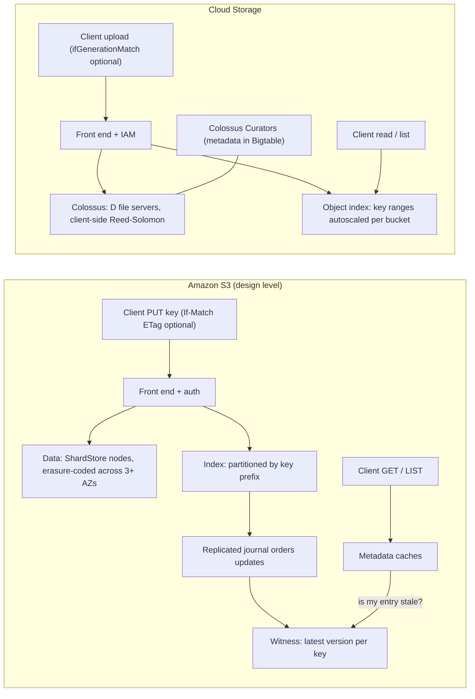

# 03.1 · Object Storage: S3 Strong Consistency and Prefix Partitioning vs Cloud Storage on Colossus

> **Folder 03 · File 1 of 4.** Every data platform in this KB (lakehouses, ML training, backups, CDN origins) ends in an object store. The two stores look alike from the API: buckets, keys, PUT and GET, strong read-after-write consistency on both. They differ in how they **scale request rate** (S3 partitions key prefixes; Cloud Storage autoscales index ranges per bucket from a documented starting rate), in their **concurrency primitives** (S3's conditional writes since 2024 vs Cloud Storage's long-standing generation preconditions), in **location models** (regional with replication vs dual- and multi-region buckets) and in **cost structure** (minimum billable sizes and durations).

| Listing | What it shows | Language |
|---|---|---|
| `object_store_planner.py` | S3 write/read ceilings by key design (1 vs 16 vs 256 partitioned prefixes). Cloud Storage ramp minutes to reach a target rate (flat vs hierarchical-namespace buckets). Minimum multipart part size for objects up to the new 50 TB S3 limit. The cost of small objects in S3 Standard-IA vs Standard | Python 3 (stdlib) |

**Verification.** The listing is embedded byte-identical. The gate re-runs it on this file and requires `verdict: OK`, which asserts the 16-prefix ceiling, the 80-minute ramp to 16k writes/s, the 96 MiB part size for 1 TB and the small-object break-even. Limits come from the S3 and Cloud Storage docs as of **2026-10-31**, including the 50 TB S3 object limit announced 2025-12-02.

**Labels.** **[D]** documented · **[E]** estimate/model · ⚠ inferred, not a product contract.

---

## 0. Orientation

**The questions this file answers.**

1. What does "strong consistency" guarantee on each store, and how was it built without giving up availability?
2. How does each store scale request rate, and which key designs defeat that scaling?
3. Which **concurrency primitives** exist (S3 `If-None-Match`/`If-Match`; Cloud Storage `ifGenerationMatch`), and why do lakehouse commit protocols depend on them?
4. How do durability, availability and replication differ across S3 storage classes, cross-Region replication, S3 Express One Zone, and Cloud Storage regional, dual-region and multi-region buckets (and zonal Rapid Storage)?
5. Where do minimum sizes, minimum durations, retrieval fees and request charges turn a "cheaper" class into a more expensive one?
6. What fails first at scale (503 SlowDown, ramp errors, same-object write limits, list performance, KMS request rates), and what's the fix?

**Reading paths.**

| Goal | Read |
|---|---|
| L7 interview | §1, §2, §3.2–3.4, §4.1–4.3, §5, §7, Q-chains |
| SAP-C02 | §2, §3.3–3.7, §6, §7, S-scenarios |
| Data-platform design | §3–§6, then run the listing on your key scheme |

**Prerequisites.** None. Downstream: [03.4](04-analytics-redshift-athena-glue-iceberg-vs-bigquery-dremel-capacitor-storage-api.md) builds Iceberg and BigQuery storage on this.

---

## 1. First principles: an object store is an index plus a blob store

### 1.1 Two subsystems

Every large object store separates:
1. an **index** (metadata) service that maps `bucket/key` to object metadata and data locations, and serves LIST;
2. a **data** service that stores immutable chunks with replication or erasure coding.

Writes create new immutable data and then **commit** a metadata update that points at it. Reads look up the index and then fetch data. Three things follow:
- **Consistency** is a property of the index, specifically of caches in front of it.
- **Request-rate scaling** is a property of how the index is partitioned, by key range on both clouds.
- **Durability** is a property of the data layer (erasure coding across failure domains).

### 1.2 Why key design matters on both clouds

Both indexes partition by **key range**. A workload that writes keys in sorted order sends all new writes to the range holding the end of the key space:
- timestamps first, sequential IDs, or `logs/2026/10/31/...` prefixes;
- on **S3**, that range is one partitioned prefix until S3 splits it;
- on **Cloud Storage**, it's an index range whose autoscaling is "slowed when using sequential names" [D].

The fix is the same on both: put high-entropy characters early in the key (a hash prefix), or structure prefixes so load spreads.

### 1.3 Concurrency: last writer wins unless you ask otherwise

Without preconditions, two concurrent PUTs to the same key race, and the later commit wins. That's fine for blobs and fatal for **table formats** (Iceberg, Delta, Hudi), which need an atomic "replace metadata pointer only if it hasn't changed".
- **Cloud Storage** has always offered **generation preconditions**: `ifGenerationMatch=0` means create-only, and `ifGenerationMatch=N` is compare-and-swap.
- **S3** added **conditional writes** in 2024: `If-None-Match: *` (create only if absent), then `If-Match: <ETag>` (compare-and-swap).

Lakehouse commit designs on S3 historically needed an external lock or catalog (DynamoDB, the Glue catalog). They now *can* commit with S3 alone, though catalogs still add governance.

---

## 2. Side-by-side architectural Rosetta matrix

| Concern | AWS (S3) | GCP (Cloud Storage) | What actually differs |
|---|---|---|---|
| Underlying storage | S3 storage nodes (ShardStore, a Rust key-value storage node; SOSP 2021). Index subsystem with caches ⚠ | **Colossus** (Google's cluster file system, successor to GFS) | Google documents the substrate. AWS documents the node engine and the consistency protocol |
| Consistency | **Strong read-after-write** for PUT/DELETE and LIST since Dec 2020 [D] | **Strong global consistency** for object reads after writes, metadata updates, deletes, and listing [D] | Equivalent guarantees. The mechanisms differ (§3.2) |
| Request-rate scaling unit | **Per partitioned prefix**: ≥ 3,500 PUT/COPY/POST/DELETE and 5,500 GET/HEAD per second [D] | **Per bucket**: ~1,000 writes/s and ~5,000 reads/s initially, ramp ≤ 2× per 20 min [D] | S3 states per-prefix rates. Cloud Storage states a bucket starting point plus a ramp rule |
| Hot-spot symptom | `503 SlowDown` while S3 partitions | Elevated latency and 429/503 during autoscaling | Both: back off with jitter and spread keys |
| Same-object writes | Last writer wins. Conditional writes for CAS | **One write per second per object name** [D]. Generation preconditions | GCS's per-object limit bites counters and "status" objects |
| Concurrency primitives | `If-None-Match: *`, `If-Match: ETag` (2024) | `ifGenerationMatch`, `ifMetagenerationMatch` | GCS has had CAS for years |
| Max object size | **50 TB** (since 2025-12-02). Practical multipart max 10,000 × 5 GiB = 48.8 TiB [D] | **5 TiB** | 10× difference for very large single objects |
| Multipart | Up to 10,000 parts, 5 MiB–5 GiB each, parallel parts | Resumable uploads, XML multipart, **compose** (up to 32 objects per request) | Both parallelize. GCS compose builds objects server-side |
| Hierarchical namespace | Directory buckets (S3 Express One Zone) | **Hierarchical namespace buckets**: real folders, atomic rename, up to 8× higher initial QPS [D] | HNS helps Hadoop/Spark-style renames on GCS |
| Low-latency zonal tier | **S3 Express One Zone** (directory buckets in one AZ, single-digit-ms, session auth) | **Rapid Storage** (zonal buckets on Colossus) and **Rapid Cache** (formerly Anywhere Cache) ⚠ check GA status per region | Both trade multi-zone durability for latency near compute |
| Location model | Regional buckets (Standard: data across ≥ 3 AZs). One Zone classes. Cross-Region Replication | **Region, dual-region, multi-region** buckets. Turbo replication (15-min RPO) for dual-region | GCS offers a single bucket spanning regions. S3 uses replication between buckets |
| Replication | CRR/SRR async. **Replication Time Control**: 99.99% of objects in 15 min (SLA). Batch Replication for existing objects | Dual-region default replication vs **turbo replication** (RPO 15 min) | Both give a 15-minute RPO option, by different constructs |
| Storage classes | Standard, Intelligent-Tiering, Standard-IA, One Zone-IA, Glacier Instant/Flexible/Deep Archive, Express One Zone | Standard, Nearline (30 d), Coldline (90 d), Archive (365 d). Autoclass | S3 IA and Glacier IR bill **≥ 128 KB per object**. GCS minimum durations are longer for Archive |
| Immutability | **Object Lock** (governance/compliance modes, legal hold) on versioned buckets | **Bucket Lock** (locked retention policy), object retention lock, holds | Both WORM-certified designs |
| Accidental-delete protection | Versioning (+ MFA Delete), Object Lock, replication | **Soft delete** (default retention), versioning, retention | GCS soft delete is on by default for new buckets (7 days) ⚠ verify per bucket |
| Access model | Bucket policies, IAM, Block Public Access, Object Ownership (ACLs disabled by default), Access Points, Multi-Region Access Points | IAM with **uniform bucket-level access**, public access prevention, managed folders | Both have moved away from per-object ACLs |
| Events | Event Notifications → SNS/SQS/Lambda, EventBridge | Pub/Sub notifications, Eventarc | — |
| Encryption | SSE-S3 default, SSE-KMS (Bucket Keys cut KMS calls), DSSE-KMS, SSE-C | Google-managed default, CMEK (Cloud KMS), CSEK | KMS request quotas are a real scaling limit (Folder 05) |
| Table storage | **S3 Tables** (table buckets, managed Iceberg, automatic compaction) | BigQuery managed storage and BigQuery Iceberg tables; Google Cloud Lakehouse (formerly BigLake) | See 03.4 |

---

## 3. Internal mechanics: Amazon S3

### 3.1 Durability architecture

S3 Standard stores data redundantly across **at least three AZs**, designed for 99.999999999% (11 nines) durability. One Zone classes stay in one AZ: same design durability within the AZ, and data is lost if the AZ is destroyed.
- The storage node software, **ShardStore**, is a log-structured key-value engine written in Rust.
- AWS validated it with lightweight formal methods: executable reference models, property-based testing, model checking of crash consistency (SOSP 2021).
- Durability work runs continuously: checksums on every request, background scrubbing, and repair.

### 3.2 How S3 became strongly consistent

Before December 2020, S3 had read-after-write consistency for new objects but eventual consistency for overwrites, deletes and LIST, because of caching in the metadata path. AWS's description (Werner Vogels, 2021) ⚠ at a design level:
- a **replicated journal** orders updates to the index;
- a **witness** component tracks, per key, the latest committed version;
- caches consult the witness cheaply to tell whether their entry is stale, and if so read through.

The result is strong consistency for all operations, including LIST, with **no price or performance change**. The general pattern for adding consistency to a cache-heavy system: don't remove the caches; add a cheap, highly available staleness oracle.

### 3.3 Request-rate scaling: partitioned prefixes [D]

- **Rates.** S3 supports **at least 3,500 PUT/COPY/POST/DELETE and 5,500 GET/HEAD requests per second per partitioned prefix**, with no limit on the number of prefixes in a bucket.
- **What a prefix is.** Any leading part of the key, not just a "folder".
- **How S3 reacts to load.** It partitions prefixes automatically as sustained load grows, and returns `503 SlowDown` while it's partitioning.
- **Design rules:**
  1. Put entropy early. A short hash (`a7f3/2026/10/31/...`) gives up to 16 prefixes per hex character of fan-out *after* S3 splits them. The listing (§5, section 1) shows the ceilings: 3,500 writes/s for one hot date prefix, 56,000 for 16 hash prefixes, 896,000 for 256.
  2. Back off with jitter on 503s. The AWS SDKs do this, so tune `max_attempts` for bulk loaders.
  3. Pre-warm by ramping load, or ask AWS support to pre-partition for a known event.
  4. For read-heavy hot objects, put **CloudFront** (02.3) or a cache in front. A single key can't use more than one prefix's rate.

### 3.4 Conditional writes and lakehouse commits

- **Create-only:** `PUT` with `If-None-Match: *` fails with `412 Precondition Failed` if the key exists.
- **Compare-and-swap:** `PUT` with `If-Match: "<etag>"` replaces only if the current ETag matches. Also supported on CompleteMultipartUpload.
- **Consequence.** A table format can commit `metadata/v42.json` atomically: write it create-only, or swap a pointer object with `If-Match`. That removes the need for an external lock table just to commit. Catalogs (Glue, Iceberg REST catalogs, **S3 Tables**) remain the place for governance, discovery and multi-table semantics.
- **Bucket policies** can **require** conditional writes for certain prefixes. That protects against clients that forget.

### 3.5 Storage classes, lifecycle and the hidden minimums [D]

| Class | Min billable object size | Min storage duration | Retrieval | Use for |
|---|---|---|---|---|
| Standard | — | — | — | Hot data |
| Intelligent-Tiering | Objects < 128 KB aren't auto-tiered (stay frequent) | — | — (archive tiers optional) | Unknown or changing access. Pays a per-object monitoring fee |
| Standard-IA | **128 KB** | 30 days | Per-GB retrieval fee | Infrequent, large objects |
| One Zone-IA | 128 KB | 30 days | Per-GB | Re-creatable infrequent data |
| Glacier Instant Retrieval | 128 KB | 90 days | Per-GB, milliseconds | Quarterly-access archives |
| Glacier Flexible Retrieval | (metadata overhead per object) | 90 days | Minutes to hours | Backups |
| Glacier Deep Archive | (metadata overhead per object) | 180 days | Hours | Compliance archives |
| Express One Zone | — | — | — | Latency-critical, single-AZ, near compute |

The listing (§5, section 4) computes the break-even. Below **~70 KB** per object, Standard-IA (billed at ≥ 128 KB) costs *more* than Standard: 10M × 4 KB objects cost $16.38/month in IA vs $0.94 in Standard.

Lifecycle transitions are **per-object requests** that cost money, and so are early deletes before the minimum duration. For small objects, **pack** them (tar, Parquet, a log segment) before tiering.

### 3.6 S3 Express One Zone

- **Directory buckets** in a single AZ, with **single-digit-millisecond** latency and very high request rates.
- A **session-based auth** model (`CreateSession`) cuts per-request authorization overhead.
- Directory-style namespace.
- For ML training data loaders, shuffle and checkpoint staging, and hot intermediate data.
- Trade: one-AZ durability scope, and a different API surface (some features differ).

### 3.7 Replication and protection

- **CRR/SRR:** asynchronous, by rules on prefix or tag. **Replication Time Control** adds an SLA (99.99% of objects within 15 minutes) and metrics. Existing objects need **Batch Replication**. Delete-marker replication is configurable.
- **Multi-Region Access Points** give one global endpoint routing to the nearest bucket, with failover controls.
- **Versioning + Object Lock** (compliance mode can't be shortened, even by root) for ransomware resilience. Pair with replication to a separate account (Folder 06).

---

## 4. Internal mechanics: Google Cloud Storage on Colossus

### 4.1 Colossus

Colossus is Google's cluster-level file system, the successor to GFS. Google's public description (Google Cloud blog, 2021):
- **metadata** is held by "Curators" in a **Bigtable**-backed metadata store, which scales far past GFS's single master;
- **data** is stored by "D" file servers;
- the **client library** handles encoding, including Reed-Solomon erasure coding, and talks to file servers directly;
- custodians handle background durability and rebalancing.

Cloud Storage, Bigtable, BigQuery storage, Spanner and AlloyDB storage are all built on Colossus. That's why Google can offer disaggregated compute and storage almost everywhere (03.2–03.4).

### 4.2 Consistency and the request model [D]

- **Consistency:** strong global consistency for read-after-write, read-after-metadata-update, read-after-delete, and bucket and object listing.
- **Request rates:**
  - a bucket starts at about **1,000 object writes/s** (uploads, updates, deletes) and **5,000 reads/s**;
  - increase **no faster than doubling every 20 minutes** above those, because autoscaling across servers takes minutes;
  - **sequential names** slow autoscaling of index ranges, so use random names or a hash prefix before timestamps;
  - **hierarchical namespace buckets** start with **up to 8× higher QPS**.

  The listing (§5, section 2) converts this to wall-clock time: **80 minutes** to reach 16,000 writes/s from 1,000 in a flat bucket, and 20 minutes with hierarchical namespace.
- **Same-object writes:** Cloud Storage has "a smaller limit for repeated writes to the same object name", **one write per second** per object. A design that updates a single "manifest" or "counter" object at high rate must move that state to a database (Firestore, Spanner) or shard it.

### 4.3 Generation preconditions

Every object has a **generation**, which changes on content overwrite, and a **metageneration**, which changes on metadata update.
- `ifGenerationMatch=0` means create-only.
- `ifGenerationMatch=<n>` means compare-and-swap.
- `ifMetagenerationMatch` guards metadata.

These have existed for a long time, which is why GCS-based table formats and Hadoop connectors could implement atomic commits without external locks earlier than S3-based ones.

### 4.4 Locations, replication and tiers

- **Regional buckets:** data across zones in one region.
- **Dual-region buckets:** two specific regions, one bucket name.
  - **Default replication** replicates asynchronously (most objects within an hour, with a longer bound for the rest) ⚠ verify the current bound.
  - **Turbo replication** gives a **15-minute RPO** objective.
- **Multi-region buckets:** a large geographic area. Highest availability for serving, with less control over location.
- **Rapid Storage** (zonal buckets) and **Rapid Cache** (formerly Anywhere Cache, an SSD cache co-located with compute zones) target AI/ML data loading, much as S3 Express One Zone does ⚠ (check GA and region coverage).
- **Classes:** Standard, Nearline (30-day minimum), Coldline (90), Archive (365). Retrieval fees on the colder classes. **Autoclass** moves objects between classes by access pattern.

### 4.5 Protection and access

- **Soft delete** keeps deleted objects recoverable for a retention window (default on for new buckets ⚠ check the default duration).
- **Object versioning.**
- **Retention policies** and **Bucket Lock**: once locked, the retention can't be reduced. **Object retention lock** works per object.
- **Uniform bucket-level access** (IAM only) and **public access prevention** are the modern defaults. **Managed folders** give folder-level IAM.

---

## 5. Listing: request ceilings, ramps, multipart and small objects

<!-- listing:object_store_planner.py -->
```python
"""object_store_planner.py - request-rate, multipart and small-object billing math for S3 and
Cloud Storage.

Rules encoded (public docs, 2026-10-31):
  S3: >= 3,500 PUT/COPY/POST/DELETE and 5,500 GET/HEAD per second per partitioned prefix; S3
      partitions prefixes automatically as load persists (503 SlowDown while it does); strong
      read-after-write consistency; multipart: <= 10,000 parts, part 5 MiB..5 GiB, max object
      50 TB (practically 10,000 x 5 GiB = 48.8 TiB)
  GCS: ~1,000 object writes/s and ~5,000 reads/s per bucket initially; ramp no faster than
      doubling every 20 minutes; sequential names slow index-range autoscaling; hierarchical
      namespace buckets have up to 8x higher initial QPS; one write per second to the same
      object name; max object 5 TiB
  S3 Standard-IA bills a minimum of 128 KB per object; Intelligent-Tiering does not auto-tier
      objects under 128 KB
Prices (USD per GB-month, list, verify): S3 Standard 0.023, Standard-IA 0.0125.

Usage: python -I object_store_planner.py <any path>
"""
import math
import sys

GIB, MIB, TB = 2 ** 30, 2 ** 20, 10 ** 12


def s3_capacity(prefixes, writes=3500, reads=5500):
    return prefixes * writes, prefixes * reads


def gcs_ramp_minutes(target, start):
    return 0 if target <= start else 20 * math.ceil(math.log2(target / start))


def min_part_size(obj_bytes):
    part = max(5 * MIB, math.ceil(obj_bytes / 10_000))
    part = math.ceil(part / MIB) * MIB
    return part if part <= 5 * GIB else None


def main():
    ok = True
    print("== 1. Sustained write rate a key design can reach on S3 (per partitioned prefix limits) ==")
    for name, prefixes in (("date prefix logs/2026/10/31/... (one hot prefix)", 1),
                           ("16 hex hash prefixes (after S3 partitions them)", 16),
                           ("256 hash prefixes", 256)):
        w, r = s3_capacity(prefixes)
        print(f"{name:<52} {w:>9,} writes/s  {r:>10,} reads/s")
    ok &= s3_capacity(16)[0] == 56_000
    print("   S3 partitions automatically, but only after sustained load; expect 503 SlowDown while it")
    print("   splits. A hot date prefix stays one partition at the write edge until it splits.")

    print()
    print("== 2. Cloud Storage: minutes of ramp to reach a target from the documented starting rates ==")
    for target in (1000, 4000, 16000, 64000):
        std = gcs_ramp_minutes(target, 1000)
        hns = gcs_ramp_minutes(target, 8000)
        print(f"{target:>6,} writes/s: flat bucket {std:>3} min | hierarchical namespace (8x start) {hns:>3} min")
    ok &= gcs_ramp_minutes(16000, 1000) == 80
    print("   a bulk load that jumps straight to 16k writes/s sees errors and latency for over an hour")

    print()
    print("== 3. Multipart: smallest part size that fits the 10,000-part limit (S3) ==")
    for size_tb in (0.1, 1, 10, 48.8 * GIB * 1024 / TB, 60):
        obj = size_tb * TB
        part = min_part_size(obj)
        if part is None:
            print(f"{size_tb:>7.2f} TB: does not fit (needs parts > 5 GiB): max object is 10,000 x 5 GiB")
        else:
            print(f"{size_tb:>7.2f} TB: part >= {part / MIB:>7,.0f} MiB -> {math.ceil(obj / part):>6,} parts")
    ok &= min_part_size(60 * TB) is None and min_part_size(1 * TB) == 96 * MIB
    print("   Cloud Storage caps objects at 5 TiB; compose merges up to 32 objects per request")

    print()
    print("== 4. Small objects in an infrequent-access class (10 million objects) ==")
    for kb in (4, 32, 128, 1024):
        actual_gb = 10_000_000 * kb * 1024 / 1e9
        billed_gb = 10_000_000 * max(kb, 128) * 1024 / 1e9
        print(f"{kb:>5} KB objects: stored {actual_gb:>9,.1f} GB, Standard-IA bills {billed_gb:>9,.1f} GB "
              f"-> ${billed_gb * 0.0125:>8,.2f}/mo vs Standard ${actual_gb * 0.023:>8,.2f}/mo")
    ok &= 10_000_000 * 128 * 1024 / 1e9 * 0.0125 > 10_000_000 * 4 * 1024 / 1e9 * 0.023
    print("   below ~70 KB, 'infrequent access' costs more than Standard: pack small objects or keep them in Standard")
    print()
    print("verdict: OK" if ok else "verdict: FAIL")


if __name__ == "__main__":
    main()
```

<!-- output:object_store_planner.py -->
```text
== 1. Sustained write rate a key design can reach on S3 (per partitioned prefix limits) ==
date prefix logs/2026/10/31/... (one hot prefix)         3,500 writes/s       5,500 reads/s
16 hex hash prefixes (after S3 partitions them)         56,000 writes/s      88,000 reads/s
256 hash prefixes                                      896,000 writes/s   1,408,000 reads/s
   S3 partitions automatically, but only after sustained load; expect 503 SlowDown while it
   splits. A hot date prefix stays one partition at the write edge until it splits.

== 2. Cloud Storage: minutes of ramp to reach a target from the documented starting rates ==
 1,000 writes/s: flat bucket   0 min | hierarchical namespace (8x start)   0 min
 4,000 writes/s: flat bucket  40 min | hierarchical namespace (8x start)   0 min
16,000 writes/s: flat bucket  80 min | hierarchical namespace (8x start)  20 min
64,000 writes/s: flat bucket 120 min | hierarchical namespace (8x start)  60 min
   a bulk load that jumps straight to 16k writes/s sees errors and latency for over an hour

== 3. Multipart: smallest part size that fits the 10,000-part limit (S3) ==
   0.10 TB: part >=      10 MiB ->  9,537 parts
   1.00 TB: part >=      96 MiB ->  9,935 parts
  10.00 TB: part >=     954 MiB ->  9,997 parts
  53.66 TB: part >=   5,118 MiB ->  9,999 parts
  60.00 TB: does not fit (needs parts > 5 GiB): max object is 10,000 x 5 GiB
   Cloud Storage caps objects at 5 TiB; compose merges up to 32 objects per request

== 4. Small objects in an infrequent-access class (10 million objects) ==
    4 KB objects: stored      41.0 GB, Standard-IA bills   1,310.7 GB -> $   16.38/mo vs Standard $    0.94/mo
   32 KB objects: stored     327.7 GB, Standard-IA bills   1,310.7 GB -> $   16.38/mo vs Standard $    7.54/mo
  128 KB objects: stored   1,310.7 GB, Standard-IA bills   1,310.7 GB -> $   16.38/mo vs Standard $   30.15/mo
 1024 KB objects: stored  10,485.8 GB, Standard-IA bills  10,485.8 GB -> $  131.07/mo vs Standard $  241.17/mo
   below ~70 KB, 'infrequent access' costs more than Standard: pack small objects or keep them in Standard

verdict: OK
```

**Reading the output.**

- **Section 1.** Date-first keys (`logs/2026/10/31/...`) keep all new writes in one partitioned prefix: **3,500 writes/s** until S3 splits it. Sixteen hash prefixes give **56,000**, and 256 give ~900,000. The hash belongs *before* the date.
- **Section 2.** Cloud Storage's documented starting rates and the doubling rule make a bulk load that jumps to 16,000 writes/s spend **80 minutes** ramping (20 minutes on a hierarchical-namespace bucket). Ramp the load generator, or expect throttling and latency for over an hour.
- **Section 3.** The smallest part that fits the 10,000-part limit:
  - 1 TB needs **≥ 96 MiB** parts;
  - the new ~50 TB ceiling needs parts near the 5 GiB maximum (10,000 × 5 GiB = 48.8 TiB);
  - 60 TB doesn't fit.

  Cloud Storage tops out at 5 TiB per object.
- **Section 4.** IA's 128 KB minimum makes 4 KB objects cost **17×** more than Standard. The break-even is ~70 KB.

---

## 6. Reference designs

### 6.1 A write-heavy ingestion bucket on both clouds

- **Keys:** `{hash4}/{yyyy}/{mm}/{dd}/{hh}/{uuid}.parquet`. Writers batch into 64–256 MB objects. Readers list by hour within each hash prefix, or better, through a table format's metadata rather than LIST.
- **S3:** SSE-KMS with **Bucket Keys** (Folder 05), so KMS request quotas don't throttle writes. Lifecycle to Intelligent-Tiering for objects over 128 KB. Abort incomplete multipart uploads after 7 days.
- **GCS:** a hierarchical-namespace bucket if Spark-style renames are used. Ramp load generators by the doubling rule. Autoclass on.
- **Both:** event notifications into a queue (SQS / Pub/Sub) so downstream processing doesn't poll LIST.

### 6.2 Cross-region protection with a stated RPO

- **AWS:**
  - CRR with **Replication Time Control** to a bucket in another Region and **another account**;
  - Object Lock (compliance mode) on the destination;
  - Batch Replication for the backfill;
  - Multi-Region Access Points if clients need one endpoint.
- **GCP:**
  - a **dual-region** bucket with **turbo replication** (15-min RPO), or a regional bucket plus a scheduled transfer to another project for blast-radius isolation;
  - Bucket Lock for WORM;
  - soft delete for operator mistakes.

---

## 7. Failure modes, throttling limits and quota traps

| # | Symptom | Root cause | Detect | Fix | Cloud |
|---|---|---|---|---|---|
| 1 | Bursts of `503 SlowDown` during ingest | One hot **prefix** above 3,500 writes/s while S3 partitions | 5xx metrics by prefix | Hash prefix early in the key, retry with jitter, ramp | AWS |
| 2 | Bulk load errors for the first hour on a new bucket | Load above **1,000 writes/s** without the 2×/20-min ramp | Error rates vs time | Ramp. Hierarchical namespace bucket. Spread names | GCP |
| 3 | Hot spot despite a ramp | **Sequential names** (timestamps, counters) | Latency concentrated on recent keys | Hash prefix before the sequential part | GCP |
| 4 | Writes to a status/manifest object fail with 429 | **One write per second per object name** | Errors on one key | Move state to a database, or shard the object | GCP |
| 5 | Two writers corrupt a table's metadata | Unconditional PUTs; last writer wins | Lost commits | Conditional writes (`If-None-Match`/`If-Match`, `ifGenerationMatch`) or a catalog | Both |
| 6 | Archive tier "saves" money but the bill rises | **128 KB minimum** (IA, Glacier IR), early-delete charges, per-object transition requests | Cost by class | Pack small objects. Tier only > 128 KB objects that outlive the minimum duration | AWS |
| 7 | Storage cost creeping up with no new data | **Incomplete multipart uploads** accumulating | Storage Lens | Lifecycle `AbortIncompleteMultipartUpload` | AWS |
| 8 | Replica bucket missing old objects | CRR only replicates **new** objects | Inventory diff | S3 Batch Replication | AWS |
| 9 | RPO breached for some objects | Plain CRR has no time guarantee | Replication metrics | Replication Time Control (15-min SLA) | AWS |
| 10 | SSE-KMS uploads throttle at high rates | **KMS request quota** per Region | `ThrottlingException` from KMS | S3 Bucket Keys, or SSE-S3 where acceptable | AWS |
| 11 | LIST-based job planning takes hours | LIST of millions of keys; paging | Planner runtime | S3 Inventory / table-format metadata / Storage Insights instead of LIST | Both |
| 12 | Deleted data unrecoverable after a script bug | No versioning or soft delete | — | Versioning + Object Lock (AWS). Soft delete + retention (GCP) | Both |
| 13 | Single object > 5 TiB fails on GCS | **5 TiB object limit** | Upload error | Split into multiple objects, or a table format | GCP |
| 14 | Latency-sensitive training stalls on object GETs | Regional store latency per GET | Data-loader wait time | S3 Express One Zone / Rapid Storage / Rapid Cache. Larger objects. Prefetch | Both |
| 15 | Dual-region bucket "lost" recent writes during a regional event | Default async replication window | Object timestamps | Turbo replication (15-min RPO) or application-level dual write | GCP |

---

## 8. Architecture diagrams: multi-service compositions

### 8.1 Write path and consistency: S3 vs Cloud Storage



### 8.2 Lakehouse landing zone with protection on both clouds

```mermaid
flowchart TB
  subgraph AWS["AWS"]
    PROD["Producers (Kinesis Firehose / Spark)"] -->|"keys: hash4/yyyy/mm/dd/hh"| RAW["S3 raw bucket (SSE-KMS + Bucket Keys)"]
    RAW -->|"Event Notifications"| SQS["SQS"] --> ETL["Glue / EMR jobs"]
    ETL -->|"Iceberg commit (If-None-Match / catalog)"| TBL["S3 Tables / Iceberg on S3"]
    RAW -->|"CRR + RTC (15 min)"| DR["S3 bucket, other Region + other account, Object Lock compliance"]
    TBL --> LC["Lifecycle: >128 KB objects to Intelligent-Tiering, abort MPU after 7 d"]
  end
  subgraph GCP["Google Cloud"]
    PROD2["Producers (Dataflow / Spark)"] -->|"hash-prefixed names, ramped load"| RAW2["GCS bucket (hierarchical namespace, CMEK)"]
    RAW2 -->|"Pub/Sub notifications"| PS["Pub/Sub"] --> DF["Dataflow"]
    DF --> BQI["BigQuery tables for Apache Iceberg / managed storage"]
    RAW2 -.->|"dual-region + turbo replication (15-min RPO)"| DUAL["Same bucket, second region"]
    RAW2 --> SOFT["Soft delete + retention policy (Bucket Lock)"]
  end
```



### 8.3 Key design and the hot range (ASCII)

```text
Sorted key space of the index (both clouds partition by key range)

 date-first:   logs/2026/10/29/... | logs/2026/10/30/... | logs/2026/10/31/...  <== ALL new writes here
                                                           (one partition / index range at the edge)

 hash-first:   0a1f/2026/10/31/... | 3c7e/2026/10/31/... | 9b20/... | f4d1/...  <== writes spread across
               (each hash prefix becomes its own partition once load persists)    every range

 S3: >= 3,500 writes/s per partitioned prefix x number of hot prefixes
 GCS: ~1,000 writes/s per bucket to start, doubling at most every 20 minutes, slower if sequential
```

---

## 9. Bar-raiser chains and SAP-C02 scenarios

### 9.1 L7 bar-raiser chains

<details><summary><b>Q1 · S3 has been strongly consistent since 2020. How, without slowing it down?</b></summary>

**Initial Prompt.** "Explain how S3 went from eventual to strong consistency for overwrites and LIST without a price or latency change, and what design lesson you'd reuse."

**L5 Answer.** "AWS changed S3 to replicate metadata synchronously, so reads always see the latest write."

**Why L5 Stalls.** Synchronous replication alone doesn't explain how *caches* stay correct. The interesting part is cache coherence at S3's request rate.

**L7 Answer.** "The eventual consistency came from caches in the metadata path. AWS's published description: updates to the index are ordered by a **replicated journal**, and a **witness** tracks the latest committed version per key. A cache asks the witness whether its entry is stale; a cheap question that's answered from memory. It serves from the cache when fresh and reads through otherwise.

The lesson I'd reuse: when you need consistency in a cache-heavy system, keep the caches and add a highly available **staleness oracle**, instead of invalidating everything synchronously.

Two caveats:
1. The design-level description is from AWS's blog, so internals beyond it are ⚠.
2. Strong consistency doesn't give **atomic multi-object** semantics or concurrency control. For that you need conditional writes or a catalog."
</details>

<details><summary><b>Q2 · Design object keys for 200,000 writes per second</b></summary>

**Initial Prompt.** "An event pipeline will write 200,000 small objects per second to object storage at peak, on both S3 and GCS. Design the keys and the write path."

**L5 Answer.** "Use a prefix per day and hour, so we can find objects easily."

**Why L5 Stalls.** Date-first keys concentrate every new write into one key range, which is exactly what limits request rate. And 200k *small objects* per second is a cost and request problem before it's a key problem.

**L7 Answer.** "First, **don't write 200k objects per second**. Batch into 64–256 MB files (Firehose/Dataflow windows). That turns it into a few hundred objects per second and also fixes downstream query performance (03.4).

If the per-object pattern is unavoidable:
- **S3:**
  - put a hash prefix first, `{hash2}/{yyyy}/{mm}/{dd}/{hh}/...`;
  - 200k ÷ 3,500 per partitioned prefix is ~58 hot prefixes, so 256 hash prefixes leave headroom once S3 has partitioned them;
  - ramp the load and back off with jitter on 503s.
- **GCS:**
  - a hash prefix before any timestamp;
  - **ramp from 1,000 writes/s, doubling no faster than every 20 minutes**. That's 20 × ⌈log₂ 200⌉ = **160 minutes**, or start on a hierarchical-namespace bucket with 8× the initial rate;
  - shard across buckets if the ramp time is unacceptable.
- **Both:** request charges at 200k PUT/s are significant (Folder 06 math), which is another argument for batching."
</details>

<details><summary><b>Q3 · Commit an Iceberg table safely with two concurrent writers</b></summary>

**Initial Prompt.** "Two Spark jobs append to the same Iceberg table on S3. We lost a commit last week. What happened, and how do we make commits safe on S3 and on GCS?"

**L5 Answer.** "Use a DynamoDB lock table so only one job writes at a time."

**Why L5 Stalls.** That works, but it's a 2019 answer. It ignores that the commit's *atomic pointer swap* is what matters, and that both stores now have native compare-and-swap.

**L7 Answer.** "An Iceberg commit writes new metadata and then atomically replaces the table's current-metadata pointer **only if it hasn't changed**. With a catalog that does unconditional swaps, or a path-based commit with plain PUTs, the second writer overwrote the first: last writer wins.

Fixes:
1. Use a **catalog that does atomic CAS**: Glue, an Iceberg REST catalog, or S3 Tables, which manages Iceberg natively including compaction.
2. On S3 alone, write `metadata/vN.json` with **`If-None-Match: *`** so only one writer can create version N. The loser gets 412, refreshes and retries its commit.
3. On GCS, the same with **`ifGenerationMatch=0`**.
4. Require conditional writes on the metadata prefix with a bucket policy, so a misconfigured client fails instead of corrupting.

Iceberg's optimistic concurrency then retries the losing commit on the new base."
</details>

<details><summary><b>Q4 · Cut storage cost for 2 billion small objects</b></summary>

**Initial Prompt.** "We have 2 billion objects averaging 16 KB, mostly cold after 30 days. Finance wants them moved to Glacier Instant Retrieval or Standard-IA. Evaluate."

**L5 Answer.** "Add a lifecycle rule to move objects older than 30 days to Standard-IA. It's cheaper per GB."

**Why L5 Stalls.** At 16 KB, every object is billed as 128 KB in IA and Glacier IR, an 8× multiplier. Lifecycle transitions are also per-object requests: 2 billion of them.

**L7 Answer.** "Run the minimums first.
- **Per-GB view:** 2B × 16 KB ≈ 32 TB. In Standard that's ~$740/month at $0.023/GB.
- **Standard-IA:** bills ≥ 128 KB each, so ~262 TB × $0.0125 ≈ $3,280/month, **4.4× more**, plus transition requests for 2 billion objects and per-GB retrieval. The listing's section 4 shows the same break-even, at ~70 KB.
- **The real fix is packing:**
  1. compact cold objects into large archives or Parquet, with an index (a manifest or a table format);
  2. tier the packed objects;
  3. delete the originals.
- **Intelligent-Tiering** doesn't auto-tier objects under 128 KB and charges per-object monitoring, so it doesn't help here either.

On GCS there's no 128 KB minimum, but Nearline/Coldline minimum durations and retrieval fees still require knowing the access pattern. Autoclass can decide per object."
</details>

<details><summary><b>Q5 · One bucket across regions (GCS) vs replication between buckets (S3)</b></summary>

**Initial Prompt.** "For a media archive with a 15-minute RPO and regional failover, compare a GCS dual-region bucket with S3 Cross-Region Replication. Which failure modes differ?"

**L5 Answer.** "They're equivalent. Both replicate data to another region."

**Why L5 Stalls.** They differ in naming, failover mechanics, blast radius, and what's guaranteed by when.

**L7 Answer.**
- **GCS dual-region:**
  - one bucket name across two regions;
  - reads and writes keep working if one region is unavailable;
  - **turbo replication** gives a 15-minute RPO objective;
  - no application failover logic, because the name doesn't change.
  - The bucket is one configuration and IAM object, so a bad lifecycle rule or delete applies to both copies. **Soft delete and retention** are the protection.
- **S3 CRR:**
  - two buckets, two names (or one Multi-Region Access Point with failover controls);
  - **RTC** gives the 15-minute SLA;
  - each bucket has its own policies, and the destination can sit in **another account** with Object Lock, which a single-bucket design can't offer;
  - failover means switching endpoints, through MRAP or the application.
- **So:** GCS dual-region optimizes availability with less code. S3 CRR optimizes **blast-radius isolation**. For ransomware-grade protection on GCP, add a copy in a separate project with Bucket Lock."
</details>

<details><summary><b>Q6 · Training jobs are I/O-bound on object storage</b></summary>

**Initial Prompt.** "Our GPU training jobs spend 30% of time waiting on data from object storage. Fix it on AWS and GCP."

**L5 Answer.** "Use bigger instances with more network bandwidth."

**Why L5 Stalls.** Bandwidth may not be the bottleneck. Per-request latency and small-file reads often are, and both clouds now have tiers built for this.

**L7 Answer.**
1. **Diagnose** request count vs bytes. Thousands of small GETs per step are latency-bound.
2. **Shard the data** into large record files (WebDataset/TFRecord, 100 MB–1 GB), with parallel range reads and prefetching in the data loader.
3. **Move hot data near compute:**
   - AWS: **S3 Express One Zone** in the training AZ (single-digit-ms latency, session auth), or FSx for Lustre linked to S3;
   - GCP: **Rapid Storage** zonal buckets or **Rapid Cache** in the GPU zone, or Parallelstore.
4. **Checkpoints:** write to the low-latency tier, then copy asynchronously to the durable regional bucket.

The trade-off to state: zonal tiers have zone-scoped durability, so they're caches or staging, not the system of record."
</details>

<details><summary><b>Q7 · A Cloud Storage "status file" design falls over</b></summary>

**Initial Prompt.** "A team's workflow engine updates `jobs/{id}/status.json` on GCS on every task transition: about 20 updates per second for busy jobs. Updates fail with 429s. Why, and what's the redesign?"

**L5 Answer.** "Increase the bucket's request quota."

**Why L5 Stalls.** The limit is per object name, not per bucket: one write per second to the same object.

**L7 Answer.** "Cloud Storage limits repeated writes to the **same object name** to about one per second. Twenty updates per second to one status object will always fail.

Object storage is the wrong home for frequently mutated small state. Put it in **Firestore** (document per job, transactional updates), **Spanner**, or Memorystore. If an object trail is needed for audit, write **immutable** event objects (`jobs/{id}/events/{ts}-{uuid}.json`), which spread across names and never overwrite.

The same advice applies on S3, which doesn't have the 1/s limit: unconditional overwrites race (last writer wins), and conditional writes make the hot object a contention point."
</details>

<details><summary><b>Q8 · Protect backups from a compromised admin</b></summary>

**Initial Prompt.** "After a ransomware incident at a peer company, the CISO asks: if an attacker gets admin credentials in our backup account, can they delete our backups? Answer for S3 and GCS."

**L5 Answer.** "We have versioning on, so deleted objects can be restored."

**Why L5 Stalls.** An admin can delete versions or suspend versioning. Versioning protects against accidents, not against an adversary with privileges.

**L7 Answer.**
- **AWS:**
  - **Object Lock in compliance mode** with a retention period: no user, including the account root, can delete or shorten retention until it expires;
  - replicate (CRR) into a **separate account** in a separate Organization OU, with an SCP denying policy changes on the vault bucket;
  - AWS Backup vault lock for backups managed by AWS Backup.
- **GCP:**
  - a **locked retention policy** (Bucket Lock), which can't be reduced or removed once locked;
  - a separate project with tight IAM;
  - soft delete for accidental deletes;
  - Organization Policy constraints to stop public exposure.
- **Both:** test restores, and make sure the *keys* (KMS/CMEK) for the backups can't be destroyed by the same admin (key deletion waiting periods and separate key admins, Folder 05)."
</details>

<details><summary><b>Q9 · Why is our S3 bill dominated by requests and KMS?</b></summary>

**Initial Prompt.** "Our data lake bill shows S3 PUT/GET requests and KMS API charges larger than storage. What's driving it, and what are the levers?"

**L5 Answer.** "Negotiate a discount, or move to a cheaper storage class."

**Why L5 Stalls.** Storage class doesn't change request counts. The drivers are object size and the encryption mode.

**L7 Answer.** "Requests scale with **object count**, and KMS calls scale with requests under SSE-KMS without Bucket Keys.
1. **Fewer, larger objects:** compaction to 128–512 MB files, as with Iceberg compaction or S3 Tables' automatic compaction.
2. **S3 Bucket Keys:** S3 uses a bucket-level key derived from KMS for a time window instead of calling KMS per object. That cuts KMS requests by a large factor and avoids KMS throttling.
3. **Fewer LIST calls:** S3 Inventory and table-format metadata instead of LIST-based planning.
4. **Caching:** for repeated GETs, put a cache or CloudFront in front.

Then add cost-allocation tags per prefix owner (Storage Lens). On GCS, the levers are the same: object count, Class A vs Class B operations, and CMEK key-usage quotas."
</details>

<details><summary><b>Q10 · Map an S3-centric design to GCS: what silently breaks?</b></summary>

**Initial Prompt.** "We're porting a platform from S3 to GCS. It uses date-prefixed keys, overwrites a `_LATEST` pointer object every few seconds, stores 8 TB video masters as single objects, and replicates to another region with CRR. What breaks?"

**L5 Answer.** "Nothing major. GCS is S3-compatible through the XML API."

**Why L5 Stalls.** API compatibility hides behavioral limits: object size, the per-object write rate, ramp behavior, and different replication constructs.

**L7 Answer.** "Four breaks:
1. **8 TB masters exceed GCS's 5 TiB object limit.** Split them into segments, or store as multiple objects with a manifest.
2. **`_LATEST` overwritten every few seconds** is fine if under ~1 write/s per name. Use `ifGenerationMatch` for safety, or move the pointer to Firestore.
3. **Date-prefixed keys plus a bulk migration** at full speed meets the 1,000 writes/s starting rate and the 2×-per-20-min ramp, made slower by sequential names. Add a hash prefix and ramp the transfer (Storage Transfer Service handles pacing).
4. **CRR becomes a choice:** a dual-region bucket with turbo replication (one name, shared blast radius) or a scheduled copy to a separate project (isolation).

Also map Object Lock to Bucket Lock / object retention, SSE-KMS to CMEK with key-usage quotas, and S3 event notifications to Pub/Sub notifications."
</details>

### 9.2 SAP-C02 scenarios (original)

<details><summary><b>S1 · SAP-C02 · Domain 2 · Select ONE</b></summary>

**Scenario.** A logging pipeline writes 40,000 objects per second to a single S3 bucket using keys like `logs/2026/10/31/14/<uuid>.json`. During peaks, producers receive HTTP 503 Slow Down responses. Which change will MOST improve sustained write throughput?

- **A.** Enable S3 Transfer Acceleration on the bucket.
- **B.** Introduce a hashed prefix at the start of each key, such as `<hash>/logs/2026/10/31/14/<uuid>.json`, so writes spread across many prefixes.
- **C.** Switch the bucket to S3 Intelligent-Tiering.
- **D.** Enable S3 Versioning to separate writes into different versions.

**Answer: B**

- **A** — wrong: Transfer Acceleration speeds long-distance transfers through edge locations and doesn't raise per-prefix request rates.
- **B** — correct: S3 scales per partitioned prefix (at least 3,500 writes per second each), so high-entropy prefixes let S3 spread writes across many partitions.
- **C** — wrong: the storage class doesn't affect request-rate scaling.
- **D** — wrong: versioning doesn't distribute load and adds storage.
</details>

<details><summary><b>S2 · SAP-C02 · Domain 3 · Select ONE</b></summary>

**Scenario.** A company stores 500 million objects averaging 20 KB in S3 Standard. Most objects aren't accessed after 30 days. A proposed lifecycle rule would transition objects to S3 Standard-IA after 30 days. What should a solutions architect point out?

- **A.** The transition will reduce costs because Standard-IA has a lower per-GB price.
- **B.** Standard-IA doesn't support lifecycle transitions from Standard.
- **C.** Standard-IA is only available in a single Availability Zone.
- **D.** Standard-IA bills a minimum object size of 128 KB and charges per-object transition requests, so this transition would likely increase costs. Aggregating small objects first is a better approach.

**Answer: D**

- **A** — wrong: at 20 KB per object, the 128 KB minimum billable size outweighs the lower per-GB price.
- **B** — wrong: lifecycle transitions from Standard to Standard-IA are supported.
- **C** — wrong: that describes One Zone-IA, not Standard-IA.
- **D** — correct: the 128 KB minimum and per-object transition costs make the transition more expensive for small objects. Packing them first changes the economics.
</details>

<details><summary><b>S3 · SAP-C02 · Domain 2 · Select TWO</b></summary>

**Scenario.** A financial company must replicate newly written S3 objects to another Region with a contractual recovery point objective of 15 minutes, and must ensure replicated copies can't be deleted by anyone, including administrators, for seven years. Which actions should a solutions architect take? (Select TWO.)

- **A.** Configure S3 Cross-Region Replication with S3 Replication Time Control.
- **B.** Enable MFA Delete on the source bucket only.
- **C.** Enable S3 Object Lock in compliance mode on the destination bucket with a seven-year default retention.
- **D.** Schedule an hourly AWS Lambda function to copy new objects.
- **E.** Use S3 Intelligent-Tiering on the destination bucket.

**Answer: A, C**

- **A** — correct: Replication Time Control provides an SLA for replicating objects within 15 minutes, with metrics and notifications.
- **B** — wrong: MFA Delete on the source doesn't protect the replicated copies and doesn't stop privileged deletion permanently.
- **C** — correct: compliance-mode Object Lock prevents any user, including root, from deleting or shortening retention during the period.
- **D** — wrong: an hourly copy can't meet a 15-minute RPO and adds operational burden.
- **E** — wrong: the storage class doesn't affect replication timing or immutability.
</details>

<details><summary><b>S4 · SAP-C02 · Domain 2 · Select ONE</b></summary>

**Scenario.** A machine learning team trains models on GPU instances in one Availability Zone. Training repeatedly reads millions of small files, and per-request latency from S3 Standard is the bottleneck. The data can be regenerated from the durable copy in S3 Standard. What should a solutions architect recommend?

- **A.** Copy the training data to an S3 Express One Zone directory bucket in the same Availability Zone as the GPU instances.
- **B.** Enable S3 Transfer Acceleration.
- **C.** Move the data to S3 Glacier Instant Retrieval.
- **D.** Replicate the bucket to another Region closer to the users.

**Answer: A**

- **A** — correct: S3 Express One Zone provides single-digit-millisecond latency and high request rates in a chosen AZ, which suits re-creatable training data near compute.
- **B** — wrong: Transfer Acceleration optimizes long-distance transfers, not in-Region request latency.
- **C** — wrong: Glacier Instant Retrieval is for rarely accessed data and adds retrieval costs.
- **D** — wrong: the compute is in one AZ. Another Region adds latency.
</details>

<details><summary><b>S5 · SAP-C02 · Domain 3 · Select ONE</b></summary>

**Scenario.** An application encrypts objects with SSE-KMS using a customer managed key. After traffic grows, uploads intermittently fail with KMS throttling errors, and KMS request charges have become significant. What is the MOST effective change?

- **A.** Switch to client-side encryption with the same KMS key.
- **B.** Request a KMS quota increase and keep the current configuration.
- **C.** Enable S3 Bucket Keys for the bucket.
- **D.** Create one KMS key per object prefix.

**Answer: C**

- **A** — wrong: client-side encryption with KMS still calls KMS per data key and moves complexity into the application.
- **B** — wrong: a quota increase may help temporarily, but doesn't cut request volume or cost.
- **C** — correct: S3 Bucket Keys reduce calls from S3 to KMS by using a bucket-level key for a period of time, lowering throttling and cost.
- **D** — wrong: more keys don't reduce per-object KMS calls, and they complicate key management.
</details>

<details><summary><b>S6 · SAP-C02 · Domain 4 · Select ONE</b></summary>

**Scenario.** A company is migrating a data lake from on premises to S3 and has to copy existing objects into a bucket that already has a Cross-Region Replication rule. After the copy, the replica bucket in the other Region is missing the migrated objects that existed before the rule was created on a temporary staging bucket. What should a solutions architect use to replicate those objects?

- **A.** Re-create the replication rule with a broader prefix filter.
- **B.** Enable S3 Versioning on the destination bucket.
- **C.** Configure S3 Event Notifications to trigger replication for each object.
- **D.** Use S3 Batch Replication to replicate the existing objects.

**Answer: D**

- **A** — wrong: replication rules apply to new writes after configuration and don't backfill existing objects.
- **B** — wrong: versioning is already required for replication and doesn't copy existing objects.
- **C** — wrong: event notifications don't trigger the replication feature and would need custom copy code.
- **D** — correct: S3 Batch Replication replicates existing objects, and objects that previously failed, according to replication rules.
</details>

---

## 10. Checklist

- [ ] Keys put entropy first (a hash prefix before dates or sequences). Write rates are checked against per-prefix (S3) or ramp (GCS) limits (listing §1–2).
- [ ] Bulk loads ramp (GCS: ≤ 2× per 20 minutes from 1,000 writes/s; HNS buckets start 8× higher). Retries use jittered backoff.
- [ ] Nothing hot lives in a single object (GCS: 1 write/s per name). Mutable state goes in a database.
- [ ] Table-format commits use conditional writes or an atomic catalog. Bucket policies require conditional writes on metadata prefixes.
- [ ] Objects are batched to 64–512 MB for analytics. Small objects are packed before tiering (128 KB IA minimum, listing §4).
- [ ] Lifecycle rules: abort incomplete multipart uploads, tier only large and long-lived objects, Intelligent-Tiering/Autoclass where access is unknown.
- [ ] Replication RPO is contractual where needed (RTC / turbo replication). Backfill uses Batch Replication.
- [ ] Ransomware protection: Object Lock compliance or Bucket Lock, a separate account or project, protected keys.
- [ ] KMS/CMEK request rates are budgeted (S3 Bucket Keys).
- [ ] Latency-critical ML data uses zonal tiers (Express One Zone / Rapid Storage / Rapid Cache) as caches, not systems of record.

---

## 11. References

AWS:
- S3 performance design patterns (prefix request rates): <https://docs.aws.amazon.com/AmazonS3/latest/userguide/optimizing-performance.html>
- S3 strong consistency: <https://aws.amazon.com/s3/consistency/>
- Werner Vogels, *Diving Deep on S3 Consistency* (2021): <https://www.allthingsdistributed.com/2021/04/s3-strong-consistency.html>
- Bornholt et al., *Using Lightweight Formal Methods to Validate a Key-Value Storage Node in Amazon S3*, SOSP 2021: <https://www.amazon.science/publications/using-lightweight-formal-methods-to-validate-a-key-value-storage-node-in-amazon-s3>
- S3 conditional writes: <https://docs.aws.amazon.com/AmazonS3/latest/userguide/conditional-writes.html>
- S3 maximum object size 50 TB (2025-12-02): <https://aws.amazon.com/about-aws/whats-new/2025/12/amazon-s3-maximum-object-size-50-tb/>
- S3 storage classes: <https://aws.amazon.com/s3/storage-classes/>
- S3 Replication Time Control: <https://docs.aws.amazon.com/AmazonS3/latest/userguide/replication-time-control.html>
- S3 Object Lock: <https://docs.aws.amazon.com/AmazonS3/latest/userguide/object-lock.html>
- S3 Express One Zone: <https://docs.aws.amazon.com/AmazonS3/latest/userguide/s3-express-one-zone.html>
- S3 Bucket Keys: <https://docs.aws.amazon.com/AmazonS3/latest/userguide/bucket-key.html>

Google Cloud:
- Request rate and access distribution guidelines: <https://docs.cloud.google.com/storage/docs/request-rate>
- Cloud Storage consistency: <https://docs.cloud.google.com/storage/docs/consistency>
- Request preconditions (generation match): <https://docs.cloud.google.com/storage/docs/request-preconditions>
- Bucket locations (dual-region, turbo replication): <https://docs.cloud.google.com/storage/docs/locations>
- Hierarchical namespace: <https://docs.cloud.google.com/storage/docs/hns-overview>
- Soft delete: <https://docs.cloud.google.com/storage/docs/soft-delete>
- Bucket Lock / retention policies: <https://docs.cloud.google.com/storage/docs/bucket-lock>
- Cloud Storage quotas and limits: <https://docs.cloud.google.com/storage/quotas>
- *A peek behind Colossus, Google's file system* (2021): <https://cloud.google.com/blog/products/storage-data-transfer/a-peek-behind-colossus-googles-file-system>
