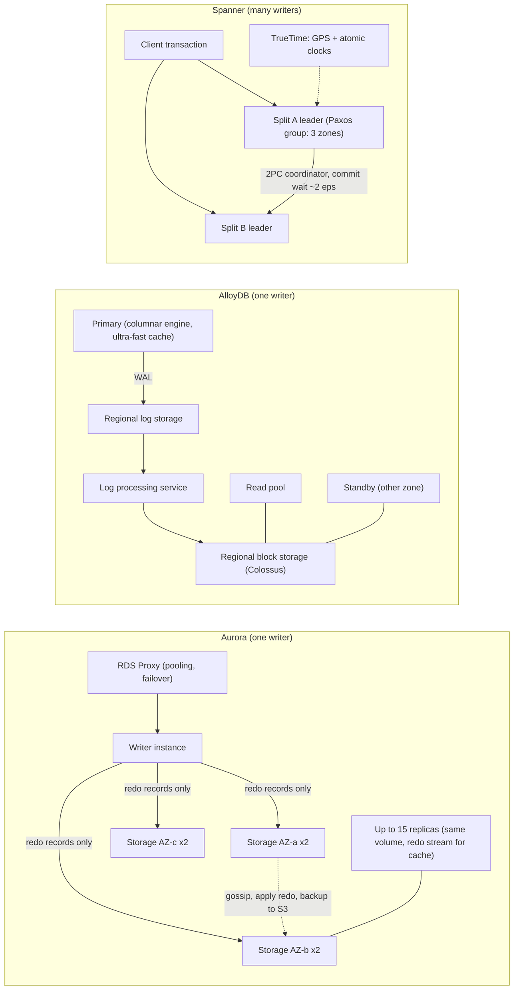
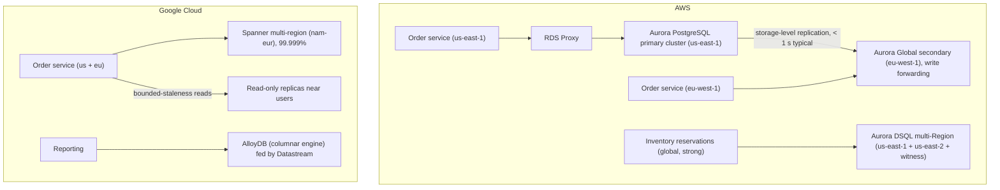

# 03.2 · Relational Internals: Aurora's Storage Quorum and RDS Proxy vs AlloyDB and Spanner

> **Folder 03 · File 2 of 4.** All three databases separate compute from storage. They separate it differently, and that decides what survives a failure, how fast failover is, and what "scale" means:
> - **Aurora** ships only **redo log records** to a purpose-built storage fleet: 6 copies across 3 AZs, write quorum 4/6. The storage applies the log itself.
> - **AlloyDB** writes PostgreSQL WAL to a regional log store and has a log-processing service materialize pages on Google's distributed storage, with a columnar engine and tiered caches on the compute side.
> - **Spanner** isn't a single-writer database at all. Data is split into key ranges, each a **Paxos group**, and **TrueTime** gives externally consistent transactions across them, at the cost of a commit wait proportional to clock uncertainty.
>
> This file also covers the 2024–2025 additions (Aurora Limitless, Aurora DSQL, Aurora's 256 TiB volumes) and **RDS Proxy**, which decides whether serverless and microservice fleets can use relational databases at all.

| Listing | What it shows | Language |
|---|---|---|
| `quorum_replication_sim.py` | Worst-case write and read availability over every failure placement for Aurora's 6-copy W4/R3 quorum vs a 3-replica majority (1–2 copies, an AZ, AZ+1, AZ+2). Repair time for a 10 GB segment. Spanner commit latency ≈ max(Paxos majority RTT, 2ε) across four configurations and three ε values | Python 3 (stdlib) |

**Verification.** The listing is embedded byte-identical. The gate re-runs it on this file and requires `verdict: OK`. That asserts Aurora survives an AZ with both writes and reads and keeps reads at AZ+1, that a 3-replica majority is down at AZ+1, the 8 s repair at 10 Gbps, and the commit-latency model's corner values. Facts come from the Aurora (SIGMOD 2017), Spanner (OSDI 2012) and DynamoDB papers, and the AWS and Google docs, as of **2026-10-31**.

**Labels.** **[D]** documented · **[E]** estimate/model · ⚠ inferred, not a product contract.

---

## 0. Orientation

**The questions this file answers.**

1. What does each engine send over the network on a commit, and why does that decide its write latency and recovery time?
2. Which failures does each survive with writes, with reads only, or not at all?
3. How fast is failover, what makes it slow, and how does RDS Proxy (or AlloyDB's proxy and connectors) change what clients see?
4. When do you need **distributed** SQL (Spanner, Aurora DSQL, Aurora Limitless), and what do you pay in latency, contention behavior and schema design?
5. How do read replicas, read pools and stale reads differ in freshness and cost?
6. How do you migrate between them (Folder 06) without assuming properties the target doesn't have?

**Reading paths.**

| Goal | Read |
|---|---|
| L7 interview | §1, §2, §3.1–3.3, §4.1–4.3, §5, §7, Q-chains |
| SAP-C02 | §2, §3.3–3.6, §6, §7, S-scenarios |
| Choosing a database for a new service | §1.3, §6, then §7 for the traps |

**Prerequisites.** [03.1](01-object-storage-s3-strong-consistency-prefix-partitioning-vs-gcs-colossus.md) for Colossus. Folder 02 for multi-region networking latency.

---

## 1. First principles: what crosses the network on commit

### 1.1 The cost of a traditional database in the cloud

A conventional PostgreSQL or MySQL primary on network block storage writes:
- WAL/redo;
- data pages, through checkpoints and double-write or full-page writes;
- binlogs;
- and then replicates all of that to a standby.

Each write becomes several network I/Os, each replicated by the block layer. Aurora's paper calls this **write amplification over the network** and shows it bounds throughput and makes recovery slow (replay from the last checkpoint).

### 1.2 Three answers

| Design | What the compute node sends on commit | Who builds the pages | Durability boundary |
|---|---|---|---|
| **Aurora** | **Redo log records only**, to 6 storage nodes in parallel; commit at 4 acks | Storage nodes apply redo in the background | Quorum across 3 AZs |
| **AlloyDB** | WAL to a regional, low-latency **log storage** service | A **log processing service** replays WAL into blocks in regional storage | Regional distributed storage on Colossus ⚠ (mechanism per Google's architecture docs) |
| **Spanner** | Paxos log entries to the split's replicas (a majority must persist) | Each replica's tablet storage (on Colossus) | A Paxos majority per split, across zones or regions |

### 1.3 Single-writer vs distributed

- **Aurora (provisioned/Serverless v2) and AlloyDB** have **one writer** per cluster. Reads scale out with replicas or read pools. Writes scale **up**. Transactions are ordinary PostgreSQL/MySQL semantics.
- **Spanner** has **many writers**: each split's leader takes writes for its key range. Transactions spanning splits use two-phase commit over Paxos groups. Writes scale **out** with the number of splits, given a good key design.
- **Aurora DSQL** is distributed SQL with **optimistic concurrency** (conflicts checked at commit by adjudicators) and active-active multi-region. **Aurora Limitless** is a sharded Aurora PostgreSQL with a routing layer.

The architect's question is never "which is faster". It's which **write scaling model** and **failure semantics** the workload needs, and which costs (commit wait, OCC aborts, cross-shard transactions) it can tolerate.

---

## 2. Side-by-side architectural Rosetta matrix

| Concern | AWS | GCP | What actually differs |
|---|---|---|---|
| PostgreSQL/MySQL-compatible, cloud-native storage | **Aurora** (MySQL, PostgreSQL): log-structured distributed storage, 6 copies / 3 AZs | **AlloyDB for PostgreSQL**: disaggregated storage with log processing; columnar engine | Aurora's storage applies redo. AlloyDB adds analytics acceleration in compute |
| Write quorum | **4 of 6** copies (2 per AZ). Read quorum 3/6 (used for repair, not routine reads) | Regional storage replication (Google-managed) ⚠ | Aurora publishes its quorum math. AlloyDB states regional durability |
| Max storage | **256 TiB** per cluster volume (Aurora MySQL/PostgreSQL, 2025) [D] | Large per cluster (check limits) | — |
| HA failover | Promote an Aurora Replica (shares storage). Typically tens of seconds. Faster via RDS Proxy | HA: primary + **standby node in another zone**. Automatic failover | Neither needs data copy on failover, since storage is shared |
| Read scaling | Up to 15 Aurora Replicas on the same volume (low lag) | **Read pool instances** sharing storage | Both read from shared storage, not replicated copies |
| Analytics on OLTP | Zero-ETL to Redshift. Aurora parallel query (MySQL) | **Columnar engine** (in-memory columnar on the primary/read pools) | AlloyDB accelerates analytics in place |
| Serverless capacity | **Aurora Serverless v2** (ACUs, scales in increments, can auto-pause to zero) | AlloyDB is provisioned. **Spanner** has granular processing units | — |
| Cross-region DR | **Aurora Global Database**: storage-level replication, typical lag < 1 s, managed switchover/failover | AlloyDB **cross-region replication** (secondary clusters, promotion) | Aurora's is storage-based. AlloyDB's is cluster replication |
| Horizontal write scaling | **Aurora Limitless** (sharded PostgreSQL). **Aurora DSQL** (distributed, OCC, active-active) | **Spanner** (Paxos per split, TrueTime, 2PC) | Spanner is pessimistic (locks, wound-wait). DSQL is optimistic |
| Global consistency model | DSQL: strong consistency, snapshot isolation, OCC commit-time conflict checks | Spanner: **external consistency** (linearizable transactions via TrueTime) | Both strongly consistent across regions, with different conflict behavior |
| Clock | DSQL relies on precise time (Amazon Time Sync) ⚠ | **TrueTime**: GPS + atomic clocks, bounded uncertainty ε | Spanner exposes the uncertainty and waits it out |
| Connection management | **RDS Proxy** (pooling, multiplexing, IAM auth, faster failover) | AlloyDB Auth Proxy / language connectors (IAM auth, TLS); built-in managed pooling ⚠ verify | RDS Proxy multiplexes. Connectors mainly secure and route |
| SLA | Aurora Multi-AZ: 99.99% | AlloyDB HA: 99.99%. Spanner regional 99.99%, **multi-region 99.999%** | Spanner multi-region is the only five-nines relational option here |
| Migration in | DMS (CDC), native replication, Babelfish (SQL Server dialect) | Database Migration Service (CDC from PostgreSQL/MySQL/Oracle), Datastream | Folder 06 |

---

## 3. Internal mechanics: Amazon Aurora and RDS Proxy

### 3.1 "The log is the database" (Verbitski et al., SIGMOD 2017)

**The write path.**
1. The writer generates **redo log records** and sends them, batched per protection group, to the **6 storage nodes** that own that 10 GB segment.
2. A write is durable once **4 of 6** acknowledge.
3. **No data pages** are written by the compute node. There are no checkpoints and no double-write buffer.
4. The storage nodes:
   - persist the log record;
   - gossip with peers to fill gaps;
   - **apply** log records to data pages in the background ("coalescing");
   - continuously back up to S3.
5. On a read miss in its buffer cache, the writer reads a page from one storage node that is known to be current, by tracking which segments have the needed log sequence number. It doesn't need a read quorum.

**Why 6 copies in 3 AZs.** The paper's argument:
- With 3 copies and a 2/3 quorum, losing an AZ plus one more node (the **"AZ+1"** case) loses quorum.
- Aurora tolerates losing an **entire AZ** with writes still available (4 of 6 remain), and **AZ+1** with *reads* still available (3 of 6). That's enough to repair the lost copies and restore write quorum.

The listing (§5, section 1) checks every placement: Aurora keeps write+read at one AZ down and read-only at AZ+1. A 3-replica majority is fully down at AZ+1.

**Why 10 GB segments.** The repair time for a segment bounds the window in which a *second* failure could cost quorum. 10 GB at 10 Gbps is **~8 s** (listing §5, section 2). Small segments make the double-fault window seconds, so the probability of correlated loss within it is tiny.

### 3.2 Replicas, failover and Global Database

- **Aurora Replicas** (up to 15) attach to the **same storage volume**. The writer streams redo to them as well, so they update cached pages in memory. Lag is typically milliseconds to low tens of milliseconds ⚠ (workload-dependent). There's no data copy.
- **Failover** promotes a replica, chosen by **failover tiers**. Storage is shared, so promotion is mostly crash recovery (fast, since there's no replay from a checkpoint) plus DNS/endpoint changes. Clients that cache DNS or hold dead connections see the long tail, which is where RDS Proxy helps.
- **Aurora Global Database** replicates at the **storage layer** to secondary Regions. Typical lag is under a second. Two operations:
  - **switchover** (planned, no data loss);
  - **failover** (unplanned, RPO equals the replication lag at the time).

  Write forwarding lets secondary-Region clients send writes to the primary.

### 3.3 Aurora Serverless v2, I/O-Optimized, Limitless and DSQL

- **Serverless v2.** Capacity in ACUs (memory/CPU units) scales in fine increments within a min/max, and can **auto-pause** to zero ACUs when idle. Scale-up is fast but not instant, so set a minimum that covers the burst.
- **I/O-Optimized** removes per-I/O charges for a higher instance and storage price. Choose it when I/O is more than about 25% of spend ⚠ (AWS's guidance threshold; verify).
- **Limitless Database.**
  - Aurora PostgreSQL with **transaction routers** and **shards**.
  - Tables are **sharded** by a shard key or **reference** tables (replicated).
  - Distributed transactions are supported.
  - Use it when a single writer's vertical ceiling is reached and the schema can be sharded.
- **Aurora DSQL** (GA 2025).
  - A serverless distributed SQL database, PostgreSQL-compatible for a subset of features.
  - **Optimistic concurrency control**: transactions run without locks, and **adjudicators** check write-write conflicts at commit. Journals provide the durable, replicated log.
  - **Multi-region active-active** with two Regions and a witness Region.
  - Read-only transactions don't pay cross-Region latency.
  - Up to 256 TiB per cluster, by quota.
  - The trade: **high-contention workloads abort and retry**. Long transactions and hot rows are anti-patterns, and some PostgreSQL features aren't supported.

### 3.4 RDS Proxy

**What it does.**
- A managed connection pooler between clients and RDS/Aurora.
- It holds a pool of database connections and **multiplexes** many client connections onto them, transaction by transaction.

**Why it matters.**
- **Connection storms:** Lambda fan-out, autoscaled pods and Cloud Run instances each open their own connections. PostgreSQL's per-connection memory and process cost makes thousands of connections expensive (01.3 §7, row 23).
- **Failover:** the proxy keeps client connections open, detects the new writer, and reconnects behind the scenes. AWS cites up to ~66% faster failover for clients ⚠ (vendor figure).
- **Auth:** IAM authentication, with database credentials kept in Secrets Manager.

**Pinning.** Session-level state ties a client to one database connection for the session, which defeats multiplexing. Examples:
- `SET` of session variables;
- temporary tables;
- some prepared-statement patterns;
- advisory locks.

Monitor the pinning metrics and keep sessions stateless.

### 3.5 RDS Multi-AZ, for contrast

- **RDS Multi-AZ instance** (classic): one standby with synchronous block-level replication, failover in typically 1–2 minutes ⚠.
- **Multi-AZ DB cluster**: one writer and two readable standbys, semi-synchronous replication, faster failover.

Aurora's shared-storage design is why its replicas are both readable *and* failover targets without a data copy.

### 3.6 What Aurora doesn't change

- Writes still go to **one writer**. Hot-row contention, long transactions and lock waits behave like MySQL/PostgreSQL.
- Max connections is still a function of instance memory.
- Vacuum (PostgreSQL) and purge (MySQL) still matter. Aurora removes storage I/O amplification, not MVCC maintenance.

---

## 4. Internal mechanics: AlloyDB and Spanner

### 4.1 AlloyDB for PostgreSQL

- **Storage.**
  - The primary writes WAL to a **low-latency regional log storage** layer.
  - A **log processing service** consumes WAL and materializes database blocks in **regional distributed block storage** built on Google's storage infrastructure (Colossus).
  - Because storage is regional and shared, failover and **read pools** don't copy data.
- **Compute:**
  - PostgreSQL with Google's changes;
  - an **ultra-fast cache** that extends the buffer cache with local SSD ⚠ (Google architecture description);
  - a **columnar engine** that automatically keeps hot columns in an in-memory columnar format for analytical scans, with vectorized execution.
- **HA.** An HA primary has an **active node and a standby in another zone**, with automatic failover. Read pools spread across zones.
- **DR.** Cross-region **secondary clusters** with replication and promotion.
- **AlloyDB Omni** runs the engine anywhere (containers).
- **Claims.** Google claims large speedups over standard PostgreSQL for transactional and analytical workloads ⚠ (vendor benchmarks). Measure yours.

### 4.2 Spanner (Corbett et al., OSDI 2012; current docs)

**Data model.**
- Tables with primary keys, optionally **interleaved** (child rows stored with the parent).
- Data is divided into **splits**: contiguous key ranges.
- Each split is replicated by a **Paxos group** across the instance configuration's replicas:
  - 3 read-write replicas in 3 zones for regional;
  - read-write replicas in two regions plus a witness for multi-region.
- One replica is the split's **leader**, holding a time-based **leader lease**.

**TrueTime.**
- `TT.now()` returns an interval `[earliest, latest]` guaranteed to contain absolute time.
- Time masters in each data center use **GPS receivers and atomic clocks**. Daemons poll several masters and bound their drift.
- The 2012 paper reported ε (half-width) typically **1–7 ms**, a sawtooth averaging about 4 ms. Current values aren't published ⚠, so the listing sweeps ε = 1, 4, 7 ms.

**Read-write transactions.**
1. Acquire locks at the split leaders (pessimistic, **wound-wait** for deadlock avoidance).
2. Buffer writes.
3. At commit, the coordinator leader runs **two-phase commit** across the participant splits' Paxos groups.
4. It picks a commit timestamp `s ≥ TT.now().latest`.
5. It **waits until `TT.after(s)`** is true, the **commit wait**, before making the commit visible. That's about 2ε, overlapped with Paxos communication.

This gives **external consistency**: if transaction T1 commits before T2 starts in real time, then T1's timestamp is less than T2's.

**Reads.**
- **Strong reads** at the current time need a replica that's up to date for that timestamp (safe time).
- **Stale reads** (exact or bounded staleness, e.g. 15 s) can be served by **any replica**, including read-only replicas in other regions, with **no locking and no leader round trip**. This is Spanner's main tool for global read latency.
- **Read-only transactions** run at a snapshot timestamp without locks.

**Latency consequences** (listing §5, section 3 [E]):
- In one region, Paxos RTT across zones is about a millisecond, so the **commit wait (2ε) dominates**: ~8 ms at ε = 4 ms.
- Across regions, the **majority RTT** dominates: 12–80 ms in the model. Leader placement and the instance configuration decide which.

**Capacity [D].**
- 1 node = 1,000 processing units.
- On a regional SSD configuration, a node at full CPU supports roughly **22,500 reads/s or 3,500 writes/s** (1 KB single-row writes). Throughput-optimized writes go higher.
- Storage is allotted at **10 TiB per node** (1,024 GiB per 100 PUs below one node).
- Size for **≤ 65% CPU** in regional and **≤ 45%** in multi-region high-priority guidance ⚠ (check the current recommended maximums).

**Schema rules.**
- **Never use monotonically increasing primary keys** (timestamps, sequences). All inserts hit the last split's leader.
- Use UUIDv4, a hash prefix, or **bit-reversed sequences** (Spanner supports them).
- Interleave child tables to keep related rows in one split.
- Use **change streams** for CDC.

**Editions (2024):** Standard, Enterprise and Enterprise Plus, gating multi-region and advanced features. Spanner also offers a **PostgreSQL interface** and graph, full-text and vector search.

### 4.3 Spanner vs Aurora DSQL vs Aurora Limitless

| | Spanner | Aurora DSQL | Aurora Limitless |
|---|---|---|---|
| Concurrency | Pessimistic locks (wound-wait), 2PC across splits | **Optimistic**: commit-time conflict detection | PostgreSQL locking per shard. Distributed transactions via routers |
| Consistency | External consistency (TrueTime) | Strong, snapshot isolation | PostgreSQL isolation per shard. Distributed consistency via routers |
| Multi-region writes | Yes (multi-region configs, leader region for each split) | Yes (active-active, two Regions + witness) | Single Region |
| Contention behavior | Waits (locks) and wounds younger transactions | **Aborts and retries** on conflict | Lock waits |
| Best for | Global OLTP with strong consistency, high write scale, mature SQL | Serverless, low-contention, active-active apps | Existing PostgreSQL apps needing write scale-out with sharding |
| Schema discipline | Key design to avoid hot splits. Interleaving | Short transactions. Avoid hot rows | Choose shard keys. Reference tables |

---

## 5. Listing: quorums, repair windows and commit latency

<!-- listing:quorum_replication_sim.py -->
```python
"""quorum_replication_sim.py - what survives which failure: Aurora's 6-copy storage quorum vs a
3-replica majority, segment repair windows, and Spanner commit latency (Paxos majority + TrueTime
commit wait) across instance configurations.

Rules encoded:
  Aurora storage: 6 copies per 10 GB protection group, 2 per AZ in 3 AZs; write quorum 4/6, read
    quorum 3/6 (Verbitski et al., SIGMOD 2017); repair re-replicates a 10 GB segment
  3-replica majority (Spanner regional splits, many Raft/Paxos stores): write and read 2/3
  Spanner: a write commits after the leader gets a Paxos majority; commit wait holds the result
    until TrueTime guarantees the timestamp has passed (about 2 x epsilon), overlapped with Paxos
    (Corbett et al., OSDI 2012). Epsilon values and inter-region RTTs below are ASSUMPTIONS.

Usage: python -I quorum_replication_sim.py <any path>
"""
import itertools
import sys


def survives(copies_per_az, az_down, extra_down, w, r):
    """Enumerate which copies fail: one whole AZ (optional) + `extra_down` more copies anywhere.
    Returns (all placements keep writes, all keep reads)."""
    copies = [(az, i) for az in range(3) for i in range(copies_per_az)]
    alive_base = [c for c in copies if az_down is None or c[0] != az_down]
    worst_w = worst_r = True
    for dead in itertools.combinations(alive_base, extra_down):
        alive = len(alive_base) - len(dead)
        worst_w &= alive >= w
        worst_r &= alive >= r
    return worst_w, worst_r


def repair_seconds(segment_gb, gbps):
    return segment_gb * 8 / gbps


def spanner_commit_ms(majority_rtt_ms, epsilon_ms):
    return max(majority_rtt_ms, 2 * epsilon_ms)


def main():
    ok = True
    print("== 1. Worst case over all placements: can the system still write / read? ==")
    print(f"{'failure':<24} {'Aurora 6 copies (W4,R3)':<26} {'3 replicas (W2,R2)':<20}")
    cases = (("one copy", None, 1), ("two copies", None, 2), ("one AZ", 0, 0),
             ("one AZ + one copy", 0, 1), ("one AZ + two copies", 0, 2))
    res = {}
    for label, az, extra in cases:
        a = survives(2, az, extra, 4, 3)
        m = survives(1, az, extra, 2, 2)
        res[label] = (a, m)
        fmt = lambda t: ("write+read" if t[0] else ("read only" if t[1] else "DOWN"))
        print(f"{label:<24} {fmt(a):<26} {fmt(m):<20}")
    ok &= res["one AZ"][0] == (True, True) and res["one AZ + one copy"][0] == (False, True)
    ok &= res["one AZ + one copy"][1] == (False, False)
    print("   Aurora's 'AZ+1' property: lose an AZ and one more copy and data stays readable and")
    print("   repairable; a 3-replica majority is down for both reads and writes in the same case")

    print()
    print("== 2. Repair window: re-replicating one 10 GB segment ==")
    for gbps in (1, 10, 25):
        print(f"at {gbps:>2} Gbps: {repair_seconds(10, gbps):>5.1f} s")
    ok &= repair_seconds(10, 10) == 8.0
    print("   small segments make the double-fault window seconds, not hours: the reason for 10 GB units")

    print()
    print("== 3. Spanner commit latency ~ max(Paxos majority RTT, 2 x epsilon) [model] ==")
    configs = (("regional (3 zones)", 1.0), ("dual-region (nearby)", 6.0),
               ("multi-region, leader + nearest voting region", 12.0),
               ("multi-region, cross-continent quorum", 80.0))
    for name, rtt in configs:
        row = "  ".join(f"eps {e:>1.0f} ms -> {spanner_commit_ms(rtt, e):>5.1f} ms" for e in (1, 4, 7))
        print(f"{name:<46} {row}")
    ok &= spanner_commit_ms(1.0, 4) == 8.0 and spanner_commit_ms(80.0, 7) == 80.0
    print("   in one region TrueTime's uncertainty dominates commit latency; across regions the quorum")
    print("   RTT does. Reads at a timestamp in the past (stale reads) skip both")
    print()
    print("verdict: OK" if ok else "verdict: FAIL")


if __name__ == "__main__":
    main()
```

<!-- output:quorum_replication_sim.py -->
```text
== 1. Worst case over all placements: can the system still write / read? ==
failure                  Aurora 6 copies (W4,R3)    3 replicas (W2,R2)  
one copy                 write+read                 write+read          
two copies               write+read                 DOWN                
one AZ                   write+read                 write+read          
one AZ + one copy        read only                  DOWN                
one AZ + two copies      DOWN                       DOWN                
   Aurora's 'AZ+1' property: lose an AZ and one more copy and data stays readable and
   repairable; a 3-replica majority is down for both reads and writes in the same case

== 2. Repair window: re-replicating one 10 GB segment ==
at  1 Gbps:  80.0 s
at 10 Gbps:   8.0 s
at 25 Gbps:   3.2 s
   small segments make the double-fault window seconds, not hours: the reason for 10 GB units

== 3. Spanner commit latency ~ max(Paxos majority RTT, 2 x epsilon) [model] ==
regional (3 zones)                             eps 1 ms ->   2.0 ms  eps 4 ms ->   8.0 ms  eps 7 ms ->  14.0 ms
dual-region (nearby)                           eps 1 ms ->   6.0 ms  eps 4 ms ->   8.0 ms  eps 7 ms ->  14.0 ms
multi-region, leader + nearest voting region   eps 1 ms ->  12.0 ms  eps 4 ms ->  12.0 ms  eps 7 ms ->  14.0 ms
multi-region, cross-continent quorum           eps 1 ms ->  80.0 ms  eps 4 ms ->  80.0 ms  eps 7 ms ->  80.0 ms
   in one region TrueTime's uncertainty dominates commit latency; across regions the quorum
   RTT does. Reads at a timestamp in the past (stale reads) skip both

verdict: OK
```

**Reading the output.**

- **Section 1** enumerates every placement of the failures.
  - **Aurora's 6-copy W4/R3** survives two arbitrary copies and a whole AZ with writes, and **AZ+1 with reads** (enough to repair).
  - A **3-replica majority** survives one copy or one AZ, but is **down for reads and writes at AZ+1 or at two copies**.

  This is the paper's argument for 6 copies, in numbers. It's also why Spanner regional configurations use 3 zones but rely on fast re-replication, and why multi-region Spanner configurations add regions and witnesses.
- **Section 2.** A 10 GB segment re-replicates in 8 s at 10 Gbps, so the window for a correlated second failure is seconds.
- **Section 3 [E].**
  - **Regional:** commit latency is set by **TrueTime's ε** (2ε: 2–14 ms).
  - **Cross-region:** the **quorum RTT** (12–80 ms in the model) dominates, so ε stops mattering.

  The design lever for regional Spanner is the clock. For global Spanner, it's leader placement, configuration choice and **stale reads**, which skip both costs.

---

## 6. Choosing and translating

### 6.1 Decision guide

| Workload | AWS | GCP | Why |
|---|---|---|---|
| Existing PostgreSQL/MySQL app, single Region, HA | Aurora (+ RDS Proxy) | AlloyDB (or Cloud SQL for smaller) | Same engine semantics, shared-storage HA |
| PostgreSQL with heavy in-database analytics | Aurora + zero-ETL to Redshift | **AlloyDB columnar engine** | AlloyDB accelerates in place |
| Spiky or dev/test relational | Aurora Serverless v2 (auto-pause) | Cloud SQL / small AlloyDB, or Spanner with granular PUs | Pay for use |
| Write scale beyond one primary, SQL | Aurora Limitless (sharded) or DSQL | **Spanner** | Horizontal writes |
| Global active-active, strong consistency | **Aurora DSQL** (low contention) or DynamoDB MRSC (key-value) | **Spanner multi-region** (99.999%) | Consistency across regions |
| Regional DR with sub-second typical RPO | Aurora Global Database | AlloyDB cross-region replication. Spanner multi-region (RPO 0) | Async vs synchronous |

### 6.2 Translation traps

- **Aurora → Spanner.**
  - Monotonic keys (`SERIAL`/auto-increment) become hot spots, so redesign the keys.
  - Large multi-row transactions across many splits cost 2PC.
  - Not all PostgreSQL features exist on Spanner's PostgreSQL interface.
- **Spanner → Aurora.** The global-write and RPO-0 assumptions break. Aurora Global Database is asynchronous at the storage layer.
- **AlloyDB ↔ Aurora PostgreSQL.** Mostly the same engine, but different extensions and features (columnar engine vs zero-ETL, pooling models), and different HA endpoints.
- **Anything → DSQL.** Retry logic for OCC aborts is mandatory, along with short transactions and unsupported-feature checks.

---

## 7. Failure modes, throttling limits and quota traps

| # | Symptom | Root cause | Detect | Fix | Cloud |
|---|---|---|---|---|---|
| 1 | "Too many connections" during a scale-out | Per-instance connection limit. Per-connection memory | DB connections metric | **RDS Proxy** / pooler. Bound client concurrency (01.3 Q5) | Both |
| 2 | RDS Proxy gives no pooling benefit | **Pinning** from session state | Proxy pinning metrics | Remove session `SET`s, temporary tables and session-level prepared statements | AWS |
| 3 | Failover takes minutes for clients but seconds for the database | Clients caching DNS / dead connections | Client errors after failover | RDS Proxy, or the AWS JDBC driver. Short DNS TTL. Connection validation | AWS |
| 4 | Aurora Global Database failover lost writes | Unplanned **failover** RPO = replication lag | Lag metric | Use **switchover** for planned moves. Alarm on lag. Application-level idempotency | AWS |
| 5 | Serverless v2 stalls at peak | Scale-up from a too-low minimum ACU | ACU utilization | Raise min ACUs for latency-critical paths | AWS |
| 6 | I/O costs exceed compute | Standard storage billing on an I/O-heavy workload | Cost and usage report | **I/O-Optimized** | AWS |
| 7 | DSQL transactions fail under load | **OCC conflicts** on hot rows | Abort/retry counts | Retry with backoff. Redesign hot rows. Short transactions | AWS |
| 8 | Spanner write throughput flat despite more nodes | **Monotonic primary keys** → one hot split | Key Visualizer | UUIDv4 / bit-reversed sequences / hash prefix | GCP |
| 9 | Spanner latency jumps for some transactions | Cross-split **2PC** and lock waits (wound-wait) | Lock statistics, transaction stats | Interleave related rows. Smaller transactions. Stale reads for reads | GCP |
| 10 | Global reads slow on multi-region Spanner | Strong reads need an up-to-date replica / the leader | Read latency by region | **Stale reads** (bounded staleness) from local replicas | GCP |
| 11 | Spanner CPU high, latency rising | Above the recommended CPU utilization | CPU by priority | Add PUs (autoscaler). Fix hot splits | GCP |
| 12 | AlloyDB analytical queries don't speed up | Columns not in the **columnar engine** (memory size, recommendations) | Columnar engine stats | Size the columnar memory. Recommendations / manual columns | GCP |
| 13 | Replica reads return stale data after a write | Replica lag (Aurora replicas, read pools) | Lag metrics | Read-your-writes on the writer for that session, or wait on an LSN | Both |
| 14 | Storage volume nearing its limit | Large tables, bloat | Volume size (256 TiB max on Aurora) | Archive or partition. Vacuum/purge. Limitless / Spanner for growth | Both |
| 15 | Vacuum falls behind and performance degrades | MVCC maintenance isn't solved by cloud storage | Dead tuples, transaction-ID age | Tune autovacuum. Avoid long transactions | Both |

---

## 8. Architecture diagrams: multi-service compositions

### 8.1 The three write paths



### 8.2 A global commerce platform on both clouds



### 8.3 Spanner read-write transaction timeline (ASCII)

```text
client      begin ---- reads (locks at leaders) ---- buffer writes ---- commit
coordinator                                                         |-- 2PC prepare to participants (Paxos log each)
                                                                    |-- choose s >= TT.now().latest
                                                                    |-- Paxos commit record       \
                                                                    |-- commit wait until          > overlapped
                                                                    |   TT.after(s) is true      /
                                                                    |-- release locks, reply
latency ~ max(majority RTT of the slowest participant group, ~2 x epsilon) + lock waits
stale read at t-15s: any caught-up replica, no locks, no leader, no commit wait
```

---

## 9. Bar-raiser chains and SAP-C02 scenarios

### 9.1 L7 bar-raiser chains

<details><summary><b>Q1 · Why six copies? Defend Aurora's quorum design</b></summary>

**Initial Prompt.** "Aurora stores six copies of your data across three AZs. Isn't that wasteful compared with three replicas? Defend or attack the design with numbers."

**L5 Answer.** "Six copies give more durability than three."

**Why L5 Stalls.** Durability isn't the argument; erasure coding could get that more cheaply. The argument is about **availability under correlated failures** and repair time.

**L7 Answer.** "The design target is the **AZ+1** case: an entire AZ is down (a correlated failure) *and* one more node fails (background noise at fleet scale).
- **3 replicas with a 2/3 quorum:** losing an AZ leaves 2, and one more failure leaves 1. Both reads and writes are down, and you can't safely repair.
- **6 copies, 2 per AZ, W = 4, R = 3:**
  - losing an AZ leaves 4, so writes continue;
  - one more failure leaves 3, so reads continue and the lost copies can be **re-replicated**;
  - the listing enumerates every placement to confirm it.
- **Segment size:** 10 GB segments make the repair window ~8 s at 10 Gbps, so a second correlated failure inside that window is unlikely.
- **The storage cost** is offset by shipping only redo log records: no page writes, no double-writes.

The honest trade: storage-level quorum doesn't add *write* scaling. There's still one writer."
</details>

<details><summary><b>Q2 · The failover took 30 seconds for Aurora and 4 minutes for the app</b></summary>

**Initial Prompt.** "During an Aurora failover, the cluster was writable again in under 30 seconds, but our Java services took 4 minutes to recover. Why, and how do we close the gap?"

**L5 Answer.** "Lower the JVM DNS TTL so it picks up the new writer faster."

**Why L5 Stalls.** That's one cause. Dead pooled connections, retry storms and connection limits on the new writer are the others.

**L7 Answer.** "Three tail contributors:
1. **DNS caching:** the cluster endpoint's DNS changes, and JVMs that cache it keep connecting to the old writer.
2. **Dead pooled connections:** HikariCP holds sockets to the dead instance until TCP timeouts or validation fail them. Without validation and short socket timeouts, that's minutes.
3. **Reconnect storms:** every pod reconnects at once against the new writer's connection limit.

Fixes:
- **RDS Proxy:** it keeps client connections open across failover and reattaches to the new writer.
- **Or the AWS Advanced JDBC Driver**, which tracks topology and fails over without waiting for DNS.
- Pool validation, short socket timeouts and jittered retries.
- A game day with an induced failover, measuring client recovery, not cluster recovery."
</details>

<details><summary><b>Q3 · Explain TrueTime's commit wait to a skeptical engineer</b></summary>

**Initial Prompt.** "An engineer says Spanner 'cheats' by waiting before committing, so it can't be fast. Explain what the wait buys and when it matters."

**L5 Answer.** "Spanner waits for clocks to sync so that transactions are ordered correctly."

**Why L5 Stalls.** Clocks never sync perfectly. Spanner bounds their uncertainty and waits it out, and the answer doesn't say when that cost dominates or how to avoid it.

**L7 Answer.** "TrueTime returns an interval `[earliest, latest]` guaranteed to contain real time. Spanner gives a committing transaction a timestamp `s ≥ latest` and doesn't make it visible until `TT.after(s)`: until every correct clock agrees `s` is in the past. That's about 2ε, overlapped with the Paxos commit.

The result is **external consistency**: if T1 commits before T2 starts in real time, T1's timestamp is smaller, everywhere, without a global sequencer.

When it matters:
- **In one region**, Paxos across zones takes about a millisecond, so the commit wait dominates. ~8 ms at the paper's typical ε of 4 ms (listing §5, section 3).
- **Across regions**, the quorum RTT dominates and ε hardly matters.

The real tools are:
1. leader placement near writers;
2. **stale reads** for most reads (no locks, no leader, no wait);
3. read-only transactions at snapshots.

The 'cheat' is a bounded wait that buys global ordering. Few databases make that trade so explicit."
</details>

<details><summary><b>Q4 · Spanner throughput didn't scale with nodes</b></summary>

**Initial Prompt.** "We migrated a write-heavy table to Spanner, tripled the nodes, and insert throughput barely moved. CPU is high on a few servers. Diagnose."

**L5 Answer.** "Add more nodes, or move to a multi-region configuration for more capacity."

**Why L5 Stalls.** Nodes don't help if every insert goes to one split. Multi-region adds latency, not throughput.

**L7 Answer.** "The primary key is almost certainly **monotonic**: a sequence or a timestamp. Spanner splits by key range, so every new row lands at the end of the key space, on **one split and one leader**. More nodes just sit idle. Key Visualizer will show a hot diagonal.

Fix the key:
- **UUIDv4**, or a **bit-reversed sequence** (Spanner supports them natively);
- or hash-prefix the key (`shard_id = hash(id) % N` as the leading column).

Keep the timestamp as a secondary index if range scans by time are needed, and accept that the index itself can hot-spot. Use a sharded index key there too.

Then confirm the per-node guidance (roughly 3,500 writes/s per node for 1 KB rows in a regional configuration) with a load test, and run under the recommended CPU utilization. The same lesson as Bigtable (03.3) and S3 prefixes (03.1): range-partitioned systems punish sorted keys."
</details>

<details><summary><b>Q5 · Serverless fleets and PostgreSQL: make it survive</b></summary>

**Initial Prompt.** "We're moving 300 Lambda functions and a GKE fleet to use one Aurora PostgreSQL cluster. Peak concurrency could be 5,000 handlers. Design the connection strategy for AWS, and its GCP equivalent on AlloyDB."

**L5 Answer.** "Raise max_connections to 5,000."

**Why L5 Stalls.** PostgreSQL connections are processes with memory. 5,000 of them on one writer degrades everything, and it doesn't solve failover churn.

**L7 Answer.**
- **The invariant:** concurrent handlers × connections each ≤ the pool the database can serve. Typically a few hundred active connections on a large instance.
- **AWS:**
  - **RDS Proxy** multiplexes thousands of client connections onto a few hundred database connections and smooths failover;
  - cap Lambda concurrency with reserved concurrency or ESM maximum concurrency;
  - keep sessions stateless to avoid **pinning**;
  - route read-only traffic to the reader endpoint through a second proxy endpoint;
  - IAM auth through the proxy.
- **GCP / AlloyDB:**
  - connectors or the Auth Proxy give IAM-authenticated TLS;
  - use a pooler (PgBouncer, or AlloyDB's managed pooling if available in your version ⚠);
  - cap Cloud Run instances × pool size, **doubled** for Cloud Run's max-instances overshoot (01.3).
- **Both:** queue in front of write bursts, and alarm on connection count and wait events."
</details>

<details><summary><b>Q6 · Active-active across regions: DSQL, Spanner or Aurora Global?</b></summary>

**Initial Prompt.** "Product wants both US and EU users to write with low latency and survive a full Region outage with zero data loss. Compare Aurora Global Database, Aurora DSQL and Spanner."

**L5 Answer.** "Aurora Global Database supports multi-region, so use it with write forwarding."

**Why L5 Stalls.** Global Database has one writer Region and asynchronous replication. Unplanned failover can lose the replication lag's worth of writes. That fails 'zero data loss'.

**L7 Answer.**
- **Aurora Global Database:** single writer Region. Write forwarding adds cross-Region latency for remote writers, and **RPO > 0** on unplanned failover. Good for DR, not active-active.
- **Aurora DSQL multi-Region:**
  - active-active in two Regions plus a witness;
  - strongly consistent, **RPO 0**;
  - writes commit with a cross-Region quorum, so commit latency includes inter-Region RTT;
  - **OCC aborts on contention**, so it fits low-contention, short-transaction workloads with retry logic;
  - check PostgreSQL feature coverage.
- **Spanner multi-region:**
  - 99.999% SLA, RPO 0, external consistency;
  - writes go to each split's leader region, so cross-region writers pay RTT;
  - use bounded-staleness reads for low-latency local reads;
  - pessimistic locking handles contention without aborts but adds lock waits.
- **The physics that applies to all three:** zero data loss across regions means a cross-region quorum on every write. US↔EU RTT (~70–90 ms) is a floor. The design question is what users can tolerate on writes, and how reads avoid paying it."
</details>

<details><summary><b>Q7 · AlloyDB's columnar engine vs zero-ETL to Redshift</b></summary>

**Initial Prompt.** "Our PostgreSQL OLTP database also serves dashboards that scan millions of rows. On GCP someone suggests the AlloyDB columnar engine. On AWS, zero-ETL to Redshift. Compare them."

**L5 Answer.** "Both offload analytics from the OLTP database."

**Why L5 Stalls.** Only one of them offloads. The columnar engine runs analytics *on the same cluster*, and zero-ETL moves them *elsewhere*. Freshness, isolation and cost differ.

**L7 Answer.**
- **AlloyDB columnar engine:**
  - keeps hot columns in an in-memory columnar format on the primary or **read pool** nodes, so analytical queries get vectorized scans with **zero replication lag**, inside the same cluster;
  - isolate dashboards on a **read pool** so they don't compete with OLTP;
  - columnar memory is finite, so size it from recommendations.
- **Aurora zero-ETL to Redshift:**
  - continuously replicates to a Redshift warehouse, with seconds of lag ⚠ (workload-dependent);
  - full isolation from OLTP;
  - analytics can join other warehouse data;
  - you pay for and operate the warehouse.
- **Choose:**
  - the columnar engine for operational analytics on fresh data within one database;
  - zero-ETL (or Datastream → BigQuery on GCP) for cross-domain analytics, heavy concurrency, or long history."
</details>

<details><summary><b>Q8 · A migration to Aurora DSQL fails load tests</b></summary>

**Initial Prompt.** "A team ported a ticketing app from PostgreSQL to Aurora DSQL for active-active. Under load, 30% of purchase transactions fail with serialization errors. What's wrong?"

**L5 Answer.** "DSQL isn't production-ready. Switch back to Aurora PostgreSQL."

**Why L5 Stalls.** DSQL is behaving as designed. The workload has a contention pattern that optimistic concurrency punishes.

**L7 Answer.** "DSQL uses **optimistic concurrency**: transactions run without locks, and the adjudicator rejects a commit whose write set conflicts with a transaction that committed since it started. Ticket purchases for a popular event all update **the same inventory row**, so most concurrent transactions conflict and abort.

Fixes:
1. **Retry with backoff.** Mandatory for OCC, but it doesn't fix a hot row.
2. **Shard the hot row**: inventory buckets per section or seat block, with allocation logic that picks a bucket.
3. **Reservation queue** for the hottest events: a queue or a DynamoDB conditional decrement in front, and commit to SQL after.
4. Keep transactions **short**.

If contention is inherent and global strong consistency is required, Spanner's pessimistic locking handles it with waits instead of aborts, with higher latency per contended transaction."
</details>

<details><summary><b>Q9 · Read replicas, read pools, stale reads: which freshness do you get?</b></summary>

**Initial Prompt.** "A team uses Aurora replicas for 'read scaling' and sees users not finding orders they just placed. They propose the same design on AlloyDB read pools and Spanner read-only replicas. Explain the freshness each gives."

**L5 Answer.** "Replicas are eventually consistent. Read from the primary for important reads."

**Why L5 Stalls.** It's correct but undifferentiated. Each system offers different, controllable freshness, and the fix should keep read scaling.

**L7 Answer.**
- **Aurora replicas:** shared storage, with cached pages updated from the redo stream. Lag is usually small but nonzero. For read-your-writes, route that session's reads to the writer for a short window, or wait until the replica's applied LSN passes the commit's.
- **AlloyDB read pools:** shared storage with replication lag on the cache side, so the same pattern.
- **Spanner:**
  - **strong reads** at current time are linearizable but may need the leader or an up-to-date replica;
  - **bounded-staleness reads** (e.g. ≤ 10 s) are served locally by any caught-up replica with no coordination;
  - you pick freshness **per read**.
- **Design:** classify reads.
  1. Read-your-writes reads go to the writer, or use strong reads.
  2. Dashboards and catalogs use replicas or staleness.

  Make the choice explicit in the data-access layer, not implicit in the connection string."
</details>

<details><summary><b>Q10 · Move a 40 TB Oracle OLTP to the cloud: Aurora, AlloyDB or Spanner?</b></summary>

**Initial Prompt.** "A 40 TB Oracle OLTP system with heavy PL/SQL, 20k TPS at peak and a 99.99% SLA is moving to the cloud. Leadership wants 'no more scaling worries'. Recommend a target on each cloud."

**L5 Answer.** "Spanner, because it scales infinitely."

**Why L5 Stalls.** Spanner's scaling requires schema and access-pattern changes, and heavy PL/SQL has to be rewritten. The answer optimizes the wrong constraint and ignores migration risk.

**L7 Answer.** "The binding constraints are **PL/SQL and schema compatibility** and the migration window, not raw scale. 20k TPS fits a large single-writer cluster.
- **AWS:**
  - **Aurora PostgreSQL**, with the Schema Conversion Tool for PL/SQL → PL/pgSQL and DMS CDC for the cutover (Folder 06);
  - Multi-AZ (99.99%), RDS Proxy, Global Database for DR;
  - if growth outruns one writer later, Aurora Limitless with shard keys.
- **GCP:**
  - **AlloyDB**, with Database Migration Service for Oracle → PostgreSQL conversion and CDC;
  - HA (99.99%) and cross-region replication.
- **Spanner only if** the business needs global multi-region writes or 99.999%, and is willing to redesign keys, transactions and stored-procedure logic. That's a modernization program, not a migration.

'No more scaling worries' is better met by **headroom plus a credible next step** than by a rewrite now."
</details>

### 9.2 SAP-C02 scenarios (original)

<details><summary><b>S1 · SAP-C02 · Domain 2 · Select ONE</b></summary>

**Scenario.** A company runs hundreds of Lambda functions that query an Aurora PostgreSQL cluster. During traffic spikes the database runs out of connections, and during failovers clients take several minutes to reconnect. What should a solutions architect do to address both issues with the least application change?

- **A.** Increase the `max_connections` parameter and the instance size.
- **B.** Put Amazon RDS Proxy in front of the cluster and have the functions connect through the proxy endpoint.
- **C.** Add more Aurora Replicas and use the reader endpoint for all queries.
- **D.** Migrate the database to Amazon DynamoDB.

**Answer: B**

- **A** — wrong: more connections increase memory pressure and don't speed client recovery after failover.
- **B** — correct: RDS Proxy pools and multiplexes connections, absorbing spikes, and keeps client connections during failover for faster recovery.
- **C** — wrong: replicas don't help writes or connection storms, and the reader endpoint can't serve write queries.
- **D** — wrong: a database migration is a large application change and isn't needed.
</details>

<details><summary><b>S2 · SAP-C02 · Domain 2 · Select ONE</b></summary>

**Scenario.** A global application needs a relational database in AWS that accepts writes in two Regions simultaneously, remains available if one Region fails, provides strong consistency, and requires no capacity management. Transactions are short and rarely contend for the same rows. Which solution meets these requirements?

- **A.** Amazon Aurora Global Database with write forwarding.
- **B.** Amazon RDS for PostgreSQL with cross-Region read replicas.
- **C.** Amazon Aurora Serverless v2 in each Region with bidirectional logical replication.
- **D.** Amazon Aurora DSQL with a multi-Region cluster.

**Answer: D**

- **A** — wrong: Global Database has a single writer Region and asynchronous replication.
- **B** — wrong: cross-Region read replicas are read-only and asynchronous.
- **C** — wrong: bidirectional logical replication is asynchronous and conflict-prone, and doesn't provide strong consistency.
- **D** — correct: Aurora DSQL multi-Region clusters are serverless, active-active and strongly consistent, which suits short, low-contention transactions.
</details>

<details><summary><b>S3 · SAP-C02 · Domain 3 · Select TWO</b></summary>

**Scenario.** An Aurora MySQL cluster serves an e-commerce site. After failovers, the application takes several minutes to recover because cached DNS points to the old writer and pooled connections hang. The team also wants to minimize data loss for a planned Region migration using Aurora Global Database. Which actions should a solutions architect recommend? (Select TWO.)

- **A.** Use Amazon RDS Proxy (or the AWS Advanced JDBC Driver) so clients follow the new writer quickly after failover.
- **B.** Increase the Aurora storage volume size.
- **C.** Use a managed Global Database switchover for the planned Region migration.
- **D.** Disable Multi-AZ to reduce failover frequency.
- **E.** Convert all replicas to Serverless v2.

**Answer: A, C**

- **A** — correct: the proxy or topology-aware driver avoids stale DNS and dead connections, shortening client recovery.
- **B** — wrong: Aurora storage grows automatically, and its size doesn't affect failover recovery.
- **C** — correct: a managed switchover is designed for planned Region changes without data loss.
- **D** — wrong: removing HA increases outage risk.
- **E** — wrong: the capacity model doesn't address client failover behavior.
</details>

<details><summary><b>S4 · SAP-C02 · Domain 3 · Select ONE</b></summary>

**Scenario.** An Aurora PostgreSQL cluster's monthly bill shows I/O charges are now more than half of total database spend, and the workload is steady and I/O-heavy. What should a solutions architect recommend to reduce cost?

- **A.** Switch the cluster to the Aurora I/O-Optimized storage configuration.
- **B.** Add read replicas to spread I/O.
- **C.** Move to Aurora Serverless v2.
- **D.** Enable Performance Insights.

**Answer: A**

- **A** — correct: I/O-Optimized removes per-request I/O charges in exchange for higher instance and storage pricing, which lowers cost when I/O dominates spend.
- **B** — wrong: replicas add instance cost, and shared-storage I/O still bills per request.
- **C** — wrong: Serverless v2 changes the compute model, not I/O billing.
- **D** — wrong: Performance Insights helps diagnose but doesn't change pricing.
</details>

<details><summary><b>S5 · SAP-C02 · Domain 4 · Select ONE</b></summary>

**Scenario.** A company wants to migrate a large on-premises Oracle OLTP database with extensive PL/SQL to AWS with minimal downtime and wants a managed, PostgreSQL-compatible target with high availability across three Availability Zones. What should a solutions architect recommend?

- **A.** Use AWS DMS full load only, then switch the application during a weekend outage.
- **B.** Rehost Oracle on EC2 and stop the database during copy.
- **C.** Export to S3 and load the data into Amazon Redshift.
- **D.** Use the AWS Schema Conversion Tool to convert the schema and PL/SQL to Aurora PostgreSQL, then use AWS DMS with full load and ongoing change data capture before cutting over.

**Answer: D**

- **A** — wrong: full load without CDC requires a long outage to capture changes during the copy.
- **B** — wrong: rehosting keeps Oracle, doesn't meet the PostgreSQL-compatible target, and the copy requires downtime.
- **C** — wrong: Redshift is an analytics warehouse, not an OLTP target.
- **D** — correct: SCT handles schema and code conversion, and DMS full load plus CDC keeps the target in sync until a short cutover.
</details>

<details><summary><b>S6 · SAP-C02 · Domain 2 · Select ONE</b></summary>

**Scenario.** An Aurora PostgreSQL workload has outgrown the write capacity of the largest instance. The schema is naturally partitioned by customer ID, and the team wants to keep PostgreSQL compatibility with horizontal write scaling in a single Region. What should a solutions architect recommend?

- **A.** Add more Aurora Replicas.
- **B.** Use Amazon Aurora PostgreSQL Limitless Database with customer ID as the shard key.
- **C.** Switch to Aurora Serverless v2 with a higher maximum ACU.
- **D.** Enable Aurora Global Database with write forwarding.

**Answer: B**

- **A** — wrong: replicas scale reads, not writes.
- **B** — correct: Limitless Database shards tables across shards behind transaction routers, scaling writes horizontally while keeping PostgreSQL compatibility.
- **C** — wrong: Serverless v2 scales within one writer's capacity limits.
- **D** — wrong: write forwarding sends writes to the single primary and doesn't add write capacity.
</details>

---

## 10. Checklist

- [ ] The required failure semantics are written down (AZ, AZ+1, Region) and matched to the engine's quorum model (listing §5, section 1).
- [ ] Connection strategy: RDS Proxy or poolers, concurrency caps for serverless (× 2 for Cloud Run), pinning monitored.
- [ ] Failover tested from the **client's** view: DNS caching, pool validation, topology-aware drivers.
- [ ] Cross-region DR: switchover for planned moves; RPO = lag for unplanned failover (Aurora Global, AlloyDB secondary). RPO 0 needs Spanner multi-region / DSQL.
- [ ] Spanner: no monotonic keys (UUIDv4 / bit-reversed sequences), interleaving for locality, stale reads for global read latency, CPU under the recommended utilization.
- [ ] DSQL: retry logic, short transactions, hot-row analysis, feature-compatibility check.
- [ ] Read freshness classified per query (writer / replica / bounded staleness).
- [ ] Cost model: Aurora Standard vs I/O-Optimized; Serverless v2 minimum ACU; Spanner PUs and editions; AlloyDB columnar memory.
- [ ] MVCC maintenance (vacuum/purge) monitored. Cloud storage doesn't remove it.

---

## 11. References

Papers:
- Verbitski et al., *Amazon Aurora: Design Considerations for High Throughput Cloud-Native Relational Databases*, SIGMOD 2017: <https://www.amazon.science/publications/amazon-aurora-design-considerations-for-high-throughput-cloud-native-relational-databases>
- Corbett et al., *Spanner: Google's Globally-Distributed Database*, OSDI 2012: <https://research.google/pubs/spanner-googles-globally-distributed-database-2/>

AWS:
- Aurora 256 TiB storage (Aurora MySQL, 2025): <https://aws.amazon.com/about-aws/whats-new/2025/07/amazon-aurora-mysql-database-clusters-256-tib-storage>
- Aurora storage and reliability: <https://docs.aws.amazon.com/AmazonRDS/latest/AuroraUserGuide/Aurora.Overview.StorageReliability.html>
- Aurora Global Database: <https://docs.aws.amazon.com/AmazonRDS/latest/AuroraUserGuide/aurora-global-database.html>
- Amazon RDS Proxy: <https://docs.aws.amazon.com/AmazonRDS/latest/UserGuide/rds-proxy.html>
- Aurora Limitless Database: <https://docs.aws.amazon.com/AmazonRDS/latest/AuroraUserGuide/limitless.html>
- Inside DSQL writes (Marc Brooker): <https://brooker.co.za/blog/2024/12/05/inside-dsql-writes/>
- Aurora DSQL 256 TiB (2025-11): <https://aws.amazon.com/about-aws/whats-new/2025/11/amazon-aurora-dsql-database-clusters-up-to-256-tib>

Google Cloud:
- AlloyDB overview: <https://docs.cloud.google.com/alloydb/docs/overview>
- AlloyDB columnar engine: <https://docs.cloud.google.com/alloydb/docs/columnar-engine/about>
- Spanner performance (per-node throughput): <https://docs.cloud.google.com/spanner/docs/performance>
- Spanner compute capacity: <https://docs.cloud.google.com/spanner/docs/compute-capacity>
- Spanner TrueTime and external consistency: <https://docs.cloud.google.com/spanner/docs/true-time-external-consistency>
- Spanner schema design best practices: <https://docs.cloud.google.com/spanner/docs/schema-design>
