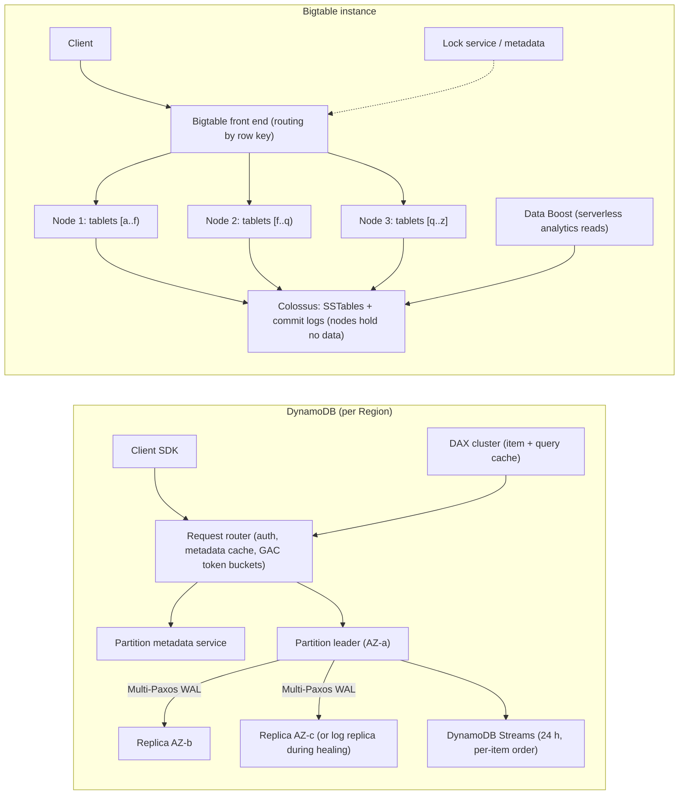
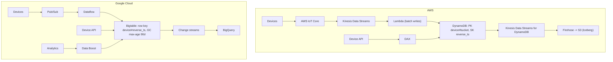

# 03.3 · NoSQL Internals: DynamoDB (GSIs, DAX, Streams) vs Bigtable and Firestore

> **Folder 03 · File 3 of 4.** "DynamoDB = Bigtable" is the most common bad translation in cloud interviews.
> - **DynamoDB** is a serverless key-value and document store. **Request routers** send each request to a **partition** replicated by Multi-Paxos across three AZs, with **per-partition throughput limits**, secondary indexes, transactions, streams and global tables.
> - **Bigtable** is a wide-column store. **Nodes serve tablets** (sorted row-key ranges) whose SSTables live in **Colossus**, with **Chubby**-style coordination. It's provisioned by nodes, built for very high throughput and range scans, with a single index (the row key).
> - **Firestore** is Google's serverless document database with automatic indexes and transactional semantics. For app backends it's the closer analog of DynamoDB.
>
> This file explains each internal design, the limits that follow from it, and how key design decides everything.

| Listing | What it shows | Language |
|---|---|---|
| `partition_heat_sim.py` | DynamoDB throttling at 20,000 writes/s keyed by tenant under Zipf skew 0.6/1.0/1.2, and how 8-way write sharding removes it. Bigtable hottest-node load on a 10-node SSD cluster for timestamp-first vs device-first vs salted (10 and 40 salts) row keys at 100,000 writes/s | Python 3 (stdlib) |

**Verification.** The listing is embedded byte-identical. The gate re-runs it on this file and requires `verdict: OK`. That asserts write sharding removes throttling at Zipf 1.2, that timestamp-first keys send 100% of writes to one node, and that device-first and 40-salt keys stay under 14,000 writes/s per node. Hashing uses `zlib.crc32`, so results don't depend on Python's hash seed. Limits come from the DynamoDB and Bigtable docs and the DynamoDB (USENIX ATC 2022) and Bigtable (OSDI 2006) papers, as of **2026-10-31**.

**Labels.** **[D]** documented · **[E]** estimate/model · ⚠ inferred, not a product contract.

---

## 0. Orientation

**The questions this file answers.**

1. How does a DynamoDB request get served: request router, partition metadata, Paxos leader? Why do per-partition limits exist even in on-demand mode?
2. What do adaptive capacity, split-for-heat, burst capacity and warm throughput actually fix, and what can't they fix?
3. How do GSIs, LSIs, transactions, Streams, DAX and global tables behave, including multi-Region strong consistency (GA 2025-06-30)?
4. How does Bigtable serve a row? Tablets, nodes, Colossus, compactions, and why rebalancing takes seconds.
5. Which key designs hot-spot each system, and how do you fix them?
6. When is the right GCP target Firestore, Bigtable or Spanner, and the right AWS target DynamoDB, Keyspaces or Aurora?

**Reading paths.**

| Goal | Read |
|---|---|
| L7 interview | §1, §2, §3.1–3.4, §4.1–4.3, §5, §7, Q-chains |
| SAP-C02 (DynamoDB-heavy) | §2, §3 entire, §6, §7, S-scenarios |
| Data-model design | §1.2, §3.2–3.3, §4.3, run the listing with your key distribution |

**Prerequisites.** [03.1](01-object-storage-s3-strong-consistency-prefix-partitioning-vs-gcs-colossus.md) for Colossus, and [03.2](02-relational-internals-aurora-storage-quorum-rds-proxy-vs-alloydb-and-spanner.md) for Paxos and quorums.

---

## 1. First principles: hash partitions vs range partitions

### 1.1 Two partitioning philosophies

| | DynamoDB | Bigtable |
|---|---|---|
| Partition function | **Hash** of the partition key → partition (sort key orders items *within* a partition key) | **Range** of the row key → tablet |
| Good at | Uniform point access at any scale. Predictable latency | Range scans in key order. Very high write throughput. Time series |
| Hot-spot cause | One **partition key** too popular (a celebrity, a tenant, a global counter) | Writes concentrated in one **key range** (timestamp-first keys) |
| Scaling unit | Partitions (managed; split by size and heat) | Nodes (provisioned or autoscaled). Tablets rebalanced across nodes |
| Secondary access | GSIs and LSIs | None besides the row key (design keys for queries, or keep separate tables) |

### 1.2 The common law: the key is the schema

Both systems give you **one primary access path** that's fast at any scale, and punish everything else:
- **DynamoDB:** design partition keys with high cardinality and uniform access. Model queries with composite sort keys and GSIs (single-table design).
- **Bigtable:** design the row key so writes **spread** and reads are **prefix scans**. Promote fields into the key (`device#reverse_ts`) and avoid timestamp-first keys.

The listing quantifies both:
- a Zipf 1.2 tenant distribution throttles **20.5%** of writes on DynamoDB until the hot keys are sharded;
- timestamp-first keys put **100%** of Bigtable writes on one node.

---

## 2. Side-by-side architectural Rosetta matrix

| Concern | AWS (DynamoDB) | GCP (Bigtable / Firestore) | What actually differs |
|---|---|---|---|
| Data model | Items (≤ 400 KB) with a partition key and optional sort key. Document attributes | **Bigtable:** rows → column families → qualifiers → timestamped cells. **Firestore:** documents (≤ 1 MiB) in collections | Bigtable versions every cell by timestamp |
| Partitioning | Hash partitions. Each ≤ **3,000 RCU, 1,000 WCU, 10 GB** [D] | Bigtable range tablets served by nodes. Firestore managed (range-based) ⚠ | Hash vs range governs the hot-spot type |
| Replication inside a region | Each partition is a **replication group of 3 across AZs, Multi-Paxos**, leader for writes and strong reads | Bigtable data durably in Colossus. A cluster is zonal. Replication across clusters is **eventually consistent** | DynamoDB is strongly consistent within a Region by default (if requested) |
| Read consistency | Eventually consistent (default, half price) or **strongly consistent** reads. Transactions | Bigtable: strong within a single cluster. Eventual across clusters (single-cluster routing for read-your-writes) | — |
| Capacity model | On-demand or provisioned (with auto scaling). Warm throughput. Burst capacity (~300 s of unused) | Bigtable: nodes (manual or autoscaling). Firestore: serverless | Bigtable is provisioned throughput by nodes |
| Throughput per unit | Per partition 3,000 RCU / 1,000 WCU | Bigtable SSD node: ~17,000 reads/s **or** 14,000 writes/s or 220 MB/s scans. Storage 5 TB per node (SSD), 16 TB (HDD) [D] | Bigtable sizes by nodes. DynamoDB by request units |
| Secondary indexes | **GSI** (own keys, async, eventually consistent), **LSI** (same partition key, 10 GB item collection limit) | Bigtable: none. Firestore: **automatic single-field + composite indexes** | Bigtable pushes index design to you |
| Transactions | `TransactWriteItems` / `TransactGetItems`: up to 100 items, 4 MB, serializable, 2× RCU/WCU | Bigtable: single-row atomicity (check-and-mutate, read-modify-write). Firestore: ACID transactions | Bigtable has no multi-row transactions |
| Change capture | **DynamoDB Streams** (24 h, ordered per item) or Kinesis Data Streams integration | Bigtable **change streams**. Firestore triggers via Eventarc | — |
| In-memory cache | **DAX** (write-through, item and query caches, microseconds, eventually consistent) | Memorystore in front. Bigtable's own block cache | DAX is API-compatible with DynamoDB |
| Multi-region | **Global tables**: MREC (last writer wins) or **MRSC** (strong, GA 2025-06-30, two replicas + a witness or three replicas) [D] | Bigtable multi-cluster replication (eventual). Firestore multi-region locations (synchronous, 99.999%) | DynamoDB now offers strong multi-Region on a key-value store |
| TTL | Per-item TTL attribute (deletes asynchronously) | Bigtable garbage-collection policies (max versions / max age) | — |
| Analytics access | Export to S3, zero-ETL to Redshift / OpenSearch | Bigtable **Data Boost** (serverless reads that don't impact serving), SQL interface, BigQuery external tables | — |
| Closest semantic peers | DynamoDB ≈ **Firestore** (serverless doc/KV) for app backends | Bigtable ≈ **Amazon Keyspaces** (Cassandra) / HBase on EMR for wide-column workloads | Translate by workload, not by "NoSQL" |

---

## 3. Internal mechanics: Amazon DynamoDB

### 3.1 The request path (Elhemali et al., USENIX ATC 2022)

1. A request reaches a **request router**. It authenticates, then looks up the table's **partition metadata** (cached, backed by a metadata service).
2. It sends the request to the **storage node** hosting the partition's **leader** replica. Eventually consistent reads may go to any replica.
3. Each partition is a **replication group** of storage replicas in different AZs, kept consistent by **Multi-Paxos**:
   - the leader handles writes and strongly consistent reads;
   - a write is acknowledged once a quorum has persisted it to the write-ahead log.
4. **Log replicas** (replicas that hold only the recent write-ahead log) speed up healing after a node failure: the group restores durability without copying a full B-tree immediately.
5. **Global admission control (GAC)** tracks table-level capacity in token buckets across routers, so a table's throughput isn't bounded by any one router's view.

Splits happen **by size** (partitions over 10 GB) and **by heat** (**split for heat**). **Adaptive capacity** reallocates provisioned throughput to busier partitions, up to the partition maximum.

### 3.2 The limits that follow [D]

- **Per partition:** 3,000 RCU (strongly consistent 4 KB reads/s, or twice that eventually consistent), **1,000 WCU** (1 KB writes/s), 10 GB.
- **A single item can't exceed one partition's throughput.** Split for heat can separate hot *items* into their own partitions, but it can't split one item.
  - A key that receives 4,000 writes/s throttles at 1,000 WCU **whatever the table's capacity or mode**.
  - The listing's top tenant at Zipf 1.2 gets 4,167 writes/s, and 20.5% of all writes throttle.
- **Burst capacity:** up to ~300 seconds of unused partition capacity can be consumed in bursts.
- **On-demand mode** instantly handles up to about double the previous peak. Beyond that, it scales over minutes. **Warm throughput** lets you pre-provision for a known event.
- **Item size ≤ 400 KB.** Larger payloads belong in S3, with a pointer in the item.
- **LSIs:** up to 5 per table, created only at table creation. **The item collection** (all items sharing a partition key, across the table and its LSIs) **is limited to 10 GB.**
- **GSIs:** up to 20 per table by default.
  - Eventually consistent.
  - Each has its own capacity.
  - **A GSI that can't keep up throttles writes on the base table** (back-pressure).
- **Transactions:** up to 100 items or 4 MB, at 2× the capacity cost.

### 3.3 Fixing hot keys

1. **Write sharding.** Append a suffix: `tenant#0..N-1` (random or computed). Reads of the logical key gather the N shards. The listing shows 8 shards remove all throttling for the Zipf 1.2 case. Size N as ⌈peak writes/s ÷ ~800⌉, keeping headroom under 1,000.
2. **Aggregate before write.** Counters become sharded counters, or buffered increments (Kinesis/SQS → batch `UpdateItem`).
3. **Cache hot reads** with **DAX**, or an application cache, for hot *reads*. DAX doesn't help hot writes.
4. **Model by access pattern.** A high-cardinality partition key, plus composite sort keys and a GSI for alternate access (single-table design).

### 3.4 Streams, DAX and global tables

- **DynamoDB Streams:**
  - an ordered log of item-level changes (keys only, new image, old image, or both), **retained 24 hours**;
  - shards follow partitions;
  - order is guaranteed **per item**;
  - Lambda ESMs consume them (01.3 §3.7);
  - for longer retention or fan-out, use **Kinesis Data Streams for DynamoDB**.
- **DAX:**
  - an in-memory cluster in your VPC;
  - an **item cache** (GetItem/BatchGetItem) and a **query cache** (Query/Scan results);
  - write-through for writes made via DAX;
  - **eventually consistent reads only**: strongly consistent reads pass through to DynamoDB;
  - microsecond reads;
  - invalidation of query results is TTL-based, so query results can be stale after writes.
- **Global tables:**
  - **MREC** (multi-Region eventual consistency): asynchronous replication with **last-writer-wins** conflict resolution. Writes anywhere.
  - **MRSC** (multi-Region strong consistency, GA **2025-06-30**):
    - three Regions: replicas, or two replicas plus a DynamoDB-managed **witness**;
    - strongly consistent reads and writes in any replica Region while a quorum is reachable;
    - otherwise only eventually consistent reads are served;
    - **the mode is fixed at table creation** [D].

### 3.5 Other building blocks

- **PITR:** continuous backups with 35-day restore. On-demand backups. **Export to S3** (full or incremental) for analytics.
- **Zero-ETL** to Redshift and OpenSearch.
- **Keyspaces** (managed Cassandra-compatible) for wide-column models and CQL migrations.

---

## 4. Internal mechanics: Bigtable and Firestore

### 4.1 Bigtable (Chang et al., OSDI 2006; current docs)

**Data model.** A sparse, sorted map: `(row key, column family:qualifier, timestamp) → value`.
- Rows are sorted by key.
- Writes to a single row are atomic.
- Column families hold **garbage-collection policies** (max versions, max age).

**Storage.**
- Each **tablet** is a contiguous row range.
- Its data lives as immutable **SSTables** in Colossus (originally GFS).
- Recent writes go to a commit log and an in-memory **memtable**.
- Minor compactions flush memtables to SSTables, and major compactions merge them.
- A **lock service** (Chubby in the paper) ensures a single active master, stores the location of the root tablet and tracks tablet servers.

**Cloud Bigtable's key property.** **Nodes don't store data.** They serve tablets whose data sits in Colossus, so **rebalancing or replacing a node moves responsibility, not bytes**: seconds, not hours. Bigtable continuously splits busy or large tablets and rebalances them across nodes.

**Capacity [D].**
- **SSD node:** up to ~17,000 reads/s, *or* 14,000 writes/s, *or* 220 MB/s scans. **HDD:** 500 reads/s, 10,000 writes/s, 180 MB/s.
- **Storage per node:** 5 TB (SSD), 16 TB (HDD).
- **Target utilization:** keep storage ≤ 70% (throughput-focused) or ≤ 60% (latency-sensitive).
- **Autoscaling** adjusts nodes by CPU and storage targets.

**Replication and routing.**
- An instance can have **multiple clusters** in different zones and regions, replicated **eventually consistently**.
- **App profiles** route traffic:
  - **single-cluster routing** gives read-your-writes and single-row transactions;
  - **multi-cluster routing** gives availability through automatic failover, but can read stale data from another cluster.

**Other features.** Change streams. **Data Boost**: serverless compute for analytical reads that doesn't consume serving nodes. A SQL interface. Integration with BigQuery and Dataflow.

### 4.2 Firestore

- A serverless document database: collections, documents ≤ 1 MiB, subcollections.
- **ACID transactions** and **strongly consistent** queries.
- **Automatic single-field indexes** plus composite indexes.
- Real-time listeners for mobile and web.
- Regional or **multi-region** locations (multi-region SLA 99.999%).
- Built on Google's distributed storage infrastructure, with Spanner-derived technology ⚠ (Google describes Firestore's backend at a high level only).
- **Limits and best practices [D]:**
  - a **sustained write rate of about 1 per second per document**;
  - **ramp new traffic with the "500/50/5" rule**: start at 500 operations/s and increase by 50% every 5 minutes;
  - avoid monotonically increasing document IDs and indexed fields that hot-spot index ranges.
- **Firestore with MongoDB compatibility** offers a MongoDB API on the same backend.
- **Datastore mode** is the legacy-compatible API.

### 4.3 Row-key design for Bigtable

| Pattern | Key | Write spread | Read pattern |
|---|---|---|---|
| Timestamp-first ❌ | `ts#device` | **One tablet/node** gets all new writes (listing: 100%) | Easy time-range scans |
| Field promotion ✅ | `device#ts` (or `device#reverse_ts` for newest-first) | Spread by device | Per-device scans. Global time-range scans fan out |
| Salting | `salt#ts#device`, salt = hash(device) mod N | N "hot heads". With N ≈ nodes, tablet boundaries can put two heads on one node (listing: 20% at N = 10). **N ≫ nodes spreads better** (12% at N = 40) | Time-range scans fan out N ways |
| Reverse domain | `com.example.www#path` | Groups related rows | Prefix scans by domain |

The listing's salted case is a useful subtlety: **each salt value is itself a time-ordered sequence**, so salting multiplies the number of hot spots rather than removing them. Use enough salts that each head's load fits comfortably on a node, or promote a naturally high-cardinality field instead.

---

## 5. Listing: hot keys and hot tablets

<!-- listing:partition_heat_sim.py -->
```python
"""partition_heat_sim.py - hot keys on DynamoDB and hot tablets on Bigtable, and what key design
does about each.

Rules encoded (public docs, 2026-10-31):
  DynamoDB: a partition serves up to 3,000 RCU and 1,000 WCU (1 KB writes); adaptive capacity
    and split-for-heat isolate hot items, but one item (one partition key with one item) cannot
    exceed a partition's limits, so a single hot key caps at 1,000 writes/s
  Bigtable: tablets are contiguous row-key ranges served by nodes (data lives in Colossus);
    an SSD node serves up to ~14,000 writes/s (1 KB rows); a key that starts with a timestamp
    sends every new write to the tablet holding the newest range, i.e. one node
Key popularity (Zipf) and the IoT write mix are ASSUMPTIONS, printed as such. Hashing uses
zlib.crc32 so results do not depend on Python's per-process hash seed.

Usage: python -I partition_heat_sim.py <any path>
"""
import bisect
import sys
import zlib


def zipf_loads(total, n, alpha):
    w = [1 / (k ** alpha) for k in range(1, n + 1)]
    s = sum(w)
    return [total * x / s for x in w]


def throttled(loads, cap):
    return sum(max(0.0, l - cap) for l in loads)


def shard_hot(loads, cap, shards):
    out = []
    for l in loads:
        if l > cap:
            out.extend([l / shards] * shards)
        else:
            out.append(l)
    return out


def tablet_loads(hist_keys, new_keys, tablets):
    hist = sorted(hist_keys)
    splits = [hist[len(hist) * i // tablets] for i in range(1, tablets)]
    counts = [0] * tablets
    for k in new_keys:
        counts[bisect.bisect_right(splits, k)] += 1
    return counts


def main():
    ok = True
    print("== 1. DynamoDB: 20,000 writes/s of 1 KB items keyed by tenant (ASSUMED Zipf over 10,000 tenants) ==")
    for alpha in (0.6, 1.0, 1.2):
        loads = zipf_loads(20_000, 10_000, alpha)
        t = throttled(loads, 1000)
        hot = sum(1 for l in loads if l > 1000)
        fixed = throttled(shard_hot(loads, 1000, 8), 1000)
        print(f"Zipf {alpha:.1f}: top tenant {loads[0]:>7,.0f} w/s, {hot} key(s) over 1,000, "
              f"throttled {t:>7,.0f} w/s ({t / 20_000:5.1%}) -> write-sharded x8: {fixed:,.0f}")
    ok &= throttled(shard_hot(zipf_loads(20_000, 10_000, 1.2), 1000, 8), 1000) == 0
    print("   adaptive capacity moves throughput between partitions; it cannot raise one item above")
    print("   1,000 WCU. Sharding the hot key (tenant#0..7) spreads it; reads must gather 8 shards")

    print()
    print("== 2. Bigtable: 10 SSD nodes (~14,000 writes/s each), 100,000 writes/s from 50,000 devices ==")
    devices = [f"dev{(i * 7919) % 50_000:05d}" for i in range(50_000)]
    hist = [f"{1700000000 + s:010d}#{d}" for s in range(0, 86_400, 864) for d in devices[::50]]
    now = 1700086400
    designs = {
        "timestamp#device": ([f"{1700000000 + s:010d}#{d}" for s in range(0, 86_400, 864) for d in devices[::50]],
                             [f"{now + s:010d}#{d}" for s in range(2) for d in devices]),
        "device#timestamp": ([f"{d}#{1700000000 + s:010d}" for s in range(0, 86_400, 864) for d in devices[::50]],
                             [f"{d}#{now + s:010d}" for s in range(2) for d in devices]),
    }
    for salts in (10, 40):
        designs[f"salt(crc32 % {salts})#timestamp#device"] = (
            [f"{zlib.crc32(d.encode()) % salts:02d}#{1700000000 + s:010d}#{d}" for s in range(0, 86_400, 864) for d in devices[::50]],
            [f"{zlib.crc32(d.encode()) % salts:02d}#{now + s:010d}#{d}" for s in range(2) for d in devices])
    del hist
    for name, (h, new) in designs.items():
        counts = tablet_loads(h, new, 10)
        share = max(counts) / len(new)
        need = 100_000 * share
        print(f"{name:<36} hottest node gets {share:6.1%} of writes -> {need:>8,.0f} w/s "
              f"({'OVER' if need > 14_000 else 'ok  '} 14,000 per node)")
        if name.startswith("timestamp"):
            ok &= share == 1.0
        elif name.startswith("device") or "% 40" in name:
            ok &= need <= 14_000
    print("   timestamp-first keys pin all new writes to the newest tablet whatever the cluster size;")
    print("   each salt value is itself time-ordered, so N salts make N hot heads: with salts = nodes a")
    print("   misaligned tablet can hold two heads; more salts than nodes (or device-first) spreads load,")
    print("   at the cost of fan-out for time-range scans")
    print()
    print("verdict: OK" if ok else "verdict: FAIL")


if __name__ == "__main__":
    main()
```

<!-- output:partition_heat_sim.py -->
```text
== 1. DynamoDB: 20,000 writes/s of 1 KB items keyed by tenant (ASSUMED Zipf over 10,000 tenants) ==
Zipf 0.6: top tenant     205 w/s, 0 key(s) over 1,000, throttled       0 w/s ( 0.0%) -> write-sharded x8: 0
Zipf 1.0: top tenant   2,043 w/s, 2 key(s) over 1,000, throttled   1,065 w/s ( 5.3%) -> write-sharded x8: 0
Zipf 1.2: top tenant   4,167 w/s, 3 key(s) over 1,000, throttled   4,096 w/s (20.5%) -> write-sharded x8: 0
   adaptive capacity moves throughput between partitions; it cannot raise one item above
   1,000 WCU. Sharding the hot key (tenant#0..7) spreads it; reads must gather 8 shards

== 2. Bigtable: 10 SSD nodes (~14,000 writes/s each), 100,000 writes/s from 50,000 devices ==
timestamp#device                     hottest node gets 100.0% of writes ->  100,000 w/s (OVER 14,000 per node)
device#timestamp                     hottest node gets  10.0% of writes ->   10,000 w/s (ok   14,000 per node)
salt(crc32 % 10)#timestamp#device    hottest node gets  20.1% of writes ->   20,050 w/s (OVER 14,000 per node)
salt(crc32 % 40)#timestamp#device    hottest node gets  12.4% of writes ->   12,418 w/s (ok   14,000 per node)
   timestamp-first keys pin all new writes to the newest tablet whatever the cluster size;
   each salt value is itself time-ordered, so N salts make N hot heads: with salts = nodes a
   misaligned tablet can hold two heads; more salts than nodes (or device-first) spreads load,
   at the cost of fan-out for time-range scans

verdict: OK
```

**Reading the output.**

- **DynamoDB [E]** (20,000 writes/s over 10,000 tenants, one item per tenant):
  - **Zipf 0.6:** the top tenant gets 205 writes/s. Nothing throttles.
  - **Zipf 1.0:** two tenants exceed 1,000 WCU, and **5.3%** of writes throttle.
  - **Zipf 1.2:** three tenants exceed it, the top one at 4,167 writes/s, and **20.5%** of writes throttle. No capacity mode or adaptive capacity fixes this, because one item can't exceed a partition's 1,000 WCU.
  - **8-way write sharding** of the hot keys removes all throttling.
- **Bigtable [E]** (10 SSD nodes, 100,000 writes/s, 50,000 devices):
  - **timestamp-first:** one node takes 100% (100,000 writes/s against a ~14,000 ceiling), whatever the cluster size;
  - **device-first:** 10% on the hottest node (10,000 writes/s, within capacity);
  - **10 salts:** 20% on one node, because a misaligned tablet holds two time-ordered heads;
  - **40 salts:** 12.4%, within capacity.

---

## 6. Choosing and translating

| Workload | AWS | GCP | Notes |
|---|---|---|---|
| App backend, serverless, key/document access, transactions | **DynamoDB** | **Firestore** (or Spanner if relational) | Single-table design ↔ document hierarchy |
| IoT/time-series ingest at 100k+ writes/s, range scans | DynamoDB (careful keys) or **Keyspaces** / Timestream | **Bigtable** | Bigtable's row-key ranges suit time series |
| Large-scale ML features / personalization (wide rows, high throughput) | DynamoDB + DAX | Bigtable | — |
| Global active-active key-value, strong | DynamoDB global tables **MRSC** | Spanner (or Firestore multi-region within its location model) | Bigtable replication is eventual |
| Cassandra or HBase migration | **Keyspaces** (CQL) / HBase on EMR | **Bigtable** (HBase API compatible) | — |
| Hot-read caching | DAX | Memorystore | DAX speaks the DynamoDB API |

**Translation traps.**
- **DynamoDB → Bigtable.**
  - There are no secondary indexes or multi-row transactions.
  - Strong consistency exists only within a single cluster.
  - Capacity is nodes, not request units.
  - A DynamoDB *hash*-partitioned key design that used timestamps as sort keys becomes a hot range if the timestamp leads the row key.
- **Bigtable → DynamoDB.**
  - Range scans across partition keys don't exist; Scan is a full-table operation.
  - The wide-row model becomes items with a sort key.
  - The 400 KB item limit replaces Bigtable's large rows.
- **DynamoDB → Firestore.**
  - The per-document write rate (~1/s sustained) and the 500/50/5 ramp rule replace partition WCU math.
  - Automatic indexes have costs, so exempt fields from indexing that are never queried.

---

## 7. Failure modes, throttling limits and quota traps

| # | Symptom | Root cause | Detect | Fix | Cloud |
|---|---|---|---|---|---|
| 1 | `ProvisionedThroughputExceededException` on one key despite spare table capacity | **Single item > 1,000 WCU / 3,000 RCU** | CloudWatch Contributor Insights (hot keys) | Write sharding (listing), aggregation, DAX for reads | AWS |
| 2 | Base-table writes throttle, but the table has capacity | **GSI back-pressure**: an under-provisioned GSI | GSI throttle metrics | Provision or scale GSIs. Sparse GSIs. Fewer projected attributes | AWS |
| 3 | Writes fail for one partition key with an "item collection" error | **LSI 10 GB item collection limit** | `ItemCollectionSizeLimitExceededException` | Avoid LSIs for unbounded collections. Use a GSI | AWS |
| 4 | Throttling at a sudden 5× launch spike in on-demand mode | On-demand absorbs ~2× the previous peak instantly | Throttle events | **Warm throughput** pre-provisioning. Provisioned mode with auto scaling. Ramp | AWS |
| 5 | Stale reads right after writes | Eventually consistent reads (default), DAX query cache, GSIs | Data mismatch | `ConsistentRead=true` on the base table (not GSIs). Bypass the DAX query cache | AWS |
| 6 | Conflicting writes silently lost across Regions | **MREC last-writer-wins** | Missing updates | MRSC for strong semantics, or idempotent / commutative updates | AWS |
| 7 | Can't switch a global table to strong consistency | **Consistency mode fixed at creation** | — | Create a new MRSC table and migrate | AWS |
| 8 | Stream consumers miss events after an outage | **24 h Streams retention** | Consumer lag | Kinesis Data Streams integration for longer retention. Alarm on iterator age | AWS |
| 9 | Transaction failures under contention | `TransactionCanceledException` from conflicts | Cancellation reasons | Smaller transactions. Avoid hot items. Retries with backoff | AWS |
| 10 | Bigtable latency spikes while CPU is uneven across nodes | **Hot tablet** from timestamp-first or low-cardinality keys | **Key Visualizer** | Field promotion. Enough salts. Reverse timestamps per entity | GCP |
| 11 | Bigtable throughput flat after adding nodes | Writes concentrated in one key range | Key Visualizer | Fix the key (nodes can't help one range) | GCP |
| 12 | Reads see stale data after failover between clusters | **Multi-cluster routing**, eventual replication | App profile config | Single-cluster routing for read-your-writes. Accept eventual reads elsewhere | GCP |
| 13 | Bigtable storage alarm, then slowdown | Storage per node above the target (5 TB SSD limit) | Storage utilization | Add nodes. GC policies. Archive old data | GCP |
| 14 | Analytical scans hurt serving latency | Batch reads on serving nodes | Latency during jobs | **Data Boost** for analytics. Separate cluster with app profiles | GCP |
| 15 | Firestore contention errors on a counter document | **~1 write/s sustained per document** | Contention errors | Distributed counters (shards). Aggregate elsewhere | GCP |
| 16 | Firestore errors right after launch | Skipped the **500/50/5** ramp | Error spikes | Ramp traffic. Avoid sequential IDs and indexed timestamps | GCP |

---

## 8. Architecture diagrams: multi-service compositions

### 8.1 DynamoDB and Bigtable request paths



### 8.2 IoT telemetry platform on both clouds



### 8.3 Hot key vs hot range (ASCII)

```text
DynamoDB (hash partitions)                        Bigtable (range tablets)
 key "tenant-42" -> hash -> partition P7           row keys sorted:  ... 1700086399#dev..  1700086400#dev..
 P7: <= 1,000 WCU for ANY one item                                         ^ all NEW writes land here
 tenant-42 at 4,167 w/s -> 3,167 w/s throttled                              (newest tablet, one node)
 fix: tenant-42#0..7 (8 shards, 521 w/s each)      fix: device#reverse_ts  (writes spread by device)
      reads gather 8 shards                             or salt#ts with salts >> nodes
```

---

## 9. Bar-raiser chains and SAP-C02 scenarios

### 9.1 L7 bar-raiser chains

<details><summary><b>Q1 · "On-demand mode means DynamoDB can't throttle"</b></summary>

**Initial Prompt.** "A team switched to DynamoDB on-demand to 'never be throttled'. During a flash sale, one product's inventory item throttled heavily. Explain it."

**L5 Answer.** "On-demand needs time to scale. Pre-warm the table next time."

**Why L5 Stalls.** Pre-warming the *table* doesn't help a single hot *item*. Its limit is per partition and can't be split.

**L7 Answer.** "Two mechanisms can throttle on-demand tables.
1. **Table-level ramp.** On-demand instantly absorbs about 2× the previous peak. A bigger jump needs time, or **warm throughput** pre-provisioning.
2. **Item-level ceiling.** Every partition caps at 1,000 WCU and 3,000 RCU. Split-for-heat can isolate a hot item into its own partition, but **one item can never exceed one partition's limit**. One inventory item receiving 5,000 decrements per second will throttle in any capacity mode.

Fixes:
- **Shard the inventory**: N sub-items, `product#0..N-1`, each holding a share of the stock. Allocation picks a random shard with stock left, and re-balances when one empties.
- **Or a reservation queue**: buffered decrements through SQS/Kinesis with batch updates.

Use **Contributor Insights** to see hot keys before the sale, and load-test the hot path, not the table average."
</details>

<details><summary><b>Q2 · Translate a DynamoDB single-table design to GCP</b></summary>

**Initial Prompt.** "Our order service uses DynamoDB single-table design (PK = customer, SK = order#date, a GSI on status). Leadership wants it on GCP. Bigtable, Firestore or Spanner?"

**L5 Answer.** "Bigtable. It's Google's equivalent of DynamoDB."

**Why L5 Stalls.** Bigtable has no secondary indexes or multi-row transactions, and its strong consistency is single-cluster only. The design depends on a GSI and probably on transactions.

**L7 Answer.** "Map by access pattern and semantics.
- **Access paths:**
  - customer → orders by date, a range within a key;
  - status → orders, a secondary index;
  - possibly a transactional order + inventory write.
- **Firestore:** `customers/{id}/orders/{orderId}` with an indexed `date` and a composite index on `status`, plus ACID transactions. It's serverless, the closest operational match, and needs the ~1 write/s per document limit respected (fine for orders).
- **Spanner:** if orders join with relational data or need SQL, global strong consistency and higher write scale. Interleave `Orders` under `Customers` and use a secondary index on status.
- **Bigtable:** only if the workload is really high-throughput time series with one access path. The status query would need a second table maintained by the application.

So: Firestore by default, Spanner when relational or global, Bigtable rarely, for this model."
</details>

<details><summary><b>Q3 · The GSI throttled the whole table</b></summary>

**Initial Prompt.** "We added a GSI on `status` to a provisioned DynamoDB table. During a backfill, writes to the base table started throttling even though the base table had plenty of WCU. Why?"

**L5 Answer.** "The backfill was too fast. Slow it down."

**Why L5 Stalls.** It's partly true, but it misses the mechanism (GSI back-pressure) and the GSI's own hot-key problem: `status` has only a few values.

**L7 Answer.** "GSIs are updated asynchronously but are **capacity-coupled**: if a GSI can't absorb the writes it receives, DynamoDB **throttles writes to the base table** to protect it.
- **Capacity:** the GSI had less WCU than the write rate that updates it.
- **Key shape:** a GSI keyed on `status` has a tiny number of partition keys (`PENDING`, `SHIPPED`), so every write lands on a few GSI partitions, a hot-key problem *inside the index*. Even on-demand caps each one at 1,000 WCU.

Fixes:
1. A **sparse, high-cardinality** GSI key, such as `status#shard` with a suffix, or `status#date`, queried per shard.
2. Provision or auto-scale the GSI separately from the table.
3. Project only the attributes the query needs.
4. Rate-limit backfills.

The Bigtable analog: a manually maintained index table keyed by `status` hits a hot range the same way."
</details>

<details><summary><b>Q4 · Bigtable cluster at 30% CPU, yet writes are slow</b></summary>

**Initial Prompt.** "Our 20-node Bigtable cluster averages 30% CPU, but write latency is high and one node is pegged. We write `timestamp#sensor` row keys. Diagnose."

**L5 Answer.** "Add nodes and enable autoscaling."

**Why L5 Stalls.** Nodes don't help one hot key range. Autoscaling may even add idle nodes while the hot node stays pegged.

**L7 Answer.** "With timestamp-first keys, every new write sorts after all existing data, into the **newest tablet**. One node serves it. Bigtable keeps splitting and moving that tablet, but the write front is always one range. Average CPU looks fine while one node is at 100%. **Key Visualizer** shows a bright band at the end of the key space.

Fix the row key:
- **`sensor#reverse_ts`**: writes spread by sensor, and per-sensor 'latest first' scans are prefix scans.
- If global time-range scans are needed, **salt** with many more salt values than nodes (our model: 10 salts → 20% on one node, 40 salts → 12%) and fan out the scans.
- Or keep a separate, time-bucketed index table.

Then right-size: a node supports ~14,000 writes/s (SSD), so a balanced 20-node cluster is ~280k writes/s."
</details>

<details><summary><b>Q5 · Global key-value with strong consistency on both clouds</b></summary>

**Initial Prompt.** "A payments-adjacent service needs a key-value store in three regions with strongly consistent reads after writes from any region, and no data loss on a regional outage. Options in 2026?"

**L5 Answer.** "DynamoDB global tables. They're multi-region."

**Why L5 Stalls.** Classic global tables (MREC) are asynchronous, last-writer-wins, so they can lose or reorder writes across Regions.

**L7 Answer.**
- **AWS:** DynamoDB global tables in **MRSC** mode (GA June 2025).
  - Three Regions: replicas, or two replicas plus a managed **witness**.
  - Strongly consistent reads and writes while a quorum is reachable.
  - If a Region is isolated, it serves only eventually consistent reads.
  - Writes pay cross-Region quorum latency.
  - **The mode is fixed at creation**, so this is a new table.
- **GCP:**
  - **Spanner multi-region** (RPO 0, 99.999%), using a key-value-style schema;
  - Firestore multi-region locations also give synchronous replication within their location model;
  - Bigtable replication is eventual, so it fails this requirement.
- **Both:** design for **write latency ≥ inter-region RTT**, idempotent writes, and clients that degrade to eventually consistent reads in a partitioned Region if the product allows."
</details>

<details><summary><b>Q6 · DAX made our reads inconsistent</b></summary>

**Initial Prompt.** "After adding DAX, users sometimes see their profile change revert for a few minutes. Why, and what do we do?"

**L5 Answer.** "DAX is eventually consistent. Turn it off."

**Why L5 Stalls.** It throws away the benefit without isolating the cause: **query cache** vs item cache, and writes that bypass DAX.

**L7 Answer.**
1. **DAX serves eventually consistent reads only.** Strongly consistent reads pass through to DynamoDB.
2. **Item-cache writes** made *through* DAX are write-through, so GetItem reflects them. But writes made **directly to DynamoDB** (by another service) don't update DAX until the item's TTL expires.
3. The **query cache** stores Query/Scan results keyed by parameters, and isn't invalidated by item writes, only by TTL.

Fixes:
- Route all writers through DAX, or accept the TTL.
- Use `ConsistentRead=true` for the read-after-write path (the profile page after edit).
- Lower the query-cache TTL, or avoid caching queries whose results change often.
- Keep DAX for the read-heavy, staleness-tolerant paths.

GCP's equivalent (Memorystore in front of Firestore/Bigtable) has the same choices, with the invalidation logic in your code."
</details>

<details><summary><b>Q7 · DynamoDB Streams vs Bigtable change streams for CDC</b></summary>

**Initial Prompt.** "We need to feed changes from our NoSQL store into a lakehouse and two microservices, and replay up to 7 days after incidents. Design it on both clouds."

**L5 Answer.** "Use DynamoDB Streams with Lambda. On GCP, Bigtable change streams with Dataflow."

**Why L5 Stalls.** The 7-day replay requirement breaks plain DynamoDB Streams (24 h retention), and fan-out to multiple consumers needs a durable bus.

**L7 Answer.**
- **AWS:**
  - **Kinesis Data Streams for DynamoDB**: item-level changes to a Kinesis stream with configurable retention (7 days or more);
  - fan out with enhanced fan-out consumers: Firehose to Iceberg on S3, and Lambda per microservice;
  - order is per item (partition key), so consumers must be idempotent.
- **GCP:**
  - Bigtable **change streams** read by Dataflow (the Bigtable change stream connector), published to **Pub/Sub** with retention set to 7 days for replay;
  - BigQuery and the microservices subscribe.
  - For Firestore, use Eventarc or Firestore triggers into Pub/Sub.
- **Both:**
  1. Carry a monotonic version or commit timestamp in each event, so consumers can ignore stale replays.
  2. Document the ordering scope: per key, never global."
</details>

<details><summary><b>Q8 · Firestore counters keep failing</b></summary>

**Initial Prompt.** "Our GCP app increments a `likes` counter document on every like. At peak we see contention errors. Fix it on Firestore, and show what the DynamoDB equivalent would hit."

**L5 Answer.** "Use a transaction around the increment."

**Why L5 Stalls.** Transactions *increase* contention on a hot document. The limit is the document's sustained write rate.

**L7 Answer.** "Firestore sustains about **one write per second per document**. A global counter is a single hot document.
- **Fix:** **distributed counters**: N shard documents, each incremented at random, with reads that sum the shards (or a periodically aggregated total). Size N from the peak rate.
- **Or** buffer increments through Pub/Sub, aggregate in Dataflow, and write totals periodically.
- **DynamoDB's equivalent limit** is 1,000 WCU per item: far higher, but the same shape. A viral item exceeds it, and the same sharded-counter fix applies (listing §1).
- **Atomic increments** (`UpdateItem ADD` on DynamoDB, `FieldValue.increment` on Firestore) avoid read-modify-write races but don't raise per-item limits."
</details>

<details><summary><b>Q9 · Migrate a 200 TB HBase cluster</b></summary>

**Initial Prompt.** "A 200 TB HBase cluster (on-prem, 300k writes/s peak) must move to the cloud. Compare targets on AWS and GCP."

**L5 Answer.** "DynamoDB on AWS and Bigtable on GCP, since both are NoSQL."

**Why L5 Stalls.** DynamoDB's model and limits (400 KB items, no range scans across partition keys, per-item limits) differ from HBase's. Bigtable is API-compatible with HBase.

**L7 Answer.**
- **GCP:** **Bigtable** is the natural target.
  - **API and model:** the HBase API is supported, and the data model is the same (row ranges, families, versions).
  - **Sizing:** 300k writes/s at ~14k per SSD node is ≥ 22 nodes for throughput. 200 TB at 5 TB per node and a 70% target is ~58 nodes for storage. **Storage dominates.**
  - **Cost:** consider HDD if latency allows (16 TB/node), or tiered storage options ⚠ (check current availability).
  - **Migration:** snapshots plus replication for cutover.
- **AWS:**
  - **HBase on EMR** with S3-backed storage keeps the API.
  - **Keyspaces** if the team will move to a Cassandra-style model.
  - DynamoDB only after remodeling: the 400 KB item cap, and range scans become per-partition-key queries.
- **Both:** row-key hot spots carry over unchanged. Run Key Visualizer or HBase metrics before migrating, not after."
</details>

<details><summary><b>Q10 · When is DynamoDB the wrong answer?</b></summary>

**Initial Prompt.** "A team wants DynamoDB for a new product catalog with faceted search, ad-hoc filters and a nightly 'all products by margin' report. Push back or approve?"

**L5 Answer.** "Approve. DynamoDB scales well and is serverless."

**Why L5 Stalls.** DynamoDB optimizes known access paths. Faceted search, ad-hoc filters and full-table analytical reports are the access patterns it's worst at.

**L7 Answer.** "Approve DynamoDB for the **known** paths only: product by ID and products by category with sort, using a GSI. Don't put the others on it.
- **Faceted search and ad-hoc filters** belong in a search engine (OpenSearch on AWS, Vertex AI Search or Elasticsearch on GCP), fed from DynamoDB Streams.
- **The nightly margin report** belongs in an analytics store (export to S3 + Athena, or zero-ETL to Redshift). A Scan of the whole table each night costs RCUs and adds latency for nothing.

On GCP the same split applies: Firestore or Spanner for the system of record, a search engine for facets, BigQuery for reports.

The principle: a key-value store is a *serving* index. Every additional access pattern needs either an index you design up front or a different engine."
</details>

### 9.2 SAP-C02 scenarios (original)

<details><summary><b>S1 · SAP-C02 · Domain 2 · Select ONE</b></summary>

**Scenario.** A social app stores like counts in a DynamoDB table with one item per post. When a post goes viral, writes to its counter item are throttled even though the table uses on-demand capacity. What is the MOST effective way to handle the hot counter?

- **A.** Switch the table to provisioned capacity with a high WCU setting.
- **B.** Add DynamoDB Accelerator (DAX) in front of the table.
- **C.** Shard the counter across multiple items with a suffix (for example, `post#0` to `post#9`), increment a random shard, and sum the shards on read.
- **D.** Create a global secondary index on the post ID.

**Answer: C**

- **A** — wrong: a single item can't exceed one partition's write limit in any capacity mode.
- **B** — wrong: DAX accelerates reads and doesn't raise per-item write throughput.
- **C** — correct: write sharding spreads increments across items and partitions, removing the per-item bottleneck.
- **D** — wrong: a GSI adds write load and doesn't spread writes to the hot item.
</details>

<details><summary><b>S2 · SAP-C02 · Domain 3 · Select ONE</b></summary>

**Scenario.** After adding a global secondary index keyed on an `order_status` attribute with three possible values, a company observes write throttling on the base DynamoDB table during peak hours. The base table has unused write capacity. What should a solutions architect recommend?

- **A.** Increase the base table's write capacity.
- **B.** Convert the GSI to a local secondary index.
- **C.** Enable DynamoDB Streams on the base table.
- **D.** Redesign the GSI partition key to have high cardinality, for example by appending a shard number or date to the status value, and provision sufficient capacity for the index.

**Answer: D**

- **A** — wrong: the base table isn't the bottleneck. GSI back-pressure is throttling base writes.
- **B** — wrong: LSIs must be created at table creation, share the table's partition key, and have item collection size limits.
- **C** — wrong: Streams don't affect GSI capacity.
- **D** — correct: a low-cardinality GSI key concentrates writes on a few index partitions. Increasing cardinality and capacity removes the back-pressure.
</details>

<details><summary><b>S3 · SAP-C02 · Domain 2 · Select TWO</b></summary>

**Scenario.** A gaming company needs player session data available in three AWS Regions. Players may write from any Region, reads must always reflect the latest write, and no acknowledged write may be lost if a Region becomes unavailable. Which design choices meet the requirements? (Select TWO.)

- **A.** Create a DynamoDB global table configured for multi-Region strong consistency (MRSC).
- **B.** Create a DynamoDB global table with multi-Region eventual consistency and rely on last-writer-wins.
- **C.** Use strongly consistent reads against the replica in the player's Region.
- **D.** Use DynamoDB Streams to copy writes between independent tables in each Region.
- **E.** Use DAX in each Region to serve reads.

**Answer: A, C**

- **A** — correct: MRSC replicates writes synchronously across a quorum of Regions, so acknowledged writes survive a Regional outage.
- **B** — wrong: eventual consistency with last-writer-wins can return stale data and lose concurrent updates.
- **C** — correct: with MRSC, strongly consistent reads in any replica Region return the latest committed write.
- **D** — wrong: stream-based copying is asynchronous and loses writes on failure.
- **E** — wrong: DAX serves eventually consistent reads.
</details>

<details><summary><b>S4 · SAP-C02 · Domain 3 · Select ONE</b></summary>

**Scenario.** A retail company plans a flash sale that will raise DynamoDB request rates to about 8 times the previous peak within seconds. The table uses on-demand capacity. The team wants to avoid throttling at the start of the sale. What should a solutions architect do?

- **A.** Switch to eventually consistent reads.
- **B.** Pre-provision warm throughput on the table and its indexes ahead of the sale.
- **C.** Enable Point-in-Time Recovery.
- **D.** Add a local secondary index.

**Answer: B**

- **A** — wrong: cheaper reads don't address write throttling or the scale-up gap.
- **B** — correct: warm throughput prepares the table to handle a specified throughput immediately, beyond what on-demand absorbs instantly (about double the previous peak).
- **C** — wrong: PITR is a backup feature.
- **D** — wrong: LSIs can only be created with the table and don't add capacity.
</details>

<details><summary><b>S5 · SAP-C02 · Domain 4 · Select ONE</b></summary>

**Scenario.** A company is migrating an Apache Cassandra cluster to AWS and wants to keep using CQL drivers and existing application code with minimal changes, without managing servers. Which service should a solutions architect recommend?

- **A.** Amazon DynamoDB with a rewritten data access layer.
- **B.** Amazon Keyspaces (for Apache Cassandra).
- **C.** Apache HBase on Amazon EMR.
- **D.** Amazon RDS for PostgreSQL with a wide-table schema.

**Answer: B**

- **A** — wrong: DynamoDB requires rewriting the data access layer, against the minimal-change requirement.
- **B** — correct: Keyspaces is serverless and compatible with Cassandra CQL drivers.
- **C** — wrong: HBase on EMR requires cluster management and doesn't speak CQL.
- **D** — wrong: a relational redesign is a major change.
</details>

<details><summary><b>S6 · SAP-C02 · Domain 3 · Select ONE</b></summary>

**Scenario.** A DynamoDB table feeds three downstream consumers through DynamoDB Streams and AWS Lambda. After a two-day outage of one consumer, the team discovers it couldn't reprocess missed changes. The company wants seven days of replay capability and independent consumers. What should a solutions architect recommend?

- **A.** Increase the DynamoDB Streams retention period to seven days.
- **B.** Enable Point-in-Time Recovery and replay from backups.
- **C.** Add a DAX cluster to buffer changes.
- **D.** Enable Kinesis Data Streams for DynamoDB with a seven-day retention period and attach each consumer to the stream independently.

**Answer: D**

- **A** — wrong: DynamoDB Streams retention is fixed at 24 hours.
- **B** — wrong: PITR restores table state but doesn't provide an ordered change feed for consumers.
- **C** — wrong: DAX is a read cache and doesn't hold change events.
- **D** — correct: Kinesis Data Streams for DynamoDB provides configurable retention and independent consumers for replay.
</details>

---

## 10. Checklist

- [ ] Peak per-key load is computed for the hottest keys, not just the table total (listing §1). Write sharding is planned for any key that could exceed ~800 WCU.
- [ ] GSIs have high-cardinality keys, separate capacity planning, and projected attributes minimized. LSIs are used only for bounded item collections (10 GB).
- [ ] Known traffic jumps above 2× use warm throughput (DynamoDB) or ramp rules (Firestore 500/50/5).
- [ ] The consistency choice is written per read path: strong vs eventual; DAX only for staleness-tolerant reads; MRSC vs MREC chosen at creation.
- [ ] CDC retention matches the replay requirement (Streams 24 h vs Kinesis integration; Pub/Sub retention on GCP).
- [ ] Bigtable row keys avoid leading timestamps. Salting uses salts ≫ nodes, or field promotion instead (listing §2). Key Visualizer is reviewed.
- [ ] Bigtable is sized by max(throughput ÷ per-node, storage ÷ (5 TB × 0.7)). Data Boost is used for analytics.
- [ ] App profiles chosen: single-cluster for read-your-writes, multi-cluster for availability with eventual reads.
- [ ] The GCP target is chosen by semantics: Firestore (document/serverless), Spanner (relational/global strong), Bigtable (wide-column throughput).
- [ ] Non-key access patterns (search, ad-hoc analytics) are routed to purpose-built engines.

---

## 11. References

Papers:
- Elhemali et al., *Amazon DynamoDB: A Scalable, Predictably Performant, and Fully Managed NoSQL Database Service*, USENIX ATC 2022: <https://www.usenix.org/conference/atc22/presentation/elhemali>
- Chang et al., *Bigtable: A Distributed Storage System for Structured Data*, OSDI 2006: <https://research.google/pubs/bigtable-a-distributed-storage-system-for-structured-data/>

AWS:
- DynamoDB partitions and data distribution: <https://docs.aws.amazon.com/amazondynamodb/latest/developerguide/HowItWorks.Partitions.html>
- Burst and adaptive capacity: <https://docs.aws.amazon.com/amazondynamodb/latest/developerguide/burst-adaptive-capacity.html>
- Global secondary indexes: <https://docs.aws.amazon.com/amazondynamodb/latest/developerguide/GSI.html>
- DynamoDB quotas: <https://docs.aws.amazon.com/amazondynamodb/latest/developerguide/ServiceQuotas.html>
- How global tables work (MREC, MRSC): <https://docs.aws.amazon.com/amazondynamodb/latest/developerguide/V2globaltables_HowItWorks.html>
- MRSC GA (2025-06-30): <https://aws.amazon.com/about-aws/whats-new/2025/06/amazon-dynamo-db-global-tables-multi-region-strong-consistency-generally-available/>
- DynamoDB Accelerator (DAX): <https://docs.aws.amazon.com/amazondynamodb/latest/developerguide/DAX.html>
- DynamoDB Streams: <https://docs.aws.amazon.com/amazondynamodb/latest/developerguide/Streams.html>

Google Cloud:
- Bigtable performance: <https://docs.cloud.google.com/bigtable/docs/performance>
- Bigtable schema design: <https://docs.cloud.google.com/bigtable/docs/schema-design>
- Bigtable replication and app profiles: <https://docs.cloud.google.com/bigtable/docs/replication-overview>
- Bigtable Data Boost: <https://docs.cloud.google.com/bigtable/docs/data-boost-overview>
- Firestore best practices (500/50/5, hot spots): <https://docs.cloud.google.com/firestore/docs/best-practices>
