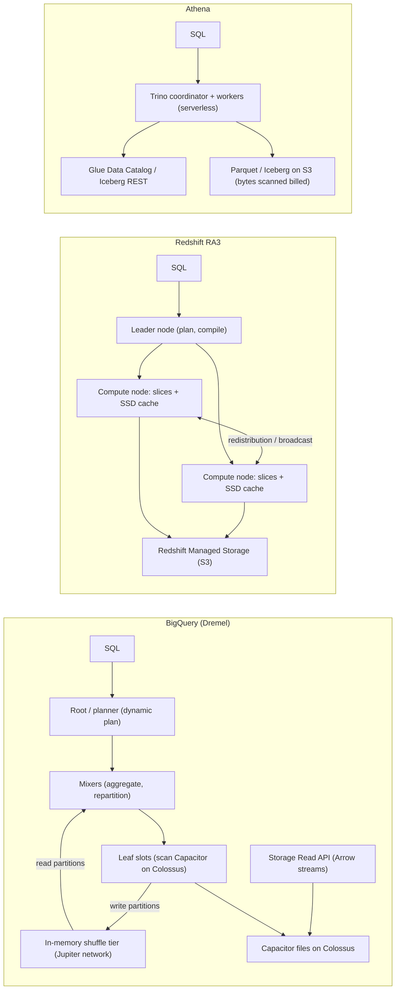
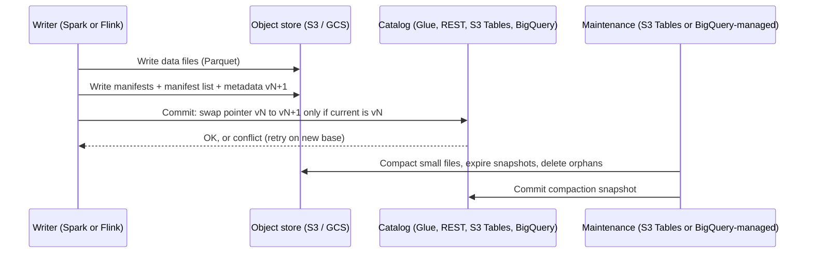

# 03.4 · Analytics: Redshift, Athena, Glue and Iceberg vs BigQuery's Dremel, Capacitor and Storage API

> **Folder 03 · File 4 of 4.** Both clouds separate analytical storage from compute. They put the boundary in different places.
> - **BigQuery** is one serverless system. **Dremel** execution trees run on **slots**, read **Capacitor** columnar files on **Colossus**, and exchange data through a disaggregated in-memory **shuffle** tier over the Jupiter network. The **Storage Read and Write APIs** let other engines read and write it directly.
> - **AWS** is a set of engines over open storage:
>   - **Redshift**: an MPP warehouse with RA3 managed storage, plus Serverless RPUs;
>   - **Athena**: serverless Trino for SQL on S3;
>   - **Glue**: catalog and Spark ETL;
>   - **Lake Formation**: governance;
>   - **Iceberg on S3**, increasingly as **S3 Tables**.
>
> This file covers how each executes a query, what's billed (logical vs compressed bytes, slots vs RPUs), how table formats commit, and the layout decisions that move cost by three orders of magnitude.

| Listing | What it shows | Language |
|---|---|---|
| `scan_cost_estimator.py` | One query on a 10 TB table across five layouts and two engines: Athena bills compressed bytes scanned; BigQuery on-demand bills logical bytes. Slot-reservation break-even against on-demand. What per-minute streaming commits do to an Iceberg table's file count before and after compaction | Python 3 (stdlib) |

**Verification.** The listing is embedded byte-identical. The gate re-runs it on this file and requires `verdict: OK`. That asserts a >1,000× cost drop from CSV to partitioned Parquet, that BigQuery on-demand exceeds Athena per query at the stated compression, that 100 Enterprise slots equal ~701 TiB of on-demand per month, and that compaction cuts the file count >100×. Prices are list prices as of **2026-10-31**; verify for your region.

**Labels.** **[D]** documented · **[E]** estimate/model · ⚠ inferred, not a product contract.

---

## 0. Orientation

**The questions this file answers.**

1. How does Dremel execute a query (serving tree, slots, shuffle), and how does Redshift (leader node, compute slices, redistribution) or Athena (Trino) do it?
2. What's actually billed: bytes scanned (Athena), logical bytes processed (BigQuery on-demand), slot-hours (BigQuery editions), RPU-hours (Redshift Serverless), node-hours (Redshift provisioned)?
3. Which layout decisions dominate cost and latency on both clouds? Columnar formats, partitioning, clustering/sort keys, file sizes.
4. How does an **Iceberg** commit work, and who manages compaction, snapshot expiry and orphan files (you, Glue, **S3 Tables**, or BigQuery for its Iceberg tables)?
5. How do external engines (Spark, Trino, Dataflow) read warehouse data without exporting it? (BigQuery Storage Read API vs Redshift data sharing, Spectrum and Iceberg on S3.)
6. How do governance models compare? (Lake Formation vs Dataplex / Knowledge Catalog and BigQuery fine-grained security.)

**Reading paths.**

| Goal | Read |
|---|---|
| L7 interview | §1, §2, §3.1–3.3, §4.1–4.3, §5, §7, Q-chains |
| SAP-C02 | §2, §3 entire, §6, §7, S-scenarios |
| Lakehouse design | §1.3, §3.4, §4.4, §5, §6 |

**Prerequisites.** [03.1](01-object-storage-s3-strong-consistency-prefix-partitioning-vs-gcs-colossus.md) covers object stores and conditional writes. Folder 04 covers the pipelines that feed these systems.

---

## 1. First principles: scan less, shuffle less, commit safely

### 1.1 Analytical cost is bytes and shuffles

An analytical query costs roughly:
1. **Bytes read** from storage, after column projection, partition pruning, and block skipping through min/max statistics or zone maps.
2. **Bytes shuffled** between stages, for joins and aggregations.
3. **CPU** for decoding and expressions.

Columnar formats (Parquet, ORC, Capacitor, Redshift's columnar blocks) make (1) proportional to the *columns* read. Partitioning and clustering make it proportional to the *rows* that can match. The listing's example: CSV to Parquet to partitioned Parquet takes one query from **$50 to $0.0096** on Athena, more than 5,000× cheaper. No engine choice comes close to that factor.

### 1.2 Serverless vs provisioned compute

| Model | Unit | You pay for | Risk |
|---|---|---|---|
| Per-byte serverless | Athena (TB scanned), BigQuery on-demand (TiB processed) | What each query reads | One bad query (SELECT \*) is expensive. No idle cost |
| Capacity serverless | BigQuery slots (editions, autoscaling reservations), Redshift Serverless RPUs | Compute time | Idle or over-provisioned capacity. Concurrency queues |
| Provisioned | Redshift RA3 nodes | Node-hours | Sizing and resizing |

### 1.3 The table-format contract

An **Iceberg** table is files plus metadata:
- a `metadata.json` (schema, partition spec, snapshots);
- a **manifest list** per snapshot;
- **manifests** listing data files with column statistics;
- the **data files** (Parquet).

A commit writes new data and metadata files, then **atomically swaps** the table's current-metadata pointer in a **catalog** (Glue, an Iceberg REST catalog, S3 Tables, BigQuery's metastore), or with conditional writes (03.1 §3.4). Readers see a consistent **snapshot**.

The operational debt is equally structural:
- small files from frequent commits;
- delete files (equality/position deletes, or v3 deletion vectors);
- old snapshots;
- orphan files.

Someone must **compact**, **expire snapshots** and **remove orphans**, either you or a managed service.

---

## 2. Side-by-side architectural Rosetta matrix

| Concern | AWS | GCP | What actually differs |
|---|---|---|---|
| Serverless SQL over open files | **Athena** (Trino-based engine v3): $5/TB scanned, 10 MB minimum per query [D] | BigQuery external / BigLake tables (**Google Cloud Lakehouse**, formerly BigLake) over GCS, with BigQuery compute | Athena bills compressed bytes read from S3. BigQuery bills logical bytes |
| Warehouse | **Redshift** (RA3 managed storage on S3 + local SSD cache; Serverless RPUs 4–1,024 base) | **BigQuery** (serverless; Capacitor on Colossus) | Redshift is an MPP cluster you size (or RPUs). BigQuery is a multi-tenant service you buy slots from |
| Execution model | Leader node plans. Compute nodes/slices execute. Data redistribution by distribution key | **Dremel**: root/mixer/leaf serving tree, slots scheduled on Borg, **disaggregated in-memory shuffle** | BigQuery shuffles through a dedicated tier. Redshift shuffles node-to-node |
| Storage format | Redshift columnar blocks with zone maps. Parquet/ORC on S3 for Athena and Spectrum | **Capacitor** (columnar, row reordering for compression, nested data). Iceberg/Parquet for lakehouse tables | Capacitor is proprietary. Iceberg is the interop layer on both clouds |
| Physical layout knobs | Distribution style (AUTO/KEY/EVEN/ALL), sort keys, automatic table optimization. Iceberg partitioning on S3 | **Partitioning** (time, ingestion time, integer range; up to 10,000 partitions per table) + **clustering** (up to 4 columns, automatic re-clustering) | BigQuery re-clusters automatically. Redshift auto-optimizes sort and distribution |
| Pricing | Redshift provisioned (node-hours), Serverless (RPU-hours, ~$0.375/RPU-h us-east-1 ⚠ verify, min base 4 RPU), Athena per TB | On-demand **$6.25/TiB** (logical bytes processed). Editions per slot-hour: Standard $0.04, Enterprise $0.06, Enterprise Plus $0.10 (pay-as-you-go, US) | On-demand BigQuery bills uncompressed size, so compression doesn't reduce the query bill |
| Storage pricing | Redshift managed storage per GB-month. S3 for lake data | Active vs long-term (90 days untouched) storage. **Logical or physical** billing per dataset | BigQuery physical billing charges compressed bytes plus time travel |
| Catalog | **Glue Data Catalog** (Hive-compatible + Iceberg REST endpoint). **S3 Tables** catalog | BigQuery metastore / Lakehouse catalog. **Dataplex / Knowledge Catalog** for discovery and governance | — |
| Managed Iceberg | **S3 Tables** (table buckets, automatic compaction and snapshot management, Iceberg REST) | **BigQuery tables for Apache Iceberg** (BigQuery-managed Iceberg in GCS) | Both now manage the maintenance debt for you |
| Fine-grained access | **Lake Formation** (database/table/column/row/cell, LF-tags), Redshift RBAC/RLS/DDM | BigQuery column-level (policy tags), row-level security, data masking. Dataplex governance | Similar capabilities. Different administration surfaces |
| External engines read warehouse data | Redshift data sharing, Spectrum. Spark on EMR/Glue reads Iceberg on S3 | **BigQuery Storage Read API** (Arrow/Avro streams, projection/filter pushdown, parallel streams) | BigQuery exposes its managed storage to Spark directly |
| High-rate ingestion | Kinesis Firehose → S3/Iceberg/Redshift. Redshift streaming ingestion | **Storage Write API** (exactly-once with committed/pending streams) | — |
| Zero-ETL | Aurora/RDS/DynamoDB → Redshift zero-ETL | Datastream → BigQuery (CDC). BigQuery federated queries to Cloud SQL/Spanner/AlloyDB | — |
| Cross-cloud | Redshift/Athena federated queries | **BigQuery Omni** (queries data in S3 and Azure Blob in place) | GCP can query AWS data without moving it |

---

## 3. Internal mechanics: AWS analytics

### 3.1 Redshift

**Architecture.**
- A **leader node** parses, plans and compiles queries into segments.
- **Compute nodes** are divided into **slices**, which execute in parallel.
- **RA3** nodes keep hot data in local SSD and store all data in **Redshift Managed Storage** on S3, so storage scales independently of compute.

**Data distribution.**
- `KEY`: co-locates join keys on the same slice.
- `ALL`: copies small dimension tables to every node.
- `EVEN`: round-robin.
- `AUTO`: Redshift chooses and adapts.

A join on mismatched distribution keys forces **redistribution**, Redshift's shuffle. EXPLAIN shows `DS_DIST_*` steps.

**Sort keys and zone maps.**
- Blocks hold min/max metadata (**zone maps**), so range filters on the sort key skip blocks.
- **Automatic table optimization** can choose and alter sort and distribution keys.

**Concurrency and elasticity.**
- **Concurrency scaling** adds transient clusters for queued reads (and some writes).
- **Workload management** (WLM, automatic or manual) queues and prioritizes.
- **Serverless:**
  - capacity in **RPUs**, with a configurable base from **4 to 1,024**;
  - scales above the base for demand;
  - metered per second;
  - the AWS pricing page starts at about **$1.50/hour** at 4 RPUs.

**Features.**
- **Data sharing:** live read access across clusters and accounts without copies.
- **Spectrum:** queries S3 data from Redshift.
- **Zero-ETL** from Aurora/RDS/DynamoDB.
- **Multi-AZ** for provisioned RA3.

### 3.2 Athena

- **Engine:** serverless SQL on a Trino-based engine (engine version 3).
- **Data access:** reads S3 data through the Glue Data Catalog (or Hive, or Iceberg REST catalogs).
- **Pricing:** **$5 per TB scanned**, measured on **bytes read from S3 (compressed)**, with a 10 MB minimum per query [D].
  - Columnar formats and compression reduce the bill directly.
  - **Partition projection** avoids catalog lookups for highly partitioned tables.
- **Iceberg tables:** ACID DML (`MERGE`, `UPDATE`, `DELETE`), time travel and `OPTIMIZE`/`VACUUM` for compaction and snapshot expiry.
- **Provisioned capacity** (DPUs) is available for predictable, concurrent workloads.
- **Federated queries** run through Lambda-based connectors.

### 3.3 Glue and Lake Formation

- **Glue Data Catalog:** a Hive-compatible metastore and an **Iceberg REST catalog endpoint**. Used by Athena, EMR, Redshift Spectrum and Glue jobs.
- **Glue jobs:** Spark (and Ray/Python) ETL billed per DPU-hour.
  - **Crawlers** infer schemas, which is convenient but can drift.
  - Prefer explicit DDL for production tables.
- **Lake Formation:**
  - permissions at database, table, column, row and cell level, with **LF-tag**-based access control;
  - cross-account sharing through RAM;
  - integrated with Athena, Redshift Spectrum, EMR and Glue;
  - credential vending gives temporary, scoped S3 credentials to engines.

### 3.4 Iceberg on S3 and S3 Tables

- **Self-managed Iceberg.** You choose the catalog (Glue or REST) and run compaction (`rewrite_data_files`), snapshot expiry (`expire_snapshots`), manifest rewrites and orphan-file removal, on a schedule.
- **Streaming writers** (Flink, Spark Structured Streaming, Firehose to Iceberg) commit often. The listing shows **72,000 files/day** from per-minute commits into 50 partitions, vs **300** after compaction to 512 MB files.
- **S3 Tables** (table buckets):
  - S3-native Iceberg tables with a built-in catalog;
  - **automatic compaction, snapshot management and unreferenced-file removal**;
  - table-level permissions;
  - access through the Iceberg REST endpoint from Athena, EMR, Redshift, Spark and others.

  It's AWS's answer to "who does the table maintenance?".

---

## 4. Internal mechanics: BigQuery

### 4.1 Dremel (Melnik et al., VLDB 2010; "A Decade of Interactive SQL Analysis at Web Scale", VLDB 2020)

- **Serving tree.** A **root** server receives the query. **Mixers** rewrite and aggregate. **Leaf** workers scan storage.
- **Slots and stages.**
  - Each stage runs on many **slots** (units of compute).
  - Slots are scheduled on Borg, and the query plan is a DAG of stages.
  - The plan is **dynamically adjusted** at run time, for example repartitioning skewed stages.
- **Disaggregated shuffle.**
  - Since about 2014, intermediate data between stages goes to a separate **in-memory shuffle tier**, not to local disks of the producing workers.
  - That decouples producers and consumers, handles skew and failures better, and exploits the **Jupiter** data-center network's bisection bandwidth.
- **Disaggregated storage.** Data lives in **Colossus**. Any slot can read any file, and there's no data locality to manage.
- **Nested data.** Dremel's original columnar encoding (repetition and definition levels) stores nested and repeated fields efficiently. Parquet adopted the same idea.

### 4.2 Capacitor and managed storage

- **Capacitor** (2016) is BigQuery's columnar format. It stores columns with rich encodings and **reorders rows** to improve run-length encoding and compression, an NP-hard problem solved heuristically. It keeps statistics for pruning, and evaluates some filters on compressed data ⚠ (Google's description).
- **Storage management.**
  - **Partitioned tables** prune by partition: up to **10,000 partitions per table** ⚠ (check the current limit).
  - **Clustered tables** sort within partitions by up to 4 columns, with **automatic re-clustering** in the background.
  - **Time travel** (2–7 days) plus a **fail-safe** period.
  - **Physical vs logical** storage billing, chosen per dataset.

### 4.3 What BigQuery bills [D]

- **On-demand.** **$6.25 per TiB processed**, measured on **logical (uncompressed) bytes** of the columns read after pruning, with a 10 MB minimum per table referenced. The first 1 TiB per month is free.
  - **Compression doesn't reduce the query bill.** Projection, partition pruning and clustering do.
  - At an assumed 5× compression, the listing's partitioned query costs **$0.0545** on BigQuery vs **$0.0096** on Athena for the same layout.
- **Editions (capacity).**
  - Per slot-hour: Standard **$0.04**, Enterprise **$0.06**, Enterprise Plus **$0.10** (pay-as-you-go, US), with 1- and 3-year commitments.
  - **Autoscaling reservations** have a baseline and a max, and bill scaled slots in increments.
  - **Idle slot sharing** across reservations.
  - **Break-even:** 100 always-on Enterprise slots ($4,380/month) equal ~**701 TiB/month** of on-demand processing (listing §2).
- **Storage.** Active and long-term (after 90 days without modification) rates, in logical or physical billing.

### 4.4 Storage Read and Write APIs, Iceberg and cross-cloud

- **Storage Read API.**
  - Engines (Spark through the BigQuery connector, Dataflow, Trino) open **read sessions** that split a table into parallel **streams** in Arrow or Avro.
  - Column projection and row-filter pushdown happen **server-side**, and snapshot reads are consistent.
  - Billed per data read. Data never has to be exported to GCS first.
- **Storage Write API.** High-throughput ingestion with **exactly-once** semantics through committed or pending streams with offsets. It's the replacement for legacy streaming inserts.
- **BigQuery tables for Apache Iceberg.** BigQuery-managed Iceberg tables in your GCS bucket. BigQuery handles commits and maintenance, and other engines read them through the catalog.
- **Google Cloud Lakehouse** (formerly BigLake) gives fine-grained access over open-format files for BigQuery and external engines.
- **BigQuery Omni** runs BigQuery compute in AWS and Azure regions to query data **in S3 or Azure Blob in place**, returning results across clouds.

---

## 5. Listing: bytes, slots and small files

<!-- listing:scan_cost_estimator.py -->
```python
"""scan_cost_estimator.py - what one analytical query costs on Athena vs BigQuery on-demand, how
layout (columnar, partitions) changes it, when capacity pricing wins, and what small files do to
an Iceberg table.

Rules and prices encoded (public pricing, 2026-10-31; verify before reuse):
  Athena (SQL): $5.00 per TB of data SCANNED (compressed bytes read from S3), 10 MB minimum/query
  BigQuery on-demand: $6.25 per TiB PROCESSED, measured on LOGICAL (uncompressed) column sizes,
    10 MB minimum per table referenced; first 1 TiB/month free (ignored here)
  BigQuery Enterprise edition: $0.06 per slot-hour pay-as-you-go
  S3 GET: $0.0004 per 1,000 requests
The table shape, compression ratio and query pattern are ASSUMPTIONS, printed as such.

Usage: python -I scan_cost_estimator.py <any path>
"""
import math
import sys

TB, TIB = 1e12, 2 ** 40


def athena_cost(scanned_bytes):
    return max(scanned_bytes, 10e6) / TB * 5.00


def bq_cost(processed_bytes):
    return max(processed_bytes, 10 * 2 ** 20) / TIB * 6.25


def main():
    ok = True
    logical = 10 * TB            # uncompressed table size
    cols, read_cols = 60, 3      # equal-width columns for simplicity
    days, read_days = 365, 7
    compression = 5.0            # columnar compression ratio (Parquet / Capacitor)
    print("ASSUMED table: 10 TB logical, 60 equal-width columns, 365 daily partitions, 5x columnar compression")
    print("query: 3 columns, last 7 days")
    print()
    print("== 1. One query ==")
    rows = []
    layouts = (("CSV, unpartitioned", logical, 1.0, 1.0),
               ("Parquet, unpartitioned", logical / compression, read_cols / cols, 1.0),
               ("Parquet, partitioned by day", logical / compression, read_cols / cols, read_days / days))
    for name, stored, col_frac, part_frac in layouts:
        scanned = stored * col_frac * part_frac
        rows.append((name, scanned, athena_cost(scanned)))
        print(f"Athena   {name:<28} scans {scanned / 1e9:>9,.1f} GB  ${athena_cost(scanned):>8.4f}")
    bq_full = logical * read_cols / cols
    bq_part = bq_full * read_days / days
    print(f"BigQuery {'columnar, unpartitioned':<28} bills {bq_full / 1e9:>9,.1f} GB  ${bq_cost(bq_full):>8.4f}")
    print(f"BigQuery {'columnar, partitioned by day':<28} bills {bq_part / 1e9:>9,.1f} GB  ${bq_cost(bq_part):>8.4f}")
    ok &= rows[0][2] / rows[2][2] > 1000
    ok &= bq_cost(bq_part) > athena_cost(rows[2][1])
    print("   same query, same layout: BigQuery bills LOGICAL bytes, Athena bills compressed bytes read,")
    print("   so at 5x compression BigQuery on-demand costs ~6x more per query here; layout matters more")
    print("   than engine: CSV -> partitioned Parquet is a ~1,000x+ reduction")

    print()
    print("== 2. When do BigQuery slots beat on-demand? (Enterprise, $0.06/slot-hour, always on) ==")
    for slots in (100, 500, 2000):
        monthly = slots * 730 * 0.06
        breakeven_tib = monthly / 6.25
        print(f"{slots:>5} slots: ${monthly:>9,.0f}/mo  = on-demand cost of {breakeven_tib:>8,.0f} TiB processed/mo")
    ok &= math.isclose(100 * 730 * 0.06 / 6.25, 700.8)
    print("   autoscaling reservations (baseline + max) bill only scaled-up slots: compare with real usage")

    print()
    print("== 3. Iceberg small files: a streaming writer commits every minute into 50 partitions ==")
    files_day = 60 * 24 * 50
    compacted = 50 * math.ceil(24 * 60 * 2e6 / 512e6)   # assume 2 MB per small file, 512 MB targets
    for name, n in (("uncompacted", files_day), ("compacted to 512 MB", compacted)):
        print(f"{name:<22} {n:>7,} data files/day -> a 1-day scan issues >= {n:>7,} GETs "
              f"(${n / 1000 * 0.0004:.4f}) and plans {n:,} file entries")
    ok &= files_day == 72_000 and compacted < files_day / 100
    print("   per-file open/plan overhead dominates latency long before GET cost does: compact,")
    print("   expire snapshots and rewrite manifests (or let S3 Tables / BigQuery manage it)")
    print()
    print("verdict: OK" if ok else "verdict: FAIL")


if __name__ == "__main__":
    main()
```

<!-- output:scan_cost_estimator.py -->
```text
ASSUMED table: 10 TB logical, 60 equal-width columns, 365 daily partitions, 5x columnar compression
query: 3 columns, last 7 days

== 1. One query ==
Athena   CSV, unpartitioned           scans  10,000.0 GB  $ 50.0000
Athena   Parquet, unpartitioned       scans     100.0 GB  $  0.5000
Athena   Parquet, partitioned by day  scans       1.9 GB  $  0.0096
BigQuery columnar, unpartitioned      bills     500.0 GB  $  2.8422
BigQuery columnar, partitioned by day bills       9.6 GB  $  0.0545
   same query, same layout: BigQuery bills LOGICAL bytes, Athena bills compressed bytes read,
   so at 5x compression BigQuery on-demand costs ~6x more per query here; layout matters more
   than engine: CSV -> partitioned Parquet is a ~1,000x+ reduction

== 2. When do BigQuery slots beat on-demand? (Enterprise, $0.06/slot-hour, always on) ==
  100 slots: $    4,380/mo  = on-demand cost of      701 TiB processed/mo
  500 slots: $   21,900/mo  = on-demand cost of    3,504 TiB processed/mo
 2000 slots: $   87,600/mo  = on-demand cost of   14,016 TiB processed/mo
   autoscaling reservations (baseline + max) bill only scaled-up slots: compare with real usage

== 3. Iceberg small files: a streaming writer commits every minute into 50 partitions ==
uncompacted             72,000 data files/day -> a 1-day scan issues >=  72,000 GETs ($0.0288) and plans 72,000 file entries
compacted to 512 MB        300 data files/day -> a 1-day scan issues >=     300 GETs ($0.0001) and plans 300 file entries
   per-file open/plan overhead dominates latency long before GET cost does: compact,
   expire snapshots and rewrite manifests (or let S3 Tables / BigQuery manage it)

verdict: OK
```

**Reading the output.**

- **Section 1 [E].**
  - **CSV unpartitioned:** Athena scans all 10 TB, so **$50 per query**.
  - **Parquet:** column projection reads 3 of 60 columns of the 2 TB compressed table: 100 GB, **$0.50**.
  - **Daily partitions:** pruning to 7 of 365 days leaves 1.9 GB, **$0.0096**.
  - **BigQuery:** the same columnar, partitioned layout bills **9.6 GB logical**, **$0.0545**.

  Engine choice moves cost by ~6× here, and layout moves it by >5,000×. Optimize layout first.
- **Section 2.** Always-on slots cost the same as on-demand at **~701 TiB/month per 100 Enterprise slots**. Below that, on-demand (or autoscaling reservations with a low baseline) wins.
- **Section 3.** Per-minute commits across 50 partitions create **72,000 files a day**. Compaction to 512 MB files leaves **300**. GET cost is trivial ($0.03), but planning and opening 72,000 files is what makes "the lakehouse is slow". Schedule compaction, or use S3 Tables or BigQuery-managed Iceberg.

---

## 6. Reference designs

### 6.1 AWS lakehouse

```text
sources -> Kinesis / MSK -> Firehose (to Iceberg) or Flink -> S3 Tables (managed Iceberg)
                                                          |-> Glue Data Catalog / REST catalog
        Aurora/DynamoDB -> zero-ETL -> Redshift (serving marts, data sharing to BI accounts)
query: Athena (ad hoc, per TB), Redshift (BI concurrency), EMR Spark (heavy ETL) - all on Iceberg
governance: Lake Formation LF-tags (column/row), cross-account via RAM; CloudTrail data events
```

### 6.2 GCP lakehouse

```text
sources -> Pub/Sub -> Dataflow (Storage Write API, exactly-once) -> BigQuery native tables
        files in GCS -> BigQuery tables for Apache Iceberg / Lakehouse (external, governed)
        AlloyDB/Spanner/Cloud SQL -> Datastream (CDC) -> BigQuery
query: BigQuery (on-demand or editions with autoscaling), Spark on Managed Service for Apache Spark
       via Storage Read API, BigQuery Omni for data still in S3
governance: Dataplex / Knowledge Catalog, policy tags (column), row access policies, VPC-SC (Folder 05)
```

### 6.3 Translation table

| AWS pattern | GCP translation | Watch |
|---|---|---|
| Athena on Parquet in S3 | BigQuery over Lakehouse/Iceberg tables, or load into native tables | Billing basis changes (compressed → logical) |
| Redshift KEY distribution + sort keys | BigQuery partitioning + clustering | No distribution keys. Shuffle is managed |
| Glue crawlers | Dataplex discovery / explicit DDL | Prefer explicit schemas on both |
| Redshift concurrency scaling | Slot autoscaling and reservations | Budget max slots |
| Lake Formation LF-tags | Policy tags + row access policies + Dataplex | Different administration models |
| Redshift data sharing | Authorized views / datasets, Analytics Hub | — |

---

## 7. Failure modes, throttling limits and quota traps

| # | Symptom | Root cause | Detect | Fix | Cloud |
|---|---|---|---|---|---|
| 1 | $50 queries on a "small" dashboard | CSV/JSON, no partitions, `SELECT *` | Bytes scanned per query | Parquet/Iceberg, partition + filter, project columns (listing §1) | AWS |
| 2 | Surprise BigQuery bill after a schema change | On-demand bills **logical** bytes. A wide new column is read by `SELECT *` | `total_bytes_processed`, `INFORMATION_SCHEMA.JOBS` | Column projection, custom cost controls (max bytes billed), reservations | GCP |
| 3 | Partition filter ignored | Filter on a derived expression, or no `require_partition_filter` | Query plan / bytes processed | Filter directly on the partition column. Require partition filters | Both |
| 4 | Lakehouse queries slow and getting slower | **Small files**, delete files, too many snapshots | File counts, planning time | Compaction, snapshot expiry, manifest rewrite, or S3 Tables / BigQuery Iceberg | Both |
| 5 | Concurrent Iceberg writers lose commits | Non-atomic commit path | Missing snapshots | An atomic catalog or conditional writes (03.1 Q3) | Both |
| 6 | Redshift join slow, EXPLAIN shows `DS_BCAST_INNER` / `DS_DIST_BOTH` | Distribution keys don't co-locate joins | EXPLAIN | KEY distribution on join keys, ALL for small dimensions, AUTO | AWS |
| 7 | Redshift queries queue at 9 a.m. | WLM saturation | Queue wait metrics | Concurrency scaling, WLM priorities, Serverless max RPU | AWS |
| 8 | BigQuery queries slow at month-end | Reservation **max slots** reached. No idle slots to borrow | Slot utilization, jobs pending | Raise the autoscaling max. Separate reservations by workload | GCP |
| 9 | One query stage takes forever | **Data skew** in joins/aggregations | Stage timings (BigQuery execution graph, Redshift slices) | Pre-aggregate hot keys, salting, broadcast small sides | Both |
| 10 | Glue crawler changed a column type and broke jobs | Schema inference drift | Catalog version history | Explicit DDL. Disable crawler updates for curated tables | AWS |
| 11 | Partition count limit errors | Too-fine partitioning (per hour for years) | DDL errors | Coarser partitions + clustering | GCP |
| 12 | Spark reads BigQuery slowly through GCS exports | Export-then-read pattern | Job timeline | **Storage Read API** with parallel streams and pushdown | GCP |
| 13 | Duplicates in streamed tables | At-least-once streaming inserts / producer retries | Duplicate keys | Storage Write API committed streams with offsets. Idempotent MERGE | GCP |
| 14 | Lake Formation permissions "don't apply" | Engine not integrated, or IAM S3 access bypasses LF | Access audit | Register locations with LF. Remove direct S3 grants. Use credential vending | AWS |
| 15 | Athena throttled at high concurrency | Per-account active query quotas | `TooManyRequestsException` | Provisioned capacity, query queueing, quota increase | AWS |

---

## 8. Architecture diagrams: multi-service compositions

### 8.1 Query execution: Dremel vs Redshift vs Athena



### 8.2 An Iceberg commit with managed maintenance



### 8.3 Where the bytes go (ASCII)

```text
10 TB logical table, query reads 3 of 60 columns, 7 of 365 days

CSV, no partitions        |#################################################| 10,000 GB   ($50.00 Athena)
Parquet (projection)      |#                                                |    100 GB   ($0.50)
Parquet + day partitions  |                                                 |    1.9 GB   ($0.0096)
BigQuery (logical bytes)  |                                                 |    9.6 GB   ($0.0545 on-demand)
                           ^ the layout decides the bill; the engine adjusts it by a small factor
```

---

## 9. Bar-raiser chains and SAP-C02 scenarios

### 9.1 L7 bar-raiser chains

<details><summary><b>Q1 · Why is BigQuery fast without indexes or distribution keys?</b></summary>

**Initial Prompt.** "Explain to a Redshift team why BigQuery doesn't ask them for distribution keys, and what it does instead. Where can it still be slow?"

**L5 Answer.** "BigQuery is serverless and uses massive parallelism, so it doesn't need tuning."

**Why L5 Stalls.** Parallelism doesn't explain shuffles, skew or bytes. The answer also gives no failure modes.

**L7 Answer.** "Three disaggregations.
1. **Storage on Colossus.** Any slot reads any Capacitor file, so there's no data locality to optimize and no distribution key.
2. **Compute as slots on Borg.** Scheduled per stage, with plans adjusted at run time.
3. **A separate in-memory shuffle tier** on the Jupiter network. Join and aggregation exchanges don't depend on producer machines' disks, and stages can be repartitioned dynamically.

Redshift instead co-locates join keys on slices (KEY/ALL distribution) to avoid network redistribution.

Where BigQuery is still slow or expensive:
- **skewed keys**: one shuffle partition dominates a stage;
- **unpruned scans**: no partition or cluster filter, so many logical bytes are billed;
- **slot starvation**: reservation max reached;
- **deeply nested repeated fields** expanded carelessly.

So the tuning moves from distribution keys to **partitioning, clustering, pre-aggregation and slot management**."
</details>

<details><summary><b>Q2 · Athena or BigQuery on-demand: which is cheaper for our query?</b></summary>

**Initial Prompt.** "A team claims BigQuery on-demand is 'about the same price' as Athena because $6.25/TiB vs $5/TB. Check that."

**L5 Answer.** "BigQuery is a bit more expensive per byte, so Athena is slightly cheaper."

**Why L5 Stalls.** It compares unit prices on different *bases*. Athena bills compressed bytes read; BigQuery on-demand bills logical (uncompressed) bytes. Compression ratio can dominate.

**L7 Answer.** "Normalize the base first:
- **Athena:** $5 per 10¹² **compressed** bytes read from S3.
- **BigQuery on-demand:** $6.25 per 2⁴⁰ **logical** bytes of the columns read.

At 5× columnar compression, the same partitioned query reads 1.9 GB on Athena ($0.0096) and bills 9.6 GB on BigQuery ($0.0545), about **6×** (listing §1).

At high volume BigQuery's answer is **capacity pricing**: 100 Enterprise slots ≈ 701 TiB/month of on-demand. Heavy users don't stay on on-demand.

The bigger lever on both is layout: CSV → partitioned Parquet is >5,000×. Model three things before choosing:
1. bytes after pruning;
2. the compression ratio;
3. monthly volume against slot break-even."
</details>

<details><summary><b>Q3 · Our Iceberg lakehouse got slow after we went streaming</b></summary>

**Initial Prompt.** "We moved ingestion from hourly batches to Flink streaming into Iceberg on S3. Query planning now takes minutes. What happened?"

**L5 Answer.** "Flink writes are slower. Increase the Athena capacity."

**Why L5 Stalls.** Compute isn't the bottleneck. Metadata and file count are.

**L7 Answer.** "Each Flink checkpoint commits a snapshot with new small files per partition. At one commit a minute into 50 partitions that's **72,000 files a day**, plus manifests and snapshots. Planning must read manifests and open files, so latency scales with file count, not bytes.

Fix:
1. **Compaction** (`rewrite_data_files` to ~512 MB targets; listing: 72,000 → 300 a day).
2. **Snapshot expiry** and **manifest rewrites**.
3. **Orphan-file removal.**
4. Longer commit intervals where freshness allows.

Or move to **S3 Tables**, which compacts and manages snapshots automatically.

On GCP, BigQuery-managed Iceberg tables or native tables with the Storage Write API avoid the small-file problem, because BigQuery manages storage. Self-managed Iceberg on GCS needs the same maintenance."
</details>

<details><summary><b>Q4 · Spark needs BigQuery data: export or read directly?</b></summary>

**Initial Prompt.** "Our ML team exports BigQuery tables to GCS nightly as Parquet so Spark can read them, and complains it takes hours and is always stale. Improve it."

**L5 Answer.** "Run the export more often."

**Why L5 Stalls.** More exports means more cost and duplication, and still stale data. There's a direct-read interface.

**L7 Answer.** "Use the **BigQuery Storage Read API** through the Spark BigQuery connector.
- It opens a **read session** at a consistent snapshot and splits the table into many parallel **Arrow streams**.
- Column projection and row filters are **pushed down server-side**.
- Spark executors read the streams directly: no export, no duplicate storage, and data as fresh as the snapshot.
- Writes back go through the **Storage Write API**, exactly-once.

If the data must be open-format for other engines, store it as **BigQuery tables for Apache Iceberg** in GCS, so one copy is readable by BigQuery, Spark and Trino through the catalog.

The AWS analog is Redshift data sharing for Redshift consumers, or keeping curated data as Iceberg on S3 that Redshift, Athena and EMR all read."
</details>

<details><summary><b>Q5 · Slots or on-demand: design the BigQuery commercial model</b></summary>

**Initial Prompt.** "We spend $180k/month on BigQuery on-demand, spiky by day, with month-end peaks 4× normal. Design the capacity model."

**L5 Answer.** "Buy a 3-year commitment for the average usage."

**Why L5 Stalls.** A flat commitment at the average either overpays off-peak or starves month-end. It ignores autoscaling, workload isolation and the editions' feature differences.

**L7 Answer.** "$180k/month on-demand is ~28,800 TiB. At Enterprise PAYG $0.06 per slot-hour, the always-on break-even is about 4,100 slots, so capacity pricing is likely cheaper.

The design:
1. **Measure slot-seconds per workload** from `INFORMATION_SCHEMA.JOBS_TIMELINE`. Size the p50 as a **baseline commitment** (1- or 3-year discount).
2. **Autoscaling reservations** with a max sized for month-end, billed only when scaled.
3. **Separate reservations** (ETL, BI, ad hoc) with idle-slot sharing. Ad hoc gets a lower max to stop runaway queries.
4. **Edition per workload:** Enterprise for most, Enterprise Plus only where its features (CMEK, compliance controls) are required.
5. **Guardrails:** maximum bytes billed for any project left on on-demand.

Re-baseline quarterly. The same thinking applies to Redshift Serverless (base RPU vs max RPU) or reserved provisioned nodes."
</details>

<details><summary><b>Q6 · Govern a lakehouse for 40 teams with column and row security</b></summary>

**Initial Prompt.** "We need column-level PII masking and row-level regional restrictions across Athena, Redshift and Spark on AWS, and BigQuery plus Spark on GCP. Design governance."

**L5 Answer.** "Use IAM policies on the S3 buckets and BigQuery datasets."

**Why L5 Stalls.** Bucket and dataset IAM is too coarse for columns and rows, and direct storage access bypasses engine-level controls.

**L7 Answer.**
- **AWS:**
  - **Lake Formation**: register S3 locations and **remove direct S3 grants**;
  - define **LF-tags** (`pii=true`, `region=eu`) on columns and tables;
  - grant by tag to roles, with row filters for regional restrictions;
  - integrated engines (Athena, Redshift Spectrum, EMR, Glue) receive scoped credentials through credential vending;
  - share across accounts through RAM;
  - Redshift-native tables use RLS and dynamic data masking.
- **GCP:**
  - **policy tags** on BigQuery columns (masking rules by role), **row access policies** per region;
  - **Dataplex / Knowledge Catalog** for discovery, lineage and data quality;
  - Spark reads through the **Storage Read API**, which **enforces** column and row security server-side;
  - **VPC Service Controls** around the projects to stop exfiltration (Folder 05).
- **Both:**
  1. tag-based (attribute) access, not per-table grants;
  2. audit through CloudTrail data events or Cloud Audit Logs;
  3. close direct storage paths."
</details>

<details><summary><b>Q7 · Redshift Serverless vs provisioned RA3 for a BI platform</b></summary>

**Initial Prompt.** "Our BI platform runs 9 a.m.–7 p.m. weekdays at steady concurrency, with nightly ELT. Should we use Redshift Serverless or provisioned RA3?"

**L5 Answer.** "Serverless, because we don't want to manage clusters."

**Why L5 Stalls.** Operational preference isn't a cost or performance model. Steady daytime usage often favors provisioned with reservations, while bursty use favors Serverless.

**L7 Answer.**
1. **Compute RPU-hours.** Serverless bills RPU-seconds while queries run, from a configurable base (4 to 1,024 RPUs), at roughly $0.375 per RPU-hour in us-east-1 ⚠.
2. **Compare** with RA3 node-hours under reserved pricing for the same throughput.

With 10 busy hours on 5 weekdays (~22% of the week) and idle nights apart from ELT, **Serverless** often wins, because it doesn't bill idle hours and scales for ELT. A 24/7 steady workload favors **reserved RA3**.

Other factors:
- concurrency scaling credits on provisioned;
- Serverless max-RPU caps for cost control;
- features that need provisioned (check current parity);
- data sharing works with both.

Run a two-week shadow load and compare the real bills."
</details>

<details><summary><b>Q8 · Query S3 data from BigQuery without moving it</b></summary>

**Initial Prompt.** "Our data stays in S3 for regulatory reasons, but the analytics team standardized on BigQuery. Options?"

**L5 Answer.** "Copy the data to GCS nightly with Storage Transfer Service."

**Why L5 Stalls.** Copying violates the stated constraint and doubles storage. There's an in-place option.

**L7 Answer.**
- **BigQuery Omni.** BigQuery compute runs in AWS regions, queries data **in S3** through a connection (IAM role federation), and returns results to BigQuery. Data at rest stays in S3.
  - Constraints: supported regions, query features and cross-cloud result transfer volumes. Results moved to GCP regions count as egress.
- **Alternative:** keep analytics on AWS for that dataset (Athena/Redshift on Iceberg) and federate only aggregates.
- **Either way:**
  1. document the residency boundary (data at rest vs results);
  2. confirm with compliance that query results crossing clouds are allowed;
  3. use Iceberg so both clouds' engines can read one copy if policy later allows."
</details>

<details><summary><b>Q9 · Duplicates in the streaming warehouse</b></summary>

**Initial Prompt.** "Our streaming pipeline into BigQuery produces occasional duplicate rows after worker restarts. The Redshift pipeline on the other side has the same issue. Fix both."

**L5 Answer.** "Run a nightly dedup query."

**Why L5 Stalls.** That accepts wrong data all day and costs a full scan nightly. The fix belongs in the write protocol.

**L7 Answer.**
- **BigQuery:**
  - replace legacy streaming inserts with the **Storage Write API**, using **committed streams with offsets**;
  - a retried append at the same offset is rejected, giving exactly-once into the table;
  - Dataflow's BigQuery sink uses this mode.
- **Redshift:**
  - land into a staging table, then **MERGE** on a business key in the same transaction;
  - or stream into an Iceberg table with idempotent upserts keyed by event ID.
- **Both:**
  1. carry a stable **event ID** from the producer (Folder 04);
  2. make sinks idempotent;
  3. measure duplicates with a reconciliation job, as a check rather than a fix."
</details>

<details><summary><b>Q10 · Translate a Redshift-heavy platform to BigQuery: what changes in the team's habits?</b></summary>

**Initial Prompt.** "We're moving 600 Redshift tables and 3,000 queries to BigQuery. What design and operational habits must change?"

**L5 Answer.** "Convert the SQL dialect and move the data."

**Why L5 Stalls.** Dialect is the easy part. Physical design, cost model and concurrency management are different, and carrying Redshift habits over causes cost and performance surprises.

**L7 Answer.**
1. **Physical design:** distribution and sort keys disappear. Replace them with **partitioning** (date, at most 10,000 partitions) and **clustering** on frequent filter and join columns. Drop `ALL`-style replication.
2. **Cost model:** on-demand bills logical bytes, so ban `SELECT *` in production code, require partition filters on big tables, and set maximum bytes billed. Or move to editions with sized reservations.
3. **Concurrency:** WLM queues become **reservations and assignments**. Isolate ETL and BI.
4. **ELT:** use MERGE with partition pruning, scheduled queries or Dataform. Stage loads through GCS or the Storage Write API.
5. **Governance:** Redshift RBAC/RLS/masking become policy tags, row access policies and authorized views.
6. **Interop:** Spark jobs reading Redshift through UNLOAD become Storage Read API consumers.
7. **Validate:** dual-run critical reports and compare results and cost before cutover (Folder 06)."
</details>

### 9.2 SAP-C02 scenarios (original)

<details><summary><b>S1 · SAP-C02 · Domain 3 · Select TWO</b></summary>

**Scenario.** A company runs Amazon Athena queries against 50 TB of CSV log files in S3, organized only by upload date in object keys but not registered as partitions. Most queries filter on the last 7 days and read a few columns. Query costs and latency are high. Which actions will MOST reduce cost? (Select TWO.)

- **A.** Convert the data to a columnar format such as Parquet with compression.
- **B.** Increase the Athena workgroup's data usage limit.
- **C.** Partition the table by date (for example, with partition projection) and filter queries on the partition column.
- **D.** Move the files to S3 Glacier Instant Retrieval.
- **E.** Run the queries from an EC2 instance in the same Region.

**Answer: A, C**

- **A** — correct: columnar, compressed formats let Athena read only the referenced columns, cutting scanned bytes dramatically.
- **B** — wrong: raising limits doesn't reduce cost or latency.
- **C** — correct: partition pruning restricts scans to the relevant days.
- **D** — wrong: a colder storage class adds retrieval cost and doesn't reduce bytes scanned.
- **E** — wrong: where the query is issued from doesn't change bytes scanned.
</details>

<details><summary><b>S2 · SAP-C02 · Domain 2 · Select ONE</b></summary>

**Scenario.** A company builds a data lake on S3 using Apache Iceberg tables that are written continuously by streaming jobs and queried by Athena, Amazon EMR and Amazon Redshift. The team doesn't want to operate compaction and snapshot cleanup jobs. What should a solutions architect recommend?

- **A.** Write the data as CSV so no compaction is needed.
- **B.** Store the tables in Amazon S3 Tables table buckets and access them through the Iceberg REST catalog endpoint.
- **C.** Use S3 Intelligent-Tiering for the data files.
- **D.** Schedule an AWS Glue crawler every hour.

**Answer: B**

- **A** — wrong: CSV removes the table-format benefits and raises query costs.
- **B** — correct: S3 Tables provides managed Iceberg tables with automatic compaction, snapshot management and unreferenced-file removal, accessible to multiple engines.
- **C** — wrong: storage tiering doesn't address small files or snapshot maintenance.
- **D** — wrong: crawlers infer schemas and don't perform table maintenance.
</details>

<details><summary><b>S3 · SAP-C02 · Domain 1 · Select ONE</b></summary>

**Scenario.** A central data team owns an S3 data lake cataloged in AWS Glue. Forty business units in separate AWS accounts must query the data with Athena, with access restricted to specific columns and rows based on data classification tags, managed centrally. What should a solutions architect recommend?

- **A.** Create S3 bucket policies granting each account access to specific prefixes.
- **B.** Use AWS Lake Formation with LF-tag-based access control, including column and row filters, and share the catalog resources with the business unit accounts.
- **C.** Copy filtered datasets into each business unit's account nightly.
- **D.** Create IAM users in the central account for every analyst.

**Answer: B**

- **A** — wrong: bucket policies can't enforce column-level or row-level access.
- **B** — correct: Lake Formation centrally governs fine-grained, tag-based permissions and shares them across accounts for Athena queries.
- **C** — wrong: copying data creates duplication, staleness and governance overhead.
- **D** — wrong: central IAM users don't scale and don't provide fine-grained data permissions.
</details>

<details><summary><b>S4 · SAP-C02 · Domain 3 · Select ONE</b></summary>

**Scenario.** An Amazon Redshift provisioned cluster shows long query times for a nightly join between a 2 TB fact table and a 500 MB dimension table. EXPLAIN shows a broadcast of the large table and redistribution steps. What should a solutions architect do?

- **A.** Increase the number of WLM queues.
- **B.** Set the dimension table's distribution style to ALL (or rely on AUTO), and distribute the fact table on the join key.
- **C.** Enable concurrency scaling.
- **D.** Convert the tables to external tables in S3.

**Answer: B**

- **A** — wrong: queues manage concurrency, not data movement within a query.
- **B** — correct: replicating the small dimension and co-locating the fact table on the join key avoids costly redistribution.
- **C** — wrong: concurrency scaling helps queued queries, not one slow join.
- **D** — wrong: external tables generally add scan latency for this pattern.
</details>

<details><summary><b>S5 · SAP-C02 · Domain 2 · Select ONE</b></summary>

**Scenario.** A company wants to replicate transactional data from an Amazon Aurora MySQL cluster into Amazon Redshift for near-real-time analytics without building or operating ETL pipelines. What should a solutions architect recommend?

- **A.** Schedule nightly AWS Glue jobs to copy the tables.
- **B.** Use AWS DMS with full load only.
- **C.** Export Aurora snapshots to S3 and query them with Athena.
- **D.** Configure an Aurora zero-ETL integration with Amazon Redshift.

**Answer: D**

- **A** — wrong: nightly jobs aren't near-real-time and require pipeline operations.
- **B** — wrong: full load alone doesn't keep data current.
- **C** — wrong: snapshot exports are point-in-time and not near-real-time.
- **D** — correct: zero-ETL continuously replicates Aurora data into Redshift without customer-managed pipelines.
</details>

<details><summary><b>S6 · SAP-C02 · Domain 3 · Select ONE</b></summary>

**Scenario.** An analytics workload on Amazon Redshift Serverless runs only during business hours, but costs are higher than expected. Investigation shows the base capacity was set to 512 RPUs although typical queries need far less, and occasional large jobs justify brief bursts. What should a solutions architect recommend?

- **A.** Lower the base capacity to match typical demand and set a maximum RPU limit to control burst spending.
- **B.** Move the workload to a provisioned cluster running 24/7.
- **C.** Increase the base capacity so queries finish faster and cost less.
- **D.** Enable concurrency scaling.

**Answer: A**

- **A** — correct: a right-sized base capacity reduces cost for typical queries, while Serverless still scales for bursts within a configured maximum.
- **B** — wrong: an always-on cluster bills idle hours for a business-hours workload.
- **C** — wrong: a higher base raises cost for this usage pattern.
- **D** — wrong: concurrency scaling is a provisioned-cluster feature for queued queries, not a Serverless cost control.
</details>

---

## 10. Checklist

- [ ] Data in a columnar format (Parquet/Iceberg, or native tables), partitioned on the dominant filter, clustered or sorted on secondary filters. Bytes per query measured (listing §1).
- [ ] The billing basis is understood: Athena compressed bytes vs BigQuery logical bytes vs slots/RPUs. Guardrails set (max bytes billed, workgroup limits, Serverless max RPU).
- [ ] BigQuery capacity model is sized from slot-seconds (baseline commitment + autoscaling max), with separate reservations per workload.
- [ ] Iceberg maintenance is owned: compaction, snapshot expiry, manifest rewrites, orphan cleanup, or managed (S3 Tables / BigQuery Iceberg).
- [ ] Commits are atomic (catalog CAS or conditional writes). One catalog of record per table.
- [ ] External engines use direct-read interfaces (Storage Read API, Iceberg on S3), not export copies.
- [ ] Streaming ingestion is exactly-once at the sink (Storage Write API committed streams, idempotent MERGE) and carries a producer event ID.
- [ ] Fine-grained governance: Lake Formation LF-tags, or BigQuery policy tags + row access policies + Dataplex. Direct storage access paths closed.
- [ ] Redshift physical design reviewed (distribution and sort keys or AUTO). EXPLAIN checked for redistribution.

---

## 11. References

Papers and engineering posts:
- Melnik et al., *Dremel: Interactive Analysis of Web-Scale Datasets*, VLDB 2010: <https://research.google/pubs/dremel-interactive-analysis-of-web-scale-datasets-2/>
- Melnik et al., *Dremel: A Decade of Interactive SQL Analysis at Web Scale*, VLDB 2020: <https://research.google/pubs/dremel-a-decade-of-interactive-sql-analysis-at-web-scale/>
- *Inside Capacitor, BigQuery's next-generation columnar storage format* (2016): <https://cloud.google.com/blog/products/bigquery/inside-capacitor-bigquerys-next-generation-columnar-storage-format>

AWS:
- Athena pricing: <https://aws.amazon.com/athena/pricing/>
- Redshift pricing (Serverless RPUs): <https://aws.amazon.com/redshift/pricing/>
- Redshift Serverless 4 RPU minimum (2025): <https://aws.amazon.com/about-aws/whats-new/2025/06/amazon-redshift-serverless-4-rpu-capacity-option>
- Redshift distribution styles: <https://docs.aws.amazon.com/redshift/latest/dg/c_choosing_dist_sort.html>
- Amazon S3 Tables: <https://docs.aws.amazon.com/AmazonS3/latest/userguide/s3-tables.html>
- AWS Lake Formation: <https://docs.aws.amazon.com/lake-formation/latest/dg/what-is-lake-formation.html>
- Aurora zero-ETL integrations with Redshift: <https://docs.aws.amazon.com/AmazonRDS/latest/AuroraUserGuide/zero-etl.html>

Google Cloud:
- BigQuery pricing: <https://cloud.google.com/bigquery/pricing>
- BigQuery editions: <https://docs.cloud.google.com/bigquery/docs/editions-intro>
- BigQuery Storage Read API: <https://docs.cloud.google.com/bigquery/docs/reference/storage>
- BigQuery Storage Write API: <https://docs.cloud.google.com/bigquery/docs/write-api>
- Partitioned tables: <https://docs.cloud.google.com/bigquery/docs/partitioned-tables>
- Clustered tables: <https://docs.cloud.google.com/bigquery/docs/clustered-tables>
- BigQuery tables for Apache Iceberg: <https://docs.cloud.google.com/bigquery/docs/iceberg-tables>
- BigQuery Omni: <https://docs.cloud.google.com/bigquery/docs/omni-introduction>

Apache Iceberg:
- Iceberg table spec: <https://iceberg.apache.org/spec/>
- Iceberg maintenance: <https://iceberg.apache.org/docs/latest/maintenance/>
