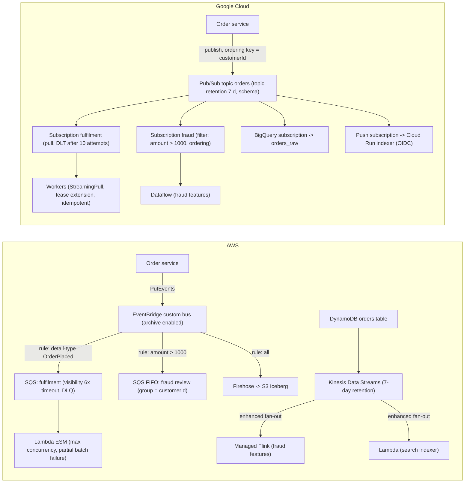
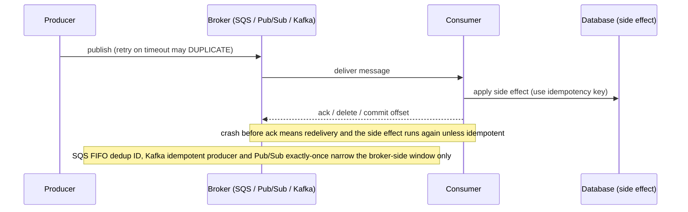

# 04.1 · Kinesis, SQS, SNS, EventBridge and MSK vs Pub/Sub and Kafka: Messaging Trade-offs

> **Folder 04 · File 1 of 2.** AWS offers **five** messaging primitives, each a different contract:
> - **SQS** is a queue: per-message visibility and deletion.
> - **SNS** is fan-out pub/sub.
> - **EventBridge** is content-routed events.
> - **Kinesis** is a sharded, ordered, replayable log.
> - **MSK** is Kafka.
>
> Google Cloud collapses most of that into **Pub/Sub**: a global, partition-free service with per-subscription acknowledgement, ordering keys, replay by seek, and exactly-once delivery as an option. Kafka is available as **Managed Service for Apache Kafka**, and Eventarc handles event routing.
>
> Choosing well means matching four properties to the workload: delivery semantics, ordering scope, replay and retention, and the capacity unit (shards, partitions, quotas).

| Listing | What it shows | Language |
|---|---|---|
| `delivery_semantics_sim.py` | Kinesis shards for 60 MB/s and 40k records/s with 1–8 consumers, shared reads vs enhanced fan-out. Ordering and throughput units: Pub/Sub ordering keys and StreamingPull streams, SQS FIFO batching, Kafka partitions. Duplicate deliveries per 100k messages as a function of visibility timeout / ack deadline, with and without lease extension | Python 3 (stdlib) |

**Verification.** The listing is embedded byte-identical. The gate re-runs it on this file and requires `verdict: OK`. That asserts 120 vs 60 shards at 4 consumers, that duplicates fall as the timeout grows, and that lease extension leaves only crash-driven redeliveries. Quotas come from the Kinesis, SQS and Pub/Sub docs as of **2026-10-31**: SQS 1 MiB messages (2025-08), Kinesis records up to 10 MiB, Pub/Sub's published regional quotas.

**Labels.** **[D]** documented · **[E]** estimate/model · ⚠ inferred or to verify.

---

## 0. Orientation

**The questions this file answers.**

1. What delivery guarantee does each service give (at-least-once, exactly-once options, ordering), and *where* does each guarantee stop?
2. What's the capacity unit (shard, partition, ordering key, quota), and what happens at its limit?
3. How do consumers scale, and what's the ordering cost of scaling them?
4. How do replay and retention work (Kinesis retention, Kafka offsets, Pub/Sub seek and topic retention, SQS none, EventBridge archive)?
5. How does each one fail: duplicates, poison messages, hot partitions, consumer lag, quota throttles?
6. How do you translate an AWS event-driven architecture to GCP, and back, without losing a guarantee?

**Reading paths.**

| Goal | Read |
|---|---|
| L7 interview | §1, §2, §3.1–3.4, §4.1–4.2, §5, §7, Q-chains |
| SAP-C02 (heavy here) | §2, §3 entire, §6, §7, S-scenarios |
| Event-driven redesign | §1.3, §6, then §8 |

**Prerequisites.** [01.3](../01-Virtualization-Compute-and-Kubernetes-Internals/03-serverless-internals-aws-lambda-firecracker-microvms-vs-cloud-run-borg.md) for Lambda event source mappings and Cloud Run push. [03.3](../03-Distributed-Storage-Databases-and-Lakehouse-Internals/03-nosql-internals-dynamodb-gsi-dax-streams-vs-bigtable-and-firestore.md) for CDC streams.

---

## 1. First principles: queues, logs and topics

### 1.1 Three abstractions

| Abstraction | State per message | Consumers | Replay | Examples |
|---|---|---|---|---|
| **Queue** | In flight / deleted, per message | Competing: each message goes to one consumer | No (once deleted) | SQS |
| **Log** | Position (offset or sequence) per consumer group; the data is immutable | Each group reads everything, in order per partition/shard | Yes, within retention | Kinesis, Kafka/MSK |
| **Topic + subscriptions** | Acked / unacked, per subscription | Each subscription gets every message. Within a subscription, competing consumers | Pub/Sub: seek to time or snapshot. SNS: none (FIFO topics have archive/replay) | Pub/Sub, SNS |

**EventBridge** is a fourth thing: a **router**. It matches each event's JSON content against rules and delivers to targets, with retries, archive and replay. It's not a buffer you consume from.

### 1.2 Delivery semantics are end-to-end, not product features

Every one of these services is **at-least-once** at the consumer boundary in the general case:
- a consumer can process a message and crash before acknowledging it, and the message is redelivered;
- a producer can retry a publish whose acknowledgement was lost, and the message is duplicated.

"Exactly-once" options narrow the window **inside** the service:
- SQS FIFO deduplication IDs (5-minute window);
- Pub/Sub exactly-once delivery (acks are guaranteed for messages whose deadline hasn't expired, regional);
- Kafka idempotent producers and transactions.

**Side effects** still need idempotency: database writes, payments, emails. The listing makes the consumer-side window concrete:
- with a 30-second visibility timeout and a median processing time of 20 s, **45% of messages are processed twice**;
- extending the lease while working leaves only crash-driven duplicates (~0.1%).

### 1.3 Ordering is always scoped

| Service | Ordering scope | Price of the scope |
|---|---|---|
| Kinesis | Per **shard** (by partition key hash) | A hot key = a hot shard (1 MB/s write) |
| Kafka/MSK | Per **partition** | Consumer parallelism ≤ partitions. Repartitioning reshuffles keys |
| SQS FIFO | Per **message group ID** | One in-flight batch per group. Throughput per API action |
| SNS FIFO | Per message group, to SQS FIFO subscribers | As SQS FIFO |
| Pub/Sub | Per **ordering key**, within a region | 1 MB/s publish per key. A failed message blocks its key until handled |
| EventBridge | **None** | — |

Global total order doesn't scale. Ask "ordered *per what*?", and pick the key so the hot entity's rate fits the unit.

---

## 2. Side-by-side architectural Rosetta matrix

| Concern | AWS | GCP | What actually differs |
|---|---|---|---|
| Work queue | **SQS** standard (nearly unlimited throughput, best-effort order) / FIFO | Pub/Sub pull subscription (competing consumers), Cloud Tasks (HTTP task queue with rate limits) | SQS has per-message visibility. Pub/Sub has per-subscription acks with deadlines |
| Max message | SQS **1 MiB** (2025-08) [D]. SNS / EventBridge 256 KB ⚠ verify. Kinesis records up to **10 MiB** [D] | Pub/Sub **10 MB** data, 100 attributes [D] | Pub/Sub carries larger messages natively |
| Fan-out | **SNS** topics → SQS/Lambda/HTTP/email. SNS FIFO → SQS FIFO | One topic, many **subscriptions**, each with its own backlog | Pub/Sub subscriptions are durable per subscriber |
| Content routing | **EventBridge**: buses, rules (pattern match), up to 5 targets per rule, Pipes, Scheduler, archive/replay, schema registry | **Eventarc** (CloudEvents routing to Cloud Run / GKE / Workflows), Eventarc Advanced (buses, pipelines) ⚠ | EventBridge is the richer router. Eventarc is often triggers |
| Ordered replayable log | **Kinesis Data Streams** (shards). **MSK** (Kafka) | Pub/Sub with ordering keys + topic retention + seek. **Managed Service for Apache Kafka** | No partitions to manage on Pub/Sub. Kafka where the protocol or ecosystem is needed |
| Capacity unit | Kinesis shard: write 1 MB/s or 1,000 rec/s; read 2 MB/s shared; **EFO 2 MB/s per consumer per shard** [D]. On-demand mode autoscales | Pub/Sub **regional throughput quotas** (e.g. publisher 240 GB/min in large regions) [D]; 1 MB/s per ordering key; 10 MB/s per StreamingPull stream | GCP has no shards. Limits are quotas and per-key rates |
| Retention | SQS 1 min–14 days. Kinesis 24 h default, up to 365 days. MSK by config / tiered storage | Subscription backlog **7 days**. **Topic retention up to 31 days**. Seek to a timestamp or snapshot [D] | Kinesis/Kafka retain the *log*. Pub/Sub retains per subscription plus optional topic retention |
| Consumer acknowledgement | SQS: delete before the visibility timeout (0 s–12 h). Kinesis/Kafka: commit offsets/checkpoints | Ack before the **ack deadline**. Client libraries extend leases. `ModifyAckDeadline` | — |
| Exactly-once options | SQS FIFO dedup (5-min window). Kafka idempotence/transactions. Kinesis none (dedupe downstream) | **Exactly-once delivery** on pull subscriptions (regional, with quotas). Dataflow exactly-once | Pub/Sub EOD guarantees no redelivery after a successful ack |
| Poison messages | SQS **redrive to DLQ** (maxReceiveCount). EventBridge DLQ + retry policy (24 h / 185 attempts) | **Dead-letter topics** (max delivery attempts 5–100) | Equivalent concept |
| Push to HTTPS / serverless | SNS HTTP subscriptions. EventBridge API destinations. Lambda ESMs poll | Pub/Sub **push** subscriptions (OIDC auth) to Cloud Run. Eventarc | GCP pushes. AWS mostly polls for you |
| Direct-to-storage subscriptions | Firehose (from Kinesis/MSK) → S3/Redshift/OpenSearch/Iceberg | **BigQuery subscriptions** and **Cloud Storage subscriptions** | Pub/Sub can write straight to BigQuery |
| Managed Kafka | **MSK** provisioned (Standard and **Express** brokers), MSK Serverless, MSK Connect, tiered storage | **Managed Service for Apache Kafka** (clusters sized by vCPU/memory, Connect) | Comparable. Express brokers add fast scaling with no storage management |
| Global scope | Regional services (cross-Region via replication or Pipes) | Pub/Sub is **global** (publish anywhere; message storage policy controls regions) | A GCP topic spans regions by default |
| Deprecated | — | **Pub/Sub Lite** (turned down 2026) ⚠ verify | Migrate Lite users to Pub/Sub or Managed Kafka |

---

## 3. Internal mechanics: AWS messaging

### 3.1 SQS

- **Durability:** messages are stored redundantly across multiple AZs.
- **Standard queues:**
  - nearly unlimited throughput;
  - **at-least-once** with occasional duplicates;
  - **best-effort ordering**.
- **FIFO queues:**
  - strict ordering **per message group ID**;
  - **deduplication** within a 5-minute window, by dedup ID or content hash;
  - 300 API calls/s per action without batching, up to 10 messages per batch (3,000 msgs/s);
  - **high-throughput FIFO** raises limits substantially, varying by region ⚠.
- **Visibility timeout:**
  - 0 s–12 h, default 30 s;
  - a received message is hidden until deleted or the timeout expires;
  - set it to well above the p99 processing time, *or* extend it with `ChangeMessageVisibility` while working;
  - for Lambda ESMs, AWS recommends a queue visibility timeout of **≥ 6× the function timeout**.
- **Other knobs:**
  - **long polling** up to 20 s cuts empty receives and cost;
  - **delay queues** up to 15 minutes;
  - retention from 1 minute to 14 days;
  - **in-flight limit 120,000** for both standard and FIFO (FIFO was raised in 2024);
  - **DLQ redrive policy** (`maxReceiveCount`), and **redrive back** to the source queue after fixes.
- **Message size:** **1 MiB** since August 2025. Older queues may keep an explicitly set lower maximum. Larger payloads use the extended client (S3 pointer).

### 3.2 SNS and EventBridge

- **SNS:**
  - push fan-out to SQS, Lambda, HTTP(S), email/SMS and Firehose;
  - **filter policies** on attributes or payload select messages per subscription;
  - **SNS FIFO** topics fan out in order to SQS FIFO queues, with deduplication and **message archiving and replay** for FIFO topics.
- **EventBridge:**
  - **event buses** (default, custom, partner);
  - **rules** match JSON patterns (prefix, numeric ranges, anything-but, exists);
  - up to 5 targets per rule;
  - delivery is at-least-once with a **retry policy** (default 24 h and 185 attempts) and a **DLQ**;
  - **archive and replay** for re-processing;
  - **Pipes** connect a source (SQS, Kinesis, DynamoDB Streams, MSK) through filtering and enrichment to a target, with no glue code;
  - **Scheduler** handles millions of one-time or recurring schedules;
  - **schema registry** and discovery;
  - **cross-account and cross-Region** event routing through bus-to-bus rules;
  - PutEvents has a per-Region TPS quota (soft) ⚠ check by Region.

### 3.3 Kinesis Data Streams

- **Write path:**
  - producers send a **partition key**;
  - Kinesis hashes it (MD5) to a 128-bit value and routes to the shard owning that hash range;
  - each record gets a **sequence number**, increasing per shard.
- **Limits per shard:**
  - write **1 MB/s or 1,000 records/s**;
  - read **2 MB/s and 5 GetRecords/s, shared** by all standard consumers;
  - **enhanced fan-out** (`SubscribeToShard` over HTTP/2) gives each registered consumer its own **2 MB/s per shard**, with push latency around 70 ms ⚠ (AWS's figure).

  With four consumers reading a 60 MB/s stream, shared reads need **120 shards** and EFO needs **60** (listing §1).
- **Records:** up to **10 MiB**. Records over 1 MiB draw on burst capacity [D].
- **Retention:** 24 h by default, extendable to 365 days.
- **On-demand mode:** autoscales from a default write capacity, which it increases from observed peaks, up to very high limits in some Regions ⚠ (verify defaults).
- **Shard quotas:** the provisioned default rose to 20,000 per account in some Regions (2025).
- **Consumers:**
  - **KCL** keeps leases and checkpoints in a DynamoDB table;
  - Lambda ESMs (01.3 §3.7) and Flink connectors are alternatives;
  - **resharding** (split/merge) changes the shard map, and KCL handles parent/child ordering.
- **Hot shards:** one partition key carrying more than 1 MB/s can't be split. Add randomness to the key or aggregate records (KPL aggregation).

### 3.4 Amazon MSK

- **Provisioned clusters:**
  - **Standard** brokers, with you managing storage, or tiered storage;
  - **Express** brokers (2024): higher throughput per broker, faster scaling and recovery, no storage provisioning.
- **MSK Serverless:** capacity by throughput quotas.
- **Integrations:** **MSK Connect** (Kafka Connect), IAM authentication, multi-VPC private connectivity, and MSK Replicator for cross-Region replication.
- **What Kafka gives:**
  - the Kafka protocol and ecosystem (Streams, Connect, schema registries);
  - **consumer groups** with partition assignment;
  - **idempotent producers** and **transactions** for exactly-once *within Kafka*;
  - compacted topics.
- **What you own:**
  - **partition counts**: parallelism is capped by partitions, and changing them remaps keys;
  - broker sizing;
  - rebalancing behavior.

---

## 4. Internal mechanics: Google Cloud Pub/Sub, Kafka and Eventarc

### 4.1 Pub/Sub

- **A global service.** Publishers in any region publish to a topic. Messages are stored in the publisher's nearest region (constrained by a **message storage policy**) and delivered to subscribers wherever they are.
- **No partitions.** Throughput scales automatically within **regional quotas** [D], for example in large regions:
  - publisher 240,000,000 kB/min;
  - pull subscriber 240,000,000 kB/min;
  - push 26,400,000 kB/min.

  Each **StreamingPull stream is capped at 10 MB/s**, so a high-throughput subscriber opens several streams. Client libraries do this.
- **Subscriptions** are independent durable backlogs:
  - pull / **StreamingPull**;
  - **push** (to HTTPS endpoints, typically Cloud Run, with OIDC tokens);
  - **BigQuery** subscriptions (write messages to a table);
  - **Cloud Storage** subscriptions (batch files).
- **Acknowledgement.** Messages must be acked within the **ack deadline**. Client libraries **extend leases** automatically while user code processes (`ModifyAckDeadline`), which removes the timeout-duplicate failure mode in the listing. Unacked messages are redelivered.
- **Ordering keys.** Messages with the same key in the same region are delivered in publish order, at up to **1 MB/s publish throughput per key** [D]. A message that keeps failing **blocks later messages for that key**, so pair ordering with a dead-letter policy and fast error handling.
- **Exactly-once delivery** (pull subscriptions):
  - redelivery stops after a successful ack;
  - acks return success or failure;
  - it's **regional**, with separate per-minute quotas (for example 1,000,000 messages consumed per minute in us-central1) [D];
  - consumers still need idempotent side effects for crashes before the ack.
- **Retention and replay:**
  - subscriptions keep unacked messages **7 days** by default;
  - **topic retention** up to **31 days** lets new subscriptions read history;
  - **seek** to a timestamp or a snapshot replays.
- **Dead-letter topics** after N delivery attempts (5–100). **Filters** on attributes per subscription. **Schemas** (Avro, protobuf) on topics.

### 4.2 Managed Service for Apache Kafka and Eventarc

- **Managed Service for Apache Kafka:**
  - Google-operated Apache Kafka clusters, sized by vCPU and memory, with storage managed by Google;
  - Kafka Connect clusters;
  - IAM integration;
  - private connectivity through PSC (02.1).

  Use it when the Kafka protocol or ecosystem is required: Kafka Streams, existing producers, compacted topics. Otherwise Pub/Sub's partition-free model is less to operate.
- **Eventarc:**
  - routes events (Cloud Audit Logs, direct events from Google services, Pub/Sub, third-party sources) as **CloudEvents** to Cloud Run, GKE, Workflows and functions;
  - **Eventarc Advanced** adds message buses and pipelines with filtering and transformation ⚠, closer to EventBridge.

---

## 5. Listing: capacity units and at-least-once behavior

<!-- listing:delivery_semantics_sim.py -->
```python
"""delivery_semantics_sim.py - capacity units and at-least-once behavior for Kinesis, SQS, Kafka
and Pub/Sub.

Rules encoded (public docs, 2026-10-31):
  Kinesis shard: write 1 MB/s or 1,000 records/s; read 2 MB/s shared by all standard consumers
    (5 GetRecords/s); enhanced fan-out: 2 MB/s per consumer per shard
  SQS: visibility timeout hides a received message; if not deleted before it expires, the message
    is delivered again (at-least-once). FIFO: 300 API calls/s per action without batching, up to
    10 messages per batch; one message group is processed in order by one consumer at a time
  Pub/Sub: 1 MB/s publish throughput per ordering key; each StreamingPull stream <= 10 MB/s;
    client libraries extend ack deadlines (lease management) while messages are processed
Processing-time distribution, crash rate and Kafka per-partition throughput are ASSUMPTIONS.

Usage: python -I delivery_semantics_sim.py <any path>
"""
import math
import random
import sys


def kinesis_shards(mb_s, rec_s, consumers, efo):
    write = max(math.ceil(mb_s / 1.0), math.ceil(rec_s / 1000))
    read = write if efo else math.ceil(mb_s * consumers / 2.0)
    return max(write, read)


def redelivery_sim(n, vt, heartbeat, crash_p, rng):
    """Messages processed more than once with a visibility timeout `vt` seconds."""
    dup = 0
    for _ in range(n):
        t = rng.lognormvariate(math.log(20), 0.8)   # median 20 s, long tail
        crashed = rng.random() < crash_p
        if crashed:
            dup += 1                                  # redelivered after crash, processed again
        elif not heartbeat and t > vt:
            dup += 1 + int((t - vt) // vt)            # reappears once per expired window
    return dup


def main():
    ok = True
    rng = random.Random(4)
    print("== 1. Kinesis shards for 60 MB/s, 40,000 records/s ==")
    for consumers in (1, 2, 4, 8):
        shared = kinesis_shards(60, 40_000, consumers, efo=False)
        efo = kinesis_shards(60, 40_000, consumers, efo=True)
        print(f"{consumers} consumers: shared-throughput fan-out needs {shared:>3} shards | enhanced fan-out {efo:>3} shards")
    ok &= kinesis_shards(60, 40_000, 4, False) == 120 and kinesis_shards(60, 40_000, 4, True) == 60
    print("   with >2 consumers, shared reads (2 MB/s per shard) cost more shards than writes do")

    print()
    print("== 2. Ordering units ==")
    print(f"Pub/Sub ordering keys for 50 MB/s in order per key: >= {math.ceil(50 / 1):>3} keys (1 MB/s each)")
    print(f"Pub/Sub StreamingPull streams for 50 MB/s: >= {math.ceil(50 / 10):>3} streams (10 MB/s each)")
    fifo_unbatched, fifo_batched = 300, 300 * 10
    print(f"SQS FIFO per API action: {fifo_unbatched} msgs/s unbatched, {fifo_batched:,} with 10-message batches")
    print("   (high-throughput FIFO mode raises this; ordering is per message group)")
    kafka_part = 10.0
    print(f"Kafka at an ASSUMED {kafka_part:.0f} MB/s per partition: >= {math.ceil(60 / kafka_part)} partitions for 60 MB/s, "
          f"and consumers in a group <= partitions")

    print()
    print("== 3. At-least-once: duplicates per 100,000 messages (processing median 20 s, lognormal) ==")
    print("   ASSUMPTION: 0.1% of consumers crash mid-message")
    results = {}
    for vt in (30, 60, 180, 600):
        no_hb = redelivery_sim(100_000, vt, False, 0.001, rng)
        hb = redelivery_sim(100_000, vt, True, 0.001, rng)
        results[vt] = (no_hb, hb)
        print(f"visibility/ack deadline {vt:>3} s: no heartbeat {no_hb:>6,} dupes | with extension {hb:>4,} dupes (crashes only)")
    ok &= results[30][0] > results[600][0] > 0 and all(r[1] < 200 for r in results.values())
    print("   extending the deadline while processing removes timeout duplicates; crashes still")
    print("   redeliver, so every consumer must be idempotent (dedupe by message or business key)")
    print()
    print("verdict: OK" if ok else "verdict: FAIL")


if __name__ == "__main__":
    main()
```

<!-- output:delivery_semantics_sim.py -->
```text
== 1. Kinesis shards for 60 MB/s, 40,000 records/s ==
1 consumers: shared-throughput fan-out needs  60 shards | enhanced fan-out  60 shards
2 consumers: shared-throughput fan-out needs  60 shards | enhanced fan-out  60 shards
4 consumers: shared-throughput fan-out needs 120 shards | enhanced fan-out  60 shards
8 consumers: shared-throughput fan-out needs 240 shards | enhanced fan-out  60 shards
   with >2 consumers, shared reads (2 MB/s per shard) cost more shards than writes do

== 2. Ordering units ==
Pub/Sub ordering keys for 50 MB/s in order per key: >=  50 keys (1 MB/s each)
Pub/Sub StreamingPull streams for 50 MB/s: >=   5 streams (10 MB/s each)
SQS FIFO per API action: 300 msgs/s unbatched, 3,000 with 10-message batches
   (high-throughput FIFO mode raises this; ordering is per message group)
Kafka at an ASSUMED 10 MB/s per partition: >= 6 partitions for 60 MB/s, and consumers in a group <= partitions

== 3. At-least-once: duplicates per 100,000 messages (processing median 20 s, lognormal) ==
   ASSUMPTION: 0.1% of consumers crash mid-message
visibility/ack deadline  30 s: no heartbeat 44,897 dupes | with extension  104 dupes (crashes only)
visibility/ack deadline  60 s: no heartbeat 10,473 dupes | with extension  117 dupes (crashes only)
visibility/ack deadline 180 s: no heartbeat    446 dupes | with extension  114 dupes (crashes only)
visibility/ack deadline 600 s: no heartbeat    108 dupes | with extension  116 dupes (crashes only)
   extending the deadline while processing removes timeout duplicates; crashes still
   redeliver, so every consumer must be idempotent (dedupe by message or business key)

verdict: OK
```

**Reading the output.**

- **Section 1.** At 60 MB/s and 40k records/s, writes need 60 shards. With **four** standard consumers each reading everything, shared reads need **120**; with **eight**, **240**. **Enhanced fan-out** keeps it at **60**, because each consumer gets its own 2 MB/s per shard. Fan-out, not ingest, often sizes a Kinesis stream.
- **Section 2.** Strict per-key order at 50 MB/s in Pub/Sub needs **≥ 50 ordering keys**: design the key space so no key exceeds 1 MB/s. A single subscriber needs **≥ 5 StreamingPull streams**. SQS FIFO at 3,000 msgs/s requires 10-message batches (or high-throughput mode). Kafka needs enough partitions for throughput **and** consumer parallelism.
- **Section 3 [E]** (median processing time 20 s, long tail):
  - a 30 s visibility timeout or ack deadline makes **44,897 of 100,000** messages process at least twice;
  - 60 s gives 10,473;
  - 180 s gives 446.

  **Extending the deadline while processing** (SQS `ChangeMessageVisibility` heartbeats; Pub/Sub client lease management) leaves ~100–120 duplicates, the assumed 0.1% crash rate. Those are why idempotency is mandatory.

---

## 6. Choosing and translating

| Need | AWS | GCP | Notes |
|---|---|---|---|
| Decouple a producer from a worker pool | SQS standard (+ DLQ) | Pub/Sub pull subscription (+ DLT), or Cloud Tasks for HTTP tasks with rate limits | Cloud Tasks ≈ SQS + rate-limited HTTP dispatch |
| Strict per-entity order, moderate rate | SQS FIFO (message group = entity) | Pub/Sub ordering keys (key = entity) | Both block a group/key behind a failing message |
| Fan-out to many independent consumers | SNS → SQS per consumer, or EventBridge | One topic, one subscription per consumer | Pub/Sub needs no queue per consumer |
| Content-based routing across teams/accounts | EventBridge buses + rules (+ cross-account) | Eventarc (Advanced), or Pub/Sub + filters | EventBridge is the more complete router |
| Ordered, replayable stream for stream processing | Kinesis (on-demand or provisioned) or MSK | Pub/Sub + topic retention + seek, or Managed Kafka | Kafka for protocol compatibility |
| Land events in the warehouse | Firehose → S3/Iceberg/Redshift | **Pub/Sub BigQuery subscription** | Zero-code on GCP |
| Kafka ecosystem (Streams, Connect, compaction) | MSK (Express brokers) | Managed Service for Apache Kafka | Partitions remain your design problem |

**Translation traps.**
- **SQS → Pub/Sub.**
  - Visibility timeout becomes the ack deadline, extended by the client library.
  - Per-message delete becomes ack.
  - FIFO groups become ordering keys, with the 1 MB/s per key limit.
  - There's no per-message delay queue: use Cloud Tasks or scheduling.
- **Kinesis → Pub/Sub.**
  - Shard-level order becomes per-key order, and there are no shards.
  - KCL checkpoints become per-subscription acks.
  - Replay by sequence number becomes **seek by time or snapshot** (enable topic retention ahead of time).
- **EventBridge → Eventarc.** Check pattern-matching expressiveness, archive and replay, and cross-project routing, and rebuild rules accordingly.
- **Pub/Sub → SNS+SQS.**
  - Each subscription becomes a queue.
  - 10 MB messages exceed SQS's 1 MiB (S3 pointers).
  - Topic retention and seek become Kinesis or MSK if replay is required.

---

## 7. Failure modes, throttling limits and quota traps

| # | Symptom | Root cause | Detect | Fix | Cloud |
|---|---|---|---|---|---|
| 1 | Duplicate processing, worst on slow messages | Visibility timeout / ack deadline < processing time (listing §3) | Receive count > 1 | Heartbeat `ChangeMessageVisibility` / client lease extension. Timeout ≥ 6× function timeout for Lambda ESMs | Both |
| 2 | Poison message retried forever | No DLQ / dead-letter topic | Age of oldest message | Redrive policy (maxReceiveCount) / DLT (max attempts). Alarm on DLQ depth | Both |
| 3 | FIFO throughput capped at 300 msgs/s | Unbatched API calls | Throttling | Batch 10. High-throughput FIFO. More message groups | AWS |
| 4 | One FIFO group/ordering key stalls everything behind it | A failing message blocks its group/key | Per-group lag | DLQ quickly. Finer keys. Make handlers fail fast | Both |
| 5 | `ProvisionedThroughputExceeded` on one shard | **Hot partition key** above 1 MB/s or 1,000 rec/s | Per-shard metrics | Spread keys (random suffix), KPL aggregation, more shards | AWS |
| 6 | Consumers lagging though writes are fine | **Shared 2 MB/s read** split among consumers | `ReadProvisionedThroughputExceeded`, iterator age | **Enhanced fan-out**, fewer polling consumers, more shards (listing §1) | AWS |
| 7 | Events lost after a long consumer outage | Retention too short (Kinesis 24 h default; SQS 4 days default) | Missing sequence ranges | Raise retention (Kinesis to 7+ days, SQS to 14 days). Archive | AWS |
| 8 | Messages rejected as too large | SNS/EventBridge payload limits. SQS 1 MiB | Publish errors | S3/GCS claim-check pattern | AWS |
| 9 | EventBridge throttling at peak | **PutEvents TPS quota** per Region | `ThrottledRules`, PutEvents failures | Quota increase. Batch PutEvents. Shard producers across buses | AWS |
| 10 | Kafka consumer group can't scale past N | **Partitions cap parallelism** | Idle consumers | Plan partitions for peak parallelism. Repartition with care (key remap) | Both |
| 11 | Rebalance storms stall Kafka consumers | Eager rebalancing, long processing between polls | Rebalance metrics | Cooperative sticky assignor, `max.poll.interval` tuning, static membership | Both |
| 12 | Pub/Sub subscriber throughput capped near 10 MB/s | **One StreamingPull stream** | Per-stream throughput | More streams/subscriber clients (listing §2) | GCP |
| 13 | Ordered Pub/Sub publishing slow for one entity | **1 MB/s per ordering key** | Publish latency per key | Finer keys. Batch payloads. Avoid ordering where unnecessary | GCP |
| 14 | Can't replay yesterday's events into a new subscription | Topic retention not enabled | — | Enable topic retention (up to 31 days) **before** you need it. Snapshots | GCP |
| 15 | Exactly-once subscription throttled at peak | **EOD per-minute quotas** (regional) | Quota metrics | Request increases, or at-least-once + idempotent sink | GCP |
| 16 | Push subscription floods a Cloud Run service | Push delivery outruns the service | 429s / backlog | Max instances + concurrency, push backoff, or switch to pull with flow control | GCP |
| 17 | Cross-Region event delivery gaps | Regional services + an asynchronous bridge | Missing events in the second Region | EventBridge global endpoints (failover). Replicate streams (MSK Replicator). Pub/Sub global topics | Both |

---

## 8. Architecture diagrams: multi-service compositions

### 8.1 Order events on both clouds



### 8.2 Delivery-guarantee boundaries



### 8.3 Capacity units side by side (ASCII)

```text
Kinesis shard        [ write 1 MB/s | 1,000 rec/s ] [ read 2 MB/s shared, or 2 MB/s per EFO consumer ]
Kafka partition      [ throughput ~ broker/disk/network ] [ one consumer per partition per group ]
SQS FIFO             [ 300 calls/s/action, 10 msgs/batch ] [ order per message group ]
Pub/Sub              [ no partitions; regional quotas ] [ 1 MB/s per ordering key ] [ 10 MB/s per stream ]
EventBridge          [ PutEvents TPS quota per Region ] [ no ordering ] [ retries 24 h / 185 attempts ]
```

---

## 9. Bar-raiser chains and SAP-C02 scenarios

### 9.1 L7 bar-raiser chains

<details><summary><b>Q1 · "Pub/Sub is just SNS plus SQS." Bar-raise it.</b></summary>

**Initial Prompt.** "An AWS-native team says Pub/Sub is SNS+SQS in one product. Where is that right, and where does it break?"

**L5 Answer.** "It's right: topics fan out like SNS, and subscriptions are like SQS queues."

**Why L5 Stalls.** It misses replay (seek and topic retention, which SQS lacks), ordering keys vs FIFO groups, the 10 MB vs 1 MiB message size, global topics, and direct BigQuery subscriptions.

**L7 Answer.** "Right at the surface: a topic fans out to subscriptions, and each subscription is a durable backlog with competing consumers.

It breaks in five places:
1. **Replay.** SQS deletes consumed messages. Pub/Sub can **seek** a subscription to a timestamp or snapshot, and **topic retention** (up to 31 days) lets new subscriptions read history. That's closer to Kinesis.
2. **Ordering.** SQS FIFO orders per message group with throughput per API action. Pub/Sub orders per **ordering key** at 1 MB/s per key, regionally.
3. **Acks vs visibility.** Pub/Sub's client libraries extend ack deadlines automatically. SQS needs explicit visibility heartbeats or generous timeouts.
4. **Scope.** Pub/Sub is global by default. SNS/SQS are regional.
5. **Sinks.** BigQuery and Cloud Storage subscriptions write directly. On AWS that's a Firehose.

So the design translation is SNS+SQS+(Kinesis for replay)+Firehose, depending on which properties the workload uses."
</details>

<details><summary><b>Q2 · Size a Kinesis stream for one producer and six consumers</b></summary>

**Initial Prompt.** "We ingest 60 MB/s of clickstream at about 40k records/s. Six teams want to consume it independently. Size Kinesis, and compare with Pub/Sub."

**L5 Answer.** "60 MB/s at 1 MB/s per shard means 60 shards."

**Why L5 Stalls.** That sizes writes only. Six standard consumers share 2 MB/s of read per shard, so reads need more shards than writes.

**L7 Answer.**
- **Kinesis:**
  - writes need max(60 MB/s ÷ 1, 40k ÷ 1,000) = **60 shards**;
  - **reads** with six polling consumers need 60 × 6 ÷ 2 = **180 shards**;
  - with **enhanced fan-out** for each consumer, every consumer gets 2 MB/s per shard, so **60 shards** suffice, at an EFO cost per consumer-shard-hour and per GB.
  - The listing reproduces 120 and 240 for four and eight consumers.
  - **On-demand mode** removes the shard math but bills by throughput.
  - Check **hot keys**: one session ID at more than 1 MB/s overflows its shard.
- **Pub/Sub:**
  - one topic with six subscriptions;
  - no shards;
  - throughput within the regional quotas (publisher ~4 GB/s in large regions);
  - each subscriber opens enough StreamingPull streams (≥ 6 at 10 MB/s each);
  - ordering keys only if order is needed.

The cost model differs: Kinesis bills shard-hours (or on-demand GB) plus EFO; Pub/Sub bills per TiB delivered per subscription."
</details>

<details><summary><b>Q3 · Exactly-once payments from a queue</b></summary>

**Initial Prompt.** "A payments worker consumes from SQS FIFO 'for exactly-once'. Finance still found double charges. Explain, and fix on AWS and GCP."

**L5 Answer.** "FIFO queues are exactly-once, so the duplicates must come from the producer. Add deduplication IDs."

**Why L5 Stalls.** FIFO deduplication covers **sends within 5 minutes**. It doesn't stop a consumer charging, crashing before `DeleteMessage`, and getting the message again after the visibility timeout.

**L7 Answer.** "The guarantees stop at the broker:
- SQS FIFO deduplicates *sends* with the same dedup ID within 5 minutes;
- delivery is still **at-least-once to the consumer**.

The double charge is the consumer window: charge, crash or timeout, redeliver, charge again.

The fix is an **idempotency key end to end**:
1. Carry the payment intent ID in the message.
2. Call the payment provider with that ID as its idempotency key, and record the outcome in a table with a conditional write (`attribute_not_exists`).
3. Only then delete the message.
4. Extend visibility while processing, so slow calls don't trigger redelivery.

On GCP, **Pub/Sub exactly-once delivery** prevents redelivery after a successful ack. A crash before the ack still redelivers, so the same idempotency design applies.

Rule: **exactly-once effects = at-least-once delivery + idempotent processing.**"
</details>

<details><summary><b>Q4 · EventBridge vs SNS vs Kinesis for a domain event backbone</b></summary>

**Initial Prompt.** "We're building an event backbone for 30 teams across 50 AWS accounts. Some consumers need replay, some need ordering, most just need routing. Which primitives, and where?"

**L5 Answer.** "Use EventBridge for everything. It's the event bus."

**Why L5 Stalls.** EventBridge doesn't order, its replay is archive-based (re-sent through rules, not consumer-positioned), and its per-Region PutEvents quota and per-event cost matter at high volume.

**L7 Answer.** "Layer by contract.
1. **EventBridge** as the **routing backbone** for domain events:
   - a custom bus per domain in a central account;
   - cross-account rules to team buses;
   - schema registry;
   - archive and replay for recovery.
2. **SQS (FIFO where needed)** per consumer as the **buffer** behind each rule: back-pressure, DLQs, consumer-side order per entity with message groups.
3. **Kinesis or MSK** for **high-volume, ordered, replayable streams**: CDC and clickstream, where consumers need positions and fan-out (EFO).
4. **SNS** only for simple fan-out to SQS/Lambda/mobile where EventBridge's routing isn't needed.

Governance:
- event schemas and versioning;
- PutEvents quotas per Region with headroom;
- idempotent consumers everywhere.

On GCP: Pub/Sub topics per domain with subscriptions per team (filters, DLTs), topic retention for replay, ordering keys where needed, and Eventarc for routing to services."
</details>

<details><summary><b>Q5 · Kafka on MSK or Pub/Sub for the GCP side of a migration?</b></summary>

**Initial Prompt.** "We're moving a Kafka-based platform (300 topics, Kafka Streams apps, Connect sinks) from on-prem to GCP. Leadership asks: Pub/Sub or Managed Kafka?"

**L5 Answer.** "Pub/Sub, because it's serverless and has no partitions."

**Why L5 Stalls.** Kafka Streams apps, Connect connectors and compacted topics depend on the Kafka protocol and semantics. Rewriting them is a different project.

**L7 Answer.**
- **Migrate first to Managed Service for Apache Kafka**, preserving:
  - the protocol and client libraries;
  - Kafka Streams state stores and compacted topics;
  - Connect sinks and sources;
  - offsets (with MirrorMaker 2).
- **Then modernize selectively:**
  - topics used for simple fan-out to GCP services move to **Pub/Sub** (BigQuery subscriptions, push to Cloud Run), where partition management and broker capacity disappear;
  - stream processing moves from Kafka Streams to Dataflow where it helps.
- **The trade:** Pub/Sub has no consumer-controlled partition assignment, and ordering is per ordering key with 1 MB/s per key.
- **The AWS mirror:** MSK (Express brokers) for the Kafka estate, with EventBridge Pipes or MSK Connect to bridge into native services."
</details>

<details><summary><b>Q6 · Consumers fall behind every evening</b></summary>

**Initial Prompt.** "Our Kinesis consumers' iterator age climbs to 40 minutes every evening, while producer metrics look healthy. Diagnose."

**L5 Answer.** "Add shards."

**Why L5 Stalls.** It might help, but the cause could be read throughput sharing, a hot shard, poison records, or slow consumers. Each has a different fix.

**L7 Answer.** "Check four things, in order.
1. **Read throughput sharing.** More consumers were added. Standard consumers share 2 MB/s per shard, and `ReadProvisionedThroughputExceeded` gives it away. Fix: enhanced fan-out for heavy consumers.
2. **Hot shard.** Per-shard metrics show one shard near 1 MB/s write, from an evening-heavy key. Fix: a key with more entropy, or KPL aggregation.
3. **Poison or retrying records.** A Lambda ESM retries a failing batch and blocks the shard. Fix: bisect-on-error, max retry attempts, on-failure destination (01.3 Q8).
4. **Consumer speed.** Processing per batch exceeds the arrival interval. Fix: parallelization factor (Lambda), more KCL workers (up to shards), batch the downstream writes.

Alarm on **iterator age** per consumer, not on aggregate throughput. On Pub/Sub, the equivalents are oldest-unacked-message age and backlog per subscription, and the fixes are more subscriber streams and flow control."
</details>

<details><summary><b>Q7 · Ordering per customer at scale</b></summary>

**Initial Prompt.** "Account events must be applied in order per customer. We have 20 million customers and 50k events/s. Design it on SQS FIFO, Kinesis and Pub/Sub."

**L5 Answer.** "Use a FIFO queue so everything is ordered."

**Why L5 Stalls.** Global order isn't required and can't scale. The design must scope order per customer and size the units accordingly.

**L7 Answer.** "Scope order **per customer**, and size the parallel units.
- **SQS FIFO:**
  - message group ID = customer ID, giving 20M groups;
  - 50k msgs/s needs **high-throughput FIFO** and batching;
  - each group processes one batch at a time, so a slow customer delays only itself.
- **Kinesis:**
  - partition key = customer ID;
  - shards ≥ max(MB/s, 50k ÷ 1,000 = 50);
  - order holds per shard, so per customer;
  - consumers process each shard serially, with parallelism = shards.
- **Pub/Sub:**
  - ordering key = customer ID;
  - each key stays far under 1 MB/s;
  - the regional quota covers 50k/s easily;
  - failing messages block only their key, so pair with a DLT.
- **All three:**
  1. events carry a per-customer sequence number;
  2. consumers apply only `seq = last + 1`, which detects gaps and duplicates;
  3. the store is the source of truth for the last applied sequence.

That makes correctness independent of the broker's edge cases."
</details>

<details><summary><b>Q8 · Replay a day of events after a bad deploy</b></summary>

**Initial Prompt.** "A buggy consumer deployed yesterday wrote wrong data for 18 hours. We need to reprocess those events with the fixed code. How on each service?"

**L5 Answer.** "Re-send the events from the source systems."

**Why L5 Stalls.** Source systems may not support it, and the brokers often already retain what's needed, if retention was configured ahead of time.

**L7 Answer.**
- **Kinesis:** start a new consumer, or reset the KCL checkpoint, at `AT_TIMESTAMP` 18 hours ago. Retention must be at least 24 h (default) or longer.
- **MSK/Kafka:** reset consumer-group offsets to a timestamp (`kafka-consumer-groups --reset-offsets --to-datetime`).
- **EventBridge:** **replay** from the archive for the time window, which re-sends events through rules, so target the fixed consumer's rule.
- **SQS:** consumed messages are gone. Replay must come from upstream (an EventBridge archive, a Kinesis stream or S3 landing).
- **Pub/Sub:** **seek** the subscription to the timestamp. Needs topic retention or retained acked messages enabled beforehand, or a snapshot taken before the deploy (a good practice for risky deploys).
- **Always:**
  1. the fixed consumer must be **idempotent**, because replays overlap with already-correct processing;
  2. correct the bad writes by version or timestamp;
  3. snapshot before deploys."
</details>

<details><summary><b>Q9 · A Cloud Run push subscriber falls over under load</b></summary>

**Initial Prompt.** "A Pub/Sub push subscription to Cloud Run worked in testing. In production, a backlog spike caused a storm of 429s and duplicate processing. What happened?"

**L5 Answer.** "Increase Cloud Run max instances."

**Why L5 Stalls.** It might reduce 429s but not fix the dynamics: push delivery rate, Cloud Run's pending queue, ack-deadline expiry and retries interact.

**L7 Answer.** "Push subscriptions deliver as fast as the endpoint accepts, with backoff on errors.
1. A backlog spike sends a burst.
2. Cloud Run scales but queues requests up to its pending window, then returns 429 (01.3 §4.4).
3. Requests that take longer than the **ack deadline** count as failures and are **redelivered** while the first attempt may still finish: duplicates.

Fixes:
- **Size for the burst:** max instances × concurrency, with min instances for warm capacity.
- **Set the ack deadline** above the p99 processing time.
- **Make handlers idempotent.**
- **Or switch to pull** (a worker pool with StreamingPull and **flow control**), where the subscriber sets the pace and the client extends leases.

AWS analog: an SQS → Lambda ESM with **maximum concurrency** paces consumption instead of pushing."
</details>

<details><summary><b>Q10 · Large payloads in events</b></summary>

**Initial Prompt.** "Our events sometimes carry 5 MB documents. Teams want to publish them directly. Policy for AWS and GCP?"

**L5 Answer.** "Put the documents in the messages. Pub/Sub supports 10 MB."

**Why L5 Stalls.** Size limits differ across services (SQS 1 MiB, SNS/EventBridge smaller, Kinesis up to 10 MiB with burst, Pub/Sub 10 MB). Large messages also raise cost, slow consumers and multiply through fan-out.

**L7 Answer.** "Use the **claim-check pattern** as policy above a threshold of ~256 KB:
1. Store the document in S3/GCS with a content hash.
2. Publish an event with the URI, the hash and the metadata.
3. Consumers fetch on demand, with presigned or signed URLs or IAM.

This keeps events small and cheap to fan out, keeps payloads immutable, and avoids per-service limits. Fan-out to six subscribers no longer copies 5 MB six times.

Exceptions:
- Kinesis and Kafka streams of large records for stream processing, where the bytes are the event (Kinesis now supports up to 10 MiB records with burst capacity);
- Pub/Sub where 1–10 MB is occasional and consumers need it inline.

Document the limits per service in the event standard, so teams don't discover them in production."
</details>

### 9.2 SAP-C02 scenarios (original)

<details><summary><b>S1 · SAP-C02 · Domain 3 · Select ONE</b></summary>

**Scenario.** A Lambda function processes messages from an SQS standard queue. Some messages take up to 4 minutes to process, the function timeout is 5 minutes, and the queue's visibility timeout is 30 seconds. The team sees many messages processed more than once. What should a solutions architect change FIRST?

- **A.** Convert the queue to an SQS FIFO queue.
- **B.** Set the queue's visibility timeout to at least six times the function timeout.
- **C.** Reduce the batch size to 1.
- **D.** Enable long polling on the queue.

**Answer: B**

- **A** — wrong: FIFO deduplication applies to sends, not to redelivery after a visibility timeout expires during processing.
- **B** — correct: the message reappears while still being processed because the visibility timeout is shorter than processing time. AWS recommends at least six times the function timeout.
- **C** — wrong: smaller batches don't prevent the timeout from expiring.
- **D** — wrong: long polling reduces empty receives and doesn't affect redelivery.
</details>

<details><summary><b>S2 · SAP-C02 · Domain 2 · Select ONE</b></summary>

**Scenario.** A clickstream stream in Amazon Kinesis Data Streams has 40 shards. Five independent applications must each read the full stream with low latency, and consumers currently receive read throttling errors. What should a solutions architect recommend?

- **A.** Double the number of shards and keep standard consumers.
- **B.** Increase the stream's retention period.
- **C.** Register the applications as enhanced fan-out consumers.
- **D.** Replace the stream with an SQS standard queue.

**Answer: C**

- **A** — wrong: more shards spread the shared 2 MB/s per-shard read limit but stay inefficient as consumers grow, and don't give low-latency push delivery.
- **B** — wrong: retention doesn't affect read throughput.
- **C** — correct: enhanced fan-out gives each registered consumer its own 2 MB/s per shard with push delivery, removing contention among consumers.
- **D** — wrong: a queue delivers each message to one consumer and lacks replayable fan-out.
</details>

<details><summary><b>S3 · SAP-C02 · Domain 1 · Select TWO</b></summary>

**Scenario.** A company wants a central event backbone where domain teams in many AWS accounts publish business events, and other teams subscribe based on event content. Consumers need buffering with retries and dead-letter handling, and the platform team needs to replay a past time window to a fixed consumer. Which services should a solutions architect combine? (Select TWO.)

- **A.** Amazon EventBridge custom event buses with cross-account rules and archive/replay.
- **B.** Amazon Kinesis Data Firehose as the routing layer.
- **C.** One Amazon SQS queue per consumer as the rule target, with a redrive policy to a dead-letter queue.
- **D.** AWS Step Functions Express workflows as the bus.
- **E.** Amazon S3 Event Notifications.

**Answer: A, C**

- **A** — correct: EventBridge routes by event content across accounts, and its archive/replay re-sends a time window through rules.
- **B** — wrong: Firehose delivers streams to storage destinations and doesn't route by content to consumers.
- **C** — correct: an SQS queue per consumer buffers events with retries and DLQ handling.
- **D** — wrong: Step Functions orchestrates workflows and isn't an event bus.
- **E** — wrong: S3 notifications cover S3 events only.
</details>

<details><summary><b>S4 · SAP-C02 · Domain 3 · Select ONE</b></summary>

**Scenario.** An SQS FIFO queue receives 2,500 messages per second at peak and producers see throttling. Message order matters only per customer, and producers currently send one message per API call. What should a solutions architect recommend?

- **A.** Use batch send operations of up to 10 messages per call, use the customer ID as the message group ID, and enable high-throughput mode for the FIFO queue.
- **B.** Switch to a standard queue and sort messages in the consumer.
- **C.** Use a single message group ID for all messages.
- **D.** Increase the visibility timeout.

**Answer: A**

- **A** — correct: batching multiplies messages per API call, per-customer groups allow parallelism while preserving per-customer order, and high-throughput mode raises FIFO limits.
- **B** — wrong: standard queues don't guarantee order, and sorting in the consumer is unreliable.
- **C** — wrong: one group serializes all processing and limits throughput.
- **D** — wrong: the visibility timeout doesn't affect send throughput.
</details>

<details><summary><b>S5 · SAP-C02 · Domain 4 · Select ONE</b></summary>

**Scenario.** A company is migrating a self-managed Apache Kafka cluster to AWS. Applications use Kafka Streams, Kafka Connect and compacted topics, and the team wants to avoid managing broker storage capacity while keeping Kafka APIs unchanged. What should a solutions architect recommend?

- **A.** Amazon Kinesis Data Streams with the Kinesis Client Library.
- **B.** Amazon SQS FIFO queues.
- **C.** Amazon EventBridge with Pipes.
- **D.** Amazon MSK provisioned clusters with Express brokers.

**Answer: D**

- **A** — wrong: Kinesis requires rewriting producers and consumers and has no compacted topics.
- **B** — wrong: SQS isn't Kafka-compatible.
- **C** — wrong: EventBridge doesn't provide the Kafka protocol or compaction.
- **D** — correct: MSK keeps Kafka APIs, and Express brokers remove broker storage provisioning while offering faster scaling.
</details>

<details><summary><b>S6 · SAP-C02 · Domain 2 · Select ONE</b></summary>

**Scenario.** A media application publishes events with payloads up to 8 MB. Multiple downstream services need the events, but SNS and SQS reject the large messages. What should a solutions architect recommend with the least operational overhead?

- **A.** Compress payloads and hope they fit.
- **B.** Store each payload in Amazon S3 and publish a small event containing the object key and metadata (claim-check pattern) through SNS to SQS subscribers.
- **C.** Split each payload into chunks across many messages and reassemble in consumers.
- **D.** Replace messaging with direct HTTP calls between services.

**Answer: B**

- **A** — wrong: compression doesn't guarantee payloads fit within limits.
- **B** — correct: the claim-check pattern keeps events within messaging limits and lets consumers fetch the payload from S3 as needed.
- **C** — wrong: chunking adds ordering and reassembly complexity.
- **D** — wrong: direct calls remove decoupling, buffering and retries.
</details>

---

## 10. Checklist

- [ ] For each flow, write down the contract: queue vs log vs topic vs router, the ordering scope, the replay need and the retention.
- [ ] Every consumer is idempotent (idempotency key or sequence check). Broker "exactly-once" is treated as a narrower window, not a guarantee of effects.
- [ ] Visibility timeout / ack deadline ≥ p99 processing time, or heartbeats / lease extension. Lambda ESM: visibility ≥ 6× function timeout.
- [ ] DLQs / dead-letter topics on every consumer, with alarms on depth and age.
- [ ] Kinesis sized for **reads** (consumers × throughput ÷ 2 MB/s per shard) or EFO. Hot-key analysis done.
- [ ] Kafka partitions sized for peak consumer parallelism. The rebalance strategy is configured.
- [ ] Pub/Sub ordering keys stay under 1 MB/s each. Subscriber streams sized (10 MB/s each). Topic retention enabled where replay may be needed.
- [ ] Payload policy: claim check above ~256 KB. Service limits documented (SQS 1 MiB, Pub/Sub 10 MB, Kinesis up to 10 MiB).
- [ ] Quotas tracked: EventBridge PutEvents, Pub/Sub regional throughput and EOD quotas, Kinesis shard quotas.
- [ ] Replay runbooks exist per service (`AT_TIMESTAMP`, offset reset, archive replay, seek), and are tested.

---

## 11. References

AWS:
- SQS quotas: <https://docs.aws.amazon.com/AWSSimpleQueueService/latest/SQSDeveloperGuide/sqs-quotas.html>
- SQS 1 MiB payloads (2025-08): <https://aws.amazon.com/about-aws/whats-new/2025/08/amazon-sqs-max-payload-size-1mib>
- SQS visibility timeout: <https://docs.aws.amazon.com/AWSSimpleQueueService/latest/SQSDeveloperGuide/sqs-visibility-timeout.html>
- SQS FIFO high throughput: <https://docs.aws.amazon.com/AWSSimpleQueueService/latest/SQSDeveloperGuide/high-throughput-fifo.html>
- Kinesis Data Streams quotas and limits: <https://docs.aws.amazon.com/streams/latest/dev/service-sizes-and-limits.html>
- Kinesis enhanced fan-out: <https://docs.aws.amazon.com/streams/latest/dev/enhanced-consumers.html>
- EventBridge event retry policy and DLQ: <https://docs.aws.amazon.com/eventbridge/latest/userguide/eb-rule-dlq.html>
- EventBridge archive and replay: <https://docs.aws.amazon.com/eventbridge/latest/userguide/eb-archive.html>
- Amazon MSK Express brokers: <https://docs.aws.amazon.com/msk/latest/developerguide/msk-broker-types-express.html>

Google Cloud:
- Pub/Sub quotas and limits: <https://docs.cloud.google.com/pubsub/quotas>
- Pub/Sub ordering: <https://docs.cloud.google.com/pubsub/docs/ordering>
- Pub/Sub exactly-once delivery: <https://docs.cloud.google.com/pubsub/docs/exactly-once-delivery>
- Pub/Sub replay (seek): <https://docs.cloud.google.com/pubsub/docs/replay-overview>
- Pub/Sub dead-letter topics: <https://docs.cloud.google.com/pubsub/docs/handling-failures>
- BigQuery subscriptions: <https://docs.cloud.google.com/pubsub/docs/bigquery>
- Managed Service for Apache Kafka: <https://docs.cloud.google.com/managed-service-for-apache-kafka/docs/overview>
- Eventarc overview: <https://docs.cloud.google.com/eventarc/docs/overview>
