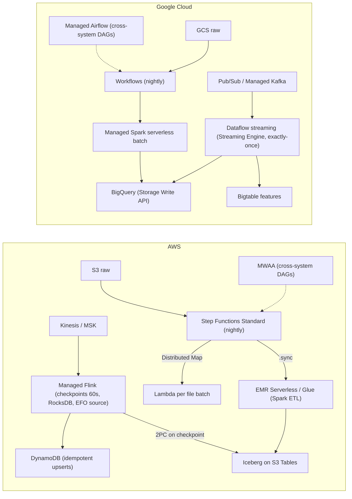
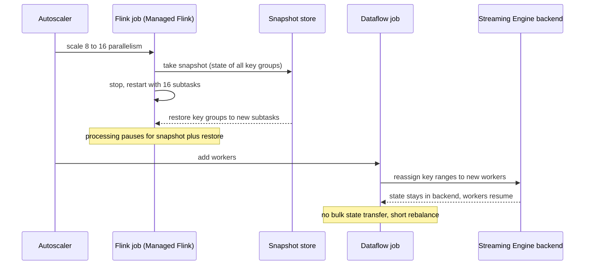

# 04.2 · Data Pipelines: Glue, EMR, Managed Flink and Step Functions vs Dataflow, Managed Airflow (Composer) and Managed Spark (Dataproc)

> **Folder 04 · File 2 of 2.** Both clouds offer three layers:
> 1. **Processing engines:** Spark, Flink, Beam.
> 2. **Managed runtimes:** serverless or clusters.
> 3. **Orchestrators:** state machines or DAG schedulers.
>
> The interesting differences are *where state lives* and *how a job rescales*:
> - **Dataflow**'s Streaming Engine and Shuffle move state and shuffle **out of the workers** into a Google-managed backend. Autoscaling then moves keys, not data.
> - **Managed Service for Apache Flink** keeps state on the workers and rescales by **snapshot and restart**.
> - **Spark** jobs, on Glue, EMR or Google's **Managed Service for Apache Spark** (formerly Dataproc), shuffle between executors unless an external shuffle service takes over.
> - Orchestrators split the same way: **Step Functions** (state machines with exactly-once Standard and high-volume Express) and **Workflows** vs **Airflow** (MWAA; Google's **Managed Service for Apache Airflow**, formerly Cloud Composer).
>
> April 2026 names are used, with the former names alongside.

| Listing | What it shows | Language |
|---|---|---|
| `pipeline_tradeoffs.py` | Checkpoint interval for an exactly-once Flink job (10–300 s): transactional-sink visibility lag, replayed events per day and checkpoint overhead. Managed Flink monthly cost by KPU count. Orchestrator cost for a 10-step workflow at 10k–100M executions per month (Step Functions Standard vs Express vs Cloud Workflows) | Python 3 (stdlib) |

**Verification.** The listing is embedded byte-identical. The gate re-runs it on this file and requires `verdict: OK`. That asserts shorter intervals give lower visibility lag and higher overhead, and that Express undercuts Standard at 100M executions. Prices are list prices as of **2026-10-31**: Managed Flink $0.11/KPU-hour; Step Functions $0.000025 per transition and Express $1/M requests plus GB-s; Workflows $0.01 per 1,000 internal steps.

**Labels.** **[D]** documented · **[E]** estimate/model · ⚠ inferred or to verify.

---

## 0. Orientation

**The questions this file answers.**

1. Which managed runtime fits which job: Glue, EMR (EC2/EKS/Serverless), Managed Flink on AWS; Dataflow, Managed Spark (clusters or serverless batches) on GCP?
2. Where does each engine keep **state and shuffle**, and what does that do to autoscaling, failure recovery and Spot usage?
3. How do exactly-once semantics actually work (Flink checkpoints + two-phase-commit sinks vs Dataflow's deduplication on persistent shuffle/state), and when should you choose **at-least-once** deliberately?
4. How do you pick an orchestrator (Step Functions Standard vs Express vs Airflow vs Workflows), and what does each cost and guarantee?
5. Which failure modes dominate? Skew, small files, shuffle loss on Spot, backlogs, checkpoint timeouts, DAG scheduler bottlenecks.

**Reading paths.**

| Goal | Read |
|---|---|
| L7 interview | §1, §2, §3.3, §4.1, §4.4, §5, §7, Q-chains |
| SAP-C02 | §2, §3 entire, §6, §7, S-scenarios |
| Platform design | §3–§6, run the listing with your rates |

**Prerequisites.**
- [04.1](01-kinesis-sqs-sns-eventbridge-msk-vs-gcp-pubsub-and-kafka-tradeoffs.md) for sources and sinks.
- [03.4](../03-Distributed-Storage-Databases-and-Lakehouse-Internals/04-analytics-redshift-athena-glue-iceberg-vs-bigquery-dremel-capacitor-storage-api.md) for lakehouse sinks.
- The separate Unified Dataflow/Beam/Flink L7 reference in this workspace covers watermarks and windowing in depth.

---

## 1. First principles: state, shuffle and the orchestration boundary

### 1.1 Where state lives decides how you scale

| Engine | Keyed state | Shuffle | Rescale mechanism | Consequence |
|---|---|---|---|---|
| **Flink** (Managed Service for Apache Flink, EMR, self-managed) | On TaskManagers (heap or RocksDB), snapshotted to durable storage | Network between TaskManagers | **Take a savepoint/snapshot, restart with new parallelism**, redistribute key groups | Rescaling costs a restart and a state restore |
| **Dataflow streaming** with **Streaming Engine** | In the **Streaming Engine backend**, not on workers ⚠ (described at this level by Google) | In the backend | **Move key ranges between workers** without moving state | Fast, frequent autoscaling. Workers are nearly stateless |
| **Dataflow batch** with **Dataflow Shuffle** | — | Backend shuffle service | Dynamic work rebalancing (liquid sharding) splits stragglers | Stragglers shrink. Losing a worker doesn't lose shuffle data |
| **Spark** (Glue, EMR, Managed Spark) | Executors (structured streaming state on executors plus checkpoints) | Executor local disks (unless an external/remote shuffle service is used) | Dynamic allocation adds or removes executors. Losing one recomputes its shuffle outputs | Spot reclaims can trigger recomputation cascades |

### 1.2 Exactly-once is a contract between engine and sink

- **Flink:**
  1. **checkpoint barriers** (Chandy–Lamport style) snapshot operator state consistently;
  2. sources rewind to checkpointed offsets on failure;
  3. **transactional sinks** pre-commit on the barrier and **commit when the checkpoint completes**. Kafka transactions and Iceberg commits work this way.

  Output therefore becomes visible **once per checkpoint**. The listing quantifies it: at a 60 s interval, the average visibility lag is ~38 s; at 300 s, ~158 s.
- **Dataflow:** exactly-once processing by default in streaming, by **deduplicating** records in the persistent shuffle and state layer and checkpointing state there. Sinks must still be idempotent or transactional for **effects**.
  - Dataflow also offers an **at-least-once streaming mode**, which lowers cost and latency in exchange for possible duplicates. That's right when the sink is idempotent (upserts keyed by event ID).
- **Spark Structured Streaming:** exactly-once with replayable sources, checkpointed offsets and idempotent or transactional sinks (Iceberg/Delta commits).

### 1.3 Orchestrators coordinate; they shouldn't process

An orchestrator schedules, sequences, retries and records. It should carry **references** (S3/GCS URIs, job IDs), not data. The pricing models reflect that:
- Step Functions Standard is **per state transition**;
- Express is **per request plus GB-seconds**;
- Workflows is **per step**;
- Airflow is **environment-hours** (scheduler, workers, web server, metadata database).

A design that loops over millions of items inside a Standard workflow pays per transition. Use **Distributed Map**, a processing engine, or Express.

---

## 2. Side-by-side architectural Rosetta matrix

| Concern | AWS | GCP | What actually differs |
|---|---|---|---|
| Serverless Spark | **AWS Glue** (DPU = 4 vCPU / 16 GB; workers G.1X–G.8X; **Flex** execution class for non-urgent jobs). **EMR Serverless** (vCPU/GB-hours, pre-initialized capacity) | **Managed Service for Apache Spark serverless batches** (formerly Dataproc Serverless) ⚠ naming | Glue adds a catalog, job bookmarks and Data Quality. EMR Serverless is closer to plain Spark |
| Spark clusters | **EMR on EC2** (primary/core/task nodes, instance fleets with Spot, managed scaling), **EMR on EKS** | **Managed Service for Apache Spark** clusters (formerly Dataproc): autoscaling policies, Spot secondary workers, ephemeral per-job clusters | Both encourage ephemeral clusters with data in S3/GCS |
| Stream processing | **Managed Service for Apache Flink** (KPU = 1 vCPU + 4 GB, $0.11/KPU-h, +1 orchestration KPU per app) | **Dataflow** (Beam; Streaming Engine; horizontal and vertical autoscaling) | Dataflow externalizes state. Managed Flink rescales by snapshot and restart |
| Unified batch + stream API | Apache Beam on the Flink runner (Managed Flink supports Beam apps), Spark | **Apache Beam** natively (Dataflow is the reference runner) | Beam portability is stronger on GCP |
| Shuffle | Executor-local (Spark). Network (Flink) | **Dataflow Shuffle** (batch) / Streaming Engine (stream) backends | Removes the shuffle-on-Spot problem for Dataflow |
| Autoscaling | Glue auto scaling. EMR managed scaling. Managed Flink autoscaling on CPU (rescale = restart) ⚠ | Dataflow horizontal autoscaling, **dynamic work rebalancing**, vertical autoscaling and right fitting (Dataflow Prime) | Dataflow's rebalancing splits stragglers mid-job |
| Exactly-once | Flink checkpoints + 2PC sinks. Spark checkpoints + idempotent/transactional sinks | Dataflow exactly-once by default, or **at-least-once mode** for cost/latency | Choose per sink |
| Incremental batch | Glue **job bookmarks**. Iceberg incremental reads | Iceberg / BigQuery incremental queries. Beam state | — |
| State-machine orchestration | **Step Functions** Standard (exactly-once, ≤ 1 year, per transition) / Express (at-least-once async, ≤ 5 min, per request + duration). **Distributed Map** (up to 10,000 parallel child executions) | **Workflows** (steps, connectors, callbacks, long-running executions) | Step Functions has richer service integrations and Distributed Map |
| DAG orchestration | **MWAA** (Managed Workflows for Apache Airflow) | **Managed Service for Apache Airflow** (formerly Cloud Composer) | Same Airflow. Different environment scaling and pricing |
| Scheduling | EventBridge Scheduler | Cloud Scheduler | — |
| Data quality and lineage | Glue Data Quality (DQDL). DataZone / SageMaker Catalog lineage | Dataplex data quality and lineage (Knowledge Catalog) | — |
| CDC ingestion | AWS DMS | **Datastream** | Folder 06 |

---

## 3. Internal mechanics: AWS pipelines

### 3.1 AWS Glue

- **Capacity.** Serverless Spark (also Python shell and Ray). Capacity in **DPUs** (1 DPU = 4 vCPU, 16 GB).
  - Worker types G.1X/G.2X/G.4X/G.8X, plus memory-optimized and streaming variants.
  - Auto scaling adds and removes workers during a run.
- **Flex execution class.** Runs non-urgent jobs on spare capacity at a lower DPU price, with longer and less predictable start times.
- **Job bookmarks.** Track processed data (S3 objects, JDBC keys) for incremental runs. They're a convenience, not a substitute for table-format incremental reads when exactness matters.
- **Catalog and quality.** Integrated with the **Glue Data Catalog** and Lake Formation. **Glue Data Quality** rules in DQDL. Glue Studio for visual ETL.
- **Where it fits.** Catalog-centric ETL on S3 and Iceberg, moderate-size jobs, teams that want no cluster management. Very large or custom-tuned Spark often moves to EMR.

### 3.2 Amazon EMR

- **EMR on EC2:**
  - a **primary** node;
  - **core** nodes (HDFS and executors);
  - **task** nodes (executors only, ideal for **Spot**).
- **Instance fleets** diversify instance types and purchase options (01.1 §5.5). **Managed scaling** resizes the cluster. Use S3 (EMRFS / Iceberg) for data, and keep HDFS for scratch only.
- **EMR on EKS** runs Spark on existing EKS clusters (shared capacity with Karpenter, 01.2).
- **EMR Serverless:**
  - applications with **pre-initialized capacity** (warm workers) to cut startup latency;
  - billed per vCPU-, GB- and storage-hour;
  - maximum-capacity limits per application.
- **Spot guidance.** Losing a node that holds **shuffle** outputs forces recomputation of upstream stages. Keep core nodes on-demand, put executors on Spot task nodes, and enable graceful decommissioning.

### 3.3 Managed Service for Apache Flink

- **Applications run Flink** (Java/Scala/Python, or Studio notebooks), sized in **KPUs**:
  - 1 vCPU + 4 GB;
  - **50 GB of running application storage per KPU**;
  - **$0.11 per KPU-hour** in us-east-1;
  - **one extra KPU per application** for orchestration;
  - per-second billing with a 10-minute minimum.

  The listing: 8 KPUs ≈ $723/month.
- **Parallelism** = KPUs × parallelism-per-KPU.
- **Snapshots** (managed savepoints) back application updates and recovery.
- **Autoscaling** adjusts parallelism based on CPU. The rescale is a **snapshot-and-restart** ⚠, with a brief processing pause, so scaling events have a cost.
- **Checkpoints:**
  - the interval and timeout decide the exactly-once latency and recovery cost (listing §1);
  - **unaligned checkpoints** help under backpressure;
  - RocksDB with incremental checkpoints suits large state.
- **Sources and sinks:** Kinesis (EFO), MSK/Kafka, S3/Iceberg, DynamoDB, OpenSearch.

### 3.4 Step Functions and MWAA

- **Standard workflows:**
  - **exactly-once** workflow execution;
  - up to **1 year**;
  - full execution history;
  - billed **$0.000025 per state transition** (4,000 free per month) [D];
  - service integrations: `.sync` (run a job and wait), `.waitForTaskToken` (callbacks and human approval);
  - Retry and Catch per state.
- **Express workflows:**
  - up to **5 minutes**;
  - **at-least-once** for asynchronous starts, at-most-once for synchronous;
  - billed **$1.00 per million requests** plus duration (from $0.00001667 per GB-second, 100 ms and 64 MB increments) [D].

  The listing: at 100M executions of a 10-step, 3-second workflow, Standard costs ~$25,000/month and Express ~$413 (first-tier duration rate assumed).
- **Distributed Map:** fans out over millions of S3 objects or items with up to **10,000 parallel child executions**. It's the right tool for "process every file" orchestration.
- **MWAA:** managed Airflow environments (scheduler, workers, web server, metadata database), sized by environment class, with workers autoscaling. Use it for teams with Airflow DAG estates and cross-system dependencies. Use Step Functions for AWS-native, event-driven state machines.

---

## 4. Internal mechanics: Google Cloud pipelines

### 4.1 Dataflow

- **Apache Beam runner.** The pipeline graph is optimized (fusion, combiner lifting) into stages.
- **Streaming Engine** moves **windowed state and shuffle** for streaming jobs from worker VMs into a Google backend. Workers become lighter and more interchangeable, so **horizontal autoscaling** can rebalance key ranges quickly.
- **Dataflow Shuffle** does the same for batch.
- **Dynamic work rebalancing** (liquid sharding) splits a straggler's remaining work and hands it to idle workers mid-stage, which cuts tail latency from skewed splits.
- **Vertical autoscaling and right fitting** (Dataflow Prime) adjust worker memory and resources per stage.
- **Semantics:**
  - streaming is **exactly-once** by default (deduplication in the shuffle and state layer);
  - **at-least-once streaming mode** reduces cost and latency where sinks are idempotent;
  - **watermarks and triggers** come from the Beam model.
- **Templates** (Flex Templates) package pipelines for reuse. **Dataflow ML** runs inference in pipelines.
- **Pricing:** worker resources (vCPU, memory, persistent disk) plus Streaming Engine or Shuffle usage. Check the current SKUs for your region.

### 4.2 Managed Service for Apache Spark (formerly Dataproc)

- **Clusters:** create in ~90 s ⚠, with **autoscaling policies** for primary and secondary workers. **Secondary workers on Spot** process but don't store HDFS data.
- **Pattern:** **ephemeral per-job or per-workflow clusters** with data in GCS and BigQuery (03.4), and the Hive metastore in a managed metastore (Dataproc Metastore / Lakehouse catalog).
- **Serverless batches** (formerly Dataproc Serverless): submit Spark workloads without clusters, billed by consumed compute units.
- **Spark on GKE** is available for shared Kubernetes capacity.

### 4.3 Managed Service for Apache Airflow (formerly Cloud Composer) and Workflows

- **Managed Airflow** (Composer 3 generation): Google-managed Airflow with autoscaling workers, the metadata database, DAG storage in GCS, and private networking. DAG-parse time, scheduler load and task concurrency are the scaling limits to watch, the same as on MWAA.
- **Workflows:**
  - YAML/JSON step definitions;
  - **connectors** for Google APIs, HTTP calls and callbacks (wait for an external event);
  - long-running executions;
  - priced per internal and external step (about $0.01 and $0.025 per 1,000, after free tiers).

  It's the Step Functions analog for service orchestration. **Cloud Scheduler** triggers it on cron.

### 4.4 Exactly-once compared

| Aspect | Flink (AWS Managed Flink) | Dataflow |
|---|---|---|
| Consistency mechanism | Distributed snapshots via checkpoint barriers. State restored on failure | Per-record deduplication and persistent state in the backend |
| Output visibility for transactional sinks | Per checkpoint (interval-dependent latency) | Per bundle commit in the backend. Sinks: idempotent or transactional |
| Rescaling | Snapshot → restart with new parallelism | Key-range reassignment (Streaming Engine) |
| Cheaper mode | Longer checkpoint intervals, at-least-once mode | **At-least-once streaming mode** |
| Typical tuning knobs | Checkpoint interval/timeout, unaligned checkpoints, state backend, parallelism per KPU | Max workers, autoscaling algorithm, Streaming Engine, machine types, fusion breaks |

---

## 5. Listing: checkpoints and orchestration pricing

<!-- listing:pipeline_tradeoffs.py -->
```python
"""pipeline_tradeoffs.py - two decisions every managed pipeline forces: the checkpoint interval of a
stateful stream job (Flink on AWS; the same trade appears in any checkpointing engine) and the
orchestrator pricing model (Step Functions Standard vs Express vs Cloud Workflows).

Rules and prices encoded (public docs/pricing, 2026-10-31; verify before reuse):
  Flink exactly-once with transactional (two-phase-commit) sinks: output becomes visible when the
    checkpoint that covers it completes; after a failure the job restarts from the last completed
    checkpoint and replays input since then
  Managed Service for Apache Flink: $0.11 per KPU-hour (1 KPU = 1 vCPU + 4 GB) + 1 extra KPU per
    application for orchestration
  Step Functions Standard: $0.000025 per state transition (us-east-1), exactly-once execution,
    up to 1 year; Express: $1.00 per 1M requests + $0.00001667 per GB-s (first tier), billed in
    100 ms and 64 MB increments, up to 5 minutes, at-least-once (async)
  Cloud Workflows: $0.01 per 1,000 internal steps, $0.025 per 1,000 external HTTP steps (list)
Checkpoint duration, failure rate and input rate are ASSUMPTIONS, printed as such.

Usage: python -I pipeline_tradeoffs.py <any path>
"""
import math
import sys


def checkpoint_profile(interval_s, ckpt_s, rate_eps, failures_per_day, restart_s):
    visible_lag = interval_s / 2 + ckpt_s            # average wait for the covering checkpoint
    replay_events = rate_eps * (interval_s / 2 + ckpt_s + restart_s)
    overhead = min(1.0, ckpt_s * 0.1 / interval_s)   # ASSUMED 10% slowdown while a checkpoint runs
    return visible_lag, replay_events * failures_per_day, overhead


def sfn_standard(execs, steps):
    return execs * steps * 0.000025


def sfn_express(execs, seconds, mem_mb=64):
    gb = math.ceil(mem_mb / 64) * 64 / 1024
    billed_s = math.ceil(seconds * 10) / 10
    return execs * 1.0 / 1e6 + execs * billed_s * gb * 0.00001667


def workflows(execs, internal, external):
    return execs * internal / 1000 * 0.01 + execs * external / 1000 * 0.025


def main():
    ok = True
    print("== 1. Checkpoint interval for an exactly-once Flink job ==")
    print("   ASSUMED: 50,000 events/s, checkpoint takes 8 s, 4 failures/day, 60 s restart")
    rows = []
    for interval in (10, 30, 60, 300):
        lag, replay, ovh = checkpoint_profile(interval, 8, 50_000, 4, 60)
        rows.append((interval, lag, replay, ovh))
        print(f"interval {interval:>3} s: sink visibility lag ~{lag:5.0f} s | replayed/day {replay / 1e6:6.1f} M events | "
              f"checkpoint overhead ~{ovh:5.1%}")
    ok &= rows[0][1] < rows[-1][1] and rows[0][3] > rows[-1][3]
    print("   short intervals buy freshness of transactional sinks and less replay, and cost overhead;")
    print("   idempotent (upsert) sinks decouple visibility from checkpoints entirely")

    print()
    kpu_month = 0.11 * 730
    print(f"== 2. Managed Flink cost: {kpu_month:.2f} USD per KPU-month ==")
    for kpu in (2, 8, 32):
        print(f"{kpu:>3} KPUs + 1 orchestration KPU: ${(kpu + 1) * kpu_month:>9,.2f}/month (+ $0.10/GB-mo running storage)")

    print()
    print("== 3. Orchestrator cost per month for a 10-step workflow lasting 3 s ==")
    print(f"{'executions':>12} {'SFN Standard':>13} {'SFN Express':>12} {'Workflows*':>11}")
    for execs in (10_000, 1_000_000, 100_000_000):
        s, e, w = sfn_standard(execs, 10), sfn_express(execs, 3.0), workflows(execs, 8, 2)
        print(f"{execs:>12,} {s:>13,.2f} {e:>12,.2f} {w:>11,.2f}")
    ok &= sfn_express(100_000_000, 3.0) < sfn_standard(100_000_000, 10)
    print("   * Workflows modeled as 8 internal + 2 external HTTP steps; free tiers ignored; Express")
    print("     duration priced at the first-tier rate throughout (higher volumes get cheaper tiers)")
    print("   Express is cheaper at volume but at-least-once and <= 5 min; Standard is exactly-once and")
    print("   auditable for long-running, human-in-the-loop flows")
    print()
    print("verdict: OK" if ok else "verdict: FAIL")


if __name__ == "__main__":
    main()
```

<!-- output:pipeline_tradeoffs.py -->
```text
== 1. Checkpoint interval for an exactly-once Flink job ==
   ASSUMED: 50,000 events/s, checkpoint takes 8 s, 4 failures/day, 60 s restart
interval  10 s: sink visibility lag ~   13 s | replayed/day   14.6 M events | checkpoint overhead ~ 8.0%
interval  30 s: sink visibility lag ~   23 s | replayed/day   16.6 M events | checkpoint overhead ~ 2.7%
interval  60 s: sink visibility lag ~   38 s | replayed/day   19.6 M events | checkpoint overhead ~ 1.3%
interval 300 s: sink visibility lag ~  158 s | replayed/day   43.6 M events | checkpoint overhead ~ 0.3%
   short intervals buy freshness of transactional sinks and less replay, and cost overhead;
   idempotent (upsert) sinks decouple visibility from checkpoints entirely

== 2. Managed Flink cost: 80.30 USD per KPU-month ==
  2 KPUs + 1 orchestration KPU: $   240.90/month (+ $0.10/GB-mo running storage)
  8 KPUs + 1 orchestration KPU: $   722.70/month (+ $0.10/GB-mo running storage)
 32 KPUs + 1 orchestration KPU: $ 2,649.90/month (+ $0.10/GB-mo running storage)

== 3. Orchestrator cost per month for a 10-step workflow lasting 3 s ==
  executions  SFN Standard  SFN Express  Workflows*
      10,000          2.50         0.04        1.30
   1,000,000        250.00         4.13      130.00
 100,000,000     25,000.00       412.56   13,000.00
   * Workflows modeled as 8 internal + 2 external HTTP steps; free tiers ignored; Express
     duration priced at the first-tier rate throughout (higher volumes get cheaper tiers)
   Express is cheaper at volume but at-least-once and <= 5 min; Standard is exactly-once and
   auditable for long-running, human-in-the-loop flows

verdict: OK
```

**Reading the output.**

- **Section 1 [E]** (assumed 50k events/s, 8 s checkpoints, 4 failures/day, 60 s restart):

  | Interval | Transactional-sink visibility lag | Overhead | Replayed per day |
  |---|---|---|---|
  | 10 s | ~13 s | ~8% | 14.6M events |
  | 60 s | ~38 s | ~1.3% | 19.6M events |
  | 300 s | ~158 s | ~0.3% | 43.6M events |

  Choose the interval from the **freshness SLO** of transactional sinks and the **replay budget**. Or use **idempotent upsert sinks**, which make visibility independent of checkpoints.
- **Section 2.** Managed Flink's orchestration KPU is a fixed overhead per application. Consolidating many tiny apps saves money, at the cost of shared fate.
- **Section 3.**
  - At 10k executions/month, every orchestrator is cheap.
  - At 1M, Standard costs ~$250, Workflows ~$130 and Express ~$4.
  - At 100M, Standard costs ~$25,000.

  Express or Workflows wins for **short, high-volume** flows. Standard is for **long-running, auditable, exactly-once** flows such as order fulfillment and human approvals.

---

## 6. Choosing and translating

| Job | AWS | GCP |
|---|---|---|
| Nightly catalog-driven ETL (S3/GCS → Iceberg/BigQuery) | Glue (Flex for non-urgent jobs) or EMR Serverless | Managed Spark serverless batches, or Dataflow batch, or BigQuery SQL (ELT) |
| Large custom Spark with tuning and Spot | EMR on EC2 (instance fleets, task nodes on Spot) / EMR on EKS | Managed Spark ephemeral clusters (Spot secondary workers) / Spark on GKE |
| Low-latency stateful streaming | Managed Flink | Dataflow streaming (Streaming Engine) |
| Same pipeline for batch and stream | Beam on Flink, Spark | **Beam on Dataflow** |
| Event-driven service orchestration | Step Functions (Standard/Express), EventBridge | Workflows + Eventarc |
| Data-platform DAGs across systems | MWAA | Managed Service for Apache Airflow |
| Process millions of objects in parallel | Step Functions **Distributed Map** + Lambda/Batch | Dataflow, or Cloud Run jobs (tasks) with Workflows |

**Translation traps.**
- **Managed Flink → Dataflow.**
  - Flink's operator-state APIs and timers map to Beam state and timers.
  - Exactly-once timing changes (checkpoint-bound → backend commit).
  - Rescaling becomes cheap, so autoscaling settings must be revisited.
- **Dataflow → Managed Flink.**
  - Autoscaling becomes restart-based.
  - Large state needs RocksDB and incremental checkpoints.
  - Choose checkpoint intervals deliberately (listing §1).
- **Step Functions ↔ Workflows.**
  - `.sync` integrations and Distributed Map have no one-to-one equivalent. Use connectors, callbacks and Cloud Run jobs.
  - Error handling syntax differs (Retry/Catch vs try/retry/except).
- **Glue → Managed Spark.**
  - Job bookmarks have no direct equivalent, so use table-format incremental reads.
  - Lake Formation permissions map to Dataplex, policy tags and BigQuery fine-grained access.

---

## 7. Failure modes, throttling limits and quota traps

| # | Symptom | Root cause | Detect | Fix | Cloud |
|---|---|---|---|---|---|
| 1 | Spark stage repeatedly re-runs after Spot reclaims | **Shuffle outputs lost** with the executor | Stage retries, fetch failures | On-demand core / primary workers, Spot only for executors, graceful decommissioning, external shuffle. Dataflow Shuffle | Both |
| 2 | One task runs 10× longer than the rest | **Data skew** on a join or group key | Task time distribution | Salting, AQE skew join (Spark), pre-aggregation. Dataflow dynamic work rebalancing helps split skewed *splits* but not hot *keys* | Both |
| 3 | Thousands of tiny output files | Too many partitions or tasks writing small files | File counts (03.4) | Coalesce/repartition before write. Iceberg compaction | Both |
| 4 | Flink job keeps failing checkpoints | Checkpoint timeout under **backpressure**, or large state | Checkpoint metrics | Unaligned checkpoints, incremental RocksDB, more parallelism, longer timeout | AWS |
| 5 | Exactly-once sink output arrives in bursts | Commit on **checkpoint completion** | Sink write pattern | Shorter interval (listing §1), or idempotent upsert sinks | AWS |
| 6 | Managed Flink scaling causes processing pauses | Autoscaling rescale = **snapshot + restart** | Downtime per scaling event | Bound scaling frequency. Headroom. Right-size parallelism | AWS |
| 7 | Dataflow streaming backlog grows despite autoscaling | Max workers reached, hot key, or slow sink | Backlog/system lag metrics | Raise max workers. Fix hot keys (combiners, key salting). Batch sink writes | GCP |
| 8 | Duplicates after switching to at-least-once mode | Intended trade-off | Duplicate keys | Idempotent sinks keyed by event ID | GCP |
| 9 | Glue job slow to start, or over budget | Flex queueing, or fixed workers on a small job | Start latency, DPU-hours | Standard class for urgent jobs. Auto scaling. Right-size workers | AWS |
| 10 | Glue bookmark reprocesses or skips data | Bookmark assumptions (object timestamps, JDBC keys) violated | Row counts vs source | Table-format incremental reads. Explicit watermark columns | AWS |
| 11 | Step Functions bill spikes | **Per-transition** pricing with loops over items | Cost per state machine | Distributed Map, Express for short high-volume flows, processing engines for per-item work | AWS |
| 12 | Express workflow side effects happen twice | **At-least-once** async semantics | Duplicate effects | Idempotent tasks, or Standard for exactly-once orchestration | AWS |
| 13 | Payload errors in a state machine | State payload limits (256 KB) ⚠ verify | Failed transitions | Pass S3/GCS references, not data | Both |
| 14 | Airflow DAGs run late, scheduler at 100% | **DAG parsing** cost, too many top-level imports, dynamic DAGs | Scheduler metrics | Faster parsing, fewer DAG files, deferrable operators, bigger scheduler | Both |
| 15 | Airflow tasks overwhelm a database | Unbounded task concurrency or pools | DB load | Airflow pools, max active tasks, queueing | Both |
| 16 | Cluster quota errors at job start | Regional vCPU quotas (EMR instance fleets, Managed Spark) | Cluster create errors | Quota headroom. Instance diversity. Serverless options | Both |

---

## 8. Architecture diagrams: multi-service compositions

### 8.1 Streaming + batch platform on both clouds



### 8.2 How state moves when a streaming job scales



### 8.3 Orchestrator choice (ASCII)

```text
                    duration     guarantee                 price driver           best for
SFN Standard        <= 1 year    exactly-once execution    per state transition   long, auditable, human steps
SFN Express         <= 5 min     at-least-once (async)     requests + GB-seconds  high-volume short event flows
Workflows (GCP)     long-running per-step execution        per step               service orchestration on GCP
Airflow (MWAA /     scheduled    task retries, DAG deps    environment-hours      data-platform DAGs across systems
 Managed Airflow)
rule: orchestrators pass references (URIs, job IDs), never bulk data
```

---

## 9. Bar-raiser chains and SAP-C02 scenarios

### 9.1 L7 bar-raiser chains

<details><summary><b>Q1 · Dataflow or Managed Flink for real-time fraud features?</b></summary>

**Initial Prompt.** "We need per-card features over 1-minute, 1-hour and 30-day windows at 50k events/s, with spiky traffic and strict correctness. Dataflow on GCP, Managed Flink on AWS: compare them."

**L5 Answer.** "Both run streaming jobs with windows. Pick the one on our cloud."

**Why L5 Stalls.** The engines differ in state placement, rescaling, exactly-once timing and operational knobs, and those decide spiky-traffic behavior and cost.

**L7 Answer.**
- **State:**
  - 30-day windows per card are large state;
  - Flink keeps it in **RocksDB on the workers**, with incremental checkpoints to durable storage;
  - Dataflow keeps it in **Streaming Engine**, off the workers.
- **Spikes:**
  - Dataflow rebalances key ranges quickly;
  - Managed Flink rescales by **snapshot and restart**, so provision headroom or tolerate scaling pauses.
- **Correctness:**
  - Flink's exactly-once output to transactional sinks is visible per **checkpoint**, about half the interval plus checkpoint time (listing §1);
  - Dataflow commits in its backend, and features written as **idempotent upserts** keyed by card+window don't depend on either.
- **Operations:**
  - Flink: tune checkpoint interval/timeout, unaligned checkpoints, parallelism per KPU;
  - Dataflow: tune max workers, hot keys and machine types.
- **Cost:** KPU-hours (+1 per app) vs worker resources plus Streaming Engine.

The decision follows the cloud of the data. The design (idempotent feature writes, hot-key handling, watermark strategy) is the same on both."
</details>

<details><summary><b>Q2 · Spark on Spot keeps re-running stages</b></summary>

**Initial Prompt.** "Our nightly 3-hour EMR job got cheaper on Spot but now sometimes takes 8 hours. Why, and how do we keep the savings?"

**L5 Answer.** "Spot interruptions. Go back to on-demand."

**Why L5 Stalls.** It gives up the savings without addressing the mechanism: lost shuffle outputs trigger recomputation.

**L7 Answer.** "When a Spot node holding **shuffle files** is reclaimed, downstream stages hit fetch failures, and Spark **recomputes the upstream stages** that produced them. One reclaim late in a deep DAG can cost hours.

Keep the savings safely:
1. **Core nodes on-demand** (HDFS and stable nodes), **task nodes on Spot** with instance fleets diversified across many types and AZs.
2. Enable **graceful decommissioning**, so executors on a node receiving an interruption notice migrate shuffle data where supported.
3. Avoid huge single shuffles: checkpoint intermediate results to S3 or Iceberg between heavy stages.
4. Or move to **EMR Serverless** or Glue, where AWS manages capacity.

On GCP, Spot **secondary workers** on Managed Spark have the same issue. **Dataflow batch with Dataflow Shuffle** removes it, because shuffle lives in the backend."
</details>

<details><summary><b>Q3 · Pick the checkpoint interval</b></summary>

**Initial Prompt.** "A Flink job writes exactly-once to Iceberg. Product wants data in the table within 30 seconds, and SRE wants recovery to replay less than a minute of input. Choose the checkpoint interval and defend it."

**L5 Answer.** "Set it to 1 second for the freshest data."

**Why L5 Stalls.** One-second checkpoints on large state cause checkpoint overlap, overhead and backpressure. The answer doesn't relate the interval to the two SLOs.

**L7 Answer.** "With a transactional sink, data becomes visible when its checkpoint completes: on average **interval/2 + checkpoint duration** later. Recovery replays from the last completed checkpoint: up to the interval plus checkpoint and restart time.

With an 8 s checkpoint duration (listing §1):
- a **30 s interval** gives ~23 s average visibility lag (p100 about 38 s) and ~2.7% overhead;
- a **10 s interval** gives ~13 s lag at ~8% overhead.

I'd pick **20–30 s**, set the checkpoint timeout well above the duration, use incremental RocksDB checkpoints, and enable unaligned checkpoints for backpressure.

If the 30 s SLO is a hard p99, Iceberg commit frequency also creates small files (03.4). Use compaction, or decouple: write **idempotent upserts** to a serving store for freshness, and commit to Iceberg less often for analytics."
</details>

<details><summary><b>Q4 · Glue, EMR Serverless or EMR on EC2 for 400 nightly jobs?</b></summary>

**Initial Prompt.** "We run 400 Spark jobs nightly, from 2-minute small jobs to a few 2-hour giants. Choose runtimes on AWS and the GCP equivalents."

**L5 Answer.** "Glue for everything, since it's serverless."

**Why L5 Stalls.** One runtime fits poorly across the range. Startup latency, per-job minimums, tuning control and Spot savings differ.

**L7 Answer.** "Segment the jobs.
- **Small catalog-driven jobs:** **Glue**, with **Flex** for non-urgent ones (lower DPU price, longer start), plus job bookmarks or Iceberg incremental reads, with Lake Formation integration.
- **Medium jobs needing standard Spark and fast start:** **EMR Serverless** with **pre-initialized capacity**, per vCPU/GB-hour billing, max-capacity guards.
- **The 2-hour giants needing tuning and Spot:** **EMR on EC2** with instance fleets (Spot task nodes), managed scaling and ephemeral clusters per run. Or EMR on EKS if a shared Karpenter fleet exists.
- **GCP:** Managed Spark **serverless batches** for small and medium jobs, **ephemeral clusters** with Spot secondary workers for giants, or rewrite giants as **Dataflow batch** for Shuffle and dynamic work rebalancing, or as BigQuery SQL if they're mostly joins and aggregations.

Orchestrate with Step Functions or Airflow passing URIs, and track cost per job to re-segment quarterly."
</details>

<details><summary><b>Q5 · Step Functions Standard is costing us more than the compute</b></summary>

**Initial Prompt.** "A state machine processes each uploaded image: 12 states, 40M executions/month. The Step Functions bill exceeds the Lambda bill. Redesign it."

**L5 Answer.** "Combine states to reduce transitions."

**Why L5 Stalls.** It helps at the margin, but the pricing model is the issue. Standard bills every transition, and short high-volume flows belong in Express.

**L7 Answer.** "40M × 12 transitions × $0.000025 is about **$12,000/month** on Standard. These executions are short and idempotent, which is Express's case: $1 per million requests plus GB-seconds. In the listing's 10-step, 3-second model at 1M executions, it's ~$4 vs ~$250.

The redesign:
1. **Express** for the per-image flow, with every task idempotent, since async Express is at-least-once.
2. Keep **Standard** only for the long or auditable parent flows: daily batches, human review.
3. For bulk backfills, **Distributed Map** over the S3 prefix with child Express workflows.
4. Pass S3 keys, not image bytes, in the state.

On GCP the analog is Workflows (per step) or, for per-object processing at volume, Eventarc → Cloud Run with Pub/Sub buffering."
</details>

<details><summary><b>Q6 · Airflow or a state machine?</b></summary>

**Initial Prompt.** "The data team wants Airflow for everything. The app team wants Step Functions/Workflows for everything. Arbitrate."

**L5 Answer.** "Pick one tool to standardize on."

**Why L5 Stalls.** The tools solve different problems. Forcing one creates either scheduler-heavy event flows or event-driven systems without DAG lineage and backfills.

**L7 Answer.**
- **Airflow** (MWAA / Managed Airflow) for **scheduled data-platform DAGs**:
  - time-partitioned runs and **backfills**;
  - cross-system dependencies (warehouse, Spark, dbt, external APIs);
  - sensors and data-aware scheduling;
  - lineage.
- **State machines** (Step Functions / Workflows) for **event-driven application workflows**:
  - per-request execution;
  - callbacks (`waitForTaskToken`, Workflows callbacks);
  - exactly-once (Standard) or high-volume (Express);
  - fine-grained retries per step.
- **The boundary:** Airflow can *start* a state machine and wait, and a state machine can trigger a DAG run through its API.
- **Rules both sides follow:**
  1. pass references, not data;
  2. idempotent tasks;
  3. pools and concurrency limits to protect databases.

Standardize the **interfaces and observability**, not the tool."
</details>

<details><summary><b>Q7 · Dataflow streaming backlog won't drain</b></summary>

**Initial Prompt.** "A Dataflow job reading Pub/Sub has a growing backlog. Autoscaling is at max workers and CPU is uneven. What do you check, and what do you change?"

**L5 Answer.** "Raise max workers."

**Why L5 Stalls.** Uneven CPU at max workers points to a hot key or a slow sink. More workers won't help a single key.

**L7 Answer.** "In order:
1. **Hot keys.** A GroupByKey or stateful step where one key gets a large share of the traffic. The job's 'hot key' logging and per-stage metrics show it. Fix with **combiners** (partial aggregation before shuffle), key salting with a second-stage merge, or by redesigning the key.
2. **A slow sink.** BigQuery or Bigtable writes throttled or unbatched. Use the Storage Write API with batching, and check sink quotas.
3. **Fusion.** A heavy step fused with a fan-out step limits parallelism. Add a reshuffle (fusion break).
4. **Only then** raise max workers or change machine types (Prime right fitting).
5. If the sink is idempotent, consider **at-least-once streaming mode** for lower cost and latency.

Alarm on **data freshness and system lag**, not CPU. The AWS Flink equivalent: backpressure metrics, hot subtasks, checkpoint duration."
</details>

<details><summary><b>Q8 · End-to-end exactly-once from Kafka to the warehouse on both clouds</b></summary>

**Initial Prompt.** "Finance needs every transaction event from Kafka in the warehouse exactly once. Design it on AWS (MSK → Redshift/Iceberg) and GCP (Managed Kafka → BigQuery)."

**L5 Answer.** "Use exactly-once mode in Flink and Dataflow."

**Why L5 Stalls.** Engine exactly-once covers internal state. The end-to-end guarantee needs replayable sources, deterministic processing and a sink that's transactional or idempotent, plus a reconciliation check.

**L7 Answer.**
- **AWS:**
  - MSK source with committed offsets in Flink checkpoints;
  - Flink exactly-once with an **Iceberg sink** (commits on checkpoint) or **MERGE into Redshift** keyed by transaction ID from staging;
  - producers use **idempotent Kafka producers**.
- **GCP:**
  - Managed Kafka source → Dataflow (exactly-once streaming) → **BigQuery Storage Write API committed streams** (offset-based, exactly-once append);
  - or at-least-once into a staging table plus MERGE on transaction ID.
- **Both:**
  1. a **business key** (transaction ID) carried from the producer;
  2. idempotent or transactional sink semantics;
  3. a **reconciliation** job comparing source and sink counts and sums per hour, as the proof (as in the past-project playbook's reconciliation exhibit);
  4. replay procedures (offset reset by timestamp).

'Exactly once' in an audit is shown by reconciliation, not asserted by a flag."
</details>

<details><summary><b>Q9 · Ephemeral clusters vs a shared persistent cluster</b></summary>

**Initial Prompt.** "Ten teams share one 200-node persistent Spark cluster. It's always either idle or congested, and upgrades are a nightmare. Propose an alternative on AWS and GCP."

**L5 Answer.** "Add autoscaling to the shared cluster."

**Why L5 Stalls.** Autoscaling a shared cluster helps utilization but keeps the noisy-neighbor, upgrade-coupling and blast-radius problems.

**L7 Answer.** "Move to **ephemeral, per-job (or per-workflow) clusters** with data in object storage and a shared metastore/catalog.
- **AWS:** EMR on EC2 clusters created per workflow by Step Functions or Airflow, or **EMR Serverless** applications per team with max-capacity guards, or EMR on EKS namespaces per team on a Karpenter-managed fleet. Glue Data Catalog and Lake Formation are the shared layer.
- **GCP:** **Managed Spark** ephemeral clusters per workflow (fast creation), or **serverless batches**. Shared metastore and Lakehouse catalog, BigQuery for SQL.
- **The gains:**
  1. per-team versions, so upgrades decouple;
  2. per-job cost attribution;
  3. no idle cluster;
  4. failures isolated.
- **The costs:** startup latency per job (mitigate with pre-initialized capacity or pooled warm capacity) and the need for good job templates."
</details>

<details><summary><b>Q10 · Translate a Managed Flink + Step Functions platform to GCP</b></summary>

**Initial Prompt.** "Our AWS platform: Kinesis → Managed Flink → DynamoDB/Iceberg, nightly Step Functions orchestrating EMR Serverless, and MWAA for cross-team DAGs. Design the GCP version and list the behavior changes."

**L5 Answer.** "Pub/Sub, Dataflow, Workflows, Dataproc and Composer, one for one."

**Why L5 Stalls.** The services map, but the behaviors don't: state and rescaling, exactly-once timing, orchestration features (Distributed Map, `.sync`) and Pub/Sub's replay setup.

**L7 Answer.**
- **Streaming:** Kinesis → **Pub/Sub** with topic retention for replay (enable it ahead of time), and ordering keys only where order per entity matters. Managed Flink → **Dataflow** (Beam).
  - Rewrite Flink operators as Beam transforms with state and timers.
  - Exactly-once timing changes from checkpoint-bound to backend commits.
  - Autoscaling becomes fast, so tune max workers.
  - DynamoDB → Bigtable or Firestore by access pattern (03.3). Iceberg → BigQuery native or BigQuery Iceberg tables.
- **Batch:** EMR Serverless → **Managed Spark serverless batches**, or BigQuery SQL where it's mostly SQL.
- **Orchestration:** Step Functions → **Workflows** (connectors and callbacks). Distributed Map → Cloud Run jobs (parallel tasks) or Dataflow. MWAA → **Managed Service for Apache Airflow**, which ports DAGs with operator changes.
- **Validation:** dual-run with reconciliation, compare freshness and cost, and cut over per pipeline (Folder 06)."
</details>

### 9.2 SAP-C02 scenarios (original)

<details><summary><b>S1 · SAP-C02 · Domain 3 · Select ONE</b></summary>

**Scenario.** A company runs hundreds of AWS Glue Spark jobs nightly. Most are not time-sensitive and can finish any time before 8 a.m., and the company wants to reduce Glue costs without changing job code. What should a solutions architect recommend?

- **A.** Convert the jobs to Python shell jobs.
- **B.** Increase the number of workers per job so they finish faster.
- **C.** Move the jobs to Amazon EC2 instances.
- **D.** Run the non-urgent jobs with the Glue Flex execution class.

**Answer: D**

- **A** — wrong: Python shell jobs don't run Spark workloads at scale and would require rewrites.
- **B** — wrong: more workers increase DPU consumption and don't lower the rate.
- **C** — wrong: self-managed EC2 adds operational overhead and requires changes.
- **D** — correct: Flex runs non-urgent jobs on spare capacity at a lower price, trading start-time predictability for cost.
</details>

<details><summary><b>S2 · SAP-C02 · Domain 2 · Select ONE</b></summary>

**Scenario.** A company must process 5 million image files in Amazon S3 with a Lambda function per batch, track the status of each item, retry failures, and finish within hours. The team wants a managed orchestration solution with minimal custom code. What should a solutions architect recommend?

- **A.** An AWS Step Functions state machine using a Distributed Map state over the S3 objects with child workflow executions running the Lambda function.
- **B.** An SQS queue with one message per file and a fleet of EC2 consumers.
- **C.** A single Lambda function that lists the bucket and processes files sequentially.
- **D.** A Step Functions Standard workflow with a Map state that iterates inline over a list of 5 million keys passed in the input.

**Answer: A**

- **A** — correct: Distributed Map iterates over S3 objects at high parallelism (up to 10,000 child executions) with per-item tracking and retries.
- **B** — wrong: this works but requires more custom code and fleet management.
- **C** — wrong: sequential processing in one function hits the 15-minute timeout and can't finish in hours.
- **D** — wrong: an inline Map over a huge input exceeds state payload limits and parallelism limits.
</details>

<details><summary><b>S3 · SAP-C02 · Domain 3 · Select TWO</b></summary>

**Scenario.** A long-running Amazon EMR on EC2 Spark cluster processes nightly batches. The company wants to reduce costs using Spot capacity while keeping jobs reliable. Which actions should a solutions architect take? (Select TWO.)

- **A.** Run all core nodes on Spot Instances.
- **B.** Use instance fleets with multiple instance types for task nodes on Spot, and keep core nodes on On-Demand.
- **C.** Store intermediate and output data on HDFS only.
- **D.** Enable EMR managed scaling so the cluster grows and shrinks with workload.
- **E.** Use a single instance type for all Spot task nodes.

**Answer: B, D**

- **A** — wrong: core nodes hold HDFS data and shuffle state. Losing them to Spot interruptions harms reliability.
- **B** — correct: diversified Spot task nodes add cheap compute, and stable On-Demand core nodes protect data.
- **C** — wrong: keeping data only on HDFS risks loss and prevents ephemeral clusters. Use S3.
- **D** — correct: managed scaling matches capacity to demand and reduces idle cost.
- **E** — wrong: a single instance type narrows Spot pools and increases interruptions.
</details>

<details><summary><b>S4 · SAP-C02 · Domain 2 · Select ONE</b></summary>

**Scenario.** An IoT platform needs to run a short, five-step workflow for each of 50 million device events per day. Each workflow completes in under 2 seconds, and all steps are idempotent. Which orchestration option is MOST cost-effective?

- **A.** AWS Step Functions Standard workflows.
- **B.** Amazon MWAA with one DAG run per event.
- **C.** AWS Step Functions Express workflows.
- **D.** AWS Glue workflows.

**Answer: C**

- **A** — wrong: Standard bills per state transition, which is costly at this volume.
- **B** — wrong: Airflow isn't designed for per-event, high-volume runs.
- **C** — correct: Express suits high-volume, short-duration, idempotent workflows, billed per request and duration.
- **D** — wrong: Glue workflows orchestrate ETL jobs, not per-event processing.
</details>

<details><summary><b>S5 · SAP-C02 · Domain 4 · Select ONE</b></summary>

**Scenario.** A company is migrating an on-premises Hadoop cluster that runs Spark and Hive jobs over HDFS to AWS. It wants to decouple storage from compute so that clusters can be ephemeral and sized per job. What should a solutions architect recommend?

- **A.** Lift and shift the cluster to EC2 with HDFS on EBS volumes.
- **B.** Run Amazon EMR with data stored in Amazon S3 and table metadata in the AWS Glue Data Catalog, launching clusters or EMR Serverless applications per workload.
- **C.** Move all data into Amazon RDS.
- **D.** Use AWS Snowball Edge clusters for ongoing processing.

**Answer: B**

- **A** — wrong: HDFS on EBS keeps storage coupled to compute and needs a persistent cluster.
- **B** — correct: S3 plus the Glue Data Catalog separates storage and metadata from compute, enabling ephemeral EMR clusters or EMR Serverless.
- **C** — wrong: RDS isn't a data lake or Spark storage layer.
- **D** — wrong: Snowball Edge is for edge transfer and processing, not ongoing cloud analytics.
</details>

<details><summary><b>S6 · SAP-C02 · Domain 2 · Select ONE</b></summary>

**Scenario.** A company needs to compute rolling aggregates over a Kinesis data stream with sub-minute latency, maintain large per-key state, and recover from failures without data loss or duplicates in the output. The team prefers a managed service. What should a solutions architect recommend?

- **A.** Amazon Managed Service for Apache Flink with checkpointing enabled and an exactly-once (transactional or idempotent) sink.
- **B.** A Lambda function triggered per record that stores state in memory.
- **C.** Amazon Athena queries scheduled every minute against the stream.
- **D.** AWS Glue batch jobs every 5 minutes.

**Answer: A**

- **A** — correct: Managed Flink provides stateful stream processing with checkpoints for recovery and exactly-once results when paired with a transactional or idempotent sink.
- **B** — wrong: Lambda memory isn't durable state and per-record invocations don't provide windowed aggregation semantics.
- **C** — wrong: Athena doesn't query Kinesis streams directly in real time.
- **D** — wrong: 5-minute batches don't meet sub-minute latency.
</details>

---

## 10. Checklist

- [ ] For each job, record where state and shuffle live, and how rescaling works (restart vs key reassignment).
- [ ] Exactly-once is defined end-to-end: replayable source, engine checkpoints or deduplication, transactional or idempotent sink, reconciliation job.
- [ ] Flink checkpoint interval and timeout are chosen from the freshness SLO and the replay budget (listing §1). Unaligned and incremental checkpoints for large state.
- [ ] Dataflow at-least-once mode is used only with idempotent sinks. Hot-key and sink throughput checks are on dashboards.
- [ ] Spot is used for executors only (task nodes / secondary workers), with graceful decommissioning. Shuffle-heavy jobs are checkpointed or moved to backends with external shuffle.
- [ ] Runtimes are segmented by job class (Glue/Flex, EMR Serverless, EMR on EC2; serverless batches vs ephemeral clusters vs Dataflow).
- [ ] Orchestrators carry references, not data. Standard vs Express is chosen by duration, guarantee and volume (listing §3). Distributed Map for bulk fan-out.
- [ ] Airflow: DAG-parse budget, pools for shared databases, deferrable operators.
- [ ] Regional vCPU quotas for cluster runtimes are tracked as a deploy gate.

---

## 11. References

AWS:
- AWS Glue Flex execution class: <https://docs.aws.amazon.com/glue/latest/dg/add-job.html>
- AWS Glue job bookmarks: <https://docs.aws.amazon.com/glue/latest/dg/monitor-continuations.html>
- Amazon EMR instance fleets: <https://docs.aws.amazon.com/emr/latest/ManagementGuide/emr-instance-fleet.html>
- EMR Serverless pre-initialized capacity: <https://docs.aws.amazon.com/emr/latest/EMR-Serverless-UserGuide/pre-init-capacity.html>
- Managed Service for Apache Flink pricing: <https://aws.amazon.com/managed-service-apache-flink/pricing/>
- Managed Flink checkpointing and fault tolerance: <https://docs.aws.amazon.com/managed-flink/latest/java/how-fault.html>
- Step Functions pricing: <https://aws.amazon.com/step-functions/pricing/>
- Standard vs Express workflows: <https://docs.aws.amazon.com/step-functions/latest/dg/choosing-workflow-type.html>
- Distributed Map state: <https://docs.aws.amazon.com/step-functions/latest/dg/state-map-distributed.html>
- Amazon MWAA: <https://docs.aws.amazon.com/mwaa/latest/userguide/what-is-mwaa.html>

Google Cloud:
- Dataflow Streaming Engine: <https://docs.cloud.google.com/dataflow/docs/streaming-engine>
- Dataflow Shuffle: <https://docs.cloud.google.com/dataflow/docs/shuffle-for-batch>
- Dataflow exactly-once and at-least-once streaming modes: <https://docs.cloud.google.com/dataflow/docs/guides/streaming-modes>
- Dataflow dynamic work rebalancing: <https://docs.cloud.google.com/dataflow/docs/dynamic-work-rebalancing>
- Dataflow horizontal autoscaling: <https://docs.cloud.google.com/dataflow/docs/horizontal-autoscaling>
- Workflows overview: <https://docs.cloud.google.com/workflows/docs/overview>
- Workflows pricing: <https://cloud.google.com/workflows/pricing>

Apache Flink:
- Checkpointing: <https://nightlies.apache.org/flink/flink-docs-stable/docs/dev/datastream/fault-tolerance/checkpointing/>
