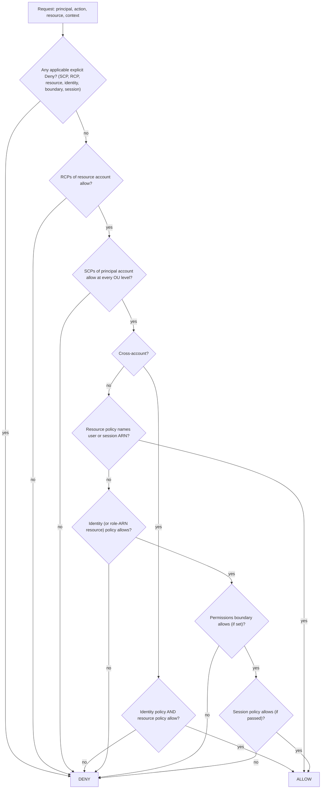
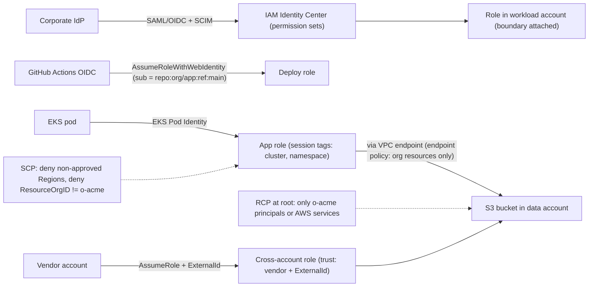

# 05.1 · AWS IAM Evaluation Logic: SCPs, RCPs, Permission Boundaries, ABAC and STS Cross-Account Access

> **Folder 05 · File 1 of 3.** AWS authorization is one algorithm applied to up to seven policy types:
> 1. SCPs and RCPs (organization guardrails);
> 2. resource-based policies;
> 3. identity-based policies;
> 4. permissions boundaries;
> 5. session policies;
> 6. and, implicitly, the service's own rules (KMS key policies, role trust policies).
>
> Most production access incidents are a misreading of that algorithm: an SCP allow-list missing a service, a role ARN where a session ARN was meant, a cross-account grant on one side only, a key policy that silently overrides IAM. This file covers:
> - the algorithm;
> - the guardrail and delegation patterns built on it (data perimeters, boundary-based delegation, ABAC);
> - STS mechanics for cross-account and workload identity;
> - a Rosetta to Google Cloud's model, developed fully in [05.2](02-gcp-iam-hierarchy-workload-identity-federation-and-vpc-service-controls.md).

| Listing | What it shows | Language |
|---|---|---|
| `iam_policy_evaluator.py` | A compact model of the documented evaluation order checked against **13 requests with known answers**: SCP region guardrail, OU allow-list gaps, boundaries on admin roles, session policies, resource policies naming a user vs a role ARN, cross-account both-sides rule, RCP org-only data perimeter, ABAC tag matching, KMS key-policy precedence | Python 3 (stdlib) |

**Verification.** The listing is embedded byte-identical. The gate re-runs it on this file and requires `verdict: OK`, which means every one of the 13 decisions matches the expected outcome from the IAM User Guide's evaluation logic. Facts as of **2026-10-31**, including:
- RCPs (2024);
- full IAM language in SCPs (2025-09-19);
- the current KMS and STS behaviors.

**Labels.** **[D]** documented · **[E]** estimate/model · ⚠ inferred or to verify.

---

## 0. Orientation

**The questions this file answers.**

1. In what order does AWS evaluate policies, and what are the exceptions (resource policies naming users or sessions, KMS key policies, trust policies)?
2. How do SCPs and RCPs differ? (Principals of an account vs resources of an account.) What can't they restrict?
3. How do you delegate IAM to teams without letting them escalate? (Permissions boundaries plus `iam:PermissionsBoundary` conditions.)
4. How do ABAC, session tags and the organization condition keys build **data perimeters**?
5. How does STS work across accounts and for workloads: AssumeRole, ExternalId, web identity, IRSA and Pod Identity, Roles Anywhere, session limits, role chaining?
6. How do the AWS constructs map to GCP's (org policies, deny policies, PAB, VPC-SC)?

**Reading paths.**

| Goal | Read |
|---|---|
| L7 interview | §1, §2, §3.1–3.4, §5, §7, Q-chains |
| SAP-C02 (very heavy here) | §2, §3 entire, §4, §6, §7, S-scenarios |
| Landing-zone design | §4, §6, then run the listing with your own policies |

**Prerequisites.** None. For keys: [05.3](03-kms-envelope-encryption-cloudhsm-nitro-enclaves-and-confidential-computing.md).

---

## 1. First principles: grants, guardrails and the default deny

### 1.1 Two kinds of policy

| Kind | Purpose | AWS examples | Can grant? |
|---|---|---|---|
| **Grant** | Gives a principal permission on a resource | Identity-based policies, resource-based policies | Yes |
| **Guardrail (ceiling)** | Bounds what grants can achieve | SCPs, RCPs, permissions boundaries, session policies | **No**: they only filter |

**Effective permission** = (grants) ∩ (every applicable ceiling) − (any explicit deny). Every request starts as an **implicit deny**. An explicit `Deny` anywhere wins. A ceiling with no matching `Allow` is an implicit deny.

### 1.2 Who owns which control

- **The organization (central security):** SCPs (what *principals in these accounts* may ever do), RCPs (what may ever be done *to resources in these accounts*), declarative policies (service configuration baselines).
- **The account or platform team:** permissions boundaries (the ceiling for roles that teams create), identity policies for platform roles.
- **The application team:** identity and resource policies within the ceilings.
- **The caller:** session policies (narrow a session further), session tags (attributes for ABAC).

Scale comes from **delegation under ceilings**, not from a central team writing every policy.

### 1.3 The data perimeter idea

Three questions every access decision should be able to answer:
1. **Identity perimeter:** only *my organization's* principals.
2. **Resource perimeter:** only *my organization's* resources.
3. **Network perimeter:** only from *expected networks* (my VPC endpoints, my IP ranges).

On AWS these are built from:
- condition keys: `aws:PrincipalOrgID`, `aws:ResourceOrgID`, `aws:SourceVpce`, `aws:SourceIp`, `aws:ViaAWSService`;
- placed in SCPs, RCPs, resource policies and VPC endpoint policies.

On GCP the same three are **IAM + PAB**, **organization policies**, and **VPC Service Controls** (05.2).

---

## 2. Side-by-side architectural Rosetta matrix

| Concern | AWS | GCP | What actually differs |
|---|---|---|---|
| Human identity | IAM Identity Center (permission sets → roles per account), SAML/OIDC federation. IAM users discouraged | Cloud Identity / Workspace accounts and groups. **Workforce Identity Federation** for external IdPs | GCP grants directly to users/groups. AWS humans assume roles |
| Workload identity | IAM roles via STS (EC2 instance profiles, Lambda roles, **IRSA**, **EKS Pod Identity**, IAM Roles Anywhere for X.509) | **Service accounts** with short-lived tokens. **Workload Identity Federation** (incl. for GKE). Keys disabled by org policy by default for new orgs | GCP service accounts are both identity *and* resource (impersonation) |
| Where grants live | Identity policies on principals **and** resource policies on resources | **Allow policies on resources** (org/folder/project/resource), inherited downward | GCP grants are always resource-attached |
| Inheritance | No inheritance of grants across accounts. SCPs/RCPs inherited down the OU tree (every level must allow) | Allow policies inherit (union). Org policies inherit (merge/replace). Deny policies inherit | GCP's hierarchy *is* the grant hierarchy |
| Org guardrail on principals | **SCPs** (full IAM language since 2025-09) | **IAM deny policies** (attached at org/folder/project) and **PAB** policies | Both are ceilings. GCP deny is by permission and principal |
| Org guardrail on resources | **RCPs** (2024): e.g. S3, STS, KMS, SQS, Secrets Manager | Deny policies + **VPC Service Controls** perimeters + org policy constraints | VPC-SC adds network/context perimeters at the API level |
| Configuration guardrails | **Declarative policies** (e.g. EC2 settings), SCP conditions, AWS Config rules | **Organization Policy** constraints (boolean, list, custom constraints, dry run) | GCP Org Policy is the richer config-guardrail system |
| Delegated admin ceiling | **Permissions boundaries** | **PAB** limits which resources principals can reach. Custom roles + IAM conditions limit grants | No exact GCP equivalent of a boundary on created roles |
| Session narrowing | Session policies (AssumeRole) | Credential Access Boundaries (downscoped tokens, Cloud Storage) | — |
| ABAC | Tags: `aws:PrincipalTag/*`, `aws:ResourceTag/*`, `aws:RequestTag/*`, session tags | IAM Conditions with **resource tags** (`resource.matchTag`) and request attributes | AWS ABAC compares principal and resource tags. GCP matches resource tags in conditions |
| Cross-account / cross-project | Role trust policy + caller identity policy (AssumeRole), or resource policy + caller identity policy | Bind the foreign principal directly on the resource, or impersonate a service account | GCP needs no "role assumption" for cross-project |
| Confused-deputy defenses | **ExternalId** for third parties. `aws:SourceArn` / `aws:SourceAccount` for service principals | Service agent identities per project. Conditions on service accounts | — |
| Temporary credential lifetimes | Role sessions 1–12 h (max session duration). **Role chaining capped at 1 h** | Access tokens 1 h default. Extendable to 12 h by org policy | — |
| Analysis | IAM Access Analyzer (external, internal and unused access; policy validation; custom checks), last-accessed data | Policy Analyzer, IAM recommender, Policy Troubleshooter, Policy Intelligence | — |

---

## 3. Internal mechanics: the AWS evaluation algorithm

### 3.1 The documented order [D]

1. **Deny evaluation.** Every applicable policy is scanned for an applicable `Deny`: SCPs, RCPs, resource-based, identity-based, boundaries, session policies. If one is found, the result is **Deny**.
2. **RCPs** (of the account that owns the **resource**). There must be an applicable `Allow`. `RCPFullAWSAccess` is attached everywhere and can't be detached, so RCPs act as deny-lists in practice.
3. **SCPs** (of the account that owns the **principal**). There must be an `Allow` at **every level** from the root through each OU to the account. A missing allow at any level is an implicit deny.
4. **Resource-based policies** (same account):
   - an `Allow` that names the **IAM user ARN** or the **role-session / federated-session ARN** grants directly. It isn't limited by an implicit deny in identity policies, boundaries or session policies;
   - one that names the **role ARN** is still **limited by boundaries and session policies**, because the requester is the session, not the role;
   - **KMS key policies and role trust policies** must allow explicitly in all cases.
5. **Identity-based policies.** There must be an `Allow` (unless step 4 granted directly).
6. **Permissions boundary** (if set). It must `Allow`.
7. **Session policy** (if passed). It must `Allow`.

**Cross-account** requests need an `Allow` in the **caller's identity policy** *and* in the **resource's policy** (or a role in the resource account that the caller assumes). The SCPs of the caller's account and the RCPs of the resource's account both apply.

### 3.2 SCPs [D]

- **They apply to principals in member accounts,** including the account root user.
- **They don't apply to:**
  - the **management account**;
  - **service-linked roles**;
  - actions by AWS service principals on your behalf.
- **Language:** since **2025-09-19**, SCPs support the full IAM policy language: conditions, resource ARNs, `NotAction` with `Allow`, and `NotResource`. That enables precise allow-list SCPs. SCPs still **never grant**.
- **Strategies:**
  - **deny-list:** keep `FullAWSAccess` and add targeted denies, such as region restriction, protecting the security tooling, or denying leaving the organization;
  - **allow-list** OUs: list allowed services. It's powerful, but **every level** of the OU path must allow, so a missing service silently denies. The listing's case 3 shows exactly that.
- **Common guardrails:**
  - deny actions outside approved Regions (`aws:RequestedRegion`), with exemptions for global services through `NotAction`;
  - deny disabling CloudTrail, GuardDuty or Config;
  - deny `organizations:LeaveOrganization`;
  - deny creating IAM users or access keys;
  - require IMDSv2 on `RunInstances`.

### 3.3 RCPs [D]

- **Resource control policies** (2024) attach to the organization, OUs and accounts, and apply to **resources** of supported services in those accounts, whoever the caller is: S3, STS, KMS, SQS, Secrets Manager, and a growing list.
- **Their purpose** is the **resource perimeter**: deny access to my S3 buckets by principals outside my organization, unless the caller is an AWS service acting for me. Previously that had to be in every bucket policy.
- The listing's case 10 shows the RCP denying an external principal even though the bucket policy allowed it.
- **Exceptions:** service-linked roles and some AWS service principals ⚠ (check the RCP docs for exempt callers).

### 3.4 Permissions boundaries and safe delegation

A **permissions boundary** is a managed policy set as the *maximum* permissions of a user or role. The delegation pattern:
1. Developers get `iam:CreateRole`/`iam:PutRolePolicy` **only with** the condition `iam:PermissionsBoundary = arn:...:policy/DevBoundary`.
2. They're denied `iam:DeleteRolePermissionsBoundary` and changes to the boundary policy itself.
3. Any role they create, even with `AdministratorAccess` attached, is capped by `DevBoundary`.

The listing's case 4 shows an admin-policy role denied `ec2:RunInstances` by an S3-only boundary.

Remember the role-vs-session subtlety (case 7): a resource policy naming the **role ARN** is still capped by the boundary.

### 3.5 Session policies, session tags and ABAC

- **Session policies** are passed on `AssumeRole`. They narrow that session: a per-request least privilege for brokers or vending machines.
- **Session tags** set principal tags for the session, and can be **transitive** across role chaining. Combined with `aws:PrincipalTag`, they drive ABAC.
- **ABAC:** grant `ec2:StartInstances` when `aws:ResourceTag/project == ${aws:PrincipalTag/project}` (listing cases 11a/11b).
  - **It scales without new policies per project.**
  - **It requires governance on tags:** control `aws:RequestTag` and `aws:TagKeys` on creation, deny untagged creation, and restrict who can retag resources or principals.
  - Otherwise ABAC becomes "tag yourself into access".

### 3.6 STS mechanics

| Mechanism | Use | Key controls |
|---|---|---|
| `AssumeRole` | Cross-account, elevation, brokers | Trust policy (`Principal`, conditions), max session duration 1–12 h, **ExternalId** for third parties, `sts:SourceIdentity`, `aws:PrincipalOrgID` in trust |
| Role chaining | A role assumes another role | **Session capped at 1 hour** [D] |
| `AssumeRoleWithWebIdentity` | OIDC: EKS **IRSA**, GitHub Actions, Cognito | Trust conditions on `sub` / `aud` claims (repository, branch, service account) |
| **EKS Pod Identity** | Pod-to-role without per-cluster OIDC trust edits | Pod Identity agent and associations. Session tags with cluster, namespace and SA |
| `AssumeRoleWithSAML` | Workforce federation | IdP attributes → session tags |
| IAM Roles Anywhere | On-prem workloads with X.509 | Trust anchors (CA), profiles |
| Service principals (`lambda.amazonaws.com`, ...) | Services acting for you | **`aws:SourceArn` / `aws:SourceAccount`** in resource policies to stop confused-deputy |

**Confused deputy.**
- A third party serving many customers can be tricked into using *its* access to *your* role on behalf of another customer.
- **ExternalId** (unique per customer, required in your trust policy) stops that.
- For AWS services acting on resources (an S3 bucket notifying an SNS topic), `aws:SourceArn` and `aws:SourceAccount` in the topic policy prevent another account's bucket from using the service as a deputy.

---

## 4. Patterns: the multi-account guardrail stack

### 4.1 Organization layout

```text
Root (SCP: deny leave-org, protect security tooling, region allow-list via NotAction)
 |-- Security OU        (log archive, security tooling accounts; tight SCPs)
 |-- Infrastructure OU  (network, shared services)
 |-- Workloads OU
 |     |-- Prod OU      (SCP: deny IAM users/keys, require IMDSv2, deny public S3 changes)
 |     |-- NonProd OU
 |-- Sandbox OU         (SCP: budget-bound services allow-list, auto-nuke)
 RCPs at Root: S3/KMS/SQS/STS/Secrets Manager accessible only by principals in o-xxxx
              (or AWS services on our behalf); enforce TLS
 Declarative policies: e.g. block public sharing of AMIs/snapshots
```

### 4.2 The data perimeter, concretely

| Perimeter | Control | Example condition |
|---|---|---|
| Identity (only my principals access my resources) | **RCP**, resource policies | Deny if `aws:PrincipalOrgID != o-acme` and not `aws:PrincipalIsAWSService` |
| Resource (my principals access only my resources) | **SCP**, VPC endpoint policies | Deny if `aws:ResourceOrgID != o-acme` (exempt AWS-owned resources where needed) |
| Network (only from expected networks) | SCP/RCP, resource policies, VPC endpoint policies | Deny if `aws:SourceVpce` not in the approved list and `aws:ViaAWSService` is false |

The exemptions matter: AWS service-to-service calls (`aws:ViaAWSService`), AWS-owned resources such as public ECR images, and service principals. Roll out in **audit first** (Access Analyzer, CloudTrail), then enforce.

---

## 5. Listing: the evaluation algorithm, executed

<!-- listing:iam_policy_evaluator.py -->
```python
"""iam_policy_evaluator.py - a small, faithful model of AWS IAM policy evaluation, checked against
12 requests with known answers.

Order encoded (IAM User Guide, "how AWS enforcement code logic evaluates requests", 2026-10-31):
  1. any explicit Deny in SCPs, RCPs, resource, identity, boundary or session policies -> DENY
  2. RCPs of the RESOURCE's account must Allow (RCPFullAWSAccess is always attached)
  3. SCPs of the PRINCIPAL's account must Allow at EVERY level of the OU path
  4. same account: a resource policy that names the user or session ARN can Allow on its own;
     one that names a role ARN is still limited by boundary and session policy
  5. identity policy must Allow (unless step 4 granted directly); KMS key policies and role
     trust policies must Allow explicitly in every case
  6. permissions boundary (if any) must Allow; session policy (if any) must Allow
  Cross account: the identity side AND the resource side must both Allow.
Supported conditions: StringEquals / StringNotEquals with ${aws:PrincipalTag/...} variables.

Usage: python -I iam_policy_evaluator.py <any path>
"""
import fnmatch
import re
import sys


def matches(pattern_list, value):
    pats = pattern_list if isinstance(pattern_list, list) else [pattern_list]
    return any(fnmatch.fnmatchcase(value, p) for p in pats)


def subst(v, ctx):
    return re.sub(r"\$\{([^}]+)\}", lambda m: ctx.get(m.group(1), "\x00missing"), v)


def cond_ok(cond, ctx):
    for op, kv in (cond or {}).items():
        for k, v in kv.items():
            want = [subst(x, ctx) for x in (v if isinstance(v, list) else [v])]
            have = ctx.get(k)
            if op == "StringEquals" and have not in want:
                return False
            if op == "StringNotEquals" and have in want:
                return False
    return True


def stmt_applies(s, req, ctx, check_principal=False):
    if not matches(s["Action"], req["action"]) or not matches(s.get("Resource", "*"), req["resource"]):
        return False
    if check_principal and not matches(s["Principal"], req["principal"]):
        return False
    return cond_ok(s.get("Condition"), ctx)


def effect(policies, req, ctx, eff, principal=False):
    return any(s["Effect"] == eff and stmt_applies(s, req, ctx, principal) for p in policies for s in p)


def evaluate(req):
    ctx = dict(req.get("ctx", {}))
    ctx.update({"aws:PrincipalArn": req["principal"]})
    scp_levels = req.get("scp_levels", [[ALLOW_ALL]])
    rcps = req.get("rcps", [ALLOW_ALL])
    ident = req.get("identity", [])
    res = req.get("resource_policy", [])
    boundary = req.get("boundary")
    session = req.get("session")
    every = [p for lvl in scp_levels for p in lvl] + rcps + ident + res + ([boundary] if boundary else []) + ([session] if session else [])
    if any(s["Effect"] == "Deny" and stmt_applies(s, req, ctx, "Principal" in s) for p in every for s in p):
        return "DENY (explicit)"
    if not effect(rcps, req, ctx, "Allow"):
        return "DENY (RCP)"
    if not all(effect(lvl, req, ctx, "Allow") for lvl in scp_levels):
        return "DENY (SCP)"
    res_allow = effect(res, req, ctx, "Allow", principal=True)
    id_allow = effect(ident, req, ctx, "Allow")
    if req.get("cross_account"):
        return "ALLOW" if (res_allow and id_allow) else "DENY (cross-account needs both sides)"
    if req.get("requires_resource_policy") and not res_allow:
        return "DENY (key policy must allow)"
    direct = res_allow and req.get("principal_kind") in ("user", "session") and req["principal"] in str(res)
    if direct:
        return "ALLOW (resource policy, direct)"
    if not (id_allow or res_allow):
        return "DENY (implicit)"
    if boundary and not effect([boundary], req, ctx, "Allow"):
        return "DENY (boundary)"
    if session and not effect([session], req, ctx, "Allow"):
        return "DENY (session policy)"
    return "ALLOW"


ALLOW_ALL = [{"Effect": "Allow", "Action": "*", "Resource": "*"}]
ADMIN = [{"Effect": "Allow", "Action": "*", "Resource": "*"}]
S3_READ = [{"Effect": "Allow", "Action": ["s3:GetObject", "s3:ListBucket"], "Resource": "*"}]
REGION_DENY = [{"Effect": "Deny", "Action": "*", "Resource": "*",
                "Condition": {"StringNotEquals": {"aws:RequestedRegion": ["us-east-1", "eu-west-1"]}}}]
OU_ALLOWLIST = [{"Effect": "Allow", "Action": ["s3:*", "ec2:*", "kms:*"], "Resource": "*"}]
ORG_ONLY_RCP = [{"Effect": "Deny", "Principal": "*", "Action": "s3:*", "Resource": "*",
                 "Condition": {"StringNotEquals": {"aws:PrincipalOrgID": "o-acme"}}}]
ABAC = [{"Effect": "Allow", "Action": "ec2:StartInstances", "Resource": "*",
         "Condition": {"StringEquals": {"aws:ResourceTag/project": "${aws:PrincipalTag/project}"}}}]
ALICE = "arn:aws:iam::111111111111:user/alice"
ROLE = "arn:aws:iam::111111111111:role/app"
SESSION = "arn:aws:sts::111111111111:assumed-role/app/s1"
EXT = "arn:aws:iam::999999999999:role/partner"

CASES = [
    ("1 identity allows S3 read", dict(principal=ROLE, principal_kind="session", action="s3:GetObject",
                                       resource="arn:aws:s3:::data/a", identity=[S3_READ], ctx={"aws:RequestedRegion": "us-east-1"}), "ALLOW"),
    ("2 SCP region guardrail", dict(principal=ROLE, principal_kind="session", action="s3:GetObject", resource="arn:aws:s3:::data/a",
                                    identity=[ADMIN], scp_levels=[[ALLOW_ALL, REGION_DENY]], ctx={"aws:RequestedRegion": "ap-south-1"}), "DENY (explicit)"),
    ("3 OU allow-list lacks dynamodb", dict(principal=ROLE, principal_kind="session", action="dynamodb:PutItem", resource="arn:aws:dynamodb:::table/t",
                                            identity=[ADMIN], scp_levels=[[ALLOW_ALL], [OU_ALLOWLIST]]), "DENY (SCP)"),
    ("4 boundary caps an admin role", dict(principal=ROLE, principal_kind="session", action="ec2:RunInstances", resource="*",
                                           identity=[ADMIN], boundary=[{"Effect": "Allow", "Action": "s3:*", "Resource": "*"}]), "DENY (boundary)"),
    ("5 session policy narrows", dict(principal=SESSION, principal_kind="session", action="s3:PutObject", resource="arn:aws:s3:::data/a",
                                      identity=[ADMIN], session=S3_READ), "DENY (session policy)"),
    ("6 bucket policy names user ARN", dict(principal=ALICE, principal_kind="user", action="s3:GetObject", resource="arn:aws:s3:::data/a",
                                            identity=[], resource_policy=[[{"Effect": "Allow", "Principal": ALICE, "Action": "s3:GetObject", "Resource": "*"}]]),
     "ALLOW (resource policy, direct)"),
    ("7 bucket policy names ROLE ARN, boundary blocks", dict(principal=ROLE, principal_kind="role", action="s3:GetObject", resource="arn:aws:s3:::data/a",
                                                             identity=[], boundary=[{"Effect": "Allow", "Action": "ec2:*", "Resource": "*"}],
                                                             resource_policy=[[{"Effect": "Allow", "Principal": ROLE, "Action": "s3:GetObject", "Resource": "*"}]]),
     "DENY (boundary)"),
    ("8 cross-account, no bucket grant", dict(principal=EXT, action="s3:GetObject", resource="arn:aws:s3:::data/a", cross_account=True,
                                              identity=[S3_READ], resource_policy=[]), "DENY (cross-account needs both sides)"),
    ("9 cross-account, both sides allow", dict(principal=EXT, action="s3:GetObject", resource="arn:aws:s3:::data/a", cross_account=True,
                                               identity=[S3_READ], ctx={"aws:PrincipalOrgID": "o-acme"},
                                               resource_policy=[[{"Effect": "Allow", "Principal": EXT, "Action": "s3:GetObject", "Resource": "*"}]]), "ALLOW"),
    ("10 RCP blocks outside-org principal", dict(principal=EXT, action="s3:GetObject", resource="arn:aws:s3:::data/a", cross_account=True,
                                                 identity=[S3_READ], rcps=[ALLOW_ALL, ORG_ONLY_RCP], ctx={"aws:PrincipalOrgID": "o-other"},
                                                 resource_policy=[[{"Effect": "Allow", "Principal": EXT, "Action": "s3:GetObject", "Resource": "*"}]]),
     "DENY (explicit)"),
    ("11a ABAC tags match", dict(principal=ROLE, principal_kind="session", action="ec2:StartInstances", resource="arn:aws:ec2:::instance/i-1",
                                 identity=[ABAC], ctx={"aws:PrincipalTag/project": "blue", "aws:ResourceTag/project": "blue"}), "ALLOW"),
    ("11b ABAC tags differ", dict(principal=ROLE, principal_kind="session", action="ec2:StartInstances", resource="arn:aws:ec2:::instance/i-2",
                                  identity=[ABAC], ctx={"aws:PrincipalTag/project": "blue", "aws:ResourceTag/project": "red"}), "DENY (implicit)"),
    ("12 KMS: IAM allows, key policy silent", dict(principal=ROLE, principal_kind="session", action="kms:Decrypt", resource="arn:aws:kms:::key/k1",
                                                   identity=[ADMIN], requires_resource_policy=True, resource_policy=[]), "DENY (key policy must allow)"),
]


def main():
    ok = True
    for name, req, want in CASES:
        got = evaluate(req)
        ok &= got == want
        print(f"{name:<48} {got:<34} {'ok' if got == want else 'MISMATCH want ' + want}")
    print()
    print("verdict: OK" if ok else "verdict: FAIL")


if __name__ == "__main__":
    main()
```

<!-- output:iam_policy_evaluator.py -->
```text
1 identity allows S3 read                        ALLOW                              ok
2 SCP region guardrail                           DENY (explicit)                    ok
3 OU allow-list lacks dynamodb                   DENY (SCP)                         ok
4 boundary caps an admin role                    DENY (boundary)                    ok
5 session policy narrows                         DENY (session policy)              ok
6 bucket policy names user ARN                   ALLOW (resource policy, direct)    ok
7 bucket policy names ROLE ARN, boundary blocks  DENY (boundary)                    ok
8 cross-account, no bucket grant                 DENY (cross-account needs both sides) ok
9 cross-account, both sides allow                ALLOW                              ok
10 RCP blocks outside-org principal              DENY (explicit)                    ok
11a ABAC tags match                              ALLOW                              ok
11b ABAC tags differ                             DENY (implicit)                    ok
12 KMS: IAM allows, key policy silent            DENY (key policy must allow)       ok

verdict: OK
```

**Reading the output.**

- **Cases 2–5 are guardrails at work.** The region deny is explicit. The OU allow-list lacking `dynamodb:*` is an implicit SCP deny, even for an admin role. A boundary caps an admin role. A session policy narrows a session.
- **Cases 6–7 are the resource-policy subtlety.**
  - A bucket policy naming the **user ARN** allows even with no identity policy.
  - Naming the **role ARN** is still capped by the role's boundary, because the requester is the role *session*.
- **Cases 8–10 are cross-account.**
  - Both sides must allow.
  - An **RCP** adds an organization-wide resource perimeter that overrides a permissive bucket policy.
- **Case 11 is ABAC.** The same policy allows the blue project's instance and denies the red one.
- **Case 12 is KMS.** IAM `*` on `kms:Decrypt` means nothing unless the **key policy** allows, either directly or by enabling IAM policies for the account (05.3).

---

## 6. Identity Center, access analysis and operations

- **IAM Identity Center:**
  - users and groups (synced from the IdP over SCIM) get **permission sets**, which become **roles** in each assigned account;
  - attribute-based access passes IdP attributes as session tags;
  - prefer permission sets with managed policies plus a boundary, and keep inline policies small.
- **IAM Access Analyzer:**
  - **external access** findings (resources shared outside the organization);
  - **internal access** (who inside can reach critical resources);
  - **unused access** (roles, keys and permissions not used);
  - **policy validation** and **custom policy checks** (e.g. "no new access compared to the baseline") in CI.
- **Least privilege loop:**
  1. generate a policy from CloudTrail activity;
  2. review;
  3. deploy;
  4. watch last-accessed data;
  5. remove what's unused.
- **Debugging access denied:**
  - the error message now often names the **policy type** that denied (SCP, RCP, boundary, session, identity, resource);
  - `sts:DecodeAuthorizationMessage` decodes EC2-style encoded messages;
  - CloudTrail `errorCode` and IAM Policy Simulator help too.

---

## 7. Failure modes, throttling limits and quota traps

| # | Symptom | Root cause | Detect | Fix | Cloud |
|---|---|---|---|---|---|
| 1 | Admin role gets AccessDenied for a new service | **Allow-list SCP** at some OU level lacks the service | Error names SCP | Add the service at *every* level, or switch to deny-list | AWS |
| 2 | SCP "doesn't work" in one account | It's the **management account** (SCPs don't apply), or a **service-linked role** | Account type | Keep workloads out of the management account | AWS |
| 3 | Region-deny SCP breaks IAM/CloudFront/Route 53 | Global services called via us-east-1 | Errors on global APIs | `NotAction` exemptions for global services | AWS |
| 4 | Cross-account access denied despite a bucket policy | Caller's **identity policy** lacks the allow (both sides needed) | Policy simulator | Add the identity-side allow | AWS |
| 5 | Resource policy grant ignored for a role | Granted to the **role ARN**: boundary/session policy still apply | Case 7 in the listing | Fix the boundary, or grant to the session ARN deliberately | AWS |
| 6 | KMS access denied while IAM allows | **Key policy** doesn't enable IAM policies or name the principal | KMS error | Key policy statement for the account root (enables IAM) or the principal | AWS |
| 7 | Key policy lockout | Key policy edited to remove all admins | Can't manage the key | Always keep an admin statement. Support recovery is slow | AWS |
| 8 | Third-party role abused for another tenant | Missing **ExternalId** (confused deputy) | Access Analyzer external findings | Require a unique ExternalId per customer | AWS |
| 9 | Long jobs fail after 1 hour | **Role chaining** caps sessions at 1 h | Expired token errors | Avoid chaining. Use direct assumption with a longer max session | AWS |
| 10 | Developers escalate via a role they created | No **boundary** requirement on `iam:CreateRole` | Access Analyzer, CloudTrail | Require `iam:PermissionsBoundary`. Deny boundary removal | AWS |
| 11 | ABAC bypassed by retagging | Principals can change tags | CloudTrail tag changes | Deny tag changes outside provisioning. Control `aws:RequestTag` / `aws:TagKeys` | AWS |
| 12 | Policy won't save | **Size limits** (managed policy 6,144 chars, role trust policy 2,048 by default) and **attachment limits** (10 managed policies per role by default) ⚠ verify current values | Validation errors | Consolidate, use wildcards carefully, raise quotas where adjustable | AWS |
| 13 | New permission "doesn't work" for a few seconds | IAM is **eventually consistent** | Intermittent denies after changes | Retry with backoff after IAM changes in automation | AWS |
| 14 | Data exfiltration to a personal bucket | No **resource perimeter** (`aws:ResourceOrgID`) | Access Analyzer, VPC endpoint logs | SCP / endpoint policy resource perimeter | AWS |
| 15 | Bucket readable by any authenticated AWS user | `Principal: *` without conditions | Access Analyzer external access | Block Public Access + RCP org-only perimeter | AWS |
| 16 | The translation to GCP misses a guardrail | No 1:1 SCP/boundary equivalents | Review | Map to deny policies, PAB, Org Policy, VPC-SC (05.2) | Both |

---

## 8. Architecture diagrams: multi-service compositions

### 8.1 The evaluation flow



### 8.2 Multi-account access with a data perimeter



### 8.3 Cross-account, both sides (ASCII)

```text
Account A (caller)                                   Account B (resource)
 identity policy:  Allow s3:GetObject on             bucket policy: Allow Principal arn:...:role/app (A)
   arn:aws:s3:::b-data/*            <---- BOTH ---->   s3:GetObject on arn:aws:s3:::b-data/*
 SCPs of A apply to the caller                       RCPs of B apply to the bucket
 (or: A assumes role in B -> trust policy in B allows A; B's role policy grants; B's SCPs apply)
```

---

## 9. Bar-raiser chains and SAP-C02 scenarios

### 9.1 L7 bar-raiser chains

<details><summary><b>Q1 · Walk me through how AWS decides one request</b></summary>

**Initial Prompt.** "A Lambda role in account A calls `s3:GetObject` on a bucket in account B. Walk through every policy AWS evaluates, in order, and name the one most likely to deny."

**L5 Answer.** "AWS checks the Lambda role's IAM policy and the bucket policy. Both need to allow it."

**Why L5 Stalls.** It's correct for the cross-account core, but it omits the explicit-deny sweep, A's SCPs, B's RCPs, any boundary or session policy, KMS if the object is SSE-KMS, and VPC endpoint policies on the path.

**L7 Answer.**
1. **Explicit-deny sweep** across all applicable policies. A's SCPs and the role's boundary are common sources: region guardrails, `aws:ResourceOrgID` perimeters.
2. **RCPs of account B:** an org-only perimeter must admit A's principal (same org).
3. **SCPs of account A** must allow `s3:GetObject` at every OU level.
4. **Cross-account core:** the role's identity policy allows the object ARN, *and* B's bucket policy allows A's role.
5. **Boundary on the role**, if set, must allow.
6. **VPC endpoint policy**, if the call goes through an S3 gateway or interface endpoint in A, must allow the bucket.
7. **If the object is SSE-KMS with a customer key in B:** B's **key policy** must allow `kms:Decrypt` for A's role (or the account with IAM delegation), *and* A's identity policy must allow `kms:Decrypt` on that key.

The most frequent real-world denier is #7. Teams forget the key, and the error surfaces as S3 AccessDenied."
</details>

<details><summary><b>Q2 · Delegate IAM to 200 teams without privilege escalation</b></summary>

**Initial Prompt.** "Platform engineering wants app teams to create their own Lambda and ECS task roles. Security fears escalation. Design it."

**L5 Answer.** "Review every role through a ticket."

**Why L5 Stalls.** Central review doesn't scale and becomes the bottleneck. The answer has no technical control.

**L7 Answer.** "**Permissions boundary delegation.**
1. Define `TeamBoundary`: everything a workload role could ever need in this OU. No IAM write, no organization APIs, no KMS key administration, no networking changes, and resources limited by tag or naming.
2. Give team deployers `iam:CreateRole` and `iam:AttachRolePolicy`/`PutRolePolicy` **only when** `iam:PermissionsBoundary` equals `TeamBoundary`, and only for role names under `team-${aws:PrincipalTag/team}-*`.
3. **Deny:**
   - `iam:DeleteRolePermissionsBoundary`;
   - `iam:CreatePolicyVersion` on the boundary policy;
   - passing roles without the boundary (`iam:PassRole` scoped to the team's role path).
4. **SCPs** still cap the account.

Now a team can attach `AdministratorAccess` to its role and still can't exceed the boundary (listing case 4). Add **Access Analyzer custom policy checks** in CI to block policies that grant new sensitive actions, and **unused-access** findings to prune.

GCP has no exact equivalent. Use custom roles limited to approved permissions, IAM conditions, deny policies for sensitive permissions, and project-per-team isolation (05.2)."
</details>

<details><summary><b>Q3 · An SCP allow-list broke production</b></summary>

**Initial Prompt.** "We moved the Prod OU to an allow-list SCP. A week later, a new feature using Amazon Bedrock fails with AccessDenied for an admin role. The account's SCP includes `bedrock:*`. Why?"

**L5 Answer.** "The IAM role probably lacks Bedrock permissions."

**Why L5 Stalls.** It's an admin role. The likely culprit is the SCP inheritance rule: every level of the OU path must allow.

**L7 Answer.** "SCPs are evaluated at **every level** from the root to the account, and each level must contain an `Allow` for the action.
- The account-level SCP allows `bedrock:*`.
- But the **Workloads OU** above it still has the old allow-list without Bedrock.
- An implicit deny at one level denies the request. The listing's case 3 is this pattern.

Also check:
- Bedrock calls to model endpoints in another Region hit a **Region-deny** guardrail;
- cross-Region inference profiles need those Regions allowed.

The fix:
1. Add the service at every allow-list level, or move those OUs to a deny-list strategy with `FullAWSAccess` plus targeted denies.
2. Add an **SCP change test**: simulate representative actions for each OU in CI before applying.
3. The error message names the SCP as the denier. Teach teams to read it."
</details>

<details><summary><b>Q4 · Stop data exfiltration to personal AWS accounts</b></summary>

**Initial Prompt.** "An insider with access to production data could copy it to their own S3 bucket in a personal account. Prevent this without breaking AWS services."

**L5 Answer.** "Deny `s3:PutObject` on all buckets outside our accounts in IAM policies."

**Why L5 Stalls.** Writing that in every identity policy doesn't scale and is easy to forget. It also misses other paths: presigned URLs, other services, network egress.

**L7 Answer.** "Build the **resource perimeter** centrally.
1. **SCP:** deny S3 (and other data-plane) actions when `aws:ResourceOrgID` isn't our organization, exempting AWS-owned resources the workloads need (e.g. specific AWS-managed buckets) through narrowly scoped conditions.
2. **VPC endpoint policies** on S3 endpoints: allow only buckets in our org (`aws:ResourceOrgID`), and route all S3 traffic through endpoints (no NAT path to S3).
3. **Network perimeter:** bucket policies or RCPs that require `aws:SourceVpce` for sensitive buckets, so stolen credentials can't be used from the internet.
4. **Detection:** CloudTrail data events and GuardDuty S3 protection for anomalies.

Roll out in audit mode with Access Analyzer and CloudTrail queries to find legitimate exceptions, then enforce.

The GCP equivalent is a **VPC Service Controls** perimeter around the data projects with egress rules. The listing in 05.2 shows an IAM-authorized insider blocked by the perimeter."
</details>

<details><summary><b>Q5 · CI/CD deploys with no long-lived keys</b></summary>

**Initial Prompt.** "Our GitHub Actions use long-lived IAM user keys to deploy to 40 accounts, and the GCP pipelines use service account JSON keys. Replace both."

**L5 Answer.** "Rotate the keys every 90 days and store them in the secrets manager."

**Why L5 Stalls.** Rotation reduces exposure time but keeps standing secrets that can leak. Both clouds support keyless OIDC federation.

**L7 Answer.**
- **AWS:**
  - an IAM OIDC provider for `token.actions.githubusercontent.com` in each target account, or a deploy account with role chaining (mind the 1 h chain limit);
  - a deploy role whose **trust policy** conditions `aud = sts.amazonaws.com` and `sub = repo:acme/app:environment:prod` (or the branch ref);
  - the workflow calls `AssumeRoleWithWebIdentity`;
  - sessions are short;
  - SCPs deny `iam:CreateAccessKey` in workload OUs.
- **GCP:**
  - **Workload Identity Federation**: a pool and provider for GitHub, with an attribute condition on the repository and branch;
  - grant `roles/iam.workloadIdentityUser` on the deploy service account to the specific principalSet, or grant direct resource access to the federated principal;
  - org policy blocks service account key creation (the default for new orgs).
- **Both:**
  1. scope trust to environment-protected branches;
  2. log federation events;
  3. alarm on any key creation."
</details>

<details><summary><b>Q6 · A vendor needs read access to our S3 data</b></summary>

**Initial Prompt.** "A SaaS vendor needs to read one S3 prefix in our account to provide analytics, and they serve many customers. Design the access."

**L5 Answer.** "Create an IAM user for the vendor and give them the access keys."

**Why L5 Stalls.** Long-lived keys outside our control are an anti-pattern, and there's no confused-deputy protection.

**L7 Answer.**
1. Create a role in our account whose **trust policy** allows the vendor's AWS account principal **only with** `sts:ExternalId = <our unique ID>`, which the vendor stores per customer. This stops the vendor being tricked into using its access for another tenant.
2. The role's policy allows `s3:GetObject`/`ListBucket` on the prefix only. Add a **boundary** if the role is created through delegated tooling.
3. If objects are SSE-KMS, the **key policy** must allow the role `kms:Decrypt` (05.3).
4. Restrict the session duration.
5. Monitor through CloudTrail and **Access Analyzer external access** findings.

If our RCPs enforce an org-only perimeter, add a narrowly scoped exception for this role, since the vendor's principals aren't in our org. On GCP, grant the vendor's service account (or federated principal) a role on the bucket directly, with an IAM condition on the prefix, and add a VPC-SC ingress rule if the project is inside a perimeter."
</details>

<details><summary><b>Q7 · ABAC across 300 projects</b></summary>

**Initial Prompt.** "We have 300 projects in shared accounts. Writing per-project IAM policies is unmaintainable. Design ABAC, and say how it can fail."

**L5 Answer.** "Tag resources with the project, and write policies that check the tag."

**Why L5 Stalls.** It skips the controls that make ABAC safe: who can set tags, how resources are created with tags, and how sessions get their tags.

**L7 Answer.**
1. **Principal attributes come from the IdP.** The `project` attribute becomes session tags through Identity Center or SAML, so users can't set their own.
2. **Resource tags at creation.** Policies allow create actions only when `aws:RequestTag/project == ${aws:PrincipalTag/project}`, and `aws:TagKeys` limits the keys.
3. **Operations** require `aws:ResourceTag/project == ${aws:PrincipalTag/project}` (listing case 11).
4. **Deny tag mutation** (`TagResource`/`UntagResource` on `project`) except by a provisioning role.
5. **SCP backstop** denying untagged creation for in-scope services.
6. **Mixed model:** some services or actions don't support tag conditions, so keep RBAC for those.

Failure modes:
- tag drift: resources created outside the paved road;
- services without tag support;
- confusing `aws:ResourceTag` with `aws:RequestTag`.

On GCP, use **IAM Conditions on resource tags** (`resource.matchTag`) and tag bindings governed by IAM."
</details>

<details><summary><b>Q8 · Why can't we just use one AWS account with IAM for isolation?</b></summary>

**Initial Prompt.** "A startup asks why it should run 20 accounts instead of one account with strict IAM. Answer as an architect."

**L5 Answer.** "Multiple accounts are a best practice for security."

**Why L5 Stalls.** "Best practice" isn't an argument. The architect must name what an account boundary provides that IAM in one account can't.

**L7 Answer.** "An account is the strongest isolation boundary AWS offers, and several things don't partition well inside one:
1. **Quotas and limits** are per account per Region: Lambda concurrency, API rate limits, VPC limits. One noisy team throttles everyone (01.3 S6).
2. **Blast radius of credentials:** an admin mistake or a leaked privileged credential is contained to the account.
3. **Guardrails per environment:** SCPs and RCPs attach to accounts and OUs, so prod gets stricter controls without complex conditions.
4. **Billing and cost attribution** are cleaner per account.
5. **Resource-policy-based services** default to account-level trust (`arn:aws:iam::ACCOUNT:root`), so separate accounts make that trust meaningful.

The cost is cross-account access design and networking (02.1). Control Tower or landing-zone automation makes it cheap. On GCP the equivalent unit is the **project** (quotas, IAM, billing) under folders. GCP's hierarchy makes many projects natural."
</details>

<details><summary><b>Q9 · Our AWS IAM guardrails don't translate to GCP</b></summary>

**Initial Prompt.** "We're expanding to GCP. Map our AWS controls (SCP region deny, deny IAM user creation, permissions boundaries for team-created roles, RCP org-only S3 access) to GCP."

**L5 Answer.** "Use Organization Policies for all of them."

**Why L5 Stalls.** Org Policy covers configuration constraints, not every permission ceiling. Boundaries and RCP-style resource perimeters map to different GCP mechanisms.

**L7 Answer.**

| AWS control | GCP mapping |
|---|---|
| SCP region deny | Org Policy `gcp.resourceLocations` (allowed locations, inherited with merge/replace) |
| Deny IAM user / key creation | Org Policy `iam.disableServiceAccountKeyCreation` (default in new orgs), `iam.allowedPolicyMemberDomains` (domain-restricted sharing) |
| Permissions boundaries | No direct equivalent. Use custom roles with curated permissions + **IAM deny policies** for sensitive permissions + project-per-team isolation + PAB to limit reachable resources |
| RCP org-only S3 access | Domain-restricted sharing (org policy) so no external principals can be granted, plus a **VPC Service Controls** perimeter for API-level exfiltration control |
| SCP protecting security tooling | Deny policies at the org/folder on `logging.sinks.delete`, etc., with exception principals for break-glass |

The listing in 05.2 models deny + PAB + VPC-SC together."
</details>

<details><summary><b>Q10 · Debug an AccessDenied in five minutes</b></summary>

**Initial Prompt.** "On-call gets 'AccessDenied' from a service with no other detail. Give the five-minute runbook."

**L5 Answer.** "Check the IAM policy of the role and add the missing permission."

**Why L5 Stalls.** Adding permissions blindly may widen access while the actual denier is an SCP, boundary, key policy or endpoint policy, and the 'fix' does nothing.

**L7 Answer.**
1. **Read the full error.** Many services now state the *policy type* that denied (SCP, RCP, boundary, session, identity, resource). EC2 returns an encoded message, so decode it with `sts:DecodeAuthorizationMessage`.
2. **CloudTrail:** find the event by request ID. It gives `errorCode`, the principal ARN (session vs role), the resource ARN, the Region, the `vpcEndpointId`.
3. **Classify:**
   - explicit deny → find it (SCP, RCP, boundary, endpoint policy);
   - implicit → which layer lacks an allow;
   - cross-account → check both sides;
   - KMS → the key policy.
4. **Policy Simulator / Access Analyzer:** simulate with the exact context (tags, source VPCe).
5. **Fix at the right layer, minimally,** and add a regression test (an Access Analyzer custom check or a CI simulation).

GCP's equivalent is Policy Troubleshooter, which evaluates allow, deny, PAB and VPC-SC for a principal, permission and resource."
</details>

### 9.2 SAP-C02 scenarios (original)

<details><summary><b>S1 · SAP-C02 · Domain 1 · Select ONE</b></summary>

**Scenario.** A company with AWS Organizations must prevent any principal in member accounts from creating resources outside `us-east-1` and `eu-west-1`, while still allowing global services such as IAM and CloudFront to work. What should a solutions architect implement?

- **A.** An IAM policy in every account that denies actions outside the two Regions.
- **B.** An SCP attached to the root that denies all actions when `aws:RequestedRegion` isn't one of the two Regions, using `NotAction` to exempt global services.
- **C.** AWS Config rules that delete resources created in other Regions.
- **D.** A permissions boundary attached to all roles that limits Regions.

**Answer: B**

- **A** — wrong: per-account IAM policies are hard to enforce centrally and can be modified by account admins.
- **B** — correct: an organization-level SCP centrally denies out-of-Region actions for member-account principals, with exemptions for global services.
- **C** — wrong: Config rules detect and remediate after creation instead of preventing it.
- **D** — wrong: boundaries must be attached to each role and don't cover principals without them.
</details>

<details><summary><b>S2 · SAP-C02 · Domain 1 · Select ONE</b></summary>

**Scenario.** A platform team wants application developers to create IAM roles for their Lambda functions, but developers must not be able to create roles with more permissions than an approved set, even if they attach administrator policies. What should a solutions architect recommend?

- **A.** Require developers to submit role definitions to the security team for manual approval.
- **B.** Grant developers `iam:CreateRole` only when the request sets a specific permissions boundary, and deny removing or modifying that boundary.
- **C.** Use an SCP that denies `iam:CreateRole` in the account.
- **D.** Use IAM Access Analyzer to delete overly permissive roles daily.

**Answer: B**

- **A** — wrong: manual review doesn't scale and isn't a technical control.
- **B** — correct: requiring the `iam:PermissionsBoundary` condition caps every developer-created role at the boundary's permissions, whatever policies are attached.
- **C** — wrong: denying role creation blocks the requirement entirely.
- **D** — wrong: after-the-fact deletion leaves windows of excess access.
</details>

<details><summary><b>S3 · SAP-C02 · Domain 2 · Select TWO</b></summary>

**Scenario.** A third-party monitoring vendor that serves many customers needs read-only access to a company's CloudWatch metrics. The company wants to avoid sharing long-term credentials and to protect against the vendor being misused to access the company's account on behalf of another customer. Which actions should a solutions architect take? (Select TWO.)

- **A.** Create an IAM user for the vendor and share access keys through a secure channel.
- **B.** Create an IAM role with read-only CloudWatch permissions that trusts the vendor's AWS account.
- **C.** Require a unique external ID in the role's trust policy condition.
- **D.** Make the CloudWatch metrics public.
- **E.** Attach an SCP to the vendor's account.

**Answer: B, C**

- **A** — wrong: long-term keys are an avoidable risk.
- **B** — correct: a cross-account role gives temporary credentials scoped to read-only permissions.
- **C** — correct: a unique external ID prevents the confused-deputy problem across the vendor's customers.
- **D** — wrong: making data public violates least privilege.
- **E** — wrong: the company can't attach SCPs to accounts outside its organization.
</details>

<details><summary><b>S4 · SAP-C02 · Domain 1 · Select ONE</b></summary>

**Scenario.** A security team wants to ensure that S3 buckets and KMS keys in all accounts of the organization can only be accessed by principals belonging to the organization, even if a bucket policy is misconfigured to allow a broader set of principals. AWS services acting on the company's behalf must keep working. What should a solutions architect implement?

- **A.** A resource control policy (RCP) attached at the organization root that denies access when `aws:PrincipalOrgID` doesn't match the organization, with an exception for AWS service principals.
- **B.** An SCP that denies `s3:*` and `kms:*` for principals outside the organization.
- **C.** S3 Block Public Access on every bucket.
- **D.** An AWS Config rule that alerts on bucket policies with wildcard principals.

**Answer: A**

- **A** — correct: RCPs apply to resources in member accounts whoever the caller is, enforcing an organization-wide identity perimeter that overrides permissive bucket policies.
- **B** — wrong: SCPs apply only to principals in the organization's accounts, not to external callers.
- **C** — wrong: Block Public Access prevents public access but not access by specific external accounts.
- **D** — wrong: a Config rule detects but doesn't prevent access.
</details>

<details><summary><b>S5 · SAP-C02 · Domain 2 · Select ONE</b></summary>

**Scenario.** A company runs hundreds of projects in shared AWS accounts. It wants engineers to start and stop only the EC2 instances that belong to their project, without writing a separate policy for each project. Project membership comes from the corporate identity provider. What should a solutions architect recommend?

- **A.** Create one IAM group per project with a policy listing that project's instance IDs.
- **B.** Use resource-based policies on each EC2 instance.
- **C.** Create one AWS account per engineer.
- **D.** Pass the project attribute from the identity provider as a session tag and use a policy condition that requires `aws:ResourceTag/project` to equal `${aws:PrincipalTag/project}`, with controls that prevent changing the project tag.

**Answer: D**

- **A** — wrong: per-project policies listing instance IDs don't scale and break as instances change.
- **B** — wrong: EC2 instances don't support resource-based policies for this.
- **C** — wrong: per-engineer accounts are operationally excessive and don't map to projects.
- **D** — correct: ABAC with IdP-provided session tags and resource tags scales across projects, provided tag changes are controlled.
</details>

<details><summary><b>S6 · SAP-C02 · Domain 3 · Select ONE</b></summary>

**Scenario.** An application role in account A reads SSE-KMS encrypted objects from a bucket in account B. The bucket policy allows the role, and the role's IAM policy allows `s3:GetObject` and `kms:Decrypt` on the key. Requests still fail with AccessDenied. What is the MOST likely cause?

- **A.** The bucket isn't versioned.
- **B.** S3 Block Public Access is enabled in account B.
- **C.** The KMS key policy in account B doesn't allow account A's role to use the key for decryption.
- **D.** The role's session duration is too short.

**Answer: C**

- **A** — wrong: versioning doesn't affect authorization.
- **B** — wrong: Block Public Access doesn't block explicitly granted cross-account access.
- **C** — correct: KMS requires the key policy to allow the external principal. The IAM policy alone can't grant use of a key in another account.
- **D** — wrong: session duration causes expiry errors, not consistent AccessDenied.
</details>

---

## 10. Checklist

- [ ] Guardrails live at the organization: SCPs (deny-list with targeted denies, or allow-lists tested at every OU level), RCPs for the resource perimeter, declarative policies for configuration.
- [ ] No workloads in the management account. Service-linked roles understood as outside SCPs.
- [ ] Delegated role creation requires a permissions boundary. Boundary removal and edits are denied.
- [ ] Data perimeter: `aws:PrincipalOrgID` (RCPs/resource policies), `aws:ResourceOrgID` (SCP/endpoint policies), `aws:SourceVpce` for sensitive data, with documented exemptions.
- [ ] No long-lived keys: Identity Center for humans, OIDC federation for CI, IRSA/Pod Identity for pods, Roles Anywhere for on-prem.
- [ ] Third-party roles require a unique ExternalId. Service-principal resource policies use `aws:SourceArn`/`aws:SourceAccount`.
- [ ] ABAC: tags from the IdP, tag-on-create enforcement, tag mutation restricted.
- [ ] KMS key policies reviewed with every cross-account S3/SQS/SNS design (05.3).
- [ ] Access Analyzer (external, internal, unused) and custom policy checks in CI.
- [ ] An AccessDenied runbook exists: error type → CloudTrail → classify layer → simulate → minimal fix.

---

## 11. References

AWS:
- Policy evaluation logic: <https://docs.aws.amazon.com/IAM/latest/UserGuide/reference_policies_evaluation-logic.html>
- How enforcement code evaluates requests: <https://docs.aws.amazon.com/IAM/latest/UserGuide/reference_policies_evaluation-logic_policy-eval-denyallow.html>
- Cross-account policy evaluation: <https://docs.aws.amazon.com/IAM/latest/UserGuide/reference_policies_evaluation-logic-cross-account.html>
- Service control policies: <https://docs.aws.amazon.com/organizations/latest/userguide/orgs_manage_policies_scps.html>
- SCPs support the full IAM language (2025-09): <https://aws.amazon.com/about-aws/whats-new/2025/09/aws-organizations-iam-language-service-control-policies>
- Resource control policies: <https://docs.aws.amazon.com/organizations/latest/userguide/orgs_manage_policies_rcps.html>
- Permissions boundaries: <https://docs.aws.amazon.com/IAM/latest/UserGuide/access_policies_boundaries.html>
- ABAC with IAM: <https://docs.aws.amazon.com/IAM/latest/UserGuide/introduction_attribute-based-access-control.html>
- The confused deputy problem: <https://docs.aws.amazon.com/IAM/latest/UserGuide/confused-deputy.html>
- Role chaining and session duration: <https://docs.aws.amazon.com/IAM/latest/UserGuide/id_roles_terms-and-concepts.html>
- Data perimeters on AWS: <https://aws.amazon.com/identity/data-perimeters-on-aws/>
- IAM Access Analyzer: <https://docs.aws.amazon.com/IAM/latest/UserGuide/what-is-access-analyzer.html>
- EKS Pod Identity: <https://docs.aws.amazon.com/eks/latest/userguide/pod-identities.html>
- IAM quotas: <https://docs.aws.amazon.com/IAM/latest/UserGuide/reference_iam-quotas.html>
