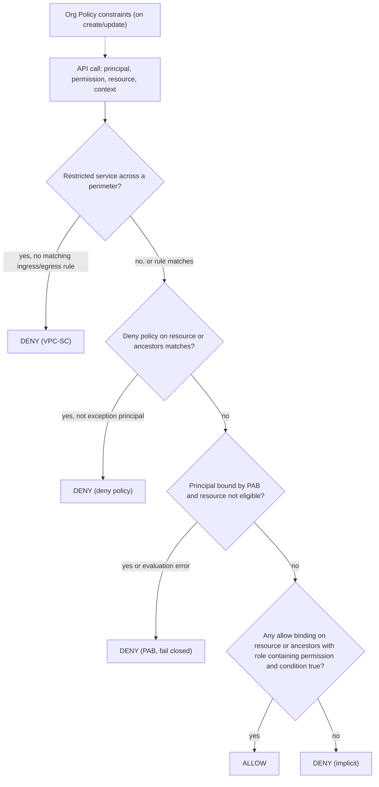
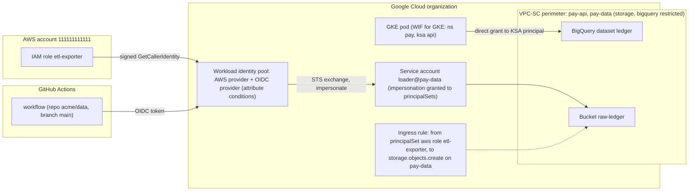

# 05.2 · GCP IAM: Resource Hierarchy, Workload Identity Federation and VPC Service Controls

> **Folder 05 · File 2 of 3.** Google Cloud's authorization model is **resource-centric and hierarchical**:
> - **allow policies** attach to the organization, folders, projects and resources, and **inherit downward as a union**;
> - **deny policies** and **Principal Access Boundary (PAB)** policies act as ceilings;
> - **Organization Policy** constrains *configuration*;
> - **VPC Service Controls** adds a context perimeter around Google APIs, so data can't leave a set of projects even through an authorized identity.
>
> Workload identity is federated (AWS, Azure, OIDC, SAML, X.509, GKE) instead of key-based. This file builds the GCP side of the [05.1](01-aws-iam-evaluation-logic-scp-permission-boundaries-abac-sts-cross-account.md) Rosetta and shows where each AWS guardrail lands.

| Listing | What it shows | Language |
|---|---|---|
| `gcp_access_resolver.py` | A model of inherited allow policies, deny policies with exception principals, IAM Conditions (resource prefix and time), a PAB that limits a contractor to one project, Org Policy `gcp.resourceLocations` with merge vs replace, and VPC-SC ingress/egress checks. 14 decisions with known answers | Python 3 (stdlib) |

**Verification.** The listing is embedded byte-identical. The gate re-runs it on this file and requires `verdict: OK`, so all 14 decisions match the documented semantics. Facts come from the IAM, Organization Policy and VPC Service Controls docs as of **2026-10-31**:
- deny policies checked before allow;
- up to 500 deny policies per resource;
- PAB fail-closed, up to 1,000 per organization;
- service account key creation disabled by default in newer organizations.

**Labels.** **[D]** documented · **[E]** estimate/model · ⚠ inferred or to verify.

---

## 0. Orientation

**The questions this file answers.**

1. How do inherited allow policies, deny policies, PAB and IAM Conditions combine into one decision?
2. How should the resource hierarchy (org → folders → projects) be designed, and what does it decide besides IAM (Org Policy, billing, quotas, VPC-SC)?
3. How do workloads get identity without keys? Attached service accounts, impersonation, Workload Identity Federation (AWS, Azure, OIDC, SAML, X.509), Workload Identity Federation for GKE.
4. What does VPC Service Controls protect that IAM can't, and how do ingress and egress rules, access levels and dry run work?
5. How do Org Policy constraints (built-in, managed, custom) replace SCP-style configuration guardrails?
6. Which designs break pipelines, and how do you roll out perimeters safely?

**Reading paths.**

| Goal | Read |
|---|---|
| L7 interview | §1, §2, §3.1–3.3, §4.1–4.3, §5, §7, Q-chains |
| SAP-C02 (AWS framing of the same problems) | §2, §6, S-scenarios |
| Landing-zone design | §3–§6, run the listing on your hierarchy |

**Prerequisites.** [05.1](01-aws-iam-evaluation-logic-scp-permission-boundaries-abac-sts-cross-account.md) for the AWS side. [02.1](../02-Global-Networking-Hybrid-Connectivity-and-Zero-Trust-VPC/01-aws-regional-vpc-tgw-privatelink-vs-gcp-global-andromeda-vpc-psc.md) for PSC and Private Google Access.

---

## 1. First principles: who, what, and from where

### 1.1 Three independent questions

| Question | GCP mechanism | AWS analog |
|---|---|---|
| **Who** may perform which permission on which resource | IAM allow policies (inherited), deny policies, PAB, conditions | Identity/resource policies, SCPs, RCPs, boundaries |
| **What configuration** resources may have | **Organization Policy** constraints | SCP conditions, declarative policies, Config rules |
| **From where** data may flow across API boundaries | **VPC Service Controls** perimeters + Access Context Manager | VPC endpoint policies + `aws:SourceVpce`/`aws:ResourceOrgID` conditions (data perimeter) |

A request must pass **IAM** *and*, for restricted services in a perimeter, **VPC-SC**. Org Policy is checked when resources are created or changed. The listing's insider case is the key intuition: the insider is IAM-authorized to read the ledger, but VPC-SC blocks copying it to a project outside the perimeter.

### 1.2 Inheritance is the feature, and the risk

A role granted at the organization applies to every project. That makes central roles (auditors, security) cheap, and accidental broad grants catastrophic. The defenses:
- **grant low** (project or resource) by default;
- **deny high** (org or folder deny policies for dangerous permissions);
- **bound principals** (PAB for contractors and external identities);
- **constrain sharing** (`iam.allowedPolicyMemberDomains`).

---

## 2. Side-by-side architectural Rosetta matrix

| Concern | GCP | AWS | What actually differs |
|---|---|---|---|
| Top-level container | **Organization** (tied to a Cloud Identity/Workspace domain) | AWS Organizations (management account) | GCP's org *is* an IAM node with inheritable policies |
| Grouping | **Folders** (nestable) | Organizational units | Folders carry IAM bindings, Org Policies, deny policies, and are VPC-SC-agnostic |
| Isolation unit | **Project** (IAM, quotas, billing, APIs) | **Account** | Projects are cheaper and more numerous |
| Grant location | Allow policies on org/folder/project/resource (**union down the tree**) | Identity policies + resource policies | GCP grants are always attached to a resource node |
| Grant limits | Allow policy size/principals per policy (check limits) | Policy size limits | — |
| Ceilings | **Deny policies** (IAM v2; deniedPrincipals, exceptionPrincipals, deniedPermissions, conditions on tags). **PAB** policies (IAM v3; eligible resources per principal set; fail closed) | SCPs, RCPs, boundaries, session policies | Deny is evaluated before allow. PAB never grants |
| Conditions | IAM Conditions (CEL): resource name, type and service; request time; **resource tags** (`resource.matchTag`) | Condition keys (`aws:*`, service keys) | — |
| Config guardrails | **Organization Policy**: boolean and list constraints, **managed** and **custom constraints** (CEL on resource fields), dry run, tag-conditional enforcement | SCP conditions, declarative policies, Control Tower controls, Config | Org Policy is first-class and inheritable with merge/replace |
| Domain-restricted sharing | `iam.allowedPolicyMemberDomains` | RCP org-only perimeter | Prevents granting to identities outside allowed domains |
| Human identity | Cloud Identity/Workspace users and groups. **Workforce Identity Federation** (external IdP users, no Google accounts) | Identity Center | — |
| Workload identity | **Service accounts** (attached; impersonation with `serviceAccountTokenCreator`). **Workload Identity Federation** (AWS, Azure, OIDC, SAML, X.509). **WIF for GKE** | IAM roles (STS), IRSA / Pod Identity, Roles Anywhere | GCP SAs are resources you grant *on* (actAs, tokenCreator) |
| Keys | SA key creation **disabled by default** for newer orgs (`iam.disableServiceAccountKeyCreation`) | IAM user access keys (SCP-deny them) | — |
| API-level exfiltration perimeter | **VPC Service Controls** (perimeters, restricted services, ingress/egress rules, access levels, dry run) | Data perimeter conditions + endpoint policies | VPC-SC enforces at Google's API front door, including for authorized identities |
| Just-in-time access | **Privileged Access Manager** (entitlements, approvals, time-bound grants) | Identity Center + custom TEAM-style elevation ⚠ | — |
| Troubleshooting | **Policy Troubleshooter** (allow, deny, PAB, VPC-SC), Policy Analyzer, IAM recommender | Access Analyzer, Policy Simulator | — |

---

## 3. Internal mechanics: IAM decision and hierarchy

### 3.1 How a decision is made [D]

1. **Deny policies** on the resource and its ancestors are checked first. A matching deny (principal ∈ deniedPrincipals, permission ∈ deniedPermissions, condition true, principal not an exception) **blocks**.
2. **PAB.** If the principal is in a principal set bound to a PAB policy, the resource must be in that policy's eligible resources. If not, or if IAM can't evaluate the PAB, the request is **blocked**: PAB fails closed.
3. **Allow policies** on the resource and **all ancestors** are unioned. Any binding whose role contains the permission and whose condition is true **allows**.
4. Otherwise **implicit deny**.

The listing reproduces each step:
- auditors inherit `roles/viewer` from the org;
- SREs inherit from the prod folder;
- a folder deny blocks `storage.buckets.delete` for everyone except break-glass;
- a time-conditioned contractor grant works at 10:00 and not at 20:00;
- a PAB keeps the contractor out of the web project even if someone grants access there.

**Limits [D]:**
- up to **500 deny policies per resource**;
- up to **1,000 PAB policies per organization**;
- deny policies use the IAM v2 API, PAB the v3 API.

### 3.2 Hierarchy design

```text
Organization (acme.com)  [org-level: security auditors, deny policies, domain-restricted sharing,
 |                        resourceLocations baseline, SA key creation disabled]
 |-- folders/shared       (logging sink project, KMS projects, networking host projects)
 |-- folders/prod         [deny: delete of logs/KMS keys; VPC-SC perimeter projects]
 |     |-- folders/payments  -> projects/pay-api, projects/pay-data
 |     |-- folders/web       -> projects/web-frontend
 |-- folders/nonprod      [looser org policies, cheaper defaults]
 |-- folders/sandbox      [budget alerts, auto-cleanup, no external IPs]
```

Rules:
1. **Folders by environment first, then by business unit**, so guardrails differ by environment.
2. **Projects per workload per environment**: quotas, billing and blast radius.
3. **Shared VPC host projects** per environment (02.1).
4. **Grant at the lowest level** that works. Use groups, not users.

### 3.3 Service accounts: identity and resource

- A **service account** is a principal (it acts) *and* a resource (others act *on* it):
  - `roles/iam.serviceAccountUser` (**actAs**) lets a user attach the SA to a VM, function or job;
  - `roles/iam.serviceAccountTokenCreator` lets a principal **impersonate** it (mint access tokens, ID tokens, sign blobs and JWTs).

  Both are privilege-escalation paths. Grant them on specific SAs, never at the project or folder level.
- **Short-lived credentials** through impersonation replace keys. Organizations created after the 2024 secure-by-default change enforce `iam.disableServiceAccountKeyCreation` by default ⚠ (verify for older orgs).
- **Service agents** (Google-managed SAs like `service-PROJECT@gcp-sa-*.iam.gserviceaccount.com`) act for services. Don't remove their roles casually: it breaks the service.

---

## 4. Internal mechanics: federation, Org Policy and VPC Service Controls

### 4.1 Workload Identity Federation

- **Workload identity pools** contain **providers**: AWS, Azure AD/Entra, OIDC (GitHub, GitLab, Kubernetes), SAML, and X.509 certificates.
- **Attribute mapping** turns external claims into Google attributes (`google.subject`, `attribute.repository`), and **attribute conditions** restrict which external identities are accepted at all.
- **Federated principals** are addressed as:
  - `principal://iam.googleapis.com/projects/NUM/locations/global/workloadIdentityPools/POOL/subject/SUBJECT`;
  - `principalSet://.../attribute.repository/acme/app`.

  They can be granted **directly on resources** (no service account needed for supported services) or allowed to **impersonate** a service account.
- **From AWS:** the AWS provider validates a signed `GetCallerIdentity` request. A role in account 111111111111 (`attribute.aws_role`) can then be granted access in GCP, with no keys stored on either side.
- **WIF for GKE:** Kubernetes service accounts are principals (`.../PROJECT.svc.id.goog/subject/ns/NAMESPACE/sa/KSA`). Grant them directly, or bind them to a Google SA. It replaces node service-account sharing and exported keys.
- **Workforce Identity Federation** lets employees from an external IdP use the console and gcloud without Google accounts, with attribute-based access.

### 4.2 Organization Policy

- **Constraints:**
  - **Boolean** constraints (e.g. `compute.requireOsLogin`, `iam.disableServiceAccountKeyCreation`, `storage.uniformBucketLevelAccess`).
  - **List** constraints (e.g. `gcp.resourceLocations`, `iam.allowedPolicyMemberDomains`, `compute.vmExternalIpAccess`).
  - **Managed constraints** (newer, with dry run).
  - **Custom constraints**: CEL conditions on resource fields at create and update, for example "GKE clusters must enable Workload Identity" or "Cloud SQL must not have public IP".
- **Inheritance.**
  - A child policy can **merge** with the parent (`inheritFromParent: true`) or **replace** it, and `reset` restores the default.
  - The listing shows `projects/pay` merging the org's US list with the prod folder's EU list (both allowed), while `projects/sandbox` under a replacing dev folder allows only `us-central1`.
- **Tags** can conditionally enforce policies, for example "external IPs allowed only on resources tagged `edge=true`".
- **Dry run** shows what would be denied before enforcing.

### 4.3 VPC Service Controls

- **A service perimeter** contains projects (and, in some modes, VPC networks) and a set of **restricted services** (Cloud Storage, BigQuery, Spanner and others).
- **Calls across the boundary** to restricted services in perimeter projects are **denied by default** in both directions:
  - **ingress:** a client outside calling into the perimeter;
  - **egress:** a client inside writing to or reading from a resource outside. Copying a bucket to an external project is egress.
- **Access levels** (Access Context Manager) express context: source IP ranges, device policy, identities, regions.
- **Ingress rules** (`from`: identities + sources or access levels; `to`: resources + operations) and **egress rules** (`from`: identities; `to`: external projects + operations) open specific, audited paths. The listing's corp-network ETL ingress and the export SA egress are examples.
- **Dry-run perimeters** log would-be violations without blocking. Always run one first.
- **Restricted VIP:** `restricted.googleapis.com` (with DNS and routes) ensures on-prem and VPC clients reach perimeter-enforced APIs (02.2 §4.5).
- **Violations** are logged with a unique identifier, and the troubleshooter explains which rule was missing.
- **What it stops:**
  - stolen credentials used from the internet (unless an access level matches);
  - insiders copying data to personal projects;
  - misconfigured cross-project pipelines exfiltrating data.
- **What it doesn't replace:** IAM (VPC-SC never grants), and encryption key control (05.3).

---

## 5. Listing: allow, deny, PAB, Org Policy and perimeters

<!-- listing:gcp_access_resolver.py -->
```python
"""gcp_access_resolver.py - a small model of Google Cloud access decisions: inherited allow policies,
deny policies, Principal Access Boundary (PAB), IAM Conditions, Organization Policy inheritance and
VPC Service Controls, checked against requests with known answers.

Rules encoded (IAM and VPC-SC docs, 2026-10-31):
  allow policies on org/folder/project/resource are INHERITED and UNIONED downward
  deny policies are checked before allow policies; a matching deny blocks unless the principal is
    an exception principal
  PAB policies bound to a principal set list the resources those principals are ELIGIBLE to
    access; resources outside them are blocked (and evaluation errors fail closed); PABs never grant
  Org Policy list constraints: a child inherits the parent's effective policy and either MERGES
    (inheritFromParent: true) or REPLACES it
  VPC-SC: a call to a restricted service on a project inside a perimeter, from a client outside
    the perimeter, is denied unless an ingress rule matches identity + source (access level);
    a call from inside to a project outside is denied unless an egress rule matches
  IAM decides WHO may act; VPC-SC decides FROM WHERE data may move; both must pass

Usage: python -I gcp_access_resolver.py <any path>
"""
import sys

PARENT = {"folders/prod": "org", "folders/dev": "org", "projects/pay": "folders/prod",
          "projects/web": "folders/prod", "projects/sandbox": "folders/dev",
          "projects/pay/buckets/ledger": "projects/pay", "projects/web/buckets/assets": "projects/web"}
ROLE_PERMS = {"roles/storage.objectViewer": {"storage.objects.get", "storage.objects.list"},
              "roles/storage.admin": {"storage.objects.get", "storage.objects.list", "storage.objects.delete",
                                      "storage.buckets.delete"},
              "roles/viewer": {"storage.objects.list"}}

ALLOW = {  # node: [(role, member, condition)]
    "org": [("roles/viewer", "group:auditors", None)],
    "folders/prod": [("roles/storage.objectViewer", "group:sre", None)],
    "projects/pay": [("roles/storage.admin", "group:pay-team", None),
                     ("roles/storage.objectViewer", "user:contractor",
                      lambda r: r["resource"].startswith("projects/pay/buckets/ledger") and r.get("hour", 12) < 18)],
}
DENY = {  # node: [(denied permissions, denied principals, exception principals)]
    "folders/prod": [({"storage.buckets.delete"}, {"principalSet:all"}, {"group:break-glass"})],
}
PAB = {"user:contractor": {"projects/pay"}}   # contractor is eligible only for resources under projects/pay


def ancestors(node):
    out = [node]
    while node in PARENT:
        node = PARENT[node]
        out.append(node)
    return out


def iam_decision(req):
    chain = ancestors(req["resource"])
    for node in chain:
        for perms, who, exc in DENY.get(node, []):
            if req["permission"] in perms and ("principalSet:all" in who or req["member"] in who) and req["member"] not in exc:
                return f"DENY (deny policy at {node})"
    if req["member"] in PAB and not any(a in PAB[req["member"]] for a in chain):
        return "DENY (outside principal access boundary)"
    for node in chain:
        for role, member, cond in ALLOW.get(node, []):
            if member == req["member"] and req["permission"] in ROLE_PERMS[role] and (cond is None or cond(req)):
                return f"ALLOW (via {role} at {node})"
    return "DENY (no allow binding)"


ORG_POLICY = {  # gcp.resourceLocations
    "org": {"allowed": {"in:us-locations"}, "inherit": False},
    "folders/prod": {"allowed": {"in:eu-locations"}, "inherit": True},
    "folders/dev": {"allowed": {"us-central1"}, "inherit": False},
}


def effective_locations(node):
    chain = list(reversed(ancestors(node)))
    eff = set()
    for n in chain:
        pol = ORG_POLICY.get(n)
        if pol:
            eff = (eff | pol["allowed"]) if pol["inherit"] else set(pol["allowed"])
    return eff


PERIMETER = {"projects": {"projects/pay"}, "restricted": {"storage.googleapis.com"},
             "ingress": [("serviceAccount:etl@corp", "level:corp-network")],
             "egress": [("serviceAccount:export@pay", "projects/web")]}


def vpcsc_decision(req):
    svc_restricted = req["service"] in PERIMETER["restricted"]
    target_in = req["target_project"] in PERIMETER["projects"]
    source_in = req["source_project"] in PERIMETER["projects"]
    if not svc_restricted or target_in == source_in:
        return "ALLOW (no perimeter crossing)"
    if target_in:  # ingress into the perimeter
        ok = any(i == req["member"] and lvl in req.get("levels", ()) for i, lvl in PERIMETER["ingress"])
        return "ALLOW (ingress rule)" if ok else "DENY (VPC-SC ingress)"
    ok = any(i == req["member"] and dst == req["target_project"] for i, dst in PERIMETER["egress"])
    return "ALLOW (egress rule)" if ok else "DENY (VPC-SC egress)"


IAM_CASES = [
    ("auditor lists ledger objects (org viewer inherited)", {"member": "group:auditors", "permission": "storage.objects.list",
                                                             "resource": "projects/pay/buckets/ledger"}, "ALLOW"),
    ("SRE reads web assets (folder binding inherited)", {"member": "group:sre", "permission": "storage.objects.get",
                                                         "resource": "projects/web/buckets/assets"}, "ALLOW"),
    ("pay-team deletes ledger bucket (folder deny)", {"member": "group:pay-team", "permission": "storage.buckets.delete",
                                                      "resource": "projects/pay/buckets/ledger"}, "DENY (deny policy"),
    ("contractor reads ledger at 10:00 (condition true)", {"member": "user:contractor", "permission": "storage.objects.get",
                                                           "resource": "projects/pay/buckets/ledger", "hour": 10}, "ALLOW"),
    ("contractor reads ledger at 20:00 (condition false)", {"member": "user:contractor", "permission": "storage.objects.get",
                                                            "resource": "projects/pay/buckets/ledger", "hour": 20}, "DENY (no allow"),
    ("contractor reads web assets (PAB)", {"member": "user:contractor", "permission": "storage.objects.get",
                                           "resource": "projects/web/buckets/assets"}, "DENY (outside"),
]
ORG_CASES = [("projects/pay", "in:eu-locations", True), ("projects/pay", "in:us-locations", True),
             ("projects/sandbox", "in:us-locations", False), ("projects/sandbox", "us-central1", True)]
VPCSC_CASES = [
    ("laptop on corp network reads ledger", {"member": "serviceAccount:etl@corp", "service": "storage.googleapis.com",
                                             "source_project": "external", "target_project": "projects/pay",
                                             "levels": ("level:corp-network",)}, "ALLOW (ingress"),
    ("stolen key from internet reads ledger", {"member": "serviceAccount:etl@corp", "service": "storage.googleapis.com",
                                               "source_project": "external", "target_project": "projects/pay", "levels": ()}, "DENY"),
    ("insider copies ledger to personal project", {"member": "user:insider", "service": "storage.googleapis.com",
                                                   "source_project": "projects/pay", "target_project": "projects/attacker"}, "DENY"),
    ("export SA writes to web project", {"member": "serviceAccount:export@pay", "service": "storage.googleapis.com",
                                         "source_project": "projects/pay", "target_project": "projects/web"}, "ALLOW (egress"),
]


def main():
    ok = True
    print("== 1. IAM: inheritance, deny, conditions, principal access boundary ==")
    for name, req, want in IAM_CASES:
        got = iam_decision(req)
        good = got.startswith(want)
        ok &= good
        print(f"{name:<52} {got:<45} {'ok' if good else 'MISMATCH'}")
    print()
    print("== 2. Org Policy gcp.resourceLocations (merge vs replace) ==")
    for proj, loc, want in ORG_CASES:
        eff = effective_locations(proj)
        got = loc in eff
        ok &= got == want
        print(f"{proj:<18} create in {loc:<18} -> {'allowed' if got else 'blocked':<8} effective={sorted(eff)}")
    print()
    print("== 3. VPC Service Controls (perimeter around projects/pay, storage restricted) ==")
    for name, req, want in VPCSC_CASES:
        got = vpcsc_decision(req)
        good = got.startswith(want)
        ok &= good
        print(f"{name:<44} {got:<28} {'ok' if good else 'MISMATCH'}")
    print("   the insider case is IAM-authorized but blocked by the perimeter: IAM = who, VPC-SC = where")
    print()
    print("verdict: OK" if ok else "verdict: FAIL")


if __name__ == "__main__":
    main()
```

<!-- output:gcp_access_resolver.py -->
```text
== 1. IAM: inheritance, deny, conditions, principal access boundary ==
auditor lists ledger objects (org viewer inherited)  ALLOW (via roles/viewer at org)               ok
SRE reads web assets (folder binding inherited)      ALLOW (via roles/storage.objectViewer at folders/prod) ok
pay-team deletes ledger bucket (folder deny)         DENY (deny policy at folders/prod)            ok
contractor reads ledger at 10:00 (condition true)    ALLOW (via roles/storage.objectViewer at projects/pay) ok
contractor reads ledger at 20:00 (condition false)   DENY (no allow binding)                       ok
contractor reads web assets (PAB)                    DENY (outside principal access boundary)      ok

== 2. Org Policy gcp.resourceLocations (merge vs replace) ==
projects/pay       create in in:eu-locations    -> allowed  effective=['in:eu-locations', 'in:us-locations']
projects/pay       create in in:us-locations    -> allowed  effective=['in:eu-locations', 'in:us-locations']
projects/sandbox   create in in:us-locations    -> blocked  effective=['us-central1']
projects/sandbox   create in us-central1        -> allowed  effective=['us-central1']

== 3. VPC Service Controls (perimeter around projects/pay, storage restricted) ==
laptop on corp network reads ledger          ALLOW (ingress rule)         ok
stolen key from internet reads ledger        DENY (VPC-SC ingress)        ok
insider copies ledger to personal project    DENY (VPC-SC egress)         ok
export SA writes to web project              ALLOW (egress rule)          ok
   the insider case is IAM-authorized but blocked by the perimeter: IAM = who, VPC-SC = where

verdict: OK
```

**Reading the output.**

- **IAM.** Org and folder grants inherit down. A **folder-level deny** blocks bucket deletion for everyone but break-glass, even pay-team admins. An **IAM Condition** makes the contractor's access time-bound. The **PAB** blocks the contractor outside `projects/pay`, a ceiling that holds whatever someone grants later.
- **Org Policy.** Merge vs replace decides whether a child *adds to* or *overrides* the parent's allowed locations. Mistakes here silently allow (merge) or break (replace) deployments, so test effective policies, not individual ones.
- **VPC-SC.**
  - An access level makes the same service account allowed from the corp network and denied from the internet: the stolen-key case.
  - The insider copy to a personal project is **egress** and is denied.
  - The export path is an explicit egress rule.
  - IAM answers *who*, the perimeter answers *where*.

---

## 6. Rollout patterns and AWS translation

### 6.1 Rolling out VPC Service Controls without breaking pipelines

1. **Inventory** cross-project data flows: Dataflow → BigQuery, Cloud Build → Artifact Registry, BI tools, partner access.
2. Create the perimeter in **dry run**. Collect violations for 2–4 weeks.
3. Convert legitimate violations into **ingress/egress rules** scoped to identities, operations and projects. Prefer service accounts over broad access levels.
4. Configure the **restricted VIP** DNS for on-prem and VPC clients.
5. **Enforce** for one perimeter at a time. Keep dry run on for the next change set (dry-run and enforced configurations can coexist).
6. Add **break-glass** procedures (an audited, time-bound ingress rule).

### 6.2 AWS ↔ GCP guardrail translation

| AWS | GCP |
|---|---|
| SCP deny-list (protect logging, region restriction) | Deny policies at the org/folder + Org Policy `gcp.resourceLocations` |
| RCP org-only perimeter | `iam.allowedPolicyMemberDomains` + VPC-SC perimeters |
| Permissions boundary for team-created roles | Curated custom roles + deny policies for sensitive permissions + project isolation + PAB |
| VPC endpoint policy (`aws:ResourceOrgID`) | VPC-SC egress rules + restricted VIP |
| IRSA / EKS Pod Identity | Workload Identity Federation for GKE |
| GitHub OIDC → AssumeRoleWithWebIdentity | WIF OIDC provider + attribute conditions |
| Identity Center permission sets | Groups + predefined/custom roles at folders/projects, Workforce Identity Federation |
| Access Analyzer | Policy Analyzer, IAM recommender, Policy Troubleshooter |

---

## 7. Failure modes, throttling limits and quota traps

| # | Symptom | Root cause | Detect | Fix | Cloud |
|---|---|---|---|---|---|
| 1 | Everyone can read a sensitive dataset | Broad role granted at the **org/folder** inherits everywhere | Policy Analyzer | Grant at the project or resource. Deny policies for sensitive permissions | GCP |
| 2 | "Editor" everywhere | Basic roles | IAM recommender | Predefined/custom roles. Org policy to restrict basic roles where possible ⚠ | GCP |
| 3 | Privilege escalation through a service account | `serviceAccountUser` / `serviceAccountTokenCreator` granted at the project level | Policy Analyzer for actAs/impersonation | Grant on specific SAs only. Deny policies for impersonation outside platform groups | GCP |
| 4 | Leaked SA JSON key used from the internet | Keys allowed; no perimeter | Audit logs: key auth from unknown IPs | Disable key creation (org policy). WIF. VPC-SC access levels | GCP |
| 5 | External collaborator can't be granted access | **Domain-restricted sharing** blocks foreign principals | IAM error | Add the customer ID to allowed domains, or a tag-conditional exception | GCP |
| 6 | Deployments fail with location errors after a folder change | Org Policy **replace vs merge** semantics | Effective policy | Check effective policies. Use merge where intended | GCP |
| 7 | Dataflow/BigQuery jobs fail after enabling VPC-SC | Cross-perimeter calls (egress to other projects, service agents) | VPC-SC violation logs | Dry run first. Ingress/egress rules for job SAs and service agents | GCP |
| 8 | On-prem clients bypass the perimeter | Using `*.googleapis.com` public VIPs | Violation/access logs | `restricted.googleapis.com` VIP + DNS + routes | GCP |
| 9 | A deny policy blocks the break-glass account | No **exceptionPrincipals** | Incident | Exception principals for break-glass. Test deny policies in non-prod | GCP |
| 10 | PAB blocks access unexpectedly after an outage | **Fail closed** on evaluation error | Access errors with PAB in the troubleshooter | Expected behavior. Keep PAB scopes accurate and monitored | GCP |
| 11 | WIF accepts tokens from any repository | Missing **attribute condition** on the provider | Audit of federated subjects | Attribute conditions on repository/branch/ref. Grant to narrow principalSets | GCP |
| 12 | GKE pods use the node's broad service account | No Workload Identity | Pod metadata access | WIF for GKE. Least-privilege node SA. Block legacy metadata endpoints | GCP |
| 13 | Standing admin access abused | No JIT | Audit | Privileged Access Manager entitlements with approval and expiry | GCP |
| 14 | AWS guardrail has no GCP twin, so a gap is left | Different models | Control mapping review | Use the translation table (§6.2) and test each control | Both |
| 15 | Audit logs missing for data reads | Data Access audit logs disabled by default for most services | Log coverage review | Enable Data Access logs for sensitive services (cost-aware) | GCP |

---

## 8. Architecture diagrams: multi-service compositions

### 8.1 Decision stack



### 8.2 Keyless multi-cloud workload access with a perimeter



### 8.3 Inheritance, ceilings and perimeter (ASCII)

```text
org        allow: auditors=viewer          org policy: locations in:us   deny: (none)
 folder prod  allow: sre=objectViewer      org policy: + in:eu (merge)   deny: buckets.delete except break-glass
   project pay  allow: pay-team=storage.admin, contractor=objectViewer [cond: ledger/*, hour<18]
      bucket ledger            <- effective allow = union of all three levels' bindings
PAB(contractor) = {projects/pay}           VPC-SC perimeter = {projects/pay}; storage restricted
decision = VPC-SC  AND  not denied  AND  PAB-eligible  AND  some allow binding
```

---

## 9. Bar-raiser chains and SAP-C02 scenarios

### 9.1 L7 bar-raiser chains

<details><summary><b>Q1 · Design the GCP resource hierarchy for a 3,000-person enterprise</b></summary>

**Initial Prompt.** "We're setting up GCP for 40 business units, 3 environments and strict PCI scope for payments. Design the org, folder and project structure, and the policies at each level."

**L5 Answer.** "One folder per business unit, and projects inside each."

**Why L5 Stalls.** BU-first folders make environment-specific guardrails (prod vs non-prod, PCI) hard. Policies would have to be repeated per BU. It also says nothing about where shared services and perimeters live.

**L7 Answer.**
- **Environment-first top folders** (`prod`, `nonprod`, `sandbox`) plus `shared` (logging, KMS, network hosts), then BU folders beneath. Guardrails attach where they differ, by environment.
- **PCI:** its own folder under prod, with:
  - stricter Org Policy (no external IPs, CMEK required through custom constraints);
  - deny policies on sensitive permissions;
  - a VPC-SC perimeter around its projects.
- **Org level:**
  - domain-restricted sharing;
  - SA key creation disabled;
  - a locations baseline;
  - org-wide auditors;
  - aggregated log sinks to the logging project, with a deny on sink deletion.
- **Projects:** per workload per environment, billing linked per BU, and Shared VPC hosts per environment (02.1).
- **People:** groups mapped to predefined or custom roles at folder or project level. PAM for elevation.

It mirrors AWS's OU design (05.1 §4.1), with GCP's advantage that grants and Org Policy inherit natively."
</details>

<details><summary><b>Q2 · Why deny policies and PAB if allow policies are already least privilege?</b></summary>

**Initial Prompt.** "Our GCP IAM is reviewed and least-privilege. Security wants deny policies and Principal Access Boundaries too. Is that redundant?"

**L5 Answer.** "Yes, mostly. Deny policies are for emergencies."

**Why L5 Stalls.** Allow-only models fail open on mistakes. A future broad grant, an inherited folder role or a compromised admin can widen access. Ceilings are what make a mistake non-fatal.

**L7 Answer.** "Allow policies are a union of everything granted anywhere above. One broad grant at a folder by any admin becomes effective everywhere beneath. Ceilings make that impossible for specific cases.
- **Deny policies** (evaluated first) on irreversible or catastrophic permissions:
  - deleting log sinks, KMS key versions or buckets with retention;
  - changing IAM on the security projects;
  - `exceptionPrincipals` for break-glass.
- **PAB** for principal populations whose reachable resources are known:
  - contractors limited to their projects;
  - partner federated identities limited to a shared folder.

  It fails closed and can't be bypassed by a later grant.

It's the same reasoning as SCPs and RCPs on AWS: guardrails turn 'nobody made a mistake' into 'mistakes can't cross this line'."
</details>

<details><summary><b>Q3 · VPC Service Controls vs IAM for data exfiltration</b></summary>

**Initial Prompt.** "A data scientist with BigQuery Data Viewer could export a sensitive table to a personal project. IAM is correct. What stops it?"

**L5 Answer.** "Remove their access."

**Why L5 Stalls.** They legitimately need read access. The problem is *where* data can go, which IAM doesn't express.

**L7 Answer.** "**VPC Service Controls.**
- Put the data projects in a perimeter with BigQuery and Cloud Storage restricted.
- An export, query or copy to a project **outside** is **egress** and is denied, whatever their IAM. The listing's insider case is exactly this.
- **Ingress** from outside, including their laptop on the internet, requires an access level (corp network or managed device). A stolen token is useless elsewhere.
- Legitimate flows (a sanctioned analytics project) get **egress or ingress rules** for specific identities and operations.

Roll out in dry run first, because pipelines and BI tools touch cross-project APIs.

Combine with:
- column-level security and masking (03.4);
- CMEK with Key Access Justifications for key-level control (05.3).

The AWS analog is the data perimeter: an SCP or endpoint policy on `aws:ResourceOrgID`, plus `aws:SourceVpce` on bucket policies (05.1 Q4)."
</details>

<details><summary><b>Q4 · Let an AWS workload write to GCP without keys</b></summary>

**Initial Prompt.** "An AWS Lambda must write files to a GCS bucket in a perimeter-protected project. Today it uses a service account JSON key in Secrets Manager. Replace it."

**L5 Answer.** "Rotate the key automatically every 30 days."

**Why L5 Stalls.** Rotation keeps a standing exportable secret. WIF removes it entirely.

**L7 Answer.**
1. Create a **workload identity pool** with an **AWS provider** for account 111111111111. Set an attribute condition limiting accepted identities to the Lambda's role (`attribute.aws_role == "arn:aws:sts::111111111111:assumed-role/lambda-writer"`).
2. Grant the principalSet for that role either:
   - `roles/storage.objectCreator` directly on the bucket; or
   - `roles/iam.workloadIdentityUser` on a dedicated SA that has the bucket role.
3. Configure the client library with a credential configuration file. It signs an AWS `GetCallerIdentity` request with the Lambda's role credentials and exchanges it through STS for a Google token.
4. **VPC-SC:** add an **ingress rule** for that principalSet to `storage.objects.create` on the project, with an access level if the source network is controlled.
5. Delete the old key, and keep key creation disabled by org policy.

Now there's no secret to leak, and access is bound to the AWS role identity."
</details>

<details><summary><b>Q5 · GKE workloads and least privilege</b></summary>

**Initial Prompt.** "All pods in our GKE clusters use the node service account, which has Editor on the project. Fix it."

**L5 Answer.** "Give the node service account fewer permissions."

**Why L5 Stalls.** Reducing node permissions breaks workloads that need access. The fix is per-workload identity.

**L7 Answer.**
1. Enable **Workload Identity Federation for GKE** on the clusters and node pools. Pods then get tokens for their **Kubernetes service account** principal, not the node's.
2. Grant each KSA principal (`.../svc.id.goog/subject/ns/NS/sa/KSA`) only what it needs, directly on resources or through a bound Google SA.
3. Give the node service account **minimal** roles: logging, monitoring, pulling images.
4. Block access to legacy metadata endpoints (Workload Identity's metadata server serves only the pod's identity).
5. Enforce with a custom Org Policy constraint requiring Workload Identity on new clusters.

The AWS equivalent is IRSA or EKS Pod Identity, with IMDSv2 hop limit 1 so pods can't use the node role (01.1/01.2)."
</details>

<details><summary><b>Q6 · We enabled VPC-SC and Dataflow broke</b></summary>

**Initial Prompt.** "After enforcing a perimeter around the data projects, Dataflow jobs that read Pub/Sub in another project and write BigQuery fail. What's the systematic fix?"

**L5 Answer.** "Add the other project to the perimeter."

**Why L5 Stalls.** Adding projects grows the perimeter until it means nothing. The fix is a precise rule, and the process should have caught this in dry run.

**L7 Answer.**
1. Read the **VPC-SC violation logs** (unique IDs). They show the service, method, identity (often the **Dataflow service agent** or worker SA) and the direction.
2. Decide per flow:
   - if the Pub/Sub project is a trusted data source, an **ingress rule** from the worker SA to read Pub/Sub, or an **egress rule** from inside to that project, scoped to the specific methods;
   - if both are part of one data domain, put them in the same perimeter.
3. Remember **service agents**: some services call APIs as Google-managed identities, which need their own rules.
4. Re-run in **dry run** for the next change, and only enforce after violations stop.

The lesson: VPC-SC rollouts are a data-flow inventory project. Tooling plus dry run turns them from outages into a backlog."
</details>

<details><summary><b>Q7 · Domain-restricted sharing blocks a customer integration</b></summary>

**Initial Prompt.** "We enforce `iam.allowedPolicyMemberDomains`. A customer's service account must be granted read access to one bucket. The grant fails. Options?"

**L5 Answer.** "Disable the constraint for that project."

**Why L5 Stalls.** Disabling it opens the project to grants to any identity. A narrow exception exists.

**L7 Answer.**
- **Narrow options:**
  1. Add the **customer's Google Workspace/Cloud Identity customer ID** to the allowed list on that project's policy only (merge with the parent).
  2. Use **tag-conditional** Org Policy: allow the extra domain only on resources tagged `external-share=customer-x`.
  3. Avoid granting the customer's identity at all: publish the data through a **signed URL** flow, or a broker service in our project that the customer calls.
- **Plus:**
  - document the exception;
  - expire it;
  - monitor grants to foreign principals with Policy Analyzer.

AWS's equivalent decision is carving a narrowly scoped exception in an RCP org-only perimeter."
</details>

<details><summary><b>Q8 · Enforce "CMEK everywhere" and "no public Cloud SQL" across 800 projects</b></summary>

**Initial Prompt.** "Compliance requires CMEK on all storage resources and no public IPs on Cloud SQL, across 800 projects, including future ones. How?"

**L5 Answer.** "Write a script that scans projects nightly and reports violations."

**Why L5 Stalls.** Detection after the fact still lets non-compliant resources exist. GCP can prevent them at creation.

**L7 Answer.**
- **Preventive:**
  - built-in constraints: `gcp.restrictNonCmekServices` (require CMEK for listed services), `gcp.restrictCmekCryptoKeyProjects` (keys only from approved KMS projects), and `sql.restrictPublicIp`;
  - **custom constraints** (CEL) for anything not covered;
  - dry run first, then enforce at the org or prod folder.
- **Key management at scale:** **Cloud KMS Autokey** provisions keys per resource with the right location and protection level, so CMEK doesn't become a ticket queue (05.3).
- **Detective backstop:** Security Command Center findings, and asset inventory queries.

On AWS: SCP conditions (e.g. deny `rds:CreateDBInstance` with `rds:PubliclyAccessible`), declarative policies where supported, Config conformance packs, and KMS key requirements through condition keys."
</details>

<details><summary><b>Q9 · Replace standing admin with just-in-time access</b></summary>

**Initial Prompt.** "Twenty engineers hold Owner on production projects 'for emergencies'. Reduce standing privilege without slowing incident response."

**L5 Answer.** "Remove Owner and create a ticket process."

**Why L5 Stalls.** A ticket process slows incidents, and people work around it.

**L7 Answer.**
1. **Privileged Access Manager** entitlements on prod folders:
   - pre-approved roles (e.g. a curated incident-responder role, not Owner);
   - maximum duration;
   - justification required;
   - an approval or auto-approval policy for on-call;
   - full audit.
2. **Break-glass:** a separate group that is an exception principal in deny policies, with alerts on use.
3. **Remove standing Owner.** Keep read-only standing access for diagnosis.
4. Review entitlement usage monthly.

On AWS: Identity Center with time-bound assignment automation (TEAM-style), plus break-glass roles excluded from specific SCP denies, with alarms on use."
</details>

<details><summary><b>Q10 · Translate a 60-account AWS landing zone to GCP</b></summary>

**Initial Prompt.** "Map our AWS landing zone (OUs, SCPs, RCPs, Identity Center, IRSA, VPC endpoint data perimeter, Access Analyzer) to a GCP design."

**L5 Answer.** "Accounts become projects and OUs become folders."

**Why L5 Stalls.** Structure maps, but guardrail semantics don't: GCP grants inherit, configuration guardrails are a separate system, and the network/data perimeter is VPC-SC.

**L7 Answer.**
- **Structure:** OUs → folders (environment-first); accounts → projects (more of them); management account → org admin groups with tight PAM.
- **Guardrails:**
  - SCP deny-list → **deny policies** + **Org Policy** (locations, external IPs, keys);
  - RCP org-only → **domain-restricted sharing** + **VPC-SC**;
  - boundaries → curated custom roles + deny + PAB.
- **Identity:**
  - Identity Center → groups and roles at folders and projects, Workforce Identity Federation;
  - IRSA/Pod Identity → WIF for GKE;
  - GitHub OIDC → a WIF provider.
- **Data perimeter:** endpoint policies and `aws:SourceVpce` → **VPC-SC perimeters with access levels** + restricted VIP.
- **Analysis:** Access Analyzer → Policy Analyzer, IAM recommender, Policy Troubleshooter.
- **Process:** dry run for Org Policy and VPC-SC, as with AWS's audit-then-enforce."
</details>

### 9.2 SAP-C02 scenarios (original)

<details><summary><b>S1 · SAP-C02 · Domain 1 · Select ONE</b></summary>

**Scenario.** A company with 80 AWS accounts uses an external identity provider. It wants employees to sign in once, receive access to specific accounts with role-appropriate permissions, and have access revoked automatically when they leave the company. What should a solutions architect implement?

- **A.** Create IAM users in each account and disable them when employees leave.
- **B.** Share long-term access keys through the IdP.
- **C.** Create one IAM role per employee in a central account.
- **D.** Configure IAM Identity Center with the external IdP as the identity source, enable SCIM provisioning, and assign permission sets to groups for each account.

**Answer: D**

- **A** — wrong: per-account users don't scale and depend on manual deprovisioning.
- **B** — wrong: long-term keys are insecure and don't support single sign-on.
- **C** — wrong: per-employee roles are unmanageable and still need federation.
- **D** — correct: Identity Center federates with the IdP, SCIM keeps users and groups in sync so leavers lose access, and permission sets become roles per account.
</details>

<details><summary><b>S2 · SAP-C02 · Domain 2 · Select ONE</b></summary>

**Scenario.** Workloads in a VPC access Amazon S3 through a gateway VPC endpoint. Security requires that these workloads can't read from or write to S3 buckets owned outside the company's AWS Organization, even with valid credentials. What should a solutions architect do?

- **A.** Remove internet access from the VPC.
- **B.** Enable S3 Block Public Access on all company buckets.
- **C.** Add a VPC endpoint policy that allows S3 actions only when `aws:ResourceOrgID` equals the company's organization ID.
- **D.** Add bucket policies to all company buckets requiring `aws:SourceVpce`.

**Answer: C**

- **A** — wrong: S3 is reachable through the endpoint anyway, so removing internet access doesn't limit which buckets are accessed.
- **B** — wrong: Block Public Access protects company buckets, not access to external buckets.
- **C** — correct: an endpoint policy conditioned on the resource's organization limits the endpoint to company-owned buckets, enforcing the resource perimeter for traffic through it.
- **D** — wrong: bucket policies on company buckets don't stop writes to external buckets.
</details>

<details><summary><b>S3 · SAP-C02 · Domain 4 · Select ONE</b></summary>

**Scenario.** During a migration, on-premises servers must call AWS APIs to upload data to S3. The company prohibits long-term access keys and already operates a private certificate authority that issues certificates to its servers. What should a solutions architect recommend?

- **A.** Use IAM Roles Anywhere with the private CA as a trust anchor, so servers obtain temporary credentials with their certificates.
- **B.** Create IAM users with access keys rotated every 30 days.
- **C.** Store access keys in AWS Secrets Manager and retrieve them at boot.
- **D.** Use Amazon Cognito user pools for the servers.

**Answer: A**

- **A** — correct: Roles Anywhere exchanges X.509 certificates from a trusted CA for temporary role credentials, removing long-term keys.
- **B** — wrong: rotated keys are still long-term credentials.
- **C** — wrong: Secrets Manager still stores long-term keys.
- **D** — wrong: Cognito user pools are for application end users, not server authorization to AWS APIs.
</details>

<details><summary><b>S4 · SAP-C02 · Domain 1 · Select TWO</b></summary>

**Scenario.** A company must ensure every new EC2 instance and EBS volume in its organization has `CostCenter` and `Owner` tags with allowed values, and must prevent untagged resources from being created. Which actions should a solutions architect take? (Select TWO.)

- **A.** Create an AWS Organizations tag policy that defines the allowed keys and values, with enforcement for the resource types.
- **B.** Rely on AWS Cost Explorer to report untagged resources monthly.
- **C.** Attach an SCP that denies `ec2:RunInstances` and `ec2:CreateVolume` when the required `aws:RequestTag` keys are missing.
- **D.** Ask teams to tag resources manually after creation.
- **E.** Use resource groups to group untagged resources.

**Answer: A, C**

- **A** — correct: tag policies standardize keys and values and can enforce compliance for supported resource types.
- **B** — wrong: monthly reporting detects but doesn't prevent untagged creation.
- **C** — correct: an SCP denying creation without the required request tags prevents untagged resources.
- **D** — wrong: manual tagging is unreliable and after the fact.
- **E** — wrong: resource groups organize resources and don't enforce tags.
</details>

<details><summary><b>S5 · SAP-C02 · Domain 1 · Select ONE</b></summary>

**Scenario.** The security team wants to manage Amazon GuardDuty and AWS Security Hub for all accounts from a dedicated security account rather than the management account, and have new accounts enrolled automatically. What should a solutions architect do?

- **A.** Enable the services manually in each account and share findings by email.
- **B.** Run the services only in the management account.
- **C.** Register the security account as the delegated administrator for GuardDuty and Security Hub in AWS Organizations, and enable auto-enable for new member accounts.
- **D.** Create IAM users in each account for the security team.

**Answer: C**

- **A** — wrong: manual enablement doesn't scale or auto-enroll new accounts.
- **B** — wrong: running security tooling in the management account goes against least privilege, and doesn't give the security team its own account.
- **C** — correct: delegated administration centralizes management in the security account, and auto-enable covers new accounts.
- **D** — wrong: IAM users per account are unnecessary and insecure.
</details>

<details><summary><b>S6 · SAP-C02 · Domain 2 · Select ONE</b></summary>

**Scenario.** An EKS cluster runs many applications, each needing different AWS permissions. Currently all pods use the node instance role. The platform team wants per-application permissions without managing an OIDC provider trust policy per cluster. What should a solutions architect recommend?

- **A.** Attach all required permissions to the node instance role.
- **B.** Run each application in its own AWS account.
- **C.** Embed access keys in Kubernetes secrets for each application.
- **D.** Use EKS Pod Identity associations that map Kubernetes service accounts to IAM roles, and restrict pod access to the instance metadata service.

**Answer: D**

- **A** — wrong: the node role grants every pod the union of all permissions.
- **B** — wrong: one account per application is disproportionate and doesn't fix pod identity within a cluster.
- **C** — wrong: long-term keys in secrets are insecure.
- **D** — correct: Pod Identity maps service accounts to roles without per-cluster OIDC trust edits, and restricting IMDS stops pods from using the node role.
</details>

---

## 10. Checklist

- [ ] Hierarchy is environment-first, then BU. Projects per workload per environment. A shared folder for logging, KMS and network hosts.
- [ ] Org-level baselines: domain-restricted sharing, SA key creation disabled, locations, external-IP restrictions, aggregated log sinks protected by deny.
- [ ] Grants at the lowest workable level, to groups. No basic roles. IAM recommender reviewed.
- [ ] Deny policies on irreversible or high-risk permissions, with exception principals for break-glass. PAB for contractors and partners.
- [ ] Service account escalation paths (`serviceAccountUser`, `serviceAccountTokenCreator`) granted only on specific SAs.
- [ ] Workload identity: WIF (AWS/Azure/OIDC/SAML/X.509) with attribute conditions. WIF for GKE. No exported keys.
- [ ] Org Policy custom constraints for compliance (CMEK, private Cloud SQL, Workload Identity required), rolled out in dry run.
- [ ] VPC-SC perimeters around sensitive data projects: dry run → rules → enforce. Restricted VIP DNS. Service agents covered.
- [ ] PAM for privileged access. Data Access audit logs for sensitive services.
- [ ] Every AWS guardrail has a tested GCP counterpart (§6.2).

---

## 11. References

Google Cloud:
- Policy types (allow, deny, PAB): <https://docs.cloud.google.com/iam/docs/policy-types>
- Deny policies overview: <https://cloud.google.com/iam/docs/deny-overview>
- Principal access boundary policies: <https://docs.cloud.google.com/iam/docs/principal-access-boundary-policies>
- IAM Conditions: <https://docs.cloud.google.com/iam/docs/conditions-overview>
- Resource hierarchy: <https://docs.cloud.google.com/resource-manager/docs/cloud-platform-resource-hierarchy>
- Organization Policy overview: <https://docs.cloud.google.com/resource-manager/docs/organization-policy/overview>
- Custom constraints: <https://docs.cloud.google.com/resource-manager/docs/organization-policy/creating-managing-custom-constraints>
- Domain-restricted sharing: <https://docs.cloud.google.com/resource-manager/docs/organization-policy/restricting-domains>
- Workload Identity Federation: <https://docs.cloud.google.com/iam/docs/workload-identity-federation>
- Workload Identity Federation for GKE: <https://docs.cloud.google.com/kubernetes-engine/docs/concepts/workload-identity>
- Service account impersonation: <https://docs.cloud.google.com/iam/docs/service-account-impersonation>
- VPC Service Controls overview: <https://docs.cloud.google.com/vpc-service-controls/docs/overview>
- Ingress and egress rules: <https://docs.cloud.google.com/vpc-service-controls/docs/ingress-egress-rules>
- Dry-run mode for perimeters: <https://docs.cloud.google.com/vpc-service-controls/docs/dry-run-mode>
- Privileged Access Manager: <https://docs.cloud.google.com/iam/docs/pam-overview>
- Policy Troubleshooter: <https://docs.cloud.google.com/policy-intelligence/docs/troubleshoot-access>

AWS (for the scenarios):
- IAM Identity Center: <https://docs.aws.amazon.com/singlesignon/latest/userguide/what-is.html>
- IAM Roles Anywhere: <https://docs.aws.amazon.com/rolesanywhere/latest/userguide/introduction.html>
- Tag policies: <https://docs.aws.amazon.com/organizations/latest/userguide/orgs_manage_policies_tag-policies.html>
