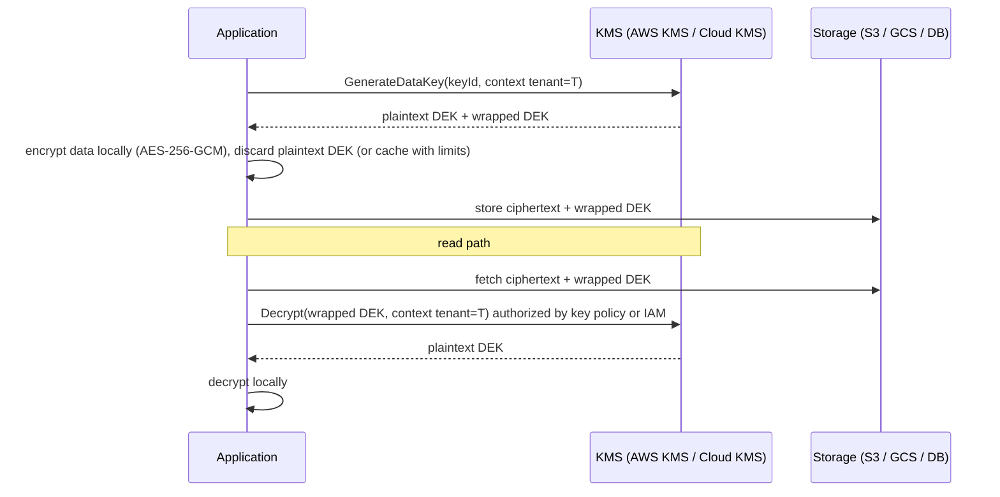
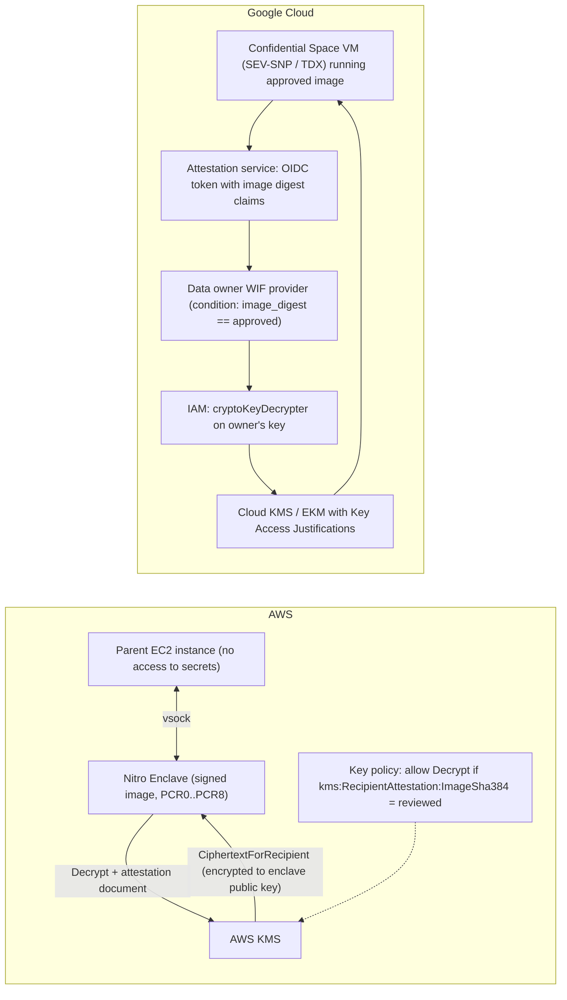

# 05.3 · KMS Envelope Encryption, CloudHSM, Nitro Enclaves and Confidential Computing

> **Folder 05 · File 3 of 3.** Encryption at rest is free and on by default on both clouds. The architecture questions are about **control**:
> - who can use a key, and how that's enforced (key policies vs IAM);
> - where the key material lives (multi-tenant HSM-backed KMS, single-tenant HSMs, external key managers);
> - whether data can be protected **while in use** (Nitro Enclaves, AMD SEV-SNP / Intel TDX Confidential VMs, Confidential Space);
> - whether the key service's **request quotas** and costs survive the design.
>
> This file covers:
> - envelope encryption mechanics and what rotation really re-encrypts;
> - AWS KMS (key policies, grants, encryption context, multi-Region keys, CloudHSM and external key stores);
> - Google Cloud KMS (protection levels, Autokey, single-tenant Cloud HSM, Cloud EKM with Key Access Justifications);
> - attested key release to enclaves and confidential VMs.

| Listing | What it shows | Language |
|---|---|---|
| `kms_request_planner.py` | HKDF-SHA256 checked against **RFC 5869 test case 1**, the primitive behind deriving many data keys from one wrapped key. KMS calls per second for 40,000 object writes/s under per-object keys, data-key caching and bucket keys, against AWS (10k/20k/100k per second by Region; 1,800/s per custom key store) and Cloud KMS (~1,000 software ops/s under the 2026 token quota). Monthly request cost. What rotation and compromise re-encrypt | Python 3 (stdlib) |

**Verification.** The listing is embedded byte-identical. The gate re-runs it on this file and requires `verdict: OK`. That asserts the RFC 5869 PRK and OKM match exactly, that per-object KMS calls exceed the default AWS quota, and that bucket keys cut calls below 1/s. Quotas come from the AWS KMS request-quota page and the Cloud KMS quotas page (token model effective 2026-02-16), as of **2026-10-31**.

**Labels.** **[D]** documented · **[E]** estimate/model · ⚠ inferred or to verify.

---

## 0. Orientation

**The questions this file answers.**

1. What does envelope encryption put in the KMS call path, and how do data-key caching and bucket keys change it?
2. How is key access authorized on each cloud (AWS key policies and grants; Google IAM on key rings and keys), and how does encryption context bind ciphertext to its purpose?
3. When do you need single-tenant HSMs (CloudHSM, single-tenant Cloud HSM) or keys held outside the cloud (AWS XKS, Cloud EKM), and what does that cost in availability and throughput?
4. What do rotation and destruction actually do, and what has to be re-encrypted after a compromise?
5. How do Nitro Enclaves, Confidential VMs and Confidential Space protect data in use, and how does **attestation-gated key release** work?
6. Which quota and lifecycle traps cause outages or data loss?

**Reading paths.**

| Goal | Read |
|---|---|
| L7 interview | §1, §2, §3.1–3.3, §4.1–4.3, §5, §7, Q-chains |
| SAP-C02 | §2, §3 entire, §6, §7, S-scenarios |
| Regulated-data design | §3–§6, run the listing with your request rates |

**Prerequisites.**
- [01.1](../01-Virtualization-Compute-and-Kubernetes-Internals/01-aws-nitro-hypervisor-ec2-placement-groups-vs-gcp-titanium-compute.md) for Nitro, Titan and Confidential VM background.
- [03.1](../03-Distributed-Storage-Databases-and-Lakehouse-Internals/01-object-storage-s3-strong-consistency-prefix-partitioning-vs-gcs-colossus.md) for S3 Bucket Keys.
- [05.1](01-aws-iam-evaluation-logic-scp-permission-boundaries-abac-sts-cross-account.md) for key-policy evaluation.

---

## 1. First principles: keys encrypt keys

### 1.1 The envelope

1. Generate a **data encryption key (DEK)** for an object, a file, a table partition or a session.
2. Encrypt the data locally with the DEK (AES-256-GCM).
3. Ask the KMS to **wrap** the DEK under a **key encryption key (KEK)** that never leaves the KMS HSMs.
4. Store the **wrapped DEK** with the ciphertext.
5. To decrypt, send the wrapped DEK to the KMS (authorization happens here), get the DEK back, and decrypt locally.

Two consequences:
- **Data never travels to the KMS**, only small keys do. Throughput scales with local crypto.
- **Every DEK operation is a KMS call** unless you reuse DEKs (caching) or derive them from a wrapped parent key, as S3 Bucket Keys do ⚠ (the mechanism is published at a high level). The listing's HKDF is the textbook derivation primitive. It reproduces RFC 5869 test case 1 bit for bit.

### 1.2 What the KMS really controls

The KMS doesn't protect data from someone who already holds a plaintext DEK. It controls **who can unwrap**, **under which conditions** (encryption context, caller, VPC endpoint, attestation), and **when keys stop working**: disable, schedule deletion or destruction, revoke external access. That's why the key policy, or the IAM on keys, is the real data-access policy for encrypted data, and why key **deletion is data deletion** (crypto-shredding).

### 1.3 Data in use

Encryption at rest and in transit leave data in plaintext in memory while it's processed. **Confidential computing** encrypts memory with keys held by the CPU, and isolates it from the hypervisor and host (AMD SEV-SNP, Intel TDX), or carves out an isolated VM with no operator or network access (Nitro Enclaves). The key point: a remote party can **attest** what code is running before releasing a key to it.

---

## 2. Side-by-side architectural Rosetta matrix

| Concern | AWS | GCP | What actually differs |
|---|---|---|---|
| Managed KMS | **AWS KMS**: HSMs validated to FIPS 140-3 Level 3. Symmetric AES-256-GCM, RSA, ECC, HMAC, and post-quantum **ML-DSA / ML-KEM** keys | **Cloud KMS**: key rings (location) → keys (purpose) → **versions**. Protection levels SOFTWARE, HSM, EXTERNAL, EXTERNAL_VPC | GCP versions are first-class objects with their own state |
| Authorization | **Key policy required** (it's the primary control). IAM applies only if the key policy enables it. **Grants** for delegated, temporary use | **IAM** on project / key ring / key (e.g. `cloudkms.cryptoKeyEncrypterDecrypter`) | AWS keys have a mandatory resource policy. GCP uses IAM inheritance |
| Context binding | **Encryption context** (AAD, logged, usable in policy conditions) | **Additional authenticated data (AAD)** on Encrypt/Decrypt | AWS exposes context in CloudTrail and conditions |
| Quotas | Symmetric crypto shared: **10,000/s** (default), **20,000/s** (some Regions), **100,000/s** (us-east-1, us-west-2, eu-west-1). Custom key stores **1,800/s each** (CloudHSM not adjustable) [D] | Token model since **2026-02-16**: software usage 6,000,000 tokens/min per region, 100 tokens per software op ≈ **1,000 ops/s**. HSM usage 3,000,000 tokens/min. External 10,000 TPS [D] | GCP's software default is **10–100× lower** per project. Plan envelope reuse |
| Single-tenant HSM | **CloudHSM** (clusters in your VPC, FIPS 140-3 L3, PKCS#11/JCE/OpenSSL; you manage HSM users) | **Single-tenant Cloud HSM** (GA 2025-12-17, quorum-approved admin, extra cost) | Both give dedicated HSM partitions. CloudHSM also exposes raw HSM APIs |
| Keys outside the cloud (HYOK) | **External key store (XKS)**: KMS calls your key manager through an XKS proxy | **Cloud EKM** (internet or VPC) with **Key Access Justifications** (reason codes per request) | KAJ lets you refuse access by reason |
| Bring your own key material | Import key material (BYOK) | Import key versions | — |
| Automation | Key creation by IaC. Service-default AWS managed keys | **Autokey**: provisions CMEK keys per resource on demand, with policy | Autokey solves CMEK-at-scale ops |
| Multi-region keys | **Multi-Region keys** (related keys with the same material, replicated, independent policies) | Keys in **multi-region / dual-region locations** (e.g. `us`, `europe`) or per-region keys | AWS replicates material. GCP uses location scope |
| Rotation | Automatic rotation (default yearly, configurable **90–2,560 days**) and **on-demand** rotation. Old material kept for decrypt | Automatic rotation period per key. New primary version; old versions decrypt until destroyed | Neither re-encrypts data on rotation |
| Deletion | Schedule deletion with a **7–30 day** waiting period. Disable first | Destroy versions after a **scheduled destruction period** (default 30 days, configurable) | Deletion is irreversible crypto-shredding |
| Default at-rest encryption | SSE-S3 / service-owned keys by default | Google default encryption (Google-managed keys) | CMEK/CMK is opt-in control, not opt-in encryption |
| Data-in-use isolation | **Nitro Enclaves** (isolated VM, vsock only, attestation in PCRs) | **Confidential VMs** (SEV, SEV-SNP, TDX), Confidential GKE Nodes, **Confidential Space** | Enclaves partition an instance. Confidential VMs encrypt whole-VM memory |
| Confidential VMs | AMD SEV-SNP on supported EC2 types. NitroTPM + Secure Boot | Confidential VMs incl. **GPU (H100) confidential computing** on supported series | GCP has broader confidential VM coverage |
| Attested key release | KMS key policy conditions on **enclave attestation** (`kms:RecipientAttestation:ImageSha384`, PCRs). KMS returns data keys encrypted to the enclave | **Confidential Space**: attestation → federated identity token with image claims → IAM-gated KMS/CMEK access | Both bind key access to measured code |

---

## 3. Internal mechanics: AWS KMS, CloudHSM and Nitro Enclaves

### 3.1 Key policies, grants and context [D]

- **Every KMS key has a key policy**, and it's **authoritative**.
  - IAM policies apply only if the key policy allows the account (`"Principal": {"AWS": "arn:aws:iam::ACCOUNT:root"}` with `kms:*`, the standard "enable IAM" statement), or names principals directly.
  - **Cross-account use needs both:** the key policy allowing the external account or role, *and* the caller's identity policy (05.1 case 12, S6).
- **Grants** delegate specific operations to a principal, typically AWS services acting on your behalf (EBS, RDS). They're created and retired programmatically, and **grant tokens** cover eventual consistency right after creation.
- **Encryption context:**
  - key-value pairs bound as AAD into the ciphertext;
  - decryption must present the same context;
  - it appears in **CloudTrail**;
  - it can be required in key-policy or grant conditions (`kms:EncryptionContext:tenant`).

  Use it to bind ciphertext to tenant, table or purpose, so a wrapped key can't be replayed elsewhere.
- **Useful conditions:**
  - `kms:ViaService`: only when called through S3 or RDS in this Region;
  - `kms:CallerAccount`;
  - `aws:SourceVpce`;
  - and the attestation keys (§3.4).
- **Limits:**
  - `Encrypt` accepts up to **4 KB** of plaintext. Anything bigger uses envelope encryption.
  - Data keys come from `GenerateDataKey`, which returns plaintext + wrapped, or `GenerateDataKeyWithoutPlaintext`, for later use.

### 3.2 Quotas and the economics of envelope reuse

Cryptographic operations on symmetric keys **share** one per-account, per-Region quota:
- 10,000/s by default;
- 20,000/s in some Regions;
- 100,000/s in us-east-1, us-west-2 and eu-west-1;
- calls made **on your behalf by AWS services** (S3 SSE-KMS, EBS, Secrets Manager) count too;
- cross-account requests count against the **caller's** account;
- custom key stores have their own **1,800/s** ceiling each (not adjustable for CloudHSM) [D].

The listing shows 40,000 object writes/s with per-object data keys exceeding the default quota by 4×, the Cloud KMS software quota by 40×, and a CloudHSM key store by 22×. The request bill would be ~$311k/month. **Data-key caching** in the Encryption SDK cuts it to ~4 calls/s, and **bucket keys** to effectively zero.

The levers, in order:
1. **S3 Bucket Keys** for S3 (03.1).
2. **Encryption SDK data key caching**, bounded by age, message count and bytes. The cache limits blast radius as well as cost.
3. **Coarser DEK scope** (per partition or file instead of per record).
4. **Quota increases**, as a last resort.

### 3.3 Custom key stores: CloudHSM and XKS

- **CloudHSM key store:** KMS keys whose material lives in **your** CloudHSM cluster: single-tenant HSMs in your VPC, FIPS 140-3 Level 3.
  - **Use when** a regulator requires dedicated HSMs or exclusive control of HSM users.
  - **Costs:**
    - HSM-hours (at least two HSMs in different AZs for availability);
    - the **1,800/s** request ceiling per key store;
    - you operate the cluster (users, backups, patching windows).
- **External key store (XKS):** KMS forwards cryptographic operations to an **external key manager**, through an XKS proxy you run, over the internet or PrivateLink.
  - **Use when** "hold your own key" is mandated: keys never in AWS, and the ability to cut AWS off.
  - **Costs:** **availability and latency now depend on your key manager and network.** If it's down, every dependent AWS service fails to decrypt.
- **CloudHSM directly** (PKCS#11, JCE, OpenSSL): for custom PKI, TDE for databases, payment HSM-like workloads (or AWS Payment Cryptography for payments-specific HSM functions), and signing keys that must stay in dedicated HSMs.

### 3.4 Nitro Enclaves

**What an enclave is:**
- an isolated VM carved from a parent EC2 instance's vCPUs and memory, created and isolated by the Nitro Hypervisor (01.1 §3.2);
- **no persistent storage**, **no interactive access**, **no external networking**: it talks only to its parent over **vsock**;
- even root on the parent can't read enclave memory.

**Attestation:**
- the Nitro Hypervisor produces a signed **attestation document** with measurements (PCRs);
- PCR0 is the enclave image, PCR1 the kernel and boot, PCR2 the application, and others cover the parent's IAM role, the instance ID and the signing certificate.

**KMS integration:**
1. The enclave calls KMS (through the parent's vsock proxy) with its attestation document.
2. The **key policy** conditions on `kms:RecipientAttestation:ImageSha384` or PCR values.
3. KMS returns the plaintext data key **encrypted to the enclave's public key** (`CiphertextForRecipient`). The parent instance never sees it.

**Uses:** tokenization and PII processing, private key handling, multi-party computation, verifying that only reviewed code can decrypt.

**Limits:**
- the enclave's resources come out of the parent's;
- debugging is constrained (debug mode zeroes PCRs, so keys keyed to PCRs won't release);
- I/O through vsock adds an engineering layer.

---

## 4. Internal mechanics: Cloud KMS, Cloud HSM, EKM and Confidential Computing

### 4.1 Cloud KMS objects and protection levels

- **Key rings** in a location (regional, dual-region, multi-region, global) contain **keys** with a purpose:
  - symmetric encrypt/decrypt;
  - asymmetric sign/decrypt;
  - MAC;
  - raw encryption, for special cases.
- Keys have **versions**. The primary version encrypts; any enabled version decrypts.
- **Protection levels:**
  - **SOFTWARE:** keys in Google's software KMS.
  - **HSM:** **Cloud HSM**, multi-tenant HSM clusters with FIPS-validated hardware, or **single-tenant Cloud HSM** (GA 2025-12-17, dedicated instances, quorum approval for administration with customer-held 2FA keys, extra cost).
  - **EXTERNAL / EXTERNAL_VPC:** **Cloud EKM**. Key material stays in a supported external key manager, reached over the internet or a VPC.
- **IAM** grants use (`roles/cloudkms.cryptoKeyEncrypterDecrypter`) and administration (`roles/cloudkms.admin`) at the project, key ring or key level.
  - Separate the duties: key admins can't use keys, and users can't change policy.
  - Put key rings in a **dedicated KMS project** per environment.

### 4.2 Quotas, Autokey and CMEK at scale

- **Quotas** use a **token model** since **2026-02-16** [D]:
  - software usage **6,000,000 tokens/min** per region per project, with a software op costing 100 tokens. That's ~**1,000 software crypto ops/s**.
  - HSM operations cost 100–14,000 tokens depending on operation and key size.
  - External KMS is capped at 10,000 TPS.
  - Quotas are charged to the **project that hosts the key** for HSM and external keys, and to the calling project for some reads ⚠ (check per metric).

  Because Google services using CMEK typically wrap and cache DEKs, application-level per-record KMS calls are what blow these quotas (listing §2).
- **Autokey:**
  - when a developer creates a CMEK-capable resource, Autokey **creates or reuses an appropriate key** in a designated key project, with the right location and protection level, and grants the service agent;
  - it removes the per-resource key ticket queue;
  - pair it with the Org Policy constraints `gcp.restrictNonCmekServices` and `gcp.restrictCmekCryptoKeyProjects` (05.2 Q8).
- **CMEK semantics:** disabling or destroying the key version makes dependent data unavailable, and for some services that's permanent. Practice in non-prod.

### 4.3 Cloud EKM and Key Access Justifications

- **Cloud EKM** keeps key material in a partner external key manager. Each wrap and unwrap is a call to it, so your EKM's **availability is now part of every dependent service's availability**, the same trade-off as AWS XKS.
- **Key Access Justifications (KAJ)** attach a **reason code** to each EKM request: customer-initiated access, Google-initiated system operation, Google support, and so on. Your EKM policy can **deny** requests by reason, for example refusing any access for Google-initiated support without approval.

### 4.4 Confidential VMs, Confidential GKE and Confidential Space

- **Confidential VMs:**
  - memory is encrypted with per-VM keys generated and held by the CPU (**AMD SEV / SEV-SNP**, **Intel TDX**);
  - SEV-SNP and TDX add integrity protection against host tampering;
  - attestation reports are verifiable;
  - live migration is supported only on some (01.1 §4.5: N2D and C3D with SEV);
  - **confidential GPUs** (NVIDIA H100 on supported A3 shapes) extend protection to accelerator memory;
  - **Confidential GKE Nodes** make every node a Confidential VM.
- **Confidential Space:**
  - a hardened, attested environment on Confidential VMs that runs a **specified container image**;
  - the attestation service issues an **OIDC token with claims** about the image digest, hardware and configuration;
  - data owners create **Workload Identity Federation providers that accept only tokens with the approved image digest**, and grant those identities access to their KMS keys and buckets.

  The result is **multi-party computation without trusting the operator**: each party's data is decryptable only inside the agreed workload.

---

## 5. Listing: derivation, request budgets and rotation

<!-- listing:kms_request_planner.py -->
```python
"""kms_request_planner.py - envelope-encryption economics: how many KMS calls a design makes, whether
it fits the quota, what it costs, plus a verified key-derivation primitive (HKDF, RFC 5869) of the
kind used to derive many data keys from one key without calling KMS each time.

Rules and prices encoded (public docs/pricing, 2026-10-31; verify before reuse):
  AWS KMS shared symmetric crypto quota per account per Region: 10,000/s, 20,000/s in some
    Regions, 100,000/s in us-east-1, us-west-2, eu-west-1; custom key stores 1,800/s each;
    $1 per key-month, $0.03 per 10,000 requests
  Cloud KMS (quota model since 2026-02-16): software usage 6,000,000 tokens/min per project per
    region, 100 tokens per software crypto op -> 1,000 ops/s; software key version ~$0.06/month,
    $0.03 per 10,000 operations
  S3 Bucket Keys: S3 asks KMS for a bucket-level key and derives per-object data keys from it for
    a time window, instead of one KMS call per object (the window length is not published:
    modeled as an ASSUMPTION)

Usage: python -I kms_request_planner.py <any path>
"""
import hashlib
import hmac
import math
import sys


def hkdf(ikm, salt, info, length):
    prk = hmac.new(salt, ikm, hashlib.sha256).digest()
    okm, t, i = b"", b"", 1
    while len(okm) < length:
        t = hmac.new(prk, t + info + bytes([i]), hashlib.sha256).digest()
        okm += t
        i += 1
    return prk, okm[:length]


def kms_calls_per_s(objects_s, mode, cache_s=300, cache_msgs=10_000, buckets=1, bucket_key_window_s=3600):
    if mode == "per-object":
        return objects_s
    if mode == "data-key cache":   # reuse a data key for cache_s seconds or cache_msgs messages
        return max(objects_s / cache_msgs, 1 / cache_s)
    if mode == "bucket keys":
        return buckets / bucket_key_window_s
    raise ValueError(mode)


def main():
    ok = True
    print("== 1. HKDF-SHA256, RFC 5869 test case 1 ==")
    prk, okm = hkdf(bytes([0x0b]) * 22, bytes(range(13)), bytes(range(0xf0, 0xfa)), 42)
    want_prk = "077709362c2e32df0ddc3f0dc47bba6390b6c73bb50f9c3122ec844ad7c2b3e5"
    want_okm = "3cb25f25faacd57a90434f64d0362f2a2d2d0a90cf1a5a4c5db02d56ecc4c5bf34007208d5b887185865"
    ok &= prk.hex() == want_prk and okm.hex() == want_okm
    print(f"PRK {prk.hex()} {'matches RFC' if prk.hex() == want_prk else 'MISMATCH'}")
    print(f"OKM {okm.hex()[:48]}... {'matches RFC' if okm.hex() == want_okm else 'MISMATCH'}")
    k1 = hkdf(b"bucket-key-material", b"salt", b"object:a.parquet", 32)[1]
    k2 = hkdf(b"bucket-key-material", b"salt", b"object:b.parquet", 32)[1]
    ok &= k1 != k2
    print("   one wrapped key + per-object context -> distinct 256-bit data keys, zero extra KMS calls")

    print()
    print("== 2. KMS calls/s for 40,000 object writes/s ==")
    rows = {}
    for mode in ("per-object", "data-key cache", "bucket keys"):
        rows[mode] = kms_calls_per_s(40_000, mode, buckets=20)
        print(f"{mode:<16} {rows[mode]:>12,.3f} calls/s")
    print("   ASSUMPTIONS: data-key cache reuses a key for 300 s or 10,000 messages; bucket key reused 1 h, 20 buckets")
    for name, quota in (("AWS default Region", 10_000), ("AWS us-east-1", 100_000), ("Cloud KMS software", 1_000),
                        ("AWS CloudHSM / XKS key store", 1_800)):
        verdict = "fits" if rows["per-object"] <= quota else f"THROTTLES ({rows['per-object'] / quota:.0f}x over)"
        print(f"per-object design vs {name:<28} quota {quota:>7,}/s: {verdict}")
    ok &= rows["per-object"] > 10_000 and rows["bucket keys"] < 1

    print()
    print("== 3. Monthly request cost at 40,000 writes/s (30 days = 2.59e6 s) ==")
    secs = 30 * 86400
    for mode, rate in rows.items():
        aws = rate * secs / 10_000 * 0.03
        print(f"{mode:<16} ${aws:>12,.2f} (AWS and Cloud KMS software both list $0.03 per 10,000)")
    ok &= rows["per-object"] * secs / 10_000 * 0.03 > 3e5

    print()
    print("== 4. Rotation: what has to be re-encrypted? ==")
    print("KEK rotation (automatic, both clouds): new key version encrypts new data keys; old versions")
    print("  stay available for decrypt -> 0 bytes of data re-encrypted")
    data_tb = 500
    print("KEK compromise: re-wrap every data key under a new KEK (ReEncrypt calls) -> no data movement")
    print(f"DEK compromise: re-encrypt only data under that DEK -> small if DEKs are per object or per")
    print(f"  partition; {data_tb} TB if one DEK covers everything (at 2 GB/s: {data_tb * 1e12 / 2e9 / 3600:.0f} h)")
    print()
    print("verdict: OK" if ok else "verdict: FAIL")


if __name__ == "__main__":
    main()
```

<!-- output:kms_request_planner.py -->
```text
== 1. HKDF-SHA256, RFC 5869 test case 1 ==
PRK 077709362c2e32df0ddc3f0dc47bba6390b6c73bb50f9c3122ec844ad7c2b3e5 matches RFC
OKM 3cb25f25faacd57a90434f64d0362f2a2d2d0a90cf1a5a4c... matches RFC
   one wrapped key + per-object context -> distinct 256-bit data keys, zero extra KMS calls

== 2. KMS calls/s for 40,000 object writes/s ==
per-object         40,000.000 calls/s
data-key cache          4.000 calls/s
bucket keys             0.006 calls/s
   ASSUMPTIONS: data-key cache reuses a key for 300 s or 10,000 messages; bucket key reused 1 h, 20 buckets
per-object design vs AWS default Region           quota  10,000/s: THROTTLES (4x over)
per-object design vs AWS us-east-1                quota 100,000/s: fits
per-object design vs Cloud KMS software           quota   1,000/s: THROTTLES (40x over)
per-object design vs AWS CloudHSM / XKS key store quota   1,800/s: THROTTLES (22x over)

== 3. Monthly request cost at 40,000 writes/s (30 days = 2.59e6 s) ==
per-object       $  311,040.00 (AWS and Cloud KMS software both list $0.03 per 10,000)
data-key cache   $       31.10 (AWS and Cloud KMS software both list $0.03 per 10,000)
bucket keys      $        0.04 (AWS and Cloud KMS software both list $0.03 per 10,000)

== 4. Rotation: what has to be re-encrypted? ==
KEK rotation (automatic, both clouds): new key version encrypts new data keys; old versions
  stay available for decrypt -> 0 bytes of data re-encrypted
KEK compromise: re-wrap every data key under a new KEK (ReEncrypt calls) -> no data movement
DEK compromise: re-encrypt only data under that DEK -> small if DEKs are per object or per
  partition; 500 TB if one DEK covers everything (at 2 GB/s: 69 h)

verdict: OK
```

**Reading the output.**

- **Section 1.** Our HKDF implementation reproduces RFC 5869's PRK and OKM exactly. Deriving per-object keys from one wrapped parent key plus object context yields distinct 256-bit keys with **no extra KMS calls**. That's the shape of bucket-key designs, and of the Encryption SDK's key-derivation step.
- **Section 2.**
  - Per-object data keys at 40,000 writes/s need **40,000 KMS calls/s**. That fits only in AWS's largest Regions (100,000/s). It's **4× over** the AWS default, **40× over** Cloud KMS's ~1,000 software ops/s, and **22× over** a CloudHSM or XKS key store.
  - Data-key caching (300 s or 10,000 messages) drops it to ~4/s.
  - Bucket keys drop it to ~0.006/s.
- **Section 3.** At $0.03 per 10,000 requests, per-object keys cost ~**$311k/month** in requests alone, caching ~$31, and bucket keys cents.
- **Section 4.**
  - **Rotation** re-encrypts **nothing**: new key versions protect new DEKs, and old versions remain for decryption.
  - A **KEK compromise** is fixed by re-wrapping DEKs, with no data movement.
  - A **DEK compromise** requires re-encrypting the data under it: 69 hours at 2 GB/s if one DEK covers 500 TB.

  Scope DEKs narrowly.

---

## 6. Reference designs

### 6.1 Multi-tenant SaaS with per-tenant keys on both clouds

- **AWS:**
  - one KMS key per tenant tier, or per tenant for regulated tenants;
  - DEKs per tenant partition;
  - **encryption context** `{tenant: T, table: X}` required by key-policy conditions;
  - **data key caching** bounded by age and messages;
  - tenant offboarding = **schedule deletion** of the tenant key (crypto-shredding) after export.
- **GCP:**
  - Cloud KMS keys per tenant in a dedicated key project, with AAD carrying the tenant ID;
  - IAM per key;
  - Autokey for resource-level CMEK;
  - offboarding = destroy the key versions after the scheduled destruction period.
- **Both:**
  1. a **quota budget** per tenant workload (listing);
  2. CloudTrail / Cloud Audit Logs on key use;
  3. alarms on unusual decrypt volume.

### 6.2 Regulated processing with attested key release

- **AWS:**
  - card data is tokenized inside a **Nitro Enclave**;
  - the KMS key policy allows `Decrypt` only with `kms:RecipientAttestation:ImageSha384 = <reviewed image>`;
  - the parent instance only brokers ciphertext over vsock.
- **GCP:**
  - a **Confidential Space** workload with the approved image digest;
  - the data owner's WIF provider accepts only tokens with that digest;
  - IAM grants decrypt on the CMEK key to that federated principal;
  - optionally **EKM with KAJ** for key custody outside Google.

---

## 7. Failure modes, throttling limits and quota traps

| # | Symptom | Root cause | Detect | Fix | Cloud |
|---|---|---|---|---|---|
| 1 | `ThrottlingException` from KMS under load | Shared symmetric quota exceeded (including calls by AWS services on your behalf) | KMS CloudWatch usage vs quota | Bucket Keys, data-key caching, coarser DEKs, quota increase | AWS |
| 2 | `RESOURCE_EXHAUSTED` from Cloud KMS | ~1,000 software ops/s (6M tokens/min) per project-region | Quota metrics | Envelope reuse, spread across key projects, quota increase | GCP |
| 3 | Cross-account decrypt denied | **Key policy** doesn't allow the external principal | KMS error | Key policy + identity policy (both) | AWS |
| 4 | Key admins locked out | Key policy edited without an admin statement | Unmanageable key | Keep the "enable IAM" root statement and an admin role | AWS |
| 5 | All dependent services fail to decrypt | XKS proxy / EKM outage | Service errors, EKM metrics | HA key manager, multi-path connectivity, disaster drills, or reconsider HYOK scope | Both |
| 6 | CloudHSM key store throttles at 1,800/s | Per-key-store ceiling (not adjustable) | `ThrottlingException` | Envelope reuse. Multiple key stores. Standard KMS if regulation allows | AWS |
| 7 | Data permanently lost | Key **deleted / destroyed** after the waiting period | Decrypt failures | Waiting periods + alarms on `ScheduleKeyDeletion`/destroy, deny policies on destroy, disable-before-delete | Both |
| 8 | Rotation "didn't protect" old data after a leak | Rotation doesn't re-encrypt. The compromised DEK still decrypts its data | Incident review | Re-encrypt data under the compromised DEK. Narrow DEK scope (listing §4) | Both |
| 9 | Wrapped key replayed for another tenant | No **encryption context / AAD** binding | Audit | Require context in conditions. Tenant ID in AAD | Both |
| 10 | Enclave can't get keys in debug mode | Debug mode zeroes PCRs | Attestation failures | Use debug only with test keys. Policies on production PCRs | AWS |
| 11 | CMEK disablement takes a service down unexpectedly | Dependent services can't access data, sometimes irreversibly | Service errors after key state change | Rehearse in non-prod. Document per-service CMEK behavior | GCP |
| 12 | Developers blocked waiting for CMEK keys | Manual key provisioning | Ticket backlog | **Autokey** + Org Policy CMEK constraints | GCP |
| 13 | Confidential VM can't live-migrate | Most Confidential VM types use TERMINATE on maintenance | Maintenance events | Choose types supporting migration, or design for restart (01.1) | GCP |
| 14 | Separation of duties violated | The same role administers and uses keys | IAM review | Split admin/use roles. Key project per environment | Both |
| 15 | Multi-Region key misused in a DR Region | Replica keys have **independent policies** | Policy drift | Manage replica policies as code with the primary | AWS |

---

## 8. Architecture diagrams: multi-service compositions

### 8.1 Envelope encryption paths



### 8.2 Attested key release on both clouds



### 8.3 Key hierarchy and blast radius (ASCII)

```text
HSM-resident KEK (KMS key / Cloud KMS key version)    <- never leaves HSM; rotation adds versions
   |  wraps
   +-- bucket/partition key (wrapped, cached briefly) <- 1 KMS call per window, not per object
          |  derives (HKDF with object context)
          +-- DEK object A  -> AES-GCM ciphertext A
          +-- DEK object B  -> AES-GCM ciphertext B
compromise of: KEK -> re-wrap keys (no data movement) | one DEK -> re-encrypt that object only
key deletion/destruction -> crypto-shred everything below (irreversible after waiting period)
```

---

## 9. Bar-raiser chains and SAP-C02 scenarios

### 9.1 L7 bar-raiser chains

<details><summary><b>Q1 · Our KMS calls throttle every peak. Fix it without weakening security.</b></summary>

**Initial Prompt.** "An ingestion service encrypts each record with its own data key from AWS KMS. At peak (30,000 records/s), KMS throttles and requests cost a fortune. On GCP the same design fails even sooner. Redesign."

**L5 Answer.** "Request a quota increase."

**Why L5 Stalls.** Quota increases treat the symptom. The design makes one KMS call per record, and GCP's software default (~1,000 ops/s) is an order of magnitude lower than AWS's.

**L7 Answer.** "Per-record keys put KMS in the data path at record rate. The listing shows 40k/s per-object exceeding AWS's default 10k/s by 4× and Cloud KMS's ~1,000/s by 40×, at ~$311k a month.

Use envelope reuse with bounded blast radius:
1. **Data-key caching** (Encryption SDK) with a max age (5 minutes), max messages and max bytes per key. That's ~4 calls/s.
2. **Or a partition-scoped DEK** wrapped once, with per-record keys **derived** through HKDF from record context. The listing verifies the primitive against RFC 5869.
3. **Encryption context / AAD** carrying tenant and partition, so derived keys and wrapped parents are bound to purpose.
4. **For S3/GCS objects,** use S3 Bucket Keys and Google-managed CMEK DEK handling rather than app-level per-object KMS calls.

Security trade: a cached or derived key protects more data per KMS authorization. Bound it by time and volume, and scope it per tenant. Then size the quota with headroom for AWS services calling KMS on our behalf."
</details>

<details><summary><b>Q2 · "We rotated the key, so the leaked data is safe." Is it?</b></summary>

**Initial Prompt.** "A data key used for a month of customer exports was exposed in a log. The team enabled key rotation on the KMS key and closed the incident. Bar-raise."

**L5 Answer.** "Rotation creates new key material, so the old exposure is mitigated."

**Why L5 Stalls.** Rotation changes the KEK for *future* data keys. The leaked **DEK** still decrypts everything it encrypted. Rotation does nothing for it.

**L7 Answer.** "Separate the two layers:
- **KMS rotation** adds new KEK material for new wraps. Old material remains so existing ciphertext stays decryptable. **No data is re-encrypted** (listing §4).
- **The leaked plaintext DEK** decrypts every object encrypted under it, independently of the KMS.

The response:
1. **Find every object encrypted under that DEK** (its wrapped-key ID or metadata).
2. **Re-encrypt them** under new DEKs.
3. **Invalidate or rotate** downstream copies if the ciphertext itself may have leaked.
4. Fix the logging that exposed plaintext key material.
5. **Narrow the DEK scope** going forward: per object or per partition rather than per month, so a single exposure has a small re-encryption job. The listing's 500 TB single-DEK case would take ~69 hours at 2 GB/s.

If the *KMS key* were compromised, which is rare and would require credentials allowing unwrap, the fix is re-wrapping DEKs under a new key, with no data movement."
</details>

<details><summary><b>Q3 · Do we need CloudHSM, single-tenant Cloud HSM or an external key manager?</b></summary>

**Initial Prompt.** "A bank's regulator asks for 'dedicated HSMs' and 'customer control of keys'. The team proposes XKS and Cloud EKM everywhere. Evaluate."

**L5 Answer.** "External key managers give the most control, so use them everywhere."

**Why L5 Stalls.** HYOK puts the bank's key manager in the availability path of every encrypted AWS and GCP service, and caps throughput. Applied everywhere, it's an outage multiplier.

**L7 Answer.** "Map each requirement to the minimal control.
- **'FIPS-validated HSMs':** standard AWS KMS (FIPS 140-3 L3) and Cloud KMS HSM protection already satisfy it.
- **'Dedicated, single-tenant HSMs':**
  - **CloudHSM key store** (1,800/s per store, you run the cluster);
  - or **single-tenant Cloud HSM** (GA 2025-12, quorum administration).
- **'Keys never in the provider; ability to cut access':**
  - **XKS / Cloud EKM** for the specific datasets where the regulation demands it;
  - with **Key Access Justifications** on GCP to refuse access by reason.
- **Design consequences of HYOK:**
  1. an HA key manager across sites;
  2. redundant connectivity (PrivateLink/VPC);
  3. latency budgets;
  4. a **drill** for "key manager unreachable";
  5. agreement that an EKM outage is a full outage of the dependent services.

Most data should stay on standard KMS with strong key policies. HYOK goes only where it's mandated."
</details>

<details><summary><b>Q4 · Prove that only reviewed code can decrypt PII</b></summary>

**Initial Prompt.** "Auditors want proof that card numbers can only be decrypted by the tokenization service's reviewed code, not by admins with instance access. Design it on AWS and GCP."

**L5 Answer.** "Restrict IAM so only the service role can call Decrypt."

**Why L5 Stalls.** Anyone with access to the instance (root, a debugger, an injected process) can use the role's credentials. IAM identifies the role, not the code.

**L7 Answer.** "Bind key release to **measured code**.
- **AWS:**
  - run tokenization in a **Nitro Enclave**;
  - the KMS key policy allows `Decrypt` only with `kms:RecipientAttestation:ImageSha384` (or a PCR) equal to the reviewed enclave image's hash;
  - KMS returns the data key **encrypted to the enclave's public key**, so the parent never sees it;
  - the parent instance has no direct decrypt permission;
  - CI publishes the image hash after review, and the key policy update is change-controlled.
- **GCP:**
  - **Confidential Space** with the approved image digest;
  - the WIF provider accepts only attestation tokens with that digest;
  - decrypt on the key is granted only to that federated principal.
- **Evidence for auditors:**
  1. the attestation conditions in the policy;
  2. CloudTrail / Audit Logs showing every Decrypt with attestation;
  3. the build-to-hash provenance chain."
</details>

<details><summary><b>Q5 · CMEK at scale: 900 projects, 40 services</b></summary>

**Initial Prompt.** "Compliance mandates CMEK on all data services across 900 GCP projects and a comparable AWS estate. Teams complain key requests take weeks. Fix the operating model."

**L5 Answer.** "Create one key per environment and share it with everyone."

**Why L5 Stalls.** One shared key maximizes blast radius and makes separation of duties and per-dataset revocation impossible. It also fixes nothing about provisioning speed.

**L7 Answer.**
- **GCP:**
  - **Autokey**: keys are created on demand per resource type and location in a dedicated key project, with service-agent grants applied automatically;
  - Org Policy **requires** CMEK (`gcp.restrictNonCmekServices`) and **restricts key projects** (`gcp.restrictCmekCryptoKeyProjects`).
- **AWS:**
  - keys from IaC modules per workload (or per data domain), with key policies from templates (admin role, service principals through `kms:ViaService`, encryption-context conditions);
  - an SCP requiring customer managed keys where services support condition keys;
  - Config rules as a backstop.
- **Both:**
  1. **separate duties**: key admins in a security group, users in workload roles;
  2. **monitor** key usage and unusual decrypt rates;
  3. **document per-service behavior** when a key is disabled;
  4. **quota planning** per key project or Region (listing).

That turns weeks into minutes without a single shared key."
</details>

<details><summary><b>Q6 · Crypto-shredding for tenant offboarding and GDPR erasure</b></summary>

**Initial Prompt.** "We must guarantee erasure of a tenant's data, including backups, within 30 days of contract end. Data is spread across S3, RDS snapshots, BigQuery and logs. Is crypto-shredding the answer?"

**L5 Answer.** "Delete the tenant's rows and objects. Backups expire eventually."

**Why L5 Stalls.** Backups, replicas and logs outlive deletes, and "eventually" fails a 30-day guarantee.

**L7 Answer.** "Crypto-shredding works **only if** the tenant's data is encrypted under tenant-scoped keys everywhere, including backups.
1. **Per-tenant KEKs** (or per-tenant DEK hierarchies under a tenant KEK) for app-level encryption of tenant fields and files.
2. **Backups inherit:** snapshots and exports contain ciphertext wrapped under tenant keys.
3. **Offboarding:** export if requested, then **schedule deletion** of the tenant key. AWS waits 7–30 days; Cloud KMS destroys after the scheduled destruction period. That makes all copies, backups included, unreadable within the window.
4. **Caveats:**
   - service-level encryption with shared keys (SSE-S3, default encryption, shared CMEK) **doesn't** shred per tenant, so tenant isolation needs app-level envelopes;
   - logs and analytics copies need the same design, or explicit deletion.
5. Record the key destruction event as **erasure evidence**."
</details>

<details><summary><b>Q7 · Confidential VMs: when are they worth it?</b></summary>

**Initial Prompt.** "Security wants all GKE and Compute workloads on Confidential VMs. Platform worries about cost and features. Advise."

**L5 Answer.** "Confidential VMs are more secure, so enable them everywhere."

**Why L5 Stalls.** It ignores the threat model, the performance and feature constraints (machine series, live migration, GPU support), and the fact that confidential computing protects against host-level access, not app vulnerabilities.

**L7 Answer.** "Match it to the threat.
- **What it adds:** protection of memory from the host, hypervisor and privileged operators, with **attestation** so relying parties can verify. That's valuable for regulated data processing, multi-party analytics (Confidential Space), and cross-organization trust.
- **What it doesn't add:** protection against application bugs, stolen app credentials or SQL injection.
- **Costs and constraints:**
  - supported series only;
  - possible performance overhead ⚠;
  - most types **can't live-migrate** (maintenance becomes a restart, 01.1);
  - GPU confidential computing only on specific shapes.
- **Recommendation:**
  1. Confidential GKE node pools for the regulated namespaces;
  2. Confidential Space for multi-party jobs;
  3. Confidential VMs where contracts require 'protected in use';
  4. standard nodes elsewhere, with Shielded VM, Workload Identity and VPC-SC.

On AWS, Nitro's design already removes operator access paths (01.1 §3.3), so add Nitro Enclaves or SEV-SNP for explicit in-use protection where required."
</details>

<details><summary><b>Q8 · Multi-Region keys for DR: what can go wrong?</b></summary>

**Initial Prompt.** "We replicate encrypted data to a DR Region. Someone suggests KMS multi-Region keys so DR can decrypt without cross-Region calls. Risks?"

**L5 Answer.** "None. It's the same key in both Regions."

**Why L5 Stalls.** The material is shared, but **policies, grants and aliases are independent per replica**. That's a drift risk and a policy-bypass risk.

**L7 Answer.** "Multi-Region keys give related keys with the **same key material and key ID** in several Regions. Ciphertext from the primary decrypts locally in the replica, which removes the cross-Region dependency during a regional outage.

Risks:
1. **Policy drift:** each replica has its **own key policy**. A looser policy in DR becomes the weakest link for all ciphertext. Manage the policies as one artifact.
2. **Blast radius:** deleting or compromising one key's access affects every Region's data.
3. **Compliance:** some residency rules forbid the same material in other jurisdictions.

The alternative is **separate keys per Region** with re-encryption on replication (S3 replication can re-encrypt with a destination key), trading DR simplicity for isolation.

GCP's analog: keys in a multi-region location (e.g. `us`), or separate regional keys with re-encryption during copy."
</details>

<details><summary><b>Q9 · Key policies vs IAM: who really controls a key?</b></summary>

**Initial Prompt.** "An AWS account admin with `AdministratorAccess` can't decrypt data in their own account. Explain why that's by design, and what the GCP equivalent is."

**L5 Answer.** "They probably lack kms:Decrypt in IAM."

**Why L5 Stalls.** They have `*`. The key policy is the gate, and it may deliberately not enable IAM for that key.

**L7 Answer.** "AWS KMS key policies are **authoritative**. IAM policies matter only if the key policy enables the account (the 'enable IAM' root statement) or names the principal. A security team can create keys whose policy allows only specific roles. Even account admins with `*` can't use them, which is exactly what separation of duties for sensitive data needs. The listing in 05.1 (case 12) shows it.

The trade-off: misconfigured key policies can lock everyone out. Always keep an admin path.

On GCP, key access is **IAM on the key or key ring**, inherited from the project, folder and org. An org-level Owner could grant themselves decrypt. Restrain it with **deny policies** on `cloudkms.cryptoKeyVersions.useToDecrypt` for non-approved principals, key projects with tight IAM, and audit logs."
</details>

<details><summary><b>Q10 · Translate an AWS key architecture to GCP</b></summary>

**Initial Prompt.** "Our AWS design uses customer managed keys per data domain, encryption context conditions, grants for services, CloudHSM for PKI, XKS for one regulated dataset, and Nitro Enclaves for tokenization. Map it to GCP."

**L5 Answer.** "Use Cloud KMS for all of it."

**Why L5 Stalls.** Cloud KMS covers part, but HSM tenancy, external keys, context binding and enclave attestation map to specific GCP features with different semantics.

**L7 Answer.**

| AWS | GCP |
|---|---|
| CMKs per domain + key policies | Cloud KMS keys per domain in key projects + IAM (admin/use split) + deny policies |
| Encryption context conditions | AAD on Encrypt/Decrypt (app-enforced). Tags and IAM Conditions for access |
| Grants for services | Service agent IAM grants (Autokey automates them) |
| CloudHSM for PKI | Single-tenant Cloud HSM or HSM-protection-level keys. Certificate Authority Service for managed PKI |
| XKS for one dataset | Cloud EKM (VPC) with Key Access Justifications |
| Nitro Enclaves tokenization | Confidential Space with attested WIF identity to KMS |
| Bucket Keys / data-key caching | CMEK services' internal DEK handling. App-level caching (mind ~1,000 software ops/s) |

Then re-run the quota budget (listing) for each app-level crypto path, because GCP's software default is much lower."
</details>

### 9.2 SAP-C02 scenarios (original)

<details><summary><b>S1 · SAP-C02 · Domain 3 · Select ONE</b></summary>

**Scenario.** An application encrypts each message with a new data key from AWS KMS. At peak traffic it receives KMS throttling errors, and KMS costs are high. The security team accepts reusing a data key for up to 5 minutes or 10,000 messages. What should a solutions architect recommend?

- **A.** Switch to asymmetric KMS keys.
- **B.** Use the AWS Encryption SDK with data key caching configured with a maximum age and message count.
- **C.** Store a single data key in plaintext in the application configuration.
- **D.** Move the keys to a CloudHSM key store.

**Answer: B**

- **A** — wrong: asymmetric keys have lower request quotas and don't reduce call volume.
- **B** — correct: data key caching reuses data keys within security limits, cutting KMS calls and cost.
- **C** — wrong: plaintext keys in configuration are insecure.
- **D** — wrong: CloudHSM key stores have a lower per-store request ceiling.
</details>

<details><summary><b>S2 · SAP-C02 · Domain 1 · Select ONE</b></summary>

**Scenario.** A central security account owns a KMS key used to encrypt S3 data in several workload accounts. Workload roles have IAM policies allowing `kms:Decrypt` on the key ARN, but decryption fails. What should a solutions architect do?

- **A.** Make the key an AWS managed key.
- **B.** Enable automatic key rotation.
- **C.** Disable S3 Bucket Keys.
- **D.** Update the key policy in the security account to allow the workload accounts' roles (or accounts) to use the key for decryption.

**Answer: D**

- **A** — wrong: AWS managed keys can't be shared across accounts.
- **B** — wrong: rotation doesn't affect authorization.
- **C** — wrong: Bucket Keys change request volume, not cross-account permissions.
- **D** — correct: cross-account key use requires the key policy to allow the external principals, in addition to their IAM policies.
</details>

<details><summary><b>S3 · SAP-C02 · Domain 2 · Select TWO</b></summary>

**Scenario.** A payments company must ensure that card data can be decrypted only by a specific, reviewed tokenization application, and not by administrators who have root access to the EC2 instances running it. Which actions should a solutions architect take? (Select TWO.)

- **A.** Run the tokenization application in an AWS Nitro Enclave.
- **B.** Store the KMS key ARN in AWS Secrets Manager.
- **C.** Add a KMS key policy condition that allows decryption only with an enclave attestation matching the reviewed image measurement.
- **D.** Enable detailed CloudWatch monitoring on the instances.
- **E.** Grant the instance role `kms:Decrypt` without conditions.

**Answer: A, C**

- **A** — correct: Nitro Enclaves isolate the application from the parent instance, including its root user.
- **B** — wrong: storing the ARN doesn't restrict who can decrypt.
- **C** — correct: attestation-based conditions release keys only to the measured enclave image.
- **D** — wrong: monitoring doesn't restrict access.
- **E** — wrong: unconditional decrypt on the instance role lets administrators use the credentials.
</details>

<details><summary><b>S4 · SAP-C02 · Domain 2 · Select ONE</b></summary>

**Scenario.** Regulators require that a company's encryption keys for one dataset are generated and stored in single-tenant HSMs that the company controls, while the company still wants to use the KMS API with integrated AWS services. What should a solutions architect recommend?

- **A.** Use a KMS key with imported key material.
- **B.** Create the KMS key in an AWS KMS custom key store backed by an AWS CloudHSM cluster.
- **C.** Use AWS managed keys.
- **D.** Use client-side encryption with keys stored in Parameter Store.

**Answer: B**

- **A** — wrong: imported key material is still stored in multi-tenant KMS HSMs.
- **B** — correct: a CloudHSM key store keeps key material in a single-tenant CloudHSM cluster the company controls, while exposing KMS APIs to integrated services.
- **C** — wrong: AWS managed keys are controlled by AWS.
- **D** — wrong: Parameter Store isn't an HSM, and this bypasses KMS integration.
</details>

<details><summary><b>S5 · SAP-C02 · Domain 4 · Select ONE</b></summary>

**Scenario.** As part of a disaster recovery migration, encrypted DynamoDB global tables and S3 data must be decryptable in a secondary Region even if the primary Region is unavailable, using the same key ID in application code. What should a solutions architect recommend?

- **A.** Use KMS multi-Region keys with a replica key in the secondary Region, managing the replica's key policy alongside the primary's.
- **B.** Export the key material and import it into a new key in the secondary Region.
- **C.** Call the primary Region's KMS endpoint from the secondary Region during disasters.
- **D.** Disable encryption for replicated data.

**Answer: A**

- **A** — correct: multi-Region keys share key material and key ID across Regions, enabling local decryption during a primary outage. Replica policies must be governed together.
- **B** — wrong: KMS key material can't be exported.
- **C** — wrong: depending on the failed Region's endpoint defeats DR.
- **D** — wrong: disabling encryption violates security requirements.
</details>

<details><summary><b>S6 · SAP-C02 · Domain 3 · Select ONE</b></summary>

**Scenario.** A security engineer accidentally scheduled deletion of a KMS key that protects production data. The company wants to prevent unplanned key deletion in the future while still allowing a controlled process. What should a solutions architect recommend?

- **A.** Disable automatic rotation.
- **B.** Reduce the waiting period to 7 days.
- **C.** Copy the key to another account.
- **D.** Use an SCP or key policy that denies `kms:ScheduleKeyDeletion` except for a break-glass role, and alarm on `ScheduleKeyDeletion` events in CloudTrail.

**Answer: D**

- **A** — wrong: rotation doesn't relate to deletion.
- **B** — wrong: a shorter waiting period raises the risk.
- **C** — wrong: KMS keys can't be copied between accounts.
- **D** — correct: restricting deletion to a break-glass role and alarming on scheduling events prevents and detects unplanned deletion, while the waiting period allows cancellation.
</details>

---

## 10. Checklist

- [ ] Every app-level crypto path has a KMS request budget against the Region's quota (AWS 10k/20k/100k; Cloud KMS ~1,000 software ops/s; custom key stores 1,800/s) (listing §2).
- [ ] Envelope reuse is bounded: data-key caching (age, messages, bytes), Bucket Keys, partition-scoped DEKs with HKDF derivation.
- [ ] Encryption context / AAD carries tenant and purpose. Key-policy conditions require it.
- [ ] Key policies: an admin path always present, duties separated, cross-account statements explicit. GCP: key projects with admin/use IAM split plus deny policies.
- [ ] HSM tenancy and HYOK only where mandated. HA and outage drills for XKS/EKM.
- [ ] Rotation enabled. Compromise runbooks distinguish KEK re-wrap from DEK re-encrypt. DEK scope kept small.
- [ ] Deletion/destruction guarded (deny except break-glass, alarms, waiting periods). Crypto-shredding designed per tenant where erasure guarantees are needed.
- [ ] Attested key release for code-bound secrets (Nitro Enclaves PCR conditions; Confidential Space WIF conditions).
- [ ] Confidential VMs used where the threat model and contracts need them, with maintenance and feature constraints accepted.
- [ ] Multi-Region keys (AWS) or regional key strategy (GCP) chosen deliberately, with policies governed together.

---

## 11. References

AWS:
- AWS KMS request quotas: <https://docs.aws.amazon.com/kms/latest/developerguide/requests-per-second.html>
- KMS key policies: <https://docs.aws.amazon.com/kms/latest/developerguide/key-policies.html>
- Encryption context: <https://docs.aws.amazon.com/kms/latest/developerguide/encrypt_context.html>
- Grants in AWS KMS: <https://docs.aws.amazon.com/kms/latest/developerguide/grants.html>
- Key rotation: <https://docs.aws.amazon.com/kms/latest/developerguide/rotate-keys.html>
- Multi-Region keys: <https://docs.aws.amazon.com/kms/latest/developerguide/multi-region-keys-overview.html>
- Custom key stores (CloudHSM, external): <https://docs.aws.amazon.com/kms/latest/developerguide/key-store-overview.html>
- AWS Encryption SDK data key caching: <https://docs.aws.amazon.com/encryption-sdk/latest/developer-guide/data-key-caching.html>
- Nitro Enclaves and KMS attestation: <https://docs.aws.amazon.com/enclaves/latest/user/kms.html>
- AWS CloudHSM: <https://docs.aws.amazon.com/cloudhsm/latest/userguide/introduction.html>

Google Cloud:
- Cloud KMS quotas (token model): <https://docs.cloud.google.com/kms/quotas>
- Cloud KMS release notes (single-tenant Cloud HSM GA): <https://docs.cloud.google.com/kms/docs/release-notes>
- Cloud HSM architecture: <https://docs.cloud.google.com/docs/security/cloud-hsm-architecture>
- Autokey overview: <https://docs.cloud.google.com/kms/docs/autokey-overview>
- Cloud EKM: <https://docs.cloud.google.com/kms/docs/ekm>
- Key Access Justifications: <https://docs.cloud.google.com/assured-workloads/key-access-justifications/docs/overview>
- Confidential VM overview: <https://docs.cloud.google.com/confidential-computing/confidential-vm/docs/confidential-vm-overview>
- Confidential Space: <https://docs.cloud.google.com/confidential-computing/confidential-space/docs/confidential-space-overview>

Standards:
- RFC 5869, HMAC-based Extract-and-Expand Key Derivation Function (HKDF): <https://www.rfc-editor.org/rfc/rfc5869>
