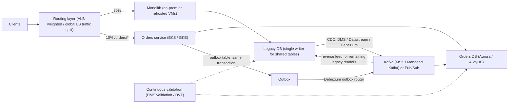
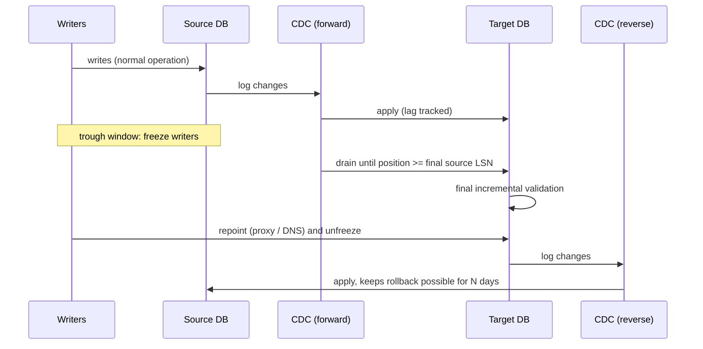

# 06.1 · Large-Scale Migration Patterns: Strangler Fig, CDC (DMS, Datastream, Debezium) and Cutover

> **Folder 06 · File 1 of 3.** A migration moves state *while it keeps changing*. Everything hard about migrations follows from that sentence:
> - change data capture (CDC) has to keep up with the source's change rate;
> - the **cutover** has to freeze writes for as short a time as validation allows;
> - **rollback** needs a path back that's as real as the path forward;
> - the application has to move incrementally (**strangler fig**), because big-bang rewrites fail.
>
> This file covers:
> - the patterns;
> - AWS's toolchain: DMS with Schema Conversion, Application Migration Service, AWS Transform, Elastic VMware Service, DataSync;
> - Google's: Database Migration Service with conversion workspaces, Datastream, Migrate to Virtual Machines, VMware Engine, Storage Transfer, BigQuery Migration Service;
> - open-source Debezium.

| Listing | What it shows | Language |
|---|---|---|
| `cutover_planner.py` | An 8 TB database with a diurnal change rate (4→12 MB/s). Offline dump/restore downtime (11.1 h / 4.4 h) vs full load + CDC: CDC apply that never catches up (8 MB/s = the average), one that catches up and drains nightly (10 MB/s), and a fast one (25 MB/s). Write-freeze math for a trough cutover vs a peak cutover | Python 3 (stdlib) |

**Verification.** The listing is embedded byte-identical. The gate re-runs it on this file and requires `verdict: OK`. That asserts apply = average never converges, the 10 MB/s case converges with real peak lag (>1 GB), and the trough freeze is drain-free. Service capabilities come from the AWS and Google Cloud migration docs as of **2026-10-31**.

**Labels.** **[D]** documented · **[E]** estimate/model · ⚠ inferred or to verify.

---

## 0. Orientation

**The questions this file answers.**

1. How do you decide what to rehost, replatform, refactor or retire (the "7 Rs"), and which tool fits each path on each cloud?
2. How does CDC actually capture changes (binlog, WAL logical decoding, Oracle redo, SQL Server CDC), and what limits its throughput and ordering?
3. When does a CDC migration catch up, and how long must writes freeze at cutover?
4. Why are dual writes dangerous, and what replaces them (outbox + CDC)?
5. How do you migrate an application incrementally (strangler fig) while data lives in both worlds?
6. How do you roll back once the target has taken writes?

**Reading paths.**

| Goal | Read |
|---|---|
| L7 interview | §1, §2, §3.2, §4.2, §5, §6, §7, Q-chains |
| SAP-C02 (Domain 4 heavy) | §2, §3, §6, §7, S-scenarios |
| Running a migration program | §5–§8, with the listing run against your change-rate data |

**Prerequisites.**
- [03.2](../03-Distributed-Storage-Databases-and-Lakehouse-Internals/02-relational-internals-aurora-storage-quorum-rds-proxy-vs-alloydb-and-spanner.md) for target databases.
- [04.1](../04-Messaging-Streaming-and-Data-Pipeline-Comparison/01-kinesis-sqs-sns-eventbridge-msk-vs-gcp-pubsub-and-kafka-tradeoffs.md) for delivery semantics.
- [02.2](../02-Global-Networking-Hybrid-Connectivity-and-Zero-Trust-VPC/02-hybrid-bgp-routing-direct-connect-vif-macsec-vs-cloud-interconnect-ha-vpn.md) for the hybrid link that carries replication.

---

## 1. First principles: moving state that keeps changing

### 1.1 The 7 Rs, as decisions not labels

| R | Decision | Typical tool | Risk owner |
|---|---|---|---|
| Retire | Turn it off | — | Business |
| Retain | Keep on-prem for now | — | Infra |
| Rehost | Same OS/app on cloud VMs | AWS MGN / Migrate to VMs | Infra (fastest, least benefit) |
| Relocate | Move a hypervisor estate as-is | Amazon EVS / Google Cloud VMware Engine | Infra |
| Replatform | Swap a component (e.g. to a managed DB) | DMS / Database Migration Service | App + DB |
| Repurchase | Move to SaaS | — | Business |
| Refactor | Re-architect (services, serverless) | Strangler fig + CDC | App team |

At scale, the portfolio decides speed. Rehost and relocate get the bulk out of the data center by a deadline. Refactoring is reserved for the systems where it pays off.

### 1.2 The convergence condition

A CDC migration runs two phases:
1. **Full load:** copy a snapshot while recording the log position.
2. **CDC:** apply changes since that position.

It converges only if the **apply rate exceeds the change rate** on average, and the lag is acceptable at the moment you cut over. The listing makes this concrete [E]:
- **Apply at 8 MB/s against an 8 MB/s average:** it **never** catches up. The day-3 lag sits between 217 and 327 GB.
- **Apply at 10 MB/s:** it catches up ~40 hours after the full load, but lag still builds to ~38 GB at the evening peak, because 12 MB/s exceeds 10.
- **Cutting over at the 04:00–11:00 trough:** drain time is near zero. At the peak, the drain alone takes 63 minutes of frozen writes.

**CDC apply is usually the bottleneck**, not the copy:
- transaction ordering forces serial or partially parallel apply;
- per-row DML on the target is expensive;
- LOBs and large transactions stall pipelines.

### 1.3 Never dual-write

Writing to old and new stores from the application isn't atomic. A crash between writes, a retry or partial failures leave them **divergent**, with no log to reconcile from. The safe alternatives:
1. **Single writer + CDC:** the old system remains the writer; CDC feeds the new one.
2. **Transactional outbox:** write the business change and an event in **one local transaction**; CDC or a relay publishes the event.
3. **Write switch at cutover:** move the single writer, then reverse the CDC direction for rollback.

---

## 2. Side-by-side architectural Rosetta matrix

| Concern | AWS | GCP | What actually differs |
|---|---|---|---|
| Discovery and planning | Migration Evaluator, Application Discovery Service, Migration Hub. **AWS Transform** (agentic assessment and modernization: VMware, mainframe, .NET) | **Migration Center** (discovery, TCO, recommendations) | AWS Transform automates parts of modernization ⚠ check scope |
| Rehost servers | **AWS Application Migration Service (MGN)**: continuous block-level replication, test and cutover launches | **Migrate to Virtual Machines**: replication, test clones, cutover | Similar model: replicate, test, cut over |
| VMware relocation | **Amazon Elastic VMware Service (EVS)** (VMware Cloud Foundation in your VPC) | **Google Cloud VMware Engine** | Both keep vSphere operations |
| Database migration | **AWS DMS** (instances or **DMS Serverless**): full load + CDC, data validation. **DMS Schema Conversion** / SCT for heterogeneous | **Database Migration Service**: homogeneous (native replication to Cloud SQL / AlloyDB) and heterogeneous (Oracle/SQL Server → PostgreSQL with **conversion workspaces**) | GCP homogeneous uses engine-native replication. AWS uses DMS's CDC engine |
| Analytical CDC | DMS → S3/Kinesis/MSK. Debezium on MSK Connect. Aurora zero-ETL to Redshift | **Datastream** (serverless CDC from MySQL, PostgreSQL, Oracle, SQL Server and more → BigQuery, GCS) | Datastream writes straight to BigQuery with merges |
| Open-source CDC | **Debezium** (Kafka Connect) on MSK Connect | Debezium on Managed Kafka Connect / GKE | Same engine, different hosting |
| Bulk file data | **DataSync** (agents, scheduling, verification), Snow family for offline transfer | **Storage Transfer Service** (agent-based for on-prem), **Transfer Appliance** | — |
| Warehouse migration | DMS Schema Conversion for warehouses. Redshift migration tooling | **BigQuery Migration Service** (batch and interactive SQL translation, assessment) | — |
| Validation | DMS **data validation** (row compare). Custom checksums | **Data Validation Tool (DVT)**, open source | Both: validate continuously, not only at the end |
| Upgrade cutovers in-cloud | **RDS/Aurora Blue/Green deployments** (managed switchover) | Cloud SQL / AlloyDB in-place or replica-promotion upgrades | AWS Blue/Green is a strong zero-downtime-ish primitive |
| Traffic shifting | ALB weighted target groups, Route 53 weighted records, CloudFront origins, API Gateway stages/canaries | Global LB weighted backend services, traffic splitting, Apigee | Strangler routing layer |
| Mainframe | AWS Transform for mainframe / Mainframe Modernization (refactor/replatform) | Mainframe modernization partners, **Dual Run** (parallel run comparison) ⚠ | — |
| Egress fees when leaving a cloud | Data transfer out waived for customers leaving AWS (by request) | Free data transfer for exiting customers (by request) | Relevant to cross-cloud moves |

---

## 3. Internal mechanics: AWS migration services

### 3.1 AWS DMS

- **Components:**
  - a **replication instance** (provisioned) or **DMS Serverless** (capacity in DCUs, auto-scaling);
  - **source/target endpoints**;
  - **tasks**: full load, full load + CDC, or CDC only from a log position.
- **Capture per source:**
  - **MySQL:** binlog (row format, full row image, retention long enough).
  - **PostgreSQL:** logical replication slots (pglogical or test_decoding). Slots retain WAL on the source until consumed, so **a stalled task can fill the source's disk**.
  - **Oracle:** LogMiner or Binary Reader; supplemental logging required.
  - **SQL Server:** MS-CDC or replication; transaction log retention matters.
- **Apply:**
  - **transactional apply** (ordered) by default, or **batch apply** for throughput where ordering per table suffices;
  - parallel load and apply settings per table;
  - LOB handling (limited, full or inline) is a major performance lever.
- **Validation:** compares rows between source and target for supported engines, and reports mismatches. It runs alongside CDC, so the final check is incremental.
- **Schema:**
  - **DMS Schema Conversion** (managed SCT) converts schemas and code (PL/SQL → PL/pgSQL), with an assessment report;
  - generative-AI-assisted conversion ⚠ (check current coverage);
  - DMS doesn't migrate secondary objects like triggers and sequences automatically, so script them.

### 3.2 Engine-native paths on AWS

- **Aurora/RDS read replicas from external MySQL** (binlog replication), and PostgreSQL logical replication into Aurora.
- **RDS/Aurora Blue/Green deployments:**
  - a staging (green) environment synchronized by replication;
  - managed **switchover** with guardrails, typically about a minute of downtime ⚠;
  - for upgrades and schema changes inside AWS.
- **Aurora zero-ETL** for analytics copies (03.4).

### 3.3 MGN, EVS, AWS Transform and DataSync

- **MGN:**
  - agents replicate block devices continuously to a staging area;
  - launch **test instances** non-disruptively;
  - **cutover** launches production instances from the latest replicated state, with conversion of boot, drivers and network;
  - rollback means pointing traffic back to the source, which is still intact.
- **Amazon EVS:** VMware Cloud Foundation running on EC2 bare metal in your VPC. Relocate VMs with vMotion and HCX-style tooling, then modernize gradually.
- **AWS Transform:** AI-agent-assisted assessment and transformation for VMware network and migration planning, mainframe COBOL analysis and refactoring, and .NET porting ⚠ (verify feature scope for your workload).
- **DataSync:** agent-based file and object transfer with integrity verification, scheduling and bandwidth throttling, over DX or the internet.

---

## 4. Internal mechanics: Google Cloud migration services and Debezium

### 4.1 Database Migration Service

- **Homogeneous** (MySQL → Cloud SQL for MySQL; PostgreSQL → Cloud SQL/AlloyDB):
  - uses **native replication** (MySQL replication, PostgreSQL logical replication through pglogical);
  - the initial dump plus continuous replication;
  - **promotion** at cutover makes the destination the primary.
- **Heterogeneous** (Oracle, SQL Server → PostgreSQL/AlloyDB):
  - **conversion workspaces** convert schema and code with an editor, with AI-assisted conversion of PL/SQL ⚠;
  - then CDC replication.
- **Connectivity:** IP allowlists, reverse SSH tunnels, or **private connectivity** through VPC peering / PSC (02.1).

### 4.2 Datastream

- **Serverless CDC.** Sources: MySQL, PostgreSQL, Oracle, SQL Server and others. Destinations: **BigQuery** (direct, with merge semantics and staleness settings), **Cloud Storage** (Avro/JSON files for custom pipelines), and Dataflow templates onward to Spanner/Cloud SQL ⚠.
- **Backfill + CDC** per object.
- **Ordering and deduplication** metadata (source timestamps, log positions) in each event.
- **Common uses:** analytics replication (the AWS zero-ETL analog) and event sourcing from legacy databases into the lakehouse.

### 4.3 Debezium (both clouds)

- Kafka Connect source connectors read database logs (binlog, WAL, Oracle LogMiner/XStream, SQL Server CDC) and emit **change events** with before/after images, log position and transaction metadata.
- **Snapshot then stream.** Incremental snapshots allow re-snapshotting tables without stopping streaming.
- **Outbox event router:** reads an `outbox` table written in the same transaction as business changes, and publishes clean domain events. That's the antidote to dual writes.
- **Hosting:** MSK Connect (AWS), Managed Service for Apache Kafka Connect or GKE (GCP).
- **Semantics:** at-least-once to Kafka; consumers must be idempotent (04.1).

### 4.4 Migrate to VMs, VMware Engine and bulk transfer

- **Migrate to Virtual Machines:** replicate VMs from VMware, AWS, Azure and physical servers; test clones; cutover with OS adaptation.
- **Google Cloud VMware Engine:** dedicated VMware SDDCs in Google Cloud.
- **Storage Transfer Service:** managed transfer from other clouds (S3, Azure), HTTP, or on-prem through agents, with integrity checks and scheduling. **Transfer Appliance** for offline bulk data.
- **BigQuery Migration Service:** SQL translation (Teradata, Redshift, Snowflake, others), assessment, data transfer.

---

## 5. Listing: when does CDC converge, and how long is the freeze?

<!-- listing:cutover_planner.py -->
```python
"""cutover_planner.py - when can a CDC-based database migration cut over, and how long is the
write freeze? Full load + change data capture (AWS DMS, Datastream, Debezium) vs offline dump/restore.

Model (all inputs are ASSUMPTIONS, printed as such):
  full load copies the source at a fixed throughput; changes made meanwhile queue as backlog
  CDC apply drains backlog at `apply` MB/s while the diurnal change rate keeps arriving
    lag(t+1) = max(0, lag(t) + change(t) - apply)
  cutover = freeze writes -> drain the remaining lag -> validate -> repoint clients
  if apply < peak change rate, lag grows every peak; you can only cut over in the trough

Usage: python -I cutover_planner.py <any path>
"""
import math
import sys


def change_rate(minute, base=4.0, peak=12.0):
    """MB/s, diurnal: trough at 04:00, peak at 16:00."""
    phase = (minute % 1440) / 1440 * 2 * math.pi
    return base + (peak - base) * (1 - math.cos(phase - 4 / 24 * 2 * math.pi)) / 2


def simulate(size_tb, load_mb_s, apply_mb_s, days=3):
    load_min = size_tb * 1e6 / load_mb_s / 60
    lag_mb, minute = 0.0, 0
    while minute < load_min:
        lag_mb += change_rate(minute) * 60
        minute += 1
    backlog_at_load_end = lag_mb
    curve = []
    for m in range(minute, minute + days * 1440):
        lag_mb = max(0.0, lag_mb + (change_rate(m) - apply_mb_s) * 60)
        curve.append((m, lag_mb))
    return load_min, backlog_at_load_end, curve


def main():
    ok = True
    size = 8.0
    print("ASSUMED: 8 TB source, change rate 4 MB/s (04:00) to 12 MB/s (16:00), validation 10 min,")
    print("client repoint 1 min (DNS TTL 60 s) or 5 s (connection proxy)")
    print()
    print("== 1. Offline dump/restore downtime ==")
    for thr in (200, 500):
        hours = size * 1e6 / thr / 3600
        print(f"restore at {thr} MB/s: {hours:5.1f} h of downtime (writes frozen for the whole copy)")
    print()
    print("== 2. Full load + CDC ==")
    results = {}
    for load, apply in ((200, 8), (200, 10), (500, 25)):
        load_min, backlog, curve = simulate(size, load, apply)
        caught = next((m for m, lag in curve if lag < 30 * change_rate(m)), None)
        last_day = curve[-1440:]
        trough = min(last_day, key=lambda x: x[1])
        peak = max(last_day, key=lambda x: x[1])
        results[(load, apply)] = (caught, trough[1], peak[1])
        hh = lambda m: f"{(m % 1440) // 60:02d}:{m % 60:02d}"
        caught_txt = f"{(caught - load_min) / 60:5.1f} h after full load" if caught is not None else "never (apply <= average change rate)"
        print(f"load {load} MB/s ({load_min / 60:4.1f} h), apply {apply:>2} MB/s: backlog {backlog / 1e3:6.1f} GB -> "
              f"caught up {caught_txt}")
        print(f"   day-3 lag: min {trough[1] / 1e3:6.2f} GB at {hh(trough[0])}, max {peak[1] / 1e3:6.2f} GB at {hh(peak[0])}")
    ok &= results[(200, 8)][0] is None
    ok &= results[(200, 10)][0] is not None and results[(200, 10)][2] > 1e3 and results[(500, 25)][2] < 1.0
    print()
    print("== 3. Write-freeze for a cutover in the trough (apply 10 MB/s) ==")
    _, trough_lag, peak_lag = results[(200, 10)]
    for name, repoint_s in (("DNS repoint (TTL 60 s)", 60), ("connection proxy", 5)):
        drain_s = trough_lag / 10
        freeze_min = (drain_s + 600 + repoint_s) / 60
        print(f"{name:<24} drain {drain_s:6.1f} s + validate 600 s + repoint {repoint_s:>2} s = {freeze_min:5.1f} min")
    ok &= trough_lag / 10 < 60
    print(f"   the same cutover at the evening peak would first drain {peak_lag / 1e3:.0f} GB: {peak_lag / 10 / 60:.0f} min of lag")
    print("   validation, not data movement, dominates the freeze: precompute row counts/checksums")
    print("   continuously so the final check covers only the last minutes")
    print()
    print("verdict: OK" if ok else "verdict: FAIL")


if __name__ == "__main__":
    main()
```

<!-- output:cutover_planner.py -->
```text
ASSUMED: 8 TB source, change rate 4 MB/s (04:00) to 12 MB/s (16:00), validation 10 min,
client repoint 1 min (DNS TTL 60 s) or 5 s (connection proxy)

== 1. Offline dump/restore downtime ==
restore at 200 MB/s:  11.1 h of downtime (writes frozen for the whole copy)
restore at 500 MB/s:   4.4 h of downtime (writes frozen for the whole copy)

== 2. Full load + CDC ==
load 200 MB/s (11.1 h), apply  8 MB/s: backlog  219.8 GB -> caught up never (apply <= average change rate)
   day-3 lag: min 217.46 GB at 09:59, max 327.47 GB at 21:59
load 200 MB/s (11.1 h), apply 10 MB/s: backlog  219.8 GB -> caught up  39.9 h after full load
   day-3 lag: min   0.00 GB at 11:07, max  37.67 GB at 19:59
load 500 MB/s ( 4.4 h), apply 25 MB/s: backlog   74.1 GB -> caught up   1.0 h after full load
   day-3 lag: min   0.00 GB at 04:27, max   0.00 GB at 04:27

== 3. Write-freeze for a cutover in the trough (apply 10 MB/s) ==
DNS repoint (TTL 60 s)   drain    0.0 s + validate 600 s + repoint 60 s =  11.0 min
connection proxy         drain    0.0 s + validate 600 s + repoint  5 s =  10.1 min
   the same cutover at the evening peak would first drain 38 GB: 63 min of lag
   validation, not data movement, dominates the freeze: precompute row counts/checksums
   continuously so the final check covers only the last minutes

verdict: OK
```

**Reading the output [E].**

- **Offline:** an 8 TB dump/restore freezes writes for **11.1 h** at 200 MB/s, or **4.4 h** at 500 MB/s. Unacceptable for most OLTP.
- **CDC that can't converge:** apply at 8 MB/s equals the **average** change rate, so lag never drains (217–327 GB on day 3). More parallel apply, batch apply, fewer LOBs or a bigger instance is required *before* scheduling a cutover.
- **CDC that converges with daily peaks:** apply at 10 MB/s catches up ~40 h after the full load. It still accumulates ~38 GB by the 20:00 peak and drains it overnight. Cut over in the trough: drain ≈ 0 s, freeze ≈ validation + repoint, **~10–11 minutes**. A peak cutover would add **63 minutes**.
- **The freeze is dominated by validation.** Run continuous row-count and checksum comparison (DMS validation, DVT), so the final check covers only the last minutes. Use a connection proxy (RDS Proxy, PgBouncer) or a pre-staged DNS change with a short TTL, so the repoint takes seconds.

---

## 6. Patterns

### 6.1 Strangler fig with a routing layer

1. Put a **routing layer** in front of the monolith: an API gateway, ALB or global LB with path and weight rules.
2. Carve out one capability at a time into a new service. Route its endpoints to the new service, with a **canary weight** (1% → 10% → 100%).
3. **Data:** the monolith remains the writer for shared tables until the capability's data is extracted.
   - The new service reads a **CDC-fed copy**, or owns new tables.
   - When it takes ownership, reverse the flow: the new service writes, CDC feeds the monolith's legacy tables for the remaining readers.
4. Retire the monolith's path when traffic reaches zero.

### 6.2 Database cutover runbook (zero-data-loss)

```text
T-14d  full load + CDC running; continuous validation green; lag SLO met for 7 days
T-1d   rehearsal on a clone: freeze, drain, validate, switch, rollback - timed
T-0    trough window: enable read-only / stop writers (feature flag or DB-level)
       wait lag = 0 (CDC position >= source final LSN/SCN/binlog pos)
       final incremental validation (rows changed since last check)
       repoint writers (proxy/DNS); start REVERSE CDC (target -> old source) for rollback
       smoke tests; unfreeze writes on the target
T+7d   reverse CDC kept running; rollback = freeze, drain reverse, switch back
T+30d  decommission source after business sign-off
```

### 6.3 Cross-cloud migrations

The same patterns apply, with:
- **egress pricing** (both clouds waive data-transfer-out fees for customers leaving, on request);
- **private links** (AWS Interconnect – multicloud, 02.2);
- **identity** (WIF/IAM federation, 05.2) for the replication services.

---

## 7. Failure modes, throttling limits and quota traps

| # | Symptom | Root cause | Detect | Fix | Cloud |
|---|---|---|---|---|---|
| 1 | CDC lag never reaches zero | **Apply ≤ average change rate** (listing §2) | Lag trend | Batch/parallel apply, LOB settings, bigger instance, fewer indexes on the target during load | Both |
| 2 | Source database disk fills during migration | **PostgreSQL replication slot** retains WAL while the task is stalled. Binlog/redo retention issues | Source disk, slot lag | Monitor slots. Alarm. Drop abandoned slots. Size retention | Both |
| 3 | Target missing rows after cutover | Writes during the cutover window not drained | Validation mismatches | Freeze writers, wait for CDC position ≥ final log position, then switch | Both |
| 4 | Divergent data between old and new systems | **Dual writes** from the app | Reconciliation | Single writer + CDC, or outbox | Both |
| 5 | Very slow full load | LOBs in full mode, single-threaded table loads, target indexes and constraints | Table load stats | Limited LOB mode, parallel load, create indexes after load | AWS |
| 6 | Sequences/identity values collide after cutover | Sequences not migrated | Duplicate key errors | Script sequence resets past max(id) | Both |
| 7 | Heterogeneous conversion breaks behavior | PL/SQL semantics differ (NULLs, implicit casts, transactions) | Test failures | Conversion assessment, unit tests of converted code, dual-run comparison | Both |
| 8 | Cutover takes an hour, not minutes | DNS caching, connection pools to the old endpoint | Client errors | Proxy repoint. Short TTL staged days ahead. Pool restarts | Both |
| 9 | No way back after go-live | No reverse replication | — | Reverse CDC from the target to the old source for N days | Both |
| 10 | CDC events out of order downstream | Parallel apply/partitioning by the wrong key | Consumer anomalies | Partition by primary key. Transactional apply where needed | Both |
| 11 | Datastream to BigQuery shows stale data | Staleness/merge settings, backfill in progress | Freshness metrics | Tune staleness. Monitor backfill | GCP |
| 12 | MGN cutover instances fail to boot | Drivers or boot mode not converted. Launch template misconfigured | Test launches | Always test-launch. Fix templates before cutover | AWS |
| 13 | Replication saturates the hybrid link | Full load + CDC + file transfers share DX/Interconnect | Link utilization | Throttle (DataSync/STS bandwidth limits), schedule, add capacity (02.2) | Both |
| 14 | Network egress bill surprises during a cross-cloud move | Exit-waiver process not used, or data moved repeatedly | Billing | Request egress waivers. Move once. Compress | Both |

---

## 8. Architecture diagrams: multi-service compositions

### 8.1 Strangler fig with CDC on both clouds



### 8.2 Database cutover with reverse CDC for rollback



### 8.3 The migration program portfolio (ASCII)

```text
wave 0  foundations: landing zone (05), network (02), identity federation, observability, CDC platform
wave 1  rehost/relocate bulk (MGN / Migrate to VMs / EVS / GCVE)   -> exit data-center deadline
wave 2  replatform data (DMS / Database Migration Service, Datastream) -> managed DBs, analytics
wave 3  refactor hotspots via strangler fig (routing + CDC + outbox)  -> services, serverless
always  continuous validation, rollback paths, cost tracking (06.3), DR posture (06.2)
```

---

## 9. Bar-raiser chains and SAP-C02 scenarios

### 9.1 L7 bar-raiser chains

<details><summary><b>Q1 · Plan a zero-downtime migration of a 10 TB OLTP database</b></summary>

**Initial Prompt.** "A 10 TB PostgreSQL OLTP database on-prem must move to Aurora PostgreSQL (or AlloyDB on GCP) with under 15 minutes of write downtime and no data loss. Plan it."

**L5 Answer.** "Use DMS full load + CDC, then switch over on a weekend."

**Why L5 Stalls.** It doesn't check convergence, slot management, validation, the repoint mechanism or rollback, and a weekend isn't necessarily the change-rate trough.

**L7 Answer.**
1. **Measure the change rate** by hour from WAL generation. Size CDC apply above the **peak**, or at least above the average with a known trough (listing: apply = average never converges).
2. **Path choice:**
   - homogeneous PostgreSQL → logical replication (DMS on AWS, Database Migration Service on GCP, both slot-based);
   - **monitor the slot**, since a stalled consumer fills the source disk.
3. **Prepare the target:** full load with indexes and constraints created after load. Script sequences.
4. **Continuous validation** from day one, so the final check is incremental.
5. **Cutover in the trough:**
   - freeze writers (feature flag);
   - wait for the CDC position to pass the final LSN;
   - run incremental validation;
   - repoint through **RDS Proxy / PgBouncer** (seconds) instead of DNS.
6. **Start reverse replication** from the target to the old source for a week as the rollback path.
7. **Rehearse** the whole runbook on a clone with timing.

That fits the 15-minute budget with validation as the main cost (listing: ~10 minutes)."
</details>

<details><summary><b>Q2 · The CDC lag keeps growing; leadership wants to cut over Friday</b></summary>

**Initial Prompt.** "DMS CDC lag rises every afternoon and only partly recovers overnight. The migration lead wants to cut over Friday anyway. What do you do?"

**L5 Answer.** "Cut over at night when the lag is lowest."

**Why L5 Stalls.** If the lag only *partly* recovers, the apply rate is at or below the average change rate. The backlog grows day over day, and the freeze would include draining it.

**L7 Answer.** "Partial overnight recovery is the listing's 'never converges' signature: apply ≤ average change rate. Each day starts with more backlog, so Friday's freeze would include draining hundreds of GB.

Before any cutover date:
1. **Find the apply bottleneck:**
   - single-threaded transactional apply;
   - LOB mode;
   - target indexes and triggers;
   - an undersized instance;
   - hot tables.
2. **Fix it:**
   - batch apply where per-table ordering suffices;
   - parallel apply threads;
   - limited LOB mode;
   - drop non-essential target indexes until after cutover;
   - scale the replication instance, or DMS Serverless capacity.
3. **Prove convergence:** lag reaches near zero in the trough for several consecutive days.

Then schedule. The go/no-go criterion is a measured lag SLO, not a calendar date."
</details>

<details><summary><b>Q3 · Why can't we just dual-write during the migration?</b></summary>

**Initial Prompt.** "An engineering lead proposes the app writes to both the old Oracle and the new PostgreSQL during migration, then switches reads. Evaluate."

**L5 Answer.** "Dual writes work if we wrap them in try/catch and retry failures."

**Why L5 Stalls.** Retries don't create atomicity across two databases. Partial failures, crashes and reordering leave divergent data with no log to reconcile from.

**L7 Answer.** "Two independent writes can't be atomic without distributed transactions, which neither side should be doing.
- A crash after the Oracle commit and before the Postgres write loses data in Postgres.
- A retry after a timeout can double-apply.
- Concurrent requests can interleave differently on each side.

There's no single ordered log to repair from.

Use one of:
1. **A single writer (Oracle) + CDC** (DMS/Datastream/Debezium) into PostgreSQL, with one ordered source of truth, until cutover.
2. **A transactional outbox** if new services need events: write the business row and an outbox row in the same Oracle transaction, and publish through Debezium's outbox router.
3. At cutover, **flip the writer** and **reverse CDC** for rollback.

Validate continuously with DMS validation or DVT."
</details>

<details><summary><b>Q4 · Rehost 2,000 VMs in 9 months</b></summary>

**Initial Prompt.** "We must exit a data center with 2,000 VMs (VMware) in 9 months. Choose a strategy on AWS and on GCP."

**L5 Answer.** "Lift and shift everything with the migration service."

**Why L5 Stalls.** It skips portfolio triage, VMware relocation as an option, waves, dependency mapping, licensing and the network/identity foundations that gate every wave.

**L7 Answer.**
1. **Triage** with discovery (Migration Center / Application Discovery and Migration Evaluator):
   - ~10–20% retire;
   - relocate tightly coupled VMware clusters (Amazon **EVS** / **Google Cloud VMware Engine**) to hit the deadline without re-platforming;
   - rehost the rest with **MGN** / **Migrate to Virtual Machines**;
   - a small set of high-value apps to replatform (managed databases through DMS / Database Migration Service).
2. **Wave plan** by dependency groups (network flows from discovery), not by server count.
3. **Foundations first:**
   - landing zone and guardrails (05);
   - hybrid connectivity sized for replication (02.2, the listing's throughput math);
   - DNS and identity.
4. **Factory:** replicate → test launch → cutover window → hypercare, with rollback to the source VMs (still intact) per wave.
5. **Licensing:** BYOL constraints (Dedicated Hosts / sole-tenant nodes, 01.1).

Modernize after the exit. The deadline is met by relocate and rehost, not by refactoring."
</details>

<details><summary><b>Q5 · Strangle a monolith that shares one database</b></summary>

**Initial Prompt.** "Our monolith has one 400-table database. We want to extract the orders domain into a service without a big-bang. The tables are joined everywhere. How?"

**L5 Answer.** "Create a new database for orders and migrate the tables."

**Why L5 Stalls.** Moving tables breaks the joins in the rest of the monolith on day one. Data ownership has to move gradually, with reads and writes considered separately.

**L7 Answer.**
1. **Route first:** put a routing layer in front, and send `/orders/*` reads to the new service at a canary weight.
2. **Read model:** the service reads an orders copy fed by **CDC** from the monolith's tables (Debezium/DMS → Kafka → the service's DB). The monolith stays the writer.
3. **Move writes:**
   - when ready, the service becomes the writer for orders;
   - it publishes through an **outbox**;
   - a reverse CDC/consumer keeps the monolith's orders tables updated for the joins that remain.
4. **Untangle the joins** in the monolith progressively: replace them with API calls or local read models.
5. **Retire** the reverse feed when no monolith code reads orders tables.

At every step there's one writer per table, and rollback is a routing change."
</details>

<details><summary><b>Q6 · Oracle to PostgreSQL: what breaks after conversion?</b></summary>

**Initial Prompt.** "Schema conversion reports 96% automatic conversion from Oracle to PostgreSQL. Leadership thinks we're nearly done. Bar-raise."

**L5 Answer.** "Fix the remaining 4% manually and we're done."

**Why L5 Stalls.** Conversion rates measure syntax, not semantics. Behavior differences in the 'converted' 96% cause production bugs.

**L7 Answer.** "Converted code can compile and still behave differently:
- empty string vs NULL (Oracle treats '' as NULL);
- implicit type conversions;
- `DATE` with time components;
- transaction and exception semantics in procedures;
- sequence and identity behavior;
- `ROWNUM` vs `LIMIT` ordering;
- outer-join syntax;
- collation and sort order;
- numeric precision.

Plan:
1. **Unit tests** for converted procedures with Oracle-produced expected outputs.
2. **Dual-run comparison**: run the same transactions or batch jobs against both and diff results (DVT, custom harnesses).
3. **Performance:** different optimizers mean query plan regressions, so capture top queries and compare plans.
4. **Data validation** of migrated rows.
5. **Staged cutover** by module where possible.

The remaining 4% is usually the riskiest code (dynamic SQL, packages), so schedule it first."
</details>

<details><summary><b>Q7 · Replicate a transactional database into BigQuery for analytics</b></summary>

**Initial Prompt.** "We need sub-minute replication of a MySQL OLTP database on AWS RDS into BigQuery for analytics, without hurting production. Design it."

**L5 Answer.** "Export nightly to S3 and load into BigQuery."

**Why L5 Stalls.** Nightly batch misses the sub-minute requirement, and export jobs load the primary.

**L7 Answer.**
- **Datastream** reads the **binlog** (row-based, from the primary or a binlog-enabled replica, to offload) over private connectivity: AWS Interconnect – multicloud or HA VPN (02.2).
- It writes **directly into BigQuery** with merge semantics: backfill first, then CDC, with the staleness tuned to ~1 minute.
- **Schema changes** propagate for supported DDL. Monitor for unsupported types.
- **Security:** a least-privilege replication user, binlog retention long enough for outages, and the BigQuery dataset inside a VPC-SC perimeter (05.2).
- **Alternative on AWS:** Aurora/RDS zero-ETL to Redshift if the warehouse is Redshift. Or Debezium → MSK → a BigQuery sink if a Kafka bus is wanted for other consumers.
- **Validate:** hourly row counts and checksums per table."
</details>

<details><summary><b>Q8 · Plan the rollback before go-live</b></summary>

**Initial Prompt.** "The CIO asks: 'If the new platform misbehaves on day 3, can we go back without losing three days of orders?'"

**L5 Answer.** "We'll keep backups of the old system."

**Why L5 Stalls.** Restoring an old backup loses everything written since cutover. Rollback must carry new writes back.

**L7 Answer.** "Yes, if we design for it:
1. **Reverse replication.** At cutover, start CDC from the **new** primary back to the **old** one (DMS/Datastream/Debezium in reverse), so the old system stays current.
2. **Keep the old schema compatible** during the rollback window. Avoid destructive schema changes on the new side until the window closes.
3. **Rollback runbook:** freeze writers → drain reverse CDC → validate → repoint → unfreeze. It's the same discipline as forward, and rehearsed.
4. **Decision criteria in advance:** error budgets, data correctness checks, business KPIs.
5. **Close the window** after N days with sign-off, then decommission.

Without reverse replication, the honest answer is 'only by losing data or replaying it from logs', so we build it."
</details>

<details><summary><b>Q9 · Migrate 3 PB of object data from on-prem to S3 and GCS</b></summary>

**Initial Prompt.** "We have 3 PB of NAS and object data to move to the cloud in 4 months, with a 10 Gbps link mostly used by production. Options?"

**L5 Answer.** "Copy it over the network with rsync."

**Why L5 Stalls.** 3 PB over a shared 10 Gbps link at 50% availability is ~55 days of perfect transfer. Plus integrity, incremental changes and cutover of the file users.

**L7 Answer.**
- **The math:** 3 PB at 5 Gbps effective is ~56 days if nothing goes wrong.
- **Online:** **DataSync** (AWS) / **Storage Transfer Service with agents** (GCP):
  - parallel agents;
  - integrity verification;
  - bandwidth throttling outside business hours;
  - incremental re-runs for changed files.
- **Offline for the bulk:** Snow-family devices where available ⚠ / **Transfer Appliance**, then online incremental sync for deltas.
- **Layout on arrival:** hash-prefixed keys for request scaling (03.1), lifecycle and Intelligent-Tiering/Autoclass for cold data (06.3).
- **Cutover for file users:**
  1. freeze writes on the share;
  2. final incremental sync;
  3. switch mounts (FSx / Filestore, or S3/GCS access patterns);
  4. keep the source read-only for rollback."
</details>

<details><summary><b>Q10 · Move a workload from AWS to GCP (or back) without a big-bang</b></summary>

**Initial Prompt.** "We're moving a data-heavy service from AWS to GCP for strategic reasons. Design the incremental migration and name the cross-cloud traps."

**L5 Answer.** "Rebuild it on GCP and switch DNS when it's ready."

**Why L5 Stalls.** It's a big-bang. It ignores data gravity, egress fees, identity across clouds and rollback.

**L7 Answer.**
1. **Connectivity and identity first:**
   - **AWS Interconnect – multicloud** / Cross-Cloud Interconnect (02.2);
   - non-overlapping CIDRs;
   - WIF from AWS roles to GCP (05.2 Q4);
   - DNS forwarding both ways.
2. **Data:**
   - CDC from Aurora (DMS or Debezium) into AlloyDB, or Datastream into BigQuery for analytics;
   - Storage Transfer Service for S3 → GCS;
   - **request the egress waiver** for exit traffic.
3. **App:**
   - a strangler routing layer (global LB in front, or DNS weights);
   - move stateless services first, reading CDC-fed copies;
   - then move writers per domain, with reverse CDC.
4. **Translation checks** from this KB: IAM (05), messaging semantics (04), storage limits (03.1 Q10), serverless concurrency (01.3).
5. **Decommission** AWS components wave by wave with cost tracking."
</details>

### 9.2 SAP-C02 scenarios (original)

<details><summary><b>S1 · SAP-C02 · Domain 4 · Select ONE</b></summary>

**Scenario.** A company is migrating a 6 TB MySQL database from on premises to Amazon Aurora MySQL. The application can tolerate only a few minutes of downtime. The change rate is moderate and the team wants to validate data before switching. What should a solutions architect recommend?

- **A.** Take a mysqldump backup over a weekend and restore it into Aurora.
- **B.** Use AWS DMS with full load and ongoing CDC, enable data validation, and cut over after replication lag reaches near zero during a low-traffic window.
- **C.** Use AWS DataSync to copy the database files.
- **D.** Export the tables to CSV in S3 and load them with AWS Glue.

**Answer: B**

- **A** — wrong: a dump and restore of 6 TB requires hours of downtime while writes are frozen.
- **B** — correct: full load plus CDC keeps Aurora synchronized, validation checks rows, and the cutover needs only minutes once lag is near zero.
- **C** — wrong: copying live database files doesn't produce a consistent, migratable database.
- **D** — wrong: CSV exports are point-in-time and require long downtime to capture later changes.
</details>

<details><summary><b>S2 · SAP-C02 · Domain 4 · Select ONE</b></summary>

**Scenario.** A company must migrate 900 on-premises VMware virtual machines running Windows and Linux to EC2 within six months with minimal changes, and must be able to test each server in AWS before cutover. What should a solutions architect recommend?

- **A.** Rebuild each server manually from scratch on EC2.
- **B.** Export each VM as an image and import it with VM Import/Export only at cutover.
- **C.** Use AWS Application Migration Service to replicate servers continuously, perform non-disruptive test launches, and cut over in waves.
- **D.** Use AWS DataSync to copy the virtual disks.

**Answer: C**

- **A** — wrong: rebuilding 900 servers manually isn't feasible in six months.
- **B** — wrong: one-time image imports at cutover require downtime proportional to disk size and offer no continuous replication.
- **C** — correct: MGN replicates block devices continuously, supports test launches and enables wave-based cutovers with short downtime.
- **D** — wrong: DataSync transfers files and objects, not bootable servers.
</details>

<details><summary><b>S3 · SAP-C02 · Domain 4 · Select TWO</b></summary>

**Scenario.** A company is migrating an Oracle database with extensive PL/SQL to Amazon Aurora PostgreSQL. It needs to convert the schema and code, and keep the target synchronized with ongoing changes until cutover. Which actions should a solutions architect take? (Select TWO.)

- **A.** Use AWS DMS Schema Conversion (or the AWS Schema Conversion Tool) to convert the schema and PL/SQL code.
- **B.** Use AWS DataSync to copy the Oracle data files.
- **C.** Use AWS DMS with full load and ongoing replication (CDC) from Oracle to Aurora PostgreSQL.
- **D.** Use Amazon S3 Transfer Acceleration.
- **E.** Convert the database to DynamoDB.

**Answer: A, C**

- **A** — correct: schema conversion handles heterogeneous schema and code translation, with an assessment of manual work.
- **B** — wrong: copying Oracle data files doesn't convert or load them into PostgreSQL.
- **C** — correct: DMS full load plus CDC keeps the target synchronized until cutover.
- **D** — wrong: Transfer Acceleration speeds S3 uploads and is unrelated.
- **E** — wrong: moving to DynamoDB is a re-architecture, not the requested migration.
</details>

<details><summary><b>S4 · SAP-C02 · Domain 4 · Select ONE</b></summary>

**Scenario.** A team is breaking a monolith into microservices. A new orders service needs the orders data, while the monolith still writes to the same tables. The team wants to avoid inconsistent data from writing to two databases from application code. What should a solutions architect recommend?

- **A.** Have the monolith write to both the old and new databases in each request.
- **B.** Copy the tables nightly to the new service's database.
- **C.** Give the new service read/write access to the monolith's database tables.
- **D.** Keep the monolith as the single writer and stream changes from its database log to the new service's database using change data capture.

**Answer: D**

- **A** — wrong: dual writes from application code aren't atomic and lead to divergence.
- **B** — wrong: nightly copies are stale.
- **C** — wrong: sharing tables couples the services and blocks independent evolution.
- **D** — correct: log-based CDC from a single writer keeps the copy consistent and ordered without dual writes.
</details>

<details><summary><b>S5 · SAP-C02 · Domain 4 · Select ONE</b></summary>

**Scenario.** A company needs to transfer 200 TB of file data from an on-premises NAS to Amazon S3 over an existing 10 Gbps Direct Connect link, with integrity verification and incremental updates until a cutover date, without saturating the link during business hours. What should a solutions architect recommend?

- **A.** Write a custom script with the AWS CLI `s3 cp` command.
- **B.** AWS DataSync with agents on premises, scheduled tasks with bandwidth limits during business hours, and verification enabled.
- **C.** AWS Application Migration Service.
- **D.** AWS DMS.

**Answer: B**

- **A** — wrong: custom scripts lack built-in verification, incremental tracking and throttling.
- **B** — correct: DataSync handles large file transfers with verification, scheduling, incremental runs and bandwidth throttling.
- **C** — wrong: MGN replicates servers, not NAS file shares.
- **D** — wrong: DMS migrates databases, not files.
</details>

<details><summary><b>S6 · SAP-C02 · Domain 3 · Select ONE</b></summary>

**Scenario.** A company needs to upgrade an Amazon Aurora MySQL cluster to a new major version with minimal downtime, test the upgraded environment with production-like data first, and switch over safely. What should a solutions architect recommend?

- **A.** Perform an in-place major version upgrade during business hours.
- **B.** Create a new cluster from a snapshot and update the application connection strings manually.
- **C.** Use Amazon RDS Blue/Green Deployments to create a synchronized green environment on the new version, test it, and perform a switchover.
- **D.** Use AWS DMS to migrate to a new cluster without CDC.

**Answer: C**

- **A** — wrong: an in-place major upgrade causes downtime and offers no pre-switch testing.
- **B** — wrong: a snapshot-based copy diverges after creation and needs a manual, error-prone switch.
- **C** — correct: Blue/Green Deployments keep a green environment synchronized and provide a managed switchover with guardrails.
- **D** — wrong: without CDC the new cluster misses changes after the copy.
</details>

---

## 10. Checklist

- [ ] Portfolio triaged by the 7 Rs. The deadline met by rehost/relocate, refactoring reserved for high-value systems.
- [ ] The change rate is measured hourly from source logs. CDC apply capacity exceeds the peak, or converges with a known trough (listing §2).
- [ ] Source log retention and replication slots monitored (a disk-full risk). Supplemental logging / binlog format configured.
- [ ] Continuous validation (DMS validation / DVT) runs from day one. The final check is incremental.
- [ ] No dual writes: single writer + CDC, outbox for events.
- [ ] Cutover runbook rehearsed with timings: freeze → drain to the final log position → validate → repoint by proxy → reverse CDC.
- [ ] A rollback window with reverse replication and a compatible schema.
- [ ] Hybrid link capacity planned for replication. Transfers throttled in business hours.
- [ ] Heterogeneous conversions covered by semantic tests and dual-run diffs, not conversion percentages.
- [ ] Cross-cloud moves: private interconnect, federated identity, egress waivers requested.

---

## 11. References

AWS:
- AWS DMS user guide: <https://docs.aws.amazon.com/dms/latest/userguide/Welcome.html>
- DMS data validation: <https://docs.aws.amazon.com/dms/latest/userguide/CHAP_Validating.html>
- DMS Schema Conversion: <https://docs.aws.amazon.com/dms/latest/userguide/CHAP_SchemaConversion.html>
- AWS DMS Serverless: <https://docs.aws.amazon.com/dms/latest/userguide/CHAP_Serverless.html>
- AWS Application Migration Service: <https://docs.aws.amazon.com/mgn/latest/ug/what-is-application-migration-service.html>
- AWS DataSync: <https://docs.aws.amazon.com/datasync/latest/userguide/what-is-datasync.html>
- RDS Blue/Green Deployments: <https://docs.aws.amazon.com/AmazonRDS/latest/AuroraUserGuide/blue-green-deployments.html>
- AWS Prescriptive Guidance, strangler fig pattern: <https://docs.aws.amazon.com/prescriptive-guidance/latest/cloud-design-patterns/strangler-fig.html>
- Transactional outbox pattern: <https://docs.aws.amazon.com/prescriptive-guidance/latest/cloud-design-patterns/transactional-outbox.html>

Google Cloud:
- Database Migration Service: <https://docs.cloud.google.com/database-migration/docs/overview>
- Datastream overview: <https://docs.cloud.google.com/datastream/docs/overview>
- Migrate to Virtual Machines: <https://docs.cloud.google.com/migrate/virtual-machines/docs/5.0/migrate/overview>
- Storage Transfer Service: <https://docs.cloud.google.com/storage-transfer/docs/overview>
- BigQuery Migration Service: <https://docs.cloud.google.com/bigquery/docs/migration-intro>
- Data Validation Tool: <https://github.com/GoogleCloudPlatform/professional-services-data-validator>

Open source:
- Debezium documentation: <https://debezium.io/documentation/reference/stable/index.html>
- Debezium outbox event router: <https://debezium.io/documentation/reference/stable/transformations/outbox-event-router.html>
