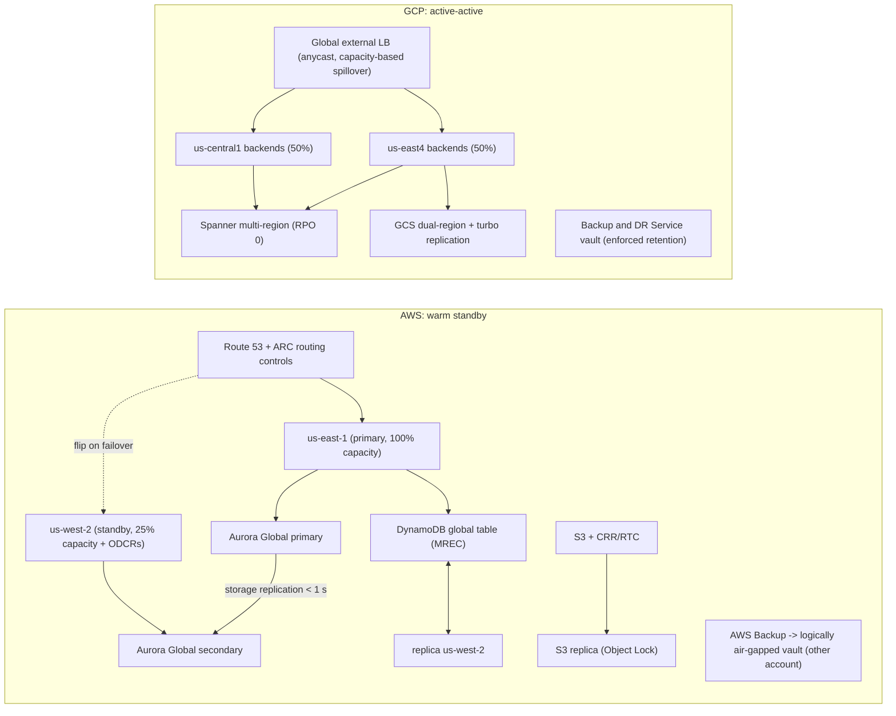
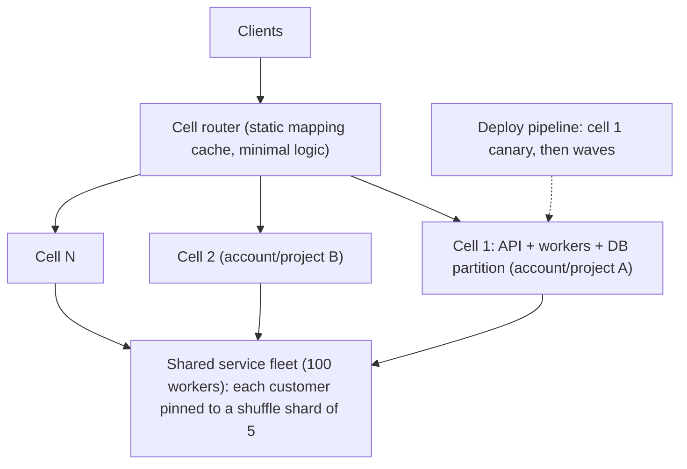

# 06.2 · Multi-Region DR: Pilot Light, Warm Standby, Active-Active and Cell-Based Failover

> **Folder 06 · File 2 of 3.** Disaster recovery is an economic decision with physics constraints:
> - **RPO** is set by how data is replicated (backup interval, async lag, synchronous quorum);
> - **RTO** is set by what must happen before traffic can move: detection, decision, capacity, data, routing;
> - **cost** is set by how much of production you keep running elsewhere.
>
> This file goes through the four classic strategies on both clouds and their RTO/RPO components. It covers the mechanisms that make failover **statically stable** (no control-plane dependency at the worst moment), the **cell-based** and **shuffle-sharded** designs that shrink blast radius so many incidents never need a Region failover, and how to prove all of it with drills.

| Listing | What it shows | Language |
|---|---|---|
| `dr_calculator.py` | RTO built from components, RPO, standing cost and expected annual loss for backup & restore, pilot light, warm standby and active-active at stated inputs. The downtime cost at which warm standby beats pilot light. Customers impacted by a poison tenant under one fleet, 4 or 10 cells, and shuffle sharding (8 workers/shard 2; 100 workers/shard 5) | Python 3 (stdlib) |

**Verification.** The listing is embedded byte-identical. The gate re-runs it on this file and requires `verdict: OK`. That asserts pilot light minimizes total cost at the stated inputs, the warm-standby break-even exceeds the stated downtime cost, and the 1/28 shuffle-shard overlap. Service capabilities come from the AWS and Google Cloud DR docs and whitepapers as of **2026-10-31**.

**Labels.** **[D]** documented · **[E]** estimate/model · ⚠ inferred or to verify.

---

## 0. Orientation

**The questions this file answers.**

1. What exactly makes up RTO and RPO for each strategy, and which components dominate?
2. Which replication mechanisms exist per data store on each cloud, and what RPO does each give?
3. How do you make failover **statically stable**? Pre-provisioned capacity, data-plane traffic controls, no dependency on the impaired Region.
4. When is a Region failover the wrong tool, and AZ evacuation, cells or shuffle sharding the right one?
5. How do you choose a strategy with numbers, and prove it with game days?
6. How does failback work?

**Reading paths.**

| Goal | Read |
|---|---|
| L7 interview | §1, §2, §3.3, §4.3, §5, §6, §7, Q-chains |
| SAP-C02 (Domains 2–3) | §2, §3, §6, §7, S-scenarios |
| Writing a DR plan | §3–§6, run the listing with your numbers |

**Prerequisites.**
- [02.3](../02-Global-Networking-Hybrid-Connectivity-and-Zero-Trust-VPC/03-global-edge-cloudfront-global-accelerator-route53-arc-vs-gcp-anycast-cdn-armor.md) for traffic shifting.
- [03.1](../03-Distributed-Storage-Databases-and-Lakehouse-Internals/01-object-storage-s3-strong-consistency-prefix-partitioning-vs-gcs-colossus.md), [03.2](../03-Distributed-Storage-Databases-and-Lakehouse-Internals/02-relational-internals-aurora-storage-quorum-rds-proxy-vs-alloydb-and-spanner.md) and [03.3](../03-Distributed-Storage-Databases-and-Lakehouse-Internals/03-nosql-internals-dynamodb-gsi-dax-streams-vs-bigtable-and-firestore.md) for data replication.

---

## 1. First principles: RTO and RPO are sums

### 1.1 RTO components

**RTO = detect + decide + capacity ready + data ready + traffic shifted + verified.**

| Component | Backup & restore | Pilot light | Warm standby | Active-active |
|---|---|---|---|---|
| Detect | Minutes | Minutes | Minutes | Seconds–minutes (health checks) |
| Decide | Often the longest (humans) | Pre-agreed criteria | Pre-agreed / automated | None (always serving) |
| Capacity | Provision everything | Scale out from minimal | Scale out from partial | Already serving |
| Data | **Restore from backups** (hours for TBs) | Replicas ready (promote) | Replicas ready | Already live |
| Traffic | DNS / LB change | DNS / LB / ARC flip | DNS / LB / ARC flip | Remove the failed Region from rotation |

In the listing's example [E], RTO falls from **375 minutes** (backup & restore, dominated by a 240-minute restore and 90 minutes of provisioning) to **60** (pilot light), **29** (warm standby) and **3** (active-active).

### 1.2 RPO is a property of replication

| Mechanism | RPO |
|---|---|
| Periodic backup | Backup interval (e.g. 24 h), or PITR granularity (minutes) |
| Asynchronous replication | Replication lag at failure (typically seconds) |
| Synchronous / quorum across Regions | 0 (with a latency cost on every write) |

### 1.3 Static stability

A system is **statically stable** if it keeps working (or fails over) **without making changes** to the control plane at the time of failure. The principles:
- **Pre-provision** the capacity needed to absorb failover (or reserve it).
- **Use data-plane mechanisms** to shift traffic: health checks, ARC routing controls, anycast LB health. Don't depend on API calls into the impaired Region or global control planes.
- **Avoid dependencies on the failed Region** in the recovery path: IAM, KMS, DNS, CI/CD and artifact registries.

### 1.4 Not every incident is a Region incident

Most outages are smaller: a bad deploy, a poison request, an AZ impairment, a dependency brownout. **Cells**, **shuffle sharding** and **AZ evacuation** contain those without the risk and cost of a Region failover. The listing shows a poison customer:
- with **one shared fleet**, 100% of customers are hit;
- with **10 cells**, 10%;
- with **shuffle sharding** (100 workers, shard 5), essentially nobody is fully impacted (1.3e-6%), and only 23% share even one worker, which retries handle.

---

## 2. Side-by-side architectural Rosetta matrix

| Concern | AWS | GCP | What actually differs |
|---|---|---|---|
| Server/VM replication for DR | **AWS Elastic Disaster Recovery (DRS)**: continuous block replication, launch on demand, failback | **Persistent Disk Asynchronous Replication** (cross-region, RPO < 1 min) + instance templates. Backup and DR Service | DRS is a full DR orchestration product. GCP gives disk-level async replication |
| Zonal-synchronous disks | EBS is AZ-scoped (snapshots for DR) | **Regional PD / Hyperdisk Balanced HA** (synchronous across 2 zones) | GCP block storage can be zone-redundant synchronously |
| Managed backup | **AWS Backup**: cross-Region/cross-account copy, **Vault Lock**, logically air-gapped vaults, restore testing | **Backup and DR Service** (backup vaults, enforced retention / immutable) | Both offer immutable, separately administered vaults |
| Relational DR | Aurora Global Database (storage-level, typical lag < 1 s, managed switchover/failover). RDS cross-Region replicas | Cloud SQL cross-region replicas (DR replica switchover). AlloyDB secondary clusters. **Spanner multi-region (RPO 0)** | Spanner provides RPO 0 without app changes |
| NoSQL DR | DynamoDB global tables (MREC; **MRSC** for RPO 0) | Bigtable replication (eventual). Firestore multi-region (synchronous) | — |
| Object DR | S3 CRR + **RTC** (15 min SLA) | Dual-region + **turbo replication** (15-min RPO), or cross-project copies | — |
| Cache DR | ElastiCache Global Datastore | Memorystore cross-region replication (where supported) ⚠ | — |
| Traffic failover | Route 53 health checks, **ARC routing controls**, Global Accelerator, CloudFront origin groups | Global external LB backend health and capacity. Cloud DNS routing policies | GCP's anycast LB often needs no DNS change (02.3) |
| AZ evacuation | **ARC zonal shift / zonal autoshift** | Remove a zone's backends (capacity scaler 0), MIG regional distribution | AWS offers autoshift as a managed action |
| Capacity assurance in DR | On-Demand Capacity Reservations, Capacity Blocks (GPU) | Reservations, future reservations | Unreserved DR capacity may not exist during a regional event |
| Resilience assessment | **AWS Resilience Hub** (RTO/RPO policy assessment) | Architecture reviews, Cloud Monitoring SLOs ⚠ | — |
| Fault injection | **AWS Fault Injection Service** (incl. AZ power-interruption scenarios) | No direct first-party equivalent. Use chaos tooling on GKE/VMs | AWS has a managed chaos service |
| Cell patterns | Well-Architected cell-based architecture guidance. Route 53 shuffle sharding (Builders' Library) | Same patterns, implemented with projects / regions / GKE clusters as cells | Cells are an application architecture, not a product |

---

## 3. Internal mechanics: AWS DR building blocks

### 3.1 The four strategies on AWS

1. **Backup & restore.**
   - AWS Backup plans copy to a second Region and a second account (Vault Lock in compliance mode for ransomware resilience).
   - Infrastructure as code recreates the environment.
   - RTO is hours (provisioning plus restore). RPO is the backup or PITR interval.
2. **Pilot light.**
   - Data is **replicated continuously**: Aurora Global Database, DynamoDB global tables, S3 CRR.
   - Core infrastructure exists but compute is **off or minimal** (ASGs at 0 or 1).
   - Failover: promote the data tier, scale compute, shift traffic.
   - RTO is tens of minutes, dominated by scale-out and promotion.
3. **Warm standby.**
   - A **scaled-down but serving** copy runs in the DR Region, continuously tested with synthetic traffic.
   - Failover: scale out, promote, shift. RTO is minutes.
4. **Multi-site active-active.**
   - Both Regions serve production traffic.
   - Data uses multi-writer strategies: DynamoDB global tables (MREC with conflict-tolerant design, or MRSC), Aurora DSQL, or partitioned ownership by user or tenant.
   - Failover = remove the failed Region from routing. RTO is seconds to minutes. RPO is 0–seconds.

### 3.2 Elastic Disaster Recovery and AWS Backup

- **AWS Elastic Disaster Recovery (DRS):**
  - agents replicate servers' block devices continuously into a low-cost staging area in the recovery Region;
  - recovery launches full instances (RPO of seconds, RTO of minutes ⚠, AWS's description);
  - drills launch without disruption;
  - **failback** replicates back to the source after recovery.

  It works for on-prem → AWS, cross-Region and cross-AZ.
- **AWS Backup:**
  - centralized policies across services;
  - cross-Region and cross-account copies;
  - **Vault Lock** (compliance mode: no one can delete before retention);
  - **logically air-gapped vaults** (isolated, shareable for recovery);
  - **restore testing** that automates periodic restores to prove recoverability.

### 3.3 Static stability on AWS

- **Traffic:** ARC **routing controls** (cluster endpoints in several Regions) with safety rules. Health-check-driven DNS. Global Accelerator dials. **Zonal autoshift** for AZ impairments (02.3).
- **Capacity:** **ODCRs** in the DR Region for the warm or pilot tier's target size, or accept the risk explicitly. ASG minimums sized so failover doesn't depend on launching thousands of instances during a regional event.
- **Dependencies:**
  - per-Region copies of secrets (Secrets Manager replication), KMS multi-Region keys (05.3), and container images (ECR replication);
  - CI/CD able to deploy without the primary Region;
  - IAM is global but has Regional STS endpoints, so use Regional STS.
- **Avoid control-plane actions** during failover: don't create resources, change IAM or edit DNS records. Flip pre-staged controls instead.

### 3.4 Resilience Hub and Fault Injection Service

- **Resilience Hub** assesses an application against an RTO/RPO policy and recommends changes.
- **FIS** runs experiments, including **AZ power-interruption** and cross-Region connectivity scenarios, with stop conditions on CloudWatch alarms. Use it to rehearse zonal autoshift, failover runbooks and dependency failures.

---

## 4. Internal mechanics: Google Cloud DR building blocks

### 4.1 The strategies on Google Cloud

- **Backup & restore:** Backup and DR Service (managed backup vaults with enforced retention) for VMs, databases and file systems. Snapshots and images copied cross-region. Terraform to rebuild.
- **Pilot light / warm standby:**
  - **Persistent Disk Asynchronous Replication** (RPO < 1 minute) replicates boot and data disks to a secondary region, so VMs can be recreated there;
  - Cloud SQL cross-region replicas with switchover;
  - AlloyDB secondary clusters;
  - GCS dual-region with turbo replication;
  - minimal MIGs in the DR region.
- **Active-active:**
  - **global external LB** spanning regional backends (no DNS change for failover);
  - **Spanner multi-region** (RPO 0, 99.999%);
  - Firestore multi-region;
  - Bigtable multi-cluster (eventual) for reads;
  - Pub/Sub global topics.

### 4.2 Zone-level resilience as the default

Many GCP primitives are **regional by default**:
- **regional MIGs** spread across zones;
- **Regional PD / Hyperdisk Balanced HA** replicate synchronously across two zones;
- Cloud SQL HA uses a standby in another zone;
- regional GKE control planes.

Zone failures are handled inside the region, and Region DR is reserved for regional events and data corruption.

### 4.3 Static stability on GCP

- **Traffic:** global LB health checks and **capacity scaler** drains are data-plane actions. Cloud DNS routing policies with health checks for non-LB endpoints.
- **Capacity:** **reservations** in the DR region for critical shapes (GPUs in particular, 01.1 Q9). Don't assume on-demand capacity during a regional event.
- **Dependencies:** Artifact Registry multi-region repositories, Secret Manager replication, Cloud KMS keys in multi-region locations or per-region keys with re-encryption (05.3), and CI/CD runnable from the DR region.

---

## 5. Listing: choose a strategy with numbers, contain the rest with cells

<!-- listing:dr_calculator.py -->
```python
"""dr_calculator.py - RTO, RPO and total cost of the four classic multi-Region DR strategies, plus the
blast-radius arithmetic of cells and shuffle sharding.

Model (all inputs are ASSUMPTIONS, printed as such):
  RTO = detection + decision + capacity ready + data ready + traffic shift
  RPO = backup interval (backup/restore) or replication lag (pilot light, warm standby, active-active)
  expected annual loss = regional events/yr x (RTO + RPO-driven rework) x cost of downtime per hour
  standing DR cost = a fraction of production spend
Shuffle sharding: with n workers and shards of k, a customer's shard is fully shared by another
random customer with probability 1/C(n,k) and partially shared with 1 - C(n-k,k)/C(n,k).

Usage: python -I dr_calculator.py <any path>
"""
import math
import sys

PROD_MONTHLY = 400_000.0     # USD production spend per month
DOWNTIME_PER_H = 250_000.0   # USD per hour of full outage
EVENTS_PER_YEAR = 0.5        # region-level events that require failover

STRATEGIES = {  # minutes: detect, decide, capacity, data, shift; rpo minutes; standing cost fraction
    "backup & restore": dict(detect=5, decide=30, capacity=90, data=240, shift=10, rpo=60 * 24, cost=0.05),
    "pilot light":      dict(detect=5, decide=15, capacity=30, data=5, shift=5, rpo=1, cost=0.15),
    "warm standby":     dict(detect=5, decide=10, capacity=10, data=2, shift=2, rpo=1, cost=0.40),
    "active-active":    dict(detect=2, decide=0, capacity=0, data=0, shift=1, rpo=0.05, cost=1.00),
}


def main():
    ok = True
    print(f"ASSUMED: prod ${PROD_MONTHLY:,.0f}/month, downtime ${DOWNTIME_PER_H:,.0f}/h, {EVENTS_PER_YEAR} failover events/yr;")
    print("rework cost counted as 0.5x downtime cost per hour of data lost")
    print()
    print(f"{'strategy':<18} {'RTO min':>8} {'RPO':>9} {'standing $/yr':>14} {'expected loss $/yr':>19} {'total $/yr':>12}")
    totals = {}
    for name, s in STRATEGIES.items():
        rto = s["detect"] + s["decide"] + s["capacity"] + s["data"] + s["shift"]
        standing = s["cost"] * PROD_MONTHLY * 12
        loss = EVENTS_PER_YEAR * (rto / 60 * DOWNTIME_PER_H + s["rpo"] / 60 * DOWNTIME_PER_H * 0.5)
        totals[name] = standing + loss
        rpo_txt = f"{s['rpo'] / 60:.0f} h" if s["rpo"] >= 60 else f"{s['rpo'] * 60:.0f} s"
        print(f"{name:<18} {rto:>8} {rpo_txt:>9} {standing:>14,.0f} {loss:>19,.0f} {totals[name]:>12,.0f}")
    best = min(totals, key=totals.get)
    print(f"   cheapest total at these inputs: {best}")
    ok &= best == "pilot light"
    print()
    print("== Sensitivity: downtime cost at which warm standby beats pilot light ==")
    p, w = STRATEGIES["pilot light"], STRATEGIES["warm standby"]
    rto_p = sum(p[k] for k in ("detect", "decide", "capacity", "data", "shift"))
    rto_w = sum(w[k] for k in ("detect", "decide", "capacity", "data", "shift"))
    extra = (w["cost"] - p["cost"]) * PROD_MONTHLY * 12
    breakeven = extra / (EVENTS_PER_YEAR * (rto_p - rto_w) / 60)
    print(f"warm standby costs ${extra:,.0f}/yr more and saves {rto_p - rto_w} min per event ->")
    print(f"   worth it above ${breakeven:,.0f} per hour of downtime (or with more frequent events)")
    ok &= breakeven > DOWNTIME_PER_H
    print()
    print("== Cells and shuffle sharding: one poison customer takes down its workers ==")
    print(f"{'design':<34} {'customers fully impacted':>25} {'customers sharing >= 1 worker':>30}")
    print(f"{'single shared fleet':<34} {'100%':>25} {'100%':>30}")
    for cells in (4, 10):
        print(f"{f'{cells} cells (customer pinned to 1)':<34} {f'{100 / cells:.1f}%':>25} {f'{100 / cells:.1f}%':>30}")
    for n, k in ((8, 2), (100, 5)):
        full = 1 / math.comb(n, k)
        part = 1 - math.comb(n - k, k) / math.comb(n, k)
        print(f"{f'shuffle shard: {n} workers, shard {k}':<34} {f'{full * 100:.2g}%':>25} {f'{part:.1%}':>30}")
    ok &= 1 / math.comb(8, 2) == 1 / 28
    print("   with retries across a customer's shard, partial overlap degrades but does not fail others")
    print()
    print("verdict: OK" if ok else "verdict: FAIL")


if __name__ == "__main__":
    main()
```

<!-- output:dr_calculator.py -->
```text
ASSUMED: prod $400,000/month, downtime $250,000/h, 0.5 failover events/yr;
rework cost counted as 0.5x downtime cost per hour of data lost

strategy            RTO min       RPO  standing $/yr  expected loss $/yr   total $/yr
backup & restore        375      24 h        240,000           2,281,250    2,521,250
pilot light              60      60 s        720,000             126,042      846,042
warm standby             29      60 s      1,920,000              61,458    1,981,458
active-active             3       3 s      4,800,000               6,302    4,806,302
   cheapest total at these inputs: pilot light

== Sensitivity: downtime cost at which warm standby beats pilot light ==
warm standby costs $1,200,000/yr more and saves 31 min per event ->
   worth it above $4,645,161 per hour of downtime (or with more frequent events)

== Cells and shuffle sharding: one poison customer takes down its workers ==
design                              customers fully impacted  customers sharing >= 1 worker
single shared fleet                                     100%                           100%
4 cells (customer pinned to 1)                         25.0%                          25.0%
10 cells (customer pinned to 1)                        10.0%                          10.0%
shuffle shard: 8 workers, shard 2                       3.6%                          46.4%
shuffle shard: 100 workers, shard 5                  1.3e-06%                          23.0%
   with retries across a customer's shard, partial overlap degrades but does not fail others

verdict: OK
```

**Reading the output [E].** The inputs are illustrative: $400k/month production, $250k/hour downtime, 0.5 failover events/year.

- **Backup & restore** has the lowest standing cost (~$240k/yr) but ~$2.3M/yr expected loss (375-minute RTO, 24-hour RPO). Total **$2.5M**.
- **Pilot light** totals **$0.85M**, the cheapest here: $720k standing, 60-minute RTO.
- **Warm standby** totals ~$2.0M. It saves 31 minutes per event but costs $1.2M/yr more. At these inputs it's worth it only above **~$4.6M per hour** of downtime.
- **Active-active** totals ~$4.8M.

**The sensitivity matters more than the winner.** Expected-value math undervalues contractual SLAs, regulatory penalties, reputational tail risk and partial-region failures, all of which push toward warm standby or active-active for tier-0 systems. Run the numbers per service tier, not per company.

**Cells and shuffle sharding:**
- a poison tenant hits **100%** of customers on one shared fleet, **10%** with 10 cells;
- with shuffle sharding of 5 workers out of 100, **1.3e-6%** of customers share the same full shard;
- 23% share at least one worker, which client retries across the shard absorb.

That's how many "regional" incidents become non-events.

---

## 6. Design patterns and drills

### 6.1 Tiering services

| Tier | Examples | Strategy | RTO / RPO target |
|---|---|---|---|
| 0 | Payments, auth, order capture | Active-active (or warm standby + RPO 0 data) | ≤ 5 min / ~0 |
| 1 | Customer-facing reads, catalog | Warm standby or active-active reads | ≤ 30 min / ≤ 1 min |
| 2 | Internal tools, reporting | Pilot light | ≤ 4 h / ≤ 15 min |
| 3 | Batch, archives | Backup & restore | ≤ 24 h / ≤ 24 h |

### 6.2 Cell-based architecture

- **A cell** is a complete, independent copy of the stack (compute, data partition, queues) serving a subset of customers. A thin **cell router** maps customers to cells. The router must be extremely simple and statically stable.
- **Benefits:**
  - blast radius = 1/cells;
  - deploys can roll cell by cell;
  - noisy tenants are isolated;
  - capacity scales by adding cells.
- **Costs:**
  - cross-cell features (global search, analytics) need separate pipelines;
  - cell migrations for rebalancing;
  - the router is a critical dependency.
- **Mapping:**
  - **AWS:** cells as accounts or VPCs per Region, with a router on CloudFront/ALB or a lightweight service.
  - **GCP:** cells as projects or GKE clusters per region, with a router on the global LB with URL or header routing.

### 6.3 Game days and failback

1. **Quarterly regional failover drill** for tier 0–1: flip routing controls (ARC) or drain the region (capacity scaler), promote data, measure **actual** RTO and RPO against targets.
2. **Monthly AZ evacuation** with zonal shift / FIS AZ scenarios.
3. **Restore tests** (AWS Backup restore testing, Backup and DR restores) to prove backups.
4. **Failback:**
   - replicate data back (Aurora Global switchover, DRS failback, reverse CDC);
   - re-establish the original primary;
   - shift traffic gradually.

   Failback is a planned migration, so run it with the same discipline as 06.1.

---

## 7. Failure modes, throttling limits and quota traps

| # | Symptom | Root cause | Detect | Fix | Cloud |
|---|---|---|---|---|---|
| 1 | DR Region can't scale out during a regional event | **No reserved capacity**, and everyone fails over at once | Launch errors (ICE / stockouts) | ODCRs / reservations for DR targets. Warm standby for tier 0 | Both |
| 2 | Failover runbook stalls on API errors | Depends on control-plane actions or impaired-Region services | Drill results | Pre-staged data-plane controls (ARC, LB capacity). Regional STS. Replicated artifacts | Both |
| 3 | Data lost beyond the stated RPO | Async replication lag at failure, or backups not copied cross-Region | Lag metrics. Backup copy jobs | Alarms on lag. RTC / turbo replication. RPO 0 stores for tier 0 | Both |
| 4 | Ransomware deletes backups too | Same account and admins for backups | — | Vault Lock / logically air-gapped vaults, Backup and DR enforced retention, separate accounts/projects | Both |
| 5 | DR environment doesn't work when needed | Never tested, config drift | Drills | Warm standby with synthetic traffic. IaC parity checks. Restore testing | Both |
| 6 | Secrets/KMS unavailable in DR | Single-Region secrets and keys | Decrypt failures | Secrets replication. Multi-Region or regional keys (05.3) | Both |
| 7 | DNS failover slow | TTL + resolver caching (02.3) | Drill timings | Anycast front doors, ARC routing controls, low TTLs set ahead | Both |
| 8 | Active-active writes conflict | Last-writer-wins across Regions | Data anomalies | Partition ownership by user/tenant. MRSC / Spanner for RPO 0 | Both |
| 9 | Failback causes a second outage | Unrehearsed reverse replication | Post-incident review | Treat failback as a migration (06.1). Rehearse | Both |
| 10 | One tenant's bad input takes down all customers | No cells or shuffle sharding | Incident blast radius | Cells. Shuffle sharding. Per-tenant limits | Both |
| 11 | Cell router becomes the outage | Complex router with dynamic dependencies | Router incidents | Keep the router simple, cached mappings, statically stable | Both |
| 12 | Zonal impairment causes a cross-AZ retry storm | Clients keep using the impaired AZ | Error rates by AZ | Zonal autoshift / zone drain. AZ-aware clients | Both |
| 13 | GPU workloads can't recover in DR | No GPU capacity in the DR Region | Reservation absence | Capacity Blocks / reservations, or accept a degraded mode | Both |
| 14 | Compliance flags DR data residency | DR Region in another jurisdiction | Audit | Choose DR Regions within the residency boundary. Key residency | Both |

---

## 8. Architecture diagrams: multi-service compositions

### 8.1 Warm standby on AWS, active-active on GCP



### 8.2 A cell-based layout with shuffle-sharded shared services



### 8.3 RTO stack by strategy (ASCII)

```text
minutes: 0        30        60        120              375
backup   |detect|decide---|provision-------|restore data------------------|shift|
pilot    |d|decide|scale out-----|promote|shift|                        (~60)
warm     |d|dec|scale|p|s|  (~29)
active   |d|s| (~3)  failed Region removed from rotation; capacity already serving
```

---

## 9. Bar-raiser chains and SAP-C02 scenarios

### 9.1 L7 bar-raiser chains

<details><summary><b>Q1 · "We need active-active everywhere."</b></summary>

**Initial Prompt.** "The CTO wants every service active-active across two Regions after a competitor's outage. Respond as the principal architect."

**L5 Answer.** "Active-active is the most resilient, so let's do it everywhere."

**Why L5 Stalls.** It ignores cost, data-consistency complexity and the fact that most incidents aren't regional. It also has no prioritization.

**L7 Answer.** "Tier the portfolio and spend where the numbers justify it.
1. **Tier 0** (payments, auth, order capture): active-active or warm standby with RPO-0 data (Spanner multi-region, DynamoDB MRSC, Aurora DSQL), rehearsed quarterly.
2. **Tier 1:** warm standby.
3. **Tier 2–3:** pilot light or backup & restore.

The listing's sensitivity shows why. At $250k/hour of downtime and 0.5 events/year, active-active costs ~$4.8M/yr against ~$0.85M for pilot light. Only tier-0 services with high downtime cost, contractual SLAs or regulatory exposure justify it.

In parallel, invest in what prevents most outages: **cells**, **shuffle sharding**, safe deployments (cell-by-cell waves) and AZ evacuation. Those reduce the probability that any Region failover is needed at all."
</details>

<details><summary><b>Q2 · Make failover work when the control plane is impaired</b></summary>

**Initial Prompt.** "Last regional event, our failover script failed because API calls to the primary Region timed out and new instances wouldn't launch in the DR Region. Redesign for static stability."

**L5 Answer.** "Add retries to the script."

**Why L5 Stalls.** Retries against an impaired control plane don't help. The design must not need those calls at all.

**L7 Answer.**
1. **Traffic:** replace script-driven DNS edits with **ARC routing controls** (AWS) or LB health/capacity (GCP), which are data-plane flips through highly available endpoints.
2. **Capacity:** keep DR capacity **running or reserved**: warm standby with ODCRs/reservations sized for failover load, and ASG minimums.
3. **Data:** use replicas that can be promoted without the primary (Aurora Global failover, DynamoDB global tables, Spanner multi-region, Cloud SQL DR replicas). Pre-stage promotion runbooks.
4. **Dependencies:**
   - secrets, keys, images and CI/CD available in the DR Region;
   - Regional STS endpoints;
   - no cross-Region calls in the recovery path.
5. **Drill:** with FIS, simulate API impairment and AZ loss, and measure."
</details>

<details><summary><b>Q3 · RPO 0 across Regions: what does it cost?</b></summary>

**Initial Prompt.** "Compliance asks for zero data loss on Region failure for the ledger. Options and costs on both clouds?"

**L5 Answer.** "Use Aurora Global Database. It's under a second of lag."

**Why L5 Stalls.** Under a second isn't zero. Unplanned failover loses the in-flight lag.

**L7 Answer.** "RPO 0 requires a **cross-Region quorum on every write**, so write latency includes inter-Region RTT.
- **GCP:** **Spanner multi-region** (external consistency, 99.999%) or Firestore multi-region.
- **AWS:** **DynamoDB global tables with MRSC** (three Regions or a witness) or **Aurora DSQL multi-Region** (OCC, active-active).
- **Costs:**
  1. write latency of tens of milliseconds;
  2. contention behavior (Spanner locks; DSQL aborts);
  3. engine migration if today's system is Aurora/PostgreSQL;
  4. higher storage and replication spend.
- **Alternative for a narrower scope:** keep the main DB on Aurora with Global Database, and write the **ledger journal** synchronously to an RPO-0 store. Reconcile the rest on failover.

Choose by what *must* be zero, which is usually the ledger, not everything."
</details>

<details><summary><b>Q4 · Backups survived ransomware, but restoring took four days</b></summary>

**Initial Prompt.** "After a ransomware incident, our immutable backups were intact, but restoring 300 TB took four days. Improve recovery."

**L5 Answer.** "Back up more frequently."

**Why L5 Stalls.** Frequency improves RPO, not RTO. The bottleneck is restore throughput and orchestration.

**L7 Answer.** "Restore time = data size ÷ restore throughput + orchestration + validation.
1. **Tier the data:** restore tier-0 datasets first, in parallel, and defer archives.
2. **Use faster-restore mechanisms:**
   - database PITR from snapshots, which often restores faster than logical dumps;
   - EBS fast snapshot restore for critical volumes;
   - replicas in a clean account where possible.
3. **Add a warm tier** for the critical subset: an isolated replicated copy (logically air-gapped vault restores, or a pilot-light environment) instead of restoring from cold backups.
4. **Automate** restore testing (AWS Backup restore testing; Backup and DR scheduled restores) and measure throughput, so RTO is known.
5. **Clean-room recovery:** restore into a separate account or project with new credentials, since the original environment may be compromised.

Immutability protects RPO. Rehearsed, parallel, tiered restores protect RTO."
</details>

<details><summary><b>Q5 · An AZ is degraded but not down</b></summary>

**Initial Prompt.** "One AZ shows elevated latency and intermittent errors. Health checks still pass. Customers complain. What should happen automatically?"

**L5 Answer.** "Fail over to another Region."

**Why L5 Stalls.** A Region failover is a big, risky move for a zonal problem, and gray failures don't trip binary health checks.

**L7 Answer.**
- **Evacuate the zone, not the Region.**
- **AWS:**
  - **ARC zonal shift** moves ALB/NLB traffic away from the AZ;
  - **zonal autoshift** lets AWS do it when it detects an impairment;
  - EKS Auto Mode and Karpenter stop provisioning there.
- **GCP:** drain the zone's backends (capacity scaler 0 on zonal NEGs/MIGs). Regional MIGs rebalance.
- **Gray-failure detection:** use **outlier detection** and latency-based signals (p99 per AZ), not just health checks. Compare AZs against each other.
- **Capacity:** each remaining AZ must absorb the load (N+1 by AZ). Static stability at the zonal level.
- **Practice:** monthly zonal shift drills with FIS AZ scenarios."
</details>

<details><summary><b>Q6 · Design cells for a multi-tenant SaaS</b></summary>

**Initial Prompt.** "A multi-tenant SaaS on one large cluster had three global outages this year from bad deploys and one tenant's pathological queries. Propose cells."

**L5 Answer.** "Split the cluster into smaller clusters."

**Why L5 Stalls.** Smaller clusters without tenant mapping, independent data, a router and deployment discipline don't contain incidents.

**L7 Answer.**
1. **Define the cell:** a full stack (API, workers, queue, a DB shard) serving a set of tenants.
   - On AWS, an account or VPC per cell per Region.
   - On GCP, a project or GKE cluster per cell.
2. **Router:** maps tenant → cell from a replicated, cached table. Minimal logic, statically stable.
3. **Sizing:** cells bounded by a maximum tenant count and load. New tenants go to new cells. Large tenants get dedicated cells.
4. **Deploys:** canary cell → waves → all, with automatic rollback on SLO burn.
5. **Shared services** behind cells use **shuffle sharding** (listing: 5 of 100 workers), so one tenant can't take down another's shard.
6. **Cross-cell needs** (analytics, search) use asynchronous pipelines (04).

The result: a bad deploy or a poison tenant affects 1/N of customers. Region failover is reserved for regional events."
</details>

<details><summary><b>Q7 · DR for GPU training and inference</b></summary>

**Initial Prompt.** "Our inference fleet (300 GPUs) and training jobs run in one Region. What's a realistic DR plan?"

**L5 Answer.** "Replicate to another Region and fail over."

**Why L5 Stalls.** GPU capacity isn't guaranteed in another Region during a regional event, and training and inference have very different DR needs.

**L7 Answer.**
- **Inference (tier 0–1):**
  - serve from two Regions with **reserved capacity** (ODCR/Capacity Blocks on AWS; reservations on GCP) sized for degraded service;
  - models and artifacts replicated (S3 CRR / GCS dual-region, ECR/Artifact Registry replication);
  - global routing with health checks;
  - a **degraded mode**: a smaller model or batch-only.
- **Training (tier 2–3):**
  - checkpoint frequently to durable, replicated storage (01.1 Q9);
  - in a regional event, **pause and resume** elsewhere when capacity is available;
  - don't pay for idle standby GPUs.
- **Data:** feature stores and embeddings replicated with known RPO.
- **Drill:** move 20% of inference traffic to the second Region quarterly."
</details>

<details><summary><b>Q8 · Choose between Aurora Global Database and DynamoDB global tables for DR</b></summary>

**Initial Prompt.** "A team running Aurora wants better DR and proposes moving to DynamoDB global tables 'because multi-Region writes'. Evaluate."

**L5 Answer.** "Yes. Global tables are active-active, so they're better for DR."

**Why L5 Stalls.** It conflates DR with active-active writes. The data model, consistency mode and migration cost matter more than the replication feature.

**L7 Answer.**
- **Aurora Global Database:**
  - a single writer Region;
  - storage replication with typical lag under a second;
  - **switchover** with no loss (planned) and **failover** that loses the lag (unplanned);
  - relational semantics preserved.

  For DR (not active-active writes), it's usually sufficient with RTO in minutes.
- **DynamoDB global tables:**
  - **MREC**: last-writer-wins, multi-Region writes;
  - **MRSC**: strong consistency, RPO 0, higher write latency.

  But it means **re-modeling** to key-value access patterns (03.3), and the mode is fixed at creation.
- **Decision:** if the requirement is DR with RPO ≈ seconds, stay on Aurora Global. If it's active-active writes or RPO 0 with simple access patterns, consider MRSC tables for the specific aggregates that need it, or Aurora DSQL for relational active-active. Don't migrate engines just for DR."
</details>

<details><summary><b>Q9 · Prove the DR plan to auditors</b></summary>

**Initial Prompt.** "Auditors want evidence that our tier-0 RTO of 15 minutes and RPO of 1 minute are real. What do you show them?"

**L5 Answer.** "The DR runbook and architecture diagrams."

**Why L5 Stalls.** Documents aren't evidence of capability. Measured drills are.

**L7 Answer.** "Show measured results.
1. **Drill records:** quarterly failover game days with timestamps per RTO component (detect, decide, capacity, data, traffic) against targets, including the worst run.
2. **Replication telemetry:** lag distributions (Aurora Global lag, replication metrics, S3 RTC metrics) showing p99 within the 1-minute RPO.
3. **Backup evidence:** restore-test results (AWS Backup restore testing, Backup and DR) with times and integrity checks.
4. **Static stability evidence:** reserved capacity in DR, ARC routing controls or LB drains used in drills, no control-plane dependencies (FIS experiment results).
5. **Gaps and remediation:** open items with dates.

Resilience Hub assessments (AWS) can supplement, but drills are the proof."
</details>

<details><summary><b>Q10 · Failback without a second outage</b></summary>

**Initial Prompt.** "We failed over to us-west-2 during an incident. The primary Region is healthy again. How do we fail back safely?"

**L5 Answer.** "Point DNS back to us-east-1."

**Why L5 Stalls.** Data written in us-west-2 since failover isn't in us-east-1. Pointing traffic back loses it or causes conflicts.

**L7 Answer.** "Failback is a planned migration (06.1).
1. **Re-establish replication** from the current primary (us-west-2) to us-east-1:
   - an Aurora Global Database re-add with us-east-1 as secondary;
   - S3 CRR in reverse;
   - DRS failback for servers.
2. **Wait for convergence** and validate data.
3. **Planned switchover** (Aurora Global switchover is lossless) in a low-traffic window.
4. **Gradual traffic shift** back with ARC or weighted routing, watching SLOs.
5. **Rebuild DR posture:** us-west-2 returns to standby, reservations are re-checked.

Do it as a scheduled change with the same rehearsal discipline. Many second outages come from rushed failbacks."
</details>

### 9.2 SAP-C02 scenarios (original)

<details><summary><b>S1 · SAP-C02 · Domain 2 · Select ONE</b></summary>

**Scenario.** A company's tier-1 application must recover within 30 minutes with no more than 1 minute of data loss if its primary Region fails. Cost should be minimized while meeting these objectives. The application uses Aurora MySQL and EC2 instances behind an Application Load Balancer. What should a solutions architect recommend?

- **A.** Back up Aurora nightly to another Region and recreate the stack with infrastructure as code during a disaster.
- **B.** Run a full-capacity active-active deployment in two Regions.
- **C.** Use Aurora Global Database with a secondary Region, keep a scaled-down copy of the application tier running in the secondary Region, and use Route 53 health checks or ARC routing controls to shift traffic.
- **D.** Use a single Region with Multi-AZ deployments only.

**Answer: C**

- **A** — wrong: nightly backups give up to 24 hours of data loss and hours of recovery.
- **B** — wrong: full active-active exceeds the objectives at higher cost.
- **C** — correct: warm standby with Aurora Global Database meets the 1-minute RPO (sub-second typical lag) and the 30-minute RTO at moderate cost.
- **D** — wrong: Multi-AZ doesn't protect against a Regional failure.
</details>

<details><summary><b>S2 · SAP-C02 · Domain 3 · Select TWO</b></summary>

**Scenario.** A company wants backups that can't be deleted by attackers who compromise administrator credentials in the production accounts, and wants to verify regularly that backups can actually be restored. Which actions should a solutions architect take? (Select TWO.)

- **A.** Store backups in the same account with a strict IAM policy.
- **B.** Copy backups to an AWS Backup vault in a separate account with AWS Backup Vault Lock in compliance mode, or to a logically air-gapped vault.
- **C.** Enable S3 Transfer Acceleration for backup uploads.
- **D.** Increase backup frequency to every hour.
- **E.** Configure AWS Backup restore testing to restore and validate backups on a schedule.

**Answer: B, E**

- **A** — wrong: compromised administrators in the same account can change IAM policies.
- **B** — correct: a locked vault in a separate account prevents deletion before retention expires, even by administrators.
- **C** — wrong: transfer speed doesn't affect immutability.
- **D** — wrong: frequency affects RPO, not protection or restore verification.
- **E** — correct: restore testing proves recoverability automatically.
</details>

<details><summary><b>S3 · SAP-C02 · Domain 2 · Select ONE</b></summary>

**Scenario.** A company runs on-premises servers and wants a DR solution in AWS with an RPO of seconds and an RTO of minutes, paying only for minimal staging resources until recovery is needed. The solution must support failback to on premises. What should a solutions architect recommend?

- **A.** AWS Elastic Disaster Recovery with continuous replication to a staging area and on-demand recovery launches.
- **B.** Nightly AMI creation with VM Import/Export.
- **C.** AWS DataSync scheduled hourly.
- **D.** A full warm standby of all servers on EC2.

**Answer: A**

- **A** — correct: DRS replicates continuously at the block level into low-cost staging, launches recovery instances in minutes, and supports failback.
- **B** — wrong: nightly images give a 24-hour RPO.
- **C** — wrong: DataSync copies files and doesn't provide server recovery.
- **D** — wrong: a full warm standby costs far more than staging resources.
</details>

<details><summary><b>S4 · SAP-C02 · Domain 3 · Select ONE</b></summary>

**Scenario.** An application spans three Availability Zones behind an Application Load Balancer. During a recent partial AZ impairment, health checks kept passing but requests in that AZ were slow and failing. The company wants traffic moved away from an impaired AZ automatically. What should a solutions architect recommend?

- **A.** Enable zonal autoshift with Amazon Application Recovery Controller for the load balancer, and ensure each remaining AZ has enough capacity.
- **B.** Fail over the application to another Region.
- **C.** Decrease the health check interval to 5 seconds.
- **D.** Disable cross-zone load balancing.

**Answer: A**

- **A** — correct: zonal autoshift shifts traffic away from an AZ when AWS detects an impairment, and static capacity in the other AZs absorbs the load.
- **B** — wrong: a Regional failover is disproportionate for a zonal impairment.
- **C** — wrong: faster health checks don't detect gray failures where checks still pass.
- **D** — wrong: disabling cross-zone load balancing doesn't remove the impaired AZ.
</details>

<details><summary><b>S5 · SAP-C02 · Domain 2 · Select ONE</b></summary>

**Scenario.** A multi-tenant SaaS platform had several outages in which a single tenant's malformed requests caused failures for all tenants on a shared worker fleet. The company wants to limit the impact of any single tenant without dedicating infrastructure to every tenant. What should a solutions architect recommend?

- **A.** Increase the worker fleet size.
- **B.** Implement shuffle sharding so each tenant is assigned a small, pseudo-randomly chosen subset of workers, with retries across the tenant's subset.
- **C.** Move all tenants to a single larger instance type.
- **D.** Add a second Region with the same shared fleet.

**Answer: B**

- **A** — wrong: a bigger shared fleet still lets one tenant affect all workers.
- **B** — correct: shuffle sharding makes it extremely unlikely that two tenants share the same full worker subset, containing the impact of a poison tenant.
- **C** — wrong: a larger instance type increases the shared failure domain.
- **D** — wrong: replicating the shared fleet replicates the failure mode.
</details>

<details><summary><b>S6 · SAP-C02 · Domain 4 · Select ONE</b></summary>

**Scenario.** After failing over a production application from `us-east-1` to `us-west-2` with Aurora Global Database, the company wants to return to `us-east-1` without losing data written in `us-west-2` during the incident. What should a solutions architect do?

- **A.** Restore the last `us-east-1` snapshot and point the application back to it.
- **B.** Update DNS to point to `us-east-1` immediately.
- **C.** Recreate the Aurora cluster in `us-east-1` from scratch and copy data manually.
- **D.** Add `us-east-1` back as a secondary Region in the global database, wait for replication to catch up, and perform a managed switchover to make `us-east-1` primary again.

**Answer: D**

- **A** — wrong: the old snapshot lacks data written during the incident.
- **B** — wrong: repointing DNS without replication loses or conflicts with new data.
- **C** — wrong: manual copying is error-prone and slow.
- **D** — correct: re-adding `us-east-1` as a secondary replicates current data, and a managed switchover returns the primary role without data loss.
</details>

---

## 10. Checklist

- [ ] Every service has a tier, an RTO/RPO target, and a strategy justified with numbers (listing).
- [ ] RTO is decomposed and measured per component in drills. Decision criteria are pre-agreed.
- [ ] Replication RPO per data store is known and monitored (lag alarms). RPO-0 stores are used where truly required.
- [ ] Static stability: data-plane traffic controls (ARC, LB health/capacity), reserved DR capacity, replicated secrets/keys/images, Regional STS.
- [ ] Immutable, separately administered backups (Vault Lock / air-gapped vaults / enforced retention) with automated restore testing.
- [ ] AZ evacuation (zonal shift/autoshift, zone drain) is practiced monthly. N+1 capacity by AZ.
- [ ] Cells and shuffle sharding contain tenant- and deploy-driven failures. The cell router is statically stable.
- [ ] GPU/AI workloads have explicit degraded modes and reservations.
- [ ] Failback runbooks exist and are rehearsed as migrations.
- [ ] Audit evidence = drill records + replication telemetry + restore tests.

---

## 11. References

AWS:
- Disaster recovery of workloads on AWS (whitepaper): <https://docs.aws.amazon.com/whitepapers/latest/disaster-recovery-workloads-on-aws/disaster-recovery-workloads-on-aws.html>
- AWS Elastic Disaster Recovery: <https://docs.aws.amazon.com/drs/latest/userguide/what-is-drs.html>
- AWS Backup Vault Lock: <https://docs.aws.amazon.com/aws-backup/latest/devguide/vault-lock.html>
- AWS Backup restore testing: <https://docs.aws.amazon.com/aws-backup/latest/devguide/restore-testing.html>
- Aurora Global Database switchover and failover: <https://docs.aws.amazon.com/AmazonRDS/latest/AuroraUserGuide/aurora-global-database-disaster-recovery.html>
- ARC zonal autoshift: <https://docs.aws.amazon.com/r53recovery/latest/dg/arc-zonal-autoshift.html>
- AWS Fault Injection Service: <https://docs.aws.amazon.com/fis/latest/userguide/what-is.html>
- AWS Resilience Hub: <https://docs.aws.amazon.com/resilience-hub/latest/userguide/what-is.html>
- Reducing the scope of impact with cell-based architecture: <https://docs.aws.amazon.com/wellarchitected/latest/reducing-scope-of-impact-with-cell-based-architecture/reducing-scope-of-impact-with-cell-based-architecture.html>
- Workload isolation using shuffle-sharding (Amazon Builders' Library): <https://aws.amazon.com/builders-library/workload-isolation-using-shuffle-sharding/>
- Static stability using Availability Zones (Amazon Builders' Library): <https://aws.amazon.com/builders-library/static-stability-using-availability-zones/>

Google Cloud:
- Disaster recovery planning guide: <https://docs.cloud.google.com/architecture/dr-scenarios-planning-guide>
- Persistent Disk Asynchronous Replication: <https://docs.cloud.google.com/compute/docs/disks/async-pd/about>
- Backup and DR Service: <https://docs.cloud.google.com/backup-disaster-recovery/docs/concepts/backup-dr>
- Cloud SQL disaster recovery: <https://docs.cloud.google.com/sql/docs/mysql/intro-to-cloud-sql-disaster-recovery>
- Spanner instance configurations: <https://docs.cloud.google.com/spanner/docs/instance-configurations>
