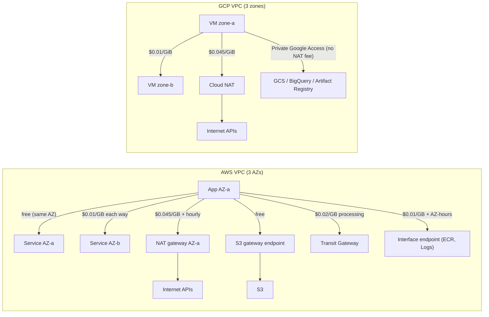
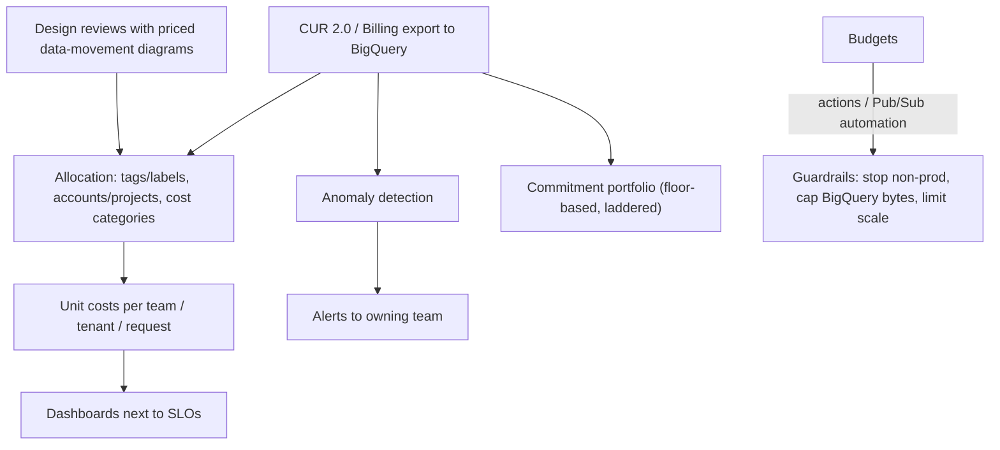

# 06.3 · Cloud FinOps: NAT Gateway and Cross-AZ Traps, Savings Plans/CUDs and Storage Tiering

> **Folder 06 · File 3 of 3.** Cloud bills are the architecture, priced. The largest surprises are rarely compute list prices. They come from:
> - **data movement**: NAT processing, cross-AZ chatter, inter-Region replication, internet egress;
> - **commitments** bought against the wrong baseline;
> - **storage class and request mix**;
> - **observability ingestion**.
>
> This file treats cost as a design property:
> - which line items each architectural choice creates on AWS and Google Cloud;
> - how to model them before building;
> - how commitments (Savings Plans, RIs, CUDs, SUDs) and Spot should be bought;
> - how FinOps operates as engineering practice rather than month-end surprise.

| Listing | What it shows | Language |
|---|---|---|
| `network_cost_model.py` | Monthly cost of sending 50 TB to S3/GCS through NAT vs a gateway endpoint / Private Google Access. Cross-AZ chatter for 200 TB of service traffic with random vs zone-aware routing. Break-even utilization for 1-yr/3-yr flexible CUDs and Compute Savings Plans. 1 PB in S3 Standard vs Intelligent-Tiering (and why small objects defeat it) | Python 3 (stdlib) |

**Verification.** The listing is embedded byte-identical. The gate re-runs it on this file and requires `verdict: OK`. That asserts the NAT saving equals the 50 TB × $0.045 processing removed, that zone-aware routing saves >$2,000/month, the 54% break-even for a 46% discount, and that Intelligent-Tiering halves the 1 PB bill at the stated access mix. Prices are list prices (us-east-1 / Tier 1) as of **2026-10-31**; verify for your region.

**Labels.** **[D]** documented · **[E]** estimate/model · ⚠ inferred or to verify.

---

## 0. Orientation

**The questions this file answers.**

1. Which architectural choices create which line items (NAT, cross-AZ, endpoints, TGW processing, egress, logs), and how do you estimate them at design time?
2. How do NAT gateways (AWS) and Cloud NAT (GCP) bill, and how do gateway endpoints and Private Google Access remove most of it?
3. Where does cross-AZ/cross-zone traffic hide (Kafka replication, consumers, service meshes, load balancers), and how do zone-aware patterns cut it?
4. How should commitments be bought? (Savings Plans vs RIs; resource-based vs flexible CUDs; SUDs; coverage vs utilization; break-even math.)
5. How do storage classes, Intelligent-Tiering, Autoclass and lifecycle rules interact with object size and access patterns?
6. How do you run FinOps as a system: allocation, unit costs, anomaly detection, budgets with actions?

**Reading paths.**

| Goal | Read |
|---|---|
| L7 interview | §1, §2, §3.1–3.3, §4.1–4.2, §5, §7, Q-chains |
| SAP-C02 (cost optimization) | §2, §3, §6, §7, S-scenarios |
| Cost review of a design | §5 (run the listing with your volumes), §6.2 |

**Prerequisites.**
- [02.1](../02-Global-Networking-Hybrid-Connectivity-and-Zero-Trust-VPC/01-aws-regional-vpc-tgw-privatelink-vs-gcp-global-andromeda-vpc-psc.md) for TGW/PrivateLink pricing.
- [03.1](../03-Distributed-Storage-Databases-and-Lakehouse-Internals/01-object-storage-s3-strong-consistency-prefix-partitioning-vs-gcs-colossus.md) for storage-class minimums.
- [03.4](../03-Distributed-Storage-Databases-and-Lakehouse-Internals/04-analytics-redshift-athena-glue-iceberg-vs-bigquery-dremel-capacitor-storage-api.md) for analytics billing.

---

## 1. First principles: the bill follows bytes, idle and commitments

### 1.1 Five cost drivers an architect controls

1. **Bytes moved**, by path: in-AZ free, cross-AZ, inter-Region, internet, through NAT, through TGW/PrivateLink.
2. **Idle capacity:** over-provisioned instances, always-on clusters, unused reservations.
3. **Commitment fit:** discounts bought against a baseline that does or doesn't exist.
4. **Storage shape:** class, object size, request mix, retention.
5. **Telemetry volume:** log ingestion, high-cardinality metrics, traces.

### 1.2 Path pricing, in one table (list, typical US) [D]

| Path | AWS | GCP |
|---|---|---|
| Same AZ/zone, private IP | Free | Free |
| Cross-AZ/zone | $0.01/GB **each direction** | $0.01/GiB |
| Through NAT | NAT GW $0.045/h + **$0.045/GB** | Cloud NAT **$0.045/GiB** + small per-VM hourly fee |
| To S3/DynamoDB from a VPC | **Free via gateway endpoint** | Google APIs via **Private Google Access** (no NAT processing) |
| Through Transit Gateway | $0.02/GB processed (+ attachments) | NCC data transfer (check) |
| PrivateLink / PSC | $0.01/AZ-hour + $0.01/GB | Per-endpoint + per-GB (producer) |
| Inter-Region (US↔US) | ~$0.02/GB | ~$0.02/GiB (North America) |
| Internet egress | Tiered (from ~$0.09/GB) | Tiered by tier and destination |
| Ingress | Free | Free |

The listing's first two sections price two common traps:
- **50 TB/month to object storage through NAT** costs ~$2,250 more than a free gateway endpoint on AWS, and the same difference with Private Google Access on GCP;
- **random placement** sends two-thirds of 200 TB service traffic cross-AZ (~$2,667/month), against ~$400 with zone-aware routing.

### 1.3 Commitments are options on a baseline

A commitment at discount *d* pays off only if at least **(1 − d)** of the committed amount is used, every hour:
- 28% → 72%;
- 46% → 54%;
- 66% → 34%.

Buy against the **steady floor** (e.g. the p10 of hourly usage over 3 months), ladder purchases over time, and cover peaks with on-demand, Spot or autoscaling.

---

## 2. Side-by-side architectural Rosetta matrix

| Concern | AWS | GCP | What actually differs |
|---|---|---|---|
| Billing data | **CUR 2.0 / Data Exports** to S3 (Athena/QuickSight) | **Cloud Billing export to BigQuery** (standard, detailed, pricing) | GCP lands billing in BigQuery natively |
| Allocation | Cost allocation tags, **Cost Categories**, account structure | **Labels**, projects/folders, tags | Projects make GCP allocation natural |
| Budgets and actions | AWS Budgets (alerts, **budget actions**: apply SCP/IAM, stop instances) | Budgets → **Pub/Sub** → automation (Cloud Run functions) | AWS has built-in actions. GCP is programmable |
| Anomaly detection | **Cost Anomaly Detection** | Cost anomaly detection (Billing) | — |
| Compute commitments | **Savings Plans** (Compute: flexible across families/Regions/Fargate/Lambda; EC2 Instance: family+Region), **Reserved Instances** (incl. capacity reservation when zonal) | **CUDs**: resource-based (machine family + region, vCPU/memory/GPU) and **flexible (spend-based)** (~28% 1-yr / ~46% 3-yr). **SUDs** automatic (up to ~30% on eligible series) | GCP gives automatic discounts without purchase on some series |
| Discount stacking | SP applies to the highest-discount usage first. RIs before SPs | Resource-based CUDs first, then flexible CUDs, then SUDs on the remainder [D] | — |
| Spare capacity | **Spot** (2-min notice; up to ~90% off) | **Spot VMs** (30 s notice; large discounts) | Notice time differs by 4× (01.1, 01.2) |
| Rightsizing | Compute Optimizer, Trusted Advisor | Recommender (VM rightsizing, idle resources, commitment recommendations) | — |
| NAT | NAT gateway per AZ (hourly + per GB) | Cloud NAT (distributed, per GiB + per VM) | Both charge per byte. AWS also charges per gateway-hour per AZ |
| Private service access | Gateway endpoints (S3, DynamoDB: free). Interface endpoints (hourly + per GB) | Private Google Access (free path for Google APIs). PSC endpoints | — |
| Kubernetes cost | Split cost allocation in CUR for EKS, Karpenter consolidation (01.2) | GKE cost allocation (namespace/label), Autopilot pod-based billing | Autopilot bills requests, not nodes |
| Object storage tiering | S3 classes, **Intelligent-Tiering** (monitoring $0.0025 per 1,000 objects; objects < 128 KB not tiered) | GCS classes, **Autoclass** (management fee per 1,000 objects) | Both automate tiering, and both charge per object to do it |
| Block storage | EBS **gp3** (cheaper than gp2, IOPS decoupled) | Hyperdisk (performance provisioned separately) / PD | gp2 → gp3 is a classic easy win |
| Logs | CloudWatch Logs ingestion ~$0.50/GB + storage | Cloud Logging ingestion ~$0.50/GiB beyond free allotment. Exclusion filters | Filter before ingestion on both |

---

## 3. Internal mechanics: AWS cost traps and controls

### 3.1 NAT gateway economics

- **Billing:** each NAT gateway bills **per hour** (~$0.045, ~$33/month) **and per GB processed** ($0.045). Deploy one per AZ for resilience (02.1), so three AZs means three hourly charges.
- **The classic leaks:**
  1. **S3/DynamoDB traffic through NAT.** Use **gateway endpoints**: free, route-table based. The listing: 50 TB/month saves $2,250.
  2. **ECR image pulls, CloudWatch Logs, STS, SSM through NAT.** Use **interface endpoints** where volume justifies them ($0.01/AZ-hour + $0.01/GB, cheaper than NAT's $0.045/GB at volume), or ECR pull-through caches.
  3. **Cross-AZ NAT:** an instance in AZ-b using a NAT in AZ-a adds $0.01/GB each way. Use per-AZ route tables.
  4. **Centralized egress through TGW:** saves NAT gateway-hours but adds **$0.02/GB TGW processing**. At high volume, decentralized NAT can be cheaper. Model both.
- **Visibility:** VPC Flow Logs plus NAT CloudWatch metrics (`BytesOutToDestination`) identify the top destinations, and therefore which endpoints to add.

### 3.2 Cross-AZ traffic: where it hides

| Source | Mechanism | Mitigation |
|---|---|---|
| Kafka/MSK replication | RF=3 across AZs: each produced byte crosses AZs twice | Expected cost of durability. Compress. Tiered storage for retention. **MSK replication traffic within the cluster isn't billed as data transfer** ⚠ verify for your broker type |
| Kafka consumers | Consumers fetch from partition leaders in other AZs | **Fetch-from-follower** (rack-aware consumers, KIP-392) |
| Microservices | Random endpoint selection across AZs (2/3 cross-AZ with 3 AZs) | Kubernetes topology-aware routing (`trafficDistribution: PreferClose`), zone-aware load balancing |
| Load balancers | NLB cross-zone load balancing transfers are charged. ALB cross-zone isn't ⚠ (verify current) | Keep targets balanced per AZ. Enable cross-zone deliberately |
| Databases | Clients connecting to a writer in another AZ | Expected for writes. Use AZ-local read replicas for reads. RDS Multi-AZ replication itself isn't billed as data transfer |
| Caches | Clients hitting cache nodes in other AZs | AZ-aware client routing, or a cache per AZ for read-heavy workloads |

### 3.3 Commitments and Spot on AWS

- **Compute Savings Plans:** a $/hour commitment for 1 or 3 years. Applies across instance families, sizes, Regions, OS and tenancy, **plus Fargate and Lambda**. Discounts up to ~66%.
- **EC2 Instance Savings Plans:** a family within a Region, for deeper discounts (up to ~72%).
- **Reserved Instances:** zonal RIs also reserve capacity. Standard vs Convertible.
- **Strategy:**
  1. cover the steady floor with Compute SPs, laddered quarterly;
  2. measure **coverage** (share of eligible spend covered) and **utilization** (share of commitment used; keep > ~95%);
  3. use **ODCRs** where capacity, not price, is the concern (06.2).
- **Spot:** for fault-tolerant work (batch, CI, stateless services with diversified fleets, 01.2):
  - allocation strategy `price-capacity-optimized`;
  - diversify across many instance types and AZs;
  - handle the 2-minute notice and rebalance recommendations.

### 3.4 Storage and observability

- **EBS gp2 → gp3:** about 20% lower price per GB, with a baseline 3,000 IOPS / 125 MB/s independent of size. Provision more IOPS only where needed. Delete unattached volumes and old snapshots, and use snapshot archive for long retention.
- **S3:**
  - **Intelligent-Tiering** for unknown access patterns. The listing: 1 PB of 2 MB objects with 10/30/60 hot/warm/cold drops from $23,000 to ~$9,700/month, including $1,250 monitoring.
  - Objects **< 128 KB** aren't tiered, so pack them (03.1).
  - Lifecycle to Glacier classes for known-cold data (mind minimum durations and per-object transition requests).
- **Logs and metrics:**
  - CloudWatch Logs bills ingestion (~$0.50/GB) and storage;
  - use subscription filters, sampling, **Infrequent Access log class** where queries are rare, and retention policies;
  - high-cardinality custom metrics multiply cost, so use embedded metric format with care, or Prometheus/AMP with controlled cardinality.

---

## 4. Internal mechanics: Google Cloud cost traps and controls

### 4.1 Cloud NAT and private access

- **Billing:** Cloud NAT bills **$0.045 per GiB processed** (both directions) plus a per-VM hourly fee capped per gateway. It's distributed, so there are no gateway instances to size (02.1 §4.6).
- **Remove NAT from Google API traffic** with **Private Google Access** on subnets, or **PSC endpoints for Google APIs**. GCS, Artifact Registry, BigQuery and Secret Manager traffic then doesn't pay NAT processing. The listing: $3,150 → $900/month for the same traffic mix.
- **Inter-zone traffic** ($0.01/GiB) appears in GKE service traffic and replication. Use topology-aware routing on GKE, and zonal affinity for chatty services.

### 4.2 Commitments, SUDs and Spot on GCP

- **Resource-based CUDs** commit to vCPU, memory, GPU or local SSD for a machine family in a region (1 or 3 years). Deep discounts (up to ~55%, more for memory-optimized ⚠).
- **Flexible CUDs** (spend-based) commit to $/hour across families and regions (~28% 1-yr / ~46% 3-yr) [D-ish, verify].
- **SUDs** apply **automatically** to eligible series (up to ~30% for usage across the month) with no commitment. New series may not have SUDs (check per series).
- **Stacking:** resource-based CUDs, then flexible CUDs, then SUDs on the remaining usage [D].
- **Spot VMs:** large discounts, 30-second preemption notice. Use them for batch, CI and fault-tolerant GKE node pools with ComputeClass fallback (01.2).

### 4.3 Storage, analytics and logging

- **GCS:** Standard → Nearline (30 d) → Coldline (90 d) → Archive (365 d). **Autoclass** moves objects automatically (management fee per object). Retrieval fees and minimum durations apply.
- **BigQuery:** on-demand bills logical TiB, and editions bill slot-hours (03.4).
  - Physical storage billing can cut storage cost when compression is high, but time travel and fail-safe bytes count.
  - Set **maximum bytes billed** and use reservations for steady workloads.
- **Cloud Logging:** ingestion beyond the free allotment (~$0.50/GiB). Use **exclusion filters** and sinks to cheaper storage (GCS/BigQuery) for archives, and log bucket retention policies.

---

## 5. Listing: pricing four architectural choices

<!-- listing:network_cost_model.py -->
```python
"""network_cost_model.py - the FinOps line items architects create: NAT processing, cross-AZ chatter,
commitments and storage tiering, on AWS and Google Cloud.

Prices (USD list, us-east-1 / Tier 1; verify before reuse):
  AWS NAT gateway $0.045/h + $0.045/GB processed; S3/DynamoDB gateway endpoints free;
    cross-AZ $0.01/GB in each direction; inter-Region $0.02/GB
  GCP Cloud NAT $0.045/GiB processed (+ small per-VM hourly fee); Private Google Access sends
    Google API traffic without NAT processing; inter-zone $0.01/GiB
  S3 Standard $0.023/GB-mo; Intelligent-Tiering frequent $0.023, infrequent $0.0125 (after 30 d),
    archive instant $0.004 (after 90 d), monitoring $0.0025 per 1,000 objects-month
Traffic volumes, placement and access pattern are ASSUMPTIONS, printed as such.

Usage: python -I network_cost_model.py <any path>
"""
import sys

TB = 1000.0  # GB


def aws_nat(gb, gateways=3):
    return gateways * 730 * 0.045 + gb * 0.045


def cross_az(gb_between_services, cross_fraction):
    return gb_between_services * cross_fraction * 0.01 * 2   # charged on both sides


def breakeven_utilization(discount):
    return 1 - discount


def main():
    ok = True
    s3_gb, api_gb, east_west_gb = 50 * TB, 20 * TB, 200 * TB
    print("ASSUMED monthly traffic: 50 TB private subnets -> S3/GCS, 20 TB -> internet APIs,")
    print("200 TB service-to-service across 3 AZs/zones")
    print()
    print("== 1. Egress path for object-store traffic ==")
    via_nat = aws_nat(s3_gb + api_gb)
    via_endpoint = aws_nat(api_gb)
    print(f"AWS: S3 through NAT          ${via_nat:>10,.0f}/mo   (NAT hours + $0.045/GB on 70 TB)")
    print(f"AWS: S3 via gateway endpoint ${via_endpoint:>10,.0f}/mo   (only the 20 TB of internet API traffic pays NAT)")
    gcp_nat = (s3_gb + api_gb) * 0.045
    gcp_pga = api_gb * 0.045
    print(f"GCP: GCS through Cloud NAT   ${gcp_nat:>10,.0f}/mo   | with Private Google Access ${gcp_pga:>10,.0f}/mo")
    ok &= via_nat - via_endpoint == s3_gb * 0.045
    print()
    print("== 2. Cross-AZ chatter for 200 TB of service-to-service traffic ==")
    for name, frac in (("random placement (2/3 cross-AZ)", 2 / 3), ("zone-aware routing (10% cross-AZ)", 0.10)):
        print(f"{name:<36} ${cross_az(east_west_gb, frac):>10,.0f}/mo")
    saved = cross_az(east_west_gb, 2 / 3) - cross_az(east_west_gb, 0.10)
    print(f"   topology-aware routing (Kubernetes trafficDistribution / zone-aware LB) saves ${saved:,.0f}/mo")
    ok &= saved > 2000
    print()
    print("== 3. Commitments: break-even utilization of the committed amount ==")
    for name, d in (("GCP flexible CUD 1 yr (~28%)", 0.28), ("GCP flexible CUD 3 yr (~46%)", 0.46),
                    ("AWS Compute SP 3 yr (up to 66%)", 0.66)):
        print(f"{name:<34} pays off if >= {breakeven_utilization(d):.0%} of the commitment is used every hour")
    print("   commit to the steady floor (e.g. p10 of hourly usage), not to the average")
    ok &= breakeven_utilization(0.46) == 0.54
    print()
    print("== 4. 1 PB in S3, 2 MB average objects (500M objects); ASSUMED 10% hot, 30% warm, 60% cold ==")
    gb = 1e6
    objects = gb * 1e3 / 2
    standard = gb * 0.023
    it = gb * (0.10 * 0.023 + 0.30 * 0.0125 + 0.60 * 0.004) + objects / 1000 * 0.0025
    print(f"all Standard                 ${standard:>10,.0f}/mo")
    print(f"Intelligent-Tiering          ${it:>10,.0f}/mo   (incl. ${objects / 1000 * 0.0025:,.0f} monitoring)")
    print("same 1 PB as 64 KB objects: objects < 128 KB stay in the frequent tier and aren't")
    print("   monitored, so IT saves nothing on them; pack small objects first (03.1)")
    ok &= it < standard * 0.5
    print()
    print("verdict: OK" if ok else "verdict: FAIL")


if __name__ == "__main__":
    main()
```

<!-- output:network_cost_model.py -->
```text
ASSUMED monthly traffic: 50 TB private subnets -> S3/GCS, 20 TB -> internet APIs,
200 TB service-to-service across 3 AZs/zones

== 1. Egress path for object-store traffic ==
AWS: S3 through NAT          $     3,249/mo   (NAT hours + $0.045/GB on 70 TB)
AWS: S3 via gateway endpoint $       999/mo   (only the 20 TB of internet API traffic pays NAT)
GCP: GCS through Cloud NAT   $     3,150/mo   | with Private Google Access $       900/mo

== 2. Cross-AZ chatter for 200 TB of service-to-service traffic ==
random placement (2/3 cross-AZ)      $     2,667/mo
zone-aware routing (10% cross-AZ)    $       400/mo
   topology-aware routing (Kubernetes trafficDistribution / zone-aware LB) saves $2,267/mo

== 3. Commitments: break-even utilization of the committed amount ==
GCP flexible CUD 1 yr (~28%)       pays off if >= 72% of the commitment is used every hour
GCP flexible CUD 3 yr (~46%)       pays off if >= 54% of the commitment is used every hour
AWS Compute SP 3 yr (up to 66%)    pays off if >= 34% of the commitment is used every hour
   commit to the steady floor (e.g. p10 of hourly usage), not to the average

== 4. 1 PB in S3, 2 MB average objects (500M objects); ASSUMED 10% hot, 30% warm, 60% cold ==
all Standard                 $    23,000/mo
Intelligent-Tiering          $     9,700/mo   (incl. $1,250 monitoring)
same 1 PB as 64 KB objects: objects < 128 KB stay in the frequent tier and aren't
   monitored, so IT saves nothing on them; pack small objects first (03.1)

verdict: OK
```

**Reading the output [E].**

- **Section 1.** Moving S3 traffic from NAT to a **gateway endpoint** cuts the monthly network bill from $3,249 to $999. The difference is exactly 50 TB × $0.045. GCP's equivalent (Private Google Access) cuts $3,150 to $900. In both, the remaining cost is genuine internet-bound traffic.
- **Section 2.** **Random placement** across three AZs sends 2/3 of service traffic cross-AZ: $2,667/month on 200 TB. **Zone-aware routing** at 10% cross-AZ costs $400. The saving grows linearly with volume, and comes with latency benefits.
- **Section 3.** Commitment break-even: a 1-yr flexible CUD (~28%) needs ≥ 72% of the commitment used every hour, a 3-yr one (~46%) ≥ 54%, and a Compute SP at its best rate (~66%) ≥ 34%. Buy against the floor, not the average.
- **Section 4.** For 1 PB of 2 MB objects with a 10/30/60 access mix, **Intelligent-Tiering** costs ~$9,700/month against $23,000 for Standard, net of $1,250 monitoring. With small objects (< 128 KB) the savings vanish, so pack them.

---

## 6. FinOps as an engineering system

### 6.1 Operating model

1. **Allocate:** tags and labels enforced at creation (tag policies + SCP/Org Policy, 05.2 S4), account/project-per-team, shared-cost rules (Cost Categories).
2. **Unit economics:** cost per order, per tenant, per inference request, published to teams next to latency SLOs.
3. **Guardrails:**
   - budgets with actions (AWS Budgets actions; GCP budgets → Pub/Sub → automation);
   - anomaly detection;
   - maximum bytes billed in BigQuery;
   - Serverless max RPU / max instances.
4. **Commitment portfolio:** quarterly laddered purchases from the measured floor, utilization and coverage dashboards, a central owner.
5. **Architecture reviews:** every design doc includes a data-movement diagram priced with the listing's rates.

### 6.2 Design-review questions

- Which paths does each byte take (AZ, Region, NAT, TGW, internet)? What's the monthly volume per path?
- Are gateway endpoints / Private Google Access in place for object storage and Google APIs?
- Are chatty services zone-affine? Do Kafka consumers fetch from followers?
- What's the steady baseline, and what share is committed?
- Which storage classes, minimum durations and object sizes apply? Is tiering automatic?
- What's the telemetry volume per day, and what's filtered before ingestion?

---

## 7. Failure modes, throttling limits and quota traps

| # | Symptom | Root cause | Detect | Fix | Cloud |
|---|---|---|---|---|---|
| 1 | NAT gateway line item > EC2 | S3/DynamoDB/ECR/logs through NAT | Flow logs by destination | Gateway endpoints, interface endpoints at volume, ECR pull-through cache | AWS |
| 2 | Cloud NAT bill high for "internal" traffic | Google API traffic via NAT | NAT logs | Private Google Access / PSC for Google APIs | GCP |
| 3 | Cross-AZ data transfer rising with scale | Random cross-AZ service calls, Kafka consumer fetches | CUR "DataTransfer-Regional", flow logs | Topology-aware routing, fetch-from-follower, AZ-local replicas | Both |
| 4 | Centralized egress cheaper on paper, pricier in practice | TGW $0.02/GB processing on all egress | CUR by TGW attachment | Model central vs per-VPC NAT at actual volumes | AWS |
| 5 | Savings Plan utilization 70% | Committed above the steady floor | SP utilization report | Smaller, laddered purchases. Let some expire | AWS |
| 6 | CUDs unused after a migration to a new machine family | Resource-based CUD tied to family/region | CUD utilization | Flexible CUDs for changing estates. Plan migrations against CUD terms | GCP |
| 7 | Spot savings eaten by interruptions | Few pools, stateful work on Spot | Interruption rate | Diversify, checkpoint, keep stateful on on-demand (01.2, 04.2) | Both |
| 8 | Glacier/Archive costs more than expected | Early-delete charges, retrieval fees, per-object transitions | Cost by usage type | Respect minimum durations. Pack small objects. Model retrievals | Both |
| 9 | Intelligent-Tiering/Autoclass doesn't save | Small objects (< 128 KB on S3), monitoring fees on many objects | Tier distribution | Pack objects. Exclude tiny objects from auto-tiering | Both |
| 10 | EBS bill high with low utilization | gp2 sized for IOPS, unattached volumes, old snapshots | Compute Optimizer, Trusted Advisor | gp3 with explicit IOPS, cleanup automation | AWS |
| 11 | Logging bill doubles after a release | Debug logs in production, high-cardinality labels | Ingestion by source | Exclusion filters, sampling, log levels via config, IA log class | Both |
| 12 | Unallocated "shared" spend dominates | Missing tags/labels | Allocation coverage | Enforce tags at creation. Cost Categories / label policies | Both |
| 13 | BigQuery bill spikes from one notebook | On-demand logical bytes, `SELECT *` | `INFORMATION_SCHEMA.JOBS` | Maximum bytes billed. Partition filters. Reservations | GCP |
| 14 | Idle non-prod environments 24/7 | No schedules | Utilization by environment | Instance Scheduler / scheduled scale-to-zero. Ephemeral environments | Both |
| 15 | Internet egress dominates for a SaaS | Serving bytes from origin Regions | Egress by destination | CDN (CloudFront/Cloud CDN), compression, private interconnect for B2B | Both |

---

## 8. Architecture diagrams: multi-service compositions

### 8.1 Where the bytes pay (AWS and GCP)



### 8.2 FinOps control loop



### 8.3 Commitment math (ASCII)

```text
hourly usage ($/h)        commit to the floor, not the mean
  peak |       /\        /\
       |  /\  /  \  /\  /  \       <- on-demand / Spot / autoscaling covers the peaks
  mean |-/--\/----\/--\/----\--
 floor |=======================    <- Savings Plan / CUD here (p10 of 3 months)
       +------------------------ time
break-even utilization = 1 - discount (28% -> 72%, 46% -> 54%, 66% -> 34%)
```

---

## 9. Bar-raiser chains and SAP-C02 scenarios

### 9.1 L7 bar-raiser chains

<details><summary><b>Q1 · The NAT gateway costs more than the compute</b></summary>

**Initial Prompt.** "Our data platform's NAT gateway line is $41k/month, more than the EC2 it serves. Explain and fix it."

**L5 Answer.** "Use a NAT instance instead. It's cheaper."

**Why L5 Stalls.** NAT instances trade per-GB fees for operational risk and throughput limits, and don't address *why* so much traffic goes through NAT.

**L7 Answer.** "$41k at $0.045/GB is ~900 TB/month through NAT. For a data platform, that's almost certainly **S3 traffic**, plus ECR pulls and logs. Fix by destination, using flow logs:
1. **S3 and DynamoDB → gateway endpoints:** free, a route-table change. The listing shows exactly 50 TB × $0.045 saved per 50 TB moved.
2. **ECR, CloudWatch Logs, STS, KMS → interface endpoints**, where $0.01/GB plus AZ-hours beats $0.045/GB, and ECR pull-through caches.
3. **Per-AZ NAT route tables**, so no cross-AZ hop to the NAT.
4. **Check centralized egress:** if traffic is hair-pinned through a TGW to a central NAT, it also pays $0.02/GB TGW processing.

What remains is real internet traffic, which is legitimate NAT use. On GCP the same fix is **Private Google Access** for Google APIs."
</details>

<details><summary><b>Q2 · Kafka cross-AZ costs are exploding</b></summary>

**Initial Prompt.** "Our self-managed Kafka on EC2 (RF=3 across 3 AZs) moves 2 PB/month, and cross-AZ data transfer is a top-3 line item. Options?"

**L5 Answer.** "Put all brokers in one AZ."

**Why L5 Stalls.** That removes the AZ fault tolerance the replication exists for. Durability and availability go out with the bill.

**L7 Answer.** "Separate the necessary cross-AZ bytes from the avoidable ones.
1. **Replication:** with RF=3 across AZs, each produced byte is copied to two other AZs. That's the price of AZ durability. Reduce bytes by **compressing** (zstd) and tuning batch sizes, and use **tiered storage** for long retention so local copies stay small.
2. **Consumers:** by default consumers fetch from leaders, so 2/3 of consumer reads cross AZs. Enable **rack-aware fetch-from-follower** (KIP-392) with `client.rack` = AZ. That's often the biggest single win.
3. **Producers:** producers in other AZs writing to leaders cross AZs, so co-locate producers by partition leader where feasible, or accept it.
4. **Consider MSK:** in-cluster replication traffic on MSK isn't billed as cross-AZ data transfer ⚠ (verify for your broker type), which can change the economics versus self-managed.

On GCP, Managed Service for Apache Kafka plus zone-aware clients is the same analysis."
</details>

<details><summary><b>Q3 · Design a commitment strategy for a growing, spiky estate</b></summary>

**Initial Prompt.** "We spend $2M/month on compute across AWS and GCP. Usage grows 3% a month with big daily peaks, and teams change instance families often. Design the commitment strategy."

**L5 Answer.** "Buy 3-year commitments for 80% of spend to maximize the discount."

**Why L5 Stalls.** 80% of spend includes peaks and families that change. Utilization will fall below break-even, and growth is better covered incrementally.

**L7 Answer.**
1. **Measure the floor:** the p10 of hourly eligible spend over 90 days, per cloud.
2. **AWS:**
   - **Compute Savings Plans**, flexible across families, Regions, Fargate and Lambda, for the floor;
   - EC2 Instance SPs only for stable families;
   - **ladder** monthly or quarterly purchases (e.g. 1/12 of the target each month), so growth gets covered and expiry stays smooth.
3. **GCP:**
   - **flexible CUDs** for the floor, given the family churn;
   - resource-based CUDs only for stable fleets;
   - remember **SUDs** discount the uncommitted remainder on eligible series automatically.
4. **Peaks:** autoscaling, Spot for tolerant work, Karpenter consolidation / ComputeClasses (01.2).
5. **KPIs:** utilization > 95%, coverage of the floor ~100%, effective savings rate, and the remaining break-even margin (listing §3: 54% at a 46% discount).

Review quarterly with forecasts."
</details>

<details><summary><b>Q4 · Cross-AZ chatter from a service mesh</b></summary>

**Initial Prompt.** "After moving to a service mesh on EKS, our cross-AZ data transfer tripled. Latency also rose slightly. Why, and what's the fix?"

**L5 Answer.** "The mesh sidecars add overhead. Remove the mesh."

**Why L5 Stalls.** The overhead isn't bytes across AZs. The mesh's load balancing ignores zones by default.

**L7 Answer.** "Most meshes and kube-proxy spread requests evenly across endpoints in all zones. With 3 AZs, about **2/3 of calls cross AZs**, billed at $0.01/GB each way and costing latency.

Fixes:
1. **Locality-aware load balancing** in the mesh (prefer same zone, spill over when unhealthy or overloaded).
2. Kubernetes **topology-aware routing** (`trafficDistribution: PreferClose` on Services) where there's no mesh.
3. **Balanced replicas per zone** (topology spread constraints), so zone-local routing doesn't overload one zone.
4. Monitor per-zone saturation to avoid uneven load.

The listing: 200 TB/month goes from $2,667 to $400 with 10% residual cross-AZ. GKE has the same features (topology-aware routing, zonal NEGs)."
</details>

<details><summary><b>Q5 · Storage: 5 PB with unknown access patterns</b></summary>

**Initial Prompt.** "We store 5 PB of media and logs in S3 Standard, access patterns unknown, object sizes from 1 KB thumbnails to 10 GB videos. Cut storage cost without breaking anything."

**L5 Answer.** "Move everything to Glacier after 30 days."

**Why L5 Stalls.** Glacier minimum durations, retrieval latency and fees, and small-object overheads can raise cost and break product features that read old objects.

**L7 Answer.**
1. **Measure:** S3 Storage Lens and Inventory give the size distribution, age and access (Storage Class Analysis).
2. **Large objects with unknown access → Intelligent-Tiering:** automatic movement to infrequent and archive-instant tiers, with millisecond retrieval preserved, at a per-object monitoring fee. The listing: 1 PB at 10/30/60 goes from $23k to $9.7k/month.
3. **Tiny objects (< 128 KB):** IT doesn't tier them, and IA would bill them as 128 KB. Keep them in Standard, or **pack** them (thumbnails into sprites, logs into compressed hourly files).
4. **Known-cold data** (old logs) → lifecycle to Glacier Flexible or Deep Archive, respecting minimum durations and retrieval needs, or delete per retention policy.
5. **Hygiene:** abort incomplete multipart uploads, expire old versions.

On GCS: Autoclass for mixed buckets, lifecycle rules to Coldline or Archive for known-cold, the same packing advice."
</details>

<details><summary><b>Q6 · Observability costs grew faster than traffic</b></summary>

**Initial Prompt.** "CloudWatch and Cloud Logging costs grew 4× this year while traffic grew 30%. Contain it without losing incident visibility."

**L5 Answer.** "Reduce log retention."

**Why L5 Stalls.** Retention is a minor factor. **Ingestion** dominates, and cutting retention loses forensic history while barely changing the bill.

**L7 Answer.** "Find the drivers (ingestion by source, by log group or bucket, by label cardinality), then:
1. **Filter before ingestion:**
   - log levels set per environment through config, sampling of high-volume success logs;
   - Cloud Logging **exclusion filters**;
   - CloudWatch subscription filters to route bulk logs straight to S3/Firehose.
2. **Cheaper classes for rarely queried logs:** CloudWatch **Infrequent Access** log class, GCS/BigQuery sinks for archives.
3. **Metrics cardinality:** remove user or request IDs from labels, aggregate at the source, use histograms.
4. **Traces:** tail-based sampling (keep errors and slow traces).
5. **Ownership:** per-team budgets and showback for observability.

Keep full-fidelity logs for security and audit trails (CloudTrail, Audit Logs), and route them to cheap long-term storage."
</details>

<details><summary><b>Q7 · Spot for production web services?</b></summary>

**Initial Prompt.** "Finance wants 60% of production web compute on Spot. Safe or reckless?"

**L5 Answer.** "Reckless. Spot can be interrupted."

**Why L5 Stalls.** It's a blanket answer. Stateless, diversified fleets with graceful drains run safely on Spot, and the answer gives no guardrails.

**L7 Answer.** "Safe with design:
1. **Stateless services only**, behind load balancers with fast deregistration.
2. **Diversify**: 10–15+ instance types across all AZs, `price-capacity-optimized` (AWS) or ComputeClass Spot priorities with on-demand fallback (GCP).
3. **An on-demand floor** per service (e.g. 40%) so a Spot reclaim wave degrades capacity, not availability.
4. **Drains within the notice:** 2 minutes on AWS, **30 seconds** on GCP.
5. **Capacity rebalancing** and Karpenter interruption handling (01.2).
6. **Chaos tests:** inject interruptions weekly.

Commitments cover the on-demand floor. Spot replaces on-demand above it, not committed capacity."
</details>

<details><summary><b>Q8 · Unit economics for a multi-tenant SaaS</b></summary>

**Initial Prompt.** "The board asks for cost per tenant and gross margin by plan. Our infrastructure is shared. How do you produce credible numbers?"

**L5 Answer.** "Divide the total bill by the number of tenants."

**Why L5 Stalls.** Averages hide the long tail. Heavy tenants subsidized by light ones distort pricing decisions.

**L7 Answer.**
1. **Direct allocation where possible:** dedicated resources tagged by tenant (cells, per-tenant buckets and databases, 06.2).
2. **Usage-based allocation for shared services:** meter per-tenant consumption (requests, CPU-seconds, GB stored, bytes egressed, queries scanned) and distribute shared cost by usage. For example, BigQuery labels per tenant query; DynamoDB RCU/WCU per tenant from application metrics.
3. **Platform overhead** (networking, observability, security) allocated by a documented rule.
4. **Publish** cost per tenant per month and per request, with margins by plan.
5. **Act:** pricing tiers, limits for heavy features, and engineering targets for the most expensive paths.

The data pipeline is CUR 2.0 or the billing export to BigQuery, joined with usage telemetry by tenant and hour."
</details>

<details><summary><b>Q9 · Compare the cost of the same workload on AWS and GCP</b></summary>

**Initial Prompt.** "Leadership asks which cloud is cheaper for our service. How do you produce a fair comparison?"

**L5 Answer.** "Compare the instance list prices."

**Why L5 Stalls.** List prices ignore discounts (SUDs, CUDs, SPs), data-movement pricing, managed-service pricing models and architecture differences. The comparison will mislead.

**L7 Answer.** "Model the **architecture**, not the SKU.
1. **The same SLOs and resilience** on each (AZ/zone, DR tier).
2. **Compute after discounts:** SPs/RIs vs CUDs and **automatic SUDs**, Spot shares, and per-second billing on both.
3. **Data movement:** NAT vs Cloud NAT, cross-AZ, inter-region, egress, CDN. The listing's rates show these can rival compute.
4. **Managed-service pricing models,** which differ structurally:
   - BigQuery logical bytes vs Athena compressed bytes (03.4);
   - Lambda vs Cloud Run concurrency (01.3);
   - KMS quotas and request costs (05.3).
5. **Operations and migration cost**, one-time and ongoing.

Present ranges with sensitivity to the top three drivers. The answer usually depends on workload shape more than on the cloud."
</details>

<details><summary><b>Q10 · Budgets that act, not just alert</b></summary>

**Initial Prompt.** "Sandbox accounts and projects keep producing surprise bills. Alerts get ignored. Design automatic guardrails."

**L5 Answer.** "Send budget alerts to the team channel."

**Why L5 Stalls.** Alerts without action are what's failing today.

**L7 Answer.**
- **AWS:**
  - AWS Budgets **budget actions** at thresholds: apply an SCP that denies launching new resources, attach a restrictive IAM policy, or stop specific EC2/RDS instances;
  - Sandbox OU SCPs limit instance types and Regions;
  - nightly cleanup automation (aws-nuke-style) for sandboxes.
- **GCP:**
  - budgets publish to **Pub/Sub**, and a Cloud Run function disables billing on the sandbox project at 100%, or scales down resources;
  - Org Policy restricts machine types and locations in the sandbox folder.
- **Both:**
  1. per-sandbox budgets with ownership tags;
  2. expiry dates on sandboxes;
  3. anomaly detection on prod with human escalation, not automated shutdown."
</details>

### 9.2 SAP-C02 scenarios (original)

<details><summary><b>S1 · SAP-C02 · Domain 3 · Select ONE</b></summary>

**Scenario.** EC2 instances in private subnets download and upload large amounts of data to Amazon S3 in the same Region through a NAT gateway. NAT gateway data processing charges are the largest item on the bill. What should a solutions architect do to reduce cost with the least effort?

- **A.** Replace the NAT gateway with a NAT instance.
- **B.** Move the instances to public subnets with public IP addresses.
- **C.** Use S3 Transfer Acceleration.
- **D.** Create an S3 gateway VPC endpoint and update the private subnets' route tables.

**Answer: D**

- **A** — wrong: NAT instances add operational burden and bandwidth limits, and still route S3 traffic inefficiently.
- **B** — wrong: public subnets expand the attack surface and aren't required.
- **C** — wrong: Transfer Acceleration adds cost and is for long-distance transfers.
- **D** — correct: gateway endpoints for S3 have no data processing charge and keep traffic private, removing NAT processing for S3 traffic.
</details>

<details><summary><b>S2 · SAP-C02 · Domain 3 · Select ONE</b></summary>

**Scenario.** A company's compute usage spans EC2 instances of several families that change frequently, AWS Fargate tasks and AWS Lambda functions. It has a stable baseline of spend and wants to lower cost with a 1-year commitment while keeping flexibility to change instance families and Regions. What should a solutions architect recommend?

- **A.** Purchase a Compute Savings Plan sized to the steady baseline of hourly compute spend.
- **B.** Purchase Standard Reserved Instances for the current instance types.
- **C.** Purchase EC2 Instance Savings Plans for each family.
- **D.** Move all workloads to Spot Instances.

**Answer: A**

- **A** — correct: Compute Savings Plans apply across instance families, sizes and Regions, and to Fargate and Lambda, which fits a changing estate. Sizing to the baseline keeps utilization high.
- **B** — wrong: Standard RIs are tied to instance attributes and don't cover Fargate or Lambda.
- **C** — wrong: EC2 Instance Savings Plans are tied to a family in a Region, and families change often.
- **D** — wrong: Spot isn't suitable for all workloads, and doesn't cover Lambda.
</details>

<details><summary><b>S3 · SAP-C02 · Domain 3 · Select TWO</b></summary>

**Scenario.** A company runs a fault-tolerant batch image-processing fleet on On-Demand EC2 instances of one type. Jobs can be retried and checkpoint progress to S3. The company wants to reduce compute cost significantly while minimizing interruptions' impact. Which actions should a solutions architect take? (Select TWO.)

- **A.** Run the fleet on Spot Instances using an Auto Scaling group with multiple instance types across all Availability Zones and the price-capacity-optimized allocation strategy.
- **B.** Purchase 3-year Reserved Instances for peak capacity.
- **C.** Use a single instance type in one Availability Zone to simplify capacity.
- **D.** Handle Spot interruption notices by checkpointing progress and returning work to the queue.
- **E.** Disable retries to avoid duplicate work.

**Answer: A, D**

- **A** — correct: diversified Spot capacity with price-capacity-optimized allocation reduces cost and interruption frequency.
- **B** — wrong: reserving peak capacity wastes commitment during off-peak hours.
- **C** — wrong: a single pool increases interruption risk and capacity shortages.
- **D** — correct: handling interruption notices preserves progress and lets other instances resume the work.
- **E** — wrong: disabling retries loses work on interruption.
</details>

<details><summary><b>S4 · SAP-C02 · Domain 3 · Select ONE</b></summary>

**Scenario.** A company has hundreds of EBS gp2 volumes that were sized large to obtain IOPS, but most of their capacity is unused. The company wants to reduce storage costs without reducing performance. What should a solutions architect recommend?

- **A.** Move the data to S3 Glacier Instant Retrieval.
- **B.** Migrate the volumes to gp3, right-size their capacity, and provision IOPS and throughput explicitly where needed.
- **C.** Convert the volumes to st1 throughput-optimized HDD.
- **D.** Take snapshots and delete the volumes.

**Answer: B**

- **A** — wrong: Glacier isn't block storage for running instances.
- **B** — correct: gp3 decouples IOPS and throughput from size and costs less per GB, so volumes can shrink while keeping performance.
- **C** — wrong: st1 can't deliver the random IOPS these workloads need.
- **D** — wrong: deleting in-use volumes breaks workloads.
</details>

<details><summary><b>S5 · SAP-C02 · Domain 1 · Select ONE</b></summary>

**Scenario.** A company with 60 AWS accounts wants to report costs by business unit and application, including shared networking and security costs split by an agreed rule, and wants finance to query detailed billing data with SQL. What should a solutions architect recommend?

- **A.** Download monthly invoices from each account into spreadsheets.
- **B.** Use only AWS Budgets for each account.
- **C.** Activate cost allocation tags, define AWS Cost Categories with split charge rules for shared costs, and deliver CUR 2.0 / Data Exports to S3 for querying with Amazon Athena.
- **D.** Create one IAM role per business unit to view the billing console.

**Answer: C**

- **A** — wrong: spreadsheets of invoices lack resource-level detail and don't scale.
- **B** — wrong: budgets alert on thresholds but don't provide allocation reporting.
- **C** — correct: tags and Cost Categories (with split charges) allocate costs, and the detailed export enables SQL analysis.
- **D** — wrong: console access doesn't allocate or split costs.
</details>

<details><summary><b>S6 · SAP-C02 · Domain 3 · Select ONE</b></summary>

**Scenario.** A global media company serves large video files directly from S3 in one Region to users worldwide. Data transfer out to the internet dominates costs, and distant users report slow downloads. What should a solutions architect recommend?

- **A.** Replicate the bucket to every Region and use Route 53 latency routing.
- **B.** Enable S3 Transfer Acceleration for downloads.
- **C.** Move the files to S3 Standard-IA.
- **D.** Serve the content through Amazon CloudFront with appropriate caching, using Origin Access Control to restrict the bucket.

**Answer: D**

- **A** — wrong: replicating to every Region multiplies storage and replication costs.
- **B** — wrong: Transfer Acceleration adds per-GB charges and doesn't cache content.
- **C** — wrong: IA lowers storage cost but adds retrieval fees and doesn't reduce egress.
- **D** — correct: CloudFront caches content near users, reducing origin egress and improving download performance, while OAC keeps the bucket private.
</details>

---

## 10. Checklist

- [ ] Every design doc has a priced data-movement diagram (listing rates), covering cross-AZ, NAT, TGW, inter-Region and egress.
- [ ] Gateway endpoints for S3/DynamoDB. Interface endpoints where volume justifies them. Private Google Access / PSC on GCP.
- [ ] Zone-aware routing for chatty services. Kafka fetch-from-follower. AZ-local read replicas and caches.
- [ ] Commitments sized to the measured floor and laddered. Utilization > 95% tracked. Flexible instruments for changing estates.
- [ ] Spot for tolerant workloads with diversification and drains within the notice (2 min / 30 s).
- [ ] Storage: gp3, Intelligent-Tiering/Autoclass for unknown access, packing small objects, lifecycle for known-cold data, multipart cleanup.
- [ ] Observability: filters before ingestion, IA log classes / sinks, metric cardinality budgets, tail sampling.
- [ ] Allocation coverage > 95% by tags/labels/projects. Unit costs per tenant/request published.
- [ ] Budgets with actions in sandboxes. Anomaly detection with owners in production.
- [ ] Analytics guardrails: maximum bytes billed, workgroup limits, reservation sizing (03.4).

---

## 11. References

AWS:
- Amazon VPC pricing (NAT gateway, endpoints): <https://aws.amazon.com/vpc/pricing/>
- Gateway endpoints for Amazon S3: <https://docs.aws.amazon.com/vpc/latest/privatelink/vpc-endpoints-s3.html>
- EC2 data transfer pricing: <https://aws.amazon.com/ec2/pricing/on-demand/>
- Savings Plans user guide: <https://docs.aws.amazon.com/savingsplans/latest/userguide/what-is-savings-plans.html>
- Spot best practices: <https://docs.aws.amazon.com/AWSEC2/latest/UserGuide/spot-best-practices.html>
- S3 Intelligent-Tiering: <https://docs.aws.amazon.com/AmazonS3/latest/userguide/intelligent-tiering-overview.html>
- EBS volume types (gp3): <https://docs.aws.amazon.com/ebs/latest/userguide/ebs-volume-types.html>
- AWS Cost Categories: <https://docs.aws.amazon.com/cost-management/latest/userguide/manage-cost-categories.html>
- AWS Budgets actions: <https://docs.aws.amazon.com/cost-management/latest/userguide/budgets-controls.html>
- CloudWatch Logs Infrequent Access: <https://docs.aws.amazon.com/AmazonCloudWatch/latest/logs/CloudWatch_Logs_Log_Classes.html>

Google Cloud:
- Cloud NAT pricing: <https://cloud.google.com/nat/pricing>
- Private Google Access: <https://docs.cloud.google.com/vpc/docs/private-google-access>
- Resource-based committed use discounts: <https://docs.cloud.google.com/compute/docs/instances/signing-up-committed-use-discounts>
- Sustained use discounts: <https://docs.cloud.google.com/compute/docs/sustained-use-discounts>
- Spot VMs: <https://docs.cloud.google.com/compute/docs/instances/spot>
- Autoclass: <https://docs.cloud.google.com/storage/docs/autoclass>
- Cloud Billing export to BigQuery: <https://docs.cloud.google.com/billing/docs/how-to/export-data-bigquery>
- Cloud Logging exclusion filters: <https://docs.cloud.google.com/logging/docs/routing/overview>

Kubernetes and Kafka:
- Kubernetes traffic distribution (PreferClose): <https://kubernetes.io/docs/concepts/services-networking/service/#traffic-distribution>
- KIP-392, fetch from closest replica: <https://cwiki.apache.org/confluence/display/KAFKA/KIP-392%3A+Allow+consumers+to+fetch+from+closest+replica>
