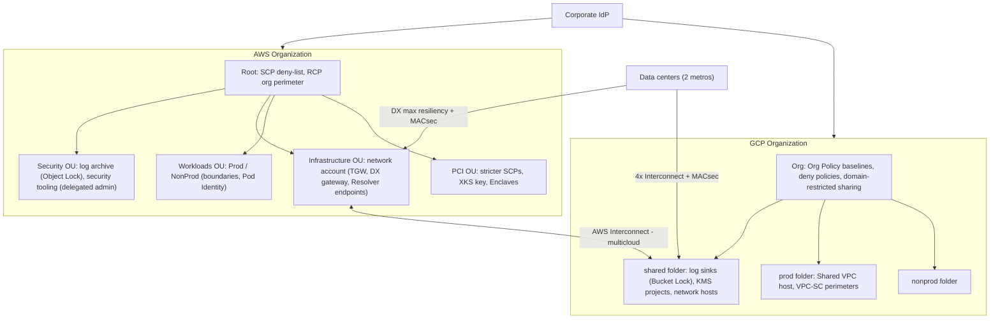
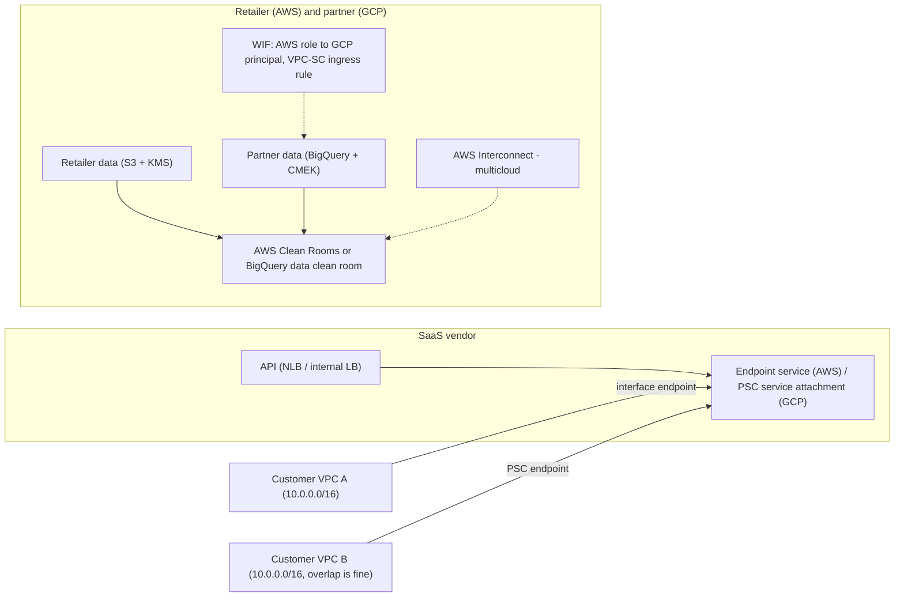

# 07.1 · Master Scenarios 01–12: Hybrid Networking, Security and Multi-Account Organization Design

> **Folder 07 · File 1 of 2.** Folders 01–06 built the mechanics. This folder **uses** them on 25 realistic, multi-constraint design problems, the kind that appear as SAP-C02 scenario questions and as 45-minute L7 design rounds. Each master scenario (MS) gives:
> 1. the situation, with numbers;
> 2. the binding constraints;
> 3. an AWS design and a GCP design;
> 4. the decision and its trade-offs, which is the part interviewers score;
> 5. links back to the mechanism files.
>
> Every scenario then has one bar-raiser chain and one original SAP-C02-style question. This file covers MS-01 to MS-12: landing zones, hybrid connectivity, network hubs, DNS, private SaaS connectivity, data perimeters, keyless identity, security tooling, regulated keys, global edge, tenant isolation, and cross-cloud partnerships.

| Listing | What it shows | Language |
|---|---|---|
| `scenario_coverage.py` | Run against **this file**. Checks that MS-01..MS-12 are contiguous, that each has all five parts and ≥ 2 links into Folders 01–06, and that each has exactly one bar-raiser chain and one mapped SAP-C02 question. Reports the file's domain mix and answer-letter balance | Python 3 (stdlib) |

**Verification.** The listing is embedded byte-identical. The gate re-runs it on this final file and requires `verdict: OK`, and also checks the chain and question formats. All scenarios and questions are **original**: no exam dumps or recalled items. Facts are those verified in Folders 01–06 (as of **2026-10-31**).

**Labels.** **[D]** documented · **[E]** estimate/model · ⚠ inferred or to verify.

---

## 0. Orientation

**How to use this file.**

1. Read the situation and constraints. **Before reading the designs, write your own** in five minutes: primitives per cloud plus the one trade-off you'd defend.
2. Compare with the AWS and GCP designs, then read **Decision and trade-offs**. The rubric is whether you named the binding constraint and quantified it.
3. Do the bar-raiser chain for that MS (§9.1) aloud, then the SAP-C02 question (§9.2) under time (about 2 minutes each).

**Scenario map.**

| MS | Theme | Primary folders | SAP-C02 domain |
|---|---|---|---|
| 01 | Multi-cloud landing zone | 05, 02 | 1 |
| 02 | 99.99% hybrid connectivity with encryption | 02 | 1 |
| 03 | Segmented network hub with inspection | 02 | 1 |
| 04 | Hybrid DNS at 400 VPCs | 02 | 3 |
| 05 | SaaS private connectivity, overlapping CIDRs | 02 | 2 |
| 06 | Data perimeter / exfiltration | 05 | 1 |
| 07 | Keyless CI/CD and workload identity | 05, 01 | 2 |
| 08 | Organization-wide security tooling | 05 | 1 |
| 09 | Regulated keys and attested processing | 05 | 2 |
| 10 | Global edge with WAF/DDoS and static IPs | 02 | 3 |
| 11 | Multi-tenant isolation model | 05, 06 | 2 |
| 12 | Cross-cloud data partnership | 02, 05 | 1 |

---

## 1. First principles: a six-step method for any master scenario

1. **Restate the constraints as numbers:** RTO/RPO, throughput, latency, availability, compliance controls, budget, deadline. A constraint without a number can't bind a design.
2. **Find the binding constraint.** Usually one dominates: a 99.99% SLA, "keys never in the cloud", 1,000 overlapping customer networks, a 9-month deadline.
3. **Choose primitives per cloud** from the mechanism folders, and say *why each one*: the property it gives, not its name.
4. **Name the trade-off you're accepting** (cost, latency, operational load, blast radius) and the alternative you rejected.
5. **Quantify** using the KB's listings: prefix limits, tunnel counts, quota budgets, failover times, unit costs.
6. **Failure modes and rollback.** What breaks first, how you'd detect it, and how you'd back out.

The SAP-C02 version of the same method: identify the requirement words ("least operational overhead", "most cost-effective", "must not", "without changing code"), eliminate options that violate a **hard constraint**, then choose among the rest by the stated optimization.

---

## 2. Side-by-side architectural Rosetta matrix

| Master scenario | AWS answer (core primitives) | GCP answer (core primitives) | Deciding principle |
|---|---|---|---|
| MS-01 Landing zone | Organizations + Control Tower, OUs by environment, SCP deny-list, RCP org perimeter, Identity Center | Org → folders by environment, Org Policy baselines, deny policies, PAB, groups + Workforce Identity Federation | Guardrails at the hierarchy root. Grants delegated low |
| MS-02 99.99% hybrid | DX maximum resiliency (2 locations × 2), MACsec, transit VIFs → DXGW → TGW, BFD | 4 Dedicated Interconnects in 2 metros, Cloud Routers in 2 regions, MACsec, BFD | Location/metro diversity, not connection count |
| MS-03 Network hub | TGW route tables (prod/nonprod/shared/inspection), appliance mode, central egress | Shared VPC hosts + NCC star + hierarchical firewall policy + NGFW/ILB next hop | Segmentation by routing domain. Symmetric inspection |
| MS-04 Hybrid DNS | Resolver inbound/outbound endpoints, rules via RAM / Route 53 Profiles, untracked SG flows | Cloud DNS forwarding + peering zones, inbound server policy, 35.199.192.0/19 route | One forwarding path per domain. QPS per endpoint IP |
| MS-05 SaaS private access | PrivateLink endpoint service (NLB) + per-customer interface endpoints | PSC service attachment + consumer endpoints (accept list) | Publish, don't route. Overlap-safe |
| MS-06 Data perimeter | RCP (PrincipalOrgID), SCP + endpoint policies (ResourceOrgID), SourceVpce | VPC-SC perimeters + ingress/egress rules + restricted VIP, domain-restricted sharing | IAM = who. Perimeter = where |
| MS-07 Keyless identity | GitHub OIDC → AssumeRoleWithWebIdentity, EKS Pod Identity, Roles Anywhere | WIF (OIDC/AWS/X.509), WIF for GKE, SA keys disabled by org policy | No standing secrets. Trust bound to claims |
| MS-08 Security tooling | Org CloudTrail → log archive (Object Lock), Security Hub + GuardDuty delegated admin, Security Lake | Aggregated org log sinks → locked buckets/BigQuery, Security Command Center, Data Access logs | Separate security accounts/projects. Immutable logs |
| MS-09 Regulated keys | CloudHSM key store or XKS for the mandated dataset, Nitro Enclaves + attestation key policy | Single-tenant Cloud HSM or EKM + KAJ, Confidential Space + attested WIF | HYOK only where mandated. Attest the code that decrypts |
| MS-10 Global edge | CloudFront (+ WAF, Shield Advanced) for web, Global Accelerator for APIs/UDP, ARC | Global external ALB (anycast, Cloud Armor, Cloud CDN), regional NLBs for UDP | Anycast front doors beat DNS failover |
| MS-11 Tenant isolation | Silo (account per tenant) / pool (ABAC, RLS) / bridge, with cells | Silo (project per tenant) / pool (IAM conditions, RLS) / bridge, with cells | Isolation level by tier. Quotas per account/project |
| MS-12 Cross-cloud partnership | AWS Interconnect – multicloud, PrivateLink, AWS Clean Rooms | Partner Cross-Cloud Interconnect, PSC, WIF, VPC-SC ingress, BigQuery data clean rooms | Private path + federated identity + perimeter rule |

---

## 3. Internal mechanics: master scenarios MS-01 to MS-06

### MS-01 · A multi-cloud landing zone for a 4,000-engineer enterprise

**Situation.** A retailer is standardizing on AWS (primary, 300 accounts expected) and GCP (analytics and AI, 600 projects expected). There are 3 environments, 12 business units, and PCI scope for payments. Today accounts and projects are created ad hoc, with IAM users and service account keys.

**Constraints.**
- New accounts or projects must be compliant at creation: regions, logging, no long-lived keys, no public data.
- Teams self-serve inside guardrails.
- PCI is isolated.
- Auditors need immutable logs.
- No central ticket queue for IAM.

**AWS design.**
- **Organizations + Control Tower:** OUs `Security`, `Infrastructure`, `Workloads/{Prod,NonProd}`, `PCI`, `Sandbox` ([05.1 §4.1](../05-IAM-KMS-Cryptography-and-Multi-Tenant-Governance/01-aws-iam-evaluation-logic-scp-permission-boundaries-abac-sts-cross-account.md)).
- **SCPs** (deny-list) at the root:
  - region allow-list with `NotAction` for global services;
  - deny leaving the organization;
  - protect CloudTrail and GuardDuty;
  - deny `iam:CreateUser` and `CreateAccessKey`.
- **RCPs** for the org-only S3/KMS/SQS perimeter.
- **Identity Center** with SCIM from the IdP. Permission sets per role. **Permissions boundaries** for team-created roles.
- **Account vending** via Control Tower Account Factory (or AFT) with baseline VPC, logging and budgets.

**GCP design.**
- **Org → folders by environment**, then BU. A `pci` folder under prod ([05.2 §3.2](../05-IAM-KMS-Cryptography-and-Multi-Tenant-Governance/02-gcp-iam-hierarchy-workload-identity-federation-and-vpc-service-controls.md)).
- **Org Policy:**
  - `gcp.resourceLocations`;
  - `iam.disableServiceAccountKeyCreation`;
  - `iam.allowedPolicyMemberDomains`;
  - external-IP restrictions;
  - custom constraints for CMEK/private SQL.
- **Deny policies** on log sinks and KMS destruction. **PAB** for contractors.
- **Groups + Workforce Identity Federation.** **PAM** for elevation.
- **Project factory** (Terraform) with labels, budgets and a Shared VPC attachment.

**Decision and trade-offs.**
- **Guardrails at the root, grants low:** SCP/RCP ↔ deny policies + Org Policy + domain restriction.
- **Self-service without escalation:** permissions boundaries on AWS. Curated custom roles + deny + PAB on GCP, because GCP has no boundary equivalent.
- **PCI:** its own OU or folder, with stricter guardrails and a VPC-SC perimeter.
- **The trade:** central teams own the guardrail code and pipeline. App teams lose some freedom (regions, keys) in exchange for speed: no tickets.
- **Watch:**
  - the management account is exempt from SCPs, so keep it empty;
  - GCP grants inherit, so never grant broad roles at folders.

### MS-02 · 99.99% hybrid connectivity with encryption to both clouds

**Situation.**
- Two data centers in different metros. 60 Gbps peak to AWS (us-east-1, us-west-2) and 20 Gbps to GCP (us-east4, us-central1).
- PCI traffic must be encrypted in transit.
- Failover must complete in under 5 seconds without packet black-holing.

**Constraints.**
- 99.99% availability for connectivity.
- Encryption of the private link at line rate.
- On-prem routers support MACsec and BFD.
- Prefix counts on-prem: ~350.

**AWS design.**
- **DX maximum resiliency:** 2 locations × 2 dedicated 100G connections on separate devices, **MACsec**.
- **Transit VIFs** → one **DX gateway** → TGWs in both Regions.
- `7224:7200` on all VIFs for ECMP.
- **BFD 300 ms × 3** on our routers.
- **Summarize to < 100 prefixes per session** (or raise the allocation with prefix controls), and max-prefix guards below the limit ([02.2 §3.2–3.5](../02-Global-Networking-Hybrid-Connectivity-and-Zero-Trust-VPC/02-hybrid-bgp-routing-direct-connect-vif-macsec-vs-cloud-interconnect-ha-vpn.md)).

**GCP design.**
- **4 Dedicated Interconnects** in 2 metros (different edge availability domains). Cloud Routers in us-east4 and us-central1. **MACsec**. **BFD** on VLAN attachments.
- MED per region so each metro prefers its local region. Global dynamic routing for failover, which works because the VPC itself is global ([02.1 §4](../02-Global-Networking-Hybrid-Connectivity-and-Zero-Trust-VPC/01-aws-regional-vpc-tgw-privatelink-vs-gcp-global-andromeda-vpc-psc.md)).

**Decision and trade-offs.**
- **Location diversity is the binding factor:** two links in one building leave ~106 min/yr of full outage at the listing's assumed rates, against ~0.8 min with two locations ([02.2 §5](../02-Global-Networking-Hybrid-Connectivity-and-Zero-Trust-VPC/02-hybrid-bgp-routing-direct-connect-vif-macsec-vs-cloud-interconnect-ha-vpn.md)).
- **MACsec** meets "encrypt the link" at line rate. IPsec at 60 Gbps would need 12+ large AWS tunnels, so reserve IPsec for segments terminating at third parties.
- **The 5 s failover target needs BFD** on both ends: AWS detects in ~0.9 s, while Cloud Router's detect timer is 5 s, which just meets the target, so test it.
- **Prefixes:** 350 exceeds the 100 default, so summarize. Otherwise the sessions go **idle**, the outage that takes all redundancy down at once.

### MS-03 · A segmented network hub with central inspection and egress

**Situation.**
- 180 VPCs across 50 AWS accounts; 120 GCP projects.
- Prod and non-prod must never communicate. Both need shared services and on-prem.
- Security wants all internet egress and east-west prod traffic inspected by stateful firewalls.

**Constraints.**
- Inspection must not break flows.
- Central control of routing.
- Cost-aware: the TGW processing bill is already high.
- Chatty services exist in a few domains.

**AWS design.**
- **One TGW per Region**, shared through RAM. Route tables `prod`, `nonprod`, `shared`, `inspection` (association/propagation), and **blackhole** routes between environments.
- Spoke default routes to the **inspection VPC** (Network Firewall or GWLB) with **appliance mode** ([02.1 §3.4](../02-Global-Networking-Hybrid-Connectivity-and-Zero-Trust-VPC/01-aws-regional-vpc-tgw-privatelink-vs-gcp-global-andromeda-vpc-psc.md)).
- Central egress with a NAT per AZ.
- **Chatty domains** co-located through VPC sharing, or peered directly to avoid $0.02/GB processing ([06.3](../06-Enterprise-Cloud-Migrations-Resiliency-and-FinOps/03-cloud-finops-nat-gateway-cross-az-traps-savings-plans-and-storage-tiering.md)).

**GCP design.**
- **Shared VPC hosts** per environment.
- An **NCC hub in star topology**: shared services and the hybrid spoke in the center, prod and non-prod as edges.
- An **org hierarchical firewall policy** denying prod↔non-prod.
- Inspection through **internal passthrough NLB next hops** to NVAs, or Cloud NGFW Enterprise.
- Cloud NAT per region.

**Decision and trade-offs.**
- **Segmentation is a routing property.** TGW tables and NCC star both make prod↔non-prod unroutable. The listing proves the matrix in both directions ([02.1 §5](../02-Global-Networking-Hybrid-Connectivity-and-Zero-Trust-VPC/01-aws-regional-vpc-tgw-privatelink-vs-gcp-global-andromeda-vpc-psc.md)).
- **Stateful inspection requires symmetry:** appliance mode on AWS, symmetric hashing on GCP ILBs.
- **The cost trade:** central inspection adds TGW processing and cross-AZ hops. Inspect north-south and inter-environment flows, and keep intra-domain east-west local.

### MS-04 · Hybrid DNS for 400 VPCs, two clouds and on-prem

**Situation.**
- Every AWS VPC and GCP network must resolve `corp.internal` (on-prem AD DNS).
- On-prem must resolve AWS private hosted zones and GCP private zones.
- Today, batch windows cause intermittent resolution failures from on-prem, and EKS nodes see DNS timeouts.

**Constraints.**
- Central management.
- Peak on-prem→cloud ~6,000 QPS.
- No per-VPC DNS servers.

**AWS design.**
- **Route 53 Resolver** inbound and outbound endpoints in a shared-services VPC.
- **Forwarding rules** for `corp.internal` shared through RAM / **Route 53 Profiles** (recommended beyond ~300 VPCs).
- Inbound endpoint SGs that keep DNS flows **untracked** (10,000 QPS per IP vs ~1,500 tracked), with ≥ 4 IPs ([02.2 §6.1](../02-Global-Networking-Hybrid-Connectivity-and-Zero-Trust-VPC/02-hybrid-bgp-routing-direct-connect-vif-macsec-vs-cloud-interconnect-ha-vpn.md)).
- **NodeLocal DNSCache** on EKS nodes, for the 1,024 PPS per-ENI link-local cap ([01.2 §6.1](../01-Virtualization-Compute-and-Kubernetes-Internals/02-eks-vs-gke-datapath-v2-ebpf-cilium-pod-ip-cni-and-karpenter-autoscaling.md)).

**GCP design.**
- A hub network with **forwarding zones** to on-prem.
- **DNS peering zones** from every Shared VPC host and service network.
- An **inbound server policy** for on-prem forwarders.
- On-prem routes **35.199.192.0/19** back over Interconnect.
- NodeLocal DNSCache on GKE.

**Decision and trade-offs.**
- **The batch-window failures are a capacity/conntrack problem, not a design problem:** 6,000 QPS against 2 IPs × 1,500 tracked QPS. Untracked rules and more IPs fix it.
- **The node timeouts are the per-ENI link-local cap plus UDP conntrack races,** fixed by node-local caching ([01.1 §7](../01-Virtualization-Compute-and-Kubernetes-Internals/01-aws-nitro-hypervisor-ec2-placement-groups-vs-gcp-titanium-compute.md)).
- **The design principle:** exactly one forwarding path per domain and one authoritative source per zone, validated by synthetic queries from every spoke.

### MS-05 · A SaaS offering private connectivity to 1,000 customer networks

**Situation.**
- A SaaS vendor must offer private access to its API from customer VPCs on both clouds.
- Customers use overlapping CIDRs (many use 10.0.0.0/16).
- Some customers need fixed per-customer allow-listing, and per-customer onboarding must be self-service.

**Constraints.**
- No routing into the vendor network.
- Per-customer approval.
- Per-AZ resilience.
- Low operational load.

**AWS design.**
- The API behind an **NLB** → **VPC endpoint service** with acceptance required and allowed principals per customer account.
- Customers create **interface endpoints** in their VPCs (private DNS optional).
- **Cross-region PrivateLink** for customers in other Regions.
- **Proxy protocol** to recover the client identity ([02.1 §3.6](../02-Global-Networking-Hybrid-Connectivity-and-Zero-Trust-VPC/01-aws-regional-vpc-tgw-privatelink-vs-gcp-global-andromeda-vpc-psc.md)).

**GCP design.**
- An internal LB fronted by a **PSC service attachment** with a **consumer accept list** (projects or networks) and a PSC NAT subnet.
- Customers create **PSC endpoints**.
- PSC connection metadata identifies the customer ([02.1 §4.5](../02-Global-Networking-Hybrid-Connectivity-and-Zero-Trust-VPC/01-aws-regional-vpc-tgw-privatelink-vs-gcp-global-andromeda-vpc-psc.md)).

**Decision and trade-offs.**
- **Publishing is the only option:** routing is impossible with overlaps, and would expose more than one port.
- **The trades:**
  - per-endpoint hourly costs fall on customers ([06.3](../06-Enterprise-Cloud-Migrations-Resiliency-and-FinOps/03-cloud-finops-nat-gateway-cross-az-traps-savings-plans-and-storage-tiering.md));
  - NAT'd source IPs, so use proxy protocol or PSC metadata for tenant identity and rate limits;
  - the vendor scales the NLB/ILB backends.
- **Rejected:** TGW or peering per customer, which hits CIDR overlap, the 125-peering ceiling and blast radius.

### MS-06 · A data perimeter against exfiltration on both clouds

**Situation.**
- A bank's analytics platform holds customer PII in S3 and BigQuery. A red-team showed:
  1. a stolen access key used from the internet could read data;
  2. an insider could copy data to a personal account or project.
- IAM is already least-privilege.

**Constraints.**
- Block both paths without breaking AWS/Google service integrations or sanctioned partner flows.
- Roll out without outages.

**AWS design.**
- **Identity perimeter:** an **RCP** that denies S3/KMS access unless `aws:PrincipalOrgID` is the bank's org (AWS services excepted).
- **Resource perimeter:** an **SCP** plus **VPC endpoint policies** that deny access to buckets where `aws:ResourceOrgID` ≠ the org.
- **Network perimeter:** bucket policies requiring `aws:SourceVpce` for PII buckets, so internet-sourced keys fail ([05.1 §4.2, Q4](../05-IAM-KMS-Cryptography-and-Multi-Tenant-Governance/01-aws-iam-evaluation-logic-scp-permission-boundaries-abac-sts-cross-account.md)).
- Audit with Access Analyzer and CloudTrail first.

**GCP design.**
- A **VPC Service Controls perimeter** around the data projects (BigQuery, Storage restricted).
- **Access levels** (corp network, managed devices).
- **Egress rules** only for sanctioned destinations.
- The **restricted VIP** for on-prem and VPC clients.
- **Domain-restricted sharing** at the org.
- **Dry run** for 3 weeks ([05.2 §4.3, §6.1](../05-IAM-KMS-Cryptography-and-Multi-Tenant-Governance/02-gcp-iam-hierarchy-workload-identity-federation-and-vpc-service-controls.md)).

**Decision and trade-offs.**
- **IAM answers *who*. Perimeters answer *where*.** The listing in 05.2 shows an IAM-authorized insider blocked by egress.
- **Exemptions are the hard part:**
  - AWS service principals (`aws:PrincipalIsAWSService`, `aws:ViaAWSService`);
  - Google service agents;
  - partner integrations.

  Audit or dry-run first, then enforce.
- **The trade:** perimeters add friction for legitimate cross-boundary work. Every exception needs an owner and an expiry.

---

## 4. Internal mechanics: master scenarios MS-07 to MS-12

### MS-07 · Keyless CI/CD and workload identity across both clouds

**Situation.**
- 900 pipelines deploy to 40 AWS accounts and 60 GCP projects using IAM user keys and SA JSON keys stored in CI secrets.
- EKS and GKE workloads use node identities.
- Last quarter, a leaked key caused an incident.

**Constraints.**
- Remove all long-lived credentials.
- Least privilege per pipeline and per pod.
- No per-cluster trust-policy toil.

**AWS design.**
- **GitHub OIDC provider** per account (or a deploy account).
- Deploy roles trust `token.actions.githubusercontent.com` with `sub` conditions per repo/environment.
- **EKS Pod Identity** associations for pods, with IMDSv2 hop limit 1 so pods can't use the node role ([01.1 §7](../01-Virtualization-Compute-and-Kubernetes-Internals/01-aws-nitro-hypervisor-ec2-placement-groups-vs-gcp-titanium-compute.md)).
- **Roles Anywhere** for on-prem agents.
- An SCP that denies access-key creation ([05.1 §3.6](../05-IAM-KMS-Cryptography-and-Multi-Tenant-Governance/01-aws-iam-evaluation-logic-scp-permission-boundaries-abac-sts-cross-account.md)).

**GCP design.**
- **WIF pools/providers** for GitHub (attribute conditions on repository and ref).
- Grants to principalSets (direct resource access or SA impersonation).
- **WIF for GKE** for pods.
- Org Policy disabling SA key creation ([05.2 §4.1](../05-IAM-KMS-Cryptography-and-Multi-Tenant-Governance/02-gcp-iam-hierarchy-workload-identity-federation-and-vpc-service-controls.md)).

**Decision and trade-offs.**
- **Federation binds trust to *claims*** (repo, branch, environment, namespace/SA) instead of possession of a secret.
- **The risks move to claim design:** a provider without attribute conditions accepts any repository. Test the negative cases.
- **Role chaining** caps sessions at 1 hour on AWS, so long deploys should assume the target role directly.

### MS-08 · Organization-wide security tooling with immutable logs

**Situation.**
- Security wants:
  - org-wide audit logs that admins of workload accounts or projects can't delete;
  - centralized threat detection and posture findings;
  - a 7-year retention for audit;
  - query access for the SOC.

**Constraints.**
- Separation of duties.
- New accounts and projects covered automatically.
- Cost-aware for Data Access/data-event logs.

**AWS design.**
- An **organization CloudTrail** to a **log archive account** S3 bucket with **Object Lock (compliance)**, KMS key policies owned by security, and RCP/SCP protections.
- **GuardDuty** and **Security Hub** (the new Security Hub GA 2025-12; legacy is Security Hub CSPM ⚠) with a **delegated administrator** in a security account and auto-enable.
- **Config** aggregator.
- **Security Lake** (OCSF) for the SOC.
- Data events only for sensitive buckets ([05.1 §2](../05-IAM-KMS-Cryptography-and-Multi-Tenant-Governance/01-aws-iam-evaluation-logic-scp-permission-boundaries-abac-sts-cross-account.md), [03.1 §3.7](../03-Distributed-Storage-Databases-and-Lakehouse-Internals/01-object-storage-s3-strong-consistency-prefix-partitioning-vs-gcs-colossus.md)).

**GCP design.**
- **Aggregated org-level log sinks** to a security project: log buckets with locked retention, plus BigQuery for analysis and GCS with **Bucket Lock** for 7-year archive.
- **Deny policies** on sink deletion.
- **Security Command Center** at the org.
- **Data Access audit logs** enabled for sensitive services only ([05.2 §7](../05-IAM-KMS-Cryptography-and-Multi-Tenant-Governance/02-gcp-iam-hierarchy-workload-identity-federation-and-vpc-service-controls.md)).

**Decision and trade-offs.**
- **Immutability + separate administration** (Object Lock / Bucket Lock + separate accounts/projects + deny policies) is what makes logs evidence.
- **Cost:** data-event and Data Access logs can exceed workload costs, so scope them to sensitive resources and route bulk to cheap storage ([06.3](../06-Enterprise-Cloud-Migrations-Resiliency-and-FinOps/03-cloud-finops-nat-gateway-cross-az-traps-savings-plans-and-storage-tiering.md)).
- **Delegated admin** keeps the management account empty.

### MS-09 · A regulated dataset with customer-held keys and attested processing

**Situation.**
- An insurer processes health claims.
- The regulator requires that keys for the claims dataset are held outside the cloud provider, and that only reviewed code can decrypt.
- Other data has no such requirement.
- Throughput: 3,000 decrypts/s at peak.

**Constraints.**
- HYOK only for the claims dataset.
- An availability SLO of 99.95% for claims processing.
- Auditable attestation.

**AWS design.**
- An **external key store (XKS)** for the claims KMS key, with an HA external key manager across two sites over PrivateLink.
- **Envelope reuse:** data-key caching. A key store tops out at **1,800/s**, below the 3,000/s peak, so caching is mandatory ([05.3 §3.2–3.3](../05-IAM-KMS-Cryptography-and-Multi-Tenant-Governance/03-kms-envelope-encryption-cloudhsm-nitro-enclaves-and-confidential-computing.md)).
- **Nitro Enclaves** run the decrypting service. The key policy requires `kms:RecipientAttestation:ImageSha384`.

**GCP design.**
- **Cloud EKM** (VPC) with **Key Access Justifications** policies.
- Processing in **Confidential Space**, with the WIF provider bound to the approved image digest ([05.2 §4.1](../05-IAM-KMS-Cryptography-and-Multi-Tenant-Governance/02-gcp-iam-hierarchy-workload-identity-federation-and-vpc-service-controls.md)), and IAM decrypt on the EKM-backed key only for that principal.
- Watch the external KMS quota (10,000 TPS) and the latency budget.

**Decision and trade-offs.**
- **Scope HYOK narrowly.** It puts the insurer's key manager in the **availability path**, so the 99.95% SLO depends on it. Build HA and drill the "key manager down" case.
- **The quota math decides the envelope design** (listing in 05.3: per-object keys exceed key-store limits by ~22×).
- **Attestation-gated release proves which code decrypts**, which IAM alone can't.

### MS-10 · A global edge for web, APIs and a UDP feed

**Situation.**
- A sports-media company serves a web app, a JSON API and a real-time UDP score feed to 40 countries from two Regions per cloud.
- Large DDoS events coincide with major matches.
- Enterprise customers allow-list fixed IPs.
- Regional failover must complete within 60 seconds.

**Constraints.**
- 60 s failover with no client DNS dependence.
- WAF and DDoS at the edge.
- UDP support.
- Static IPs.

**AWS design.**
- **CloudFront** for web and cacheable API paths: Origin Shield, VPC origins, AWS WAF, **Shield Advanced**, Anycast Static IPs for allow-listing.
- **Global Accelerator** for the UDP feed and uncacheable APIs: endpoint groups per Region, 10 s × 3 health checks, traffic dials.
- **ARC routing controls** for evacuation ([02.3](../02-Global-Networking-Hybrid-Connectivity-and-Zero-Trust-VPC/03-global-edge-cloudfront-global-accelerator-route53-arc-vs-gcp-anycast-cdn-armor.md)).

**GCP design.**
- A **global external Application LB** (Premium Tier) with **Cloud CDN** and **Cloud Armor** (Adaptive Protection, rate limits) for web and API: one anycast IP, ~10 s failover by backend health.
- UDP on **regional passthrough NLBs** with DNS steering or client multi-endpoint logic. Google's global L4 is proxy-based TCP.

**Decision and trade-offs.**
- **DNS failover can't meet 60 s:** the listing shows a 99% drain at 90 s for TTL 60, and up to 665 s with sticky resolvers ([02.3 §5](../02-Global-Networking-Hybrid-Connectivity-and-Zero-Trust-VPC/03-global-edge-cloudfront-global-accelerator-route53-arc-vs-gcp-anycast-cdn-armor.md)). Anycast is required.
- **UDP is the asymmetry:** GA on AWS. On GCP, regional NLBs plus client logic, which is the weaker failover story, so say it.
- **DDoS cost protection** (Shield Advanced / Cloud Armor Enterprise) matters because attacks coincide with peak events.
- **Evacuation is a drill, not a hope:** rehearse the regional move with ARC routing controls and the warm-standby runbook ([06.2](../06-Enterprise-Cloud-Migrations-Resiliency-and-FinOps/02-multi-region-dr-pilot-light-warm-standby-active-active-and-cell-failover.md)).

### MS-11 · Choosing a multi-tenant isolation model

**Situation.**
- A B2B SaaS has 2,000 tenants: 20 enterprise tenants (regulated, large), 300 mid-market, and 1,680 self-serve.
- One enterprise tenant's batch job recently throttled everyone, and an enterprise RFP asks for "dedicated infrastructure".

**Constraints.**
- Tenant isolation proportional to tier.
- Cost per tenant visible.
- Quotas must not be shared across noisy tenants.
- Offboarding with guaranteed erasure.

**AWS design.**
- **Silo** for enterprise: an **account per tenant** (or per tenant cell), own quotas and keys.
- **Bridge** for mid-market: shared compute with per-tenant data stores or schemas, and per-tenant KMS keys.
- **Pool** for self-serve: shared everything with **ABAC** (tenant session tags), row-level isolation and per-tenant rate limits.
- **Cells** and **shuffle sharding** for shared services ([06.2 §6.2](../06-Enterprise-Cloud-Migrations-Resiliency-and-FinOps/02-multi-region-dr-pilot-light-warm-standby-active-active-and-cell-failover.md)).
- Crypto-shredding by tenant key ([05.3 Q6](../05-IAM-KMS-Cryptography-and-Multi-Tenant-Governance/03-kms-envelope-encryption-cloudhsm-nitro-enclaves-and-confidential-computing.md)).

**GCP design.**
- **Project per enterprise tenant** (silo).
- Bridge with per-tenant datasets or databases and keys.
- Pool with IAM conditions on tags, BigQuery row-level security and per-tenant quotas in the application.
- Cells as projects or GKE clusters.
- Per-tenant CMEK keys and Autokey.

**Decision and trade-offs.**
- **Isolation costs money,** so tier it.
- **Quotas are per account/project:** Lambda concurrency, KMS request rates, API limits ([01.3 S6](../01-Virtualization-Compute-and-Kubernetes-Internals/03-serverless-internals-aws-lambda-firecracker-microvms-vs-cloud-run-borg.md)). Silo is the only way to give a tenant its own.
- **Noisy neighbors in the pool:** per-tenant rate limits plus shuffle sharding contain them. The listing shows full-overlap probability of 1.3e-6% for 5-of-100 sharding.
- **Erasure requires tenant-scoped keys everywhere,** backups included.

### MS-12 · A cross-cloud data partnership

**Situation.**
- A retailer (AWS) and a consumer-goods partner (GCP, BigQuery) want to compute joint sales analytics on sensitive data.
- Neither party may see the other's raw rows.
- ~5 TB/week moves.
- Both security teams forbid internet paths and long-lived keys.

**Constraints.**
- Private connectivity.
- Federated identity.
- No raw-data exposure.
- Each party controls its own keys.
- Auditable.

**AWS design.**
- **AWS Interconnect – multicloud** (GA 2026-04-14) provisioned from the DX console to the partner's GCP project ([02.2 §6.3](../02-Global-Networking-Hybrid-Connectivity-and-Zero-Trust-VPC/02-hybrid-bgp-routing-direct-connect-vif-macsec-vs-cloud-interconnect-ha-vpn.md)).
- Shared data through **AWS Clean Rooms** (analysis rules, no raw row access), or an export of aggregates.
- KMS keys in the retailer's account. WIF-compatible role identities for any cross-cloud call.

**GCP design.**
- **Partner Cross-Cloud Interconnect for AWS** on the partner side.
- **BigQuery data clean rooms** (Analytics Hub) for privacy-safe joins.
- **WIF** so the retailer's AWS role can write aggregates without keys.
- A **VPC-SC ingress rule** scoped to that federated principal and operation ([05.2 Q4](../05-IAM-KMS-Cryptography-and-Multi-Tenant-Governance/02-gcp-iam-hierarchy-workload-identity-federation-and-vpc-service-controls.md)).
- CMEK on partner datasets.

**Decision and trade-offs.**
- **Three layers have to line up:**
  1. a **private path** (multicloud interconnect, with HA VPN as backup);
  2. **federated identity** (no keys);
  3. a **policy surface** that permits exactly the joint computation (clean-room analysis rules, VPC-SC ingress).
- **Choose one side's clean room** to avoid duplicating data: the party with the larger dataset hosts.
- **Check SLA coverage** of the partner interconnect (not SLA-covered on the Google side at GA) and **egress costs** for the weekly 5 TB.

---

## 5. Listing: scenario coverage of this file

<!-- listing:scenario_coverage.py -->
```python
"""scenario_coverage.py - verifies the master-scenario file it is run against (argv[1]).

Checks, ignoring fenced code blocks:
  * master scenarios are headed "### MS-NN · title", numbered contiguously, no duplicates
  * every scenario has the five parts **Situation.** **Constraints.** **AWS design.** **GCP design.**
    **Decision and trade-offs.** and links to >= 2 other KB files (relative ../0N-... links)
  * every scenario has exactly one bar-raiser chain ("Qn · MS-NN · ...") and exactly one SAP-C02
    question whose body says "**Maps to:** MS-NN"
  * reports the SAP-C02 domain mix and answer-letter balance of the file

Usage: python -I scenario_coverage.py <master-scenario .md>
"""
import collections
import pathlib
import re
import sys

PARTS = ["**Situation.**", "**Constraints.**", "**AWS design.**", "**GCP design.**", "**Decision and trade-offs.**"]


def main():
    md = pathlib.Path(sys.argv[1]).read_text(encoding="utf-8")
    body = re.sub(r"^```.*?^```", "", md, flags=re.S | re.M)
    ok = True
    heads = re.findall(r"^### (MS-(\d\d)) · (.+)$", body, re.M)
    nums = [int(n) for _, n, _ in heads]
    contiguous = nums == list(range(nums[0], nums[0] + len(nums))) if nums else False
    ok &= contiguous and len(set(nums)) == len(nums)
    print(f"master scenarios: {len(heads)} (MS-{nums[0]:02d}..MS-{nums[-1]:02d}), contiguous={contiguous}")
    sections = re.split(r"^### (?=MS-\d\d · )", body, flags=re.M)[1:]
    chains = re.findall(r"<summary><b>Q\d+ · (MS-\d\d) · ", body)
    scen_blocks = re.findall(r"<details><summary><b>S\d+ · SAP-C02 · Domain (\d) · Select (\w+)</b></summary>(.*?)</details>", body, re.S)
    maps = collections.Counter()
    domains, letters = collections.Counter(), collections.Counter()
    for dom, _sel, blk in scen_blocks:
        m = re.search(r"\*\*Maps to:\*\* (MS-\d\d)", blk)
        if m:
            maps[m.group(1)] += 1
        domains[dom] += 1
        ans = re.search(r"\*\*Answer: ([A-E](?:, [A-E])*)\*\*", blk)
        for x in (ans.group(1).split(", ") if ans else []):
            letters[x] += 1
    print(f"{'scenario':<8} {'parts':>5} {'KB links':>8} {'chain':>5} {'SAP-C02':>7}  title")
    for sec in sections:
        sid, title = re.match(r"(MS-\d\d) · (.+)", sec).groups()
        cut = sec.split("\n### ", 1)[0].split("\n## ", 1)[0]
        parts = sum(1 for p in PARTS if p in cut)
        links = len(set(re.findall(r"\]\((\.\./0[1-6][^)#]+)", cut)))
        nchain, nmap = chains.count(sid), maps[sid]
        good = parts == len(PARTS) and links >= 2 and nchain == 1 and nmap == 1
        ok &= good
        print(f"{sid:<8} {parts:>3}/5 {links:>8} {nchain:>5} {nmap:>7}  {title[:60]}{'' if good else '  <-- FIX'}")
    print(f"SAP-C02 domains in this file: {dict(sorted(domains.items()))}")
    print(f"answer letters in this file: {dict(sorted(letters.items()))}")
    ok &= sum(domains.values()) == len(heads)
    print()
    print("verdict: OK" if ok else "verdict: FAIL")


if __name__ == "__main__":
    main()
```

<!-- output:scenario_coverage.py -->
```text
master scenarios: 12 (MS-01..MS-12), contiguous=True
scenario parts KB links chain SAP-C02  title
MS-01      5/5        2     1       1  A multi-cloud landing zone for a 4,000-engineer enterprise
MS-02      5/5        2     1       1  99.99% hybrid connectivity with encryption to both clouds
MS-03      5/5        2     1       1  A segmented network hub with central inspection and egress
MS-04      5/5        3     1       1  Hybrid DNS for 400 VPCs, two clouds and on-prem
MS-05      5/5        2     1       1  A SaaS offering private connectivity to 1,000 customer netwo
MS-06      5/5        2     1       1  A data perimeter against exfiltration on both clouds
MS-07      5/5        3     1       1  Keyless CI/CD and workload identity across both clouds
MS-08      5/5        4     1       1  Organization-wide security tooling with immutable logs
MS-09      5/5        2     1       1  A regulated dataset with customer-held keys and attested pro
MS-10      5/5        2     1       1  A global edge for web, APIs and a UDP feed
MS-11      5/5        3     1       1  Choosing a multi-tenant isolation model
MS-12      5/5        2     1       1  A cross-cloud data partnership
SAP-C02 domains in this file: {'1': 6, '2': 4, '3': 2}
answer letters in this file: {'A': 5, 'B': 2, 'C': 3, 'D': 5}

verdict: OK
```

**Reading the output.** All 12 master scenarios have their five parts, link into at least two mechanism files, and map one-to-one to a bar-raiser chain and an SAP-C02 question. The domain and letter counts are reported so the two files together match SAP-C02's weighting and avoid letter bias.

---

## 6. Patterns that recur across MS-01 to MS-12

| Pattern | Where it appears | One-line rule |
|---|---|---|
| Guardrails high, grants low | MS-01, 06, 08, 11 | Ceilings at the org/OU/folder. Grants at the project/account/resource |
| Publish, don't route | MS-03, 05, 12 | PrivateLink/PSC for services. Routing only for infrastructure |
| Diversity beats count | MS-02, 10 | Locations/metros, AZs, providers, not more links in one place |
| Claims, not secrets | MS-07, 09, 12 | OIDC/WIF/attestation bind trust to verifiable attributes |
| Who vs where | MS-06, 12 | IAM for identity, perimeters (RCP/endpoint policies/VPC-SC) for location |
| Quotas are per boundary | MS-04, 09, 11 | Endpoint QPS, KMS rates, account/project quotas decide designs |
| Audit, then enforce | MS-01, 06, 08 | Access Analyzer / dry run before blocking |

---

## 7. Failure modes, throttling limits and quota traps

| # | Symptom | Root cause | Detect | Fix | MS |
|---|---|---|---|---|---|
| 1 | All hybrid sessions DOWN together | Prefix limit exceeded on every VIF/attachment | BGP state | Summaries + max-prefix guards (02.2) | 02 |
| 2 | Half of flows die after centralizing inspection | Asymmetric routing (TGW AZ affinity) | Firewall half-opens | Appliance mode / symmetric hashing (02.1) | 03 |
| 3 | DNS failures at batch peaks | Tracked flows on Resolver endpoints (~1,500 QPS/IP) | Endpoint metrics | Untracked SG rules, more IPs (02.2) | 04 |
| 4 | Node-level DNS timeouts | 1,024 PPS link-local cap, conntrack races | ENA counters | NodeLocal DNSCache (01.1, 01.2) | 04 |
| 5 | Perimeter breaks a sanctioned pipeline | Missing service-agent / partner exceptions | Violation logs | Dry run, scoped ingress/egress rules (05.2) | 06, 12 |
| 6 | Federated provider accepts any repo | No attribute conditions | Federation audit | Claim conditions, negative tests (05.2) | 07 |
| 7 | Logs deleted by a compromised admin | Logs in workload accounts/projects | — | Separate log archive + Object/Bucket Lock + deny (05) | 08 |
| 8 | Claims processing down when key manager is down | HYOK in the availability path | EKM/XKS metrics | HA key manager, drills, narrow scope (05.3) | 09 |
| 9 | Key store throttles at 1,800/s | Per-store quota | KMS throttles | Data-key caching (05.3) | 09 |
| 10 | Failover takes minutes | DNS in the failover path | Drill timings | Anycast front door, ARC (02.3) | 10 |
| 11 | One tenant throttles everyone | Shared quotas and fleets | Per-tenant metrics | Silo/cells/shuffle sharding/rate limits (06.2) | 11 |
| 12 | Partner link outage not covered | Partner interconnect SLA scope | Contract review | HA VPN backup, second link (02.2) | 12 |

---

## 8. Architecture diagrams: multi-service compositions

### 8.1 The combined landing zone, network and security spine



### 8.2 SaaS private connectivity plus cross-cloud partnership



### 8.3 Who-vs-where control map (ASCII)

```text
                 WHO may act (identity)                  WHERE data may go (context)
AWS   identity/resource policies, SCP, RCP,      VPC endpoint policies (aws:ResourceOrgID),
      boundaries, session policies, ABAC tags    aws:SourceVpce / SourceIp, RCP org perimeter
GCP   allow policies (inherited), deny, PAB,     VPC Service Controls (ingress/egress rules,
      IAM Conditions, WIF                        access levels, restricted VIP), domain sharing
rule  both must pass; perimeters stop authorized identities from moving data to the wrong place
```

---

## 9. Bar-raiser chains and SAP-C02 scenarios

### 9.1 L7 bar-raiser chains (one per master scenario)

<details><summary><b>Q1 · MS-01 · "Just give every team admin in its own account"</b></summary>

**Initial Prompt.** "A VP says landing zones are bureaucracy: give each team an account or project with admin, and audit later. Respond."

**L5 Answer.** "Admin everywhere is risky. We should limit permissions."

**Why L5 Stalls.** It's a sentiment, not a design. It doesn't show how teams keep speed while the organization keeps guarantees.

**L7 Answer.** "Team admin is fine *inside* guardrails that admins can't change.
- **On AWS:**
  - SCPs: regions, no IAM users or keys, protected logging;
  - RCPs: org-only data access;
  - Control Tower vending with baseline logging;
  - permissions boundaries so team-created roles can't exceed policy.
- **On GCP:** Org Policy (locations, no SA keys, domain-restricted sharing), deny policies on log sinks and KMS destruction, PAB for contractors.

Teams get vending in minutes and no IAM tickets. The organization gets invariants that hold even when an admin errs. 'Audit later' means finding the public bucket after the breach. Guardrails make that class of mistake impossible."
</details>

<details><summary><b>Q2 · MS-02 · "Two circuits means redundant"</b></summary>

**Initial Prompt.** "The network team ordered two 100G circuits to AWS and two to GCP, both in the same colocation building, and calls it 99.99%. Push back."

**L5 Answer.** "Different buildings would be safer."

**Why L5 Stalls.** It's true but unquantified, and it misses the control-plane and timer failure modes that also take down 'redundant' designs.

**L7 Answer.** "Three correlated failure domains defeat that design.
1. **Location.** At the listing's assumed rates, two links in one building leave ~106 minutes a year with both down, against ~0.8 minutes across two locations. Both clouds' four-nines topologies require location or metro diversity.
2. **Control plane.** One route leak that exceeds the per-session prefix limit idles every session at once, so we need max-prefix guards and staged changes.
3. **Detection.** Without BFD, a silent failure black-holes for the 90 s hold time.

So: DX maximum resiliency (2 locations × 2), 4 Interconnects across 2 metros, MACsec, BFD on both ends, and summarized prefixes."
</details>

<details><summary><b>Q3 · MS-03 · "Inspect everything"</b></summary>

**Initial Prompt.** "Security wants every east-west flow between all 180 VPCs through the central firewall. Finance says the TGW bill is already too high. Arbitrate."

**L5 Answer.** "Security wins. Inspect everything."

**Why L5 Stalls.** Inspection everywhere adds per-GB processing and latency, and creates a central chokepoint without proportional risk reduction.

**L7 Answer.** "Inspect by **risk boundary**, not by packet.
- **Inspect:** north-south (internet), inter-environment (if allowed at all) and cross-domain flows into sensitive zones.
- **Keep local:** intra-domain east-west, co-located through VPC sharing, or peered for the chattiest pairs. Use security groups / network policy for micro-segmentation.

Mechanically, appliance mode keeps stateful inspection symmetric.

The cost: every byte into a TGW is $0.02/GB, and at 1.9 PB/month that's $38k (02.1 Q6). Selective inspection plus co-location reduces both risk exposure and cost. On GCP: NCC star for segmentation, hierarchical firewall policies, NGFW only on boundary paths."
</details>

<details><summary><b>Q4 · MS-04 · "Add more DNS servers"</b></summary>

**Initial Prompt.** "During nightly batches, on-prem lookups of AWS private zones fail. The proposal is EC2-based DNS servers in every VPC. Evaluate."

**L5 Answer.** "More DNS servers will spread the load."

**Why L5 Stalls.** It adds hundreds of unmanaged servers. The real limit is per-IP QPS under connection tracking on the inbound endpoint.

**L7 Answer.** "Inbound Resolver endpoints serve ~10,000 QPS per IP, but **~1,500 when connection tracking is enforced**. With two IPs and restrictive security groups, that's ~3,000 QPS against a 6,000 QPS batch peak.

The fix:
1. SG rules that leave DNS flows untracked;
2. four or more endpoint IPs;
3. on-prem forwarder caching;
4. alarms on endpoint metrics.

Keep one forwarding path per domain through Route 53 Profiles across 400 VPCs, and add NodeLocal DNSCache for the separate per-ENI 1,024 PPS problem on Kubernetes nodes. GCP's equivalent is an inbound server policy with enough capacity and the 35.199.192.0/19 return route."
</details>

<details><summary><b>Q5 · MS-05 · "Peer with every customer"</b></summary>

**Initial Prompt.** "A sales engineer promised a bank 'private connectivity' and proposes VPC peering to its VPC. The bank uses 10.0.0.0/16 like us. What now?"

**L5 Answer.** "We'll renumber our VPC."

**Why L5 Stalls.** Renumbering for one customer breaks the next one, and peering exposes the whole network.

**L7 Answer.** "**Publish, don't route.**
- AWS: put the API behind an NLB as an **endpoint service**, with acceptance required and the bank's account allow-listed.
- GCP: a PSC service attachment with a consumer accept list.

The customer creates an endpoint in its own VPC and gets a local IP. Overlaps are irrelevant, and exposure is one port. Per-customer identity comes from proxy protocol or PSC connection metadata, for rate limits and audit.

Peering fails on overlap, on the 125-peering ceiling, and on blast radius. Make this the standard offer for every customer."
</details>

<details><summary><b>Q6 · MS-06 · "Our IAM is least privilege, so we're safe"</b></summary>

**Initial Prompt.** "The red team exfiltrated data with valid credentials. The CISO says IAM was correct. Explain the gap and the fix."

**L5 Answer.** "Rotate credentials and tighten IAM further."

**Why L5 Stalls.** IAM was working. The gap is the *context* of use: from where, and to which destination.

**L7 Answer.** "IAM answers **who** may read. It doesn't answer **from where** or **to which destination**.
- **AWS perimeters:**
  - an RCP denying non-org principals on S3/KMS;
  - SCP and endpoint policies denying non-org destination buckets (`aws:ResourceOrgID`);
  - `aws:SourceVpce` on PII buckets, so internet use of stolen keys fails.
- **GCP:**
  - VPC-SC perimeters (egress blocks copies to personal projects, access levels block internet use of stolen tokens);
  - domain-restricted sharing.

Roll out in audit or dry-run mode, then enforce with owned, expiring exceptions. The 05.2 listing shows the exact case: an IAM-authorized insider blocked by egress."
</details>

<details><summary><b>Q7 · MS-07 · "Rotate the keys every 30 days"</b></summary>

**Initial Prompt.** "After a key leak, the proposal is mandatory 30-day key rotation for all CI and service credentials. Better idea?"

**L5 Answer.** "Rotation is good. Automate it."

**Why L5 Stalls.** Rotation shortens exposure but keeps standing, exfiltratable secrets in thousands of places.

**L7 Answer.** "Remove the secrets.
- **CI:** GitHub OIDC → `AssumeRoleWithWebIdentity` (AWS) and WIF providers (GCP), with trust bound to repo/environment/ref claims.
- **Pods:** EKS Pod Identity / WIF for GKE, with IMDSv2 hop limit 1.
- **On-prem:** Roles Anywhere / WIF X.509.
- **Prevent regression:** an SCP denying access-key creation, and an Org Policy disabling SA keys.

The new risk is claim design (a provider accepting any repo), so test negative cases in CI. Credentials now live for minutes, and nothing is stored to leak."
</details>

<details><summary><b>Q8 · MS-08 · "Logs are in each account, that's fine"</b></summary>

**Initial Prompt.** "Each account and project keeps its own audit logs. An auditor asks how you know an attacker with admin didn't delete them. Answer."

**L5 Answer.** "We restrict who can delete logs."

**Why L5 Stalls.** Admins of an account can change those restrictions. Evidence needs separation of duties and immutability.

**L7 Answer.**
- **AWS:** an organization CloudTrail delivered to a **separate log archive account**, with **Object Lock compliance** retention, KMS keys owned by security, an RCP/SCP protecting the trail, and delegated-admin GuardDuty and Security Hub.
- **GCP:** **aggregated org sinks** to a security project with locked log-bucket retention and Bucket Lock archives, plus **deny policies** on sink changes with break-glass exceptions.

Workload admins can't touch either. For the SOC, Security Lake (OCSF) or BigQuery give a queryable copy. Data events and Data Access logs are scoped to sensitive resources, for cost."
</details>

<details><summary><b>Q9 · MS-09 · "Put everything behind our own keys"</b></summary>

**Initial Prompt.** "After the HYOK requirement for claims data, the CTO wants every dataset on XKS/EKM 'for consistency'. Respond."

**L5 Answer.** "Consistency is good. Let's do it."

**Why L5 Stalls.** HYOK makes the customer's key manager a dependency of every encrypted service, and it caps throughput.

**L7 Answer.** "HYOK trades **availability and throughput** for custody.
- Each KMS call goes to our key manager. An outage there is an outage of every dependent service.
- Custom key stores cap at **1,800/s** each on AWS, and Cloud EKM at 10,000 TPS.

Apply it **only where mandated** (claims), with an HA key manager, data-key caching and drills. Everything else stays on standard KMS (FIPS 140-3 L3) with strong key policies, or single-tenant HSMs where 'dedicated' is the actual requirement.

Pair claims processing with Nitro Enclaves or Confidential Space attestation, so the control is 'only reviewed code decrypts', which is what the regulator actually cares about."
</details>

<details><summary><b>Q10 · MS-10 · "DNS failover with TTL 30 is enough"</b></summary>

**Initial Prompt.** "A team claims Route 53 failover with a 30-second TTL meets the 60-second regional failover requirement for the score feed. Check."

**L5 Answer.** "30 s TTL plus fast health checks should be under 60 s."

**Why L5 Stalls.** It ignores resolvers and clients that hold answers longer, and the feed is UDP, which CloudFront can't front.

**L7 Answer.** "Failover = detection + TTL + **resolver tail**. In the 02.3 model, 5% sticky resolvers move the 99% point to 665 s even with TTL 60. The requirement can't be met through DNS.

- **AWS:** **Global Accelerator** gives static anycast IPs, supports UDP, has endpoint groups per Region, and fails over on health checks (~30 s at 10 s × 3) without client DNS. Add ARC for evacuations.
- **GCP:** the UDP feed needs regional passthrough NLBs, so failover requires client multi-endpoint logic or DNS. State that limitation explicitly, or carry the feed over a protocol the global proxy LB supports."
</details>

<details><summary><b>Q11 · MS-11 · "Dedicated infrastructure for everyone"</b></summary>

**Initial Prompt.** "After an enterprise RFP, sales wants 'dedicated infrastructure' for all 2,000 tenants. Respond with a model."

**L5 Answer.** "That's too expensive. Keep everyone shared."

**Why L5 Stalls.** Blanket refusal ignores real enterprise requirements and the noisy-neighbor incident.

**L7 Answer.** "Tier isolation.
1. **Silo** (account/project per tenant: own quotas, keys, network) for the 20 enterprise tenants, priced accordingly.
2. **Bridge** for mid-market: shared compute, per-tenant data stores and keys.
3. **Pool** for self-serve: ABAC/RLS, per-tenant rate limits, shuffle-sharded shared services.

Cells cap the blast radius for everyone. Unit-cost telemetry per tenant (06.3 Q8) prices the tiers. Tenant-scoped keys make offboarding erasure provable in all three.

The noisy-neighbor fix for the pool is rate limits plus shuffle sharding. Silo is for the tenants whose contracts or quotas demand it."
</details>

<details><summary><b>Q12 · MS-12 · "Just share a bucket"</b></summary>

**Initial Prompt.** "The partner's data team proposes the retailer drop weekly CSVs in a GCS bucket with a service account key. Fix it end to end."

**L5 Answer.** "Use HTTPS and encrypt the CSVs."

**Why L5 Stalls.** It keeps a long-lived key, raw data exposure and an internet path, all forbidden by both security teams.

**L7 Answer.** "Replace each forbidden element.
1. **Internet path → AWS Interconnect – multicloud / Partner Cross-Cloud Interconnect** (GA 2026-04-14), with HA VPN as backup. Check SLA coverage on the Google side.
2. **Key → WIF**: the retailer's AWS role federates into GCP, scoped by a VPC-SC ingress rule to the exact operations.
3. **Raw rows → a clean room**: BigQuery data clean rooms or AWS Clean Rooms with analysis rules, or the retailer sends only aggregates.
4. **Keys:** each party's CMEK/KMS keys protect their own data.
5. **Audit:** both sides' audit logs, in their locked sinks.

Price the 5 TB/week of transfer in the model before committing."
</details>

### 9.2 SAP-C02 scenarios (original, one per master scenario)

<details><summary><b>S1 · SAP-C02 · Domain 1 · Select TWO</b></summary>

**Maps to:** MS-01

**Scenario.** A company is creating hundreds of AWS accounts with AWS Control Tower. Every new account must deny IAM user creation and restrict usage to two Regions, and application teams must be able to create IAM roles for workloads without exceeding an approved permission set. Which actions should a solutions architect take? (Select TWO.)

- **A.** Attach SCPs to the workload OUs that deny `iam:CreateUser` and deny actions outside the approved Regions with exemptions for global services.
- **B.** Create IAM users for every developer in each account.
- **C.** Grant developers `iam:CreateRole` only when a specific permissions boundary is attached, and deny removing it.
- **D.** Use AWS Config to delete non-compliant roles weekly.
- **E.** Disable AWS CloudTrail in sandbox accounts to save costs.

**Answer: A, C**

- **A** — correct: SCPs centrally enforce the IAM-user ban and Region restrictions for all member accounts.
- **B** — wrong: IAM users contradict the requirement and add long-lived credentials.
- **C** — correct: requiring a permissions boundary caps every team-created role.
- **D** — wrong: weekly deletion is detective and leaves windows of excess access.
- **E** — wrong: disabling CloudTrail removes audit visibility.
</details>

<details><summary><b>S2 · SAP-C02 · Domain 1 · Select ONE</b></summary>

**Maps to:** MS-02

**Scenario.** A company needs private connectivity from two data centers to AWS with an SLA of 99.99%, encryption of the dedicated links at line rate, and failover detection in under one second. Which design meets these requirements?

- **A.** One hosted connection at each data center with Site-to-Site VPN over the internet.
- **B.** Two dedicated connections at a single Direct Connect location with IPsec VPN over each.
- **C.** A single 100 Gbps dedicated connection with MACsec and a VPN backup.
- **D.** Two dedicated connections at each of two Direct Connect locations with MACsec enabled and BFD configured on the customer routers.

**Answer: D**

- **A** — wrong: hosted connections plus internet VPN don't meet the 99.99% topology or line-rate encryption.
- **B** — wrong: a single location is a shared failure domain, and IPsec tunnels don't run at line rate.
- **C** — wrong: a single connection can't provide 99.99%.
- **D** — correct: the maximum-resiliency topology provides 99.99%, MACsec encrypts at line rate, and BFD gives sub-second detection.
</details>

<details><summary><b>S3 · SAP-C02 · Domain 1 · Select ONE</b></summary>

**Maps to:** MS-03

**Scenario.** A company connects 180 VPCs through a transit gateway. Production and development VPCs must be isolated from each other, both must reach shared services, and all traffic between production VPCs and the internet must pass through stateful firewalls in an inspection VPC without breaking return traffic. What should a solutions architect configure?

- **A.** Separate transit gateway route tables for production, development and shared services with appropriate associations and propagations, default routes to the inspection VPC attachment, and appliance mode on that attachment.
- **B.** A single transit gateway route table with network ACLs in each VPC.
- **C.** VPC peering between all VPCs and the inspection VPC.
- **D.** Security groups that reference the firewall instances.

**Answer: A**

- **A** — correct: route-table segmentation isolates environments, default routes send traffic to inspection, and appliance mode keeps flows symmetric.
- **B** — wrong: one route table makes everything routable, and distributed ACLs aren't central control.
- **C** — wrong: peering is non-transitive and can't route through an inspection VPC.
- **D** — wrong: security groups don't force traffic through firewalls.
</details>

<details><summary><b>S4 · SAP-C02 · Domain 3 · Select ONE</b></summary>

**Maps to:** MS-04

**Scenario.** On-premises servers resolve AWS private hosted zone records through a Route 53 Resolver inbound endpoint with two IP addresses. During nightly batch jobs, about 6,000 queries per second arrive and some lookups time out. The endpoint's security group allows DNS only from specific on-premises CIDRs. What should a solutions architect do FIRST?

- **A.** Replace the endpoint with DNS servers on EC2 in every VPC.
- **B.** Make the private hosted zones public.
- **C.** Adjust the endpoint's security group rules so DNS flows aren't connection-tracked, and add more IP addresses to the inbound endpoint.
- **D.** Increase the TTL of all records to one day.

**Answer: C**

- **A** — wrong: per-VPC DNS servers add operational burden and don't address the endpoint bottleneck.
- **B** — wrong: exposing private records is a security regression.
- **C** — correct: connection tracking lowers per-IP query capacity substantially, so untracked flows plus more IPs raise capacity.
- **D** — wrong: long TTLs slow change propagation and don't fix capacity.
</details>

<details><summary><b>S5 · SAP-C02 · Domain 2 · Select ONE</b></summary>

**Maps to:** MS-05

**Scenario.** A SaaS company must provide private access to its API to hundreds of customers' VPCs. Many customers use the same CIDR range as the company, customers must not be able to reach anything else in the company's network, and each customer connection requires approval. What should a solutions architect recommend?

- **A.** A transit gateway shared with all customers.
- **B.** A VPC endpoint service backed by a Network Load Balancer with acceptance required, and allowed principals per customer account.
- **C.** VPC peering with each customer.
- **D.** A public API Gateway endpoint with an IP allow list.

**Answer: B**

- **A** — wrong: routing through a transit gateway requires unique CIDRs and exposes the network.
- **B** — correct: PrivateLink tolerates overlapping CIDRs, exposes only the service, and supports per-connection acceptance.
- **C** — wrong: peering fails with overlapping CIDRs and doesn't scale to hundreds of customers.
- **D** — wrong: a public endpoint isn't private connectivity.
</details>

<details><summary><b>S6 · SAP-C02 · Domain 1 · Select TWO</b></summary>

**Maps to:** MS-06

**Scenario.** A security team must ensure that (1) credentials stolen from the company can't be used to read sensitive S3 data from outside the company's network, and (2) principals in the company's accounts can't copy data to S3 buckets outside the company's organization. Which controls meet these requirements? (Select TWO.)

- **A.** Bucket policies on sensitive buckets that deny access unless the request comes through the company's VPC endpoints (`aws:SourceVpce`).
- **B.** S3 Intelligent-Tiering on all buckets.
- **C.** IAM Access Analyzer unused access findings.
- **D.** SCPs and VPC endpoint policies that deny S3 actions on resources whose `aws:ResourceOrgID` isn't the company's organization.
- **E.** S3 Transfer Acceleration.

**Answer: A, D**

- **A** — correct: requiring the company's VPC endpoints blocks use of stolen credentials from outside the network.
- **B** — wrong: storage classes don't control access.
- **C** — wrong: unused-access findings help hygiene but don't block these paths.
- **D** — correct: a resource-organization perimeter prevents writing to buckets outside the organization.
- **E** — wrong: Transfer Acceleration doesn't restrict access.
</details>

<details><summary><b>S7 · SAP-C02 · Domain 2 · Select ONE</b></summary>

**Maps to:** MS-07

**Scenario.** A company's GitHub Actions workflows deploy to 40 AWS accounts using long-lived access keys stored as repository secrets. The company wants to eliminate long-lived credentials and allow only the `main` branch of each repository to deploy to production. What should a solutions architect recommend?

- **A.** Rotate the access keys automatically every 30 days.
- **B.** Store the access keys in AWS Secrets Manager and fetch them during the workflow.
- **C.** Create one IAM user per repository.
- **D.** Configure an IAM OIDC identity provider for GitHub in each account, and deploy roles whose trust policies allow `AssumeRoleWithWebIdentity` only when the token's `sub` claim matches the repository and `main` branch.

**Answer: D**

- **A** — wrong: rotated keys are still long-lived credentials.
- **B** — wrong: fetching keys from Secrets Manager still requires a credential to access it, and keeps long-lived keys.
- **C** — wrong: per-repository users still use long-lived keys.
- **D** — correct: OIDC federation issues short-lived credentials, and `sub` conditions restrict which repository and branch can assume the role.
</details>

<details><summary><b>S8 · SAP-C02 · Domain 1 · Select ONE</b></summary>

**Maps to:** MS-08

**Scenario.** A company wants all API activity across its AWS organization recorded in a location that administrators of member accounts can't modify or delete, retained for seven years, and wants new accounts covered automatically. What should a solutions architect recommend?

- **A.** Enable CloudTrail separately in each account with logs in a local bucket.
- **B.** Create an organization trail delivering to an S3 bucket in a dedicated log archive account with S3 Object Lock in compliance mode and a seven-year retention.
- **C.** Export CloudTrail Event history weekly.
- **D.** Store logs in Amazon CloudWatch Logs in each account with a 7-year retention.

**Answer: B**

- **A** — wrong: per-account trails in local buckets can be modified by account administrators.
- **B** — correct: an organization trail covers all accounts automatically, and compliance-mode Object Lock in a separate account prevents deletion.
- **C** — wrong: Event history covers only recent management events, and manual exports aren't reliable.
- **D** — wrong: logs in member accounts remain under those accounts' administrators' control.
</details>

<details><summary><b>S9 · SAP-C02 · Domain 2 · Select ONE</b></summary>

**Maps to:** MS-09

**Scenario.** A regulated insurer must keep the encryption keys for one dataset in a key manager outside AWS, while still using AWS KMS integration with AWS services. The dataset is decrypted at up to 3,000 requests per second. What should a solutions architect recommend?

- **A.** Use a KMS external key store for the dataset's key, deploy a highly available external key manager and proxy, and use data key caching to keep KMS requests below the key store's request quota.
- **B.** Import key material into a standard KMS key.
- **C.** Use AWS managed keys for the dataset.
- **D.** Use client-side encryption with keys stored in AWS Systems Manager Parameter Store.

**Answer: A**

- **A** — correct: an external key store keeps keys outside AWS while integrating with KMS. HA protects availability, and caching keeps requests within the per-key-store limit.
- **B** — wrong: imported material is stored in AWS KMS HSMs.
- **C** — wrong: AWS managed keys are controlled by AWS.
- **D** — wrong: Parameter Store keeps keys in AWS and bypasses KMS integration.
</details>

<details><summary><b>S10 · SAP-C02 · Domain 3 · Select ONE</b></summary>

**Maps to:** MS-10

**Scenario.** A sports-media company serves a UDP-based real-time score feed from two AWS Regions using Route 53 failover records with a 30-second TTL. During a regional event, many clients took several minutes to move to the healthy Region. The company needs failover within about one minute and fixed IP addresses for enterprise customers. What should a solutions architect recommend?

- **A.** Lower the TTL to 1 second.
- **B.** Place the feed behind Amazon CloudFront.
- **C.** Use AWS Global Accelerator with endpoint groups in both Regions and health checks, and give customers the accelerator's static anycast IPs.
- **D.** Use Route 53 multivalue answer routing.

**Answer: C**

- **A** — wrong: many resolvers ignore or floor TTLs, and very low TTLs don't reliably fix client caching.
- **B** — wrong: CloudFront doesn't proxy arbitrary UDP traffic.
- **C** — correct: Global Accelerator supports UDP, provides static anycast IPs and fails over on health checks without relying on client DNS caches.
- **D** — wrong: multivalue routing still relies on DNS caching.
</details>

<details><summary><b>S11 · SAP-C02 · Domain 2 · Select TWO</b></summary>

**Maps to:** MS-11

**Scenario.** A SaaS provider's largest tenants require dedicated resources and separate service quotas, while thousands of small tenants share infrastructure. A single tenant recently exhausted a shared Lambda concurrency quota and caused throttling for everyone. Which design changes should a solutions architect recommend? (Select TWO.)

- **A.** Place large, regulated tenants in dedicated AWS accounts within AWS Organizations (a silo model).
- **B.** Increase the Lambda timeout for all functions.
- **C.** Use one shared account for all tenants with no limits.
- **D.** For shared tenants, apply per-tenant rate limits and use shuffle sharding so that a noisy tenant affects only a small subset of shared capacity.
- **E.** Disable Lambda reserved concurrency.

**Answer: A, D**

- **A** — correct: dedicated accounts give large tenants independent quotas and isolation.
- **B** — wrong: timeouts don't affect concurrency contention.
- **C** — wrong: a shared account with no limits caused the problem.
- **D** — correct: per-tenant limits and shuffle sharding contain noisy tenants in the pooled tier.
- **E** — wrong: removing reserved concurrency removes protection for critical functions.
</details>

<details><summary><b>S12 · SAP-C02 · Domain 1 · Select ONE</b></summary>

**Maps to:** MS-12

**Scenario.** A retailer on AWS and a partner on Google Cloud want to run joint analytics on sensitive customer data. Neither may see the other's row-level data, connectivity must be private, and no long-lived credentials may be shared. On the AWS side, which approach BEST meets these requirements?

- **A.** Copy both datasets into a shared S3 bucket accessible with an IAM user's access keys.
- **B.** Email nightly CSV exports.
- **C.** Grant the partner's Google service account key access to the retailer's S3 bucket.
- **D.** Use AWS Clean Rooms with analysis rules that prevent row-level access, connect the clouds privately, and use federated, short-lived identities for any cross-cloud calls.

**Answer: D**

- **A** — wrong: a shared bucket exposes raw rows, and access keys are long-lived credentials.
- **B** — wrong: email isn't private, controlled or auditable.
- **C** — wrong: a long-lived service account key violates the requirements.
- **D** — correct: Clean Rooms enforces analysis rules without exposing raw rows, private connectivity avoids the internet, and federated identities avoid long-lived credentials.
</details>

---

## 10. Checklist

- [ ] For each scenario, the six steps were done before reading the designs: numbers → binding constraint → primitives → trade-off → quantification → failure modes and rollback.
- [ ] Each AWS answer has a GCP twin with the semantic differences stated (boundaries, perimeters, UDP at the global edge, inheritance).
- [ ] Every number cited comes from a listing or a documented limit: prefix limits, QPS per IP, KMS rates, failover drains, overlap probabilities.
- [ ] Exceptions to guardrails and perimeters have owners and expiry.
- [ ] Each design names what it deliberately does **not** do: no inspection everywhere, no HYOK everywhere, no DNS failover for 60 s targets.

---

## 11. References

Mechanism files used by these scenarios: Folders 01–06 of this KB (linked inline per scenario).

External:
- AWS Control Tower: <https://docs.aws.amazon.com/controltower/latest/userguide/what-is-control-tower.html>
- AWS Security Reference Architecture: <https://docs.aws.amazon.com/prescriptive-guidance/latest/security-reference-architecture/welcome.html>
- AWS Clean Rooms: <https://docs.aws.amazon.com/clean-rooms/latest/userguide/what-is.html>
- Google Cloud enterprise foundations blueprint: <https://docs.cloud.google.com/architecture/security-foundations>
- BigQuery data clean rooms: <https://docs.cloud.google.com/bigquery/docs/data-clean-rooms>
- AWS SaaS tenant isolation strategies (whitepaper): <https://docs.aws.amazon.com/whitepapers/latest/saas-tenant-isolation-strategies/saas-tenant-isolation-strategies.html>
