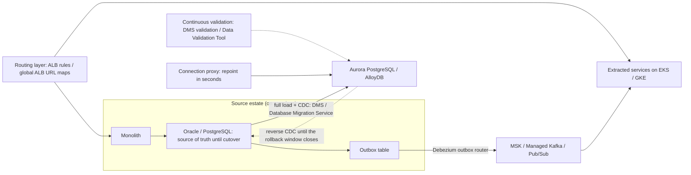
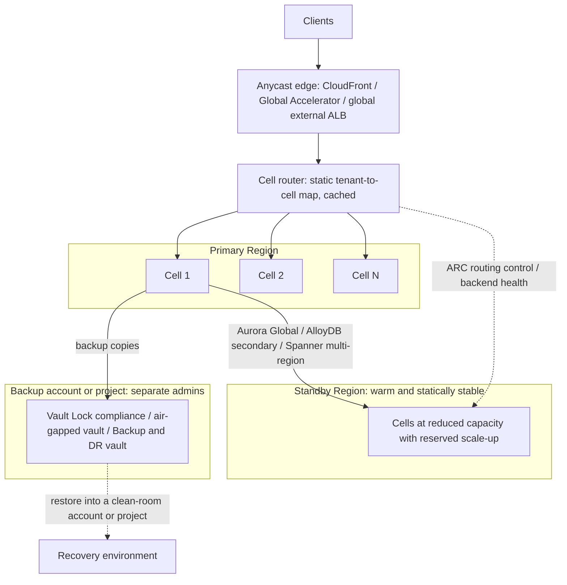

# 07.2 · Master Scenarios 13–25: Zero-Downtime Migration, DR, Serverless and Data Platforms

> **Folder 07 · File 2 of 2.** [07.1](01-scenarios-01-to-12-hybrid-networking-security-and-multi-account-org-design.md) covered the foundations: landing zones, hybrid networks, perimeters and identity. This file covers what runs on them, in 13 more master scenarios:
> - moving databases, data centers and monoliths without downtime;
> - surviving Regions and ransomware;
> - absorbing serverless bursts;
> - making event pipelines safe for money;
> - moving Kafka and Hadoop estates;
> - cutting a cloud bill by 30%;
> - running a governed GenAI platform;
> - containing blast radius with cells.
>
> Same format as 07.1: situation, constraints, an AWS design, a GCP design, the decision and its trade-offs, and links to the mechanism files. Each scenario then has one bar-raiser chain and one original SAP-C02-style question.

| Listing | What it shows | Language |
|---|---|---|
| `scenario_coverage.py` | Run against **this file**. Checks that MS-13..MS-25 are contiguous, that each has all five parts and ≥ 2 links into Folders 01–06, and that each has exactly one bar-raiser chain and one mapped SAP-C02 question. Reports the file's domain mix and answer-letter balance | Python 3 (stdlib) |

**Verification.** The listing is embedded byte-identical. The gate re-runs it on this final file and requires `verdict: OK`, and also checks the chain and question formats. Every number below is either reused from a listing in Folders 01–06 (named where used) or a documented limit; estimates are labeled **[E]**. All scenarios and questions are **original**. Facts are as of **2026-10-31**. Two 2026 names appear in MS-24 and are flagged where used: Vertex AI was renamed **Gemini Enterprise Agent Platform** on 2026-04-22, and Lambda **Web Functions** launched on 2026-10-12.

**Labels.** **[D]** documented · **[E]** estimate/model · ⚠ inferred or to verify.

---

## 0. Orientation

**How to use this file.** Same drill as 07.1:
1. Read the situation.
2. Write your own design in five minutes.
3. Compare, then do the chain (§9.1) aloud and the SAP-C02 question (§9.2) under time.

**Scenario map.**

| MS | Theme | Primary folders | SAP-C02 domain |
|---|---|---|---|
| 13 | Oracle → PostgreSQL with a 15-minute freeze | 06, 03 | 4 |
| 14 | 2,000-VM data-center exit in 12 months | 06, 01, 02 | 4 |
| 15 | Strangler fig with CDC and an outbox | 06, 04 | 4 |
| 16 | Tier-0 ledger with RPO 0 across Regions | 03, 06 | 2 |
| 17 | Warm standby with static stability | 06, 03, 02 | 3 |
| 18 | Ransomware-resilient backups, clean-room recovery | 06, 05, 03 | 3 |
| 19 | Serverless API bursts, 0 → 30,000 RPS | 01, 04 | 2 |
| 20 | Order pipeline with exactly-once effects | 04, 06 | 2 |
| 21 | On-prem Kafka → managed streaming + real-time features | 04, 02 | 4 |
| 22 | 4 PB Hadoop → lakehouse | 03, 04 | 4 |
| 23 | A 30% cost reduction without SLO regressions | 06, 03 | 3 |
| 24 | Governed GenAI/RAG on both clouds | 05, 02, 03 | 2 |
| 25 | Cell-based global SaaS with safe deploys | 06, 02 | 3 |

---

## 1. First principles: three clocks and a bill

Every scenario in this file is decided by one of four quantities. Name the one that binds before you pick a service.

1. **The convergence clock (migrations).** CDC converges only if **apply throughput exceeds the peak change rate**. The write freeze at cutover is *drain + validate + repoint*. In the 06.1 model, validation dominates (10 of 11 minutes), not data movement.
2. **The recovery clocks (DR).**
   - **RPO is a property of the replication mode.** Asynchronous replication means RPO > 0 on an unplanned failover. RPO 0 needs a synchronous quorum on every commit.
   - **RTO = detect + decide + promote/shift + scale + verify.** Each step is either automated and rehearsed or it's a guess.
3. **The scaling clock (bursts).** Platforms add capacity at a **rate**, not instantly. Lambda adds 1,000 execution environments per 10 s per function; Cloud Run queues pending requests for max(10 s, 3.5 × startup). A burst that outruns the rate throttles even below every quota.
4. **The bill.** Unit cost is set at architectural chokepoints:
   - paths (NAT, cross-AZ, egress);
   - commitments (to the floor, not the average);
   - storage tiers and layout (bytes scanned);
   - telemetry volume;
   - per-transition or per-request orchestration.

**The SAP-C02 Domain 4 reflex (migration and modernization).** Look for the phrase that sets the strategy:
- "least effort" or "fixed deadline" → **rehost** (MGN, Migrate to VMs) or **relocate** (EVS, VMware Engine);
- "reduce operational overhead" → **replatform** to managed services;
- "decompose without downtime" → **strangler fig** with CDC and an outbox;
- "minimal downtime database" → **full load + CDC**, with validation and a rollback path.

Then eliminate any option that dual-writes, takes a long outage, or loses changes between loads.

---

## 2. Side-by-side architectural Rosetta matrix

| Master scenario | AWS answer (core primitives) | GCP answer (core primitives) | Deciding principle |
|---|---|---|---|
| MS-13 Oracle → PostgreSQL | DMS Schema Conversion, DMS full load + CDC (sized ≥ peak change), DMS validation, connection proxy, reverse CDC | Database Migration Service conversion workspace, CDC to AlloyDB, Data Validation Tool, PSC connectivity, reverse CDC with Debezium | Apply > peak change rate. Freeze = validation |
| MS-14 Data-center exit | Discovery, MGN rehost waves, Amazon EVS for the VMware tail, DataSync over DX, Dedicated Hosts for BYOL | Migration Center, Migrate to Virtual Machines, VMware Engine, Storage Transfer Service, sole-tenant nodes | Deadline binds: retire, rehost, relocate; modernize later |
| MS-15 Strangler fig | ALB/API Gateway routing, outbox + Debezium on MSK (or DMS), EventBridge fan-out | URL maps on the global ALB, outbox + Debezium to Managed Kafka or Pub/Sub, Datastream for read models | One writer per entity. Never dual-write |
| MS-16 RPO-0 ledger | Aurora DSQL multi-Region or DynamoDB MRSC (3 Regions or 2 + witness) | Spanner multi-region configuration (99.999%) | Synchronous quorum per commit. Contention model decides |
| MS-17 Warm standby | Aurora Global Database, scaled-down running tier, reserved capacity, ARC routing controls, regional STS | AlloyDB secondary / Cloud SQL replica, scaled-down MIGs/GKE, global external ALB health-based shift | RTO requirement binds before cost. Data-plane failover |
| MS-18 Ransomware | AWS Backup to a separate account: Vault Lock compliance / logically air-gapped vault, restore testing, clean-room account | Backup and DR backup vaults with enforced retention in a separate project, deny policies, clean-room project | Outside prod admins' reach + immutable + rehearsed |
| MS-19 Bursty serverless | Scheduled provisioned concurrency, SQS write buffer, CloudFront/ElastiCache reads, Web Functions ⚠ 2026 | Cloud Run min instances, concurrency per instance, pending queue, Pub/Sub write buffer, Cloud CDN | Scaling rate, not quota. Pre-warm known events |
| MS-20 Exactly-once effects | Outbox → EventBridge/SQS, Step Functions (Express fast path, Standard + task token for review), idempotency keys | Outbox → Pub/Sub (exactly-once delivery, ordering keys), Workflows with callbacks, idempotency in Spanner/Firestore | Effects = at-least-once + idempotency |
| MS-21 Kafka migration | MSK (Express brokers), MirrorMaker 2 on MSK Connect, Managed Flink, Redshift streaming ingestion | Managed Service for Apache Kafka, MirrorMaker 2 on Kafka Connect, Dataflow, BigQuery | Move the platform, then modernize. Offsets translated |
| MS-22 Hadoop → lakehouse | S3 + Iceberg (S3 Tables / Glue Catalog), Lake Formation, EMR Serverless + Spot, Athena, MWAA | GCS + BigLake Iceberg, BigLake fine-grained policies, serverless Spark (formerly Dataproc), BigQuery, managed Airflow | Decouple storage and compute. Layout is the cost lever |
| MS-23 30% cost cut | Gateway endpoints, topology-aware routing, Savings Plans to the floor, Graviton/Spot, Intelligent-Tiering, log classes | Private Google Access, zone-aware routing, flexible CUDs to the floor, Spot VMs, Autoclass, log exclusions | Chokepoints and floors, not flat cuts |
| MS-24 Governed RAG | Bedrock (Knowledge Bases on S3 Vectors or OpenSearch, Guardrails, metadata filters), PrivateLink, KMS | Gemini Enterprise Agent Platform ⚠ 2026 name (Agent Search, Gemini models), VPC-SC, CMEK | Entitlements filter retrieval before the model sees text |
| MS-25 Cells | Account per cell, thin cell router, wave deploys with alarm rollback, shuffle sharding, ARC zonal shift | Project/cluster per cell, global ALB routing to cells, progressive rollouts, shuffle sharding | Bound blast radius by construction |

---

## 3. Internal mechanics: master scenarios MS-13 to MS-18

### MS-13 · Oracle to PostgreSQL with a 15-minute write freeze

**Situation.**
- An order-management system runs on an **8 TB Oracle 19c** database with about **1,400 PL/SQL packages**.
- Redo change rate swings from **4 MB/s at 04:00 to 12 MB/s at 16:00**. These are the inputs of the 06.1 listing.
- Two business units are moving: one to **Aurora PostgreSQL**, one to **AlloyDB**. They share one playbook.
- The Oracle license renewal is in 9 months.

**Constraints.**
- Write freeze at cutover ≤ **15 minutes**.
- Rollback to Oracle must remain possible for **two weeks** after cutover.
- No application dual-writes.
- Data must be verifiably identical at cutover.

**AWS design.**
- **Schema and code:** **DMS Schema Conversion** produces the assessment report and converts what it can. Plan engineering time for the remainder of the PL/SQL ([06.1 §3.1](../06-Enterprise-Cloud-Migrations-Resiliency-and-FinOps/01-large-scale-migration-patterns-strangler-fig-cdc-dms-datastream-and-cutover.md)).
- **Data:** a **DMS full load + CDC** task. Capture via LogMiner or Binary Reader with supplemental logging. Apply sized for **≥ 25 MB/s**: batch apply where per-table order suffices, parallel apply per table, more DCUs in DMS Serverless.
- **Validation:** **DMS data validation** runs alongside CDC, so the final check covers only the last minutes.
- **Cutover:** clients reach the database through a **connection proxy** (RDS Proxy or the app's pool endpoint), so repointing takes seconds, not a DNS TTL.
- **Rollback:** a **reverse CDC** task (Aurora → Oracle) starts at cutover and runs for the two-week window.
- **Target behavior:** Aurora's 4-of-6 storage quorum changes durability, not SQL semantics. Retest isolation-sensitive code paths ([03.2 §3.6](../03-Distributed-Storage-Databases-and-Lakehouse-Internals/02-relational-internals-aurora-storage-quorum-rds-proxy-vs-alloydb-and-spanner.md)).

**GCP design.**
- **Schema and code:** a **Database Migration Service** heterogeneous job with a **conversion workspace** (AI-assisted PL/SQL conversion ⚠), then CDC into **AlloyDB**.
- **Connectivity:** private through PSC or peering.
- **Validation:** the open-source **Data Validation Tool** runs row counts, checksums and column aggregates continuously.
- **Rollback:** reverse CDC with **Debezium** on the AlloyDB logical slot, sinking to Oracle.
- **Reporting:** the AlloyDB **columnar engine** takes reporting queries off the primary ([03.2 §4.1](../03-Distributed-Storage-Databases-and-Lakehouse-Internals/02-relational-internals-aurora-storage-quorum-rds-proxy-vs-alloydb-and-spanner.md)).

**Decision and trade-offs.**
- **Convergence decides feasibility.** The 06.1 listing:
  - offline restore at 200 MB/s = 11.1 h of downtime;
  - CDC apply at 8 MB/s **never** catches up;
  - at 10 MB/s it catches up 40 h after the load, with a 38 GB evening lag;
  - at 25 MB/s it catches up in 1 h.
- **The freeze** in the trough is ~10–11 minutes. Validation is 10 of those minutes and is precomputed continuously. At the evening peak, the 38 GB drain alone would take 63 minutes, so **cut over in the trough**.
- **Reverse CDC** is extra machinery, but it is what makes "rollback" a real option rather than a slide.
- **The schedule's long pole is code conversion,** not data. Start PL/SQL conversion and tests in month 1.
- **Watch:** a stalled task holds WAL on a PostgreSQL source (the reverse CDC) and can fill the disk. Alarm on slot lag.

### MS-14 · A 2,000-VM data-center exit in 12 months

**Situation.**
- The data center lease ends in **12 months**. It holds:
  - **1,500 VMware VMs**, of which ~300 depend on VMware-specific features (vSAN policies, appliance images);
  - **300 physical servers**;
  - **200 appliances**;
  - **1.2 PB** of file data.
- Discovery suggests ~30% of VMs are idle or redundant.
- MS-02 connectivity (DX/Interconnect) is in place.
- Windows Server and SQL Server licenses are BYOL-eligible.

**Constraints.**
- The date is fixed.
- Most apps can't be changed.
- Waves of ≤ 100 VMs, each with rollback.
- Licensing compliance.

**AWS design.**
- **Discovery:** Application Discovery Service agents or AWS Transform assessment ⚠ give inventory, utilization and **network flows**.
- **Portfolio:** the 7 Rs. Retire the idle ~30%.
- **Rehost:** **AWS Application Migration Service (MGN)** for the compatible VMs and physical servers. Replication is continuous block-level, test launches are non-disruptive, and at cutover the source stays intact, so rollback is a traffic flip ([06.1 §3.3](../06-Enterprise-Cloud-Migrations-Resiliency-and-FinOps/01-large-scale-migration-patterns-strangler-fig-cdc-dms-datastream-and-cutover.md)).
- **Relocate:** **Amazon EVS** for the 300 VMware-dependent VMs (vMotion/HCX-style moves), modernized after the exit.
- **Files:** **DataSync** over DX.
- **Licensing:** **Dedicated Hosts** for BYOL licenses that need host-level visibility ([01.1 §4.6](../01-Virtualization-Compute-and-Kubernetes-Internals/01-aws-nitro-hypervisor-ec2-placement-groups-vs-gcp-titanium-compute.md) compares sole tenancy).

**GCP design.**
- **Discovery:** **Migration Center** for discovery and TCO.
- **Rehost:** **Migrate to Virtual Machines** (replication, test clones, cutover).
- **Relocate:** **Google Cloud VMware Engine** for the VMware tail.
- **Files:** **Storage Transfer Service** agents.
- **Licensing:** **sole-tenant nodes** for BYOL.
- **Network:** the hybrid design from MS-02 ([02.2](../02-Global-Networking-Hybrid-Connectivity-and-Zero-Trust-VPC/02-hybrid-bgp-routing-direct-connect-vif-macsec-vs-cloud-interconnect-ha-vpn.md)).

**Decision and trade-offs.**
- **The deadline is the binding constraint.** Retire, rehost, relocate; replatform only where it is cheap (databases to managed services when the engine matches). Modernize after the move, with real telemetry.
- **Waves are dependency groups** from observed flows, not org-chart groupings. A wave that splits a chatty pair across the DX link adds latency and transfer cost for weeks.
- **Bandwidth math [E]:** 1.2 PB at 10 Gbps effective ≈ 11 days; at 1 Gbps, 111 days. Schedule bulk transfer early and throttle it below business traffic.
- **Trade:** rehost and relocate carry inefficiency into the cloud. Budget a right-sizing pass 30 days after each wave (Compute Optimizer / GCP recommender) and a VMware-exit plan for the EVS/GCVE tail.

### MS-15 · Strangler-fig decomposition with CDC and an outbox

**Situation.**
- A 12-year-old Java monolith on a **3 TB PostgreSQL** schema runs catalog, pricing, inventory and orders.
- Teams want independently deployable services on EKS and GKE.
- Downstream (search, analytics, warehouse) needs an event for every inventory change.

**Constraints.**
- No downtime.
- **No dual writes.**
- Each extraction step reversible.
- Events must be neither lost nor phantom: no event without a commit, no commit without an event.

**AWS design.**
- **Routing layer:** a routing layer (ALB listener rules or API Gateway) in front of the monolith. Each path moves to a new service when ready ([06.1 §6.1](../06-Enterprise-Cloud-Migrations-Resiliency-and-FinOps/01-large-scale-migration-patterns-strangler-fig-cdc-dms-datastream-and-cutover.md)).
- **Read models first:** a CDC-fed copy of the pricing tables, from **DMS** or **Debezium on MSK Connect**.
- **Events:** the monolith and each new service write domain events to an **outbox table in the same transaction** as the state change. **Debezium's outbox event router** publishes them to **MSK**, and **EventBridge** fans them out to non-Kafka consumers ([04.1 §3.2](../04-Messaging-Streaming-and-Data-Pipeline-Comparison/01-kinesis-sqs-sns-eventbridge-msk-vs-gcp-pubsub-and-kafka-tradeoffs.md)).

**GCP design.**
- **Routing:** **URL maps** on the global external ALB.
- **Read models:** **Datastream** for analytics read models into BigQuery.
- **Events:** the outbox published by **Debezium** to **Managed Service for Apache Kafka** (Kafka Connect), or **Debezium Server → Pub/Sub** with **ordering keys** = entity ID.
- **Compute:** services on GKE.

**Decision and trade-offs.**
- **One writer per entity at every moment.** Write ownership flips atomically per entity at the routing layer, and CDC keeps the other side's reads correct.
- **The outbox turns "write + publish" into one local transaction.** The dual-write failure (commit succeeds, publish fails, or the reverse) can't happen.
- **Extraction order:** start with read-heavy, loosely coupled capabilities (pricing), then move up the coupling gradient. Orders go last.
- **Ordering is per key:** a Kafka partition key or a Pub/Sub ordering key (1 MB/s per key). Every consumer dedupes by event ID.
- **Trade:** during the transition, data exists in two places and the CDC lag is visible to readers. State the staleness budget per read path.

### MS-16 · A tier-0 payments ledger with RPO 0 across Regions

**Situation.**
- A payments ledger peaks at **4,000 committed transactions/s** in the US.
- Today it runs on **Aurora PostgreSQL with Global Database**.
- The regulator requires that **no committed transaction** is lost in a regional failure. RTO must be under 1 minute.
- Merchant balance rows are **hot**: a few merchants take 20% of writes.

**Constraints.**
- RPO = 0.
- Strong consistency: no double spend.
- p99 commit < 50 ms.
- SQL preferred.

**AWS design.**
- **Option A, Aurora DSQL multi-Region:**
  - two Regional clusters plus a **witness Region**;
  - active-active, strongly consistent;
  - **optimistic concurrency**, so hot rows **abort and retry** ([03.2 §3.3](../03-Distributed-Storage-Databases-and-Lakehouse-Internals/02-relational-internals-aurora-storage-quorum-rds-proxy-vs-alloydb-and-spanner.md)).
- **Option B, DynamoDB global tables MRSC** (GA 2025-06-30):
  - three Regions, or two plus a witness;
  - strongly consistent reads and writes while a quorum is reachable;
  - conditional writes on account items;
  - the mode is **fixed at table creation**;
  - check feature parity for your access patterns ⚠ ([03.3 §3.4](../03-Distributed-Storage-Databases-and-Lakehouse-Internals/03-nosql-internals-dynamodb-gsi-dax-streams-vs-bigtable-and-firestore.md)).
- **Either way, the schema is append-only:** ledger entries keyed by transaction ID, with balances derived per account from entries (or held in sharded per-account buckets). Hot rows disappear.

**GCP design.**
- **Spanner** in a **US multi-region configuration** (RPO 0, 99.999% SLA).
- External consistency via TrueTime. **Pessimistic locking** (wound-wait) makes hot rows *wait* rather than abort.
- The leader Region is placed near the main write traffic.
- Nodes are sized from the per-node write throughput with headroom ([03.2 §4.2](../03-Distributed-Storage-Databases-and-Lakehouse-Internals/02-relational-internals-aurora-storage-quorum-rds-proxy-vs-alloydb-and-spanner.md)).

**Decision and trade-offs.**
- **RPO 0 rules out every asynchronous design:** Aurora Global Database (lag typically under a second, but > 0 on an unplanned failover) and DynamoDB MREC (last writer wins also permits double spend).
- **Synchronous quorum costs commit latency.** In the 03.2 model, a commit costs ~12 ms with a nearby voting Region and ~80 ms with a cross-continent quorum. Keep the quorum within the continent to meet p99 < 50 ms.
- **The contention model is the second decision:**
  - DSQL's OCC punishes hot rows (abort rate);
  - Spanner's locks serialize them (wait time).

  The append-only design makes both viable.
- **RTO is near zero** because there is no promotion step. The quorum simply loses a member ([06.2 §1.2](../06-Enterprise-Cloud-Migrations-Resiliency-and-FinOps/02-multi-region-dr-pilot-light-warm-standby-active-active-and-cell-failover.md)).
- **Trade:** higher per-write cost and latency, and a schema redesign. Worth it only for tier-0 data. Everything else stays on asynchronous replication.

### MS-17 · Warm standby with static stability for a tier-1 commerce API

**Situation.**
- A commerce API runs in one Region at **$400,000/month**. Downtime costs **$250,000/h**, and the expected rate is ~0.5 regional failover events per year. These are the 06.2 listing's inputs.
- The SLO document says **RTO 30 minutes, RPO 1 minute**.
- Finance proposes pilot light because the model ranks it cheapest.

**Constraints.**
- Meet the RTO/RPO at the lowest cost that meets them.
- Failover must not depend on the failed Region's control plane.
- Drills every quarter.

**AWS design.**
- **Data:** **Aurora Global Database** (RPO typically < 1 s) with managed failover. S3 CRR with Replication Time Control. DynamoDB global tables (MREC) for carts and sessions.
- **Compute:** in the standby Region, **a running, scaled-down tier** (20–30% capacity) with **capacity reservations** for the scale-up.
- **Shared config:** secrets and parameters replicated.
- **Identity:** applications use **regional STS endpoints**.
- **Traffic:** shifted with **ARC routing controls** (data plane) or Global Accelerator dials ([02.3](../02-Global-Networking-Hybrid-Connectivity-and-Zero-Trust-VPC/03-global-edge-cloudfront-global-accelerator-route53-arc-vs-gcp-anycast-cdn-armor.md)).
- **Verification:** runbooks automated with health verification gates ([06.2 §3.3](../06-Enterprise-Cloud-Migrations-Resiliency-and-FinOps/02-multi-region-dr-pilot-light-warm-standby-active-active-and-cell-failover.md)).

**GCP design.**
- **Traffic:** the **global external ALB** with backends in both regions. Failover follows backend health with no DNS change.
- **Data:** an **AlloyDB secondary cluster** or a Cloud SQL cross-region replica (promotion). GCS dual-region with turbo replication. Persistent Disk Asynchronous Replication (RPO < 1 min) for stateful VMs.
- **Compute:** a scaled-down MIG/GKE node pool with reservations.

**Decision and trade-offs.**
- **The requirement decides before the cost model.** At these inputs the 06.2 listing ranks pilot light cheapest ($846k/yr total), and says warm standby ($1.98M/yr) only pays for itself above $4.6M per hour of downtime. But pilot light's modeled **60-minute RTO violates the 30-minute requirement**.
- **Warm standby's modeled 29 minutes leaves one minute of margin,** so every step must be automated and rehearsed:
  - promotion;
  - scale-up into reserved capacity;
  - traffic shift.
- **Static stability:** the failover path uses only data-plane operations and pre-provisioned resources in the healthy Region. That means no "create the ASG during the event" and no dependency on the failed Region's APIs.
- **Tell the business the price of its RTO:** $1.2M/yr more than pilot light. If 60 minutes is acceptable, that money comes back.

### MS-18 · Ransomware-resilient backups and clean-room recovery

**Situation.**
- An attacker with **administrator access** in a production account encrypted EBS volumes and **deleted the snapshots**.
- The cyber-insurer now requires:
  - immutable backups;
  - recovery into an isolated environment;
  - a **tested restore of tier-1 systems within 24 hours**.
- The company also runs workloads on GCP.

**Constraints.**
- No one with production access (including account root) can delete or shorten backups.
- Encryption keys aren't controlled from production.
- Restores are tested on a schedule.

**AWS design.**
- **Copies:** **AWS Backup** policies (via Organizations) copy recovery points to a vault in a **separate backup account**, protected by **Vault Lock in compliance mode**, or to a **logically air-gapped vault** shared to a recovery account ([06.2 §3.2](../06-Enterprise-Cloud-Migrations-Resiliency-and-FinOps/02-multi-region-dr-pilot-light-warm-standby-active-active-and-cell-failover.md)).
- **Keys and guardrails:** KMS keys live in the backup account. SCPs/RCPs deny vault and key changes from workload OUs ([05.1](../05-IAM-KMS-Cryptography-and-Multi-Tenant-Governance/01-aws-iam-evaluation-logic-scp-permission-boundaries-abac-sts-cross-account.md)).
- **Proof:** **restore testing** runs scheduled restores and measures time.
- **Object data:** S3 Object Lock for object backups ([03.1 §3.7](../03-Distributed-Storage-Databases-and-Lakehouse-Internals/01-object-storage-s3-strong-consistency-prefix-partitioning-vs-gcs-colossus.md)).

**GCP design.**
- **Backups:** **Backup and DR Service** backup vaults with **enforced minimum retention** (immutable and indelible for the period), administered from a **separate project** with separate admins.
- **Guardrails:** **deny policies** on vault and key administration. Bucket Lock for object archives.
- **Recovery:** into a clean project in an isolated folder.

**Decision and trade-offs.**
- **The threat model is "admin in prod."** That puts three requirements on backups:
  1. outside prod's administrative domain;
  2. immutable for the retention period;
  3. restorable into an environment the attacker never touched.
- **Clean-room recovery:**
  1. rebuild infrastructure from IaC in a fresh account or project;
  2. rotate every credential;
  3. restore data and scan it (indicators of compromise, malware) before reconnecting networks.
- **Trade:** compliance-mode retention **can't be shortened, even by you**. A mis-sized retention costs storage for years, so pilot it on a small vault.
- **Recovery time is unknown until measured.** Restore testing turns "24 hours" into a number you can show the insurer.

---

## 4. Internal mechanics: master scenarios MS-19 to MS-25

### MS-19 · A serverless API that bursts from 200 to 30,000 RPS

**Situation.**
- A ticketing API idles at **200 RPS** and jumps to **30,000 RPS** within seconds when a sale opens, at scheduled times.
- Requests take **120 ms** wall time and **15 ms** CPU.
- Today: Lambda behind API Gateway, account concurrency **5,000**. The last sale saw **292,500 throttled requests**, matching the 01.3 listing.
- Writes go to a database that sustains **3,000 writes/s**.

**Constraints.**
- No throttling of valid users at sale open.
- Protect the database.
- Low idle cost.
- p99 read latency < 1 s.

**AWS design.**
- **Pre-warm:** **scheduled provisioned concurrency** (Application Auto Scaling) ramps to ~3,600 environments before each sale ([01.3 §3.4](../01-Virtualization-Compute-and-Kubernetes-Internals/03-serverless-internals-aws-lambda-firecracker-microvms-vs-cloud-run-borg.md)).
- **Writes:** go to **SQS**. A consumer with bounded concurrency drains them at ≤ 3,000/s, and the user gets an order-pending state ([04.1 §3.1](../04-Messaging-Streaming-and-Data-Pipeline-Comparison/01-kinesis-sqs-sns-eventbridge-msk-vs-gcp-pubsub-and-kafka-tradeoffs.md)).
- **Reads:** come from CloudFront and a cache.
- **2026 option ⚠:** **Lambda Web Functions** (launched 2026-10-12, Node.js) serve up to 64 concurrent requests per environment. The CPU bound puts the need at **≥ 225 environments** instead of 3,600.

**GCP design.**
- **Compute:** **Cloud Run** with `min-instances` raised before each sale and per-instance concurrency. CPU at the 60% target binds at **~750 instances** in the listing (concurrency alone would need 75).
- **Absorbing startup:** the **pending queue** holds a request up to max(10 s, 3.5 × startup) before a 429.
- **Writes:** buffered through **Pub/Sub**.
- **Reads:** from Cloud CDN and Memorystore.

**Decision and trade-offs.**
- **The throttles were a scaling-rate problem, not a quota problem.** Steady state needs 3,600 environments, under the 5,000 limit. The listing reaches steady state after 26 s because new environments arrive at 1,000 per 10 s, so raising the quota changes nothing.
- **The event time is known,** so pre-warm.
- **Writes queue** because the database, not the compute, is the real ceiling.
- **Trade:**
  - pre-warmed capacity is paid for during the window;
  - queued writes make the UX asynchronous;
  - multi-concurrency runtimes (Cloud Run, Web Functions) need far fewer environments but share memory and CPU between requests, so the code must be concurrency-safe.

### MS-20 · An event-driven order pipeline with exactly-once effects

**Situation.**
- **30 million orders a month** flow through: place → charge → reserve inventory → buy shipping label → notify.
- Finance found **double charges**: a payment call timed out after the provider charged, and the step retried.
- About 2% of orders are flagged for fraud review and can wait **up to two days** for a human.

**Constraints.**
- No double charges.
- No lost orders.
- Compensation when a later step fails.
- An auditable history per order.
- Orchestration cost proportional to value.

**AWS design.**
- **Intake:** the order service writes the order and an **outbox** row in one transaction. CDC publishes to EventBridge/SQS ([04.1 §1.2](../04-Messaging-Streaming-and-Data-Pipeline-Comparison/01-kinesis-sqs-sns-eventbridge-msk-vs-gcp-pubsub-and-kafka-tradeoffs.md)).
- **Orchestration:**
  - **fast path:** a **Step Functions Express** workflow (asynchronous, at-least-once, ≤ 5 min) with idempotent steps;
  - **flagged orders:** a **Standard** workflow with a `.waitForTaskToken` callback for the reviewer, up to two days ([04.2 §3.4](../04-Messaging-Streaming-and-Data-Pipeline-Comparison/02-aws-glue-emr-flink-step-functions-vs-gcp-dataflow-composer-airflow-dataproc.md)).
- **Idempotency:** every payment call passes the **order ID as the provider's idempotency key**. Effects are recorded in a DynamoDB idempotency table with **conditional writes**.
- **Failure handling:** sagas with explicit compensations (refund, release inventory).

**GCP design.**
- **Intake:** outbox → **Pub/Sub** with **ordering key = order ID** and **exactly-once delivery** on the pull subscription.
- **Workers:** Cloud Run.
- **Orchestration:** **Workflows** runs the saga, with **callbacks** for human review.
- **Idempotency:** records in Spanner or Firestore, written in transactions.

**Decision and trade-offs.**
- **Exactly-once *effects* = at-least-once delivery + idempotent processing.**
  - Standard workflows execute each state transition once, but a task that times out after the provider acted still retries.
  - Pub/Sub exactly-once delivery prevents redelivery *after a successful ack*, not before it.
- **Orchestration cost scales with transitions.** At 10 transitions per order, the 04.2 listing's rates give:

  | Orchestrator | Cost for 30M orders/month |
  |---|---|
  | Standard for everything | ~$7,500/month |
  | Express | ~$124/month |
  | Workflows (modeled) | ~$3,900/month |

  Hence Express on the fast path, and Standard only where long waits or audit need it.
- **Trade:** two workflow types to operate, and idempotency tables to retain beyond the provider's retry window.

### MS-21 · On-prem Kafka to managed streaming, with real-time fraud features

**Situation.**
- An on-prem **Kafka** cluster ingests **60 MB/s** (40,000 records/s) for 6 consumer groups, with 7-day retention.
- It also carries compacted topics and **Kafka Streams** apps.
- A new fraud model needs features with **≤ 5 s freshness**.
- Dashboards will move to Redshift or BigQuery.

**Constraints.**
- No data loss.
- Consumers resume from their positions.
- A rollback option.
- Keep the Kafka protocol where the ecosystem needs it.
- Lower operational load.

**AWS design.**
- **Platform:** **Amazon MSK** (Express brokers).
- **Replication:** **MirrorMaker 2** on MSK Connect over DX, with **checkpoint-based consumer-offset translation** ([04.1 §3.4](../04-Messaging-Streaming-and-Data-Pipeline-Comparison/01-kinesis-sqs-sns-eventbridge-msk-vs-gcp-pubsub-and-kafka-tradeoffs.md)).
- **Order of moves:** per topic, consumers move first, then producers. Replication continues until the rollback window closes.
- **Features:** computed on **Managed Service for Apache Flink**, writing to an **idempotent upsert sink** such as DynamoDB or ElastiCache ([04.2 §3.3](../04-Messaging-Streaming-and-Data-Pipeline-Comparison/02-aws-glue-emr-flink-step-functions-vs-gcp-dataflow-composer-airflow-dataproc.md)).
- **Analytics:** **Redshift streaming ingestion** from MSK.

**GCP design.**
- **Platform:** **Managed Service for Apache Kafka**.
- **Replication:** MirrorMaker 2 on its Kafka Connect clusters over Interconnect ([02.2](../02-Global-Networking-Hybrid-Connectivity-and-Zero-Trust-VPC/02-hybrid-bgp-routing-direct-connect-vif-macsec-vs-cloud-interconnect-ha-vpn.md)).
- **Features:** **Dataflow** with Streaming Engine, writing upserts to Bigtable.
- **Analytics:** BigQuery.
- **Cleanup:** consumers that never needed the Kafka protocol move to **Pub/Sub** later.

**Decision and trade-offs.**
- **Separate the platform move from the application rewrite.** Kafka Streams and compacted topics need the Kafka protocol. Rewriting them during the migration doubles the risk.
- **Partitions:** keep the counts and keys. Changing the partition count remaps keys and breaks per-key order. The 04.1 listing gives ≥ 6 partitions at an assumed 10 MB/s each for 60 MB/s.
- **Freshness vs exactly-once:** checkpoint-gated transactional sinks lag ~13 s even at a 10 s checkpoint interval (04.2 listing). The 5 s target therefore needs **idempotent upserts**, which make visibility independent of checkpoints.
- **Trade:** managed Kafka still leaves partition planning and rebalancing to you. Pub/Sub removes them but drops the Kafka ecosystem.

### MS-22 · Modernizing a 4 PB Hadoop estate into a lakehouse

**Situation.**
- **On-prem Hadoop:**
  - **4 PB** in HDFS;
  - a Hive metastore;
  - **9,000 nightly Spark/Hive jobs** orchestrated by Oozie;
  - Presto for 600 analysts.
- A hardware refresh is due.
- PII columns require row- and column-level controls.

**Constraints.**
- Keep most Spark code.
- An **open table format**.
- Fine-grained access.
- No idle-cluster spend.
- 18 months.

**AWS design.**
- **Bulk copy:** DataSync or DistCp over DX. At 20 Gbps effective, 4 PB takes ~19 days **[E]**.
- **Tables and access:**
  - **Apache Iceberg** tables in **S3 Tables** (managed compaction) or in the Glue Data Catalog;
  - **Lake Formation** for row, column and cell permissions.
- **Compute:** Spark on **EMR Serverless**, or job-scoped EMR clusters with **Spot task nodes**.
- **SQL:** **Athena** replaces Presto.
- **Orchestration:** **MWAA** replaces Oozie.
- **Marts:** Redshift for heavy marts ([03.4 §6.1](../03-Distributed-Storage-Databases-and-Lakehouse-Internals/04-analytics-redshift-athena-glue-iceberg-vs-bigquery-dremel-capacitor-storage-api.md)).

**GCP design.**
- **Tables and access:** GCS with **BigLake Iceberg tables** and the BigLake metastore, under **BigLake row and column policies**.
- **Compute:** serverless batches on **Managed Service for Apache Spark** (formerly Dataproc).
- **SQL:** **BigQuery** for ad-hoc and marts, reading Iceberg through BigLake.
- **Orchestration:** **Managed Service for Apache Airflow** (formerly Cloud Composer) ([04.2 §4.2](../04-Messaging-Streaming-and-Data-Pipeline-Comparison/02-aws-glue-emr-flink-step-functions-vs-gcp-dataflow-composer-airflow-dataproc.md)).

**Decision and trade-offs.**
- **Decouple storage and compute.** Data lives once in an open format, and compute is ephemeral.
- **The cost lever is layout.** In the 03.4 listing, moving a 10 TB table from CSV to day-partitioned Parquet cuts an Athena query from **$50 to under a cent**. Compaction cuts **72,000 data files/day to 300**.
- **The billing models differ:**
  - BigQuery on-demand bills **logical** bytes, ~6× Athena per query at 5× compression;
  - heavy BigQuery use belongs on editions (500 slots ≈ 3,504 TiB/month of on-demand).
- **Migration order:** lift Spark jobs first (low risk), then rewrite hot Hive SQL, then replace Oozie.
- **Trade:** Iceberg maintenance (compaction, snapshot expiry, manifest rewrites) is now somebody's job, unless managed tables take it.

### MS-23 · A 30% cost reduction without SLO regressions

**Situation.**
- The bill is **$2.4M/month**, split 70% AWS and 30% GCP.
- Mix: compute 45%, data transfer and NAT 14%, storage 18%, managed databases 15%, logging 8%.
- The CFO wants **30% off in two quarters** and proposes a flat 30% budget cut per team.

**Constraints.**
- No SLO regressions.
- Durable savings, not one-off.
- Accountability per team.

**AWS design.**
- **Paths:** **S3/DynamoDB gateway endpoints** take object traffic off NAT. In the 06.3 listing, $3,249 → $999/month for 50 TB to S3 plus 20 TB of internet traffic. **Topology-aware routing** cuts the cross-AZ cost of 200 TB from $2,667 to $400/month.
- **Compute:** **Compute Savings Plans** sized to the **floor** (p10 of hourly usage). A 3-year plan at up to 66% off breaks even at 34% utilization. Add Graviton, and Spot for stateless and batch work with diversification.
- **Storage:** **Intelligent-Tiering**. 1 PB at 2 MB objects drops from $23k to $9.7k/month, but objects < 128 KB aren't tiered ([06.3 §3.1–3.4](../06-Enterprise-Cloud-Migrations-Resiliency-and-FinOps/03-cloud-finops-nat-gateway-cross-az-traps-savings-plans-and-storage-tiering.md)).
- **Logs:** CloudWatch Logs Infrequent Access class, and data events scoped to sensitive resources.

**GCP design.**
- **Paths:** **Private Google Access** takes the GCS case from $3,150 to $900/month. Add zone-aware routing.
- **Compute:** flexible **CUDs to the floor**:

  | CUD | Discount | Break-even utilization |
  |---|---|---|
  | 1-year | ~28% | 72% |
  | 3-year | ~46% | 54% |

  Add Spot VMs.
- **Storage:** **Autoclass** for GCS.
- **Logs:** **exclusion filters** and sinks to cheaper storage.
- **Analytics:** BigQuery editions with autoscaling ([03.4 §4.3](../03-Distributed-Storage-Databases-and-Lakehouse-Internals/04-analytics-redshift-athena-glue-iceberg-vs-bigquery-dremel-capacitor-storage-api.md)).

**Decision and trade-offs.**
- **Cut unit costs at chokepoints, not budgets across the board.** A rough sum **[E]**:

  | Lever | Share of bill | Expected cut | Savings |
  |---|---|---|---|
  | Transfer | 14% | half | ~7% |
  | Commitments on the compute floor | 45% | ~9% | ~9% |
  | Storage tiering | 18% | ~1/3 | ~6% |
  | Logging | 8% | ~1/2 | ~4% |
  | Right-sizing and Graviton | | | ~5% |
  | **Total** | | | **≈ 31%** |

- **Durable means instrumented:**
  - tag and label coverage;
  - unit cost per order;
  - anomaly alerts;
  - the 06.3 design-review questions on every new service.
- **Trade:**
  - commitments reduce flexibility, so buy them to the floor in tranches;
  - Spot needs interruption-tolerant designs;
  - tiering has retrieval and monitoring costs that small objects don't recover.

### MS-24 · A governed GenAI/RAG platform on both clouds

**Situation.**
- An internal assistant answers questions over **40 million documents** (SharePoint, Confluence, S3, GCS) with **source ACLs**.
- 20,000 employees. Peak of **40 answers/s** at 09:00, each ~5,000 input and 500 output tokens.
- Regulated: prompts and outputs must not be retained by the provider, and EU users' data stays in the EU.
- The AWS side builds first. A GCP business unit wants the same on its platform.

**Constraints.**
- Answers respect source permissions.
- Data residency.
- Burst capacity at peak.
- Private connectivity.
- Evaluations gate releases.
- Cost per answer visible.

**AWS design.**
- **Retrieval:** **Bedrock Knowledge Bases** on **S3 Vectors** (GA 2025-12-02) or OpenSearch Serverless. Each chunk carries ACL-group **metadata**, and every retrieval applies a **mandatory metadata filter** from the caller's groups, resolved server-side from Identity Center, carried as session tags ([05.1 §3.5](../05-IAM-KMS-Cryptography-and-Multi-Tenant-Governance/01-aws-iam-evaluation-logic-scp-permission-boundaries-abac-sts-cross-account.md)).
- **Content controls:** **Guardrails** for content policy.
- **Network and keys:** **PrivateLink** endpoints for Bedrock ([02.1](../02-Global-Networking-Hybrid-Connectivity-and-Zero-Trust-VPC/01-aws-regional-vpc-tgw-privatelink-vs-gcp-global-andromeda-vpc-psc.md)). KMS keys.
- **Audit:** invocation logs to the security account.
- **Capacity:** **cross-Region inference profiles** within the EU or US geography, and provisioned throughput for the 09:00 peak.

**GCP design.**
- **Platform ⚠ 2026 name:** **Gemini Enterprise Agent Platform**. Vertex AI was renamed on 2026-04-22: Vertex AI Search is now **Agent Search** and Agent Engine is now **Agent Runtime**.
- **Retrieval:** Agent Search with ACL-aware connectors ⚠, or a custom retrieval index with the same mandatory filter.
- **Models:** Gemini models with provisioned throughput ⚠.
- **Perimeter:** a **VPC Service Controls** perimeter around the platform APIs and the data ([05.2 §4.3](../05-IAM-KMS-Cryptography-and-Multi-Tenant-Governance/02-gcp-iam-hierarchy-workload-identity-federation-and-vpc-service-controls.md)).
- **Keys and residency:** CMEK, and EU regional endpoints for EU users.

**Decision and trade-offs.**
- **Entitlements are the binding constraint, and they must be enforced *before* text reaches the model.** A system prompt or content guardrail can't know who may read what. Once restricted text is in the context window, it can leak.
- **ACLs sync on change,** and red-team queries per role run in the evaluation suite.
- **Capacity [E]:** 40 × 5,500 ≈ 220k tokens/s ≈ **13M tokens/minute** at peak. Compare that with your per-model, per-Region quota in Service Quotas (or the GCP equivalent) **before** launch day.
- **Trade:**
  - managed RAG (Knowledge Bases, Agent Search) ships fast but constrains chunking and ranking;
  - a custom pipeline gives control at operational cost;
  - keep one primary model platform per workload, and abstract at the gateway rather than in every app.

### MS-25 · A cell-based global SaaS with safe deploys

**Situation.**
- A collaboration SaaS serves **50,000 customers** from three Regions per cloud.
- Last year, **one configuration push took every Region down for 3 hours**.
- Separately, one customer's malformed workload repeatedly crashed a shared worker fleet.

**Constraints.**
- Any single deploy, config change or customer may affect **≤ 5% of customers**.
- Regions independent.
- Daily deploys continue.

**AWS design.**
- **Cells:** full-stack copies, **an account per cell**, each with its own quotas.
- **Cell router:** a deliberately thin **cell router** using a static, cached **tenant → cell map** (a DynamoDB global table, cached at the edge or in the router).
- **Rollouts:**
  - **deploys and config** go in **waves**: one box → one cell → one Region → the rest, with bake times;
  - **automatic rollback** on alarms (CodeDeploy / AppConfig alarm rollbacks).
- **Shared services:** **shuffle sharding** ([06.2 §6.2](../06-Enterprise-Cloud-Migrations-Resiliency-and-FinOps/02-multi-region-dr-pilot-light-warm-standby-active-active-and-cell-failover.md)).
- **AZ events:** **ARC zonal shift / autoshift** ([02.3](../02-Global-Networking-Hybrid-Connectivity-and-Zero-Trust-VPC/03-global-edge-cloudfront-global-accelerator-route53-arc-vs-gcp-anycast-cdn-armor.md)).

**GCP design.**
- **Cells:** **a project (or GKE cluster) per cell**.
- **Routing:** the **global external ALB** routes by host or header to cell backends, or to a thin router service. The tenant map lives in Spanner or Firestore and is cached.
- **Rollouts:** progressive (Cloud Deploy canaries ⚠), with config staged per cell.
- **Shared services:** shuffle-sharded worker pools.

**Decision and trade-offs.**
- **Testing lowers the probability of a bad change. Cells bound its blast radius.** ≤ 5% impact needs **≥ 20 cells** (the 06.2 listing: 10 pinned cells means 10% impact per cell).
- **Shuffle sharding** with 5 of 100 workers makes full overlap with a poison tenant **1.3e-6%**. 23% of customers share at least one worker, so retries across a shard turn that overlap into degradation, not failure.
- **The router must be the most stable component:** static data, cached, no per-request dependencies.
- **Trade:**
  - fixed per-cell overhead;
  - more deployment stages, so slower global rollout;
  - cross-cell features (search, analytics, tenant moves) need aggregation and migration tooling.

---

## 5. Listing: scenario coverage of this file

<!-- listing:scenario_coverage.py -->
```python
"""scenario_coverage.py - verifies the master-scenario file it is run against (argv[1]).

Checks, ignoring fenced code blocks:
  * master scenarios are headed "### MS-NN · title", numbered contiguously, no duplicates
  * every scenario has the five parts **Situation.** **Constraints.** **AWS design.** **GCP design.**
    **Decision and trade-offs.** and links to >= 2 other KB files (relative ../0N-... links)
  * every scenario has exactly one bar-raiser chain ("Qn · MS-NN · ...") and exactly one SAP-C02
    question whose body says "**Maps to:** MS-NN"
  * reports the SAP-C02 domain mix and answer-letter balance of the file

Usage: python -I scenario_coverage.py <master-scenario .md>
"""
import collections
import pathlib
import re
import sys

PARTS = ["**Situation.**", "**Constraints.**", "**AWS design.**", "**GCP design.**", "**Decision and trade-offs.**"]


def main():
    md = pathlib.Path(sys.argv[1]).read_text(encoding="utf-8")
    body = re.sub(r"^```.*?^```", "", md, flags=re.S | re.M)
    ok = True
    heads = re.findall(r"^### (MS-(\d\d)) · (.+)$", body, re.M)
    nums = [int(n) for _, n, _ in heads]
    contiguous = nums == list(range(nums[0], nums[0] + len(nums))) if nums else False
    ok &= contiguous and len(set(nums)) == len(nums)
    print(f"master scenarios: {len(heads)} (MS-{nums[0]:02d}..MS-{nums[-1]:02d}), contiguous={contiguous}")
    sections = re.split(r"^### (?=MS-\d\d · )", body, flags=re.M)[1:]
    chains = re.findall(r"<summary><b>Q\d+ · (MS-\d\d) · ", body)
    scen_blocks = re.findall(r"<details><summary><b>S\d+ · SAP-C02 · Domain (\d) · Select (\w+)</b></summary>(.*?)</details>", body, re.S)
    maps = collections.Counter()
    domains, letters = collections.Counter(), collections.Counter()
    for dom, _sel, blk in scen_blocks:
        m = re.search(r"\*\*Maps to:\*\* (MS-\d\d)", blk)
        if m:
            maps[m.group(1)] += 1
        domains[dom] += 1
        ans = re.search(r"\*\*Answer: ([A-E](?:, [A-E])*)\*\*", blk)
        for x in (ans.group(1).split(", ") if ans else []):
            letters[x] += 1
    print(f"{'scenario':<8} {'parts':>5} {'KB links':>8} {'chain':>5} {'SAP-C02':>7}  title")
    for sec in sections:
        sid, title = re.match(r"(MS-\d\d) · (.+)", sec).groups()
        cut = sec.split("\n### ", 1)[0].split("\n## ", 1)[0]
        parts = sum(1 for p in PARTS if p in cut)
        links = len(set(re.findall(r"\]\((\.\./0[1-6][^)#]+)", cut)))
        nchain, nmap = chains.count(sid), maps[sid]
        good = parts == len(PARTS) and links >= 2 and nchain == 1 and nmap == 1
        ok &= good
        print(f"{sid:<8} {parts:>3}/5 {links:>8} {nchain:>5} {nmap:>7}  {title[:60]}{'' if good else '  <-- FIX'}")
    print(f"SAP-C02 domains in this file: {dict(sorted(domains.items()))}")
    print(f"answer letters in this file: {dict(sorted(letters.items()))}")
    ok &= sum(domains.values()) == len(heads)
    print()
    print("verdict: OK" if ok else "verdict: FAIL")


if __name__ == "__main__":
    main()
```

<!-- output:scenario_coverage.py -->
```text
master scenarios: 13 (MS-13..MS-25), contiguous=True
scenario parts KB links chain SAP-C02  title
MS-13      5/5        2     1       1  Oracle to PostgreSQL with a 15-minute write freeze
MS-14      5/5        3     1       1  A 2,000-VM data-center exit in 12 months
MS-15      5/5        2     1       1  Strangler-fig decomposition with CDC and an outbox
MS-16      5/5        3     1       1  A tier-0 payments ledger with RPO 0 across Regions
MS-17      5/5        2     1       1  Warm standby with static stability for a tier-1 commerce API
MS-18      5/5        3     1       1  Ransomware-resilient backups and clean-room recovery
MS-19      5/5        2     1       1  A serverless API that bursts from 200 to 30,000 RPS
MS-20      5/5        2     1       1  An event-driven order pipeline with exactly-once effects
MS-21      5/5        3     1       1  On-prem Kafka to managed streaming, with real-time fraud fea
MS-22      5/5        2     1       1  Modernizing a 4 PB Hadoop estate into a lakehouse
MS-23      5/5        2     1       1  A 30% cost reduction without SLO regressions
MS-24      5/5        3     1       1  A governed GenAI/RAG platform on both clouds
MS-25      5/5        2     1       1  A cell-based global SaaS with safe deploys
SAP-C02 domains in this file: {'2': 4, '3': 4, '4': 5}
answer letters in this file: {'A': 2, 'B': 6, 'C': 5, 'D': 2}

verdict: OK
```

**Reading the output.**
- All 13 master scenarios (MS-13..MS-25) are contiguous and have their five parts and links into the mechanism files.
- Each maps one-to-one to a bar-raiser chain and an SAP-C02 question.
- **Domain mix:**

  | | D1 | D2 | D3 | D4 | Total |
  |---|---|---|---|---|---|
  | This file | — | 4 | 4 | 5 | 13 |
  | With 07.1 | 6 | 8 | 6 | 5 | 25 |
  | Share | 24% | 32% | 24% | 20% | |
  | SAP-C02 weighting | 26% | 29% | 25% | 20% | |

---

## 6. Patterns that recur across MS-13 to MS-25

| Pattern | Where it appears | One-line rule |
|---|---|---|
| Converge, then freeze | MS-13, 15, 21 | Apply/replication must beat the *peak* change rate. The freeze is validation + repoint |
| Reversible steps | MS-13, 14, 15, 21 | Keep the source intact and replicate back until the rollback window closes |
| One writer per entity | MS-15, 16, 20 | Ownership flips atomically. Outbox + CDC instead of dual writes |
| Requirement before cost | MS-16, 17 | RPO/RTO constraints eliminate options. Cost picks among the survivors |
| Data plane for failover | MS-17, 25 | Pre-provisioned capacity, routing controls, cached maps. No control-plane calls in the failed Region |
| Rate, not quota | MS-19, 24 | Scaling and token rates throttle before quotas do. Pre-warm known peaks |
| Idempotency everywhere | MS-15, 20, 21 | Exactly-once effects = at-least-once + idempotent consumers |
| Layout and floors | MS-22, 23 | Bytes scanned and committed floors decide the bill |
| Bound the blast radius | MS-18, 25 | Separate administrative domains and cells, not more testing |

---

## 7. Failure modes, throttling limits and quota traps

| # | Symptom | Root cause | Detect | Fix | MS |
|---|---|---|---|---|---|
| 1 | CDC lag never reaches zero | Apply throughput ≤ average change rate | Task lag metrics | Batch/parallel apply, more DCUs; size for peak (06.1) | 13 |
| 2 | Source database disk fills during migration | Replication slot or archive logs retained by a stalled task | Slot lag, disk alarms | Alarm on slot lag, cap retained WAL, restart tasks quickly | 13, 15 |
| 3 | Cutover freeze overruns to an hour | Cut over at peak; validation run only at the end | Runbook timings | Trough cutover, continuous validation, proxy repoint | 13 |
| 4 | A wave breaks an unmigrated dependency | Waves by owner, not by observed flows | Flow logs after cutover | Dependency-grouped waves from discovery data | 14 |
| 5 | Events lost or phantom during extraction | Dual writes (commit and publish not atomic) | Reconciliation diffs | Outbox in the same transaction + CDC | 15 |
| 6 | "RPO 0" design loses a second of payments | Asynchronous replication (Aurora Global, MREC) | DR test with forced failover | Synchronous quorum store (DSQL, MRSC, Spanner) | 16 |
| 7 | Hot accounts fail at peak | OCC aborts on hot rows | Abort/retry rate | Append-only entries, sharded balances, or a lock-based engine | 16 |
| 8 | Failover stalls during a regional event | Runbook needs the failed Region's control plane, or capacity isn't reserved | Game day | Data-plane routing controls, reservations, regional STS | 17 |
| 9 | Backups deleted along with production | Backups in the same administrative domain, governance-mode locks | Restore drill | Separate account/project, compliance-mode locks, logically air-gapped vault | 18 |
| 10 | 429s at sale open below the quota | Scaling rate (1,000 environments per 10 s) | Throttle metrics vs concurrency | Scheduled provisioned concurrency / min instances; queue writes | 19 |
| 11 | Double charges with a "exactly-once" workflow | Task retried after the external effect | Payment reconciliation | Provider idempotency keys, idempotency table | 20 |
| 12 | Consumers reprocess days of data after the Kafka move | Offsets not translated between clusters | Consumer lag jump | MirrorMaker 2 checkpoints / offset sync, per-topic flips | 21 |
| 13 | Lakehouse queries slow and costly | Small files and unpartitioned layouts | Files per partition, bytes scanned | Compaction, partitioning, managed table maintenance | 22 |
| 14 | Commitments go unused | Committed to average, not floor | Utilization reports | Commit to p10 in tranches; review quarterly | 23 |
| 15 | Assistant reveals restricted documents | ACLs not enforced at retrieval | Red-team evals per role | Mandatory server-side metadata filters, ACL sync | 24 |
| 16 | Token throttling at 09:00 | Per-model, per-Region token quotas | Throttle metrics | Provisioned throughput, cross-Region inference within geography, caching | 24 |
| 17 | One push takes down every Region | No wave boundaries for config | — | Cells + waves + alarm rollback | 25 |

---

## 8. Architecture diagrams: multi-service compositions

### 8.1 Zero-downtime migration and strangler fig on both clouds



### 8.2 Resilience composition: cells, warm standby and isolated backups



### 8.3 The clocks that decide each scenario (ASCII)

```text
MIGRATION (MS-13..15, 21)
  full load ──► CDC lag shrinks only if apply > PEAK change ──► freeze = drain + validate + repoint
            └─ reverse CDC / replication kept running until the rollback window closes

DR (MS-16..18)
  RPO  = replication mode            async: > 0 on unplanned failover | sync quorum: 0
  RTO  = detect + decide + promote/shift + scale + verify   (automate every term)

BURST (MS-19, 24)
  demand step ──► capacity arrives at a RATE (envs per 10 s, tokens per minute)
              └─ pre-warm the known peak; queue what the database can't take

BILL (MS-22, 23)
  paths (NAT, cross-AZ) → floors (commit to p10) → layout (bytes scanned) → tiers → telemetry
```

---

## 9. Bar-raiser chains and SAP-C02 scenarios

### 9.1 L7 bar-raiser chains (one per master scenario)

<details><summary><b>Q13 · MS-13 · "Just take a weekend outage"</b></summary>

**Initial Prompt.** "The DBA proposes a 48-hour weekend outage to export and import the 8 TB Oracle database into PostgreSQL. The business allows a 15-minute freeze. Respond."

**L5 Answer.** "Use DMS with CDC instead, so there's no downtime."

**Why L5 Stalls.** CDC isn't automatically convergent, and the freeze is set by validation and repoint, not by the copy. The answer also skips rollback and the real schedule risk, which is code conversion.

**L7 Answer.** "Three numbers from the 06.1 model.
1. **An offline restore** at 200 MB/s is 11.1 hours of downtime, so it fails.
2. **Full load + CDC converges only if apply beats the *peak* change rate.**
   - At 8 MB/s against 4–12 MB/s of change, it never catches up.
   - At 10 MB/s it takes ~40 hours, with a 38 GB evening lag.
   - At 25 MB/s it catches up in an hour.

   So size the apply (batch apply, per-table parallelism) for 25 MB/s.
3. **The freeze** in the trough is ~11 minutes with a DNS repoint, ~10 with a proxy. Validation dominates, so run it continuously.

Then **reverse CDC** keeps rollback real for two weeks. The long pole is converting 1,400 PL/SQL packages, so that work starts in month 1."
</details>

<details><summary><b>Q14 · MS-14 · "Modernize everything as we move"</b></summary>

**Initial Prompt.** "Leadership wants every one of the 2,000 VMs re-architected into containers during the 12-month exit. Push back with a plan."

**L5 Answer.** "That's too much. Let's rehost everything."

**Why L5 Stalls.** Both extremes ignore portfolio economics. A blanket rehost also migrates the ~30% of servers nobody uses.

**L7 Answer.** "The deadline binds, so decide per workload with the 7 Rs:
- **retire** the ~30% that discovery shows idle;
- **rehost** the bulk with MGN / Migrate to VMs, in **dependency-grouped waves** of ≤ 100 built from observed flows;
- **relocate** the 300 VMware-dependent VMs to EVS / VMware Engine to make the date;
- **replatform** only where it's cheap: matching database engines to managed services.

Modernize after the move, using real telemetry. Data: 1.2 PB at 10 Gbps effective is ~11 days, so start early and throttle it. BYOL goes on Dedicated Hosts / sole-tenant nodes. Every wave gets a right-sizing pass 30 days after cutover. Containers come later, for the apps where they pay."
</details>

<details><summary><b>Q15 · MS-15 · "Write to both databases during the transition"</b></summary>

**Initial Prompt.** "To extract the pricing service, a lead proposes that the monolith write to both its own table and the new service's database. Evaluate."

**L5 Answer.** "Dual writes keep them in sync. Add retries."

**Why L5 Stalls.** Without a distributed transaction, a partial failure diverges the two stores. Retries reorder writes, and there's no single owner to reconcile against.

**L7 Answer.** "Never dual-write. Keep **one writer per entity** at all times.
1. **Phase 1:** the service reads a CDC-fed copy while the monolith owns writes.
2. **Phase 2:** flip pricing's write ownership at the routing layer. The service writes its database **plus an outbox row in one transaction**, and CDC publishes events, including back to the monolith's read paths.
3. **Phase 3:** retire the monolith's tables.

Each phase reverses by flipping the route. Ordering is per key (SKU as the Kafka partition key or Pub/Sub ordering key), and every consumer dedupes by event ID."
</details>

<details><summary><b>Q16 · MS-16 · "Aurora Global Database is RPO zero"</b></summary>

**Initial Prompt.** "A team says Aurora Global Database meets the ledger's RPO = 0 requirement because replication lag is under a second. Respond."

**L5 Answer.** "Sub-second lag is effectively zero."

**Why L5 Stalls.** RPO 0 means no committed transaction is lost. Asynchronous replication can lose the in-flight second on an unplanned failover, and for a ledger that second is money.

**L7 Answer.**
- **The replication mode decides RPO.** Async replication (Aurora Global, DynamoDB MREC) gives RPO > 0 on unplanned failover, and MREC's last-writer-wins would even allow double spend.
- **RPO 0 needs a synchronous cross-Region quorum per commit:** Aurora DSQL multi-Region, DynamoDB MRSC, or Spanner multi-region.
- **Each commit then pays quorum RTT:** ~12 ms with a nearby voting Region, ~80 ms cross-continent in the 03.2 model. So keep the quorum in-continent for p99 < 50 ms.
- **Contention is the second decision:** DSQL's OCC aborts on hot merchant balances, while Spanner's locks make them wait. An append-only ledger with derived balances makes either viable.
</details>

<details><summary><b>Q17 · MS-17 · "Pilot light is cheaper, so use it"</b></summary>

**Initial Prompt.** "Finance shows pilot light has the lowest expected total cost for the commerce API. The SLO says RTO 30 minutes. Decide."

**L5 Answer.** "Use pilot light, and work on recovering faster."

**Why L5 Stalls.** The RTO is a constraint, not a cost input. A design that violates it isn't a candidate, whatever it costs.

**L7 Answer.** "At these inputs the 06.2 model ranks pilot light cheapest at $846k/yr, and warm standby at $1.98M/yr only pays above $4.6M per hour of downtime. But **pilot light's 60-minute RTO fails a 30-minute requirement**, so it's out.

Warm standby's modeled 29 minutes leaves one minute of margin. So:
- automate promotion, scale-up and shift;
- reserve the scale-up capacity;
- fail over through the data plane (ARC routing controls / global LB health);
- replicate secrets;
- use regional STS endpoints;
- drill quarterly.

Then show the business the price: the 30-minute RTO costs $1.2M/yr more. If 60 minutes is acceptable, they get that money back."
</details>

<details><summary><b>Q18 · MS-18 · "We have snapshots, we're covered"</b></summary>

**Initial Prompt.** "Ransomware deleted snapshots in a production account. The team proposes more frequent snapshots and MFA for admins. Fix it."

**L5 Answer.** "Hourly snapshots plus MFA will make us resilient."

**Why L5 Stalls.** The attacker *was* an admin in the account where the snapshots live. Frequency doesn't matter when deletion is possible.

**L7 Answer.** "Model the threat as **admin in prod**. Backups must then sit outside prod's administrative reach and be immutable.
- **AWS:**
  - AWS Backup org policies copy to a **separate backup account** with **Vault Lock compliance mode** or a **logically air-gapped vault**;
  - KMS keys live there;
  - SCPs/RCPs fence it off.
- **GCP:** Backup and DR vaults with **enforced retention** in a separate project, plus deny policies.

Recover into a **clean-room** account or project: rebuild from IaC, rotate credentials, scan data before reconnecting. **Restore testing** measures time against the 24-hour target. One caveat: compliance retention can't be shortened, so size it deliberately."
</details>

<details><summary><b>Q19 · MS-19 · "Raise the concurrency limit"</b></summary>

**Initial Prompt.** "Ticket sales caused 292,500 throttled requests. The proposed fix is raising Lambda account concurrency from 5,000 to 20,000. Evaluate."

**L5 Answer.** "A higher limit means fewer throttles."

**Why L5 Stalls.** Steady state needs only 3,600 environments, below the current limit. The throttles come from the scaling rate, so a higher ceiling changes nothing.

**L7 Answer.**
- **The arithmetic:** 30,000 RPS × 120 ms = 3,600 concurrent environments.
- **The real limit:** the 01.3 listing takes 26 s to steady state because environments are added at 1,000 per 10 s per function. That's where the 292,500 429s come from.
- **The fix:**
  - the sale time is known, so **schedule provisioned concurrency** ahead;
  - put writes on **SQS**, drained at the database's 3,000/s;
  - serve reads from cache.
- **On GCP:** Cloud Run min instances before the sale, the pending queue (≥ 10 s) absorbs startup, and CPU-bound sizing is ~750 instances at the 60% target.
- **Multi-concurrency** (Cloud Run, or 2026's Lambda Web Functions at 64 requests per environment) cuts environments to hundreds.
</details>

<details><summary><b>Q20 · MS-20 · "Standard workflows are exactly-once, so payments are safe"</b></summary>

**Initial Prompt.** "The team moved order processing to a Step Functions Standard workflow and assumes payments can no longer double-charge. True?"

**L5 Answer.** "Yes. Standard workflows execute exactly once."

**Why L5 Stalls.** Standard runs each *state transition* once. A payment task that times out after the provider charged still retries, and the external effect happens twice.

**L7 Answer.** "Exactly-once in the orchestrator isn't exactly-once *effects*. The fix:
- pass the **order ID as the provider's idempotency key**;
- record effects in an idempotency table with conditional writes;
- retry only idempotent tasks;
- compensate later failures (saga).

**Cost decides the split:** 30M orders × 10 transitions is ~$7,500/month on Standard and ~$124 on Express. So Express runs the fast path with idempotent steps, and Standard with a task token handles the 2% that wait up to two days for review.

**On GCP,** Pub/Sub exactly-once delivery stops redelivery *after* an ack, Workflows runs the saga with callbacks (~$3,900/month modeled), and the idempotency design is the same."
</details>

<details><summary><b>Q21 · MS-21 · "Rewrite onto Kinesis and Pub/Sub while we migrate"</b></summary>

**Initial Prompt.** "The proposal: leave on-prem Kafka by rewriting all producers and Kafka Streams apps onto Kinesis and Pub/Sub at the same time. Respond."

**L5 Answer.** "Native managed services are better, so the rewrite is worth it."

**Why L5 Stalls.** It couples a platform move with an application rewrite. Kafka Streams and compacted topics depend on the Kafka protocol, so the rewrite is a redesign.

**L7 Answer.** "Move the platform first, then modernize.
- **Move:** to MSK (Express) / Managed Service for Apache Kafka, with **MirrorMaker 2** over DX/Interconnect. MM2 checkpoints translate consumer offsets, so per topic **consumers move first, then producers**. Rollback flips back while replication runs.
- **Partitions:** keep the counts. ≥ 6 at an assumed 10 MB/s each for 60 MB/s, because changing the count remaps keys.
- **Modernize:** fraud features on Managed Flink / Dataflow. For 5 s freshness, use **idempotent upsert sinks**, because transactional sinks gated on checkpoints lag ~13 s even at a 10 s interval.

Consumers that never needed Kafka move to Pub/Sub or Kinesis later, one at a time."
</details>

<details><summary><b>Q22 · MS-22 · "Lift HDFS to the cloud and run it 24/7"</b></summary>

**Initial Prompt.** "The plan is to rebuild the Hadoop cluster on EC2 and Compute Engine with HDFS, and keep it running. Critique."

**L5 Answer.** "Use managed EMR or Dataproc clusters instead."

**Why L5 Stalls.** A managed cluster running 24/7 on HDFS keeps storage and compute coupled, pays for idle time and still has no open table format or fine-grained governance.

**L7 Answer.**
- **Decouple storage:** data on S3/GCS as **Iceberg** tables (S3 Tables / BigLake), cataloged in Glue / the BigLake metastore, governed by Lake Formation / BigLake policies.
- **Make compute ephemeral:** EMR Serverless or job clusters with Spot task nodes, and serverless Spark on GCP. Athena / BigQuery for ad-hoc SQL.
- **The cost lever is layout:** CSV → day-partitioned Parquet takes a 10 TB Athena scan from $50 to under a cent, and compaction takes 72,000 files/day to 300.
- **Know the billing models:** BigQuery on-demand bills logical bytes (~6× Athena at 5× compression), so heavy use goes on editions.

Order: lift Spark jobs first, then Hive SQL, then Oozie → Airflow.
</details>

<details><summary><b>Q23 · MS-23 · "Cut every team's budget by 30%"</b></summary>

**Initial Prompt.** "The CFO wants 30% off the $2.4M/month bill via a flat 30% budget cut per team. Counter-propose."

**L5 Answer.** "Buy Savings Plans and CUDs for everything we run."

**Why L5 Stalls.** Committing to average usage wastes money in every trough. Flat cuts hurt SLOs, and neither fixes architectural cost.

**L7 Answer.** "Attack chokepoints, with the 06.3 numbers:
- **Paths:** gateway endpoints / Private Google Access ($3,249 → $999 and $3,150 → $900/month) and topology-aware routing ($2,667 → $400 per 200 TB).
- **Floors:** commit to p10. A 3-year Compute SP breaks even at 34% utilization; a 1-year flexible CUD at 72%.
- **Tiers:** Intelligent-Tiering / Autoclass (1 PB from $23k to $9.7k, except < 128 KB objects).
- **Telemetry:** log classes, exclusions, scoped data-access logs.

Rough sum [E]: ~7% transfer + ~9% commitments + ~6% storage + ~4% logs + ~5% right-sizing ≈ 31%. To make it durable: unit cost per order, tag coverage, anomaly alerts, design-review gates."
</details>

<details><summary><b>Q24 · MS-24 · "The model will respect permissions if we tell it to"</b></summary>

**Initial Prompt.** "The RAG prototype indexes all 40 million documents in one vector index, and the system prompt says 'only answer from documents the user may see'. Security objects. Fix it."

**L5 Answer.** "Add guardrails that block sensitive topics."

**Why L5 Stalls.** Content filters don't know entitlements. Once restricted text is in the context window, the model can reveal it.

**L7 Answer.** "Enforce entitlements **before** retrieved text reaches the model.
1. Store ACL groups on every chunk.
2. Resolve the caller's groups server-side from the IdP (Identity Center / Workforce Identity Federation).
3. Apply them as a **mandatory retrieval filter**.
4. Re-sync ACLs on change.
5. Red-team per role in the eval suite that gates releases.

Platforms:
- **AWS:** Bedrock Knowledge Bases with metadata filters, S3 Vectors or OpenSearch, Guardrails for content, PrivateLink.
- **GCP:** Gemini Enterprise Agent Platform (the 2026 name for Vertex AI) with Agent Search, inside a VPC-SC perimeter.

Capacity: ~13M tokens/minute at peak, so check quotas and plan provisioned throughput or in-geography cross-Region inference."
</details>

<details><summary><b>Q25 · MS-25 · "One global deployment is simpler"</b></summary>

**Initial Prompt.** "After a 3-hour global outage from a config push, a director says cells are needless complexity and we should just test more. Respond."

**L5 Answer.** "Add more staging tests and stricter code review."

**Why L5 Stalls.** Testing lowers the probability of a bad change but not its blast radius. Every Region failing together is a design property.

**L7 Answer.** "Bound blast radius **by construction**.
- **Cells:** full-stack copies, an account/project per cell, behind a thin router with a static, cached tenant-to-cell map. ≤ 5% impact means ≥ 20 cells.
- **Waves for deploys and config:** one box → one cell → one Region → the rest, with bake times and automatic rollback on alarms.
- **Shuffle-sharded shared services:** 5 of 100 workers makes full overlap with a poison tenant 1.3e-6%. 23% share at least one worker, so clients retry across their shard.

The trades are per-cell overhead and cross-cell aggregation for search and analytics. That is the price of never losing every Region at once again."
</details>

### 9.2 SAP-C02 scenarios (original, one per master scenario)

<details><summary><b>S13 · SAP-C02 · Domain 4 · Select ONE</b></summary>

**Maps to:** MS-13

**Scenario.** A company is migrating an 8 TB Oracle database to Amazon Aurora PostgreSQL. The business allows a write freeze of no more than 15 minutes. The company must be able to roll back to Oracle for two weeks after cutover. The database's change rate peaks at 12 MB/s in the afternoon. What should a solutions architect do?

- **A.** Export the database with Oracle Data Pump over a weekend and import it into Aurora PostgreSQL.
- **B.** Convert the schema with AWS DMS Schema Conversion, then run an AWS DMS full load and CDC task sized so its apply throughput exceeds the peak change rate. Validate data continuously, cut over during a low-traffic window, and run a reverse CDC task from Aurora to Oracle until the rollback window ends.
- **C.** Change the application to write to both Oracle and Aurora PostgreSQL until cutover.
- **D.** Run an AWS DMS full-load-only task every night until the cutover date.

**Answer: B**

- **A** — wrong: an export/import of 8 TB requires hours of downtime.
- **B** — correct: CDC sized above the peak change rate converges, continuous validation keeps the freeze short, and reverse CDC preserves rollback.
- **C** — wrong: dual writes diverge on partial failures and require application changes.
- **D** — wrong: full loads alone miss changes between loads and need a long final copy.
</details>

<details><summary><b>S14 · SAP-C02 · Domain 4 · Select TWO</b></summary>

**Maps to:** MS-14

**Scenario.** A company must exit its data center within 12 months. It runs 1,500 VMware virtual machines. About 300 of them depend on VMware-specific features and can't be changed before the deadline, while most of the others can run unchanged on Amazon EC2. The company wants to meet the deadline with the least migration effort. Which actions should a solutions architect recommend? (Select TWO.)

- **A.** Refactor every application into containers on Amazon EKS before migrating.
- **B.** Use AWS Application Migration Service to rehost the compatible VMs in dependency-based waves, with test launches before each cutover.
- **C.** Move the VMware-dependent VMs to Amazon Elastic VMware Service, and modernize them after the exit.
- **D.** Rebuild each server manually from installation media on EC2.
- **E.** Copy the VM disk files to Amazon S3 with AWS DataSync and boot them directly as EC2 instances.

**Answer: B, C**

- **A** — wrong: refactoring 1,500 VMs within the deadline is the highest-effort option.
- **B** — correct: MGN replicates servers continuously and supports non-disruptive tests and quick cutovers.
- **C** — correct: Amazon EVS runs VMware Cloud Foundation in a VPC, so VMware-dependent VMs move without changes.
- **D** — wrong: manual rebuilds are slow and error-prone.
- **E** — wrong: DataSync copies files and doesn't convert or launch virtual machines.
</details>

<details><summary><b>S15 · SAP-C02 · Domain 4 · Select ONE</b></summary>

**Maps to:** MS-15

**Scenario.** A company is extracting an inventory service from a monolithic application that uses a relational database. Downstream systems need an event for every inventory change. The company must not lose events or publish events for changes that were rolled back, even if a process crashes between the database write and the publish. What should a solutions architect recommend?

- **A.** Publish each event to Amazon SNS first, and then write the change to the database.
- **B.** Write the change to the database, then publish the event to Amazon SQS from the application, retrying on failure.
- **C.** Write the state change and an event record to an outbox table in the same database transaction, and publish the outbox records by using change data capture.
- **D.** Run a nightly job that compares the databases and publishes the differences as events.

**Answer: C**

- **A** — wrong: if the database write fails after publishing, the event describes a change that never happened.
- **B** — wrong: a crash after the commit but before the publish loses the event.
- **C** — correct: the transactional outbox makes the state change and the event atomic, and CDC publishes it reliably.
- **D** — wrong: nightly comparison adds a day of latency and misses intermediate changes.
</details>

<details><summary><b>S16 · SAP-C02 · Domain 2 · Select ONE</b></summary>

**Maps to:** MS-16

**Scenario.** A payments company needs a database on AWS for account balances. It must lose no committed writes if an entire Region fails, must accept writes in more than one Region, and must prevent conflicting concurrent updates to the same account. Which solution meets these requirements?

- **A.** Amazon Aurora PostgreSQL with an Aurora global database in a second Region.
- **B.** Amazon DynamoDB global tables configured for multi-Region strong consistency, with conditional writes on account items.
- **C.** Amazon DynamoDB global tables configured for multi-Region eventual consistency.
- **D.** Amazon RDS for PostgreSQL with cross-Region read replicas.

**Answer: B**

- **A** — wrong: Aurora global databases replicate asynchronously and accept writes in one primary Region.
- **B** — correct: multi-Region strong consistency writes synchronously across Regions, and conditional writes prevent conflicting updates.
- **C** — wrong: eventual consistency resolves conflicts with last writer wins and can lose recent writes in a Region failure.
- **D** — wrong: read replicas are asynchronous and read-only.
</details>

<details><summary><b>S17 · SAP-C02 · Domain 3 · Select ONE</b></summary>

**Maps to:** MS-17

**Scenario.** A company's tier-1 API runs in a single AWS Region. It needs an RTO of 30 minutes and an RPO of 1 minute for a Regional failure, at the lowest cost that meets those objectives. Failover must not depend on control-plane operations in the failed Region. What should a solutions architect recommend?

- **A.** Copy backups to a second Region, and restore the environment with AWS CloudFormation during an event.
- **B.** Replicate the database to a second Region, and create the application tier there only when an event occurs.
- **C.** Deploy a warm standby in a second Region with an Aurora global database and a scaled-down but running application tier, and shift traffic with Amazon Route 53 Application Recovery Controller routing controls.
- **D.** Run active-active in three Regions with a synchronously replicated database.

**Answer: C**

- **A** — wrong: restoring from backups takes hours and misses both objectives.
- **B** — wrong: creating and scaling the application tier during the event is unlikely to fit within 30 minutes.
- **C** — correct: a running scaled-down stack and a replicated database meet the objectives, and routing controls shift traffic through the data plane.
- **D** — wrong: active-active in three Regions exceeds the objectives at a much higher cost.
</details>

<details><summary><b>S18 · SAP-C02 · Domain 3 · Select TWO</b></summary>

**Maps to:** MS-18

**Scenario.** An attacker with administrator access deleted Amazon EBS snapshots in a production account. The company now requires backups that no one in its production accounts can delete or shorten before the retention period ends, and it wants to prove recoverability regularly. Which actions should a solutions architect take? (Select TWO.)

- **A.** Use AWS Backup to copy recovery points to a backup vault in a separate account that has AWS Backup Vault Lock configured in compliance mode.
- **B.** Increase the EBS snapshot frequency to every 15 minutes in each production account.
- **C.** Configure AWS Backup restore testing to restore recovery points on a schedule and validate the results.
- **D.** Keep backups in each production account, and attach an IAM policy that denies deletion.
- **E.** Configure AWS Backup Vault Lock in governance mode in each production account.

**Answer: A, C**

- **A** — correct: a compliance-mode lock in a separate account prevents deletion or shortening of retention by production administrators.
- **B** — wrong: more snapshots in the same account can be deleted the same way.
- **C** — correct: scheduled restore tests prove that backups are recoverable and measure restore time.
- **D** — wrong: account administrators can modify or remove the IAM policy.
- **E** — wrong: governance mode can be removed by sufficiently privileged users, and the vault stays in the production accounts.
</details>

<details><summary><b>S19 · SAP-C02 · Domain 2 · Select ONE</b></summary>

**Maps to:** MS-19

**Scenario.** A ticketing API runs on AWS Lambda behind Amazon API Gateway. At scheduled sale times, traffic rises from 200 to 30,000 requests per second within seconds, and each request takes 120 ms. The account concurrency quota is 5,000, yet many requests are throttled during the first 30 seconds of each sale. Writes go to a database that can sustain only 3,000 writes per second. What should a solutions architect do?

- **A.** Request an increase of the account concurrency quota to 20,000.
- **B.** Schedule provisioned concurrency before each sale, and send writes to an Amazon SQS queue that a consumer drains at a rate the database can sustain.
- **C.** Increase the memory of the function to the maximum.
- **D.** Attach the function to a VPC.

**Answer: B**

- **A** — wrong: steady state needs about 3,600 concurrent executions, below the current quota, so the throttling comes from scaling speed.
- **B** — correct: pre-provisioned environments absorb the burst, and the queue protects the database.
- **C** — wrong: more memory doesn't change how fast new execution environments are added.
- **D** — wrong: VPC attachment doesn't address scaling and adds no capacity.
</details>

<details><summary><b>S20 · SAP-C02 · Domain 2 · Select ONE</b></summary>

**Maps to:** MS-20

**Scenario.** An order workflow calls a third-party payment API. Sometimes a call times out after the provider has already charged the customer, the workflow retries, and the customer is charged twice. Orders flagged for fraud must wait up to two days for a human decision. What should a solutions architect recommend?

- **A.** Disable retries on the payment step.
- **B.** Put an Amazon SQS FIFO queue with content-based deduplication between the workflow steps.
- **C.** Use an AWS Step Functions Express workflow for every order, including the flagged ones.
- **D.** Use an AWS Step Functions Standard workflow with a callback task token for the human review, and send the order ID as an idempotency key on every payment request so that retries don't create new charges.

**Answer: D**

- **A** — wrong: without retries, transient errors would leave orders unpaid.
- **B** — wrong: FIFO deduplication applies to sends within five minutes, not to repeated external API calls.
- **C** — wrong: Express workflows run for at most five minutes and can't wait two days.
- **D** — correct: idempotency keys make retries safe, and Standard workflows support long waits with task tokens.
</details>

<details><summary><b>S21 · SAP-C02 · Domain 4 · Select ONE</b></summary>

**Maps to:** MS-21

**Scenario.** A company is moving a self-managed Apache Kafka cluster from its data center to AWS. Several applications use Kafka Streams and compacted topics. Consumers must resume from their current positions after the move, and the company wants the option to roll back. What should a solutions architect recommend?

- **A.** Rewrite all producers and consumers to use Amazon Kinesis Data Streams before migrating.
- **B.** Stop the on-premises cluster, copy its log segments to Amazon S3, and start an Amazon MSK cluster from them.
- **C.** Create an Amazon MSK cluster, replicate topics with MirrorMaker 2 including consumer group offset translation, move consumers and then producers, and keep replication running until the rollback window ends.
- **D.** Replace each topic with an Amazon SQS FIFO queue.

**Answer: C**

- **A** — wrong: Kafka Streams and compacted topics require the Kafka protocol, and a rewrite adds risk and time.
- **B** — wrong: this requires downtime, and copying log segments isn't a supported way to seed MSK.
- **C** — correct: MirrorMaker 2 replicates data and translates offsets, and continued replication keeps rollback possible.
- **D** — wrong: SQS has neither Kafka semantics nor compaction.
</details>

<details><summary><b>S22 · SAP-C02 · Domain 4 · Select ONE</b></summary>

**Maps to:** MS-22

**Scenario.** A company is migrating a 4 PB on-premises Hadoop platform to AWS. It wants to keep most of its Spark code, use an open table format, enforce column-level and row-level permissions on PII, and stop paying for idle clusters. Which design meets these requirements with the least operational overhead?

- **A.** Run a permanent Hadoop cluster with HDFS on Amazon EC2 instances.
- **B.** Store the data as Apache Iceberg tables in Amazon S3 (S3 Tables or Iceberg tables in the AWS Glue Data Catalog), govern access with AWS Lake Formation, run Spark jobs on Amazon EMR Serverless, and use Amazon Athena for ad hoc SQL.
- **C.** Load all the data into Amazon RDS for PostgreSQL.
- **D.** Store the data as CSV files in Amazon S3, and grant bucket-level IAM access.

**Answer: B**

- **A** — wrong: a permanent cluster keeps idle cost and HDFS operations, and doesn't provide fine-grained governance.
- **B** — correct: Iceberg is open, Lake Formation provides row and column permissions, and serverless compute avoids idle clusters.
- **C** — wrong: a relational database doesn't fit 4 PB of analytics data or run Spark jobs.
- **D** — wrong: CSV is inefficient to scan, and bucket-level IAM can't enforce row or column permissions.
</details>

<details><summary><b>S23 · SAP-C02 · Domain 3 · Select ONE</b></summary>

**Maps to:** MS-23

**Scenario.** A company's workloads in private subnets send 50 TB per month to Amazon S3 through NAT gateways. Its EC2 usage varies between 400 and 1,000 vCPUs, with a steady floor of about 400 vCPUs. The company wants the largest durable cost reduction without affecting reliability. What should a solutions architect recommend?

- **A.** Add an S3 gateway VPC endpoint to the private subnets' route tables, and purchase a Compute Savings Plan sized to the steady usage floor.
- **B.** Purchase a Compute Savings Plan sized to the peak usage of 1,000 vCPUs.
- **C.** Move all workloads to EC2 Spot Instances.
- **D.** Replace the NAT gateways with NAT instances on the smallest instance type.

**Answer: A**

- **A** — correct: the gateway endpoint removes NAT processing charges for S3 traffic, and a Savings Plan sized to the floor stays fully used.
- **B** — wrong: a commitment sized to peak goes unused whenever usage is below 1,000 vCPUs.
- **C** — wrong: Spot interruptions would affect workloads that need steady capacity.
- **D** — wrong: small NAT instances reduce availability and throughput and add operational work.
</details>

<details><summary><b>S24 · SAP-C02 · Domain 2 · Select ONE</b></summary>

**Maps to:** MS-24

**Scenario.** A company is building an internal assistant with Amazon Bedrock Knowledge Bases over documents that have different access permissions. Employees must receive answers derived only from documents they are authorized to read. What should a solutions architect recommend?

- **A.** Add an instruction to the system prompt telling the model to answer only from documents the user may see.
- **B.** Store each document's access groups as metadata on its chunks, and on every request apply a retrieval filter built server-side from the caller's verified group memberships.
- **C.** Configure an Amazon Bedrock guardrail with denied topics for confidential subjects.
- **D.** Fine-tune a model on all the documents so that retrieval isn't needed.

**Answer: B**

- **A** — wrong: a prompt instruction doesn't enforce access, and restricted text in the context can still leak.
- **B** — correct: filtering retrieval by verified entitlements ensures that only authorized content reaches the model.
- **C** — wrong: guardrails filter content categories and don't know individual users' permissions.
- **D** — wrong: fine-tuning on all documents embeds restricted content in the model for every user.
</details>

<details><summary><b>S25 · SAP-C02 · Domain 3 · Select ONE</b></summary>

**Maps to:** MS-25

**Scenario.** A SaaS company suffered a global outage when a faulty configuration change was deployed to all Regions at once. Separately, a single customer's malformed workload repeatedly crashed a shared worker fleet. The company wants any deployment or customer to affect only a small percentage of customers. What should a solutions architect recommend?

- **A.** Add more integration tests before each deployment.
- **B.** Keep deploying to all Regions at once, but automate faster rollback.
- **C.** Consolidate all customers into one larger Region to simplify operations.
- **D.** Partition the service into cells behind a lightweight routing layer, deploy changes in waves cell by cell with automatic rollback on alarms, and assign customers to shuffle-sharded subsets of the shared workers.

**Answer: D**

- **A** — wrong: tests reduce the chance of a bad change but don't limit its impact.
- **B** — wrong: a simultaneous global deployment still affects every customer before rollback completes.
- **C** — wrong: one Region increases the blast radius.
- **D** — correct: cells and wave deployments bound the impact of changes, and shuffle sharding limits the impact of a poison customer.
</details>

---

## 10. Checklist

- [ ] Migrations: apply/replication throughput vs **peak** change rate computed. Freeze budgeted as drain + validate + repoint. Rollback replication planned.
- [ ] No design dual-writes. Every entity has one writer at each moment. Events come from an outbox or CDC.
- [ ] DR: the replication mode matches the RPO. Every RTO term is automated. Failover uses only the healthy Region's data plane and pre-reserved capacity.
- [ ] Backups sit outside production's administrative domain, are immutable, and are restored on a schedule with measured time.
- [ ] Bursts: scaling *rates* checked, not just quotas. Known peaks are pre-warmed. Downstream ceilings are protected by queues.
- [ ] Money paths: idempotency keys on every external effect. Orchestrator cost per order computed.
- [ ] Data platforms: open table format, ephemeral compute, layout and compaction owned. Billing model (logical vs compressed bytes) known.
- [ ] Cost: chokepoints first, commitments to the floor, unit cost per business transaction tracked.
- [ ] GenAI: entitlements enforced at retrieval, token capacity checked against quotas, evaluations gate releases. 2026 product names verified.
- [ ] Blast radius: cells sized from the maximum acceptable impact. Deploys and config in waves with alarm-driven rollback.

---

## 11. References

Mechanism files used by these scenarios: Folders 01–06 of this KB (linked inline per scenario), and [07.1](01-scenarios-01-to-12-hybrid-networking-security-and-multi-account-org-design.md) for the foundations.

External:

**Migration**
- AWS DMS data validation: <https://docs.aws.amazon.com/dms/latest/userguide/CHAP_Validating.html>
- AWS DMS Schema Conversion: <https://docs.aws.amazon.com/dms/latest/userguide/CHAP_SchemaConversion.html>
- Google Cloud Database Migration Service: <https://docs.cloud.google.com/database-migration/docs/overview>
- Data Validation Tool: <https://github.com/GoogleCloudPlatform/professional-services-data-validator>
- AWS Application Migration Service: <https://docs.aws.amazon.com/mgn/latest/ug/what-is-application-migration-service.html>
- Migrate to Virtual Machines: <https://docs.cloud.google.com/migrate/virtual-machines/docs/5.0/migrate/overview>

**Decomposition and event pipelines**
- Strangler fig pattern (AWS Prescriptive Guidance): <https://docs.aws.amazon.com/prescriptive-guidance/latest/cloud-design-patterns/strangler-fig.html>
- Transactional outbox pattern: <https://docs.aws.amazon.com/prescriptive-guidance/latest/cloud-design-patterns/transactional-outbox.html>
- Debezium outbox event router: <https://debezium.io/documentation/reference/stable/transformations/outbox-event-router.html>
- Step Functions workflow types: <https://docs.aws.amazon.com/step-functions/latest/dg/choosing-workflow-type.html>
- Pub/Sub exactly-once delivery: <https://docs.cloud.google.com/pubsub/docs/exactly-once-delivery>

**Streaming**
- Kafka MirrorMaker 2.0 (KIP-382): <https://cwiki.apache.org/confluence/display/KAFKA/KIP-382%3A+MirrorMaker+2.0>
- Managed Service for Apache Kafka: <https://docs.cloud.google.com/managed-service-for-apache-kafka/docs/overview>

**Databases**
- Spanner instance configurations: <https://docs.cloud.google.com/spanner/docs/instance-configurations>
- Aurora global database: <https://docs.aws.amazon.com/AmazonRDS/latest/AuroraUserGuide/aurora-global-database.html>

**DR and resilience**
- AWS Backup Vault Lock: <https://docs.aws.amazon.com/aws-backup/latest/devguide/vault-lock.html>
- AWS Backup logically air-gapped vaults: <https://docs.aws.amazon.com/aws-backup/latest/devguide/logicallyairgappedvault.html>
- AWS Backup restore testing: <https://docs.aws.amazon.com/aws-backup/latest/devguide/restore-testing.html>
- Google Cloud Backup and DR: <https://docs.cloud.google.com/backup-disaster-recovery/docs/concepts/backup-dr>
- Disaster recovery of workloads on AWS (whitepaper): <https://docs.aws.amazon.com/whitepapers/latest/disaster-recovery-workloads-on-aws/disaster-recovery-workloads-on-aws.html>
- Static stability using Availability Zones: <https://aws.amazon.com/builders-library/static-stability-using-availability-zones/>
- Cell-based architecture (AWS whitepaper): <https://docs.aws.amazon.com/wellarchitected/latest/reducing-scope-of-impact-with-cell-based-architecture/reducing-scope-of-impact-with-cell-based-architecture.html>
- Workload isolation using shuffle sharding: <https://aws.amazon.com/builders-library/workload-isolation-using-shuffle-sharding/>

**Serverless**
- Lambda scaling behavior: <https://docs.aws.amazon.com/lambda/latest/dg/scaling-behavior.html>
- Cloud Run instance autoscaling: <https://docs.cloud.google.com/run/docs/about-instance-autoscaling>

**Cost**
- Savings Plans: <https://docs.aws.amazon.com/savingsplans/latest/userguide/what-is-savings-plans.html>
- Committed use discounts: <https://docs.cloud.google.com/compute/docs/instances/signing-up-committed-use-discounts>

**GenAI**
- Amazon S3 Vectors GA (2025-12-02): <https://aws.amazon.com/about-aws/whats-new/2025/12/amazon-s3-vectors-generally-available/>
- Amazon Bedrock Knowledge Bases: <https://docs.aws.amazon.com/bedrock/latest/userguide/knowledge-base.html>
- Gemini Enterprise Agent Platform release notes (Vertex AI renaming, 2026): <https://docs.cloud.google.com/gemini-enterprise-agent-platform/release-notes>
