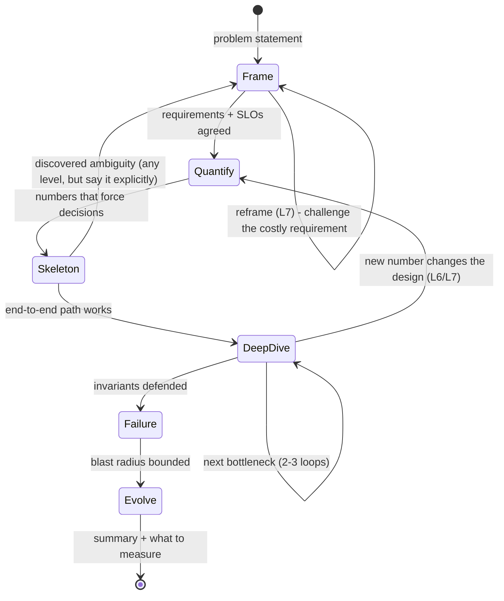
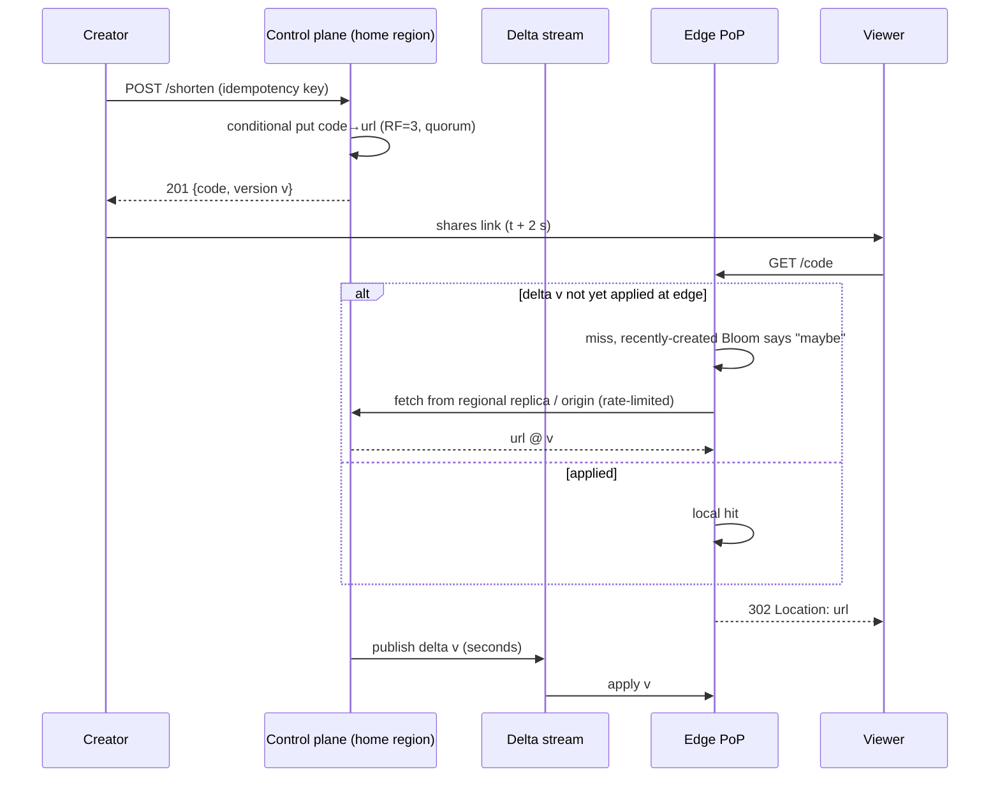

# L5 vs L6 vs L7: How System Design Interviews Are Graded, and the Signals That Move a Packet

> **Folder 01 · File 01** of the Distributed Systems & System Design L7 Reference.
> **Prerequisites:** none. This file is the lens for everything that follows.
> **Listing:** [`estimation_toolkit.py`](#6-the-quantification-toolkit-first-principles-math-graded-in-every-round) is the
> quantification toolkit. It is deterministic, and its output is reproduced byte-for-byte by the KB gate.
> **Companion files:** [02 — hardware, network physics and FinOps](02-hardware-network-physics-latency-numbers-and-finops-math.md),
> [03 — CAP, PACELC and consistency models](03-cap-pacelc-linearizability-serializability-and-causal-consistency.md).

---

## 0. How to read this file

The other 31 files in this KB teach *what* to design. This one teaches *how the design is judged*, because the same
architecture can be scored as Senior, Staff or Principal depending on what you drive, what you quantify, and what you
refuse to build.

The file is organized as:

| § | What | Use it for |
|---|------|-----------|
| 1 | The level ladder across companies | Knowing which bar you are actually interviewing against |
| 2 | How Google, Meta and Amazon loops turn a conversation into a decision | Making your signals *quotable* in written feedback |
| 3 | The scope cone | One picture that separates L5, L6 and L7 |
| 4 | The master evaluation matrix | 16 dimensions × 3 levels; the rubric you self-grade against |
| 5 | The 45-minute session anatomy | Time-boxing per level |
| 6 | The quantification toolkit + listing | Nines, availability composition, tail at scale, queueing knees, Little's law, Zipf |
| 7 | Calibration: one problem answered at L5, L6 and L7 | Seeing the delta on a problem everyone knows |
| 8 | Signals catalog and red flags | What interviewers write down verbatim |
| 9 | Bar-raiser probing chains | 8 generic three-step chains with defenses |
| 10 | Opening and closing scripts | The first and last 90 seconds |
| 11 | Self-scoring sheet | Mock-interview grading |
| 12 | Invariants | The checklist |

Conventions used across the KB:
- Release- or company-dependent claims are marked **⚠ verify**.
- Measured values are labelled "one measured run". Deterministic outputs are labelled "Output (verified)".

---

## 1. The level ladder is not one ladder

The brief for this KB says "L5 Senior / L6 Staff / L7 Principal". That is a **normalized** scale. The real ladders
differ, and a candidate who confuses them prepares for the wrong bar.

| Normalized band (this KB) | Google | Meta | Amazon | Uber | Microsoft |
|---|---|---|---|---|---|
| **L5: Senior** | L5 Senior SWE | E5 | L6 SDE III / Senior | L5a / L5b | 63–64 Senior |
| **L6: Staff** | L6 Staff | E6 | (no Staff title; upper L6 to L7) | L6 Staff | 65–66 Principal |
| **L7: Principal / Senior Staff** | L7 Senior Staff (L8 Principal) | E7 (E8) | L7 Principal (L8 Sr Principal) | L7 Sr Staff (L8) | 67–68 Partner-track |

⚠ verify. These are approximate public equivalences (levels.fyi-style mappings). They shift, and comp bands overlap
across adjacent levels.

Three consequences matter for preparation:

1. **Amazon's L6 is "Senior", not "Staff".** Amazon jumps from SDE III (L6) to Principal (L7). An Amazon L7 loop is
   graded against the Principal Engineering Tenets (§2.3), which sit closer to Google L7/L8 than to Google L6.
2. **Google's L7 is "Senior Staff".** Google's "Principal" is L8. When this KB says L7, it means the band where you
   are expected to set technical direction across *multiple teams or an org*, not just own one large system.
3. **Down-leveling is the common failure mode, not rejection.** At E6/L6 and above, a strong-but-not-quite packet is
   usually offered one level down. Most of the signals in §4 and §8 are about avoiding a down-level, not about passing.

---

## 2. How the loop actually grades you

Every large company converts a 45-minute conversation into **written evidence**. A separate group, the hiring
committee (HC), the debrief, or the bar raiser, then reads that evidence and decides. Your interviewer is
mostly a *stenographer with a rubric*. The practical consequence:

> **Say your signals out loud, in quotable sentences.** "We have 3 bottlenecks; the one that sets the cost is the
> fan-out write amplification: 100M posts/day × 300 average followers = 3.5×10⁵ inserts/s" ends up verbatim in a
> packet. A correct diagram drawn in silence often does not.

### 2.1 Google

- **Process (historically; ⚠ verify the current flow):**
  1. Interviewers submit structured feedback and a numeric rating.
  2. A hiring committee of engineers who did not interview you reads the whole packet and decides hire/no-hire.
  3. A separate step calibrates the level, and team match follows.
- **Attributes graded:**
  - General Cognitive Ability: how you reason through ambiguity.
  - Role-Related Knowledge: technical depth.
  - Leadership: emergent leadership, driving the discussion.
  - "Googleyness": collaboration, comfort with ambiguity.
- **What moves a system design packet at L6+:**
  - The design is *right-sized*: the candidate deliberately does not over-build.
  - Trade-offs are quantified.
  - The candidate proactively covers failure, operations and evolution.
  - A Google HC is notoriously skeptical of "buzzword architecture". A precise argument about *why* a component exists
    beats a richer diagram.

### 2.2 Meta

- **Loop for E5+:** typically coding rounds, one or two design rounds, and a behavioral round. The design rounds are
  system design (the "Pirate" round) or product architecture, which leans more on APIs and data modeling for product
  teams.
- **Focus areas Meta publishes for system design** (⚠ verify the current wording):
  - **Problem Navigation:** scoping, asking the right questions, identifying what matters.
  - **Solution Design:** a working, scalable design with appropriate components.
  - **Technical Excellence:** depth, trade-offs, failure handling, correctness.
  - **Technical Communication:** clarity, structure, driving the conversation.
- **What moves an E6/E7 packet:** the behavioral round carries heavy weight for level. "Scope of impact" stories must
  match the level claimed: E6 means a cross-team outcome, E7 means org-level direction. A design round that is strong
  on Solution Design but weak on Problem Navigation reads as E5.

### 2.3 Amazon

- **Leadership Principles in every round.** Each interviewer owns two or three LPs and must collect evidence for them,
  including inside the system design round. The LPs that show up most in design are:
  - *Dive Deep*;
  - *Think Big*;
  - *Invent and Simplify*;
  - *Frugality*: your FinOps math is graded here;
  - *Insist on the Highest Standards*: operational excellence;
  - *Are Right, A Lot*: trade-off judgment.
- **The Bar Raiser** is a specially trained interviewer from outside the hiring team, with effective veto power in the
  debrief. Their question is "is this candidate better than 50% of the people currently at this level?"
- **Principal (L7) is graded against the Principal Engineering Tenets** (public):
  - Exemplary Practitioner;
  - Technically Fearless;
  - Balanced and Pragmatic;
  - Illuminate and Clarify;
  - Flexible in Approach;
  - Respect What Came Before;
  - Learn, Educate, and Advocate;
  - Have Resounding Impact.

  Two of these are directly testable in a design round:
  - *Respect What Came Before*: you migrate rather than rewrite.
  - *Illuminate and Clarify*: you make the problem simpler for everyone in the room.

### 2.4 Netflix, Uber and the rest

- **Uber** grades system design heavily on real-time and geo-distributed concerns, and on **operability at Uber's
  scale**: on-call, migrations, multi-region failover.
- **Netflix** emphasizes judgment and context-over-control. Expect deep "how would you operate this" and "what would
  you *not* build" questions, and chaos and resilience thinking (Netflix originated Chaos Monkey). ⚠ verify each
  company's current level structure before a loop.

### 2.5 The common denominator

| Every rubric rewards... | ...and the evidence an interviewer can write down |
|---|---|
| Scoping before solving | "Asked about read/write ratio, consistency needs and growth before drawing anything" |
| Quantification | "Estimated 350k peak QPS and 274 TB with RF=3 in under 3 minutes" |
| Identifying the real bottleneck | "Immediately flagged hot-key skew on celebrity accounts as the core problem" |
| Trade-off articulation | "Chose async replication, stated the RPO of ~1 s, and explained when that is unacceptable" |
| Failure and operations | "Proactively covered region evacuation, backfill and schema migration" |
| Driving | "I barely had to ask questions; the candidate set the agenda for the deep dives" |
| Judgment | "Rejected a microservice split for a 2-person team; kept it a modular monolith" |

---

## 3. The scope cone: one picture of the three levels

```
                       ┌──────────────────────────────────────────────────────────────────┐
  L7  PRINCIPAL        │ Redefines the problem: business ROI, physics, org boundaries,    │
  "changes the         │ blast radius across tenants/regions/teams, control vs data plane,│
   question"           │ metastability, multi-year evolution, TCO. Decides what NOT to    │
                       │ build. Designs the platform others' systems run on.              │
                       └───────────────┬──────────────────────────────────┬───────────────┘
                                       │                                  │
                         ┌─────────────┴──────────────────────────────────┴─────────────┐
  L6  STAFF              │ Finds the 2-3 real bottlenecks unprompted, quantifies them,  │
  "finds the right       │ multi-region trade-offs, hot keys, schema evolution, SLOs,   │
   problem inside        │ day-2 operations (deploys, backfills, migrations, on-call).  │
   the system"           │ Drives the session.                                          │
                         └───────────────┬─────────────────────────────┬────────────────┘
                                         │                             │
                             ┌───────────┴─────────────────────────────┴───────────┐
  L5  SENIOR                 │ Given a clear problem, produces a correct, scalable  │
  "solves the problem        │ design with standard patterns (LB, cache, sharding,  │
   as given"                 │ queue, replication). Needs nudges on edge cases.     │
                             └──────────────────────────────────────────────────────┘
```

The cone widens in three directions at once:

- **Scope of the problem:** one component → one system → the system plus its neighbors, owners and economics.
- **Time horizon:** launch day → day 2 (operations, migrations) → year 3 (evolution, cost curve, org changes).
- **Failure domain:** a node → a zone/region → a correlated, cross-tenant, or metastable failure that no single node
  "has".

An L7 answer is *not* an L5 answer with more boxes. Often it has **fewer** boxes. The extra value is in the
boundary decisions: what is in scope, what is shared, what is isolated, what is static, and what is allowed to fail.

---

## 4. The master evaluation matrix

Self-grade each dimension after every mock. A packet reads at a level when **most** dimensions hit it and **none**
falls two levels below.

| # | Dimension | L5: Senior says… | L6: Staff adds… | L7: Principal drives… |
|---|---|---|---|---|
| 1 | **Problem framing** | Lists functional requirements; asks about scale when prompted | Separates functional vs non-functional; pins SLOs (p99, availability, RPO/RTO, freshness); names out-of-scope | Reframes around the business outcome and constraints ("is the real need a feed, or notification of 5 events?"); finds the requirement that dominates cost and challenges it |
| 2 | **Estimation** | Computes QPS and storage when asked | Estimates unprompted: peak vs average, read/write mix, working set, bandwidth; uses them to *choose* | Derives from physics and prices: RTT floors, IOPS per $, $/GB tiers, cost per request; puts error bars on estimates and knows which one is load-bearing |
| 3 | **API & data model** | Reasonable REST/gRPC endpoints and tables | Idempotency keys, pagination tokens, versioned schemas, access patterns drive keys | Contracts as long-lived org interfaces: compatibility rules, ownership, deprecation; data model chosen so the hot path is single-partition |
| 4 | **High-level architecture** | Standard boxes: LB → service → cache → DB → queue | Every box is justified by a number or failure mode; avoids needless services | Cellular/regional topology; control plane vs data plane; what is shared vs per-cell; build-on-platform vs bespoke |
| 5 | **Bottleneck identification** | Finds bottlenecks when nudged ("what if writes 10×?") | Names the 2–3 core bottlenecks in the first 10 minutes (hot keys, fan-out, coordination) | Identifies the bottleneck that sets the *architecture* (often coordination or cost, not throughput) and designs it away |
| 6 | **Consistency & correctness** | "Use a transaction" / "eventually consistent" | States the model per operation (linearizable writes, RYW reads), isolation level, anomalies accepted | Proves the invariant: fencing, idempotency, exactly-once *effects*; picks the weakest model that keeps the invariant, and prices the stronger one |
| 7 | **Partitioning & hot keys** | Hash-shard by ID | Choice of key from access pattern; resharding plan; hot-key detection and salting/replication | Skew as a first-class load model (Zipf, celebrities, flash sales); admission per key; isolation of whales into their own cells |
| 8 | **Multi-region** | "Replicate to another region" | Active-passive vs active-active; replication lag and RPO; conflict resolution; failover procedure | Data residency/home-region ownership; physics floor on cross-region commits; per-workload placement; regional independence (no global SPOF) |
| 9 | **Failure modes** | Node failure, retries, replicas | Zonal failure, partial failure, timeouts/backoff, circuit breakers, dependency SLOs | Correlated and gray failures; metastable states (retry storms, cache cold-start); bounded blast radius (shuffle sharding); static stability |
| 10 | **Overload & backpressure** | "Autoscale" | Rate limits, queue bounds, load shedding, timeouts aligned to SLO | Admission control by priority; retry budgets; adaptive concurrency limits; LIFO/CoDel; proof the system *recovers* after the trigger is removed |
| 11 | **Operability (day 2)** | Mentions monitoring | SLIs/SLOs, dashboards, alerting on symptoms, safe deploys (canary, feature flags), backfills, runbooks | Operating model: ownership boundaries, error budgets as a decision tool, automated remediation, game days, what the on-call does at 3 a.m. |
| 12 | **Evolution & migration** | — | Schema evolution (expand/contract), online migration (dual-write, backfill, verify, cut over) | Multi-year roadmap; reversible (two-way door) vs irreversible decisions; migration as the *main* design constraint ("respect what came before") |
| 13 | **Security & multi-tenancy** | AuthN/AuthZ mentioned | Tenant isolation, encryption in transit/at rest, least privilege, audit | Noisy-neighbor and abuse as capacity problems; per-tenant quotas; authorization as a service (Zanzibar-style); compliance/residency as topology |
| 14 | **Cost / FinOps** | — | Rough monthly cost; caching to save DB cost | TCO math with unit economics (cost/request, $/GB-month per tier); cross-AZ/egress traps; build vs buy with people cost; cost as an SLO |
| 15 | **Communication & driving** | Answers questions clearly | Drives the agenda; summarizes decisions; checks in at milestones | Sets the frame in 90 seconds; makes the interviewer's job easy; turns disagreements into explicit trade-off decisions |
| 16 | **Judgment** | Applies known patterns | Knows when *not* to apply a pattern | Right-sizes: rejects complexity the problem does not need; names the assumption that would change the design, and how they would learn it fast |

Two calibration notes from bar-raiser practice:

- **Dimension 16 (judgment) is the tie-breaker at L7.** A candidate who builds cells, shuffle sharding and
  multi-region active-active for an internal tool with 100 QPS is *not* L7. They are an L5 who memorized L7 words.
  L7 means proportionate design.
- **Dimensions 9–12 are where L6 packets are won.** Most Senior candidates design a correct launch-day system. Staff
  candidates design the system that survives its first year: the bad deploy, the backfill, the schema change, the
  zone outage.

---

## 5. The 45-minute session anatomy

### 5.1 Time allocation per level

| Phase | L5 typical | L6 target | L7 target | What changes |
|---|---|---|---|---|
| Clarify & scope | 3–5 min | 5–7 min | 6–8 min | L7 spends *more* here: the reframing is the highest-leverage minute of the interview |
| Estimate | 2–3 min (when asked) | 3–4 min | 3–4 min | Same time, different purpose: L6/L7 estimate in order to *decide* (e.g. "working set fits in RAM, so no DB on the read path") |
| API + data model | 5–8 min | 4–5 min | 3–4 min | L7 compresses the boilerplate and states it ("standard CRUD; the only interesting API is the idempotent create") |
| High-level design | 15–20 min | 8–10 min | 6–8 min | L5 spends most of the session here; L6/L7 get a skeleton up fast to buy deep-dive time |
| Deep dives (2–3) | 5–10 min | 15–18 min | 15–18 min | L6/L7 choose the dives themselves; L7 picks the dive where the *architecture* is decided |
| Failure, ops, evolution | 0–3 min | 4–5 min | 5–7 min | L7 folds failure into every dive and ends with a blast-radius + evolution summary |
| Wrap-up | 0–2 min | 1–2 min | 1–2 min | "Here's what I'd build first, what I'd measure, and the decision I'd revisit at 10×" |

### 5.2 The interview as a state machine



The two back-edges labelled L6/L7 are what interviewers mean by "drives the conversation":
- **DeepDive → Quantify:** going back to the numbers when a deep dive reveals a new constraint.
- **Frame → Frame:** challenging the requirement that dominates cost.

An L5 session is a straight line through the states, with the interviewer pushing at each edge.

### 5.3 What the interviewer is doing at each state

| State | Interviewer's private question | Evidence they are hunting for |
|---|---|---|
| Frame | "Will this person build the right thing?" | Clarifying questions that *change the design*, not ceremony |
| Quantify | "Can they reason with numbers?" | Order-of-magnitude correctness and speed; numbers *used* later |
| Skeleton | "Is there a working system?" | End-to-end read and write paths, no hand-waving between boxes |
| DeepDive | "How deep does it go, and did *they* choose the right depth?" | Data structures, protocols, failure semantics, trade-offs with numbers |
| Failure | "Will this page someone at 3 a.m.?" | Partial failures, overload, recovery, blast radius |
| Evolve | "Will this survive year 2?" | Migrations, schema evolution, cost curve, team boundaries |

---

## 6. The quantification toolkit: first-principles math graded in every round

Every level is expected to estimate. The difference is what the estimate is *for*:

- L5 estimates to fill in a template.
- L6 estimates to choose between designs.
- L7 estimates to find the term that dominates. That term is the place where a design change saves an order of
  magnitude.

### 6.1 Fermi estimation with error bars

- **Rate conversions worth memorizing:**
  - 1 day = 86,400 s ≈ 10⁵ s.
  - 1 month ≈ 2.6×10⁶ s.
  - 1 year ≈ 3.15×10⁷ s.
  - 1M per day ≈ 11.6/s.
  - 1B per day ≈ 11,600/s.
- **Peak-to-average:**
  - Diurnal consumer traffic runs 2–3× average.
  - Launches, flash sales and live events run 10–100× average. Design for the peak, and pay attention to the peak's
    *shape* (step vs ramp), because autoscaling cannot follow a step.
- **Error bars multiply.** If QPS is known to ±2× and object size to ±3×, bandwidth is known to roughly ±6×. When a
  range is wide, use the geometric mean of the bounds: between 1 KB and 100 KB, assume 10 KB, not 50 KB.
- **The load-bearing number** is the estimate whose error would flip a design decision. Say which one it is. ("If the
  average follower count is 200 we push; if it is 20,000 we must pull. I'll design for push with a celebrity cut-over
  at 10k followers, and that threshold is the thing to measure.")

### 6.2 Nines and error budgets

| Availability | Downtime / year | / month | / week | / day |
|---|---|---|---|---|
| 99% | 3.65 days | 7.3 h | 1.7 h | 14.4 min |
| 99.9% | 8.77 h | 43.8 min | 10.1 min | 86.4 s |
| 99.95% | 4.38 h | 21.9 min | 5.0 min | 43.2 s |
| 99.99% | 52.6 min | 4.38 min | 60.5 s | 8.64 s |
| 99.999% | 5.26 min | 26 s | 6.0 s | 0.86 s |

The 99.99% row is the one to internalize: **4.4 minutes a month**. That is less than the time it takes a human to be
paged, open a laptop and read a dashboard. *Any* 99.99% service must therefore detect and mitigate automatically.
That one fact justifies automated failover, static stability and pre-provisioned capacity, and it is the
first-principles root of Folder 05.

### 6.3 Availability composition, and why "redundancy" lies

- **Serial (hard dependencies):** $A = \prod_i A_i$. Ten hard dependencies at 99.9% each give **99.0%**.
- **Parallel (independent replicas):** $A = 1 - (1 - a)^n$.
- **Parallel with shared fate:** a fraction $\rho$ of outages is common-mode: the same bad deploy, the same config
  push, the same control plane, the same region. Then
  $A = 1 - \big(\rho\,p + (1-\rho)\,p^n\big)$, where $p = 1 - a$.

With $a$ = 99.9% replicas, the listing below shows:
- Independent duplication gives 99.9999%.
- With **10% shared fate**, two, three and five replicas all cap at about **99.99%**.
- Adding replicas does nothing once the common-mode term dominates.

This is the most important availability equation in the KB. The way to improve availability past a few nines is to
**shrink ρ, not to grow n**:
- staggered deployments, wave by wave;
- cell-based architecture: independent copies of the whole stack;
- static stability: the data plane does not depend on the control plane;
- avoiding global singletons: one global config service, one global DNS zone, one IAM.

### 6.4 Tail at scale

If a request fans out to $n$ leaves and waits for all of them, it sees at least one leaf's p99 with probability
$1 - 0.99^n$:
- 9.6% at $n=10$;
- **63.4% at $n=100$**;
- essentially 100% at $n=1000$.

At fan-out, **the leaf p99 becomes the request median**. The listing simulates a leaf with a 10 ms body and a 1%
100–300 ms hiccup (a GC pause or compaction):

| Configuration | p50 | p99 | Extra leaf load |
|---|---|---|---|
| Single leaf | 10.0 ms | 116 ms | — |
| Fan-out 100 | 165 ms | 309 ms | — |
| Fan-out 100 + hedge after 15 ms | 23.8 ms | 36.3 ms | 6.2% |

Hedging (Dean & Barroso, *The Tail at Scale*, CACM 2013) cuts p99 by 8.5× for 6% extra work. It is only safe for
**idempotent reads**, and only if hedges are budgeted: an unbudgeted hedge is a retry storm waiting for a slow day
(Folder 05).

### 6.5 Queueing knees and the "cell tax"

For an M/M/1 queue with service time $S$ and utilization $\rho$:
- mean response time $= S/(1-\rho)$;
- p99 $= S\ln(100)/(1-\rho) \approx 4.6\,S/(1-\rho)$.

At $S$ = 10 ms:
- $\rho$ = 0.9 gives a mean of 100 ms and a p99 of 460 ms;
- $\rho$ = 0.99 gives a mean of 1 s and a p99 of 4.6 s.

The curve is flat, then vertical, and the vertical part arrives earlier than intuition suggests.

Pooling changes the knee dramatically. Erlang C (M/M/c) gives the highest utilization that keeps mean response within
1.5 × S:

| Servers in the pool | 1 | 4 | 16 | 64 | 256 |
|---|---|---|---|---|---|
| Max utilization | 33.3% | 74.7% | 91.8% | 97.6% | 99.3% |

This is the **cell tax**:
- Cutting one pool of 256 servers into 16 cells of 16 drops the safe utilization from 99% to 92% per cell, *before*
  adding failover headroom.
- Cells buy blast-radius isolation and pay for it in capacity.

An L7 says so, and sizes cells so the tax stays small: cells of 50–100+ hosts, not 4. The same math explains why
very small services, with one or two instances behind a hot queue, behave terribly near saturation.

### 6.6 Little's law and the metastability preview

$L = \lambda W$: concurrency = arrival rate × time in system. It holds for any stable system, regardless of the
distribution.

- 10k QPS × 5 ms of DB time = **50** busy connections.
- When the DB slows to 200 ms, the same traffic needs **2,000**.
- With a 100-connection pool, the backlog grows by **9,500 requests/s**.
- Requests then time out, clients retry, the effective $\lambda$ rises, and the queue never drains, even after the
  DB recovers.

That is a *metastable failure*: the trigger is gone, but the sustaining loop (retries, plus timeouts that waste work)
keeps the system down. Folder 05 is about breaking that loop:
- retry budgets;
- adaptive concurrency limits;
- LIFO queues with CoDel;
- deadline propagation;
- priority load shedding.

### 6.7 Zipf and cache sizing

Popularity in most consumer systems is Zipf-like: the $k$-th most popular key gets traffic ∝ $k^{-s}$. The hit
ratio of caching the top $k$ of $n$ keys is $H(k,s)/H(n,s)$, where $H$ is the generalized harmonic number.

- With $s=1.0$, the top 1% of a million keys serves **68%** of requests.
- With $s=0.8$, the same 1% serves only **36%**.
- For the 1.8×10¹¹-key URL shortener of §7, a 90% hit ratio needs the top **7%** of keys at $s=1$ but **59%** at
  $s=0.8$.

The exponent is load-bearing. At $s = 0.8$, "just cache it" means caching most of the dataset. Measured web-proxy
traces have historically shown $s$ ≈ 0.6–0.85 (Breslau et al., INFOCOM 1999).

The L7 refinement is that real access is **recency-dominated**: links are hot for hours after creation, then
cold. The right cache model is "the last 48 hours of writes" (100 GB here), not all-time Zipf.

### 6.8 The listing

```python
"""estimation_toolkit.py - the quantification toolkit graded in every design interview (Folder 01, file 01).

Standard library only, deterministic (seeded). Sections:
  1. nines -> downtime budgets
  2. availability composition: serial, independent parallel, and parallel with shared fate
  3. tail at scale: fan-out straggler probability and a hedged-request Monte Carlo
  4. queueing knees: M/M/1, Erlang C (M/M/c), and Little's-law pool exhaustion
  5. Zipf cache coverage (generalized harmonic numbers via Euler-Maclaurin)
  6. worked example: URL-shortener capacity plan (the calibration problem in the prose)
Every number quoted in the prose is asserted in self_test().
"""
import math
import random

YEAR_S = 365.25 * 24 * 3600
MONTH_S = YEAR_S / 12


# ---------------------------------------------------------------- 1. nines
def downtime_budget(availability: float) -> dict:
    u = 1.0 - availability
    return {"per_year_min": u * YEAR_S / 60, "per_month_min": u * MONTH_S / 60,
            "per_week_s": u * 7 * 86400, "per_day_s": u * 86400}


# ---------------------------------------------------------------- 2. availability composition
def serial(*avail: float) -> float:
    """Every dependency on the request path must be up (hard dependencies multiply)."""
    return math.prod(avail)


def parallel_independent(a: float, n: int) -> float:
    """n replicas, any one suffices, failures independent."""
    return 1.0 - (1.0 - a) ** n


def parallel_shared_fate(a: float, n: int, rho: float) -> float:
    """With probability rho an outage is common-mode (same deploy, same config push, same
    control plane) and takes all n replicas down together; otherwise replicas fail independently."""
    p = 1.0 - a
    return 1.0 - (rho * p + (1.0 - rho) * p ** n)


# ---------------------------------------------------------------- 3. tail at scale
def p_any_straggler(n: int, quantile: float = 0.99) -> float:
    return 1.0 - quantile ** n


def leaf_latency(rng: random.Random) -> float:
    """10 ms lognormal body plus a 1% hiccup (GC pause, compaction, noisy neighbour) of 100-300 ms."""
    base = rng.lognormvariate(math.log(10.0), 0.25)
    return base + (rng.uniform(100.0, 300.0) if rng.random() < 0.01 else 0.0)


def pct(xs: list, q: float) -> float:
    s = sorted(xs)
    return s[min(len(s) - 1, int(q * len(s)))]


def fanout_sim(fanout: int, requests: int, hedge_after_ms: float | None, seed: int = 42) -> dict:
    """A request completes when its slowest leaf completes. With hedging, a leaf that has not
    answered by hedge_after_ms gets a backup request to another replica; the leaf completes at
    min(primary, hedge_after + backup)."""
    rng = random.Random(seed)
    totals, hedges = [], 0
    for _ in range(requests):
        worst = 0.0
        for _ in range(fanout):
            t = leaf_latency(rng)
            if hedge_after_ms is not None and t > hedge_after_ms:
                hedges += 1
                t = min(t, hedge_after_ms + leaf_latency(rng))
            worst = max(worst, t)
        totals.append(worst)
    return {"p50": pct(totals, 0.50), "p99": pct(totals, 0.99),
            "extra_load": hedges / (fanout * requests)}


# ---------------------------------------------------------------- 4. queueing
def mm1_response(service_ms: float, rho: float) -> tuple[float, float]:
    """(mean, p99) response time of an M/M/1 queue; the response time is exponential with rate mu-lambda."""
    mean = service_ms / (1.0 - rho)
    return mean, mean * math.log(100.0)


def erlang_c(c: int, a: float) -> float:
    """Probability an arrival waits in M/M/c with offered load a = lambda/mu (a < c)."""
    term, total = 1.0, 1.0           # k = 0 term of sum_{k<c} a^k/k!
    for k in range(1, c):
        term *= a / k
        total += term
    top = term * a / c * (c / (c - a))   # a^c/c! * c/(c-a)
    return top / (total + top)


def mmc_mean_response(c: int, rho: float, service_ms: float) -> float:
    a = rho * c
    wq = erlang_c(c, a) * service_ms / (c - a)   # Wq = C / (c*mu - lambda)
    return service_ms + wq


def max_utilization(c: int, service_ms: float, slo_ratio: float) -> float:
    """Highest utilization at which mean response stays <= slo_ratio * service time (bisection)."""
    lo, hi = 0.0, 0.999999
    for _ in range(80):
        mid = (lo + hi) / 2
        if mmc_mean_response(c, mid, service_ms) <= slo_ratio * service_ms:
            lo = mid
        else:
            hi = mid
    return lo


def littles_law_concurrency(qps: float, latency_ms: float) -> float:
    return qps * latency_ms / 1000.0


# ---------------------------------------------------------------- 5. Zipf coverage
_EM_M = 200_000
_ZETA_CACHE: dict = {}


def _harmonic_exact(n: int, s: float) -> float:
    return math.fsum(k ** -s for k in range(1, n + 1))


def harmonic(n: float, s: float) -> float:
    """Generalized harmonic number H(n, s) = sum_{k<=n} k^-s for huge n (Euler-Maclaurin tail)."""
    if n <= _EM_M:
        return _harmonic_exact(int(n), s)
    if s == 1.0:
        return math.log(n) + 0.5772156649015329 + 1 / (2 * n) - 1 / (12 * n * n)
    if s not in _ZETA_CACHE:   # analytically continued zeta(s), fitted at M (valid for s < 1 too)
        m = _EM_M
        _ZETA_CACHE[s] = (_harmonic_exact(m, s) - m ** (1 - s) / (1 - s) - m ** -s / 2
                          + s * m ** (-s - 1) / 12)
    return _ZETA_CACHE[s] + n ** (1 - s) / (1 - s) + n ** -s / 2 - s * n ** (-s - 1) / 12


def zipf_coverage(k: float, n: float, s: float) -> float:
    """Fraction of requests served by caching the k most popular of n keys."""
    return harmonic(k, s) / harmonic(n, s)


def keys_for_hit_ratio(n: float, s: float, target: float) -> float:
    lo, hi = 1.0, n
    for _ in range(200):
        mid = math.sqrt(lo * hi)          # bisect in log space
        if zipf_coverage(mid, n, s) >= target:
            hi = mid
        else:
            lo = mid
    return hi


# ---------------------------------------------------------------- 6. URL shortener plan
def url_shortener_plan() -> dict:
    writes_day, read_ratio, peak, years = 100e6, 100, 3.0, 5
    row_bytes, rf = 500, 3
    w_avg = writes_day / 86400
    r_avg = w_avg * read_ratio
    n_urls = writes_day * 365 * years
    space7, space8 = 62 ** 7, 62 ** 8
    return {
        "write_qps_avg": w_avg, "write_qps_peak": w_avg * peak,
        "read_qps_avg": r_avg, "read_qps_peak": r_avg * peak,
        "urls_5y": n_urls,
        "base62_7": space7, "years_to_half_full_7": space7 * 0.5 / writes_day / 365,
        "p_collision_new_id_7": n_urls / space7, "p_collision_new_id_8": n_urls / space8,
        "storage_tb_rf1": n_urls * row_bytes / 1e12, "storage_tb_rf3": n_urls * row_bytes * rf / 1e12,
        "hot_set_48h_gb": writes_day * 2 * row_bytes / 1e9,
        "redirect_egress_gbps_peak": r_avg * peak * 500 * 8 / 1e9,
        "click_events_tb_day": r_avg * 200 * 86400 / 1e12,
    }


# ---------------------------------------------------------------- report + self-test
def report() -> dict:
    out: dict = {}
    print("== 1. nines -> downtime budget")
    print(f"{'availability':>13} {'min/year':>10} {'min/month':>10} {'s/week':>9} {'s/day':>8}")
    for a in (0.99, 0.999, 0.9995, 0.9999, 0.99999, 0.999999):
        d = downtime_budget(a)
        out[a] = d
        print(f"{a * 100:>12.4f}% {d['per_year_min']:>10.1f} {d['per_month_min']:>10.2f} "
              f"{d['per_week_s']:>9.1f} {d['per_day_s']:>8.2f}")

    print("\n== 2. availability composition")
    path = serial(0.9999, 0.9995, 0.9995, 0.999)
    ten = serial(*[0.999] * 10)
    print(f"LB 99.99 x app 99.95 x DB 99.95 x cache 99.9 (all hard deps) = {path * 100:.3f}%")
    print(f"ten serial 99.9% dependencies                         = {ten * 100:.3f}%")
    out["path"], out["ten"] = path, ten
    print(f"{'replicas':>8} {'independent':>12} {'rho=1%':>10} {'rho=10%':>10}   (each replica 99.9%)")
    for n in (1, 2, 3, 5):
        row = (parallel_independent(0.999, n), parallel_shared_fate(0.999, n, 0.01),
               parallel_shared_fate(0.999, n, 0.10))
        out[("par", n)] = row
        print(f"{n:>8} " + " ".join(f"{x * 100:>11.5f}%" for x in row))

    print("\n== 3. tail at scale")
    for n in (1, 10, 100, 1000):
        out[("strag", n)] = p_any_straggler(n)
        print(f"fan-out {n:>4}: P(request waits on >=1 leaf p99) = {p_any_straggler(n) * 100:5.1f}%")
    single = fanout_sim(1, 20000, None)
    plain = fanout_sim(100, 4000, None)
    hedged = fanout_sim(100, 4000, 15.0)
    out["fan"] = (single, plain, hedged)
    print(f"leaf alone          : p50 {single['p50']:6.1f} ms  p99 {single['p99']:6.1f} ms")
    print(f"fan-out 100, plain  : p50 {plain['p50']:6.1f} ms  p99 {plain['p99']:6.1f} ms")
    print(f"fan-out 100, hedge@15ms: p50 {hedged['p50']:6.1f} ms  p99 {hedged['p99']:6.1f} ms  "
          f"extra leaf load {hedged['extra_load'] * 100:.1f}%")

    print("\n== 4. queueing knees (service time S = 10 ms)")
    print(f"{'rho':>5} {'M/M/1 mean':>11} {'M/M/1 p99':>10}")
    for rho in (0.5, 0.7, 0.8, 0.9, 0.95, 0.99):
        m, p99 = mm1_response(10.0, rho)
        out[("mm1", rho)] = (m, p99)
        print(f"{rho:>5.2f} {m:>9.1f}ms {p99:>8.1f}ms")
    print("max utilization keeping mean response <= 1.5 x S (the 'cell tax'):")
    for c in (1, 4, 16, 64, 256):
        u = max_utilization(c, 10.0, 1.5)
        out[("umax", c)] = u
        print(f"  pool of {c:>3} servers: {u * 100:5.1f}%")
    need = littles_law_concurrency(10_000, 5)
    slow = littles_law_concurrency(10_000, 200)
    backlog = 10_000 - 100 / 0.200
    out["little"] = (need, slow, backlog)
    print(f"Little: 10k QPS x 5 ms DB time = {need:.0f} busy connections; DB slows to 200 ms -> "
          f"{slow:.0f} needed; with a 100-connection pool the backlog grows {backlog:,.0f} req/s")

    print("\n== 5. Zipf cache coverage")
    for s in (1.0, 0.8):
        n = 1e6
        approx = zipf_coverage(1e4, n, s)
        exact = _harmonic_exact(10_000, s) / _harmonic_exact(1_000_000, s)
        out[("zipf_check", s)] = (approx, exact)
        print(f"s={s}: top 1% of 1e6 keys -> {exact * 100:.2f}% of requests (approx {approx * 100:.2f}%)")
    plan = url_shortener_plan()
    n5 = plan["urls_5y"]
    for s in (1.0, 0.8):
        k = keys_for_hit_ratio(n5, s, 0.90)
        out[("k90", s)] = k / n5
        print(f"s={s}: 90% hit ratio over {n5:.3g} all-time keys needs the top {k / n5 * 100:.2f}% of keys")

    print("\n== 6. URL shortener capacity plan (100M new URLs/day, 100:1 reads, 3x peak, 5 years)")
    out["plan"] = plan
    for k, v in plan.items():
        print(f"  {k:<28} {v:,.4g}")
    return out


def self_test(o: dict) -> None:
    assert abs(o[0.9999]["per_year_min"] - 52.6) < 0.1 and abs(o[0.9999]["per_month_min"] - 4.38) < 0.01
    assert abs(o[0.99999]["per_year_min"] - 5.26) < 0.01
    assert abs(o["ten"] - 0.990) < 0.0005 and o["path"] < 0.9989
    assert o[("par", 2)][0] > 0.999998 and o[("par", 2)][2] < 0.99991   # shared fate caps you near 4 nines
    assert o[("par", 5)][2] < 0.99991 and o[("par", 5)][1] < 0.999991
    assert abs(o[("strag", 100)] - 0.634) < 0.001
    single, plain, hedged = o["fan"]
    assert single["p99"] < 120 < plain["p99"] and hedged["p99"] < 40 and hedged["extra_load"] < 0.07
    assert abs(o[("mm1", 0.9)][0] - 100) < 1e-6 and o[("mm1", 0.99)][1] > 4500
    assert o[("umax", 1)] < 0.34 and o[("umax", 64)] > 0.85 and o[("umax", 256)] > o[("umax", 64)]
    assert o["little"] == (50.0, 2000.0, 9500.0)
    for s in (1.0, 0.8):
        a, e = o[("zipf_check", s)]
        assert abs(a - e) < 1e-6
    assert o[("k90", 1.0)] < 0.10 and o[("k90", 0.8)] > 0.5
    p = o["plan"]
    assert round(p["write_qps_avg"]) == 1157 and round(p["read_qps_peak"]) == 347222
    assert 0.05 < p["p_collision_new_id_7"] < 0.053 and p["p_collision_new_id_8"] < 0.001
    assert round(p["storage_tb_rf3"]) == 274


if __name__ == "__main__":
    results = report()
    self_test(results)
    print("\nself-test: all assertions passed")
```

Output (verified; deterministic, reproduced byte-identically by the KB gate):

```text
== 1. nines -> downtime budget
 availability   min/year  min/month    s/week    s/day
     99.0000%     5259.6     438.30    6048.0   864.00
     99.9000%      526.0      43.83     604.8    86.40
     99.9500%      263.0      21.91     302.4    43.20
     99.9900%       52.6       4.38      60.5     8.64
     99.9990%        5.3       0.44       6.0     0.86
     99.9999%        0.5       0.04       0.6     0.09

== 2. availability composition
LB 99.99 x app 99.95 x DB 99.95 x cache 99.9 (all hard deps) = 99.790%
ten serial 99.9% dependencies                         = 99.004%
replicas  independent     rho=1%    rho=10%   (each replica 99.9%)
       1    99.90000%    99.90000%    99.90000%
       2    99.99990%    99.99890%    99.98991%
       3   100.00000%    99.99900%    99.99000%
       5   100.00000%    99.99900%    99.99000%

== 3. tail at scale
fan-out    1: P(request waits on >=1 leaf p99) =   1.0%
fan-out   10: P(request waits on >=1 leaf p99) =   9.6%
fan-out  100: P(request waits on >=1 leaf p99) =  63.4%
fan-out 1000: P(request waits on >=1 leaf p99) = 100.0%
leaf alone          : p50   10.0 ms  p99  116.1 ms
fan-out 100, plain  : p50  164.9 ms  p99  308.8 ms
fan-out 100, hedge@15ms: p50   23.8 ms  p99   36.3 ms  extra leaf load 6.2%

== 4. queueing knees (service time S = 10 ms)
  rho  M/M/1 mean  M/M/1 p99
 0.50      20.0ms     92.1ms
 0.70      33.3ms    153.5ms
 0.80      50.0ms    230.3ms
 0.90     100.0ms    460.5ms
 0.95     200.0ms    921.0ms
 0.99    1000.0ms   4605.2ms
max utilization keeping mean response <= 1.5 x S (the 'cell tax'):
  pool of   1 servers:  33.3%
  pool of   4 servers:  74.7%
  pool of  16 servers:  91.8%
  pool of  64 servers:  97.6%
  pool of 256 servers:  99.3%
Little: 10k QPS x 5 ms DB time = 50 busy connections; DB slows to 200 ms -> 2000 needed; with a 100-connection pool the backlog grows 9,500 req/s

== 5. Zipf cache coverage
s=1.0: top 1% of 1e6 keys -> 68.00% of requests (approx 68.00%)
s=0.8: top 1% of 1e6 keys -> 36.24% of requests (approx 36.24%)
s=1.0: 90% hit ratio over 1.82e+11 all-time keys needs the top 7.06% of keys
s=0.8: 90% hit ratio over 1.82e+11 all-time keys needs the top 59.21% of keys

== 6. URL shortener capacity plan (100M new URLs/day, 100:1 reads, 3x peak, 5 years)
  write_qps_avg                1,157
  write_qps_peak               3,472
  read_qps_avg                 1.157e+05
  read_qps_peak                3.472e+05
  urls_5y                      1.825e+11
  base62_7                     3.522e+12
  years_to_half_full_7         48.24
  p_collision_new_id_7         0.05182
  p_collision_new_id_8         0.0008359
  storage_tb_rf1               91.25
  storage_tb_rf3               273.8
  hot_set_48h_gb               100
  redirect_egress_gbps_peak    1.389
  click_events_tb_day          2

self-test: all assertions passed
```

What to take from the output:

- **§2:**
  - The shared-fate columns are flat from 2 to 5 replicas. Redundancy without independence is theater.
  - A four-dependency request path (LB → app → DB → cache) is already at 99.79%. Every hard dependency added to the
    request path spends error budget.
- **§3:** the p50 at fan-out 100 (165 ms) is above the leaf's p99 (116 ms).
- **§4:**
  - A single server cannot run above about 33% utilization if you want mean latency within 1.5× service time.
  - That is why "just run it hotter" fails for small pools, and why consolidating pools is a FinOps lever.
- **§5:** the approximation matches the exact harmonic numbers to 10⁻⁶, so the 1.8×10¹¹-key results can be
  trusted.
- **§6:** the plan in §7 below uses these exact numbers.

---

## 7. Calibration: one problem answered at L5, L6 and L7

**The prompt:** "Design a URL shortener."

Everyone knows this problem, which makes the level delta easy to see. The numbers come from §6 of the listing:
- 100M new URLs/day;
- 100:1 reads;
- 3× peak;
- 5 years of retention.

### 7.1 Capacity plan (all levels should produce this in under 4 minutes)

| Quantity | Value | Derivation |
|---|---|---|
| Write QPS | 1,157 avg / 3,472 peak | 10⁸ / 86,400 |
| Redirect QPS | 115,741 avg / **347,222 peak** | × 100, × 3 |
| URLs after 5 years | 1.825×10¹¹ | 10⁸ × 365 × 5 |
| Storage | 91 TB (RF=1), **274 TB at RF=3** | 500 B/row incl. index overhead |
| Base62 7-char space | 3.52×10¹² | 62⁷; half-full only after 48 years |
| P(random 7-char ID collides) at year 5 | **5.2% per insert** | n/62⁷: a random scheme needs check-and-retry |
| Same at 8 chars | 0.08% | 62⁸ = 2.18×10¹⁴ |
| Hot set (last 48 h of links) | 100 GB | Fits in RAM on a handful of cache nodes |
| Redirect egress at peak | 1.4 Gbps | 347k × ~500 B (302 + headers) |
| Click events | 2 TB/day | 115k/s × 200 B |

### 7.2 The L5 answer

```
      clients
         │  GET /{code}            POST /shorten
         ▼
   ┌───────────┐
   │    LB     │
   └─────┬─────┘
         ▼
   ┌───────────┐  INCR / ranges  ┌──────────────┐
   │ API svc   │────────────────►│ ID generator │
   └──┬─────┬──┘                 └──────────────┘
      │     │ cache-aside
      │     ▼
      │  ┌─────────┐
      │  │  Redis  │
      │  └─────────┘
      ▼
   ┌────────────────────────┐
   │ sharded KV / MySQL     │  key = code, value = long_url, owner, created_at
   └────────────────────────┘
```

Typical L5 transcript markers:
- "We'll base62-encode an auto-increment ID."
- "Redis in front for reads."
- "Shard by code."
- "Use 301 because it's cacheable."
- When asked about analytics: "log clicks to Kafka".

It is correct and it scales, so it is a **Hire at L5**. It is a down-level at L6 because:
- every decision was prompted;
- there are no failure semantics;
- 301 vs 302 was answered wrongly for the business (see below);
- enumeration and abuse were not considered.

### 7.3 What the L6 adds

- **Redirect semantics as a business decision.** A 301 is cached by browsers indefinitely, so you lose click
  analytics and the ability to disable a malicious link. Use **302/307 with `Cache-Control: private, max-age=…`** if
  analytics or takedown matter, which they always do commercially.
- **ID generation without coordination on the hot path.**
  - A ticket server hands out **ranges** of 10⁶ IDs per API host, so there is one coordination round-trip per million
    creates.
  - A bijective permutation (a keyed Feistel network over the 62⁷ space) makes codes non-sequential, so competitors
    cannot enumerate your links.
  - This avoids the 5.2% collision-retry rate of random 7-char IDs.
- **Custom aliases need a conditional put** (`INSERT … IF NOT EXISTS` / `attribute_not_exists`). This is the only
  write with a uniqueness invariant.
- **Hot links:** a viral link gets 10⁵ redirects/s on one key.
  - Cache at the CDN for a short TTL (seconds).
  - Single-flight the cache fill to prevent a stampede.
  - Pre-warm the cache on create.
- **Analytics path decoupled:** edge logs → stream → hourly Parquet → OLAP. Never write a counter row per click
  synchronously.
- **Day 2:**
  - Link deletion and takedown with cache purge.
  - Expiry via TTL.
  - A backfill plan for an analytics bug.
  - SLOs: redirect p99 < 50 ms at origin, availability 99.99% for redirects, 99.9% for creates.

### 7.4 What the L7 drives

**Reframe in the first five minutes:** "This is not a database problem; 274 TB is small. It is a **global
low-latency read edge** with a **reputation-risk control plane**. Two observations set the architecture."

1. **Physics.** Every click pays the redirect's round trip *before* the real page loads.
   - From an origin in us-east-1, a user in Singapore pays ~220 ms of RTT, plus TLS setup on the short domain.
   - The redirect must be served **at the edge**, from a replicated read-only index, at p99 under about 20 ms.
2. **The correlated failure mode is reputation, not hardware.**
   - One phishing campaign gets the short *domain* blocklisted by browser safe-browsing lists and mail filters.
   - That is a 100% outage for every customer at once, and no amount of replication helps, because ρ = 1.
   - So **the cell boundary is the domain**:
     - untrusted free-tier links live on a separate short domain from paid tenants;
     - enterprise tenants bring custom domains;
     - abuse scanning sits on the create path for untrusted tenants, synchronous for new tenants and asynchronous with
       auto-disable for established ones.

**Data plane vs control plane, with static stability:**

```
CONTROL PLANE (home region, strongly consistent)              DATA PLANE (every edge PoP, read-only)
┌─────────────────────────────────────────────┐             ┌──────────────────────────────────────┐
│ create / alias / delete / takedown API      │             │  edge worker                         │
│   ├─ tenant policy + quotas                 │  snapshot   │   GET /{code}                        │
│   ├─ abuse scan (sync for new tenants)      │──+ deltas──►│   1. edge KV lookup (local SSD/RAM)  │
│   ├─ ID ranges + Feistel permutation        │  (pub/sub,  │   2. miss → regional replica         │
│   └─ source of truth: sharded KV (RF=3)     │  versioned) │   3. miss → origin (rate-limited)    │
│ analytics config, billing                   │             │   4. 302 + Cache-Control             │
└───────────────┬─────────────────────────────┘             │   click event → local buffer → batch │
                │                                           └──────────────────┬───────────────────┘
                ▼                                                              ▼
       per-domain cells: free.sh / brand.sh / custom domains     object storage (Parquet, hourly) → OLAP
```

- **Static stability:** if the control plane is down, existing links keep redirecting from the edge snapshot.
  - Creates fail closed: return 503 with Retry-After, or queue and accept for trusted tenants.
  - Takedowns fall back to a tiny, separately replicated *deny list* that has its own propagation path. It is
    prioritized over the main delta stream, because a takedown is a security action.
- **The read-your-writes race and the negative-cache trap:**
  - A creator shares a link seconds after creating it.
  - If the edge negative-caches the miss for 5 minutes, the link 404s for every viewer at that PoP for 5 minutes.
  - The fix:
    - the create API returns a version token;
    - edges negative-cache only for ~1 s, *or* consult a "recently created" Bloom filter that is shipped with the
      delta stream before negative-caching;
    - first-click misses fall through to the regional replica.



**FinOps, done L7-style:**
- The 274 TB at RF=3 is the *wrong* thing to optimize.
- The real cost lines are edge requests (347k/s peak), egress, and analytics storage at 2 TB/day.
- Most links are never clicked after 30 days. So:
  - keep the last ~90 days in the edge-replicated index;
  - serve older codes through a regional tier backed by object storage with a cache;
  - accept a slower first click on a cold link.
- The cloud "five-minute rule" in [file 02 §7.3](02-hardware-network-physics-latency-numbers-and-finops-math.md#73-the-five-minute-rule-cloud-edition)
  gives the break-even re-access interval.

**Failure recovery path:**

```
edge KV corrupt / stale  ─► detect (snapshot checksum + version gap) ─► fall back to regional replica
regional replica down    ─► edges serve last good snapshot (static) ─► creates queue in control plane
control plane down       ─► data plane unaffected; takedowns via deny-list channel; creates 503 + Retry-After
domain blocklisted       ─► only that cell's domain affected; migrate tenant links to a fresh domain + redirect map
```

**The L7 closing line:** "If I could measure one thing before building, it would be the click-age distribution. It
decides the size of the edge index, and therefore the cost."

### 7.5 The delta, summarized

| | L5 | L6 | L7 |
|---|---|---|---|
| Framing | "Map short → long" | "Read-heavy KV with analytics and SLOs" | "Global read edge + reputation-risk control plane" |
| Hardest problem named | Encoding scheme | Hot keys, ID generation, 301 vs 302 | Edge latency physics and domain-level correlated failure |
| Consistency | Not discussed | Conditional put for aliases | RYW for creators via version tokens; negative-cache hazard |
| Failure | Replicas | Cache stampede, takedown | Static stability; deny-list channel; domain cells |
| Cost | — | "Cache saves DB load" | Cost lines ranked; tiering by click age |

---

## 8. Signals catalog: what interviewers write down

### 8.1 Positive signals by level

| L5 (Senior) | L6 (Staff) | L7 (Principal) |
|---|---|---|
| Working end-to-end read and write paths | Names the core bottleneck before being asked | Reframes the problem in business/physics terms, with the interviewer's agreement |
| Uses standard components correctly | Quantifies every major decision | Identifies the correlated failure mode and draws cell boundaries around it |
| Responds well to hints | Drives the deep dives; chooses them | Separates control plane from data plane; makes the data plane statically stable |
| Knows the internals of the components used | States the consistency model per operation | Designs overload *recovery*, not just overload handling |
| Clean communication | Covers deploys, migrations, backfills and observability unprompted | Prices the design: unit cost, dominant cost line, the 10× lever |
| | Trade-offs with explicit "what we give up" | Says what *not* to build and why; right-sizes |
| | | Names the measurement that would change the design |

### 8.2 Red flags (any level)

- **No numbers,** or numbers computed but never *used*.
- **Buzzword architecture:**
  - "Kafka" as a verb;
  - a microservice per noun;
  - "we'll use Kubernetes" as an answer to a scaling question.
- **"Eventually consistent"** without a bound, a conflict-resolution rule, or a statement of which user-visible
  anomaly is acceptable.
- **"Exactly-once delivery."** The honest phrase is *exactly-once effects* through idempotency, transactions or
  deduplication.
- **Retries without backoff, jitter, deadlines or budgets.**
- **Caches without invalidation, stampede or cold-start stories.**
- **A single global anything** on the hot path (config, lock, sequencer, DNS zone) without addressing its failure.
- **"The DB will handle it"** for hot keys, uniqueness, or ordering.
- **Arguing with the interviewer's constraint** instead of exploring it.
- **Not knowing how your own chosen component works** when probed: how Redis replicates, what a Kafka ISR is, how a
  B+tree splits.

### 8.3 The "fake L7" anti-patterns (a down-level trigger)

- **Cells, shuffle sharding and active-active for a problem that needs none of it.** Judgment is scored, and
  over-engineering scores as poor judgment.
- **Strategy instead of design:** talking about org charts and roadmaps while the read path is undefined.
- **Paper-dropping without mechanics:** "like Spanner" with no account of TrueTime and commit wait.
- **Refusing depth:** "the team would figure out the details". L7s are *Exemplary Practitioners* and must be able
  to go to the data structure.
- **Ignoring cost** while claiming business framing.

---

## 9. Bar-raiser probing chains (generic, apply to any design)

Each chain is three escalating probes. What is graded is the level at which you *stop being surprised*.

### Chain 1: "What happens when this dies?"

1. **Probe:** "A storage node dies."
   - **L5:** "Replicas take over; the client retries."
2. **Probe:** "A whole AZ goes dark, and your leader was there."
   - **L6:** "Leader election in about 2–10 s, with in-flight writes reattempted idempotently. We pre-provision 1.5×
     in the remaining AZs so that we don't depend on scaling during the event, and the replica count per AZ keeps
     quorum."
3. **Probe:** "It isn't dead. It answers 1 in 10 requests in 30 seconds."
   - **L7 defense:**
     - "Gray failure is worse than death: health checks pass, and every caller's timeout budget is consumed."
     - Outlier ejection on *latency*, not just errors.
     - Per-call deadlines propagated from the edge.
     - Hedged reads for idempotent paths, with a budget.
     - A circuit breaker per dependency *instance*.
     - "And I'd make sure our retry policy can't triple load on the survivors (retry budget ≤ 10%)."

### Chain 2: "What's your p99?"

1. **L5:** "Under 100 ms."
2. **Probe:** "Decompose it." **L6:** a latency budget per hop (edge 5, LB 1, service 10, cache 2, DB 20, plus
   network), and an acknowledgement that p99s don't add (they compose worse).
3. **Probe:** "Your service fans out to 40 shards." **L7:**
   - $1 - 0.99^{40}$ = 33% of requests see at least one shard's p99, so the request p99 is set by the shard p99.9.
   - So: reduce the fan-out (co-locate by query key), hedge, set shard-level p99.9 SLOs, and cap per-shard queue
     depth.
   - "I'd also verify where the tail comes from (GC, compaction, noisy neighbor) before buying capacity."

### Chain 3: "Traffic grows 10×"

1. **L5:** "Add more servers and shards."
2. **Probe:** "Which component breaks first?" **L6:** the one with coordination or a single writer (sequencer,
   leader, hot partition), quantified: "the leader handles 50k writes/s; at 10× we exceed it, so we partition the
   log".
3. **Probe:** "And the cost curve?" **L7:**
   - Identifies the superlinear term: cross-AZ replication bytes, fan-out writes, or the metadata service. Usually
     it is coordination or cost, not CPU.
   - Changes the architecture so the term becomes linear or sublinear: batching, locality, tiering, or moving a
     computation from write time to read time.

### Chain 4: "Now change the schema"

1. **L5:** "Run a migration."
2. **Probe:** "It's 200 TB and serving 300k QPS." **L6:**
   - Expand/contract: add a nullable column → dual-write → backfill in throttled batches with checkpoints → verify by
     sampled dual-read comparison → flip reads → stop old writes → drop.
   - Every step is reversible except the last.
3. **Probe:** "The backfill is doubling p99, and it'll take 3 weeks." **L7:**
   - Rate-limit the backfill by SLO burn rate, not by a fixed rate.
   - Run it from replicas or snapshots, not the primary.
   - Or **don't backfill**: lazy migration on read, with a background sweeper for cold rows.
   - "And I'd ask whether the schema change is needed at all, or whether a versioned envelope lets old and new
     coexist indefinitely."

### Chain 5: "What does this cost?"

1. **L5:** "Some servers and a database."
2. **Probe:** "Order of magnitude per month?" **L6:** a node count × instance price, plus storage; within 2–3× of
   reality.
3. **Probe:** "What's the biggest line item, and how do you cut it 10×?" **L7:**
   - Ranks the lines and often finds the surprise: cross-AZ transfer, NAT processing, per-request object-store fees,
     or idle headroom.
   - Proposes the 10× lever: zone-affine routing, batching small objects, tiering cold data, consolidating pools.
   - Prices the trade-off in latency or availability (see [file 02 §7](02-hardware-network-physics-latency-numbers-and-finops-math.md#7-finops-math-unit-economics-an-l7-derives-on-the-whiteboard)).

### Chain 6: "Your config service is down"

1. **L5:** "We'd fail over to a replica of the config service."
2. **Probe:** "All of it, globally, for 2 hours." **L6:** "Services cache the last good config, and we don't restart
   them during the incident."
3. **Probe:** "A host reboots during the outage." **L7 defense:**
   - "Static stability: the data plane must *start* from local state too."
     - Config and credentials are persisted locally with a TTL far longer than any plausible outage.
     - Bootstrapping never requires the control plane.
   - Scaling actions are not on the recovery path: capacity is pre-provisioned.
   - "The control plane can fail without dropping a single in-flight request; it can only prevent *changes*."

### Chain 7: "One tenant sends 100× traffic, or a poison-pill request"

1. **L5:** "Rate limit per tenant."
2. **Probe:** "The request crashes the worker that parses it, and the client retries." **L6:** dead-letter after N
   attempts, crash-loop detection, a per-tenant quota with burst, and "isolate big tenants to their own pool".
3. **Probe:** "You have 10,000 tenants and 100 workers." **L7:**
   - **Shuffle sharding:** each tenant maps to a random subset of $k$ of the $N$ workers. With $N=100$ and $k=5$,
     another tenant shares the poison tenant's *exact* worker set with probability $1/\binom{100}{5}$ ≈ 1.3×10⁻⁸.
   - Most tenants keep 4–5 healthy workers.
   - Retries go to a *different* worker in the shard.
   - The derivation is in Folder 05.

### Chain 8: "How do you know it works?"

1. **L5:** "Monitoring and alerts."
2. **Probe:** "Which alerts?" **L6:** SLI/SLO-based burn-rate alerts (multi-window), symptom-based not cause-based;
   dashboards per golden signal; synthetic probes.
3. **Probe:** "How do you know it's *correct*, not just up?" **L7:**
   - Continuous correctness verification:
     - reconciliation jobs (ledger sums, replica checksums);
     - consistency checkers on sampled histories (Folder 01 file 03's checker is the toy version);
     - canary analysis on business metrics.
   - Fault injection and game days with explicit hypotheses.
   - Deployment safety: automated rollback on SLO regression.

---

## 10. The first and last 90 seconds

### Opening (L6/L7)

1. "Let me make sure I'm solving the right problem." Ask two or three questions *whose answers change the design*:
   - read/write ratio;
   - consistency need per operation;
   - global vs regional users;
   - growth;
   - the single most important SLO.
2. "Here's what I'm assuming, and here's what's out of scope." Write it in the corner of the board.
3. "The numbers that will drive this are X and Y." Estimate them now.
4. "I'll get a simple end-to-end design up in about 8 minutes, then I'd like to go deep on A and B, which I think are
   the hard parts. Does that match what you'd like to see?"

### Closing (L6/L7)

1. Re-trace the read and write paths in two sentences each.
2. "The decisions I'm least sure of are…, and here's how I'd de-risk them."
3. "Blast radius: the worst single failure takes out at most… because…."
4. "At 10×, the first thing to change is…."
5. (L7) "Cost is dominated by…; the lever to cut it is…."

---

## 11. Self-scoring sheet for mock interviews

Score each row from 1 to 4 (1 = below L5, 2 = L5, 3 = L6, 4 = L7). The weight column is the relative importance *at
the target level*.

| Dimension (from §4) | Weight @L5 | Weight @L6 | Weight @L7 | Score |
|---|---|---|---|---|
| Problem framing | 1 | 2 | 3 | |
| Estimation | 1 | 2 | 2 | |
| API & data model | 2 | 1 | 1 | |
| High-level architecture | 3 | 2 | 2 | |
| Bottlenecks & hot keys | 2 | 3 | 3 | |
| Consistency & correctness | 2 | 3 | 3 | |
| Multi-region | 1 | 2 | 3 | |
| Failure, overload & recovery | 1 | 3 | 3 | |
| Operability & evolution | 1 | 3 | 3 | |
| Cost / FinOps | 0 | 1 | 2 | |
| Communication & driving | 2 | 3 | 3 | |
| Judgment & right-sizing | 1 | 2 | 3 | |

**Pass rule of thumb:** the weighted mean is ≥ the target level's score (2, 3 or 4), **and** no dimension with
weight ≥ 2 scores more than one level below the target.

---

## 12. Invariants checklist

- [ ] I asked at least two questions whose answers changed the design.
- [ ] I produced QPS, storage, bandwidth and working set, and *used* at least one of them to make a decision.
- [ ] I named the load-bearing estimate and what would happen if it were wrong.
- [ ] Every component on the diagram is justified by a number or a failure mode.
- [ ] I stated the consistency model *per operation*, including what anomaly users may see.
- [ ] I covered hot keys/skew explicitly.
- [ ] I described failure at three scales: node, zone/region, and gray/correlated.
- [ ] Overload: bounded queues, deadlines, retry budgets, shedding. The system *recovers* after the trigger.
- [ ] The data plane survives control-plane loss (static stability).
- [ ] Blast radius is bounded and quantified.
- [ ] Day 2: deploys, migrations, backfills, observability.
- [ ] Cost: dominant line item and the 10× lever.
- [ ] I said what I would *not* build.

---

## 13. References

- J. Dean, L. A. Barroso. *The Tail at Scale.* CACM 56(2), 2013.
- B. Treynor, M. Dahlin, V. Rau, B. Beyer. *The Calculus of Service Availability.* ACM Queue 15(2), 2017. Dependency
  availability math, the "rule of the extra 9".
- J. D. C. Little. *A Proof for the Queuing Formula L = λW.* Operations Research 9(3), 1961.
- M. Harchol-Balter. *Performance Modeling and Design of Computer Systems.* Cambridge, 2013. M/M/1, M/M/c, Erlang C.
- L. Breslau, P. Cao, L. Fan, G. Phillips, S. Shenker. *Web Caching and Zipf-like Distributions.* INFOCOM 1999.
- N. Bronson, A. Aghayev, A. Charapko, T. Zhu. *Metastable Failures in Distributed Systems.* HotOS 2021.
  L. Huang et al. *Metastable Failures in the Wild.* OSDI 2022.
- Google SRE Book (2016): *Embracing Risk*; *Handling Overload*; *Addressing Cascading Failures.*
  sre.google/sre-book/table-of-contents.
- AWS Builders' Library:
  - *Static stability using Availability Zones*;
  - *Workload isolation using shuffle-sharding*;
  - *Avoiding insurmountable queue backlogs*;
  - *Timeouts, retries, and backoff with jitter*.

  All at aws.amazon.com/builders-library.
- Amazon Leadership Principles (amazon.jobs/principles) and the Principal Engineering Community Tenets (⚠ verify the
  current URL).
- Meta engineering interview preparation guides, system design focus areas (⚠ verify the current wording).
