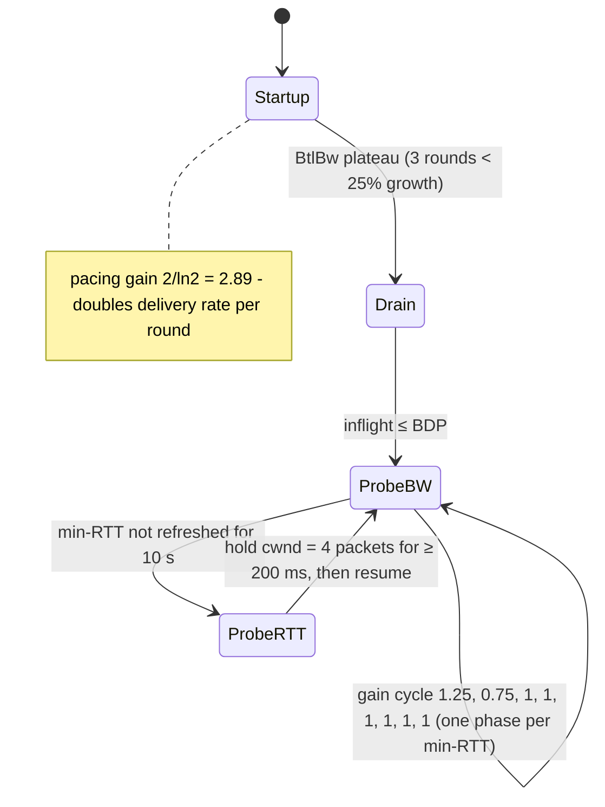

# Hardware & Network Physics, Latency Numbers, and FinOps Math

> **Folder 01 · File 02** of the Distributed Systems & System Design L7 Reference.
> **Prerequisites:** [file 01 §6](01-l5-vs-l6-vs-l7-interview-evaluation-rubric-and-signals.md#6-the-quantification-toolkit-first-principles-math-graded-in-every-round)
> (Little's law, queueing).
> **Listings:**
>
> | Listing | What it shows | Output |
> |---|---|---|
> | `LatencyLadder.java` | Cache/DRAM latency, MLP, bandwidth, coherence | Measured |
> | `IoCostProbe.java` | fsync, group commit, loopback RTT, CPU cost per byte | Measured |
> | `ftl_waf_sim.py` | SSD write amplification vs over-provisioning and placement | Deterministic |
> | `network_physics.py` | Light in fiber, handshakes, slow start, BDP, congestion control, packet budgets, consensus floors | Deterministic |
> | `finops_tco.py` | Unit prices, the cloud five-minute rule, Kafka cross-AZ, DynamoDB vs Cassandra, static-stability multipliers | Deterministic |
>
> **Measured on:** Intel i5-11260H (Tiger Lake-H, 6C/12T, 48 KB L1d, 1.25 MB L2 per core, 12 MB L3),
> 2×8 GB DDR4-3200, Micron 2400 NVMe (176-layer QLC, DRAM-less with HMB), Windows 11, JDK 25.0.4.
> This is a laptop. Server parts differ, and the *ratios* are the point.

---

## 0. How to read this file

Every architectural decision in the 32 problems of Folders 06–08 is a bet on one of five physical quantities:

1. **Latency.** How far away the data is, in nanoseconds, microseconds or milliseconds.
2. **Bandwidth.** How fast bytes move once the pipe is full.
3. **Parallelism.** How many operations can be in flight. Little's law turns latency into throughput.
4. **Endurance and amplification.** How many bytes you *actually* write per byte the user wrote.
5. **Price.** Dollars per GB-month, per request, per GB moved, per core-hour.

L5 candidates quote latency numbers. L6 candidates use them to budget a request. L7 candidates derive the
*floor* from physics, see which floor the design is pinned to, and change the design or the placement so the floor
moves.

---

## 1. The latency ladder (2026 edition)

| Operation | Typical (server class) | Measured here | Why it matters for design |
|---|---|---|---|
| CPU cycle @ 3–4 GHz | 0.25–0.33 ns | — | The unit of everything below |
| L1d hit | ~1 ns (4–5 cycles) | **1.2 ns** | Tight loops, hot structs |
| L2 hit | ~3–5 ns (~14 cycles) | **3.2–4.5 ns** | Per-core working sets ≤ 1–2 MB |
| L3 hit | ~10–20 ns (laptop); 20–40 ns on large server meshes | **13.6–17 ns** | Shared, sliced; NUMA-like within a socket |
| Atomic increment, uncontended | ~5–10 ns | **6.2 ns** | Every lock and refcount |
| Atomic on a contended line (cross-core) | ~50–150 ns | **60–131 ns** | Global counters, hot locks, false sharing |
| DRAM random load (local NUMA) | ~80–120 ns | **111 ns** | Pointer chasing: B-tree nodes, hash chains |
| DRAM random load (remote NUMA) | ~130–200 ns | — | Cross-socket; pin threads near memory |
| memcpy 1 MB (one core) | ~50–100 µs | **~106 µs** (9.5 GB/s) | Copies are not free at 100 Gbps |
| AES-256-GCM 1 MB (one core) | ~0.1–0.2 ms | **~0.16 ms** (6.1 GB/s) | TLS everywhere is cheap |
| SHA-256 1 MB (one core, SHA-NI) | ~0.5–0.7 ms | **~0.61 ms** (1.6 GB/s) | Content addressing costs a core per GB/s |
| Loopback TCP round trip | ~10–30 µs (Linux) | **35 µs** (Windows) | Sidecars and local proxies cost this per hop |
| Same-rack RTT, kernel TCP | ~10–50 µs | — | The floor of an RPC |
| RDMA one-sided read | ~2–5 µs | — | Kernel bypass, zero copy (FaRM, eRPC) |
| Same-AZ RTT, cloud VMs | ~50–250 µs ⚠ | — | Placement groups help; noisy neighbors hurt |
| NVMe 4 KB random read (TLC, QD1) | ~50–100 µs | — | One B-tree page miss |
| NVMe write into the drive's cache | ~10–20 µs | — | Fast until the cache fills |
| fsync, enterprise SSD with power-loss protection (PLP) | ~20–100 µs ⚠ | — | WAL commit floor in a datacenter |
| fsync, consumer SSD (no PLP) | ~0.5–5 ms; tail ≫ | **p50 0.8–1.1 ms, p99 1.5–102 ms** | Why laptops are terrible database benchmarks |
| Cross-AZ RTT | ~0.5–2 ms | — | The cost of synchronous zonal replication |
| Network block storage (EBS-class) I/O | ~0.25–1+ ms ⚠ | — | Every I/O is a network round trip |
| HDD seek + half rotation (7,200 rpm) | ~8–12 ms | — | 100–200 random IOPS per spindle |
| Cross-region RTT, US east ↔ west | ~60–70 ms | — | Synchronous geo-replication floor |
| Transatlantic RTT | ~70–80 ms | — | |
| US/EU ↔ Asia-Pacific RTT | ~150–230 ms | — | Do not put a synchronous dependency here |
| TCP + TLS 1.3 setup, transatlantic | 2 RTT ≈ 144 ms | — | Why edges terminate TLS |

Each rung of the ladder is roughly 10× the one above it. Most "how do I make this faster" questions are answered by
**moving one rung up**: from network to local memory, from DRAM to cache, from disk to RAM, from a remote region to a
local one.

```
log10(ns)   0      1      2      3      4      5      6      7      8      9
            │──────│──────│──────│──────│──────│──────│──────│──────│──────│
L1  1.2 ns  █
L2  4 ns    ██
L3  15 ns   ███
DRAM 111 ns ████
contended   ████   (60-131 ns)
loopback RTT        ███████████   35 µs
NVMe read                ████████████   ~80 µs
fsync (laptop)                  ███████████████   ~1 ms (p99 up to 100 ms)
cross-AZ                        ███████████████   ~1 ms
US coast-to-coast                         ███████████████████   65 ms
US↔Singapore                                ████████████████████   ~220 ms
```

---

## 2. CPU and memory: the physics under every data structure

### 2.1 The measured hierarchy

`LatencyLadder.java` links 64-byte cache lines into a single random cycle and chases it. Each load's address depends
on the previous load, so out-of-order execution cannot overlap anything, and the time per hop is the load-to-use
latency of whichever level holds the working set.

```java
// LatencyLadder.java - measured memory hierarchy: dependent-load latency per working set, MLP, bandwidth, coherence.
package dev.l7.dsd.physics;

import java.util.SplittableRandom;
import java.util.concurrent.CountDownLatch;
import java.util.concurrent.atomic.AtomicLong;
import java.util.concurrent.atomic.AtomicLongArray;

/**
 * One-thread microbenchmarks that expose the physics behind every storage and cache design:
 * <ol>
 *   <li>Pointer chasing over a random single cycle of 64-byte lines: each load depends on the previous one,
 *       so the time per hop is the load-to-use latency of whichever level holds the working set.</li>
 *   <li>The same random lines read with independent loads: the core overlaps misses, so the per-load cost
 *       drops by the memory-level parallelism (MLP) the core sustains (Little's law: MLP = latency x rate).</li>
 *   <li>Sequential scan, one-int-per-line stride, and arraycopy bandwidth.</li>
 *   <li>Cache-coherence cost: uncontended vs contended atomics, and false sharing.</li>
 * </ol>
 * Heap budget is ~300 MB (the laptop has ~1 GB free), so the largest working set is 128 MB, about 10x the 12 MB L3.
 */
public final class LatencyLadder {
    static final int LINE_INTS = 16;                       // 64-byte line / 4-byte int
    static final int MAX_BYTES = 128 << 20;
    static final int[] ARENA = new int[MAX_BYTES / 4];
    static long sink;

    /** Links `lines` cache lines into one random cycle; ARENA[i*16] holds the index of the next line's slot. */
    static void buildChain(int lines, long seed) {
        int[] order = new int[lines];
        for (int i = 0; i < lines; i++) order[i] = i;
        SplittableRandom r = new SplittableRandom(seed);
        for (int i = lines - 1; i > 0; i--) {              // Fisher-Yates; consecutive entries form a single cycle
            int j = r.nextInt(i + 1);
            int t = order[i]; order[i] = order[j]; order[j] = t;
        }
        for (int i = 0; i < lines; i++) ARENA[order[i] * LINE_INTS] = order[(i + 1) % lines] * LINE_INTS;
    }

    static int chase(long hops) {
        int p = 0;
        for (long h = 0; h < hops; h++) p = ARENA[p];
        return p;
    }

    static double nsPerHop(int bytes) {
        int lines = bytes / 64;
        buildChain(lines, 0x5EEDL + bytes);
        long hops = bytes <= (1 << 20) ? 30_000_000L : bytes <= (16 << 20) ? 10_000_000L : 4_000_000L;
        sink += chase(Math.min(hops, 4L * lines));          // warm the working set (and the JIT)
        double best = Double.MAX_VALUE;
        for (int rep = 0; rep < 3; rep++) {
            long t0 = System.nanoTime();
            sink += chase(hops);
            best = Math.min(best, (System.nanoTime() - t0) / (double) hops);
        }
        return best;
    }

    static long gather(int[] idx) {
        long s = 0;
        for (int i : idx) s += ARENA[i];
        return s;
    }

    static long sumAll(int n) {
        long s = 0;
        for (int i = 0; i < n; i++) s += ARENA[i];
        return s;
    }

    static long sumStride(int n) {
        long s = 0;
        for (int i = 0; i < n; i += LINE_INTS) s += ARENA[i];
        return s;
    }

    interface Body { void run(); }

    static double bestSeconds(int reps, Body b) {
        double best = Double.MAX_VALUE;
        for (int i = 0; i < reps; i++) {
            long t0 = System.nanoTime();
            b.run();
            best = Math.min(best, (System.nanoTime() - t0) / 1e9);
        }
        return best;
    }

    /** One thread per slot, each performing `ops` increments on its slot; returns ns per increment per thread. */
    static double threadedIncrements(AtomicLongArray arr, int[] slots, long ops) throws InterruptedException {
        CountDownLatch start = new CountDownLatch(1);
        CountDownLatch done = new CountDownLatch(slots.length);
        for (int slot : slots) {
            Thread t = new Thread(() -> {
                try { start.await(); } catch (InterruptedException e) { Thread.currentThread().interrupt(); return; }
                for (long i = 0; i < ops; i++) arr.incrementAndGet(slot);
                done.countDown();
            });
            t.start();
        }
        long t0 = System.nanoTime();
        start.countDown();
        done.await();
        return (System.nanoTime() - t0) / (double) ops;
    }

    interface Measure { double run() throws InterruptedException; }

    static double median5(Measure m) throws InterruptedException {
        double[] v = new double[5];
        for (int i = 0; i < v.length; i++) v[i] = m.run();
        java.util.Arrays.sort(v);
        return v[2];
    }

    public static void main(String[] args) throws Exception {
        System.out.println("== 1. dependent-load latency (random single cycle over 64 B lines, best of 3)");
        System.out.printf("%12s %10s%n", "working set", "ns/load");
        int[] sizes = {16 << 10, 32 << 10, 64 << 10, 128 << 10, 256 << 10, 512 << 10, 1 << 20, 2 << 20,
                       4 << 20, 8 << 20, 16 << 20, 32 << 20, 64 << 20, 128 << 20};
        double l1 = 0, l2 = 0, l3 = 0, dram = 0;
        for (int sz : sizes) {
            double ns = nsPerHop(sz);
            if (sz == 16 << 10) l1 = ns;
            if (sz == 512 << 10) l2 = ns;
            if (sz == 4 << 20) l3 = ns;
            if (sz == 128 << 20) dram = ns;
            String label = sz >= 1 << 20 ? (sz >> 20) + " MB" : (sz >> 10) + " KB";
            System.out.printf("%12s %10.2f%n", label, ns);
        }

        System.out.println("\n== 2. memory-level parallelism over the same 128 MB of random lines");
        int lines = MAX_BYTES / 64;
        buildChain(lines, 0x5EEDL + MAX_BYTES);
        int[] idx = new int[8_000_000];
        SplittableRandom r = new SplittableRandom(7);
        for (int i = 0; i < idx.length; i++) idx[i] = r.nextInt(lines) * LINE_INTS;
        sink += gather(idx);
        double gatherNs = bestSeconds(3, () -> sink += gather(idx)) * 1e9 / idx.length;
        System.out.printf("dependent loads  : %6.2f ns/load%n", dram);
        System.out.printf("independent loads: %6.2f ns/load  -> effective MLP ~ %.1f misses in flight%n",
                gatherNs, dram / gatherNs);

        System.out.println("\n== 3. bandwidth (single thread)");
        int n = ARENA.length;
        sink += sumAll(n);
        double seq = bestSeconds(5, () -> sink += sumAll(n));
        double stride = bestSeconds(5, () -> sink += sumStride(n));
        int[] dst = new int[n];
        System.arraycopy(ARENA, 0, dst, 0, n);
        double copy = bestSeconds(5, () -> System.arraycopy(ARENA, 0, dst, 0, n));
        double gb = MAX_BYTES / 1e9;
        System.out.printf("sequential sum of 128 MB      : %6.2f GB/s%n", gb / seq);
        System.out.printf("1 int per 64 B line (stride)  : %6.2f GB/s of lines moved, %5.2f GB/s useful (%.2f ns/int)%n",
                gb / stride, gb / stride / 16, stride * 1e9 / (n / LINE_INTS));
        System.out.printf("arraycopy 128 MB (read+write) : %6.2f GB/s moved%n", 2 * gb / copy);

        System.out.println("\n== 4. coherence: cost of an atomic increment");
        AtomicLong one = new AtomicLong();
        long ops = 20_000_000L;
        for (int i = 0; i < 3; i++) { for (long k = 0; k < ops; k++) one.incrementAndGet(); }
        long t0 = System.nanoTime();
        for (long k = 0; k < ops; k++) one.incrementAndGet();
        double uncontended = (System.nanoTime() - t0) / (double) ops;
        AtomicLongArray arr = new AtomicLongArray(128);
        long ops2 = 5_000_000L;
        int[] same = {0, 0, 0, 0}, adjacent = {0, 1, 2, 3}, apart = {0, 16, 32, 48};   // 8 B vs 128 B spacing
        threadedIncrements(arr, adjacent, ops2 / 10);
        double sameCounter = median5(() -> threadedIncrements(arr, same, ops2));
        double falseShare = median5(() -> threadedIncrements(arr, adjacent, ops2));
        double padded = median5(() -> threadedIncrements(arr, apart, ops2));
        System.out.printf("1 thread, uncontended               : %6.2f ns/op%n", uncontended);
        System.out.printf("4 threads, one shared counter       : %6.2f ns/op per thread%n", sameCounter);
        System.out.printf("4 threads, own counters, same line  : %6.2f ns/op per thread (false sharing)%n", falseShare);
        System.out.printf("4 threads, own counters, 128 B apart: %6.2f ns/op per thread%n", padded);

        // invariants, not exact values: the ladder must be monotone across levels and the effects must be visible
        if (!(l1 < l2 && l2 < l3 && l3 < dram)) throw new AssertionError("latency ladder not monotone");
        if (dram < 5 * l3) throw new AssertionError("DRAM should be >5x the L3 latency");
        if (dram / gatherNs < 3) throw new AssertionError("expected MLP >= 3");
        if (falseShare < 1.3 * padded) throw new AssertionError("false sharing should cost visibly more than padded");
        System.out.printf("%nsummary: L1 %.1f ns, L2 %.1f ns, L3 %.1f ns, DRAM %.0f ns; DRAM/L1 = %.0fx (sink %d)%n",
                l1, l2, l3, dram, dram / l1, sink & 1);
        System.out.println("self-test: all invariants hold");
    }
}
```

Output (one measured run; values vary ±10–20% run to run, and the invariants are asserted):

```text
== 1. dependent-load latency (random single cycle over 64 B lines, best of 3)
 working set    ns/load
       16 KB       1.16
       32 KB       1.17
       64 KB       3.23
      128 KB       3.23
      256 KB       3.26
      512 KB       4.11
        1 MB       4.53
        2 MB      13.60
        4 MB      17.00
        8 MB      47.22
       16 MB     101.90
       32 MB     105.90
       64 MB     108.51
      128 MB     110.56

== 2. memory-level parallelism over the same 128 MB of random lines
dependent loads  : 110.56 ns/load
independent loads:   8.98 ns/load  -> effective MLP ~ 12.3 misses in flight

== 3. bandwidth (single thread)
sequential sum of 128 MB      :  23.53 GB/s
1 int per 64 B line (stride)  :  20.87 GB/s of lines moved,  1.30 GB/s useful (3.07 ns/int)
arraycopy 128 MB (read+write) :  19.13 GB/s moved

== 4. coherence: cost of an atomic increment
1 thread, uncontended               :   6.20 ns/op
4 threads, one shared counter       : 131.16 ns/op per thread
4 threads, own counters, same line  :  60.24 ns/op per thread (false sharing)
4 threads, own counters, 128 B apart:  20.21 ns/op per thread

summary: L1 1.2 ns, L2 4.1 ns, L3 17.0 ns, DRAM 111 ns; DRAM/L1 = 96x (sink 0)
self-test: all invariants hold
```

Reading the ladder:

| Working set | ns/load | Level | Interpretation |
|---|---|---|---|
| 16–32 KB | 1.2 | L1d (48 KB) | 4–5 cycles at turbo |
| 64 KB – 1 MB | 3.2–4.5 | L2 (1.25 MB) | ~3× L1 |
| 2–4 MB | 13–17 | L3 | ~4× L2 |
| 8 MB | 36–47 | L3 + TLB misses | 2,048 STLB entries × 4 KB pages = 8 MB of reach ⚠; past it, every hop adds a page walk |
| 16–128 MB | 102–111 | DRAM (+ page walks) | ~95× L1 |

Three design consequences:

1. **The 95× DRAM/L1 gap is why data layout beats algorithmic cleverness at the bottom of every storage engine.**
   - A B+tree with 16 KB nodes reads ~log₁₀₀₀(N) nodes, and each node visit is a few DRAM misses.
   - A binary tree reads log₂(N) nodes, each a miss: ~30 dependent misses for a billion keys, or ~3 µs.
   - This is why in-memory indexes use wide nodes: B-trees, ART, Masstree, Bw-tree.
   - It is also why hash tables use open addressing with SIMD probing (SwissTable/F14) instead of chaining.
2. **The TLB step at 8 MB is real.** Large in-memory caches and buffer pools benefit from 2 MB huge pages: 2,048
   entries × 2 MB = 4 GB of reach.
   - Transparent huge pages bring compaction stalls and fork/copy-on-write bloat. Redis has long recommended
     disabling THP. MongoDB 8.0 reversed its old guidance alongside its new TCMalloc (⚠ verify).
   - Explicit hugetlbfs, or JVM `-XX:+UseLargePages`, avoids the stalls at the cost of static reservation.
3. **The DRAM rung is where "in-memory" systems live.** Redis, Memcached and TAO-style caches are fast because a
   lookup is a handful of DRAM misses (~0.5 µs) plus the network RTT (~50–200 µs). **The network dominates by 100×**,
   so an in-memory cache's latency is a networking problem, and its throughput is a per-core packet-processing
   problem (§4.7).

### 2.2 Little's law for memory: why independent loads win

The same 128 MB of random lines, read with *independent* loads, costs **9.0 ns per load instead of 111 ns**. The
core keeps about **12 misses in flight**, roughly the number of L1 fill buffers.

Little's law applied to the memory system:

$$\text{bandwidth} = \frac{\text{lines in flight} \times 64\,\text{B}}{\text{latency}}$$

| Access pattern | In flight | Latency | Bandwidth |
|---|---|---|---|
| Dependent chase | 1 line | 111 ns | 0.58 GB/s |
| Independent random | 12.3 lines | 111 ns | ~7 GB/s |
| Sequential with hardware prefetch | ~41 lines | 111 ns | 23.5 GB/s (measured) |

The sequential row works backwards from the measurement: 23.5 GB/s × 111 ns / 64 B ≈ 41 lines. That is the L2
streamer's outstanding-request queue at work.

This is why:

- **Batching and software prefetch transform lookups.** Group prefetching, or coroutines that interleave 8–16 hash
  probes, turn dependent misses into independent ones. Hash joins, LSM point lookups and Bloom filter probes in
  modern engines exploit this.
- **Columnar scans run at bandwidth, row-at-a-time pointer chasing at latency.** The gap is 20–40×.
- **A server socket's bandwidth needs many cores.**
  - 12 channels of DDR5-4800 give 460.8 GB/s per socket.
  - At ~120 ns, saturating it needs 460.8 GB/s × 120 ns / 64 B ≈ 860 lines in flight, which is 40+ cores' worth of
    MLP.
  - One thread gets a few percent of the socket's bandwidth.

### 2.3 Bandwidth and the cache-line tax

| Measurement | Value |
|---|---|
| Sequential read, one thread | 23.5 GB/s, vs 51.2 GB/s theoretical for dual-channel DDR4-3200 |
| `arraycopy` | 19.1 GB/s moved (read + write) |
| One int per 64 B line | 20.9 GB/s of *lines* but only **1.3 GB/s useful** |

The last row is the cache-line tax. You pay for 64 bytes to use 4.

This tax is the physics behind:
- **row vs column stores**: an analytic query over 3 of 100 columns reads 3% of the bytes in a column store, and 100%
  in a row store;
- **struct-of-arrays layouts**;
- **compact encodings**: varints, dictionary encoding, bit-packing;
- **"cache-oblivious" structures.**

| Memory | Bandwidth | Context |
|---|---|---|
| DDR4-3200, 2 channels (this laptop) | 51.2 GB/s | |
| DDR5-4800, 12 channels (AMD Genoa-class socket) | 460.8 GB/s | |
| DDR5-6400 / MRDIMM-8800, 12 channels (Granite Rapids-class) | 614–845 GB/s ⚠ | |
| HBM3 (H100 SXM) | 3.35 TB/s | Why LLM decode lives on GPUs; see the companion AI KB |

### 2.4 Coherence: the hidden cost of sharing

| Pattern | ns/op per thread | Ratio |
|---|---|---|
| One thread, uncontended atomic | 6.2 | 1× |
| 4 threads, own counters, 128 B apart | 20.2 | 3× (memory-ordering and pipeline effects) |
| 4 threads, own counters, **same cache line** (false sharing) | 60.2 | 10× |
| 4 threads, one shared counter | 131 | 21× |

On a contended line, every increment moves the 64-byte line between cores through the coherence protocol (MESIF on
Intel). Design consequences:

- **Sharded counters.** Java's `LongAdder`, per-CPU counters in the kernel, and per-core token buckets in rate
  limiters exist because a single global atomic counter caps out at ~10⁷ updates/s *for the whole machine*.
  Per-core shards scale linearly.
- **Pad hot fields to 64 or 128 bytes.** Java's `@Contended`, C++'s `alignas(std::hardware_destructive_interference_size)`.
  Adjacent-line prefetching makes 128 B the safe spacing on Intel.
- **Shared-nothing, thread-per-core architectures** (Seastar/ScyllaDB, Redpanda) avoid coherence traffic
  structurally. Each core owns a shard of the data and communicates by message passing.
- **The distributed-systems analogy is exact.** A hot key in a sharded database is a contended cache line at cluster
  scale. The cure is the same: split it (salting/sharding the counter), or make it read-mostly (replicate it).

### 2.5 Other CPU-side costs worth knowing (⚠ order of magnitude; kernel and mitigations change them)

| Operation | Typical | Note |
|---|---|---|
| Trivial syscall | ~0.1–0.5 µs | Spectre/Meltdown mitigations (KPTI) roughly doubled some paths |
| Thread context switch | ~1–5 µs direct; more with cache/TLB refill | Why thread-per-request tops out; virtual threads and async I/O |
| Page fault (minor) | ~0.5–1 µs | First touch of fresh memory |
| Process fork of a large-RSS process | ms to 100s of ms | Redis BGSAVE latency spikes; CoW page duplication |
| JIT warm-up | seconds | An earlier, un-warmed draft of `IoCostProbe` measured AES-GCM at **83 MB/s**, against **6.1 GB/s** once the record loop was JIT-compiled and the intrinsic engaged: 70×. Benchmark warm, and capacity-plan for cold starts |

---

## 3. Storage physics: from NAND cells to the WAL commit

### 3.1 The media

| Property | HDD (7,200 rpm) | NAND SSD (TLC) | NAND SSD (QLC) | DRAM |
|---|---|---|---|---|
| Random 4 KB read latency | 8–12 ms | 50–100 µs | 100–200 µs | ~0.1 µs |
| Random 4 KB read IOPS (one device) | 100–200 | 500k–1.5M (deep queue) | 300k–1M | n/a |
| Sequential bandwidth | 200–280 MB/s | 3–14 GB/s (PCIe 4/5) | 3–7 GB/s | 20–60 GB/s per channel group |
| Write granularity | 512 B / 4 KB sector, in place | 16 KB page, **never in place** | 16 KB+ page | 64 B line |
| Erase granularity | n/a | Block of 100s–1000s of pages (MBs to tens of MBs) | Same | n/a |
| Endurance (P/E cycles per cell) | ∞ (mechanical wear) | ~1,000–3,000 (enterprise more) | ~500–1,500 | ∞ |
| Program / read time per page | n/a | tPROG ~0.3–1 ms, tR ~40–80 µs | tPROG ~1–3 ms, tR ~100+ µs | n/a |

⚠ verify. Values vary by NAND generation and controller, and the *ratios* are stable.

Two physical facts drive every SSD-aware design:

1. **Pages are programmed once, then a whole erase block must be erased.** The SSD therefore runs a log-structured
   translation layer (FTL). A logical overwrite becomes a new physical page plus an invalidation, and **garbage
   collection** relocates the still-valid pages of a victim block before erasing it. The relocations are **write
   amplification**.
2. **A device's IOPS is parallelism, not speed.** A drive has 8–16 channels × several dies × 2–6 planes: hundreds of
   independent units. By Little's law:

   $$\text{IOPS} = \frac{\text{queue depth}}{\text{latency}}$$

   - At 80 µs and QD1, a drive delivers 12.5k IOPS.
   - At QD32, the same drive delivers 400k IOPS.
   - A synchronous, one-at-a-time storage engine wastes 97% of an NVMe drive.
   - This is why io_uring, async I/O, and many concurrent requests per drive matter.

**The FTL's own memory.**
- A page-level map at 4 KB granularity with 4-byte entries costs 1 GB of DRAM per TB of flash.
- DRAM-less consumer drives cache part of the map in host RAM via the Host Memory Buffer. The Micron 2400 here does
  this.
- High-capacity QLC drives move to **16 KB or 64 KB indirection units** to cut map DRAM.
  - A 4 KB random write to a 16 KB IU is a read-modify-write: up to 4× amplification before GC even starts.
  - Large-IU QLC is for large, sequential, rarely-rewritten data: LSM SSTs, object storage, logs. It is not for
    B-tree random updates. (⚠ verify the IU per drive model.)

### 3.2 Garbage collection and write amplification: the derivation

Take uniform random overwrites with FIFO cleaning. Let:
- $T$ = physical pages;
- $U$ = logical (user) pages;
- $\alpha = T/U = 1 + \text{OP}$, the over-provisioning.

A block is cleaned one full log rotation after it was written. During that rotation, $T(1-x)$ user writes land, where
$x$ is the valid fraction found in a victim block. Each page survives a write with probability $1 - 1/U$, so

$$x = \left(1 - \tfrac{1}{U}\right)^{T(1-x)} \approx e^{-\alpha(1-x)}, \qquad \text{WAF} = \frac{1}{1-x}$$

The solution can be written in closed form with the Lambert W function: $\text{WAF} = \alpha / (\alpha + W_0(-\alpha
e^{-\alpha}))$ (Hu et al. 2009; Desnoyers 2012). The industry rule of thumb is $\text{WAF} \approx
(1+\text{OP})/(2\,\text{OP})$. Greedy cleaning (pick the victim with the fewest valid pages) does a little better
than FIFO.

`ftl_waf_sim.py` simulates the FTL and checks the formulas. It then asks the question that matters for system
design: **what does host-side data placement do?**

```python
"""ftl_waf_sim.py - SSD flash-translation-layer simulator: write amplification vs over-provisioning and placement.

NAND cannot overwrite in place: pages are programmed once, then a whole erase block (here 64 pages) must be
erased. A log-structured FTL appends every write to an open block, invalidates the old copy, and garbage-collects
(GC) a victim block by relocating its still-valid pages. Relocations are the write amplification (WAF):
    WAF = NAND page programs / host page writes.
Experiments (all seeded, deterministic):
  A. uniform random overwrites: greedy vs FIFO victim choice, vs the analytic FIFO fixed point and the
     (1+OP)/(2*OP) rule of thumb, across over-provisioning (OP) levels;
  B. placement: one shared write frontier vs host placement hints (multi-stream / NVMe FDP), for
     (i) 80/20 hot/cold frequency skew and (ii) log-structured segments that die together mixed with random
     small overwrites (the LSM / CacheLib pattern);
  C. what the stacked amplification does to drive lifetime.
"""
import math
import random

PPB = 64           # pages per erase block (real 3D NAND blocks hold hundreds-thousands of 16 KB pages)
BLOCKS = 512


class Ftl:
    def __init__(self, op: float, policy: str, streams: int, seed: int):
        self.phys = BLOCKS * PPB
        self.logical = int(self.phys / (1.0 + op))
        self.policy = policy
        self.l2p = [-1] * self.logical                  # logical page -> physical page
        self.owner = [-1] * self.phys                   # physical page -> logical page (-1 = invalid/free)
        self.valid = [0] * BLOCKS
        self.free = list(range(BLOCKS))
        self.closed: list[int] = []                     # FIFO order of full blocks
        self.frontier = [self._take() for _ in range(streams)]
        self.ptr = [0] * streams
        self.host = self.nand = 0
        self.rng = random.Random(seed)

    def _take(self) -> int:
        return self.free.pop()

    def _append(self, lpn: int, stream: int) -> None:
        blk = self.frontier[stream]
        ppn = blk * PPB + self.ptr[stream]
        old = self.l2p[lpn]
        if old >= 0:
            self.owner[old] = -1
            self.valid[old // PPB] -= 1
        self.l2p[lpn] = ppn
        self.owner[ppn] = lpn
        self.valid[blk] += 1
        self.nand += 1
        self.ptr[stream] += 1
        if self.ptr[stream] == PPB:
            self.closed.append(blk)
            self.frontier[stream] = self._take()
            self.ptr[stream] = 0

    def _gc(self, stream_of) -> None:
        while len(self.free) < 2:                       # keep two erased blocks in reserve
            if self.policy == "greedy":
                victim = min(self.closed, key=self.valid.__getitem__)
                self.closed.remove(victim)
            else:
                victim = self.closed.pop(0)             # FIFO: oldest block, regardless of validity
            base = victim * PPB
            for ppn in range(base, base + PPB):
                lpn = self.owner[ppn]
                if lpn >= 0:
                    self._append(lpn, stream_of(lpn))   # relocation: a NAND program the host never asked for
            self.valid[victim] = 0
            self.free.append(victim)                    # erase

    def write(self, lpn: int, stream: int, stream_of) -> None:
        self.host += 1
        self._append(lpn, stream)
        self._gc(stream_of)

    def trim(self, lpn: int) -> None:
        """Host discard (file deletion): the page is invalid without a rewrite."""
        old = self.l2p[lpn]
        if old >= 0:
            self.owner[old] = -1
            self.valid[old // PPB] -= 1
            self.l2p[lpn] = -1


SEGMENT = 4 * PPB   # an SST file / log segment: written sequentially, deleted (TRIMmed) as a unit


def run(op: float, policy: str, workload: str, separated: bool, seed: int = 11) -> float:
    streams = 2 if separated else 1
    f = Ftl(op, policy, streams, seed)
    n = f.logical
    hot_n = n // 5 if workload == "hotcold" else (n // 2) // SEGMENT * SEGMENT   # hot set, or segment region
    stream_of = (lambda lpn: 0 if lpn < hot_n else 1) if separated else (lambda lpn: 0)
    seq = [hot_n - 1]
    for lpn in range(n):                                # sequential fill
        f.write(lpn, stream_of(lpn), stream_of)
    rng = f.rng

    def pick() -> int:
        if workload == "uniform":
            return rng.randrange(n)
        if workload == "hotcold":
            return rng.randrange(hot_n) if rng.random() < 0.8 else hot_n + rng.randrange(n - hot_n)
        if rng.random() < 0.5:                          # "logmix": rewrite the oldest segment...
            seq[0] = (seq[0] + 1) % hot_n
            if seq[0] % SEGMENT == 0:                   # ...after deleting (TRIM) the old file as a whole
                for lpn in range(seq[0], seq[0] + SEGMENT):
                    f.trim(lpn)
            return seq[0]
        return hot_n + rng.randrange(n - hot_n)         # ...interleaved with random small overwrites

    for _ in range(3 * n):                              # reach steady state
        lpn = pick()
        f.write(lpn, stream_of(lpn), stream_of)
    h0, n0 = f.host, f.nand
    for _ in range(5 * n):
        lpn = pick()
        f.write(lpn, stream_of(lpn), stream_of)
    return (f.nand - n0) / (f.host - h0)


def fifo_analytic(op: float) -> float:
    """Uniform random writes, FIFO cleaning, large blocks: a page survives a full log rotation of
    T*(1-x) user writes with probability exp(-alpha*(1-x)), so the valid fraction x at cleaning solves
    x = exp(-alpha*(1-x)) with alpha = physical/logical; WAF = 1/(1-x)."""
    alpha = 1.0 + op
    lo, hi = 0.0, 1.0 - 1e-12
    for _ in range(200):                                # bisection on g(x) = exp(-alpha(1-x)) - x, root in (0,1)
        mid = (lo + hi) / 2
        if math.exp(-alpha * (1 - mid)) - mid > 0:
            lo = mid
        else:
            hi = mid
    return 1.0 / (1.0 - lo)


def rule_of_thumb(op: float) -> float:
    return (1.0 + op) / (2.0 * op)


def lifetime_days(capacity_tb: float, pe_cycles: int, ingest_mb_s: float, app_waf: float, ftl_waf: float) -> float:
    nand_budget = capacity_tb * 1e12 * pe_cycles
    nand_rate = ingest_mb_s * 1e6 * app_waf * ftl_waf
    return nand_budget / nand_rate / 86400


def main() -> None:
    print(f"== A. uniform random 4K-page overwrites ({BLOCKS} blocks x {PPB} pages)")
    print(f"{'OP':>6} {'greedy':>8} {'FIFO':>8} {'FIFO analytic':>14} {'(1+OP)/2OP':>11}")
    res = {}
    for op in (0.07, 0.125, 0.28, 0.5, 1.0):
        g = run(op, "greedy", "uniform", False)
        fi = run(op, "fifo", "uniform", False)
        res[op] = (g, fi, fifo_analytic(op), rule_of_thumb(op))
        print(f"{op * 100:>5.1f}% {g:>8.2f} {fi:>8.2f} {fifo_analytic(op):>14.2f} {rule_of_thumb(op):>11.2f}")

    print("\n== B. placement, greedy GC: shared frontier vs host placement hints (FDP / streams)")
    print(f"{'workload':<34} {'OP':>6} {'mixed':>8} {'separated':>10} {'uniform ref':>12}")
    hc = {}
    for wl, label in (("hotcold", "80/20 hot/cold (frequency skew)"),
                      ("logmix", "50% log segments + 50% random")):
        for op in (0.07, 0.28):
            mixed = run(op, "greedy", wl, False)
            sep = run(op, "greedy", wl, True)
            hc[(wl, op)] = (mixed, sep)
            print(f"{label:<34} {op * 100:>5.1f}% {mixed:>8.2f} {sep:>10.2f} {res[op][0]:>12.2f}")

    print("\n== C. stacked amplification -> drive lifetime (7.68 TB, 100 MB/s of user ingest)")
    cases = [("TLC 3000 P/E, B+tree-ish app WAF 2, FTL 1.5", 3000, 2, 1.5),
             ("TLC 3000 P/E, leveled LSM app WAF 10, FTL 2.5", 3000, 10, 2.5),
             ("QLC 1000 P/E, leveled LSM app WAF 10, FTL 2.5", 1000, 10, 2.5),
             ("QLC 1000 P/E, LSM WAF 10, FDP-aligned FTL 1.1", 1000, 10, 1.1)]
    life = {}
    for label, pe, app, ftl in cases:
        d = lifetime_days(7.68, pe, 100, app, ftl)
        life[label] = d
        print(f"  {label:<48} {d:>8.0f} days ({d / 365:.1f} years)")

    # self-test: shape of the physics, not exact values
    for op, (g, fi, fa, rt) in res.items():
        assert g <= fi + 0.05, f"greedy should not lose to FIFO at OP {op}"
        assert abs(fi - fa) / fa < 0.12, f"FIFO sim should track the analytic fixed point at OP {op}"
    assert res[0.07][0] > 3 * res[0.28][0] / 1.5 and res[1.0][0] < 1.6
    for key, (mixed, sep) in hc.items():
        assert sep < mixed, f"placement hints must reduce WAF {key}"
    assert hc[("hotcold", 0.07)][1] > 0.8 * hc[("hotcold", 0.07)][0]     # frequency hints: modest gain
    assert hc[("logmix", 0.07)][1] < 0.6 * hc[("logmix", 0.07)][0]       # lifetime hints: large gain
    assert life[cases[1][0]] < 120 and life[cases[0][0]] > 800
    print("\nself-test: all assertions passed")


if __name__ == "__main__":
    main()
```

Output (verified; deterministic):

```text
== A. uniform random 4K-page overwrites (512 blocks x 64 pages)
    OP   greedy     FIFO  FIFO analytic  (1+OP)/2OP
  7.0%     7.39     8.30           7.82        7.64
 12.5%     4.54     4.85           4.68        4.50
 28.0%     2.43     2.52           2.48        2.29
 50.0%     1.69     1.73           1.72        1.50
100.0%     1.24     1.26           1.26        1.00

== B. placement, greedy GC: shared frontier vs host placement hints (FDP / streams)
workload                               OP    mixed  separated  uniform ref
80/20 hot/cold (frequency skew)      7.0%     7.74       7.06         7.39
80/20 hot/cold (frequency skew)     28.0%     2.78       2.38         2.43
50% log segments + 50% random        7.0%     5.25       2.63         7.39
50% log segments + 50% random       28.0%     1.78       1.30         2.43

== C. stacked amplification -> drive lifetime (7.68 TB, 100 MB/s of user ingest)
  TLC 3000 P/E, B+tree-ish app WAF 2, FTL 1.5           889 days (2.4 years)
  TLC 3000 P/E, leveled LSM app WAF 10, FTL 2.5         107 days (0.3 years)
  QLC 1000 P/E, leveled LSM app WAF 10, FTL 2.5          36 days (0.1 years)
  QLC 1000 P/E, LSM WAF 10, FDP-aligned FTL 1.1          81 days (0.2 years)

self-test: all assertions passed
```

What the numbers say:

- **Over-provisioning is the dominant knob.**
  - At 7% OP (consumer: 512 GB of raw flash sold as 480 GB), WAF ≈ 7.4–8.3.
  - At 28% OP (enterprise "mixed-use"), WAF ≈ 2.4.
  - At 100% OP, WAF ≈ 1.24.
  - **Leaving 20% of an SSD unpartitioned is a real endurance and tail-latency optimization.** The FTL uses the
    space as spare.
- **The FIFO simulation tracks the analytic fixed point within a few percent.** Model and simulation agree.
- **Placement hints that encode *frequency* help modestly:** an 80/20 hot/cold split goes from 7.74 to 7.06 at 7% OP.
- **Placement hints that encode *lifetime* help a lot.**
  - The workload is SST- or log-segment-style files, written sequentially and deleted (TRIMmed) as a unit, mixed with
    random overwrites.
  - Mixed into the same erase blocks, WAF is **5.25**. Separated, so segments fill their own blocks and die whole,
    WAF is **2.63**.
  - **Data that dies together should live together.**
  - That is what NVMe **Flexible Data Placement (FDP)** and **Zoned Namespaces (ZNS)** let the host express. Meta
    reported large flash-cache WAF reductions with FDP in CacheLib (⚠ verify the published figures).
  - It is the hardware-sympathetic argument for LSM trees and log-structured storage.

### 3.3 Stacked amplification and drive lifetime

Write amplification **multiplies** through the stack:

```
user bytes ──► app WAF ──► filesystem WAF ──► FTL WAF ──► NAND program/erase
              (LSM 10–30×,   (journal, CoW:     (GC: 1.1–8×,
               B-tree 2–5×   ~1–2×)             depends on OP
               + double-write)                  and placement)
```

Lifetime follows directly (table C of the output):

$$\text{days} = \frac{\text{capacity} \times \text{P/E cycles}}{\text{ingest rate} \times \text{WAF}_\text{app} \times \text{WAF}_\text{FTL}}$$

A 7.68 TB TLC drive taking 100 MB/s of user ingest through a leveled LSM (app WAF 10, FTL WAF 2.5) lasts
**107 days**. The same ingest on QLC lasts **36 days**.

The L7 reading:
- **Write amplification is a hardware cost line.** It sets how many drives you buy per year, not just throughput.
- The levers, in order of leverage:
  1. Reduce app WAF: tiered or universal compaction, larger memtables, key-value separation (WiscKey/BlobDB) for large
     values.
  2. Align placement so the FTL WAF approaches 1: FDP, ZNS, or simply large sequential files with whole-file deletes.
  3. Add OP.
  4. Buy endurance (TLC over QLC) only for the write-hot tier.
- The B+tree-vs-LSM debate in Folder 02 (`02-Storage-Engines-Replication-and-Sharding-Internals/`) is incomplete
  without this product. An LSM's large sequential writes are FTL-friendly (FTL WAF ≈ 1), but its own WAF is 10–30×.
  A B-tree's in-place random page writes cost less at the application layer but drive FTL GC.

### 3.4 The B+tree vs LSM physics, in one table (preview of Folder 02)

| | B+tree (InnoDB, Postgres heap + B-tree indexes) | LSM (RocksDB, Cassandra, ScyllaDB) |
|---|---|---|
| Write pattern on device | Random in-place page writes (4–16 KB), plus a sequential WAL | Sequential WAL + sequential SST writes; whole-file deletes |
| App write amplification | Page size / changed bytes per flush; InnoDB doubles it with the double-write buffer | Leveled ≈ 10–30×; tiered ≈ number of levels, but up to ~2× space |
| Read amplification | ~1 page read per level not cached (usually 1–2 I/Os) | Up to one probe per level/run; Bloom filters cut point reads to ~1 I/O |
| Space amplification | Pages ~69% full after random inserts (Yao 1978: ln 2) | Leveled ~1.1×; tiered up to 2× during compaction |
| Tail-latency hazard | Page splits, checkpoint flushing, buffer-pool eviction storms | **Compaction debt → write stalls** (RocksDB slows writes at 20 L0 files and stops them at 36 by default ⚠ verify) |
| FTL interaction | Random overwrites → GC pressure | FTL-friendly (aligned, die-together files) |

### 3.5 Durability: what an fsync costs, and why group commit exists

`IoCostProbe.java` measures three things on this laptop:
- a buffered 4 KB append;
- the same append followed by `force()`, which is `FlushFileBuffers` on Windows and `fdatasync` on Linux;
- **group commit**: 64 small records per fsync.

The same listing also measures the loopback network and per-byte CPU costs used in §4 and §5.

```java
// IoCostProbe.java - measured costs of durability (fsync, group commit), loopback RTT, and per-byte CPU work.
package dev.l7.dsd.physics;

import java.io.DataInputStream;
import java.io.DataOutputStream;
import java.io.IOException;
import java.net.InetAddress;
import java.net.ServerSocket;
import java.net.Socket;
import java.nio.ByteBuffer;
import java.nio.channels.FileChannel;
import java.nio.charset.StandardCharsets;
import java.nio.file.Files;
import java.nio.file.Path;
import java.nio.file.StandardOpenOption;
import java.security.MessageDigest;
import java.util.Arrays;
import java.util.SplittableRandom;
import java.util.zip.CRC32;
import java.util.zip.CRC32C;
import java.util.zip.Deflater;
import java.util.zip.Inflater;
import javax.crypto.Cipher;
import javax.crypto.spec.GCMParameterSpec;
import javax.crypto.spec.SecretKeySpec;

/**
 * The numbers behind WAL design, RPC budgets and "is compression/encryption free?":
 * <ol>
 *   <li>fsync latency of a 4 KB append, and group commit (64 records per fsync) amortizing it.</li>
 *   <li>Loopback TCP round trip (1-byte ping-pong, TCP_NODELAY) and connection setup cost.</li>
 *   <li>Single-core throughput of memcpy, CRC32/CRC32C, SHA-256, AES-256-GCM, Deflate and Inflate.</li>
 * </ol>
 * Usage: IoCostProbe &lt;scratch dir for the fsync file&gt;. Values are one measured run on this machine.
 */
public final class IoCostProbe {
    static long sink;

    static double[] stats(long[] ns) {
        long[] s = ns.clone();
        Arrays.sort(s);
        return new double[]{s[s.length / 2] / 1e3, s[(int) (s.length * 0.99)] / 1e3};   // micros
    }

    static void fsync(Path dir) throws IOException {
        Path f = dir.resolve("wal-probe.bin");
        byte[] page = new byte[4096];
        new SplittableRandom(1).nextBytes(page);
        try (FileChannel ch = FileChannel.open(f, StandardOpenOption.CREATE, StandardOpenOption.WRITE,
                StandardOpenOption.TRUNCATE_EXISTING)) {
            int n = 200;
            long[] buffered = new long[n], synced = new long[n];
            for (int i = 0; i < n; i++) {
                long t0 = System.nanoTime();
                ch.write(ByteBuffer.wrap(page));
                buffered[i] = System.nanoTime() - t0;
            }
            ch.force(false);
            for (int i = 0; i < n; i++) {
                long t0 = System.nanoTime();
                ch.write(ByteBuffer.wrap(page));
                ch.force(false);                              // FlushFileBuffers on Windows, fdatasync on Linux
                synced[i] = System.nanoTime() - t0;
            }
            int batch = 64, groups = 50;
            byte[] rec = Arrays.copyOf(page, 128);
            long t0 = System.nanoTime();
            for (int g = 0; g < groups; g++) {
                for (int k = 0; k < batch; k++) ch.write(ByteBuffer.wrap(rec));
                ch.force(false);
            }
            double perRecordUs = (System.nanoTime() - t0) / 1e3 / (groups * batch);
            double[] b = stats(buffered), s = stats(synced);
            System.out.printf("4 KB append, page cache only : p50 %8.1f us  p99 %8.1f us%n", b[0], b[1]);
            System.out.printf("4 KB append + fsync          : p50 %8.1f us  p99 %8.1f us  -> %,.0f commits/s serial%n",
                    s[0], s[1], 1e6 / s[0]);
            System.out.printf("group commit, 64 x 128 B     : %8.1f us per record -> %,.0f records/s%n",
                    perRecordUs, 1e6 / perRecordUs);
            if (!(s[0] > 5 * b[0])) throw new AssertionError("fsync should dominate a buffered write");
            if (!(perRecordUs * 8 < s[0])) throw new AssertionError("group commit should amortize fsync >8x");
        } finally {
            Files.deleteIfExists(f);
        }
    }

    static void loopback() throws Exception {
        try (ServerSocket server = new ServerSocket(0, 50, InetAddress.getLoopbackAddress())) {
            Thread echo = new Thread(() -> {
                try (Socket s = server.accept()) {
                    s.setTcpNoDelay(true);
                    var in = new DataInputStream(s.getInputStream());
                    var out = new DataOutputStream(s.getOutputStream());
                    while (true) { int b = in.read(); if (b < 0) return; out.write(b); out.flush(); }
                } catch (IOException ignored) { }
            });
            echo.setDaemon(true);
            echo.start();
            int n = 20_000;
            long[] rtt = new long[n];
            try (Socket c = new Socket(InetAddress.getLoopbackAddress(), server.getLocalPort())) {
                c.setTcpNoDelay(true);
                var out = c.getOutputStream();
                var in = c.getInputStream();
                for (int i = 0; i < 2_000; i++) { out.write(1); out.flush(); sink += in.read(); }
                for (int i = 0; i < n; i++) {
                    long t0 = System.nanoTime();
                    out.write(1); out.flush();
                    sink += in.read();
                    rtt[i] = System.nanoTime() - t0;
                }
            }
            echo.join(2_000);
            double[] s = stats(rtt);
            System.out.printf("loopback TCP 1-byte RTT      : p50 %8.1f us  p99 %8.1f us%n", s[0], s[1]);
        }
        try (ServerSocket server = new ServerSocket(0, 512, InetAddress.getLoopbackAddress())) {
            Thread acceptor = new Thread(() -> {
                try { while (true) { server.accept().close(); } } catch (IOException ignored) { }
            });
            acceptor.setDaemon(true);
            acceptor.start();
            int n = 400;
            long[] setup = new long[n];
            for (int i = 0; i < n; i++) {
                long t0 = System.nanoTime();
                try (Socket c = new Socket(InetAddress.getLoopbackAddress(), server.getLocalPort())) {
                    sink += c.getLocalPort();
                }
                setup[i] = System.nanoTime() - t0;
            }
            double[] s = stats(setup);
            System.out.printf("loopback TCP connect+close   : p50 %8.1f us  p99 %8.1f us%n", s[0], s[1]);
        }
    }

    interface Work { void run(byte[] data) throws Exception; }

    static double mbPerSec(byte[] data, int reps, Work w) throws Exception {
        w.run(data);
        double best = Double.MAX_VALUE;
        for (int i = 0; i < reps; i++) {
            long t0 = System.nanoTime();
            w.run(data);
            best = Math.min(best, (System.nanoTime() - t0) / 1e9);
        }
        return data.length / 1e6 / best;
    }

    /** Semi-structured log lines: realistic, compressible (not random, not constant) input. */
    static byte[] logLines(int bytes) {
        SplittableRandom r = new SplittableRandom(3);
        String[] paths = {"/api/v1/items/", "/api/v1/cart/", "/checkout/", "/search?q=", "/static/img/"};
        StringBuilder sb = new StringBuilder(bytes + 256);
        long ts = 1_761_500_000_000L;
        while (sb.length() < bytes) {
            ts += r.nextInt(5);
            sb.append("ts=").append(ts).append(" lvl=INFO user=u").append(r.nextInt(50_000))
              .append(" path=").append(paths[r.nextInt(paths.length)]).append(r.nextInt(100_000))
              .append(" status=").append(r.nextInt(100) < 97 ? 200 : 503)
              .append(" dur_ms=").append(r.nextInt(400)).append('\n');
        }
        return Arrays.copyOf(sb.toString().getBytes(StandardCharsets.US_ASCII), bytes);
    }

    static void cpuPerByte() throws Exception {
        byte[] big = logLines(64 << 20);
        byte[] dst = new byte[big.length];
        System.out.printf("%-30s %10s%n", "single core, 64 MB of log lines", "MB/s");
        System.out.printf("%-30s %10.0f%n", "memcpy (System.arraycopy)",
                mbPerSec(big, 5, d -> System.arraycopy(d, 0, dst, 0, d.length)));
        System.out.printf("%-30s %10.0f%n", "CRC32C", mbPerSec(big, 5, d -> {
            CRC32C c = new CRC32C(); c.update(d, 0, d.length); sink += c.getValue(); }));
        System.out.printf("%-30s %10.0f%n", "CRC32", mbPerSec(big, 5, d -> {
            CRC32 c = new CRC32(); c.update(d, 0, d.length); sink += c.getValue(); }));
        System.out.printf("%-30s %10.0f%n", "SHA-256", mbPerSec(big, 3, d -> {
            sink += MessageDigest.getInstance("SHA-256").digest(d)[0]; }));
        SecretKeySpec key = new SecretKeySpec(new byte[32], "AES");
        byte[] iv = new byte[12];
        Cipher gcm = Cipher.getInstance("AES/GCM/NoPadding");
        byte[] sealed = new byte[(64 << 10) + 16];
        Work aes = d -> {                                     // 64 KB records, fresh nonce each (TLS-like framing)
            for (int off = 0; off < d.length; off += 64 << 10) {
                for (int b = 0; b < 8 && ++iv[b] == 0; b++) { }
                gcm.init(Cipher.ENCRYPT_MODE, key, new GCMParameterSpec(128, iv));
                sink += gcm.doFinal(d, off, 64 << 10, sealed, 0);
            }
        };
        aes.run(big);                                         // JIT the record loop so the AES-GCM intrinsic engages
        System.out.printf("%-30s %10.0f%n", "AES-256-GCM encrypt", mbPerSec(big, 3, aes));
        byte[] mid = Arrays.copyOf(big, 16 << 20);
        for (int level : new int[]{1, 6}) {
            final int lv = level;
            byte[] out = new byte[mid.length + 1024];
            int[] clen = new int[1];
            double speed = mbPerSec(mid, 2, d -> {
                Deflater z = new Deflater(lv, true); z.setInput(d); z.finish();
                clen[0] = z.deflate(out); z.end(); });
            System.out.printf("%-30s %10.0f   ratio %.1fx%n", "Deflate level " + level, speed,
                    mid.length / (double) clen[0]);
            if (level == 1) {
                byte[] comp = Arrays.copyOf(out, clen[0]);
                byte[] back = new byte[mid.length];
                double inflate = mid.length / 1e6 / (1e-9 * timeNs(() -> {
                    Inflater inf = new Inflater(true); inf.setInput(comp);
                    sink += inf.inflate(back); inf.end(); }));
                if (!Arrays.equals(back, mid)) throw new AssertionError("inflate round trip");
                System.out.printf("%-30s %10.0f   (MB/s of output)%n", "Inflate (of level 1)", inflate);
            }
        }
    }

    interface Thunk { void run() throws Exception; }

    static long timeNs(Thunk t) throws Exception {
        t.run();
        long best = Long.MAX_VALUE;
        for (int i = 0; i < 3; i++) { long t0 = System.nanoTime(); t.run(); best = Math.min(best, System.nanoTime() - t0); }
        return best;
    }

    public static void main(String[] args) throws Exception {
        Path dir = Path.of(args.length > 0 ? args[0] : System.getProperty("java.io.tmpdir"));
        Files.createDirectories(dir);
        System.out.println("== 1. durability");
        fsync(dir);
        System.out.println("\n== 2. loopback network");
        loopback();
        System.out.println("\n== 3. CPU cost per byte");
        cpuPerByte();
        System.out.printf("%nself-test: all invariants hold (sink %d)%n", sink & 1);
    }
}
```

Output (one measured run; note the fsync p99):

```text
== 1. durability
4 KB append, page cache only : p50     13.4 us  p99     95.9 us
4 KB append + fsync          : p50   1086.2 us  p99 101976.1 us  -> 921 commits/s serial
group commit, 64 x 128 B     :     23.5 us per record -> 42,522 records/s

== 2. loopback network
loopback TCP 1-byte RTT      : p50     35.0 us  p99     75.9 us
loopback TCP connect+close   : p50    381.4 us  p99    518.2 us

== 3. CPU cost per byte
single core, 64 MB of log lines       MB/s
memcpy (System.arraycopy)            9459
CRC32C                              20567
CRC32                               20244
SHA-256                              1627
AES-256-GCM encrypt                  6139
Deflate level 1                       189   ratio 4.8x
Inflate (of level 1)                  719   (MB/s of output)
Deflate level 6                        69   ratio 6.2x

self-test: all invariants hold (sink 0)
```

Interpretation:

- **A buffered write is a memcpy into the page cache:** ~13 µs including the JVM and syscall. It is not durable.
- **fsync on a consumer drive costs ~1 ms at p50.** The tail is wild. In this run the p99 was **102 ms**. An earlier
  run on the same machine measured p99 = 1.5 ms. The QLC drive's SLC cache and DRAM-less FTL flush map updates
  unpredictably.
  - Enterprise drives with **power-loss protection (PLP)** have capacitors that make their write cache durable. They
    can acknowledge a flush in tens of microseconds, roughly 10–50× faster at p50 and far tighter at p99.
  - **Never benchmark a database on a laptop and extrapolate commit latency.**
- **Group commit decouples throughput from fsync latency.**
  - Throughput = batch size ÷ fsync latency: 921 serial commits/s becomes **42,522 records/s** at 64 records per
    flush.
  - The cost is latency: each commit waits for its batch.
  - By Little's law, at 42.5k/s and ~1.5 ms per batch, you need ~64 concurrent committers to fill the batches. This is
    why databases with group commit (Postgres `commit_delay`, InnoDB, Kafka's batched log flush, every Raft
    implementation) scale with concurrency and look slow single-threaded.
- **The fsync contract is subtle, and getting it wrong has lost real data.**
  - In 2018 PostgreSQL discovered ("fsyncgate") that on Linux a failed `fsync` can mark dirty pages clean. A retried
    fsync then *succeeds* even though the data never reached disk.
  - PostgreSQL now PANICs on fsync failure (`data_sync_retry = off`).
  - Correct durability also requires fsyncing the **directory** after creating or renaming a file. Pillai et al.,
    OSDI 2014 ("All File Systems Are Not Created Equal") catalogs crash-consistency bugs across applications.
- **`O_DIRECT` + `O_DSYNC` + preallocated files** (or a raw block device) is how serious logs avoid
  filesystem-metadata fsyncs entirely.

### 3.6 Cloud block storage and why Aurora ships logs, not pages

| Volume type | Baseline | Max | Latency |
|---|---|---|---|
| EBS gp3 | 3,000 IOPS and 125 MiB/s regardless of size | Raised in 2025 (⚠ verify current maxima; previously 16,000 IOPS and 1,000 MiB/s) | Network-attached, ~sub-ms to ms |
| EBS io2 Block Express | — | Up to 256k IOPS ⚠ | AWS describes it as sub-millisecond |
| Local instance-store NVMe | — | — | ~50–100 µs, but the data dies with the instance |

- **Network-attached storage makes every I/O a network round trip**, plus replication inside the AZ. A B-tree engine
  that does 5 random page reads per query pays 5 × ~0.5 ms.
- **Amazon Aurora's design is a direct response to that physics** (Verbitski et al., SIGMOD 2017):
  - The compute node ships only **redo log records** to a storage fleet that materializes pages itself.
  - Storage is split into **10 GB segments** with **6 copies across 3 AZs**.
  - The **write quorum is 4/6 and the read quorum 3/6.** That tolerates the loss of an AZ plus one more node for
    reads, and an entire AZ for writes.
  - A small segment repairs in seconds, which keeps the double-fault window tiny.
  - The paper reports roughly 35× the transactions with ~7.7× fewer I/Os per transaction than mirrored MySQL on its
    benchmark (⚠ verify the exact figures).
  - Full treatment in Folder 02 file 04 (`02-Storage-Engines-Replication-and-Sharding-Internals/`).

---

## 4. Network physics: light, handshakes, windows, and packets

### 4.1 The speed of light in fiber is the floor under every distributed protocol

Light in standard single-mode fiber travels at $c / n_g$ with group index $n_g \approx 1.468$:
**204 km/ms, or 4.9 µs per km one way**. The "200 km/ms" in the brief is right. The common error is forgetting that
protocols pay **round trips**, and that real fiber paths are longer than great circles.

```python
"""network_physics.py - speed of light, TCP/TLS/QUIC round trips, slow start, BDP, loss-based throughput, packet budgets.

Standard library only. "Observed" RTTs are typical public measurements (approximate; they vary by carrier, route,
time of day and provider backbone) and are used only to show route inflation over the physical floor.
"""
import math

C_VACUUM_KM_S = 299_792.458
N_GROUP_SMF = 1.4682              # group index of standard single-mode fiber (SMF-28) at 1550 nm
N_HOLLOW_CORE = 1.0030            # hollow-core fiber: light travels mostly through air
V_FIBER = C_VACUUM_KM_S / N_GROUP_SMF / 1000      # km per ms
V_HOLLOW = C_VACUUM_KM_S / N_HOLLOW_CORE / 1000

CITY = {
    "New York": (40.7128, -74.0060), "London": (51.5074, -0.1278), "San Francisco": (37.7749, -122.4194),
    "Frankfurt": (50.1109, 8.6821), "Singapore": (1.3521, 103.8198), "Tokyo": (35.6762, 139.6503),
    "Los Angeles": (34.0522, -118.2437), "Sydney": (-33.8688, 151.2093), "Mumbai": (19.0760, 72.8777),
    "Sao Paulo": (-23.5505, -46.6333), "Miami": (25.7617, -80.1918), "Ashburn": (39.0438, -77.4874),
    "Columbus": (39.9612, -82.9988), "Dublin": (53.3498, -6.2603), "Boardman": (45.8399, -119.7006),
}
OBSERVED_RTT_MS = {   # typical, approximate
    ("Ashburn", "Columbus"): 12, ("London", "Frankfurt"): 14, ("Dublin", "Frankfurt"): 25,
    ("Ashburn", "Boardman"): 65, ("New York", "San Francisco"): 66, ("Ashburn", "Dublin"): 70,
    ("New York", "London"): 72, ("Tokyo", "Singapore"): 70, ("San Francisco", "Tokyo"): 105,
    ("Miami", "Sao Paulo"): 110, ("Mumbai", "London"): 115, ("Los Angeles", "Sydney"): 145,
    ("London", "Singapore"): 165,
}


def great_circle_km(a: str, b: str) -> float:
    (la1, lo1), (la2, lo2) = CITY[a], CITY[b]
    p1, p2, dl = math.radians(la1), math.radians(la2), math.radians(lo2 - lo1)
    h = math.sin((p2 - p1) / 2) ** 2 + math.cos(p1) * math.cos(p2) * math.sin(dl / 2) ** 2
    return 2 * 6371.0088 * math.asin(math.sqrt(h))


def min_rtt_ms(km: float, v_km_ms: float = V_FIBER) -> float:
    return 2 * km / v_km_ms


# ------------------------------------------------------------------ handshakes and slow start
MSS = 1460
IW = 10                            # RFC 6928 initial window (segments)


def slow_start_rounds(nbytes: int, iw: int = IW, mss: int = MSS) -> int:
    """Round trips to deliver nbytes from a cold connection with no loss: after k rounds,
    iw*mss*(2^k - 1) bytes have been sent (cwnd doubles each RTT)."""
    return max(1, math.ceil(math.log2(nbytes / (iw * mss) + 1)))


def fetch_ms(nbytes: int, rtt: float, handshake_rtts: int) -> float:
    """Cold HTTPS fetch: handshake round trips, then the request + slow-start data rounds."""
    return (handshake_rtts + slow_start_rounds(nbytes)) * rtt


def edge_fetch_ms(nbytes: int, rtt_edge: float, rtt_origin: float) -> float:
    """TLS terminates at a nearby PoP (TCP+TLS1.3 = 2 RTT there); the PoP reuses a warm, wide-open
    connection to the origin (1 RTT for request+response); bytes then slow-start over the short RTT."""
    return 2 * rtt_edge + rtt_origin + slow_start_rounds(nbytes) * rtt_edge


# ------------------------------------------------------------------ throughput limits
def bdp_bytes(gbps: float, rtt_ms: float) -> float:
    return gbps * 1e9 / 8 * rtt_ms / 1e3


def window_limited_mbps(window_bytes: float, rtt_ms: float) -> float:
    return window_bytes * 8 / (rtt_ms / 1e3) / 1e6


def mathis_mbps(rtt_ms: float, loss: float, mss: int = MSS) -> float:
    """Mathis et al. 1997 steady-state bound for loss-based (Reno-like) congestion control."""
    return mss * 8 / (rtt_ms / 1e3) * (math.sqrt(1.5) / math.sqrt(loss)) / 1e6


def cubic_recovery_s(w_max_segments: float, c: float = 0.4, beta: float = 0.7) -> float:
    """RFC 9438: W(t) = C (t - K)^3 + W_max, K = cbrt(W_max (1 - beta) / C): seconds to regain W_max."""
    return (w_max_segments * (1 - beta) / c) ** (1 / 3)


def reno_recovery_s(w_max_segments: float, rtt_ms: float) -> float:
    """AIMD: halve, then +1 segment per RTT."""
    return w_max_segments / 2 * rtt_ms / 1e3


# ------------------------------------------------------------------ packet budgets
def mpps(gbps: float, frame_bytes: int) -> float:
    wire = frame_bytes + 20         # 8 B preamble+SFD + 12 B inter-frame gap
    return gbps * 1e9 / 8 / wire / 1e6


def serialization_us(nbytes: int, gbps: float) -> float:
    return nbytes * 8 / (gbps * 1e9) * 1e6


def majority_commit_ms(leader: str, others: list[str], rtt: dict) -> float:
    """Leader-based consensus commit = 1 RTT to the fastest majority (leader counts as one vote)."""
    acks = sorted(rtt[tuple(sorted((leader, o)))] for o in others)
    majority = (len(others) + 1) // 2 + 1
    return acks[majority - 2]                # the leader's own vote is free; wait for majority-1 acks


def main() -> None:
    out = {}
    print(f"== 1. light in fiber: v = c / {N_GROUP_SMF} = {V_FIBER:.1f} km/ms "
          f"({1000 / V_FIBER:.2f} us/km one way); hollow-core {V_HOLLOW:.1f} km/ms")
    print(f"{'pair':<26} {'km':>7} {'floor RTT':>10} {'hollow':>7} {'observed':>9} {'inflation':>10}")
    for (a, b), obs in sorted(OBSERVED_RTT_MS.items(), key=lambda kv: kv[1]):
        km = great_circle_km(a, b)
        floor = min_rtt_ms(km)
        out[(a, b)] = (km, floor, obs / floor)
        print(f"{a + '-' + b:<26} {km:>7,.0f} {floor:>8.1f}ms {min_rtt_ms(km, V_HOLLOW):>5.1f}ms "
              f"{obs:>7}ms {obs / floor:>9.2f}x")

    print("\n== 2. cold fetch: handshakes + slow start (IW=10, MSS=1460, no loss)")
    print(f"{'object':>8} {'rounds':>7} {'TCP+TLS1.3 @72ms':>17} {'QUIC 1-RTT':>11} {'QUIC 0-RTT':>11} "
          f"{'edge PoP 10ms':>14}")
    for size in (10_000, 100_000, 1_000_000, 10_000_000):
        row = (slow_start_rounds(size), fetch_ms(size, 72, 2), fetch_ms(size, 72, 1),
               fetch_ms(size, 72, 0), edge_fetch_ms(size, 10, 72))
        out[("fetch", size)] = row
        print(f"{size / 1e3:>6.0f}KB {row[0]:>7} {row[1]:>15.0f}ms {row[2]:>9.0f}ms {row[3]:>9.0f}ms "
              f"{row[4]:>12.0f}ms")

    print("\n== 3. long fat pipes")
    bdp = bdp_bytes(10, 72)
    cap = window_limited_mbps(6 * 2 ** 20, 72)
    out["bdp"], out["cap"] = bdp, cap
    print(f"BDP 10 Gbps x 72 ms = {bdp / 1e6:.0f} MB in flight; a 6 MiB receive-buffer cap "
          f"(Linux default tcp_rmem max) limits one flow to {cap:.0f} Mbps")
    print(f"{'loss':>8} {'Mathis @72ms':>13} {'@10ms':>9} {'@1ms':>9}  (Mbps, loss-based CC)")
    for p in (1e-6, 1e-5, 1e-4, 1e-3, 1e-2):
        row = (mathis_mbps(72, p), mathis_mbps(10, p), mathis_mbps(1, p))
        out[("mathis", p)] = row
        print(f"{p:>8.0e} {row[0]:>13,.0f} {row[1]:>9,.0f} {row[2]:>9,.0f}")
    w = bdp / MSS
    k = cubic_recovery_s(w)
    reno = reno_recovery_s(w, 72)
    out["cubic"], out["reno"] = k, reno
    print(f"after one loss at W_max = {w:,.0f} segments: CUBIC regains W_max in {k:.1f} s, "
          f"Reno in {reno / 60:.0f} min, BBR does not back off on isolated loss")

    print("\n== 4. per-packet budgets at line rate")
    print(f"{'link':>6} {'frame':>6} {'Mpps':>8} {'ns/pkt':>8} {'cycles@3GHz':>12}")
    for g in (10, 25, 100, 400):
        for fb in (64, 1518):
            r = mpps(g, fb)
            out[("pps", g, fb)] = r
            print(f"{g:>4}G {fb:>6} {r:>8.2f} {1e3 / r:>8.1f} {3e3 / r:>12.0f}")
    for nb in (1500, 1_000_000):
        print(f"serialization of {nb:>9,} B: " + ", ".join(
            f"{g}G {serialization_us(nb, g):,.2f} us" for g in (1, 10, 100)))

    print("\n== 5. consensus commit floor = RTT to the fastest majority")
    rtt = {tuple(sorted(k)): v for k, v in OBSERVED_RTT_MS.items()}
    rtt.update({tuple(sorted(("Ashburn", "Tokyo"))): 150, tuple(sorted(("Ashburn", "Singapore"))): 220,
                tuple(sorted(("Ashburn", "Frankfurt"))): 88})
    layouts = {"3 x US (Ashburn, Columbus, Boardman)": ["Columbus", "Boardman"],
               "3 x transatlantic (Ashburn, Dublin, Frankfurt)": ["Dublin", "Frankfurt"],
               "5 x global (+Boardman, Dublin, Tokyo, Singapore)": ["Boardman", "Dublin", "Tokyo", "Singapore"]}
    for label, others in layouts.items():
        ms = majority_commit_ms("Ashburn", others, rtt)
        out[label] = ms
        print(f"leader Ashburn, {label:<50}: >= {ms} ms per commit")

    # self-test
    assert 203 < V_FIBER < 205 and abs(1000 / V_FIBER - 4.9) < 0.05
    km, floor, infl = out[("New York", "London")]
    assert 5500 < km < 5650 and 53 < floor < 56 and 1.2 < infl < 1.4
    assert all(1.0 < v[2] < 3.0 for k, v in out.items() if isinstance(k, tuple) and len(k) == 2
               and isinstance(k[0], str) and k[0] in CITY)
    assert out[("fetch", 1_000_000)][0] == 7 and out[("fetch", 100_000)][1] == 360
    assert out[("fetch", 100_000)][4] < out[("fetch", 100_000)][1] / 2.5
    assert 89 < out["bdp"] / 1e6 < 91 and 690 < out["cap"] < 710
    assert out[("mathis", 1e-4)][0] < 20 and out[("mathis", 1e-6)][0] > 190
    assert 35 < out["cubic"] < 37 and 30 < out["reno"] / 60 < 40
    assert abs(out[("pps", 100, 64)] - 148.81) < 0.01 and abs(out[("pps", 100, 1518)] - 8.13) < 0.01
    assert out["3 x US (Ashburn, Columbus, Boardman)"] == 12
    assert out["5 x global (+Boardman, Dublin, Tokyo, Singapore)"] == 70
    print("\nself-test: all assertions passed")


if __name__ == "__main__":
    main()
```

Output (verified; deterministic):

```text
== 1. light in fiber: v = c / 1.4682 = 204.2 km/ms (4.90 us/km one way); hollow-core 298.9 km/ms
pair                            km  floor RTT  hollow  observed  inflation
Ashburn-Columbus               484      4.7ms   3.2ms      12ms      2.53x
London-Frankfurt               638      6.2ms   4.3ms      14ms      2.24x
Dublin-Frankfurt             1,088     10.7ms   7.3ms      25ms      2.35x
Ashburn-Boardman             3,503     34.3ms  23.4ms      65ms      1.89x
New York-San Francisco       4,129     40.4ms  27.6ms      66ms      1.63x
Ashburn-Dublin               5,461     53.5ms  36.5ms      70ms      1.31x
Tokyo-Singapore              5,311     52.0ms  35.5ms      70ms      1.35x
New York-London              5,570     54.6ms  37.3ms      72ms      1.32x
San Francisco-Tokyo          8,275     81.0ms  55.4ms     105ms      1.30x
Miami-Sao Paulo              6,566     64.3ms  43.9ms     110ms      1.71x
Mumbai-London                7,192     70.4ms  48.1ms     115ms      1.63x
Los Angeles-Sydney          12,074    118.3ms  80.8ms     145ms      1.23x
London-Singapore            10,848    106.3ms  72.6ms     165ms      1.55x

== 2. cold fetch: handshakes + slow start (IW=10, MSS=1460, no loss)
  object  rounds  TCP+TLS1.3 @72ms  QUIC 1-RTT  QUIC 0-RTT  edge PoP 10ms
    10KB       1             216ms       144ms        72ms          102ms
   100KB       3             360ms       288ms       216ms          122ms
  1000KB       7             648ms       576ms       504ms          162ms
 10000KB      10             864ms       792ms       720ms          192ms

== 3. long fat pipes
BDP 10 Gbps x 72 ms = 90 MB in flight; a 6 MiB receive-buffer cap (Linux default tcp_rmem max) limits one flow to 699 Mbps
    loss  Mathis @72ms     @10ms      @1ms  (Mbps, loss-based CC)
   1e-06           199     1,431    14,305
   1e-05            63       452     4,524
   1e-04            20       143     1,431
   1e-03             6        45       452
   1e-02             2        14       143
after one loss at W_max = 61,644 segments: CUBIC regains W_max in 35.9 s, Reno in 37 min, BBR does not back off on isolated loss

== 4. per-packet budgets at line rate
  link  frame     Mpps   ns/pkt  cycles@3GHz
  10G     64    14.88     67.2          202
  10G   1518     0.81   1230.4         3691
  25G     64    37.20     26.9           81
  25G   1518     2.03    492.2         1476
 100G     64   148.81      6.7           20
 100G   1518     8.13    123.0          369
 400G     64   595.24      1.7            5
 400G   1518    32.51     30.8           92
serialization of     1,500 B: 1G 12.00 us, 10G 1.20 us, 100G 0.12 us
serialization of 1,000,000 B: 1G 8,000.00 us, 10G 800.00 us, 100G 80.00 us

== 5. consensus commit floor = RTT to the fastest majority
leader Ashburn, 3 x US (Ashburn, Columbus, Boardman)              : >= 12 ms per commit
leader Ashburn, 3 x transatlantic (Ashburn, Dublin, Frankfurt)    : >= 70 ms per commit
leader Ashburn, 5 x global (+Boardman, Dublin, Tokyo, Singapore)  : >= 70 ms per commit

self-test: all assertions passed
```

What to take from §1 of the output:

- **Route inflation is 1.2–2.5×.** Short paths inflate the most, because a metro-to-metro path is dominated by
  routing detours and equipment.
  - Ashburn–Columbus (us-east-1 ↔ us-east-2 territory) has a 4.7 ms floor and ~12 ms observed.
  - Long submarine paths run closer to the great circle: LA–Sydney is 1.23×.
- **Hollow-core fiber** (light mostly in air, $n \approx 1.003$) cuts propagation delay by ~32%. Microsoft acquired
  Lumenisity in 2022 to deploy it in Azure. Microwave and millimeter-wave links do the same for HFT.
- **No software can beat the floor column.** A design that needs a synchronous New York ↔ London round trip per user
  request has a ≥ 55 ms floor before a single byte is processed.

### 4.2 The four delays

For each packet on each hop:

$$d = \underbrace{\tfrac{\text{distance}}{v}}_{\text{propagation}} + \underbrace{\tfrac{\text{size}}{\text{bandwidth}}}_{\text{serialization}} + \underbrace{q(\text{load})}_{\text{queueing}} + \underbrace{p}_{\text{processing}}$$

| Delay | Magnitude | Where it bites |
|---|---|---|
| Propagation | 4.9 µs/km | Geo placement, consensus quorums |
| Serialization | 1,500 B: 1.2 µs at 10G, 0.12 µs at 100G; **1 MB: 800 µs at 10G** | Large RPC payloads, incast (many senders → one port) |
| Queueing | 0 to ~100s of ms (bufferbloat) | Shallow vs deep switch buffers; loss-based CC fills buffers |
| Processing | ~0.1–10 µs per packet per hop | Per-packet CPU: kernel stack, sidecars, middleboxes |

**Incast** is the datacenter-specific trap. A partition/aggregate query fans out to 100 shards, and all 100 reply at
once into one ToR port. The buffer overflows, TCP's minimum RTO (200 ms on Linux by default) fires, and a 1 ms query
takes 200+ ms. The fixes:
- jittered or paced responses;
- application-level flow control (cap in-flight requests);
- ECN-based datacenter congestion control (DCTCP);
- lower RTOmin inside the datacenter.

### 4.3 Handshakes and slow start: why the edge exists

§2 of the output prices a cold HTTPS fetch at 72 ms RTT:

| Object | Slow-start rounds | TCP + TLS 1.3 | QUIC 1-RTT | QUIC 0-RTT | Via an edge PoP 10 ms away |
|---|---|---|---|---|---|
| 10 KB | 1 | 216 ms | 144 ms | 72 ms | 102 ms |
| 100 KB | 3 | 360 ms | 288 ms | 216 ms | **122 ms** |
| 1 MB | 7 | 648 ms | 576 ms | 504 ms | **162 ms** |
| 10 MB | 10 | 864 ms | 792 ms | 720 ms | 192 ms |

- A cold connection delivers $IW \cdot MSS \cdot (2^k - 1)$ bytes after $k$ round trips, with IW = 10 segments
  (RFC 6928). So **a 1 MB object needs 7 round trips** on a fresh connection, regardless of link bandwidth.
- **Edge termination wins 3–4×** for mid-size objects. TLS and slow start happen over the short RTT, and the edge
  reuses a warm, wide-open connection to the origin. This is the whole reason CDNs and API edges exist for dynamic
  content.
- **QUIC folds the transport and TLS handshakes into one round trip.** 0-RTT resumption removes it entirely, but 0-RTT
  data is **replayable**. Only idempotent requests may use it, and servers need anti-replay (RFC 8446 §8, RFC 9001).
- **Connection pooling inside the datacenter is the same lesson at 0.1–1 ms scale.** A service that opens a new TLS
  connection per request to a dependency pays 2 RTT plus handshake CPU on every call.

### 4.4 Bandwidth-delay product: why replication is slow on a fat pipe

To fill a pipe, the sender needs BDP = bandwidth × RTT bytes in flight. 10 Gbps × 72 ms = **90 MB**.

Linux's default receive-buffer autotuning cap is `net.ipv4.tcp_rmem` max = 6 MiB (⚠ verify on your kernel). That
cap limits a single transatlantic flow to **699 Mbps**, 7% of the link, no matter how fast the NICs are.

Cross-region replication, backups and bulk transfers that "only get 600 Mbps" are almost always window-limited. The
fixes:
- raise `tcp_rmem`/`tcp_wmem` and `net.core.rmem_max`;
- use parallel streams;
- use a congestion control that does not collapse on loss (§4.5).

### 4.5 Congestion control: Reno, CUBIC, BBR

**Loss-based control is capped by the loss rate.** The Mathis et al. (1997) bound for Reno-like AIMD is:

$$\text{throughput} \le \frac{MSS}{RTT}\cdot\frac{\sqrt{3/2}}{\sqrt{p}}$$

At 72 ms RTT:

| Loss rate | Max throughput |
|---|---|
| 10⁻⁶ | 199 Mbps |
| 10⁻⁴ (one packet in 10,000; normal on long or wireless paths) | **20 Mbps** |

**Recovery time after a loss.** After a single loss at a 10G × 72 ms window (61,644 segments):
- **Reno** (halve, then +1 segment per RTT) needs **37 minutes** to regain the window.
- **CUBIC** (RFC 9438) grows in *time* rather than per RTT: $W(t) = C(t-K)^3 + W_{max}$, with
  $K = \sqrt[3]{W_{max}(1-\beta)/C}$, $C = 0.4$, $\beta = 0.7$. It regains the window in **35.9 s**. Better, but every
  random loss still costs half a minute of reduced rate.

**BBR (Cardwell et al., ACM Queue 2016)** replaces "loss means congestion" with a *model* of the path:
- the bottleneck bandwidth (max delivery rate over a ~10-round window);
- the round-trip propagation time (min RTT over ~10 s).

It paces at `pacing_gain × BtlBw` and caps in-flight data at `cwnd_gain × BDP` (gain 2). Random loss does not
cause a back-off, which is why BBR wins on long, lossy paths.



Google reported:
- BBR on its B4 WAN gave 2–25× the throughput of CUBIC;
- BBR on YouTube cut median RTT by ~53% globally, and by more in developing regions.

(Cardwell et al. 2016; ⚠ verify the exact figures.)

The L7 caveats:
- **BBRv1 is not "fair".** In shallow buffers it can retransmit heavily. Against CUBIC flows its share depends on
  buffer depth and flow counts rather than converging to 1/n (Ware et al., IMC 2019).
- BBRv2/v3 add loss and ECN response (`inflight_hi`/`inflight_lo` bounds) to coexist better. ⚠ Verify which version
  your kernel ships: upstream Linux long carried BBRv1, and v3 is maintained by Google.
- **Use BBR on the egress of long-haul and lossy paths** (CDN to client, cross-region bulk). **Inside a datacenter,
  use DCTCP** (ECN marking at a queue threshold, `cwnd ← cwnd·(1 − α/2)`) or a delay-based scheme like Google's Swift
  (SIGCOMM 2020). These keep queues near-empty for microsecond RPCs.
- **RDMA fabrics (RoCEv2)** depend on PFC for losslessness, with DCQCN for congestion. That brings PFC pause storms
  and deadlocks as a failure class, and a reason hyperscalers built alternative transports. ⚠ Survey the current
  designs before choosing.

### 4.6 BGP anycast vs GeoDNS, from the physics side (full treatment in Folder 04)

| | BGP anycast | GeoDNS / DNS steering |
|---|---|---|
| How a client is mapped | Internet routing picks the "best" BGP path: AS-path length and policy, **not latency** | The authoritative DNS answers by resolver IP, or by client subnet via EDNS Client Subnet |
| Granularity | Per prefix / per routing decision | Per resolver / client subnet; weights and capacity steering |
| Failover | Withdraw the route; BGP converges in seconds to minutes | Bounded by TTL plus resolvers that ignore TTL; minutes |
| Mapping accuracy | Usually good, sometimes a far PoP (path ≠ latency) | Wrong when users use a distant public resolver without ECS |
| Long-lived TCP | A route change mid-connection can land packets on a PoP without state; QUIC connection IDs help | Stable once resolved |
| DDoS | Absorbs attacks across all PoPs naturally | Concentrates attack traffic on the answered PoP |
| Typical use | DNS itself, CDN edges, DDoS scrubbing, L4 front doors | Capacity and cost steering, regional failover, compliance pinning |

Production front doors combine both:
- anycast to reach the nearest edge and absorb attacks;
- DNS and L4/L7 steering to shift load between edges and origins by capacity, health and cost.

### 4.7 Packet budgets and kernel bypass

§4 of the output gives the per-packet time budget at line rate (frame + 20 B preamble and inter-frame gap on the
wire):

| Link | 64 B frames | ns per packet | Cycles @ 3 GHz | 1,518 B frames | ns per packet |
|---|---|---|---|---|---|
| 10G | 14.88 Mpps | 67 | 202 | 0.81 Mpps | 1,230 |
| 100G | **148.8 Mpps** | **6.7** | **20** | 8.13 Mpps | 123 |
| 400G | 595 Mpps | 1.7 | 5 | 32.5 Mpps | 31 |

A DRAM miss (111 ns) is 16 packet-times at 100G with small packets. Per-packet costs in the kernel are therefore the
bottleneck for small-packet workloads: interrupts, skb allocation, syscalls, copies. The options:

| Technique | Mechanism | Typical gain ⚠ | Cost / risk |
|---|---|---|---|
| Tuned kernel (RSS, busy-poll, GRO/GSO, `SO_REUSEPORT`, batching syscalls) | Amortize per-packet work | 2–5× on small packets | Mostly free; do this first |
| **XDP / eBPF** | Run verified programs in the driver before skb allocation | Drop/redirect at ~10–25+ Mpps per core | Limited program model; observability needs care |
| **AF_XDP** | XDP redirects frames into userspace rings, zero copy | Near-DPDK for many workloads; keeps the kernel driver | Newer; driver support varies |
| **DPDK** | Userspace poll-mode drivers own the NIC; hugepages; no interrupts | Tens of Mpps per core | **Burns cores at 100% polling**; bypasses the kernel's TCP stack, firewalling and tools |
| **io_uring** | Shared submission/completion rings; SQPOLL; registered buffers | Fewer syscalls and copies for storage and network | Large attack surface. Google reported ~60% of 2022 kernel-exploit submissions to its VRP/kernelCTF targeted io_uring, and restricted it in production and on ChromeOS/Android (⚠ verify) |
| **RDMA** (RoCEv2 / InfiniBand) | NIC-to-NIC one-sided reads/writes; kernel bypass + zero copy | 2–5 µs RTT; µs-scale remote memory | Lossless-fabric complexity (PFC); limited isolation |

Real uses:
- **Meta's Katran** and **Cloudflare's Unimog** L4 load balancers, and Cloudflare's DDoS mitigation, are built on
  XDP.
- **Google's Snap** (SOSP 2019) moved packet processing to userspace "microkernel" engines.
- **FaRM** and **eRPC** use RDMA or kernel-bypass NICs for microsecond transactions and RPCs.

**The L7 framing: kernel bypass is a FinOps and operability decision, not a performance trick.**
- A polling core costs about $0.07/h (2 vCPUs at the derived $0.035/vCPU-h, §7.1), or ~$50 per host per month.
- Across 10,000 hosts that is $500k/month, before the cost of rebuilding the observability and security tooling the
  kernel gave you for free.
- It pays when per-packet CPU *is* the product: load balancers, DDoS scrubbers, caches serving millions of tiny
  requests, trading systems.
- It rarely pays for a CRUD service, where the 111 ns DRAM misses in your business logic dwarf the packet path.

### 4.8 Loopback and service-mesh hops

The measured loopback round trip on this machine is **35 µs** at p50 (76 µs at p99) for a 1-byte TCP ping-pong.
Connection setup and teardown is **381 µs**.

A service mesh puts two proxies in each call, each traversing a loopback-style hop plus user-space proxy processing.
That is tens to hundreds of microseconds per hop. It is invisible for a 50 ms request, and dominant for a 500 µs
cache lookup. Two consequences:
- Sidecarless designs exist: eBPF-based meshes and ambient/ztunnel modes.
- Latency-critical data planes (caches, feature stores) are often exempted from the mesh.

---

## 5. CPU cost per byte: is compression, encryption or checksumming "free"?

From the `IoCostProbe` output (one core, 64 MB of realistic log lines):

| Work | MB/s per core | Cores per 10 GB/s | Verdict |
|---|---|---|---|
| CRC32C (hardware instruction) | 20,567 | 0.5 | Free. Checksum every block, frame and page; there is no excuse |
| memcpy | 9,459 | 1.1 | Not free at 100 Gbps: zero-copy (`sendfile`, `splice`, kTLS) matters |
| AES-256-GCM (AES-NI/VAES) | 6,139 | 1.6 | Nearly free. Encrypt everything in transit and at rest |
| SHA-256 (SHA-NI) | 1,627 | 6 | A real cost at storage-ingest scale (content-addressed dedup) |
| Inflate (zlib) | 719 | 14 | Decompression on the read path is a CPU line item |
| Deflate level 1 (4.8× ratio) | 189 | 53 | Expensive. Prefer LZ4/zstd for hot paths |
| Deflate level 6 (6.2× ratio) | 69 | 145 | Archival only |

LZ4 and zstd are not in the JDK, so they were not measured here. Their published benchmarks put LZ4 at ~700+ MB/s
compression and multiple GB/s decompression per core, and zstd level 1 at ~500 MB/s compression and ~1.5 GB/s
decompression, with a better ratio than LZ4 (zstd README benchmark table; ⚠ verify the figures for your CPU).

**Compression is a three-way trade between CPU, storage and network.**
- At 2 TB/day of click events (the URL shortener in file 01), a 4.8× ratio saves ~1.6 TB/day of storage and transfer.
- Deflate-1 would spend ~0.12 core-days per day on it. zstd-1 spends ~0.05.

The L7 move is to compress **once, at the producer, in large batches**:
- Kafka compresses per record batch, and brokers store and serve compressed batches without recompressing.
- Store columnar files with per-column codecs.
- Never compress tiny RPCs, where per-call overhead and lost ratio dominate.

Two production data points (⚠ verify the figures):
- Netflix's FreeBSD Open Connect appliances serve hundreds of Gbps per box by combining in-kernel TLS (kTLS),
  `sendfile` zero-copy and NIC TLS offload (Gallatin, EuroBSDCon 2021: "Serving Netflix Video at 400 Gb/s").
- The memcpy and AES rows above explain why each of those three pieces was necessary.

---

## 6. Back-of-the-envelope reference

| Quantity | Value | Quantity | Value |
|---|---|---|---|
| 2¹⁰ | 1,024 ≈ 10³ (KiB) | 1 day | 86,400 s ≈ 10⁵ s |
| 2²⁰ | ≈ 10⁶ (MiB) | 1 month (730 h) | 2.63×10⁶ s |
| 2³⁰ | ≈ 10⁹ (GiB) | 1 year | 3.16×10⁷ s |
| 2⁴⁰ | ≈ 10¹² (TiB) | 1M req/day | 11.6 req/s |
| 2³² | 4.3×10⁹ (32-bit IDs run out) | 1B req/day | 11,574 req/s |
| 2⁶⁴ | 1.8×10¹⁹ | 1 Gbps | 125 MB/s ≈ 10.8 TB/day |
| 62⁷ | 3.5×10¹² (base62, 7 chars) | 10 Gbps for a month | ~3.3 PB |
| UUID v4 collision 50% | ~2.7×10¹⁸ IDs (birthday, 122 random bits) | 1 TB at 1 GB/s | 1,000 s ≈ 17 min |

Typical payload sizes (order of magnitude): a tweet or chat message ~0.3–1 KB with metadata; a row ~0.1–1 KB; a
thumbnail 10–50 KB; a phone photo 2–5 MB; 1 minute of 1080p video ~50–150 MB at typical bitrates; an LLM token ~4
bytes of text.

---

## 7. FinOps math: unit economics an L7 derives on the whiteboard

At L7, cost is a design constraint like latency, with the same method:
1. find the dominant term;
2. derive it from unit prices;
3. change the architecture so the term shrinks.

`finops_tco.py` encodes AWS us-east-1 list prices as published through 2025. **⚠ Verify before use:** prices
change, and Savings Plans, reserved capacity and enterprise discounts are excluded. The method is provider-neutral,
so swap the `PRICES` table and rerun.

```python
"""finops_tco.py - cloud unit economics an L7 derives on the whiteboard (Folder 01, file 02).

Every price below is an AWS us-east-1 on-demand LIST price as published through 2025 (⚠ verify before use;
prices change, and discounts such as Savings Plans, reserved capacity and EDPs are excluded). AWS bills storage per
GB-month with GB = 2^30 bytes, so this file works in GiB throughout. Swap PRICES to re-run for another provider.
"""
import math

H_MONTH = 730
S_MONTH = H_MONTH * 3600
GIB = 2 ** 30

PRICES = {
    # EC2 instance-hours: (USD/h, vCPU, GiB RAM)
    "m7i.xlarge": (0.2016, 4, 16), "r7i.xlarge": (0.2646, 4, 32), "r7i.4xlarge": (1.0584, 16, 128),
    "m7g.xlarge": (0.1632, 4, 16),
    "i4i.4xlarge": (1.373, 16, 128),          # + 3,750 GB local NVMe, ~400k 4K random-read IOPS
    "i4i_nvme_gb": 3750, "i4i_read_iops": 400_000,
    "gp3_gb": 0.08, "gp3_iops": 0.005, "io2_gb": 0.125, "io2_iops": 0.065,          # per month
    "s3_std": 0.023, "s3_ia": 0.0125, "s3_glacier_ir": 0.004, "s3_deep": 0.00099,   # per GiB-month
    "s3_put_1k": 0.005, "s3_get_1k": 0.0004,
    "xaz_each_dir": 0.01, "inter_region": 0.02, "nat_gb": 0.045,                    # per GiB transferred
    "egress_tiers": [(10_240, 0.09), (40_960, 0.085), (102_400, 0.07), (math.inf, 0.05)],
    "ddb_wru_m": 0.625, "ddb_rru_m": 0.125, "ddb_gb": 0.25, "ddb_wcu_h": 0.00065, "ddb_rcu_h": 0.00013,
}


# ------------------------------------------------------------------ 1. derived unit prices
def unit_prices(p=PRICES) -> dict:
    m, r = p["m7i.xlarge"], p["r7i.xlarge"]
    ram_h = (r[0] - m[0]) / (r[2] - m[2])                  # the r-vs-m family delta prices pure RAM
    vcpu_h = (m[0] - m[2] * ram_h) / m[1]
    r4 = p["r7i.4xlarge"]
    nvme_h = p["i4i.4xlarge"][0] - r4[0]                    # i4i vs same-shape r7i: the NVMe premium
    return {"ram_gib_h": ram_h, "vcpu_h": vcpu_h,
            "linear_check": vcpu_h * r4[1] + ram_h * r4[2] - r4[0],
            "ram_gib_month": ram_h * H_MONTH,
            "nvme_gib_month": nvme_h * H_MONTH / (p["i4i_nvme_gb"] * 1e9 / GIB),
            "nvme_iops_month": nvme_h * H_MONTH / p["i4i_read_iops"]}


def tier_ladder(u: dict, p=PRICES) -> list:
    return [("DRAM (r7i marginal)", u["ram_gib_month"]), ("local NVMe (i4i, 1 copy)", u["nvme_gib_month"]),
            ("local NVMe x3 replicas", 3 * u["nvme_gib_month"]), ("EBS io2", p["io2_gb"]),
            ("EBS gp3", p["gp3_gb"]), ("S3 Standard", p["s3_std"]), ("S3 Standard-IA", p["s3_ia"]),
            ("S3 Glacier Instant Retrieval", p["s3_glacier_ir"]), ("S3 Glacier Deep Archive", p["s3_deep"])]


# ------------------------------------------------------------------ 2. five-minute rule, cloud edition
def break_even_s(obj_bytes: int, cost_per_access_rate_month: float, u: dict) -> float:
    """Keep an object in RAM iff it is re-read more often than every T seconds, where renting the RAM for a month
    costs the same as serving 1/T accesses per second for a month from the next tier."""
    ram_month = u["ram_gib_month"] * obj_bytes / GIB
    return cost_per_access_rate_month / ram_month


def s3_access_rate_month(p=PRICES) -> float:
    return S_MONTH * p["s3_get_1k"] / 1000           # $ per month for 1 GET/s


# ------------------------------------------------------------------ 3. Kafka cross-AZ bill
def kafka_monthly(ingest_gib_s: float, consumer_groups: int, fetch_from_follower: bool, p=PRICES) -> dict:
    xaz = 2 * p["xaz_each_dir"]                       # charged on both sides of the AZ boundary
    gib = ingest_gib_s * S_MONTH
    produce = gib * (2 / 3) * xaz                     # producer -> leader in another AZ 2/3 of the time
    replicate = gib * 2 * xaz                         # RF=3, one replica per AZ: two cross-AZ copies
    consume = 0.0 if fetch_from_follower else gib * consumer_groups * (2 / 3) * xaz
    return {"produce": produce, "replicate": replicate, "consume": consume,
            "total": produce + replicate + consume}


def diskless_monthly(ingest_gib_s: float, object_mib: int, consumer_groups: int, retention_days: float,
                     p=PRICES) -> dict:
    """Brokers write batched segments straight to S3 (zonal-affinity producers, S3 provides cross-AZ durability;
    in-region EC2<->S3 transfer is free)."""
    puts_s = ingest_gib_s * 1024 / object_mib
    put = puts_s * S_MONTH * p["s3_put_1k"] / 1000
    get = puts_s * consumer_groups * S_MONTH * p["s3_get_1k"] / 1000
    storage = ingest_gib_s * 86400 * retention_days * p["s3_std"]
    return {"put": put, "get": get, "storage": storage, "total": put + get + storage}


# ------------------------------------------------------------------ 4. DynamoDB vs self-managed Cassandra
def dynamodb_monthly(writes_s: float, reads_s: float, data_gib: float, p=PRICES) -> dict:
    on_demand = (writes_s * S_MONTH * p["ddb_wru_m"] / 1e6            # 1 WRU per <=1 KB write
                 + reads_s * S_MONTH * 0.5 * p["ddb_rru_m"] / 1e6     # eventually consistent: 0.5 RRU per <=4 KB
                 + data_gib * p["ddb_gb"])
    target = 0.7                                                      # autoscaling target utilization
    provisioned = (writes_s / target * H_MONTH * p["ddb_wcu_h"]
                   + reads_s * 0.5 / target * H_MONTH * p["ddb_rcu_h"]
                   + data_gib * p["ddb_gb"])
    return {"on_demand": on_demand, "provisioned": provisioned}


def cassandra_monthly(writes_s: float, reads_s: float, data_gib: float, item_kib: float, fte: float,
                      ops_per_node: float = 40_000, fte_year: float = 300_000, p=PRICES) -> dict:
    nvme_gib = p["i4i_nvme_gb"] * 1e9 / GIB
    storage_nodes = math.ceil(data_gib * 3 / 0.5 / nvme_gib)          # RF=3, disks <=50% full (compaction)
    replica_ops = writes_s * 3 + reads_s                              # every write lands on 3 replicas; reads CL=ONE
    tput_nodes = math.ceil(replica_ops / ops_per_node * 1.5)          # 1.5x: survive one AZ of three statically
    nodes = 3 * math.ceil(max(storage_nodes, tput_nodes) / 3)
    compute = nodes * p["i4i.4xlarge"][0] * H_MONTH
    xaz = writes_s * 2 * item_kib / 1024 / 1024 * S_MONTH * 2 * p["xaz_each_dir"] * 1.1   # +10% hints/repair
    backup = data_gib * p["s3_std"]
    people = fte * fte_year / 12
    return {"nodes": nodes, "compute": compute, "cross_az": xaz, "backup": backup, "people": people,
            "total": compute + xaz + backup + people}


# ------------------------------------------------------------------ 5. traps and multipliers
def s3_small_object_monthly(objects_s: float, obj_kib: float, batch_mib: float | None, p=PRICES) -> dict:
    bytes_s = objects_s * obj_kib * 1024
    puts_s = objects_s if batch_mib is None else bytes_s / (batch_mib * 2 ** 20)
    return {"put": puts_s * S_MONTH * p["s3_put_1k"] / 1000,
            "storage_first_month": bytes_s * S_MONTH / GIB * p["s3_std"]}


def internet_egress_monthly(gib: float, p=PRICES) -> float:
    cost, left = 0.0, gib
    for size, price in p["egress_tiers"]:
        take = min(left, size)
        cost += take * price
        left -= take
        if left <= 0:
            break
    return cost


def static_stability_multiplier(zones: int, max_util_after_loss: float = 0.85) -> tuple[float, float]:
    """Capacity to pre-provision (x demand) so losing one of `zones` needs no scaling action, and the
    resulting steady-state utilization."""
    mult = zones / (zones - 1) / max_util_after_loss
    return mult, 1.0 / mult


def main() -> None:
    p = PRICES
    u = unit_prices()
    print("== 1. derived unit prices (from instance-family deltas)")
    print(f"RAM  ${u['ram_gib_h']:.6f}/GiB-h = ${u['ram_gib_month']:.2f}/GiB-month;  vCPU ${u['vcpu_h']:.5f}/h;  "
          f"linear-model residual on r7i.4xlarge ${u['linear_check']:+.6f}/h")
    print(f"local NVMe premium (i4i.4xlarge - r7i.4xlarge): ${u['nvme_gib_month']:.4f}/GiB-month, "
          f"${u['nvme_iops_month'] * 1e3:.3f} per 1k read-IOPS-month")
    print(f"Graviton m7g.xlarge vs m7i.xlarge: {(1 - p['m7g.xlarge'][0] / p['m7i.xlarge'][0]) * 100:.0f}% cheaper per hour")
    print(f"\n{'tier':<30} {'$/GiB-month':>12} {'x S3 Std':>9}")
    ladder = tier_ladder(u)
    for name, c in ladder:
        print(f"{name:<30} {c:>12.5f} {c / p['s3_std']:>9.2f}")

    print("\n== 2. five-minute rule, cloud edition (break-even re-access interval for caching in RAM)")
    rows = {}
    for label, rate in (("EBS gp3 provisioned IOPS", p["gp3_iops"]), ("EBS io2 provisioned IOPS", p["io2_iops"]),
                        ("local NVMe (i4i) IOPS", u["nvme_iops_month"]), ("S3 GET requests", s3_access_rate_month())):
        for size in (4096, 2 ** 20, 64 * 2 ** 20):
            t = break_even_s(size, rate, u)
            rows[(label, size)] = t
        print(f"{label:<26} 4 KiB: {rows[(label, 4096)]:>9,.0f} s   1 MiB: {rows[(label, 2 ** 20)]:>8,.1f} s   "
              f"64 MiB: {rows[(label, 64 * 2 ** 20)]:>7,.2f} s")

    print("\n== 3. Kafka at 1 GiB/s ingest, RF=3 over 3 AZs, monthly cross-AZ transfer")
    k_naive = kafka_monthly(1.0, 1, False)
    k_ffr = kafka_monthly(1.0, 1, True)
    k_3cg = kafka_monthly(1.0, 3, False)
    dl = diskless_monthly(1.0, 4, 1, 1.0)
    for label, k in (("leader-only fetch, 1 consumer group", k_naive), ("leader-only fetch, 3 consumer groups", k_3cg),
                     ("fetch-from-follower (KIP-392)", k_ffr)):
        print(f"{label:<38} produce ${k['produce']:>9,.0f}  replicate ${k['replicate']:>9,.0f}  "
              f"consume ${k['consume']:>9,.0f}  total ${k['total']:>9,.0f}")
    print(f"{'diskless: 4 MiB S3 segments, 1 day':<38} put ${dl['put']:>9,.0f}  get ${dl['get']:>7,.0f}  "
          f"storage ${dl['storage']:>7,.0f}  total ${dl['total']:>9,.0f}")

    print("\n== 4. DynamoDB vs self-managed Cassandra on i4i (1 KiB items, reads eventually consistent)")
    print(f"{'scale':>6} {'W/s':>9} {'R/s':>9} {'TiB':>5} {'DDB on-demand':>14} {'DDB provisioned':>16} "
          f"{'Cassandra+people':>16} {'nodes':>6} {'FTE':>4}")
    tco = {}
    for scale in (0.1, 1.0, 10.0):
        w, r, d = 100_000 * scale, 300_000 * scale, 10_240 * scale
        ddb = dynamodb_monthly(w, r, d)
        fte = {0.1: 1, 1.0: 2, 10.0: 4}[scale]
        cas = cassandra_monthly(w, r, d, 1.0, fte=fte)
        tco[scale] = (ddb, cas)
        print(f"{scale:>5}x {w:>9,.0f} {r:>9,.0f} {d / 1024:>5.0f} {ddb['on_demand']:>14,.0f} "
              f"{ddb['provisioned']:>16,.0f} {cas['total']:>16,.0f} {cas['nodes']:>6} {fte:>4}")
    c1 = tco[1.0][1]
    print(f"Cassandra 1x breakdown: compute ${c1['compute']:,.0f}, cross-AZ ${c1['cross_az']:,.0f}, "
          f"backup ${c1['backup']:,.0f}, people ${c1['people']:,.0f} (FTE at $300k/year fully loaded)")

    print("\n== 5. traps and multipliers")
    tiny = s3_small_object_monthly(100_000, 1, None)
    batched = s3_small_object_monthly(100_000, 1, 8)
    print(f"100k x 1 KiB objects/s to S3: PUTs ${tiny['put']:,.0f}/month vs storage ${tiny['storage_first_month']:,.0f}; "
          f"batched into 8 MiB objects: PUTs ${batched['put']:,.0f}/month")
    nat = 50 * 1024 * p["nat_gb"]
    print(f"50 TiB/month of S3 traffic through a NAT gateway: ${nat:,.0f}/month processing; via a gateway VPC endpoint: $0")
    eg = internet_egress_monthly(1024 * 1024)
    print(f"1 PiB/month internet egress (tiered): ${eg:,.0f}/month (blended ${eg / (1024 * 1024):.4f}/GiB)")
    for z in (2, 3, 4, 6):
        m, util = static_stability_multiplier(z)
        print(f"static stability over {z} zones: provision {m:.2f}x demand -> {util * 100:.0f}% steady-state utilization")
    m3, _ = static_stability_multiplier(3)
    print(f"stacked (survive 1 of 3 AZs inside each of 3 regions AND 1 of 3 regions): "
          f"{(3 / 2) * (3 / 2) / 0.85:.2f}x demand")

    # self-test
    assert abs(u["linear_check"]) < 1e-9 and abs(u["ram_gib_month"] - 2.874) < 0.001
    assert 0.06 < u["nvme_gib_month"] < 0.07
    assert ladder[0][1] / p["s3_std"] > 120 and ladder[0][1] / p["s3_deep"] > 2800
    assert 400 < rows[("EBS gp3 provisioned IOPS", 4096)] < 500
    assert 40 < rows[("local NVMe (i4i) IOPS", 4096)] < 60
    assert 24 * 3600 < rows[("S3 GET requests", 4096)] < 28 * 3600
    assert 300 < rows[("S3 GET requests", 2 ** 20)] < 450
    assert 170_000 < k_naive["total"] < 180_000 and dl["total"] < k_naive["total"] / 25
    ddb1, cas1 = tco[1.0]
    assert ddb1["on_demand"] > 2 * ddb1["provisioned"] and cas1["total"] < ddb1["provisioned"]
    assert tco[10.0][1]["total"] < tco[10.0][0]["provisioned"] / 2           # people cost amortizes at scale
    assert tco[0.1][1]["total"] > tco[0.1][0]["provisioned"]                 # ...and dominates when small
    assert tiny["put"] > 100 * tiny["storage_first_month"] and batched["put"] < 200
    assert abs(m3 - 1.765) < 0.001
    print("\nself-test: all assertions passed")


if __name__ == "__main__":
    main()
```

Output (verified; deterministic given the price table):

```text
== 1. derived unit prices (from instance-family deltas)
RAM  $0.003938/GiB-h = $2.87/GiB-month;  vCPU $0.03465/h;  linear-model residual on r7i.4xlarge $+0.000000/h
local NVMe premium (i4i.4xlarge - r7i.4xlarge): $0.0658/GiB-month, $0.574 per 1k read-IOPS-month
Graviton m7g.xlarge vs m7i.xlarge: 19% cheaper per hour

tier                            $/GiB-month  x S3 Std
DRAM (r7i marginal)                 2.87438    124.97
local NVMe (i4i, 1 copy)            0.06576      2.86
local NVMe x3 replicas              0.19727      8.58
EBS io2                             0.12500      5.43
EBS gp3                             0.08000      3.48
S3 Standard                         0.02300      1.00
S3 Standard-IA                      0.01250      0.54
S3 Glacier Instant Retrieval        0.00400      0.17
S3 Glacier Deep Archive             0.00099      0.04

== 2. five-minute rule, cloud edition (break-even re-access interval for caching in RAM)
EBS gp3 provisioned IOPS   4 KiB:       456 s   1 MiB:      1.8 s   64 MiB:    0.03 s
EBS io2 provisioned IOPS   4 KiB:     5,928 s   1 MiB:     23.2 s   64 MiB:    0.36 s
local NVMe (i4i) IOPS      4 KiB:        52 s   1 MiB:      0.2 s   64 MiB:    0.00 s
S3 GET requests            4 KiB:    95,870 s   1 MiB:    374.5 s   64 MiB:    5.85 s

== 3. Kafka at 1 GiB/s ingest, RF=3 over 3 AZs, monthly cross-AZ transfer
leader-only fetch, 1 consumer group    produce $   35,040  replicate $  105,120  consume $   35,040  total $  175,200
leader-only fetch, 3 consumer groups   produce $   35,040  replicate $  105,120  consume $  105,120  total $  245,280
fetch-from-follower (KIP-392)          produce $   35,040  replicate $  105,120  consume $        0  total $  140,160
diskless: 4 MiB S3 segments, 1 day     put $    3,364  get $    269  storage $  1,987  total $    5,620

== 4. DynamoDB vs self-managed Cassandra on i4i (1 KiB items, reads eventually consistent)
 scale       W/s       R/s   TiB  DDB on-demand  DDB provisioned Cassandra+people  nodes  FTE
  0.1x    10,000    30,000     1         21,608            9,068           29,133      3    1
  1.0x   100,000   300,000    10        216,085           90,681           85,318     24    2
 10.0x 1,000,000 3,000,000   100      2,160,850          906,814          438,146    225    4
Cassandra 1x breakdown: compute $24,055, cross-AZ $11,028, backup $236, people $50,000 (FTE at $300k/year fully loaded)

== 5. traps and multipliers
100k x 1 KiB objects/s to S3: PUTs $1,314,000/month vs storage $5,764; batched into 8 MiB objects: PUTs $160/month
50 TiB/month of S3 traffic through a NAT gateway: $2,304/month processing; via a gateway VPC endpoint: $0
1 PiB/month internet egress (tiered): $56,320/month (blended $0.0537/GiB)
static stability over 2 zones: provision 2.35x demand -> 42% steady-state utilization
static stability over 3 zones: provision 1.76x demand -> 57% steady-state utilization
static stability over 4 zones: provision 1.57x demand -> 64% steady-state utilization
static stability over 6 zones: provision 1.41x demand -> 71% steady-state utilization
stacked (survive 1 of 3 AZs inside each of 3 regions AND 1 of 3 regions): 2.65x demand

self-test: all assertions passed
```

### 7.1 Derive unit prices from instance-family deltas

- `r7i.xlarge` and `m7i.xlarge` have the same vCPUs and differ only by 16 GiB of RAM. The price delta is the
  marginal price of RAM: **$0.0039/GiB-h ≈ $2.87/GiB-month**.
- Subtracting that RAM leaves **$0.035/vCPU-h**.
- The linear model reproduces `r7i.4xlarge` exactly (residual $0.000000/h). Cloud instance pricing within a family
  *is* linear in vCPU and RAM, which makes this a reliable whiteboard technique.
- The same delta trick prices **local NVMe** (`i4i.4xlarge` minus the same-shape `r7i.4xlarge`):
  - $0.066/GiB-month;
  - $0.57 per 1,000 read-IOPS-month. That is ~9× cheaper per IOPS than gp3's provisioned IOPS, and ~110× cheaper
    than io2's.

### 7.2 The storage tier ladder

| Tier | $/GiB-month | × S3 Standard | Durability / caveat |
|---|---|---|---|
| DRAM | 2.87 | **125×** | Volatile |
| Local NVMe (one copy) | 0.066 | 2.9× | Dies with the instance; needs app-level replication |
| Local NVMe × 3 replicas | 0.197 | 8.6× | What a self-managed database actually pays |
| EBS io2 | 0.125 | 5.4× | + $0.065 per provisioned IOPS-month |
| EBS gp3 | 0.080 | 3.5× | AZ-scoped durability |
| S3 Standard | 0.023 | 1× | 11 nines design, multi-AZ; plus request fees |
| S3 Standard-IA | 0.0125 | 0.54× | Retrieval fee per GB; 30-day minimum |
| S3 Glacier Instant Retrieval | 0.004 | 0.17× | Retrieval fee; ms access |
| S3 Glacier Deep Archive | 0.00099 | 0.04× | Hours to restore |

**DRAM is ~2,900× Deep Archive.** Tiering by access frequency is the single largest storage-cost lever, and §7.3
gives the rule for where to cut.

### 7.3 The five-minute rule, cloud edition

Gray and Putzolu (1987) asked when it is cheaper to keep a page in RAM than to re-read it from disk. The answer:
when it is re-accessed more often than every

$$T = \frac{\text{cost of 1 access/s of I/O capacity}}{\text{cost of the RAM to hold the object}}$$

With 1987 prices, $T$ ≈ 5 minutes for 1 KB pages. The cloud version, from §2 of the output:

| Next tier | 4 KiB object | 1 MiB object | 64 MiB object |
|---|---|---|---|
| EBS gp3 provisioned IOPS | **456 s (~7.6 min)** | 1.8 s | 0.03 s |
| EBS io2 provisioned IOPS | 5,928 s (~99 min) | 23 s | 0.36 s |
| Local NVMe (i4i) IOPS | 52 s | 0.2 s | ~0 |
| **S3 GET requests** | **95,870 s (~26.6 h)** | **375 s (~6 min)** | 5.9 s |

How to read the table:
- **For gp3-backed pages, the five-minute rule still holds almost exactly** (7.6 minutes).
- **For S3, the rule inverts for small objects.**
  - A 4 KiB object read from S3 even once a day costs more in GET fees than renting the RAM to cache it.
  - Small hot objects must never live behind per-request object-store pricing.
  - Large objects (64 MiB+) should almost never be cached in RAM; stream them.
- **Local NVMe makes RAM caching rarely worth it** for anything re-read less often than once a minute. This is why
  RAM-plus-local-NVMe hybrid caches (CacheLib, Kangaroo-style designs) exist.

### 7.4 The cross-AZ tax: Kafka at 1 GiB/s

AWS charges $0.01/GB **in each direction** across AZs: $0.02 per GB moved. For a 3-AZ Kafka cluster with RF=3:

| Flow | Cross-AZ share | $/month at 1 GiB/s |
|---|---|---|
| Producer → leader | 2/3 of produce traffic crosses AZs | $35,040 |
| Leader → 2 followers | 2 copies always cross | $105,120 |
| Leader → consumer (per group) | 2/3 | $35,040 |
| **Total, 1 consumer group** | | **$175,200** |
| Total, 3 consumer groups | | $245,280 |
| With fetch-from-follower (KIP-392, rack-aware consumers) | consume → 0 | $140,160 |
| **Diskless / S3-direct design** (4 MiB segments, 1-day retention) | No broker-to-broker replication: S3 provides multi-AZ durability, and in-region EC2↔S3 transfer is free | **$5,620** |

- **Replication traffic is the dominant line**, and it is pure physics of placement.
- Writing batches straight to object storage cuts the bill ~31× in this model. That is the logic behind WarpStream,
  AutoMQ, Confluent's Freight clusters and Kafka's diskless-topics proposal (KIP-1150) (⚠ verify the KIP status).
- The price is **latency**. An S3 PUT costs tens to hundreds of milliseconds, so end-to-end p99 moves from ~10 ms to
  ~0.5–1 s.
- The L7 decision is **per workload**: low-latency topics stay on replicated disks, and high-volume analytics and log
  topics go diskless.

### 7.5 Build vs buy: DynamoDB vs self-managed Cassandra (the people term)

The workload: 100k writes/s and 300k eventually consistent reads/s of 1 KiB items, 10 TiB, swept at 0.1×, 1× and 10×:

| Scale | DynamoDB on-demand | DynamoDB provisioned (70% target) | Cassandra on i4i + people | Nodes | FTE |
|---|---|---|---|---|---|
| 0.1× | $21.6k | **$9.1k** | $29.1k | 3 | 1 |
| 1× | $216k | $90.7k | **$85.3k** | 24 | 2 |
| 10× | $2.16M | $907k | **$438k** | 225 | 4 |

The Cassandra 1× breakdown:

| Line | $/month |
|---|---|
| Compute | 24,055 |
| Cross-AZ replication | 11,028 |
| Backup | 236 |
| **People** (2 FTE at $300k/year fully loaded) | **50,000** |

- **At small scale, people dominate.** The managed service wins easily.
- **At 1×, it is a tie** between provisioned DynamoDB and self-managed Cassandra, and on-demand is 2.4× more
  expensive than provisioned.
  - On-demand is for spiky or unknown load.
  - Provisioned with autoscaling (plus reserved capacity, not modelled here) is for steady load.
- **At 10×, infrastructure scales linearly and people don't**, so self-managed is ~2× cheaper.
- The L7 answer is not "Cassandra is cheaper". It is "**the crossover sits near our 1× point**, so the decision turns
  on:
  - growth: do we reach 10×?
  - whether we already run a Cassandra team: is the marginal FTE real?
  - the operational risk we're willing to own."

That framing is Amazon's *Frugality* and Google's "judgment" in one table.

### 7.6 Traps that show up on real bills

| Trap | Model output | Fix |
|---|---|---|
| Tiny objects to S3 | 100k × 1 KiB objects/s = **$1.31M/month in PUTs** against $5.8k of storage | Batch into 8 MiB objects: **$160/month**. Log-structure everything that lands in an object store |
| NAT gateway processing | 50 TiB/month of S3 traffic through NAT = $2,304/month | Gateway VPC endpoint for S3/DynamoDB: $0. Watch cross-AZ hops to a NAT in another AZ too |
| Internet egress | 1 PiB/month = $56k/month at a blended $0.054/GiB | CDN contracts, peering, or Open Connect-style ISP embedding for media; compression at the source |
| Idle headroom | §7.7 | Pool consolidation and right-sizing, set against the cell tax (file 01 §6.5) |
| Cross-AZ chatter in microservices | Every cross-AZ RPC pays $0.02/GB plus ~1 ms | Zone-affine routing (topology-aware routing in Kubernetes, AZ-local load balancing) with spill-over |

### 7.7 The price of static stability

To survive the loss of one of $z$ zones **without any scaling action** (AWS's definition of static stability), with
the survivors at ≤ 85% utilization, you must pre-provision

$$\text{capacity} = \text{demand} \times \frac{z}{z-1} \times \frac{1}{0.85}$$

| Zones | Provisioned / demand | Steady-state utilization |
|---|---|---|
| 2 | 2.35× | 42% |
| 3 | 1.76× | 57% |
| 4 | 1.57× | 64% |
| 6 | 1.41× | 71% |

Stacking it is the expensive part. Surviving one AZ in each of three regions **and** a whole region costs **2.65×
demand**. Two consequences:

- **More, smaller failure domains reduce the static-stability tax**: 6 zones at 1.41× vs 2 at 2.35×.
- **Cells are cheaper to over-provision when they are numerous.** This is the counterweight to the queueing cell tax
  in file 01 §6.5, and finding the cell size that balances the two is an L7 sizing exercise.

### 7.8 The FinOps levers, ranked by typical leverage

1. **Tier by access frequency.** RAM → NVMe → object storage → archive, cut at the break-even intervals in §7.3.
   This is often 10–100× on storage cost.
2. **Kill cross-AZ and cross-region bytes** with zone-affine routing, follower fetching, and object-store-backed
   replication. This is often the single biggest line in streaming systems.
3. **Batch requests to per-request-priced services:** object storage, KMS, queue APIs. 1,000× is not unusual.
4. **Choose the pricing mode by load shape:** on-demand for spiky load; provisioned or reserved for steady load; spot
   for stateless or preemptible batch work, with a 2-minute interruption notice on AWS.
5. **Use ARM** (Graviton is 19% cheaper per instance-hour here; check performance per vCPU for your workload) and
   right-size from p95 utilization, not peak guesses.
6. **Compress at the producer, in batches** (§5).
7. **Reduce write amplification** (§3.3). It shows up as drive replacement and instance count.
8. **Put people cost in the model** (§7.5). It decides build vs buy below the crossover.

---

## 8. L5 vs L6 vs L7 on physics and cost

| Topic | L5 (Senior) | L6 (Staff) | L7 (Principal) |
|---|---|---|---|
| Latency | "Cache is faster than the DB" | Per-hop latency budget with real numbers; knows p99s compose badly | Derives the floor (light, RTT count, fsync); identifies which floor pins the design and changes placement to move it |
| Memory | "Keep it in Redis" | Working-set sizing, eviction policy, hot keys | Cache-line and MLP effects on data structures; coherence cost of shared counters; the DRAM-vs-network split of cache latency |
| Storage | "Use SSDs" | IOPS/throughput sizing, queue depth, LSM vs B-tree trade-offs | Stacked write amplification as an endurance/TCO line; placement (FDP/ZNS); group commit math; fsync semantics (fsyncgate) |
| Network | "Use a CDN" | RTT budgets, connection reuse, timeouts, cross-region lag | BDP and buffer limits, CC choice per path (BBR vs DCTCP), handshake RTT economics, anycast vs DNS steering trade-offs |
| Kernel bypass | — | Knows it exists for high-pps systems | Packet-budget math; the TCO of polling cores and lost tooling; when it pays |
| Cost | — | Rough monthly estimate | Unit prices derived on the spot; dominant term; five-minute-rule tiering; build-vs-buy crossover with people cost; static-stability multipliers |

---

## 9. Bar-raiser probing chains (physics and FinOps)

### Chain A: "Make it strongly consistent across regions."

1. **L5:** "Use a globally consistent database like Spanner."
2. **Probe:** "What does a write cost?" **L6:**
   - "A majority quorum round trip from the leader."
   - "With replicas in Ashburn, Dublin and Frankfurt, that's ~70 ms per commit."
   - "All-US replicas are ~12 ms."
3. **Probe:** "Users are in all three continents and write constantly." **L7 defense:**
   - "Physics says we can't have <20 ms global strongly consistent writes, so make consistency *partitioned*."
   - Each user's data has a **home region** with a local leader, so writes commit at intra-region latency.
   - Cross-region reads use follower reads with bounded staleness, or read-your-writes tokens.
   - Only the rare truly global invariants (unique usernames, global quotas) pay the cross-region quorum, and they are
     made rare by design: reserve namespaces per region, and escrow quota blocks.
   - The output of §5 in `network_physics.py` is the evidence.

### Chain B: "Your NVMe fleet is wearing out in 6 months."

1. **L5:** "Buy higher-endurance drives."
2. **Probe:** "Why is wear so high?" **L6:**
   - "LSM compaction amplifies writes; we can switch to tiered compaction or tune level sizes."
   - "Check whether the FTL is also amplifying."
3. **Probe:** "Quantify it, and fix it without doubling cost." **L7:**
   - Multiplies the stack: 100 MB/s × app WAF 10 × FTL 2.5 = 2.5 GB/s of NAND writes, which gives 107 days on TLC.
   - Then the levers:
     - key-value separation for large values (cuts app WAF);
     - whole-file-delete placement or FDP (FTL WAF toward 1; the simulation shows 5.25 → 2.63);
     - 20% unpartitioned OP;
     - moving cold SSTs to a cheaper tier.
   - Prices each lever in drives per year.

### Chain C: "Cross-region replication is stuck at ~600 Mbps on a 10G link."

1. **L5:** "Get a bigger link."
2. **Probe:** "The link is 5% utilized." **L6:** "We're window-limited: BDP is 90 MB, our buffers cap at 6 MiB. Raise
   `tcp_rmem`/`wmem` and use parallel streams."
3. **Probe:** "We raised buffers; now it's 200 Mbps and spiky." **L7:**
   - "There is loss on the long path, and loss-based CUBIC collapses: Mathis gives ~20 Mbps per flow at 10⁻⁴."
   - Switch the sender to BBR and measure retransmits and fairness against other traffic on the link.
   - Or use a replication protocol with application-level parallelism and forward error correction.
   - Check whether compression at the source halves the bytes.

### Chain D: "The AWS bill doubled after we went multi-AZ."

1. **L5:** "Multi-AZ costs more; it's for availability."
2. **Probe:** "Which line doubled?" **L6:** "Cross-AZ data transfer; our Kafka and service mesh traffic now crosses
   zones."
3. **Probe:** "Cut it without losing AZ resilience." **L7:**
   - Fetch-from-follower for consumers.
   - Zone-affine routing with spill-over for RPCs.
   - Diskless topics for high-volume analytics streams (the model shows $175k → $5.6k/month).
   - AZ-local caches.
   - Then quantify what remains as the **true price of zonal independence**, and present it as a decision rather than
     an accident.

### Chain E: "Should we adopt DPDK for our cache tier?"

1. **L5:** "Yes, it's faster."
2. **Probe:** "Where does the time go today?" **L6:** profiles first: syscalls, interrupts, copies, and the actual
   hash lookup; tunes the kernel (busy-poll, batching, `SO_REUSEPORT`).
3. **Probe:** "Profiles say 70% is kernel networking at 2M req/s per host." **L7:**
   - Now the packet budget matters, and XDP/AF_XDP or a userspace stack can pay.
   - Compare the gain with the cost of dedicated polling cores ($50/host-month here) and the lost kernel tooling.
   - Consider the alternative of batching multi-gets so packets carry more work.
   - Pilot in one cell first.

---

## 10. The numbers cheat-sheet (memorize this page)

```
LATENCY                                   THROUGHPUT / CAPACITY
L1 1 ns · L2 4 ns · L3 15 ns              DRAM: ~20 GB/s per core seq; 400-800 GB/s per socket
DRAM 100 ns (remote NUMA 150+)            NVMe: 500k-1.5M IOPS, 3-14 GB/s; IOPS = QD / latency
contended atomic 50-150 ns                HDD: 100-200 IOPS, ~250 MB/s
syscall 0.1-0.5 us · ctx switch 1-5 us    1 Gbps = 125 MB/s = 10.8 TB/day
loopback RTT 10-35 us                     100G line rate: 148.8 Mpps @64B (6.7 ns/pkt), 8.1 Mpps @1518B
same-AZ RTT 50-250 us · RDMA 2-5 us       one core: CRC32C 20 GB/s, AES-GCM 6 GB/s, SHA-256 1.6 GB/s,
NVMe read 50-100 us                                 memcpy ~10 GB/s, zlib-1 0.2 GB/s
fsync: 20-100 us (PLP) / ms (consumer)    Mathis: 20 Mbps per flow at 72 ms & 1e-4 loss
cross-AZ 0.5-2 ms                         BDP 10G x 72 ms = 90 MB; 6 MiB window -> 699 Mbps
US coast-coast 65 ms · NY-London 72 ms    TCP+TLS1.3 = 2 RTT; QUIC = 1 (0-RTT replayable)
US-Asia 150-230 ms                        cold 1 MB fetch = 7 slow-start rounds

PHYSICS                                   PRICES (AWS list, verify)
fiber 204 km/ms = 4.9 us/km one way       RAM $2.9/GiB-mo · NVMe $0.07 · gp3 $0.08 · S3 $0.023
route inflation 1.2-2.5x                  Glacier Deep $0.001 · vCPU $0.035/h
consensus commit = RTT to majority        cross-AZ $0.02/GB round trip · NAT $0.045/GB · egress $0.05-0.09
WAF ~ (1+OP)/(2 OP); 7% OP -> ~7-8        S3 PUT $5/M · GET $0.4/M · DynamoDB WRU $0.625/M
stacked WAF = app x fs x FTL              5-min rule: gp3 7.6 min @4K; S3 26 h @4K, 6 min @1M
                                          static stability over 3 AZs: 1.76x demand
```

---

## 11. Invariants checklist

- [ ] Every latency claim is placed on the ladder, and the design's floor is named (light, RTT count, fsync, DRAM).
- [ ] Throughput claims respect Little's law: in-flight = rate × latency, for memory, SSD queues and connections.
- [ ] Shared mutable hot spots (global counters, locks, hot keys) are sharded or made read-mostly.
- [ ] Write amplification is computed through the whole stack, and its endurance/cost impact is stated.
- [ ] Durability claims specify what fsync means on the actual hardware (PLP or not), and how group commit amortizes
      it.
- [ ] Long-haul transfers are checked against BDP, buffer limits and the CC algorithm's loss sensitivity.
- [ ] Handshake round trips are counted, and edge termination or connection reuse is used where they dominate.
- [ ] Kernel-bypass proposals carry a per-packet budget *and* a TCO.
- [ ] Cost is broken into unit prices; the dominant term and its 10× lever are identified.
- [ ] Tiering decisions follow the five-minute-rule break-even for the actual next tier.
- [ ] Static-stability headroom is computed, not assumed.

---

## 12. References

- J. Dean. *Numbers Everyone Should Know* (Stanford/LADIS talks, 2009); P. Norvig, *Teach Yourself Programming in Ten
  Years* (latency table). Treat their 2009-era values as historical; this file's are current.
- L. A. Barroso, U. Hölzle, P. Ranganathan. *The Datacenter as a Computer*, 3rd ed., 2018.
- L. A. Barroso, M. Marty, D. Patterson, P. Ranganathan. *Attack of the Killer Microseconds.* CACM 60(4), 2017.
- U. Drepper. *What Every Programmer Should Know About Memory*, 2007.
- J. Gray, F. Putzolu. *The 5 Minute Rule for Trading Memory for Disc Accesses…* SIGMOD 1987. Later revisits:
  Gray & Graefe 1997; Graefe 2007; Appuswamy, Borovica-Gajic, Graefe, Ailamaki, *The Five-minute Rule Thirty Years
  Later*, 2019.
- X.-Y. Hu, E. Eleftheriou, R. Haas, I. Iliadis, R. Pletka. *Write Amplification Analysis in Flash-Based Solid State
  Drives.* SYSTOR 2009.
- P. Desnoyers. *Analytic Modeling of SSD Write Performance.* SYSTOR 2012.
- J. He, S. Kannan, A. Arpaci-Dusseau, R. Arpaci-Dusseau. *The Unwritten Contract of Solid State Drives.* EuroSys
  2017.
- M. Bjørling et al. *ZNS: Avoiding the Block Interface Tax for Flash-based SSDs.* USENIX ATC 2021. NVMe TP4146,
  Flexible Data Placement.
- T. S. Pillai et al. *All File Systems Are Not Created Equal.* OSDI 2014. PostgreSQL "fsyncgate" discussion
  (pgsql-hackers, 2018).
- A. Verbitski et al. *Amazon Aurora: Design Considerations for High Throughput Cloud-Native Relational Databases.*
  SIGMOD 2017.
- M. Mathis, J. Semke, J. Mahdavi, T. Ott. *The Macroscopic Behavior of the TCP Congestion Avoidance Algorithm.* CCR
  1997.
- RFC 9438 (CUBIC), RFC 6928 (IW10), RFC 8446 (TLS 1.3), RFC 9000/9001 (QUIC), RFC 8257 (DCTCP).
- N. Cardwell, Y. Cheng, C. S. Gunn, S. H. Yeganeh, V. Jacobson. *BBR: Congestion-Based Congestion Control.* ACM
  Queue 14(5), 2016.
- R. Ware, M. Mukerjee, S. Seshan, J. Sherry. *Modeling BBR's Interactions with Loss-Based Congestion Control.* IMC
  2019.
- G. Kumar et al. *Swift: Delay is Simple and Effective for Congestion Control in the Datacenter.* SIGCOMM 2020.
- M. Marty et al. *Snap: a Microkernel Approach to Host Networking.* SOSP 2019.
- A. Kalia, M. Kaminsky, D. Andersen. *Datacenter RPCs can be General and Fast (eRPC).* NSDI 2019.
- A. Dragojević et al. *FaRM: Fast Remote Memory.* NSDI 2014.
- Cloudflare Blog, *How to receive a million packets per second* (2015) and the Unimog/L4Drop posts. Meta
  Engineering, *Open-sourcing Katran* (2018).
- D. Gallatin. *Serving Netflix Video at 400 Gb/s on FreeBSD.* EuroBSDCon 2021.
- AWS pricing pages for EC2, EBS, S3, DynamoDB and data transfer (⚠ verify the current values). Kafka KIP-392
  (fetch from follower) and KIP-1150 (diskless topics).
