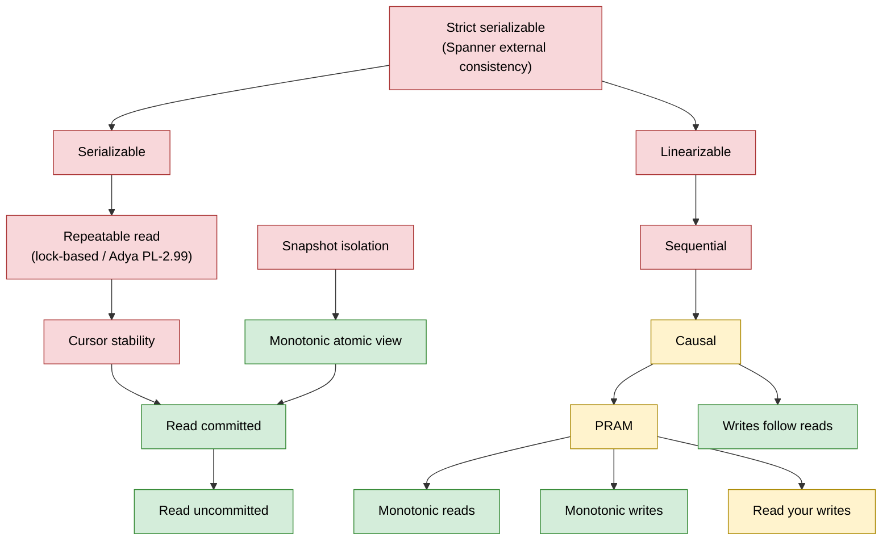
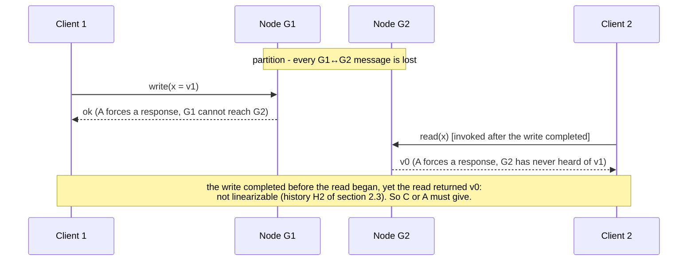
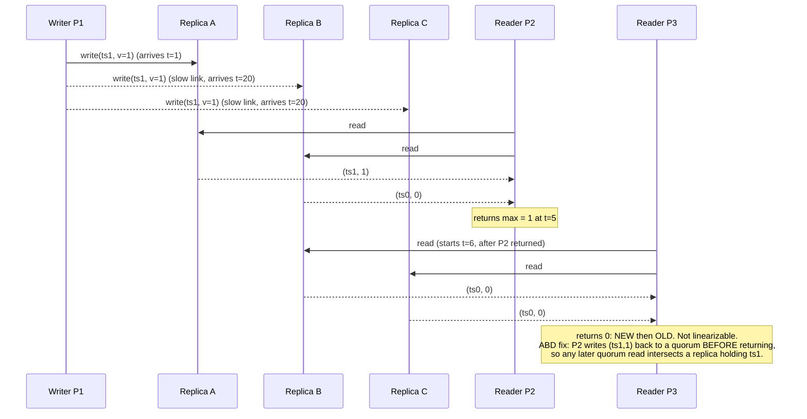
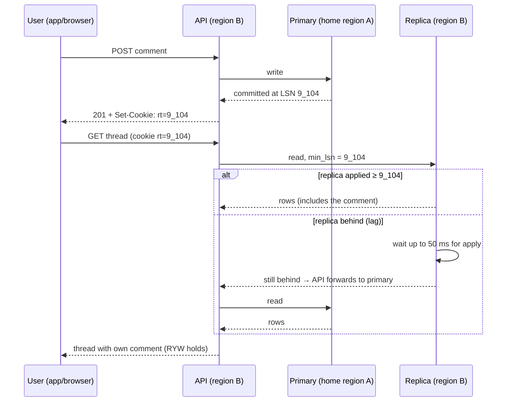

# CAP, PACELC, Linearizability, Serializability, and Causal Consistency

> **Folder 01 · File 03** of the Distributed Systems & System Design L7 Reference.
> **Prerequisites:** [file 02 §4](02-hardware-network-physics-latency-numbers-and-finops-math.md#4-network-physics-light-handshakes-windows-and-packets)
> (RTT floors, consensus commit latency).
> **Listings** (all deterministic):
>
> | Listing | What it does |
> |---|---|
> | `linearizability_checker.py` | Wing & Gong-style checker for linearizability and sequential consistency |
> | `quorum_sim.py` | Dynamo quorums vs ABD, sloppy quorums, LWW clock skew, and PBS staleness |
> | `mvcc_isolation_sim.py` | Read Committed, Snapshot Isolation and SSI against the classic anomalies |
>
> **Forward links:**
> - Folder 02 ([`02-Storage-Engines-Replication-and-Sharding-Internals/`](../02-Storage-Engines-Replication-and-Sharding-Internals/)): replication and NewSQL internals.
> - Folder 03 ([`03-Consensus-Coordination-and-Distributed-Transactions/`](../03-Consensus-Coordination-and-Distributed-Transactions/)): consensus, clocks, transactions.

---

## 0. How to read this file

Consistency vocabulary is the first filter a bar raiser applies. "Eventually consistent", "strongly consistent", "CP"
and "ACID" are each ambiguous enough that a candidate can say them and mean nothing.

This file gives:
1. **Precise definitions** you can state in one sentence.
2. **Executable checkers.** Every anomaly discussed is produced and detected by code, so you can *show* the
   difference between linearizable and sequentially consistent rather than assert it.
3. **The latency price** of each model, from file 02's physics.
4. **The per-operation decision guide** used in all 32 problems of Folders 06–08.

| § | Topic |
|---|---|
| 1 | The formal model: histories, real-time order, specifications |
| 2 | Single-object models: linearizable → sequential → causal → PRAM → session guarantees → eventual; with a checker |
| 3 | Transactional models: isolation levels, anomalies, SSI; with an MVCC simulator |
| 4 | CAP, stated and proved precisely, and its myths |
| 5 | PACELC and the latency lower bound |
| 6 | Quorums: why R + W > N is not linearizability; with a simulator |
| 7 | How real systems provide linearizability |
| 8 | Causal consistency and session guarantees in practice |
| 9 | Choosing a model per operation |
| 10–13 | L5/L6/L7 table, probing chains, invariants, references |

---

## 1. The formal model

- **Operation.** An operation $o$ is a pair of events: an **invocation** at real time $\text{inv}(o)$ and a
  **response** at $\text{res}(o)$, as seen by an omniscient external observer.
  - An operation with no response is **pending**: the client timed out or crashed.
  - A pending operation may or may not have taken effect.
- **History.** A history $H$ is the set of operations. Two partial orders on it matter:
  - **Real-time order:** $o_1 <_{rt} o_2 \iff \text{res}(o_1) < \text{inv}(o_2)$. $o_1$ finished before $o_2$ started.
    Operations that overlap in time are *concurrent* and unordered.
  - **Process (program) order:** the order in which one client issued its own operations.
- **Sequential specification.** An object's sequential specification is the set of legal *sequential* behaviors. For
  a register, every read returns the most recent write. For a compare-and-set, it succeeds iff the current value
  equals the expected one.

Every consistency model answers the same question: **is there a total order of the operations that is legal for the
specification and respects which constraints?**

---

## 2. Single-object (non-transactional) models

### 2.1 Definitions you should be able to say in one breath

| Model | Definition | Practical meaning |
|---|---|---|
| **Linearizable** (Herlihy & Wing 1990) | There is a legal total order that **respects real-time order**. Equivalently, each operation appears to take effect atomically at a point between its invocation and response | "Behaves like a single copy." Once a write completes, every later read sees it or something newer; once any read sees a value, no later read sees an older one |
| **Sequentially consistent** (Lamport 1979) | There is a legal total order that **respects each process's program order** (not real time) | Everyone agrees on one order, but it may lag reality: a read may return a stale value even after the write finished, as long as the whole history can be serialized |
| **Causal** (Ahamad et al. 1995) | Writes related by happens-before (program order ∪ reads-from, transitively) are seen by every process in that order; concurrent writes may be seen in different orders by different processes | A reply is never visible before the message it answers. Two independent posts may appear in different orders to different users |
| **PRAM / FIFO** | Writes *from one process* are seen by all in issue order; writes from different processes are unordered | Each writer's stream is ordered; there is no cross-writer guarantee |
| **Session guarantees** (Terry et al. 1994) | **RYW**: read your own writes. **MR**: monotonic reads, never go back in time. **MW**: monotonic writes, a client's writes apply in order. **WFR**: writes follow reads, a write is ordered after the writes its author had read | Per-client guarantees that need no global coordination. Causal consistency = all four combined (Brzeziński et al. 2004) |
| **Eventual** | If writes stop, replicas *eventually* converge | A **liveness** property only. It says nothing about what a read returns before convergence |
| **Strong eventual** (Shapiro et al. 2011) | Replicas that have received the same set of updates are in the same state, with no rollback | What CRDTs give: deterministic merge, no consensus |

Two properties separate linearizability from everything below it:

- **Locality (composability).** A history is linearizable iff each object's sub-history is linearizable (Herlihy &
  Wing).
  - So you can build linearizable systems from independently linearizable pieces: shards, registers, queues.
  - **Sequential consistency is not local.** Two individually sequentially consistent registers can combine into a
    non-SC system. The checker demonstrates this below.
- **Real time is what clients can observe.**
  - Clients communicate outside your system: a phone call, a message queue, a second API.
  - If Alice's write completes and she *tells* Bob, Bob reading the old value violates linearizability even though a
    sequential order exists.
  - This is the practical reason linearizability matters for leader election, locks, uniqueness checks and
    "has the payment been recorded?".

### 2.2 The hierarchy and what survives a partition



An arrow means "implies". The diagram follows the structure of the Jepsen consistency map (jepsen.io/consistency).
Snapshot isolation and serializability are **incomparable**: neither implies the other.

The colors give the availability class under a network partition (Bailis et al., VLDB 2014; Mahajan et al. 2011):

| Color | Class | Meaning |
|---|---|---|
| Red | Unavailable | Some non-failing nodes must refuse or wait during a partition |
| Yellow | Sticky available | Available if each client keeps talking to the same server (session stickiness) |
| Green | Totally available | Any non-failing node can serve any request |

**Mahajan, Alvisi & Dahlin's result:** no consistency model stronger than real-time causal can be both always
available and convergent. **Causal (+ convergence) is therefore the strongest model a partition-tolerant,
always-available system can offer.** That sentence replaces most of what people say when they invoke CAP.

### 2.3 The checker

`linearizability_checker.py` searches for a witness total order, using the memoized backtracking idea from Wing &
Gong and Lowe. It runs the classic litmus histories:
- a pending write that may or may not have taken effect;
- the store-buffering litmus test;
- a double-CAS lost update.

```python
"""linearizability_checker.py - a small Wing & Gong style checker for linearizability and sequential consistency.

A history is a list of Op records with invocation/response times; res=None marks a PENDING op (the client timed out
or crashed), which may take effect at any point after its invocation, or never. The object model is a map of
registers supporting write, read and compare-and-set. The checker searches for a total order that
  (a) is legal for the sequential register specification, and
  (b) respects real-time order (linearizability: a.res < b.inv => a before b), or only per-process program order
      (sequential consistency).
Linearizability checking is NP-complete in general (Gibbons & Korach 1997); memoizing (linearized-set, state) keeps
these textbook histories instant. Production checkers: Knossos, Porcupine, Elle (for transactions).
"""
from dataclasses import dataclass


@dataclass(frozen=True)
class Op:
    proc: str
    kind: str                 # "w" write, "r" read, "cas" compare-and-set
    key: str
    arg: object               # value written, or (expected, new) for cas
    ret: object               # value read, True/False for cas, None for write
    inv: float
    res: float | None         # None = pending: may or may not have taken effect

    def __str__(self) -> str:
        if self.kind == "w":
            body = f"w({self.key}={self.arg})"
        elif self.kind == "r":
            body = f"r({self.key})->{self.ret}"
        else:
            body = f"cas({self.key},{self.arg[0]}->{self.arg[1]})->{self.ret}"
        span = f"[{self.inv},{'...' if self.res is None else self.res}]"
        return f"{self.proc}:{body}{span}"


def _apply(state: tuple, op: Op, initial: object) -> tuple[bool, tuple]:
    regs = dict(state)
    cur = regs.get(op.key, initial)
    if op.kind == "w":
        regs[op.key] = op.arg
    elif op.kind == "r":
        if op.res is not None and cur != op.ret:
            return False, state
    elif op.kind == "cas":
        expected, new = op.arg
        ok = cur == expected
        if op.res is not None and ok != op.ret:
            return False, state
        if ok:
            regs[op.key] = new
    return True, tuple(sorted(regs.items()))


def check(history: list[Op], model: str = "linearizable", initial: object = 0) -> list[Op] | None:
    """Returns a witness total order, or None if no legal order exists under the model."""
    ops = [op for op in history if not (op.kind == "r" and op.res is None)]   # a pending read constrains nothing
    n = len(ops)
    must_before = [0] * n
    for j, b in enumerate(ops):
        for i, a in enumerate(ops):
            if i == j:
                continue
            if model == "linearizable":
                if a.res is not None and a.res < b.inv:
                    must_before[j] |= 1 << i
            elif model == "sequential":
                if a.proc == b.proc and a.inv < b.inv:
                    must_before[j] |= 1 << i
            else:
                raise ValueError(model)
    complete = sum(1 << i for i, op in enumerate(ops) if op.res is not None)
    seen: set = set()

    def dfs(mask: int, state: tuple, order: list[int]) -> list[int] | None:
        if mask & complete == complete:
            return order                              # remaining pending ops simply never took effect
        if (mask, state) in seen:
            return None
        seen.add((mask, state))
        for i in range(n):
            if mask >> i & 1 or must_before[i] & ~mask:
                continue
            ok, nxt = _apply(state, ops[i], initial)
            if ok:
                found = dfs(mask | 1 << i, nxt, order + [i])
                if found is not None:
                    return found
        return None

    found = dfs(0, (), [])
    return None if found is None else [ops[i] for i in found]


def per_key(history: list[Op], model: str) -> dict[str, bool]:
    keys = sorted({op.key for op in history})
    return {k: check([op for op in history if op.key == k], model) is not None for k in keys}


def W(p, k, v, inv, res): return Op(p, "w", k, v, None, inv, res)
def R(p, k, v, inv, res): return Op(p, "r", k, None, v, inv, res)
def CAS(p, k, exp, new, ok, inv, res): return Op(p, "cas", k, (exp, new), ok, inv, res)


EXAMPLES = {
    "H1 concurrent read may return old or new": [
        W("P1", "x", 1, 0, 10), R("P2", "x", 0, 1, 3), R("P3", "x", 1, 4, 6), R("P2", "x", 1, 11, 12)],
    "H2 stale read after the write completed": [
        W("P1", "x", 1, 0, 2), R("P2", "x", 0, 3, 4)],
    "H3 new-old inversion under a pending write": [
        W("P1", "x", 1, 0, None), R("P2", "x", 1, 1, 2), R("P3", "x", 0, 3, 4)],
    "H4 store buffering (x86-TSO litmus)": [
        W("P1", "x", 1, 0, 1), R("P1", "y", 0, 2, 3), W("P2", "y", 1, 0, 1), R("P2", "x", 0, 2, 3)],
    "H5 two CAS(0->1) both succeed (lost update)": [
        CAS("P1", "x", 0, 1, True, 0, 5), CAS("P2", "x", 0, 1, True, 1, 6)],
    "H6 timed-out write lands later": [
        W("P1", "x", 1, 0, None), R("P2", "x", 0, 1, 2), R("P2", "x", 1, 3, 4)],
}
EXPECTED = {   # (linearizable, sequentially consistent)
    "H1 concurrent read may return old or new": (True, True),
    "H2 stale read after the write completed": (False, True),
    "H3 new-old inversion under a pending write": (False, True),
    "H4 store buffering (x86-TSO litmus)": (False, False),
    "H5 two CAS(0->1) both succeed (lost update)": (False, False),
    "H6 timed-out write lands later": (True, True),
}


def main() -> None:
    print(f"{'history':<46} {'linearizable':>13} {'sequential':>11}")
    for name, h in EXAMPLES.items():
        lin = check(h, "linearizable")
        sc = check(h, "sequential")
        print(f"{name:<46} {str(lin is not None):>13} {str(sc is not None):>11}")
        assert (lin is not None, sc is not None) == EXPECTED[name], name
        if sc is not None and lin is None:
            print(f"    SC witness: {'  '.join(map(str, sc))}")
    h4 = EXAMPLES["H4 store buffering (x86-TSO litmus)"]
    sc_keys, lin_keys = per_key(h4, "sequential"), per_key(h4, "linearizable")
    print(f"\nH4 per key: sequential {sc_keys}  linearizable {lin_keys}")
    print("  -> every key is sequentially consistent on its own, the whole history is not: SC does not compose.")
    print("  -> linearizability is local: the history fails per key exactly when it fails as a whole.")
    assert all(sc_keys.values()) and not any(lin_keys.values())
    print("\nself-test: all assertions passed")


if __name__ == "__main__":
    main()
```

Output (verified; deterministic):

```text
history                                         linearizable  sequential
H1 concurrent read may return old or new                True        True
H2 stale read after the write completed                False        True
    SC witness: P2:r(x)->0[3,4]  P1:w(x=1)[0,2]
H3 new-old inversion under a pending write             False        True
    SC witness: P3:r(x)->0[3,4]  P1:w(x=1)[0,...]  P2:r(x)->1[1,2]
H4 store buffering (x86-TSO litmus)                    False       False
H5 two CAS(0->1) both succeed (lost update)            False       False
H6 timed-out write lands later                          True        True

H4 per key: sequential {'x': True, 'y': True}  linearizable {'x': False, 'y': False}
  -> every key is sequentially consistent on its own, the whole history is not: SC does not compose.
  -> linearizability is local: the history fails per key exactly when it fails as a whole.

self-test: all assertions passed
```

How to read each history:

```
H2  stale read after the write completed           H3  new-old inversion (pending write)
P1: |--w(x=1)--|                                    P1: |----------- w(x=1) ... (no response) -------
P2:              |--r(x)->0--|                      P2:     |--r->1--|
    time 0     2  3         4                       P3:                 |--r->0--|
  not linearizable: the read began after           not linearizable: once ANY read returned 1, a later
  the write finished                               read cannot return 0
  sequentially consistent: r, w                    sequentially consistent: r(P3), w, r(P2)
```

- **H2** is what an asynchronously replicated database does when you write to the primary and read from a lagging
  replica. It is fine for sequential consistency, and a violation for linearizability.
- **H3** is what a Dynamo-style quorum produces without read repair (§6).
- **H4** is the store-buffering litmus test that x86-TSO allows, because each core's write sits in its store buffer.
  The checker shows every key individually SC while the combined history is not. **SC does not compose; linearizability
  does.** This is why "each shard is sequentially consistent" is not a system guarantee.
- **H5** is the lost update. Two CAS(0→1) operations both "succeed", and no total order explains it. Any
  lock-free algorithm or idempotency-key table that allows this is broken.
- **H6** is the pending-write case, and the practical one. **A timeout is not a failure.** The write may still land,
  and a correct client must treat it as "unknown" and retry *idempotently*. Treating a timed-out payment as failed and
  charging again is the H6 bug in production.

Checking linearizability is **NP-complete** in general (Gibbons & Korach 1997). Production tools manage it with
partitioning by key (locality), memoization, and P-compositionality:
- Knossos (Clojure, used by Jepsen);
- Porcupine (Go, used in etcd/MIT 6.824-style tests);
- Elle (Kingsbury & Alvaro, VLDB 2020), which infers transactional anomalies from dependency graphs in linear time.

---

## 3. Transactional models: isolation, anomalies, and SSI

### 3.1 Definitions

- **Serializable** (Papadimitriou 1979): the outcome equals *some* serial execution of the committed transactions.
  There is **no real-time constraint**. A serializable database may order your transaction before one that committed
  minutes earlier.
- **Strict serializable:** serializable **and** consistent with real-time order. This is linearizability for
  transactions, and it is what Spanner calls *external consistency*.
- **Snapshot isolation (SI)** (Berenson et al. 1995):
  - Each transaction reads from a consistent snapshot taken at its start.
  - It commits only if no concurrent transaction committed a write to the same item: **first-committer-wins**.
  - SI prevents dirty reads, non-repeatable reads, read skew and lost updates.
  - SI **allows write skew**.
- **Serializable Snapshot Isolation (SSI)** (Cahill et al. 2008; PostgreSQL since 9.1, Ports & Grittner 2012):
  - SI plus tracking of **rw-antidependencies**: T read a version that a concurrent U later overwrote, written
    T →rw U.
  - Every non-serializable SI history contains a "dangerous structure": a pivot transaction with an incoming *and* an
    outgoing rw edge among concurrent transactions.
  - Aborting the pivot restores serializability, conservatively, with some false positives.

### 3.2 The anomalies

| Code | Name (Berenson / Adya) | Schedule sketch | RC | RR (lock-based) | SI | Serializable |
|---|---|---|---|---|---|---|
| P0 | Dirty write (G0) | T1 and T2 interleave writes to x and y | ✗ | ✗ | ✗ | ✗ |
| P1 | Dirty read (G1a/b) | T2 reads T1's uncommitted write | ✗ | ✗ | ✗ | ✗ |
| P4 | Lost update | Both read x=0 and write x=1 | **possible** | ✗ | ✗ (first-committer-wins) | ✗ |
| P2 | Non-repeatable read | T1 reads x twice and sees T2's committed change | possible | ✗ | ✗ | ✗ |
| A5A | Read skew | T1 reads x, T2 updates x and y and commits, T1 reads y | possible | ✗ | ✗ | ✗ |
| P3 | Phantom | T1's predicate read misses T2's insert | possible | possible | partly (snapshot) | ✗ |
| A5B | **Write skew** (G2-item) | Both read {x, y}, each writes a different one, the invariant over x+y breaks | possible | ✗ (items) | **possible** | ✗ |
| — | Read-only anomaly (Fekete et al. 2004) | A read-only transaction observes a state no serial order produces | possible | — | **possible** | ✗ |

✗ = prevented. "Possible" = the level allows it. After Berenson et al., SIGMOD 1995, Table 4, and Adya 1999.

### 3.3 What your database actually means by those words (⚠ verify per version; see Kleppmann's Hermitage tests)

| Database | Default | "REPEATABLE READ" is… | "SERIALIZABLE" is… |
|---|---|---|---|
| PostgreSQL | Read Committed | **Snapshot isolation** (prevents P4 and A5A, allows A5B) | **SSI**: truly serializable; aborts with SQLSTATE 40001 |
| MySQL / InnoDB | Repeatable Read | MVCC snapshot for plain SELECTs, *latest version* for locking reads and UPDATEs. **Allows lost update** (no first-committer-wins) and write skew | Lock-based: plain SELECTs take shared locks when autocommit is off |
| Oracle | Read Committed | n/a | **Snapshot isolation**: allows write skew despite the name |
| SQL Server | Read Committed (locking; RCSI optional) | Lock-based | Lock-based with key-range locks. `SNAPSHOT` is SI |
| CockroachDB | Serializable | (Read Committed added in v23.x) | Serializable via HLC-timestamped MVCC with read refresh. Not strictly serializable across unrelated keys: a "causal reverse" is possible |
| Spanner | Serializable read-write txns | (⚠ newer isolation options exist) | **Strict serializable** (external consistency via TrueTime) |

The L6/L7 point is that **"we use transactions" is not a correctness argument.** Say which level, which anomaly
remains, and why it cannot hurt this invariant. Two traps catch most teams:

1. **PostgreSQL Read Committed and the in-SQL increment.**
   - `UPDATE t SET x = x + 1 WHERE id = 7` under Read Committed is *safe*: the second updater waits on the row lock,
     then re-evaluates against the new version (EvalPlanQual).
   - Application read-modify-write (`SELECT x`, compute, `UPDATE SET x = :new`) under the same level *loses updates*.
   - The fixes:
     - `SELECT … FOR UPDATE`;
     - an atomic `UPDATE`;
     - an optimistic version column: `UPDATE … SET x = :new, v = v + 1 WHERE id = 7 AND v = :v`, which is a
       compare-and-set.
2. **Write skew in booking systems.** "Check that no overlapping booking exists, then insert" is a *predicate* write
   skew. SI cannot prevent it, because the conflicting rows don't exist yet. The fixes:
   - SERIALIZABLE (SSI);
   - **materialize the conflict** as a row both transactions must write: one row per room-night, locked or
     conditionally written;
   - a database constraint: PostgreSQL `EXCLUDE USING gist (room WITH =, during WITH &&)`.

   Folder 08 problem 24 builds on this.

### 3.4 The MVCC simulator

`mvcc_isolation_sim.py` implements:
- MVCC versions per key;
- RC reads at the latest committed version;
- SI snapshot reads with first-committer-wins;
- SSI's rw-antidependency tracking with the conservative pivot rule.

It then runs the four canonical schedules.

```python
"""mvcc_isolation_sim.py - an MVCC store that runs the classic anomalies under Read Committed, Snapshot Isolation and
Serializable Snapshot Isolation (SSI, Cahill et al. 2008, as in PostgreSQL SERIALIZABLE).

  RC  : every read sees the latest committed version at the time of the read; no write-conflict check.
  SI  : every read sees the snapshot taken at BEGIN; first-committer-wins on write-write conflicts.
  SSI : SI + tracking of rw-antidependencies (T read a version that a concurrent U overwrote: T -rw-> U).
        Every non-serializable SI execution contains a "pivot" with an incoming AND an outgoing rw edge among
        concurrent transactions; aborting at the pivot (conservatively, as PostgreSQL does) restores
        serializability at the price of some false-positive aborts.
Anomalies (Berenson et al. 1995 / Adya 1999 naming): P4 lost update, A5A read skew, A5B write skew, and the
Fekete-O'Neil-O'Neil 2004 read-only anomaly.
"""


class Abort(Exception):
    pass


class Txn:
    def __init__(self, db: "Db", name: str, level: str):
        self.db, self.name, self.level = db, name, level
        self.start = db.clock
        self.reads: set = set()
        self.writes: dict = {}
        self.status, self.commit_ts = "active", None
        self.rw_in: set = set()                             # transactions u with u -rw-> self
        self.rw_out: set = set()                            # transactions u with self -rw-> u

    def read(self, key: str):
        if key in self.writes:
            return self.writes[key]
        snapshot = self.db.clock if self.level == "RC" else self.start
        self.reads.add(key)
        return next(v for ts, v in reversed(self.db.versions[key]) if ts <= snapshot)

    def write(self, key: str, value) -> None:
        self.writes[key] = value

    def commit(self) -> None:
        db = self.db
        if self.level in ("SI", "SSI"):
            for k in self.writes:                           # first-committer-wins
                if db.versions[k][-1][0] > self.start:
                    self._abort(f"write-write conflict on {k}")
        if self.level == "SSI":
            live = lambda edges: {t for t in edges if t.status != "aborted"}
            new_out, new_in = set(), set()
            for u in db.txns:
                if u is self or u.status == "aborted" or not self._concurrent(u):
                    continue
                if self.reads & set(u.writes):              # self read what u overwrote: self -rw-> u
                    new_out.add(u)
                if u.reads & set(self.writes):              # u read what self overwrites: u -rw-> self
                    new_in.add(u)
            for u in new_in | new_out:                      # a committed u cannot be aborted any more
                if u.status == "committed" and live(u.rw_in | ({self} & new_out))                         and live(u.rw_out | ({self} & new_in)):
                    self._abort(f"would make committed {u.name} a pivot")
            if live(self.rw_in | new_in) and live(self.rw_out | new_out):
                self._abort("pivot: rw-antidependency in and out")
            self.rw_out |= new_out
            self.rw_in |= new_in
            for u in new_out:
                u.rw_in.add(self)
            for u in new_in:
                u.rw_out.add(self)
        db.clock += 1
        self.commit_ts, self.status = db.clock, "committed"
        for k, v in self.writes.items():
            db.versions[k].append((db.clock, v))

    def _concurrent(self, u: "Txn") -> bool:
        return u.status == "active" or u.commit_ts > self.start

    def _abort(self, why: str) -> None:
        self.status = "aborted"
        raise Abort(f"{self.name} aborted: {why}")


class Db:
    def __init__(self, **init):
        self.clock = 0
        self.versions = {k: [(0, v)] for k, v in init.items()}
        self.txns: list[Txn] = []

    def begin(self, name: str, level: str) -> Txn:
        t = Txn(self, name, level)
        self.txns.append(t)
        return t

    def latest(self, key: str):
        return self.versions[key][-1][1]


def attempt(log: list, fn) -> bool:
    try:
        fn()
        return True
    except Abort as e:
        log.append(str(e))
        return False


def lost_update(level: str) -> tuple[int, list]:
    db, log = Db(counter=0), []
    t1, t2 = db.begin("T1", level), db.begin("T2", level)
    a, b = t1.read("counter"), t2.read("counter")          # both read 0 (application read-modify-write)
    t1.write("counter", a + 1)
    t2.write("counter", b + 1)
    attempt(log, t1.commit)
    attempt(log, t2.commit)
    return db.latest("counter"), log


def read_skew(level: str) -> tuple[int, list]:
    db, log = Db(x=50, y=50), []
    t1 = db.begin("T1", level)
    x = t1.read("x")
    t2 = db.begin("T2", level)                             # transfer 10 from x to y
    t2.write("x", t2.read("x") - 10)
    t2.write("y", t2.read("y") + 10)
    attempt(log, t2.commit)
    y = t1.read("y")
    attempt(log, t1.commit)
    return x + y, log                                      # the invariant x + y == 100 as T1 observed it


def write_skew(level: str) -> tuple[int, list]:
    db, log = Db(alice=1, bob=1), []                       # rule: at least one doctor on call
    t1, t2 = db.begin("T1", level), db.begin("T2", level)
    if t1.read("alice") + t1.read("bob") >= 2:
        t1.write("alice", 0)
    if t2.read("alice") + t2.read("bob") >= 2:
        t2.write("bob", 0)
    attempt(log, t1.commit)
    attempt(log, t2.commit)
    return db.latest("alice") + db.latest("bob"), log


def read_only_anomaly(level: str) -> tuple[tuple, int, list]:
    """x = checking, y = savings. T2 withdraws 10 from checking and charges a 1 overdraft fee if x + y would go
    negative; T1 deposits 20 into savings; T3 is a read-only balance report."""
    db, log = Db(x=0, y=0), []
    t2 = db.begin("T2", level)
    x2, y2 = t2.read("x"), t2.read("y")
    t1 = db.begin("T1", level)
    t1.write("y", t1.read("y") + 20)
    attempt(log, t1.commit)
    t3 = db.begin("T3", level)
    report = (t3.read("x"), t3.read("y"))
    attempt(log, t3.commit)
    t2.write("x", x2 - 10 - (1 if x2 + y2 - 10 < 0 else 0))
    attempt(log, t2.commit)
    return report, db.latest("x"), log


def main() -> None:
    results = {}
    print(f"{'anomaly':<46} {'RC':>14} {'SI':>14} {'SSI':>14}")
    for label, fn, fmt in (
            ("P4 lost update: counter after 2 increments", lost_update, lambda r: f"counter={r[0]}"),
            ("A5A read skew: x+y seen by T1 (truth 100)", read_skew, lambda r: f"sum={r[0]}"),
            ("A5B write skew: doctors on call (rule >=1)", write_skew, lambda r: f"on_call={r[0]}")):
        row = {lvl: fn(lvl) for lvl in ("RC", "SI", "SSI")}
        results[label] = row
        print(f"{label:<46} " + " ".join(f"{fmt(row[l]) + ('*' if row[l][-1] else ''):>14}" for l in row))
    ro = {lvl: read_only_anomaly(lvl) for lvl in ("SI", "SSI")}
    print(f"{'read-only anomaly: T3 report / final x':<46} {'-':>14} "
          f"{str(ro['SI'][0]) + ' x=' + str(ro['SI'][1]):>14} "
          f"{str(ro['SSI'][0]) + ' x=' + str(ro['SSI'][1]) + ('*' if ro['SSI'][2] else ''):>14}")
    print("  (* = a transaction aborted and must be retried)")
    for label, row in results.items():
        for lvl, r in row.items():
            for line in r[-1]:
                print(f"    {lvl:<3} {label.split(':')[0]:<5} {line}")
    for line in ro["SSI"][2]:
        print(f"    SSI R-O   {line}")
    print("  SI read-only anomaly: T3 saw (x=0, y=20), i.e. the deposit but not the withdrawal; yet T2 was charged\n"
          "  the fee because it did NOT see the deposit -> no serial order of T1, T2, T3 explains T3's report.")

    lu, rs, ws = (results[k] for k in results)
    assert lu["RC"][0] == 1 and lu["SI"][0] == 1 and lu["SI"][1] and lu["SSI"][0] == 1 and lu["SSI"][1]
    assert not lu["RC"][1]
    assert rs["RC"][0] == 110 and rs["SI"][0] == 100 and rs["SSI"][0] == 100
    assert ws["RC"][0] == 0 and ws["SI"][0] == 0 and not ws["SI"][1] and ws["SSI"][0] == 1 and ws["SSI"][1]
    assert ro["SI"][0] == (0, 20) and ro["SI"][1] == -11 and not ro["SI"][2]
    assert ro["SSI"][2] and ro["SSI"][1] == 0
    print("\nself-test: all assertions passed")


if __name__ == "__main__":
    main()
```

Output (verified; deterministic):

```text
anomaly                                                    RC             SI            SSI
P4 lost update: counter after 2 increments          counter=1     counter=1*     counter=1*
A5A read skew: x+y seen by T1 (truth 100)             sum=110        sum=100        sum=100
A5B write skew: doctors on call (rule >=1)          on_call=0      on_call=0     on_call=1*
read-only anomaly: T3 report / final x                      -  (0, 20) x=-11   (0, 20) x=0*
  (* = a transaction aborted and must be retried)
    SI  P4 lost update T2 aborted: write-write conflict on counter
    SSI P4 lost update T1 aborted: pivot: rw-antidependency in and out
    SSI A5B write skew T1 aborted: pivot: rw-antidependency in and out
    SSI R-O   T2 aborted: pivot: rw-antidependency in and out
  SI read-only anomaly: T3 saw (x=0, y=20), i.e. the deposit but not the withdrawal; yet T2 was charged
  the fee because it did NOT see the deposit -> no serial order of T1, T2, T3 explains T3's report.

self-test: all assertions passed
```

Reading the results:

| Anomaly | RC | SI | SSI |
|---|---|---|---|
| Lost update | Counter = 1 after two increments, **with no error**. The worst kind of bug | The second committer aborts. Retrying gives 2 | Also aborts one transaction (here the *first* to commit, because the other's buffered write was already visible to the detector; which one aborts is implementation-dependent) |
| Read skew | T1 observes a sum of 110 against a true invariant of 100. A report or audit query under RC can be wrong without any concurrent bug in the writers | Fixes it | Fixes it |
| Write skew | Both doctors go off call | Both go off call | Aborts T1 as the pivot (in-edge from T2, out-edge to T2); one doctor stays on call |
| Read-only anomaly | — | All three commit. The report shows the deposit (y=20) but not the withdrawal, while the withdrawal was charged the overdraft fee as if the deposit had not happened. No serial order produces this. The read-only transaction is what makes the history non-serializable | Aborts T2. PostgreSQL also offers `SERIALIZABLE READ ONLY DEFERRABLE`, which waits for a safe snapshot so read-only transactions never abort or cause aborts |

**SSI's cost is aborts, and aborts under contention are a metastability risk.**
- A hot row (a global counter, a popular seat) under SSI produces abort → retry → more conflicts.
- Under load, goodput can collapse while CPU stays at 100%.
- The L7 fixes:
  - remove the hot conflict from the transaction: escrow or partitioned counters, or a single-writer queue per hot
    key;
  - bound retries with a budget and jittered backoff;
  - keep contended transactions short, with no network calls inside them.

  Folder 05 file 02 treats retry storms in general.

---

## 4. CAP, stated and proved precisely

### 4.1 The theorem (Gilbert & Lynch 2002, formalizing Brewer's 2000 conjecture)

Take an asynchronous network in which messages between nodes may be lost arbitrarily. Then **no** implementation of
a read/write register can guarantee both:

- **C: atomic consistency**, which means **linearizability** of that register. This is *not* the C in ACID, which is
  about application invariants.
- **A: availability**, meaning every request received by a **non-failing** node eventually gets a response. "Some
  node answers" does not count, and neither does a 99.99% SLO.

These cannot both hold in executions where the network partitions (**P**). Partitions are not optional, so the real
statement is: **during a partition, a linearizable register must make some non-failing nodes wait or refuse.**

### 4.2 The proof in one picture



### 4.3 What CAP does not say (the myths an L7 corrects in one sentence)

| Myth | Correction |
|---|---|
| "Pick 2 of 3" | Brewer (2012) called this framing misleading. P is not a choice. The choice is C vs A *only while partitioned*, and *per operation* |
| "We're a CA system" | Not possible in a distributed system: you don't get to decline partitions. A single-node database is "CA" only in the sense that the partition is the node failing |
| "NoSQL = AP, SQL = CP" | Consistency is configurable per operation in most systems: Cassandra consistency levels, DynamoDB `ConsistentRead`, MongoDB read/write concerns, Cosmos DB's five levels |
| "CP systems are unavailable" | A majority-quorum system stays fully available **on the majority side** of a partition. Only minority-side clients lose service. In practice, well-run CP systems often meet higher SLOs than operationally fragile "AP" ones |
| "AP means eventually consistent" | Totally-available systems can offer read committed, monotonic atomic view and the session guarantees. Sticky-available systems can offer **causal**. "Eventual" is the *weakest* option, not the only one |
| "CAP explains our latency" | CAP says nothing about latency without partitions. That is what PACELC adds |
| "Labelling a DB CP/AP is useful" | Kleppmann (*A Critique of the CAP Theorem*, 2015): most systems are neither C nor A in CAP's strict senses. Describe the model per operation and the behavior under partition instead |

---

## 5. PACELC and the latency lower bound

### 5.1 PACELC (Abadi 2012)

> **If Partition:** choose **A**vailability or **C**onsistency.
> **Else:** choose **L**atency or **C**onsistency.

The "else" clause is the one that matters 99.9% of the time. Even with a perfect network, a write that must be
visible to linearizable reads elsewhere must reach those replicas first, and that costs round trips.

| System (as classified by Abadi, plus modern notes) | P → | E → | Notes |
|---|---|---|---|
| Dynamo, Cassandra, Riak (default levels) | A | L | Tunable. QUORUM moves toward C but is still not linearizable without LWT/Paxos (§6) |
| BigTable/HBase, VoltDB/H-Store, Megastore | C | C | Single-master per range/partition |
| Spanner | C | C | TrueTime makes linearizable reads at "now" cost commit wait on writes. Bounded-staleness reads trade back to L |
| MongoDB | A (Abadi 2012) | C | With `w: majority` + `readConcern: majority/linearizable`, behaves PC/EC per operation (⚠ verify the version semantics) |
| PNUTS (Yahoo) | C | L | Per-record master; reads may be stale ("timeline consistency") |
| Cosmos DB | per request | per request | Strong / bounded staleness / session / consistent prefix / eventual |

### 5.2 The bound that makes PACELC a theorem, not a preference

Let message delay be at least $d$. Then **any** implementation of a sequentially consistent register, and therefore
of a linearizable one, must satisfy

$$|\text{read}| + |\text{write}| \ \ge\ d$$

(Lipton & Sandberg 1988; Attiya & Welch, TOCS 1994.) Linearizability adds further bounds that depend on the delay
*uncertainty*; see Attiya & Welch for the exact terms.

You can make reads local and free only by making writes wait at least $d$, or the reverse. **There is no design that
makes both fast.**

With file 02's numbers:
- **3 replicas across US regions**, leader in Ashburn: the majority-commit floor is **12 ms**.
- **Ashburn + Dublin + Frankfurt:** **70 ms** per commit.
- **5 replicas spread globally:** still **70 ms**. Majority = leader + 2 fastest, so adding far replicas does not
  add latency, but it does not remove the transatlantic hop either.

The L7 use of this bound:

1. Decide, **per operation**, which side pays. Configuration reads are read-heavy, so pay on writes. Ingestion is
   write-heavy, so pay on reads, or accept bounded staleness.
2. **Move the leader to the writers.** Spanner and CockroachDB leader/lease placement, "follow-the-workload", and
   per-user home regions all do this.
3. **Shrink the set of operations that need global agreement** until the physics bill is acceptable.

---

## 6. Quorums: why R + W > N is overlap, not linearizability

Dynamo-style replication (DeCandia et al., SOSP 2007) writes to $W$ of $N$ replicas and reads from $R$. If
$R + W > N$, every read set **intersects** every write set. Engineers routinely conclude that the system is
"strongly consistent". It is not, for four reasons that `quorum_sim.py` reproduces and checks:

```python
"""quorum_sim.py - R + W > N buys overlap, not linearizability.

Discrete-event scenarios over three replicas holding (timestamp, value), each history checked by
linearizability_checker.py (same folder):
  1. Dynamo-style strict quorum (N=3, W=2, R=2): new-old inversion, then the ABD fix (read write-back);
  2. sloppy quorum + hinted handoff under a partition: a "successful" W=2 write invisible to an R=2 read;
  3. last-writer-wins with a skewed client clock: an acknowledged write silently lost;
  4. probabilistically bounded staleness (PBS, Bailis et al. 2012): P(read is fresh) t ms after a write commits.
"""
import heapq
import random

from linearizability_checker import Op, check


class Sim:
    def __init__(self, delay):
        self.delay, self.q, self.t, self.seq = delay, [], 0.0, 0

    def at(self, t: float, fn) -> None:
        heapq.heappush(self.q, (t, self.seq, fn))
        self.seq += 1

    def send(self, src: str, dst: str, fn) -> None:
        d = self.delay(src, dst, self.t)
        if d is not None:                                   # None = dropped by a partition
            self.at(self.t + d, fn)

    def run(self) -> None:
        while self.q:
            self.t, _, fn = heapq.heappop(self.q)
            fn()


class Replica:
    def __init__(self, name: str):
        self.name, self.ts, self.val, self.hints = name, 0, 0, []

    def store(self, ts: int, val: int) -> None:
        if ts > self.ts:                                    # LWW: higher timestamp wins, the other is dropped
            self.ts, self.val = ts, val


class Client:
    def __init__(self, sim: Sim, name: str, history: list, open_ops: list):
        self.sim, self.name, self.history, self.open = sim, name, history, open_ops

    def write(self, reps: list, ts: int, val: int, w: int, stand_in: dict | None = None) -> None:
        inv, acks, rec = self.sim.t, set(), {"op": ("w", val, self.sim.t)}
        self.open.append((self.name, rec))
        targets = list(reps)
        if stand_in:                                        # sloppy quorum: hand unreachable homes to a stand-in
            for home, sub in stand_in.items():
                if self.sim.delay(self.name, home.name, self.sim.t) is None:
                    targets[targets.index(home)] = sub
                    sub.hints.append((home, ts, val))

        def ack(rep: Replica) -> None:
            acks.add(rep.name)
            if len(acks) == w and "done" not in rec:
                rec["done"] = True
                self.history.append(Op(self.name, "w", "x", val, None, inv, self.sim.t))

        for rep in targets:
            self.sim.send(self.name, rep.name, lambda rep=rep: (rep.store(ts, val),
                          self.sim.send(rep.name, self.name, lambda: ack(rep))))

    def read(self, reps: list, r: int, write_back: bool = False) -> None:
        inv, replies = self.sim.t, []

        def finish(ts: int, val: int) -> None:
            self.history.append(Op(self.name, "r", "x", None, val, inv, self.sim.t))

        def reply(rep: Replica, ts: int, val: int) -> None:
            replies.append((ts, val))
            if len(replies) != r:
                return
            ts_max, val_max = max(replies)
            if not write_back:
                return finish(ts_max, val_max)
            acks = []                                       # ABD phase 2: make the value durable on a quorum first

            def wb_ack() -> None:
                acks.append(1)
                if len(acks) == r:
                    finish(ts_max, val_max)

            for rp in reps:
                self.sim.send(self.name, rp.name, lambda rp=rp: (rp.store(ts_max, val_max),
                              self.sim.send(rp.name, self.name, wb_ack)))

        for rep in reps:
            self.sim.send(self.name, rep.name, lambda rep=rep: (
                lambda ts, val: self.sim.send(rep.name, self.name, lambda: reply(rep, ts, val)))(rep.ts, rep.val))


def finalize(history: list, open_ops: list) -> list:
    for proc, rec in open_ops:
        if "done" not in rec:
            kind, val, inv = rec["op"]
            history.append(Op(proc, kind, "x", val, None, inv, None))   # never acknowledged: pending
    return sorted(history, key=lambda o: o.inv)


def scenario_inversion(write_back: bool) -> list:
    slow = {("P1", "B"), ("P1", "C")}                       # the writer's links to B and C are congested
    sim = Sim(lambda s, d, t: 20.0 if (s, d) in slow else 1.0)
    a, b, c = Replica("A"), Replica("B"), Replica("C")
    hist, open_ops = [], []
    p1, p2, p3 = (Client(sim, p, hist, open_ops) for p in ("P1", "P2", "P3"))
    sim.at(0, lambda: p1.write([a, b, c], ts=1, val=1, w=2))
    sim.at(3, lambda: p2.read([a, b], r=2, write_back=write_back))
    sim.at(8 if write_back else 6, lambda: p3.read([b, c], r=2, write_back=write_back))   # after P2 returned
    sim.run()
    return finalize(hist, open_ops)


def scenario_sloppy() -> tuple[list, int]:
    side1 = {"P1", "A", "D"}

    def delay(s: str, d: str, t: float) -> float | None:
        if t < 10 and ((s in side1) != (d in side1)):
            return None                                     # partition until t=10
        return 1.0
    sim = Sim(delay)
    a, b, c, d = Replica("A"), Replica("B"), Replica("C"), Replica("D")
    hist, open_ops = [], []
    p1, p2 = Client(sim, "P1", hist, open_ops), Client(sim, "P2", hist, open_ops)
    sim.at(0, lambda: p1.write([a, b, c], ts=1, val=1, w=2, stand_in={b: d}))
    sim.at(5, lambda: p2.read([b, c], r=2))

    def handoff() -> None:                                  # partition healed: D delivers its hints
        for home, ts, val in d.hints:
            sim.send("D", home.name, lambda home=home, ts=ts, val=val: home.store(ts, val))
    sim.at(10, handoff)
    after = []
    sim.at(15, lambda: Client(sim, "P2", after, []).read([b, c], r=2))
    sim.run()
    return finalize(hist, open_ops), after[0].ret


def scenario_lww_skew() -> list:
    sim = Sim(lambda s, d, t: 1.0)
    reps = [Replica(n) for n in "ABC"]
    hist, open_ops = [], []
    p1, p2, p3 = (Client(sim, p, hist, open_ops) for p in ("P1", "P2", "P3"))
    skew = {"P1": 0, "P2": -15}                             # P2's wall clock runs 15 units behind
    sim.at(10, lambda: p1.write(reps, ts=10 + skew["P1"], val=1, w=2))
    sim.at(20, lambda: p2.write(reps, ts=20 + skew["P2"], val=2, w=2))
    sim.at(30, lambda: p3.read(reps, r=2))
    sim.run()
    return finalize(hist, open_ops)


def pbs(n: int, r: int, w: int, t_after: float, trials: int, rng: random.Random) -> float:
    """Each replica gets the write after a one-way delay (5% of replicas are 'slow': +40 ms GC/compaction);
    the write commits at the W-th ack; a read starts t_after ms later and takes the first R replies."""
    fresh = 0
    for _ in range(trials):
        arrive = [1 + rng.expovariate(1 / 3) + (40 if rng.random() < 0.05 else 0) for _ in range(n)]
        commit = sorted(x + 0.5 + rng.expovariate(1.0) for x in arrive)[w - 1]
        start = commit + t_after
        req = [0.5 + rng.expovariate(1.0) for _ in range(n)]
        first = sorted(range(n), key=lambda i: req[i] + 0.5 + rng.expovariate(1.0))[:r]
        fresh += any(arrive[i] <= start + req[i] for i in first)
    return fresh / trials


def show(title: str, hist: list) -> bool:
    ok = check(hist, "linearizable") is not None
    print(f"{title}\n    " + "  ".join(map(str, hist)) + f"\n    linearizable: {ok}")
    return ok


def main() -> None:
    print("== 1. strict quorum N=3 W=2 R=2 (R+W>N)")
    naive = show("Dynamo-style read (max timestamp of R replies):", scenario_inversion(False))
    abd = show("ABD read (write the max back to a quorum before returning):", scenario_inversion(True))

    print("\n== 2. sloppy quorum + hinted handoff, partition {P1,A,D} | {P2,B,C} until t=10")
    hist, later = scenario_sloppy()
    sloppy = show("W=2 'succeeds' on A + stand-in D; R=2 reads home replicas B, C:", hist)
    print(f"    read at t=15 after hinted handoff returns {later} (eventually consistent)")

    print("\n== 3. LWW with client-supplied timestamps, P2's clock 15 units behind")
    lww = show("both writes acknowledged by all replicas, then a quorum read:", scenario_lww_skew())

    print("\n== 4. PBS: P(read returns the committed write) t ms after commit (10,000 trials each)")
    rng = random.Random(2012)
    ts = (0, 1, 2, 5, 10, 20, 50)
    print(f"{'N,R,W':>7} " + " ".join(f"{f't={t}':>8}" for t in ts))
    table = {}
    for r, w in ((1, 1), (1, 2), (2, 1), (2, 2)):
        row = [pbs(3, r, w, t, 10_000, rng) for t in ts]
        table[(r, w)] = row
        print(f"{f'3,{r},{w}':>7} " + " ".join(f"{p * 100:>7.2f}%" for p in row))

    assert not naive and abd and not sloppy and not lww and later == 1
    assert all(p == 1.0 for p in table[(2, 2)])                       # R+W>N: overlap is guaranteed
    assert table[(1, 1)][0] < 0.95 and table[(1, 1)][-1] > 0.995      # staleness is a decaying window
    assert table[(1, 2)][0] > table[(1, 1)][0] and table[(2, 1)][0] > table[(1, 1)][0]
    print("\nself-test: all assertions passed")


if __name__ == "__main__":
    main()
```

Output (verified; deterministic):

```text
== 1. strict quorum N=3 W=2 R=2 (R+W>N)
Dynamo-style read (max timestamp of R replies):
    P1:w(x=1)[0,21.0]  P2:r(x)->1[3,5.0]  P3:r(x)->0[6,8.0]
    linearizable: False
ABD read (write the max back to a quorum before returning):
    P1:w(x=1)[0,21.0]  P2:r(x)->1[3,7.0]  P3:r(x)->1[8,12.0]
    linearizable: True

== 2. sloppy quorum + hinted handoff, partition {P1,A,D} | {P2,B,C} until t=10
W=2 'succeeds' on A + stand-in D; R=2 reads home replicas B, C:
    P1:w(x=1)[0,2.0]  P2:r(x)->0[5,7.0]
    linearizable: False
    read at t=15 after hinted handoff returns 1 (eventually consistent)

== 3. LWW with client-supplied timestamps, P2's clock 15 units behind
both writes acknowledged by all replicas, then a quorum read:
    P1:w(x=1)[10,12.0]  P2:w(x=2)[20,22.0]  P3:r(x)->1[30,32.0]
    linearizable: False

== 4. PBS: P(read returns the committed write) t ms after commit (10,000 trials each)
  N,R,W      t=0      t=1      t=2      t=5     t=10     t=20     t=50
  3,1,1   65.82%   74.33%   79.94%   89.84%   94.33%   95.28%   99.90%
  3,1,2   82.75%   85.96%   88.79%   93.30%   95.20%   95.29%   99.98%
  3,2,1   92.10%   95.49%   97.19%   99.28%   99.74%   99.76%  100.00%
  3,2,2  100.00%  100.00%  100.00%  100.00%  100.00%  100.00%  100.00%

self-test: all assertions passed
```

### 6.1 New-old inversion, and the ABD fix



- The write is still in progress (it completes at t=21), so returning *either* value would be fine for a read that
  overlaps it.
- But **once P2 has returned 1, no later read may return 0.**
- ABD (Attiya, Bar-Noy & Dolev, JACM 1995) adds a **write-back phase** to reads. The checker confirms the ABD history
  is linearizable.
- The price is a second round trip on reads that observe divergence.
- Cassandra 4.0+ defaults quorum reads to **blocking read repair**, which is exactly this write-back. It gives
  monotonic quorum reads (⚠ verify for your version).

### 6.2 Sloppy quorums and hinted handoff

- During a partition, Dynamo-style systems write to *any* W reachable nodes, including **stand-ins** outside the
  key's home set, with a "hint" to forward later.
- The write "succeeds" with W=2: one home replica and one stand-in. A reader on the other side of the partition reads
  two *home* replicas and sees the old value.
- Overlap was the whole guarantee, and sloppy quorums give it up in exchange for write availability.
- After the partition heals, the hint is delivered and the read becomes fresh. That is "eventual".

### 6.3 Last-writer-wins with clocks loses acknowledged writes

- P2's clock is 15 units behind. Its later write is stamped *older* and silently discarded by every replica, even
  though all replicas **acknowledged** it.
- The history is not linearizable, and **no error was ever returned to anyone**.
- This is the standard data-loss mode of LWW systems with client- or coordinator-supplied wall-clock timestamps.
- Mitigations:
  - lightweight transactions (Paxos) for conflicting updates;
  - CRDTs or sibling resolution with version vectors (Riak);
  - single-writer-per-key designs;
  - hybrid logical clocks, which bound but do not eliminate the problem.

  Folder 03 file 02 covers them.

### 6.4 Probabilistically bounded staleness (Bailis et al., VLDB 2012)

With partial quorums ($R + W \le N$), the right question is not "is it consistent?" but "**how stale, how often?**"
§4 of the output:

| N,R,W | Fresh at t=0 | t=5 ms | t=20 ms | t=50 ms |
|---|---|---|---|---|
| 3,1,1 | 65.8% | 89.8% | 95.3% | 99.9% |
| 3,1,2 | 82.8% | 93.3% | 95.3% | 99.98% |
| 3,2,1 | 92.1% | 99.3% | 99.8% | 100% |
| **3,2,2** | **100%** | 100% | 100% | 100% |

Two observations:
- The **plateau at ~95% between 10 and 20 ms** comes from the 5% of replicas that are slow (a 40 ms GC or
  compaction pause). **The staleness window is set by the tail of replication delay, not its median.**
- An L7 answer states an SLO in this form, for example "p99.9 of reads are fresh within 50 ms of commit". It then
  monitors replica lag as an SLI, and pages on the tail, not the mean.

### 6.5 What would make quorums linearizable

All of the following are needed:
- strict quorums (no sloppy substitutes);
- an ABD-style write-back on reads;
- writes ordered by something stronger than wall clocks: a per-key leader, consensus, or a CAS on a version;
- a rule that a *failed* write is "unknown", never "didn't happen".

At that point you have rebuilt a consensus-backed register, which is why systems that need linearizability use
**consensus** (Raft, Paxos) rather than leaderless quorums.

---

## 7. How real systems provide (or don't provide) linearizability

| System | Write path | Read path | Linearizable reads? |
|---|---|---|---|
| **etcd** | Raft log commit | **ReadIndex** by default: leader confirms leadership with a heartbeat quorum, then serves at ≥ commit index. `serializable` option for local reads | Yes by default |
| **ZooKeeper** | Zab (leader + quorum) | Served locally by the connected server; may be stale. `sync()` before a read narrows the window | Writes yes; reads **sequentially consistent** |
| **Consul** | Raft | `default` (leader lease; brief staleness possible), `consistent` (quorum check), `stale` (any server) | Only in `consistent` mode |
| **Spanner** | Paxos per split + TrueTime commit wait | Strong reads at a TrueTime timestamp; bounded-staleness reads from nearest replica | Yes (strict serializable) |
| **DynamoDB** | Leader per partition, replicated within the region | `ConsistentRead=true` goes to the leader; the default is eventually consistent | Strongly consistent reads, single item, single region. Global tables: LWW multi-active, plus a newer multi-region strong consistency mode (⚠ verify GA status/limits) |
| **Amazon S3** | — | Strong read-after-write for PUT/DELETE and LIST since December 2020 | Yes, per object |
| **Kafka** | Partition leader + ISR, `acks=all` | Consumers read up to the high watermark | An ordered log, not a register. Per-partition order; no cross-partition order |
| **Redis** (primary + async replicas) | Async replication; `WAIT` only counts acks | Primary or replica | **No.** Failover can lose acknowledged writes; `WAIT` does not make it CP (Redis docs) |
| **MongoDB** | `w: "majority"` | `readConcern: "linearizable"` (single document) or `"majority"` | Only with the right concerns; Jepsen has found issues in past versions (⚠ verify) |
| **CockroachDB** | Raft per range + HLC/MVCC | Leaseholder reads; follower reads at bounded staleness | Per key yes; transactions serializable but not strictly across keys |

**Lease reads vs ReadIndex** is the clock trade-off at the heart of consensus systems:
- A **leader lease** lets the leader answer reads locally for a lease interval after its last quorum heartbeat. It
  assumes **bounded clock drift**.
  - A process pause longer than the lease (GC, VM migration) can serve **stale reads from a deposed leader**.
  - The leader must check its lease *after* any possible pause, and use monotonic clocks.
- **ReadIndex** pays one heartbeat round trip per read batch and assumes nothing about clocks.

Folder 03 file 02 (clocks) and file 03 (fencing tokens) make this rigorous.

---

## 8. Causal consistency and session guarantees in practice

### 8.1 The anomaly causal consistency exists to prevent

The COPS paper's example (Lloyd et al., SOSP 2011):
1. Alice removes her boss from her photo album's ACL.
2. *Then* she posts an embarrassing photo.

In a geo-replicated store without causal ordering, a remote datacenter may apply the photo before the ACL change, and
the boss sees the photo. Nothing is "inconsistent" in the eventual sense, because both updates eventually arrive.
The harm happened in the window between them.

The same anomaly has many shapes:
- a reply visible before the post it answers;
- an order-shipped email before the order exists in the customer's view;
- a permission check against a stale ACL. Zanzibar calls this **the new-enemy problem**, Folder 06 problem 11.

### 8.2 Mechanisms, from cheapest to strongest

| Mechanism | How it works | Guarantee | Cost |
|---|---|---|---|
| **Sticky sessions** | Route a user to the same replica/region | RYW + monotonic reads while sticky | Breaks on failover; uneven load |
| **Session tokens** (LSN / HLC / GTID) | The write returns a commit position; the client sends it on reads; a replica serves only if `applied ≥ token`, else waits briefly or forwards | RYW, MR, MW, WFR for that client. Cosmos DB "session" level; MySQL `WAIT_FOR_EXECUTED_GTID_SET`; PostgreSQL by comparing `pg_last_wal_replay_lsn()` | A token in a cookie or header; occasional forward to the primary |
| **Snapshot tokens** (Zanzibar "zookies") | Content stores the token of the ACL version it was written under; checks evaluate at a snapshot ≥ that token | Causal between ACL changes and content | Requires a timestamped (MVCC) store |
| **Explicit dependency tracking** (COPS, Eiger) | Each write carries its nearest dependencies; a remote DC applies a write only after its dependencies | Causal+ across all clients | Metadata size; dependency checks on apply |
| **Stabilization by physical clocks** (GentleRain, Cure) | Apply remote writes once a global stable time passes them | Causal with small metadata | Visibility delayed by the slowest DC's clock/heartbeat |
| **Version vectors / vector clocks** | Per-replica counters detect concurrency; concurrent writes become siblings or merge | Detects causality *and* concurrency | O(replicas) metadata per key; sibling explosion without pruning |

### 8.3 The session-token recipe, used in many problems in this KB



- Tokens must be **per partition** (a map shard → position) or **globally comparable** (HLC). A single LSN only
  works for one primary.
- Bound the wait, then forward. **Never wait unboundedly on a lagging replica.** That converts lag into an outage.
- Caches break session guarantees unless the cache key or version respects the token. A write, then a read through
  a stale cache entry, is the most common RYW bug. Folder 04 file 02 covers lease and versioned invalidation.

---

## 9. Choosing a model per operation

The L7 move is to stop asking "what consistency does the system have?" and instead ask **"what is the weakest model
that preserves this operation's invariant, and what does the stronger one cost?"**

| Data / operation | Weakest safe model | The invariant | Typical mechanism |
|---|---|---|---|
| Money movement, ledger postings | Strict serializable, or serializable within one shard + idempotency | Debits = credits; no double spend | Single-shard transaction per account pair, or Spanner/CRDB; double-entry with idempotency keys (Folder 08 problem 27) |
| Inventory / seats / quotas | Linearizable per item, or **escrow** | Never oversell | Conditional write/CAS on the item; pre-split escrow blocks per region; reservation with TTL (problem 23) |
| Unique username / idempotency key | Linearizable on the key | Uniqueness | Conditional put (`attribute_not_exists`, `INSERT … ON CONFLICT`) on a single-leader partition |
| Booking intervals | Serializable, or materialized conflict | No overlap | One row per room-night; or `EXCLUDE` constraint; or SSI (problem 24) |
| Leader election, locks | Linearizable + **fencing tokens** | At most one *effective* holder | Consensus + monotonically increasing tokens checked by the resource (Folder 03 file 03) |
| Posts, comments, chat | Causal + RYW | Replies after parents; you see your own message | Per-conversation sequence numbers; session tokens (problems 12, 13) |
| ACLs vs content | Causal (snapshot ≥ token) | New-enemy problem | Zookies (problem 11) |
| Config / feature flags | Linearizable writes; **monotonic** versioned reads | No flip-flopping between versions | Versioned snapshots; clients reject older versions (Folder 05 file 03) |
| Counters (likes, views) | Eventual (CRDT) | Converges; approximate OK | G-/PN-counters, batched increments |
| Presence, typing indicators | Best-effort eventual | Ephemeral | Pub/sub with TTL |
| Search index, feeds | Bounded staleness (a freshness SLO) | Fresh within N seconds at p99 | CDC with lag SLI (problems 12, 19) |
| Analytics, reports | Consistent snapshot (stale OK) | Internally consistent aggregate | Snapshot/time-travel reads at a timestamp |

The **consistency budget** is part of a production design, as an SLO:
- "RYW: 100%";
- "cross-region staleness: p99 < 1 s, p99.9 < 5 s";
- "monotonic reads: 100% within a session".

The system **degrades by widening staleness** (serving from replicas, disabling cross-region freshness), not by
failing requests. That is graceful degradation (Folder 05 file 03).

---

## 10. L5 vs L6 vs L7 on consistency

| Topic | L5 (Senior) | L6 (Staff) | L7 (Principal) |
|---|---|---|---|
| Vocabulary | "Strong" vs "eventual" | Linearizable vs serializable vs SI; session guarantees; names the anomaly | Precise definitions incl. real-time, locality and pending operations; uses a checker mindset ("what history would prove us wrong?") |
| CAP | "We're AP" | Behavior per operation during a partition; majority side stays available | Rejects CP/AP labels; states the strongest available model (causal); designs partition *recovery* (reconciliation, compensation) |
| Latency | — | Knows strong consistency costs a quorum round trip | Uses the \|r\|+\|w\| ≥ d bound and the RTT matrix to place leaders and choose which side pays |
| Quorums | "R + W > N, so it's consistent" | Knows about sloppy quorums, read repair, hinted handoff | New-old inversion, ABD write-back, LWW lost writes, PBS staleness SLOs; knows when to switch to consensus |
| Transactions | "Wrap it in a transaction" | Picks the isolation level and the remaining anomaly; FOR UPDATE / CAS | Write skew and read-only anomalies; materializing conflicts; SSI abort storms as a metastability risk; per-invariant choice |
| Multi-region | Async replica in another region | RPO/RTO, lag monitoring, RYW via stickiness | Home-region ownership, session/snapshot tokens, consistency as an SLO, global invariants made rare by design |

---

## 11. Bar-raiser probing chains

### Chain 1: "Is your system CP or AP?"

1. **L5:** "AP. We use Cassandra."
2. **Probe:** "So during a partition, what happens to a checkout?" **L6:** "Checkout uses LWT (Paxos) on the order
   key, so the minority side refuses checkout. Browsing stays available from local replicas at ONE."
3. **Probe:** "And what does the user see, and what happens when the partition heals?" **L7:**
   - The minority side degrades gracefully: cart writes are buffered locally with idempotency keys, and the user sees
     "checkout temporarily unavailable in your region" instead of an error page.
   - On heal, buffered carts replay idempotently.
   - "The labels don't matter. Per operation, here is the model, the partition behavior, and the recovery."

### Chain 2: "N=3, W=2, R=2, so reads are strongly consistent?"

1. **L5:** "Yes, read and write quorums overlap."
2. **Probe:** "What about hinted handoff?" **L6:** "Sloppy quorums break overlap during partitions; turn them off for
   this keyspace, or accept staleness."
3. **Probe:** "Strict quorums only. Is it linearizable now?" **L7:** "No."
   - New-old inversion while a write is in flight, unless reads write back (ABD / blocking read repair).
   - LWW with skewed clocks drops acknowledged writes.
   - A failed write may later become visible.
   - "If we need linearizability on this key, use LWT/consensus on that key only, and quantify the latency: one
     extra round trip in-region."

### Chain 3: "Users report their comment disappears right after posting."

1. **L5:** "Replication lag. Increase replica capacity."
2. **Probe:** "Lag is 300 ms at p99, and you can't make it zero." **L6:** "Read-your-writes. Route the author's reads
   to the primary for a few seconds after a write, or stick them to the region."
3. **Probe:** "Users post from mobile, then open the web app in another region." **L7:**
   - Session tokens carried in the account session rather than a device cookie.
   - Replicas serve only at `applied ≥ token`, with a bounded wait and then a forward.
   - Cache entries keyed or versioned so a stale cache cannot violate RYW.
   - Monitor the RYW-violation rate as an SLI by sampling author reads against their tokens.

### Chain 4: "We use PostgreSQL REPEATABLE READ, so double-booking is impossible."

1. **L5:** "Right, the transaction sees a consistent snapshot."
2. **Probe:** "Two users book overlapping dates at once." **L6:** "That's write skew. Under SI both inserts succeed.
   Use SERIALIZABLE, or SELECT … FOR UPDATE on the room."
3. **Probe:** "SERIALIZABLE aborts 30% of transactions at peak, and retries make it worse." **L7:**
   - Materialize the conflict as one row per room-night, so a conflict is a single-row unique/CAS failure. That is
     cheap, deterministic, and has no false positives.
   - Or use an `EXCLUDE` constraint.
   - Bound retries with a budget, and serialize contention per hot room through a single-writer queue.
   - "SSI is correct, but at contention it's a retry-storm generator."

### Chain 5: "Make the global leaderboard strongly consistent."

1. **L5:** "Use a single global database."
2. **Probe:** "Players on 4 continents, 500k score updates/s." **L6:** "Regional leaderboards with async global
   merge; the global view lags a few seconds."
3. **Probe:** "What anomaly would a player notice, and what's the right guarantee?" **L7:**
   - The player notices *their own* rank going backwards (monotonic reads) and their score not appearing (RYW).
   - Strict global rank order at millisecond freshness is invisible to them.
   - So: RYW and monotonic reads per player via tokens; global rank as a bounded-staleness snapshot (≤ 2 s,
     published as a versioned top-K).
   - Cross-region quorums only for prize-affecting end-of-season finalization.
   - Prices the alternative: 70+ ms per update × 500k/s would need a ~35,000-writes-in-flight pipeline (Little's law)
     on a consensus log, for a guarantee nobody can see.

---

## 12. Invariants checklist

- [ ] Every operation has a named consistency model and the user-visible anomaly it permits.
- [ ] Linearizability is required wherever clients communicate out-of-band or an invariant spans time (locks,
      uniqueness, "is it recorded?").
- [ ] Timeouts are treated as **unknown outcomes**; retries are idempotent.
- [ ] Isolation level named; the remaining anomaly argued harmless for this invariant; write skew checked for every
      "check then write" over a predicate.
- [ ] "R + W > N" is never presented as linearizability. Sloppy quorums, LWW and read repair are addressed.
- [ ] The latency price of the chosen model is computed from the RTT matrix (|r| + |w| ≥ d).
- [ ] Multi-region: home ownership or quorum placement is explicit; global invariants are minimized.
- [ ] Session guarantees (RYW, MR) have a mechanism (tokens or stickiness) that survives caches and failover.
- [ ] Staleness is an SLO with an SLI and alerting on the tail.
- [ ] Partition behavior *and* partition-recovery behavior are specified.

### Cheat-sheet

```
linearizable   = legal total order + respects REAL TIME          (local/composable; "single copy")
sequential     = legal total order + respects PROGRAM ORDER      (not composable; may be stale)
causal         = happens-before respected; concurrent may differ (strongest sticky-available model)
serializable   = equals SOME serial order of transactions        (no real-time promise)
strict serial. = serializable + real time = Spanner external consistency
SI             = snapshot reads + first-committer-wins           (allows WRITE SKEW + read-only anomaly)
SSI            = SI + rw-antidependency pivot abort              (Postgres SERIALIZABLE)
CAP            = during a partition, a linearizable register cannot answer on every non-failing node
PACELC         = else: latency vs consistency;  |read| + |write| >= d
R+W>N          = overlap only; linearizable needs ABD write-back + non-clock ordering + no sloppy quorum
PBS            = staleness window is set by the replication-delay TAIL
```

---

## 13. References

- M. Herlihy, J. Wing. *Linearizability: A Correctness Condition for Concurrent Objects.* ACM TOPLAS 12(3), 1990.
- L. Lamport. *How to Make a Multiprocessor Computer That Correctly Executes Multiprocess Programs.* IEEE Trans.
  Computers C-28(9), 1979.
- M. Ahamad, G. Neiger, J. Burns, P. Kohli, P. Hutto. *Causal Memory: Definitions, Implementation, and Programming.*
  Distributed Computing 9(1), 1995.
- D. Terry et al. *Session Guarantees for Weakly Consistent Replicated Data.* PDIS 1994.
- J. Brzeziński, C. Sobaniec, D. Wawrzyniak. *From Session Causality to Causal Consistency.* PDP 2004.
- S. Gilbert, N. Lynch. *Brewer's Conjecture and the Feasibility of Consistent, Available, Partition-Tolerant Web
  Services.* SIGACT News 33(2), 2002.
- E. Brewer. *Towards Robust Distributed Systems* (PODC 2000 keynote); *CAP Twelve Years Later: How the "Rules" Have
  Changed.* IEEE Computer 45(2), 2012.
- D. Abadi. *Consistency Tradeoffs in Modern Distributed Database System Design.* IEEE Computer 45(2), 2012.
- M. Kleppmann. *A Critique of the CAP Theorem*, arXiv:1509.05393, 2015. *Designing Data-Intensive Applications*,
  O'Reilly. Hermitage isolation tests: github.com/ept/hermitage.
- H. Berenson, P. Bernstein, J. Gray, J. Melton, E. O'Neil, P. O'Neil. *A Critique of ANSI SQL Isolation Levels.*
  SIGMOD 1995.
- A. Adya. *Weak Consistency: A Generalized Theory and Optimistic Implementations for Distributed Transactions.* PhD
  thesis, MIT, 1999.
- A. Fekete, E. O'Neil, P. O'Neil. *A Read-Only Transaction Anomaly Under Snapshot Isolation.* SIGMOD Record 33(3),
  2004.
- M. Cahill, U. Röhm, A. Fekete. *Serializable Isolation for Snapshot Databases.* SIGMOD 2008.
- D. Ports, K. Grittner. *Serializable Snapshot Isolation in PostgreSQL.* VLDB 2012.
- P. Bailis et al.:
  - *Highly Available Transactions: Virtues and Limitations.* VLDB 2014.
  - *Probabilistically Bounded Staleness for Practical Partial Quorums.* VLDB 2012.
- P. Mahajan, L. Alvisi, M. Dahlin. *Consistency, Availability, and Convergence.* UT Austin TR-11-22, 2011.
- W. Lloyd, M. Freedman, M. Kaminsky, D. Andersen. *Don't Settle for Eventual: Scalable Causal Consistency for
  Wide-Area Storage with COPS.* SOSP 2011.
- H. Attiya, A. Bar-Noy, D. Dolev. *Sharing Memory Robustly in Message-Passing Systems.* JACM 42(1), 1995.
- H. Attiya, J. Welch. *Sequential Consistency versus Linearizability.* ACM TOCS 12(2), 1994. R. Lipton, J.
  Sandberg. *PRAM: A Scalable Shared Memory.* Princeton TR-180-88, 1988.
- J. Wing, C. Gong. *Testing and Verifying Concurrent Objects.* JPDC 17, 1993. P. Gibbons, E. Korach. *Testing
  Shared Memories.* SIAM J. Comput. 26(4), 1997. G. Lowe. *Testing for Linearizability.* CCPE 29(4), 2017.
- P. Viotti, M. Vukolić. *Consistency in Non-Transactional Distributed Storage Systems.* ACM CSUR 49(1), 2016.
- K. Kingsbury, P. Alvaro. *Elle: Inferring Isolation Anomalies from Experimental Observations.* VLDB 2020. Jepsen
  consistency map: jepsen.io/consistency.
- G. DeCandia et al. *Dynamo: Amazon's Highly Available Key-value Store.* SOSP 2007.
- M. Shapiro, N. Preguiça, C. Baquero, M. Zawirski. *Conflict-free Replicated Data Types.* SSS 2011.
- J. Corbett et al. *Spanner: Google's Globally-Distributed Database.* OSDI 2012.
- R. Pang et al. *Zanzibar: Google's Consistent, Global Authorization System.* USENIX ATC 2019.
