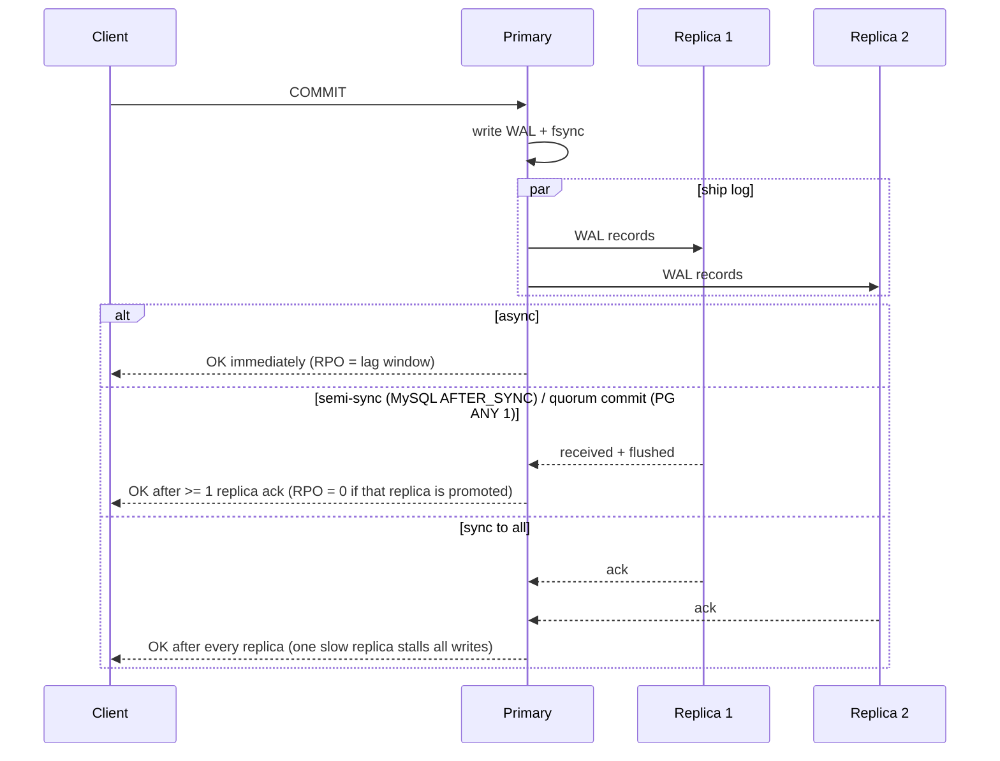

# Replication: Single-Leader, Multi-Leader, and Leaderless (Sloppy Quorums)

> **Folder 02 · File 02** of the Distributed Systems & System Design L7 Reference.
> **Prerequisites:** [Folder 01 file 03](../01-First-Principles-Physics-and-L5-L6-L7-Rubric/03-cap-pacelc-linearizability-serializability-and-causal-consistency.md)
> (consistency models, quorums, PBS).
> **Listing:** `replication_lab.py` covers:
> - the RPO of async failover;
> - write availability by replication mode;
> - multi-leader conflicts under LWW, version vectors and CRDTs;
> - Merkle anti-entropy.
>
> The output is deterministic.

---

## 0. Why replicate, and the two numbers that define it

Replication buys four things, and each has a different design:

| Goal | Typical design |
|---|---|
| **Durability** | Synchronous copies, or quorums |
| **Availability** | Fast failover, or leaderless |
| **Read scaling and latency** | Replicas near readers, accepting staleness |
| **Write locality** | Multi-leader, or per-key home regions |

Every replication design is pinned down by two numbers:

- **RPO (Recovery Point Objective):** how much acknowledged data may be lost when a node or region dies. Async: the
  replication lag window. Sync or quorum: zero.
- **RTO (Recovery Time Objective):** how long until writes are accepted again. Detection timeout + election/promotion
  + client re-routing.

The L7 move is to state both, per dataset, and to price them in latency (Folder 01 file 03 §5: $|r| + |w| \ge d$)
and in availability (§2 below).

---

## 1. Single-leader replication

### 1.1 Modes



| Mode | Example knobs (⚠ verify per version) | RPO | Write-latency cost | Write availability |
|---|---|---|---|---|
| Async | PostgreSQL default; MySQL default | Lag window | 0 | = primary |
| Semi-sync | MySQL `rpl_semi_sync_source_wait_point=AFTER_SYNC`, timeout falls back to async (default 10 s) | 0 while semi-sync holds | +1 RTT to the nearest replica | Slightly *below* the primary alone (§2) |
| Quorum commit | PostgreSQL `synchronous_standby_names = 'ANY 1 (r1, r2)'` | 0 if the promoted replica was in the quorum | +1 RTT to the k-th fastest | Higher than sync-all |
| Consensus (Raft/Paxos) | etcd, CockroachDB, Spanner, KRaft | 0 | +1 RTT to majority | Majority-available (§2) |

### 1.2 The log being shipped

| Method | What it ships | Pros | Cons |
|---|---|---|---|
| Statement-based | SQL text | Small | Non-determinism (`NOW()`, `RAND()`, auto-increment races) |
| Physical / WAL shipping | Page-level redo (PostgreSQL streaming replication) | Exact replica; cheap | Same major version and architecture; no partial or cross-engine use |
| Logical / row-based | Row changes (MySQL binlog ROW, PG logical decoding / `pgoutput`) | Version-independent; feeds CDC (Debezium) | Larger; needs replica identity; DDL is awkward |
| Trigger-based | App-defined | Flexible | Slow, fragile |

**Change data capture (CDC) is replication to other systems.** Every invariant of replication applies to it:
- per-key ordering;
- an offset/position (LSN, GTID) as the resume token;
- **at-least-once delivery, so idempotent consumers.**

Two failure modes recur:
- A logical replication slot pins WAL until its consumer catches up. A dead CDC consumer fills the primary's disk.
- Consumers that apply out of order produce stale ACLs or search documents. The companion AI KB, Folder 04, measured
  184 wrong ACLs from naive CDC.

### 1.3 Replication-lag anomalies and their fixes

| Anomaly (Folder 01 file 03 §2) | Symptom | Fix |
|---|---|---|
| Read-your-writes violation | User's own update vanishes | Session token (LSN/GTID) → replica waits or forwards; or read from the leader for N s after a write |
| Monotonic-reads violation | Data "goes back in time" between refreshes | Sticky replica per session, or token |
| Consistent-prefix violation | An answer appears before the question (multi-partition) | Causally related writes in the same partition, or causal metadata |

### 1.4 Failover: the most dangerous routine operation

```mermaid
stateDiagram-v2
    [*] --> Healthy
    Healthy --> Suspected: heartbeats missed > timeout
    Suspected --> Healthy: heartbeat resumes (false alarm)
    Suspected --> Fencing: quorum of observers agrees primary is down
    Fencing --> Electing: old primary fenced (STONITH / lease expiry / storage-level fence)
    Electing --> Promoting: choose most caught-up replica (max LSN / GTID)
    Promoting --> Rerouting: new primary accepts writes, new epoch
    Rerouting --> Healthy: clients/proxies switched; old primary rejoins as replica after rewind
```



The three ways failover goes wrong:

1. **Split brain.** The old primary is alive but partitioned, still accepting writes, and both sides diverge.
   - Prevent it with **fencing**: power off the old primary (STONITH), let its lease expire before promotion, have
     storage reject the old epoch, or use consensus-based leadership, where a leader without a quorum cannot commit.
2. **Lost writes on async failover.** The lab's §A at 5,000 writes/s:
   - With healthy lag (median 30 ms), a crash loses **248 acknowledged writes on average and 1,561 at p99**.
   - With *bursty* lag (σ = 2), the mean is 1,094 and **the p99.9 is 63,104**.
   - **The RPO is set by the lag tail, not the median.** Alert on lag p99.9 and cap it, for example by throttling
     writers when lag exceeds a bound.
   - Promoting a random replica loses **246** writes; promoting the most caught-up loses **119**. Always promote by
     max LSN/GTID.
3. **Flapping.** A too-short timeout during a GC pause or network blip triggers needless failovers, each costing RTO
   and risk. GitHub's October 2018 incident is the canonical public post-mortem:
   - a 43-second network partition triggered a cross-coast primary promotion;
   - the resulting divergence took ~24 hours of degraded service to reconcile.

   Tune detection timeouts **above the p99.9 of pauses**. Require a quorum of observers. Consider whether automatic
   cross-region failover should be automatic at all.

**Kafka's version** is the in-sync replica set (ISR):
- `acks=all` waits for every ISR member.
- `min.insync.replicas=2` with RF=3 refuses writes if the ISR shrinks to 1.
- `unclean.leader.election.enable=false` (the default) refuses to elect an out-of-sync replica. That trades
  availability for not losing acknowledged data.

---

## 2. Write availability vs replication mode

From §B of the output, with independent replica availability $a$:

| Mode | $a$ = 99% | $a$ = 99.9% | Loss of acknowledged writes on primary crash |
|---|---|---|---|
| Async (primary only) | 99.0000% | 99.900% | Anything in the lag window |
| Semi-sync (primary + 1 of 2) | 98.9901% | 99.8999% | None if the acking replica is promoted (but it falls back to async on timeout) |
| **Majority quorum, 2 of 3** | **99.9702%** | **99.9997%** | None |
| Sync to all 3 | 97.0299% | 99.7003% | None, but any slow replica stalls every write |
| Majority quorum, 3 of 5 | 99.9990% | ~100% | None; tolerates 2 failures |

The lesson most teams miss: **semi-sync and sync-all *reduce* write availability**, because they add hard
dependencies (Folder 01 file 01 §6.3: serial composition multiplies). **Majority quorums increase it**, because any
majority will do (parallel composition).

Consensus-based replication is therefore not only "more consistent". At equal hardware it is *more available* for
writes than primary-plus-sync-replica, and it removes the failover-decision problem: leadership is part of the
protocol.

---

## 3. Multi-leader replication

### 3.1 When it is worth it

- **Multi-region active-active writes:** each region's users write locally at intra-region latency.
- **Offline-capable clients:** each device is a leader. Calendars, notes, mobile apps.
- **Collaborative editing:** every editor is a leader (Folder 07 problem 21).

The price is that **conflicts are possible by construction**. Two leaders can accept writes to the same key before
either hears of the other.

### 3.2 Conflict rate is a computable quantity

Per key, a write is concurrent with another region's write if they fall within the replication delay $d$ of each
other. With per-key write rate $\lambda$ split across two regions:

$$P(\text{a write is silently lost under LWW}) = 1 - e^{-(\lambda/2)\,d}$$

§C of the output (200 writes/s, $d$ = 80 ms, 10 minutes) matches the model:

| Hot keys | Writes | LWW silently lost | Model | Version-vector conflicts detected | LWW counter | CRDT counter |
|---|---|---|---|---|---|---|
| 1 | 119,987 | **119,946** | 119,947 | 119,987 | 41 | **119,987** |
| 100 | 120,452 | 9,210 | 9,261 | 17,667 | 111,242 | 120,452 |
| 100,000 | 120,663 | 9 | 10 | 18 | 120,654 | 120,663 |

- **A single hot key under multi-leader LWW is a data shredder.** 99.97% of increments vanish. Even 100 hot keys lose
  7.6%.
- **With spread-out keys, conflicts are rare but non-zero.** 9 lost per 10 minutes is ~1,300 per day: a steady
  trickle of silent data loss that no test will catch.
- **Version vectors detect every conflict** (each write is counted once if it participates in any conflict). The
  application then *merges* siblings.
- **A CRDT counter loses nothing.** Increments commute.

### 3.3 Conflict handling, from worst to best

| Strategy | What happens to concurrent writes | Use when |
|---|---|---|
| **Last-writer-wins** (timestamps) | One silently dropped. With skewed clocks, the *later* one can lose (Folder 01 file 03 §6.3) | Overwrites where loss is acceptable: caches, presence, "last seen" |
| **Version vectors + siblings** (Riak, Dynamo's shopping cart) | All kept; the reader or application merges | The app has a meaningful merge (union of cart items) |
| **CRDTs** (counters, sets, maps, sequences) | Merged deterministically and convergently (strong eventual consistency) | The data type has a CRDT: counters, OR-sets, LWW-registers per field, RGA for text |
| **Operational transformation** | Ops transformed against concurrent ops by a server | Real-time collaborative text with a central server (Google Docs) |
| **Conflict avoidance:** home region per key | No conflicts. Each key has one writer region, and others forward writes | Most "active-active" systems in practice |

**The L7 default is conflict avoidance.**
- Pin each user, tenant or entity to a home region; write there; replicate out.
- Fail over the *home assignment* when the region dies, and accept an RPO of the lag window for that failover.
- Reserve CRDTs and merges for data types that need concurrent multi-region writes.

### 3.4 Topology traps

```
   circular           star              all-to-all
  A → B → C → A     B ← A → C         A ⇄ B, B ⇄ C, A ⇄ C
  (one break         (hub is a         (fast, but writes can arrive out of causal order:
   stops the ring)    SPOF)             C may see B's "update x" before A's "insert x")
```

All-to-all needs causal metadata (version vectors) or idempotent, order-independent operations. Loop prevention
needs origin IDs on every replicated change; MySQL `server_id` and GTIDs serve this purpose.

---

## 4. Leaderless replication (Dynamo-style)

### 4.1 Mechanics

```
 write(k,v): coordinator sends to all N replicas in k's preference list; succeeds after W acks
 read(k):    coordinator asks N (or R) replicas; returns newest after R replies; repairs stale replicas
             ┌──────────── preference list for k on the ring (Folder 02 file 03) ────────────┐
             │  A (home)  B (home)  C (home)  D (fallback)  E (fallback) ...                  │
             └─────────────────────────────────────────────────────────────────────────────────┘
 sloppy quorum: if B is unreachable, D accepts the write with a HINT ("this belongs to B") and hands it off later
```

| Mechanism | What it repairs | Cost / caveat |
|---|---|---|
| **Read repair** | Divergence on keys that are *read* | Cold keys stay divergent. Blocking read repair = the ABD write-back that gives monotonic quorum reads |
| **Hinted handoff** | Writes missed during short outages | Hints are stored on other nodes; if the hint holder dies, the hint is lost. Hints have a max window (Cassandra `max_hint_window`, default 3 h) |
| **Anti-entropy with Merkle trees** | Everything, including cold keys | Background CPU, I/O and network. Must complete inside the tombstone grace window (file 01 §2.7) |

### 4.2 Merkle-tree anti-entropy (§D of the output)

Two replicas each hash their key range into a binary tree of bucket hashes and compare from the root down, descending
only into differing subtrees.

| Divergent keys | Hashes compared | Keys exchanged | vs full comparison |
|---|---|---|---|
| 1 | 25 | 64 | 262,144 |
| 10 | 175 | 640 | 262,144 |
| 100 | 1,081 | 6,272 | 262,144 |
| 1,000 | 4,737 | 57,408 | 262,144 |

Cost scales with the *amount of divergence × log(range)*, not with the data size. Two caveats:
- **Bucket granularity sets the waste.** Each differing bucket ships 64 keys here.
- Tree *construction* still reads all the data. Cassandra's incremental repair limits it to unrepaired SSTables.

### 4.3 Versioning: vector clocks vs version vectors

- **Version vectors** have one entry per *replica* and track which writes a replica has seen. They detect concurrent
  sibling writes.
- **Vector clocks** have one entry per *process/client*. They grow with clients.
- **Dotted version vectors** (Riak) fix the "sibling explosion" that plain version vectors cause when clients write
  through different coordinators.

Folder 03 file 02 builds these from first principles.

---

## 5. The listing

```python
"""replication_lab.py - the numbers behind replication choices (Folder 02, file 02).

  A. RPO of asynchronous failover: acknowledged writes lost when the primary dies, for lag distributions; and the
     cost of promoting the wrong replica.
  B. Write availability vs replication mode (sync-all, majority quorum, semi-sync, async) and what each loses.
  C. Multi-leader conflicts: LWW silently drops concurrent updates; version vectors detect them; a CRDT counter
     loses nothing.
  D. Merkle-tree anti-entropy: hashes exchanged to find k divergent keys vs shipping every key.
Standard library only; seeded, deterministic.
"""
import hashlib
import math
import random


# ---------------------------------------------------------------- A. async RPO
def lost_on_crash(rate: float, lag_median_ms: float, sigma: float, trials: int, rng: random.Random) -> dict:
    lost = sorted(rate * rng.lognormvariate(math.log(lag_median_ms / 1000), sigma) for _ in range(trials))
    return {"mean": sum(lost) / trials, "p50": lost[trials // 2], "p99": lost[int(trials * 0.99)],
            "p999": lost[int(trials * 0.999)]}


def wrong_promotion(rate: float, rng: random.Random, trials: int = 20_000) -> tuple[float, float]:
    """Two async replicas with independent lag; promoting a random one vs the most caught-up (max GTID/LSN)."""
    rnd = best = 0.0
    for _ in range(trials):
        a, b = (rng.lognormvariate(math.log(0.03), 1.0) for _ in range(2))
        rnd += rate * (a if rng.random() < 0.5 else b)
        best += rate * min(a, b)
    return rnd / trials, best / trials


# ---------------------------------------------------------------- B. availability vs mode
def at_least(k: int, n: int, a: float) -> float:
    return sum(math.comb(n, i) * a ** i * (1 - a) ** (n - i) for i in range(k, n + 1))


def modes(a: float) -> dict:
    return {
        "async (primary only)": a,
        "semi-sync (primary + 1 of 2)": a * (1 - (1 - a) ** 2),
        "majority quorum (2 of 3)": at_least(2, 3, a),
        "sync to all 3": a ** 3,
        "majority quorum (3 of 5)": at_least(3, 5, a),
    }


# ---------------------------------------------------------------- C. multi-leader
def multi_leader(keys: int, writes_per_s: float, delay_s: float, seconds: float, rng: random.Random) -> dict:
    """Two regions accept writes to shared keys; each write reaches the other region after delay_s.
    Two writes to a key from different regions are CONCURRENT if neither had arrived at the other's region when
    it was issued (|t1 - t2| < delay). Under LWW the later-stamped one wins, so a write is SILENTLY LOST if a
    concurrent write from the other region follows it; version vectors instead keep both as siblings."""
    by_key: dict = {}
    t = 0.0
    n = 0
    while t < seconds:
        t += rng.expovariate(writes_per_s)
        by_key.setdefault(rng.randrange(keys), []).append((t, rng.randrange(2)))
        n += 1
    lost = conflicted = 0
    for writes in by_key.values():
        for i, (ti, ri) in enumerate(writes):
            later = earlier = False
            j = i + 1
            while j < len(writes) and writes[j][0] - ti < delay_s:
                later |= writes[j][1] != ri
                j += 1
            j = i - 1
            while j >= 0 and ti - writes[j][0] < delay_s:
                earlier |= writes[j][1] != ri
                j -= 1
            lost += later
            conflicted += later or earlier
    return {"writes": n, "lww_silently_lost": lost, "vv_detected": conflicted,
            "lww_counter": n - lost, "crdt_counter": n}


def lww_loss_model(writes_per_s: float, keys: int, delay_s: float) -> float:
    """P(a write is lost under LWW) = P(the other region writes the same key within the next delay_s)
    = 1 - exp(-lambda * delay), lambda = (writes/2) / keys."""
    return 1 - math.exp(-writes_per_s / 2 / keys * delay_s)


# ---------------------------------------------------------------- D. Merkle anti-entropy
def merkle_levels(store: dict, leaves: int) -> list[list[bytes]]:
    buckets = [hashlib.blake2b(digest_size=16) for _ in range(leaves)]
    for k in sorted(store):
        buckets[k % leaves].update(f"{k}={store[k]};".encode())
    level = [b.digest() for b in buckets]
    levels = [level]
    while len(level) > 1:
        level = [hashlib.blake2b(level[i] + level[i + 1], digest_size=16).digest() for i in range(0, len(level), 2)]
        levels.append(level)
    return levels[::-1]                                     # root first


def merkle_diff(a: list, b: list) -> tuple[int, int]:
    """Walk both trees from the root; returns (hashes compared, leaf buckets that differ)."""
    compared, frontier = 0, [0]
    for depth in range(len(a)):
        compared += len(frontier)
        diff = [i for i in frontier if a[depth][i] != b[depth][i]]
        if depth == len(a) - 1:
            return compared, len(diff)
        frontier = [c for i in diff for c in (2 * i, 2 * i + 1)]
    return compared, 0


def main() -> None:
    rng = random.Random(42)
    print("== A. async failover: acknowledged writes lost when the primary dies (5,000 writes/s)")
    print(f"{'replication lag':<34} {'mean':>8} {'p50':>8} {'p99':>8} {'p99.9':>8}")
    rpo = {}
    for label, med, sig in (("healthy: median 30 ms, sigma 1.0", 30, 1.0),
                            ("bursty: median 30 ms, sigma 2.0", 30, 2.0),
                            ("degraded: median 2 s, sigma 1.0", 2000, 1.0)):
        r = lost_on_crash(5000, med, sig, 20_000, rng)
        rpo[label] = r
        print(f"{label:<34} {r['mean']:>8.0f} {r['p50']:>8.0f} {r['p99']:>8.0f} {r['p999']:>8.0f}")
    rnd, best = wrong_promotion(5000, rng)
    print(f"two replicas: promote a random one -> {rnd:.0f} writes lost on average; "
          f"promote the most caught-up (max LSN/GTID) -> {best:.0f}")

    print("\n== B. write availability by replication mode (independent replica availability a)")
    print(f"{'mode':<32} {'a=99%':>10} {'a=99.9%':>10}   acknowledged-write loss on primary crash")
    loss = {"async (primary only)": "anything in the lag window",
            "semi-sync (primary + 1 of 2)": "none if the acking replica is promoted (falls back to async on timeout)",
            "majority quorum (2 of 3)": "none (any new majority overlaps)",
            "sync to all 3": "none, but one slow replica stalls every write",
            "majority quorum (3 of 5)": "none; tolerates 2 failures"}
    m99, m999 = modes(0.99), modes(0.999)
    for k in m99:
        print(f"{k:<32} {m99[k] * 100:>9.4f}% {m999[k] * 100:>9.5f}%   {loss[k]}")

    print("\n== C. multi-leader, 2 regions, 80 ms replication delay, 10 minutes")
    print(f"{'hot keys':>8} {'writes':>8} {'LWW lost':>9} {'model':>7} {'VV conflicts':>13} "
          f"{'LWW counter':>12} {'CRDT counter':>13}")
    ml = {}
    for keys in (1, 100, 100_000):
        r = multi_leader(keys, 200, 0.080, 600, rng)
        ml[keys] = r
        model = lww_loss_model(200, keys, 0.080) * r["writes"]
        print(f"{keys:>8} {r['writes']:>8} {r['lww_silently_lost']:>9} {model:>7.0f} {r['vv_detected']:>13} "
              f"{r['lww_counter']:>12} {r['crdt_counter']:>13}")

    print("\n== D. Merkle anti-entropy over 262,144 keys, 4,096 leaf buckets")
    base = {k: 0 for k in range(1 << 18)}
    tree_a = merkle_levels(base, 4096)
    md = {}
    for k_diff in (1, 10, 100, 1000):
        other = dict(base)
        for k in rng.sample(range(1 << 18), k_diff):
            other[k] = 1
        compared, buckets = merkle_diff(tree_a, merkle_levels(other, 4096))
        keys_shipped = buckets * (len(base) // 4096)
        md[k_diff] = (compared, buckets, keys_shipped)
        print(f"  {k_diff:>5} divergent keys: {compared:>5} hashes compared, {buckets:>4} buckets differ, "
              f"{keys_shipped:>7,} keys exchanged (vs 262,144 for a full comparison)")

    # self-test
    h, b = rpo["healthy: median 30 ms, sigma 1.0"], rpo["bursty: median 30 ms, sigma 2.0"]
    assert 200 < h["mean"] < 300 and b["p999"] > 20 * h["p50"]                 # the tail sets the RPO
    assert best < 0.7 * rnd
    assert m999["majority quorum (2 of 3)"] > m999["async (primary only)"] > m999["sync to all 3"]
    assert m99["semi-sync (primary + 1 of 2)"] < m99["async (primary only)"]
    for keys, r in ml.items():
        model = lww_loss_model(200, keys, 0.080) * r["writes"]
        assert r["vv_detected"] >= r["lww_silently_lost"] and r["crdt_counter"] == r["writes"]
        assert abs(r["lww_silently_lost"] - model) <= max(10, 0.1 * model), keys
    assert ml[1]["lww_silently_lost"] > ml[100]["lww_silently_lost"] > ml[100_000]["lww_silently_lost"]
    assert md[1][0] < 30 and md[1000][2] < 262_144
    print("\nself-test: all assertions passed")


if __name__ == "__main__":
    main()
```

Output (verified; deterministic):

```text
== A. async failover: acknowledged writes lost when the primary dies (5,000 writes/s)
replication lag                        mean      p50      p99    p99.9
healthy: median 30 ms, sigma 1.0        248      150     1561     3193
bursty: median 30 ms, sigma 2.0        1094      151    15288    63104
degraded: median 2 s, sigma 1.0       16605    10065    99515   234100
two replicas: promote a random one -> 246 writes lost on average; promote the most caught-up (max LSN/GTID) -> 119

== B. write availability by replication mode (independent replica availability a)
mode                                  a=99%    a=99.9%   acknowledged-write loss on primary crash
async (primary only)               99.0000%  99.90000%   anything in the lag window
semi-sync (primary + 1 of 2)       98.9901%  99.89990%   none if the acking replica is promoted (falls back to async on timeout)
majority quorum (2 of 3)           99.9702%  99.99970%   none (any new majority overlaps)
sync to all 3                      97.0299%  99.70030%   none, but one slow replica stalls every write
majority quorum (3 of 5)           99.9990% 100.00000%   none; tolerates 2 failures

== C. multi-leader, 2 regions, 80 ms replication delay, 10 minutes
hot keys   writes  LWW lost   model  VV conflicts  LWW counter  CRDT counter
       1   119987    119946  119947        119987           41        119987
     100   120452      9210    9261         17667       111242        120452
  100000   120663         9      10            18       120654        120663

== D. Merkle anti-entropy over 262,144 keys, 4,096 leaf buckets
      1 divergent keys:    25 hashes compared,    1 buckets differ,      64 keys exchanged (vs 262,144 for a full comparison)
     10 divergent keys:   175 hashes compared,   10 buckets differ,     640 keys exchanged (vs 262,144 for a full comparison)
    100 divergent keys:  1081 hashes compared,   98 buckets differ,   6,272 keys exchanged (vs 262,144 for a full comparison)
   1000 divergent keys:  4737 hashes compared,  897 buckets differ,  57,408 keys exchanged (vs 262,144 for a full comparison)

self-test: all assertions passed
```

---

## 6. Chain replication (and CRAQ)

```
 writes ──► HEAD ──► mid ──► mid ──► TAIL ──► ack to client
 reads  ───────────────────────────► TAIL                  (strongly consistent: the tail has only committed data)
 CRAQ: reads at ANY node; a node with a dirty (uncommitted) version asks the tail for the committed version number
```

- **Chain replication** (van Renesse & Schneider, OSDI 2004) gives linearizable reads and writes. Each node forwards
  once, so the *head's* outbound bandwidth is 1 copy, not N−1. A primary-backup leader sends N−1 copies.
- **CRAQ** (Terrace & Freedman, ATC 2009) spreads reads over all nodes.
- The costs:
  - write latency grows linearly with chain length;
  - a single slow node slows the whole chain;
  - membership needs an external configuration master, itself built on consensus.
- Chains are used where throughput per byte matters more than tail latency. Object storage and some replicated logs
  use chain-like pipelines; HDFS's write pipeline is a chain.

---

## 7. L5 vs L6 vs L7

| Topic | L5 (Senior) | L6 (Staff) | L7 (Principal) |
|---|---|---|---|
| Mode choice | "Add a read replica" | Sync vs async vs semi-sync with RPO/RTO; replica lag anomalies and fixes | Quorum/consensus vs primary-plus-sync priced in *availability* (semi-sync lowers it) and latency; RPO set by the lag *tail* |
| Failover | "Promote the replica" | Fencing, promote max LSN, split-brain prevention | Detection tuned above p99.9 pauses; whether cross-region failover should be automatic; epochs everywhere; rehearsed failovers |
| Multi-region | "Multi-master" | Conflict resolution options; LWW risks | Conflict rate computed (1 − e^{−λd/2}); conflict *avoidance* via home regions as the default; CRDTs only for types that need them |
| Leaderless | "Quorums" | Read repair, hinted handoff, sloppy quorums | Merkle repair cost model; tombstone grace vs repair cadence; hint windows; PBS-style staleness SLOs |
| CDC | "Use Debezium" | Ordering per key, offsets | Slots pinning WAL as an outage mode; idempotent, versioned consumers; CDC lag as an SLI |

---

## 8. Bar-raiser probing chains

### Chain A: "We'll use async replication to a standby region for DR."

1. **L5:** "If the primary region fails, promote the standby."
2. **Probe:** "What do you lose?" **L6:** "Everything inside the replication lag, typically sub-second. Users may see
   lost recent writes; we reconcile from logs."
3. **Probe:** "Quantify it for payments at 5,000 writes/s, and decide." **L7:**
   - "At healthy lag that's ~250 writes on average, but the tail matters: thousands at p99, tens of thousands when
     lag is bursty."
   - "For payments, RPO must be 0, so ledger writes commit to a quorum spanning two regions, paying the inter-region
     RTT (~12 ms between nearby regions)."
   - "Non-financial data stays async with a lag-tail SLO and write throttling when lag exceeds 1 s."
   - "Failover is human-approved for the ledger, automatic for the rest."

### Chain B: "Make our user-profile service active-active in three regions."

1. **L5:** "Multi-master database with LWW."
2. **Probe:** "Two regions update the same profile at once?" **L6:** "LWW drops one; use version vectors and merge
   per field, or field-level LWW."
3. **Probe:** "What's the expected loss, and what would you actually build?" **L7:**
   - "Compute it: with per-profile write rates of ~1/hour, conflicts are ~10⁻⁵ per write. Rare, but not zero."
   - "Fields like `last_login` take LWW; collections (followed topics) take OR-set CRDTs; money-like fields (credits)
     never go multi-leader."
   - "Simplest of all: home-region per user, local writes for 99% of traffic; the rest forward with ~70 ms added."

### Chain C: "The primary's disk filled up at 3 a.m. and the database went down."

1. **L5:** "Add disk alerts."
2. **Probe:** "Data size didn't change." **L6:** "WAL retention. A replication slot for a CDC consumer that died is
   pinning WAL."
3. **Probe:** "Prevent the class of failure." **L7:**
   - `max_slot_wal_keep_size` (PostgreSQL 13+), so a dead consumer is dropped rather than the primary.
   - CDC lag as a paged SLI.
   - Consumers that can resume from a snapshot plus offset.
   - The principle: "no downstream consumer may hold the primary's availability hostage". That is the control-plane
     vs data-plane separation of Folder 05 applied to replication.

---

## 9. Invariants checklist

- [ ] RPO and RTO stated per dataset; the RPO is computed from the lag *tail*.
- [ ] Failover: quorum-based detection, fencing, promote max-LSN, epochs; timeouts above pause tails.
- [ ] Replication mode priced in write availability (serial vs parallel composition), not just latency.
- [ ] Lag anomalies (RYW, monotonic, prefix) have mechanisms.
- [ ] Multi-leader: conflict rate computed; resolution per field/type; home-region avoidance is the default.
- [ ] Leaderless: anti-entropy cadence < tombstone grace; hint windows; read-repair semantics known.
- [ ] CDC consumers are idempotent and per-key ordered; slot/WAL retention is bounded.

---

## 10. References

- G. DeCandia et al. *Dynamo: Amazon's Highly Available Key-value Store.* SOSP 2007.
- A. Lakshman, P. Malik. *Cassandra: A Decentralized Structured Storage System.* LADIS 2009.
- R. van Renesse, F. Schneider. *Chain Replication for Supporting High Throughput and Availability.* OSDI 2004.
- J. Terrace, M. Freedman. *Object Storage on CRAQ.* USENIX ATC 2009.
- R. Merkle. *A Digital Signature Based on a Conventional Encryption Function.* CRYPTO 1987 (hash trees).
- N. Preguiça, C. Baquero et al. *Dotted Version Vectors: Logical Clocks for Optimistic Replication.*
  arXiv:1011.5808, 2010.
- M. Shapiro et al. *Conflict-free Replicated Data Types.* SSS 2011.
- M. Kleppmann. *Designing Data-Intensive Applications*, ch. 5 (Replication).
- GitHub Engineering. *October 21 post-incident analysis*, 2018.
- PostgreSQL documentation: streaming replication, `synchronous_standby_names`, logical decoding, replication slots.
  MySQL documentation: semi-synchronous replication, GTIDs. Apache Kafka documentation: replication, ISR, unclean
  leader election.
