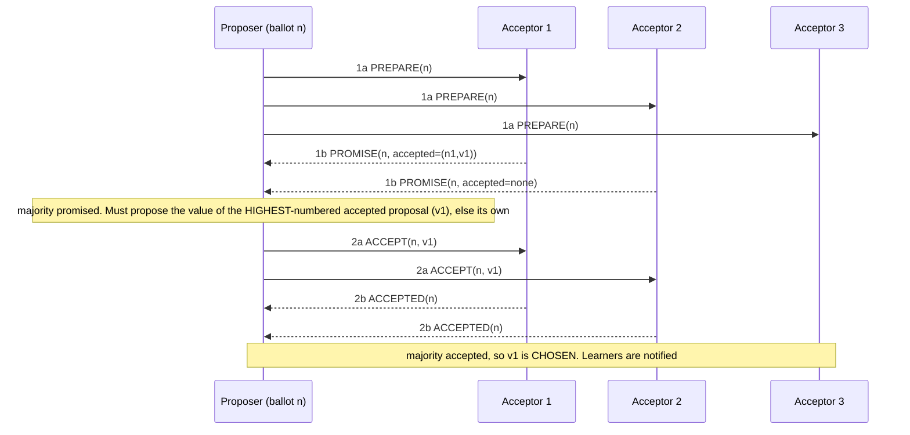
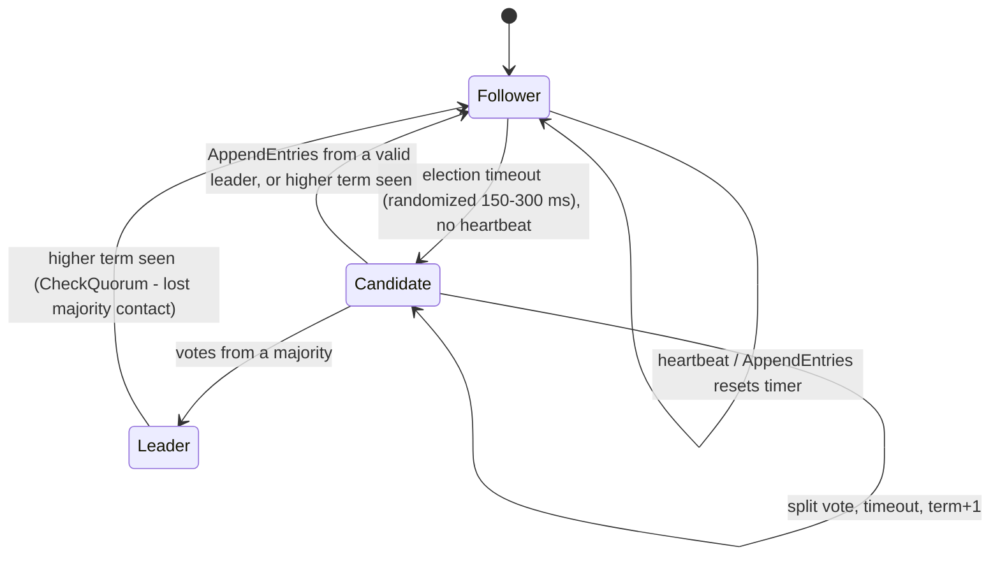

# Paxos, Multi-Paxos, Raft, Zab, and Dynamic Membership Changes

> **Folder 03 · File 01** of the Distributed Systems & System Design L7 Reference.
> **Prerequisites:**
> - [Folder 01 file 03](../01-First-Principles-Physics-and-L5-L6-L7-Rubric/03-cap-pacelc-linearizability-serializability-and-causal-consistency.md)
>   (linearizability);
> - [Folder 02 file 02](../02-Storage-Engines-Replication-and-Sharding-Internals/02-replication-single-leader-multi-leader-and-leaderless-sloppy-quorums.md)
>   (replication modes, failover).
>
> **Listing:** `raft_sim.py` is a compact Raft with:
> - an event-driven chaos simulator that checks Election Safety and State Machine Safety;
> - a scripted reproduction of the paper's **Figure 8** commit hazard;
> - election-timeout experiments.
>
> The output is deterministic.

---

## 0. What consensus is for

Consensus lets a set of machines agree on a sequence of values (a replicated log), so that each machine applies the
same commands in the same order. **State machine replication** (Lamport 1978; Schneider 1990) turns that log into a
fault-tolerant service.

Every strongly consistent system in this KB sits on it:
- leader election and locks (ZooKeeper, etcd, Chubby);
- replicated shards (Spanner Paxos groups, CockroachDB/TiKV Raft ranges);
- Kafka's metadata quorum (KRaft);
- configuration stores and the coordinator state of 2PC (file 03).

**Properties:**
- **Agreement:** no two correct nodes decide differently.
- **Validity:** a decided value was proposed.
- **Termination:** eventually decides, which can only be guaranteed under partial synchrony.

**Fundamental limits:**
- **FLP (Fischer, Lynch & Paterson, 1985).** In an asynchronous system, no deterministic protocol guarantees
  termination if even one process may crash. Practical protocols therefore keep **safety always** and get
  **liveness when the network is "eventually synchronous"** (Dwork, Lynch & Stockmeyer 1988). Timeouts and leaders
  give them progress.
- **Quorums.** Tolerating $f$ crash failures needs $n \ge 2f + 1$, so that any two majorities intersect. 3 nodes
  tolerate 1 failure, and 5 tolerate 2. Byzantine faults need $3f + 1$ (PBFT); they are out of scope for datacenter
  crash-fault systems.

---

## 1. Basic Paxos (Lamport, "The Part-Time Parliament" 1998; "Paxos Made Simple" 2001)



Acceptor rules:
- Promise never to accept ballots < n.
- Reply with the highest-ballot value already accepted.
- Accept (n, v) unless it has promised a higher ballot.

**Safety argument:** if a value v was chosen at ballot m, then every higher ballot's phase 1 hits a majority that
intersects the one that accepted v, sees v, and must re-propose v. Once chosen, a value can never change.

**Liveness failure:** two proposers alternately preempt each other's phase 1 ("dueling proposers"). Randomized backoff
or a distinguished leader fixes it in practice.

## 2. Multi-Paxos: amortize phase 1

- Elect a stable leader that runs phase 1 *once* for all future log slots.
- Each new command is then **one phase-2 round trip to a majority**, plus the acceptors' log fsync.
- With **leader leases** (bounded clock drift), the leader can serve reads locally (Folder 01 file 03 §7).
- Chubby, Spanner and Megastore run Multi-Paxos variants.
- "Paxos Made Live" (Chandra, Griesemer & Redstone, PODC 2007) is the canonical account of the gap between the paper
  and production: disk corruption, master leases, group membership, snapshots, testing.

---

## 3. Raft (Ongaro & Ousterhout, USENIX ATC 2014)

Raft is Multi-Paxos-equivalent in power, designed for understandability by decomposing the problem into leader
election, log replication and safety.

### 3.1 State machine of a node



### 3.2 The rules that carry the safety proof

| Rule | Statement | What breaks without it |
|---|---|---|
| **Terms** | Monotonic epochs; any message with a higher term makes the receiver a follower | Stale leaders keep acting |
| **One vote per term** | Persisted `votedFor` (fsync before replying) | Two leaders in one term |
| **Election restriction** | Vote only for a candidate whose log is at least as up-to-date: (lastTerm, lastIndex) compared lexicographically | A leader without committed entries |
| **Log matching** | AppendEntries carries (prevIndex, prevTerm); the follower rejects on mismatch and truncates conflicting suffixes | Divergent logs |
| **Commit rule** | A leader commits index N only if a majority store it **and log[N].term == currentTerm**; earlier entries commit indirectly | **Figure 8:** a committed entry gets overwritten |

### 3.3 Figure 8, executed (§B of the output)

The scripted scenario is the paper's:
- **(a)** S1, leader in term 2, writes (2,a) to S1 and S2 only.
- **(b)** S1 fails. S5 is elected for term 3 (votes S3, S4, S5) and writes (3,b) locally.
- **(c)** S5 fails. S1 returns and is elected for term 4, then replicates (2,a) to S3. (2,a) is now on a majority:
  S1, S2, S3.
- **(d)** S1 fails before any term-4 entry replicates. S5 is elected for term 5, since its last log term 3 beats S2's
  and S3's term 2, and overwrites index 2 with (3,b).

| Commit rule | In step (c), is (2,a) committed? | Outcome |
|---|---|---|
| Naive: count replicas of any entry | **Yes**, and S1, S2, S3 apply `a` at index 2 | S5 later commits `b` at index 2. **State machine safety violated** (two different commands applied at index 2) |
| **Raft: count only current-term entries** | No: (2,a) is from term 2 and S1 is in term 4 | `b` is committed; no node ever applied `a` |

Two lessons:

- **"Replicated on a majority" is not "committed".** An entry from an old term can be on a majority and still be
  overwritten, because a node that lacks it can still win an election. The election restriction protects only
  entries whose term is the latest a voter has seen.
- **The randomized chaos run (§A) did not find this bug in 60 seeds.** Both rules produced 0 violations across 19
  elections and 140 commits per run. The interleaving is rare. This is why serious consensus implementations are
  verified with:
  - model checking (TLA+ specs for Raft and Paxos; AWS's use of TLA+ for S3 and DynamoDB, Newcombe et al., CACM 2015);
  - deterministic simulation testing (FoundationDB);
  - Jepsen-style fault injection.

  "We ran chaos tests and saw no problems" is an L5 answer. An L7 asks what the *model checker* says.

### 3.4 Election timing: why the timeout is randomized (§C of the output)

| Election timeout | Failover after a leader crash: mean | p50 | p99 |
|---|---|---|---|
| 150–300 ms (paper) | 192 ms | 183 ms | **410 ms** |
| 150–155 ms (too narrow) | 963 ms | 755 ms | **4,420 ms** |

With a narrow range, followers time out together, split the vote, and retry together: livelock. Raft's randomization
makes one candidate usually start first.

The production rules:
- **The timeout must exceed (heartbeat interval + network p99.9 + pause p99.9).** A 200 ms GC pause on the leader
  triggers a needless election, and every election causes a write-unavailability window plus client retries.
- **Under a stop-the-world-GC runtime or noisy VMs**, use 1–5 s election timeouts. etcd's defaults are a 100 ms
  heartbeat and 1,000 ms election timeout (⚠ verify), tuned per network.
- **PreVote** (Ongaro's thesis §9.6): a candidate first asks "would you vote for me?" without incrementing its term.
  A partitioned node rejoining with a huge term no longer disrupts a healthy leader.
- **CheckQuorum:** a leader that hasn't heard from a majority within an election timeout steps down. This prevents a
  minority-side leader from serving stale lease reads.

### 3.5 Log compaction, snapshots and catch-up

- Logs grow forever unless the state machine is **snapshotted**. Entries up to the snapshot index are discarded.
- A follower too far behind receives **InstallSnapshot**.
- Snapshot size × network bandwidth is the catch-up time. It is also an outage risk: a 100 GB snapshot over a
  1 Gbps-throttled link takes ~14 minutes, during which the cluster runs with reduced redundancy.
- Multi-Raft systems use many small groups (CockroachDB ranges ≤ 512 MiB) to keep snapshots small. This is the same
  MTTR argument as Aurora's 10 GB segments.

---

## 4. Zab (ZooKeeper Atomic Broadcast; Junqueira, Reed & Serafini, DSN 2011)

- **Primary-backup with epochs.** A new leader goes through three phases:
  1. *discovery*: learn the latest epoch and the history from a quorum;
  2. *synchronization*: bring followers to the leader's history;
  3. *broadcast*: two-phase propose/ack/commit for each transaction (zxid = epoch‖counter).
- **Primary order:** all of a primary's broadcasts are delivered in order, and a new primary's broadcasts come after
  all of its predecessors' committed broadcasts. **FIFO client order** comes on top of that.
- **Reads are served locally** by whichever server a client is connected to. They are sequentially consistent, not
  linearizable. `sync()` before a read narrows the gap (Folder 01 file 03 §7).
- **Raft vs Zab vs Multi-Paxos** differ mostly in leader-change mechanics, not in steady-state cost. All three pay
  **one majority round trip plus fsync per commit**.

---

## 5. Membership changes: the subtle part

Changing the voter set naively (switch every node from C_old to C_new at once) can create **two disjoint majorities**
during the transition. For example, going from 3 to 5 nodes, {S1, S2} is a majority of C_old while {S3, S4, S5} is a
majority of C_new.

| Approach | How | Caveats |
|---|---|---|
| **Joint consensus** (Raft paper §6) | Commit C_old,new; during it, decisions need majorities of **both**; then commit C_new | Safe for arbitrary changes; more complex |
| **Single-server changes** (Ongaro thesis) | Add or remove one voter at a time; any two consecutive configurations' majorities overlap | A 2015 bug: a change could be lost across a leader change. The fix is that **a new leader must commit an entry in its own term before starting a membership change** |
| **Learners / non-voters** | New nodes catch up (snapshot + log) as non-voting members, then are promoted | Without this, adding an empty voter can stall commits if it counts toward quorum before catching up |
| **Flexible Paxos** (Howard, Malkhi & Spiegelman 2016) | Only phase-1 and phase-2 quorums must intersect: $|Q_1| + |Q_2| > n$ | Enables small replication quorums with large election quorums. Shows majority is sufficient, not necessary |

**Operational invariant:** never replace a majority at once. Replace one node at a time: add the learner, promote it,
remove the old node, and verify health between steps. "Rolling replace a 3-node etcd by deleting two pods" is the
classic self-inflicted quorum loss.

---

## 6. Performance: what consensus costs

| Quantity | Formula | Example |
|---|---|---|
| Commit latency | RTT(leader → f-th fastest follower) + fsync + leader processing | In-AZ 3 replicas: ~0.5 ms RTT + fsync (20–100 µs PLP or ms consumer). Cross-region 5: ~70 ms (Folder 01 file 03 §5.2) |
| Throughput ceiling (one group) | Leader NIC out ÷ (N−1) copies; or fsync rate × batch size | 10 Gbps leader, 5 replicas → 1.25 GB/s ÷ 4 ≈ 312 MB/s of log |
| Batching | Group commit: one fsync and one RPC per batch | Throughput ∝ batch; latency +1 batch interval |
| Pipelining | Send entry k+1 before k is acknowledged | Keeps the pipe full at high RTT (BDP again) |
| Scale-out | **Multi-Raft**: thousands of independent groups (one per range) | Spreads leaders across nodes. Requires leader balancing, heartbeat coalescing, and a transaction layer across groups |

**The leader is the bottleneck by construction.** At L7, the answer to "consensus doesn't scale" is:
1. **Shard into many groups** (Multi-Raft).
2. **Move bulk data off the consensus path.** Consensus orders small metadata; data goes to quorum-replicated or
   erasure-coded storage. Examples: Kafka KRaft for metadata only, Aurora's storage quorum avoiding consensus for
   I/Os, object stores with metadata in Paxos.
3. **Read from followers** with ReadIndex/lease or bounded staleness.
4. **Batch and pipeline.**

---

## 7. Other members of the family

| Protocol | Idea | When it matters |
|---|---|---|
| Viewstamped Replication (Oki & Liskov 1988; revisited 2012) | Primary-backup with view changes. The first practical consensus | Historical; equivalent to Raft |
| **EPaxos** (Moraru et al., SOSP 2013) | Leaderless; commuting commands commit in one round trip from any replica | Geo-distributed, low-conflict workloads; much harder to implement correctly |
| Fast Paxos / Generalized Paxos | Skip the leader hop when there is no contention | Conflicts cost extra rounds |
| Mencius | Rotating leadership per slot | Balances WAN leaders |
| **Raft in production** | etcd/raft (Kubernetes), hashicorp/raft (Consul, Nomad), TiKV raft-rs, CockroachDB, Kafka KRaft, MongoDB's replication protocol (Raft-inspired) | Read the implementation's handling of PreVote, CheckQuorum, leases and snapshots |
| **Accord** (Cassandra CEP-15) | Leaderless, timestamp-based general transactions | ⚠ verify the release status |

---

## 8. The listing

```python
"""raft_sim.py - a compact Raft (Ongaro & Ousterhout 2014) with a chaos simulator and the Figure 8 hazard.

  A. Randomized chaos: 5 nodes, message delay/loss, partitions and crash-restarts; checks Election Safety (<= 1
     leader per term) and State Machine Safety (every node applies the same command at each index).
  B. Figure 8, scripted: a leader that commits an entry from an OLDER term by counting replicas lets a later leader
     overwrite a committed entry. Raft's rule (only count replicas for current-term entries) prevents it.
  C. Election timing: time to elect a new leader after a leader crash, wide vs narrow randomized timeouts
     (split votes).
Standard library only; seeded, deterministic.
"""
import heapq
import random

APPLIED: dict = {}          # index -> (term, cmd) first applied anywhere; any disagreement is a safety violation
VIOLATIONS: list = []


class Node:
    def __init__(self, nid: int, n: int, safe_commit: bool = True):
        self.id, self.n, self.safe = nid, n, safe_commit
        self.term, self.voted_for = 0, None
        self.log = [(0, None)]                              # 1-based log with a sentinel at index 0
        self.commit = self.applied = 0
        self.role, self.votes = "follower", set()
        self.next_idx: dict = {}
        self.match: dict = {}

    # ------------------------------------------------------------ helpers
    def last(self) -> tuple[int, int]:
        return len(self.log) - 1, self.log[-1][0]

    def _step_down(self, term: int) -> None:
        if term > self.term:
            self.term, self.voted_for = term, None
        self.role = "follower"

    # ------------------------------------------------------------ RequestVote
    def start_election(self) -> tuple:
        self.term += 1
        self.role, self.voted_for, self.votes = "candidate", self.id, {self.id}
        li, lt = self.last()
        return self.term, self.id, li, lt

    def handle_request_vote(self, term: int, cand: int, li: int, lt: int) -> tuple[int, bool]:
        if term > self.term:
            self._step_down(term)
        my_li, my_lt = self.last()
        up_to_date = lt > my_lt or (lt == my_lt and li >= my_li)       # election restriction
        grant = term == self.term and self.voted_for in (None, cand) and up_to_date
        if grant:
            self.voted_for = cand
        return self.term, grant

    def on_vote_reply(self, voter: int, term: int, granted: bool) -> bool:
        if term > self.term:
            self._step_down(term)
            return False
        if self.role == "candidate" and term == self.term and granted:
            self.votes.add(voter)
            if len(self.votes) * 2 > self.n:
                self.role = "leader"
                self.next_idx = {p: len(self.log) for p in range(self.n) if p != self.id}
                self.match = {p: 0 for p in range(self.n) if p != self.id}
                return True
        return False

    # ------------------------------------------------------------ AppendEntries
    def make_append(self, peer: int) -> tuple:
        ni = self.next_idx[peer]
        return self.term, self.id, ni - 1, self.log[ni - 1][0], self.log[ni:], self.commit

    def handle_append(self, term, leader, prev_i, prev_t, entries, lcommit) -> tuple[int, bool, int]:
        if term < self.term:
            return self.term, False, 0
        self._step_down(term)
        if prev_i >= len(self.log) or self.log[prev_i][0] != prev_t:
            return self.term, False, 0                                   # log matching check failed
        i = prev_i + 1
        for e in entries:
            if i < len(self.log) and self.log[i][0] != e[0]:
                del self.log[i:]                                         # conflicting suffix is discarded
            if i >= len(self.log):
                self.log.append(e)
            i += 1
        match = prev_i + len(entries)
        if lcommit > self.commit:
            self.commit = min(lcommit, match)
            self.apply()
        return self.term, True, match

    def on_append_reply(self, peer: int, term: int, ok: bool, match: int) -> None:
        if term > self.term:
            self._step_down(term)
            return
        if self.role != "leader" or term != self.term:
            return
        if ok:
            self.match[peer] = max(self.match[peer], match)
            self.next_idx[peer] = self.match[peer] + 1
            self.advance_commit()
        else:
            self.next_idx[peer] = max(1, self.next_idx[peer] - 1)

    def advance_commit(self) -> None:
        for idx in range(len(self.log) - 1, self.commit, -1):
            replicas = 1 + sum(1 for m in self.match.values() if m >= idx)
            if replicas * 2 > self.n and (not self.safe or self.log[idx][0] == self.term):
                self.commit = idx                                        # the Figure 8 rule is the term check
                self.apply()
                break

    def apply(self) -> None:
        while self.applied < self.commit:
            self.applied += 1
            entry = self.log[self.applied]
            first = APPLIED.setdefault(self.applied, entry)
            if first != entry:
                VIOLATIONS.append((self.applied, first, entry, self.id))


# ---------------------------------------------------------------- A/C: event-driven chaos simulator
class Sim:
    def __init__(self, n: int, seed: int, timeout: tuple, safe: bool, chaos: bool):
        self.rng = random.Random(seed)
        self.nodes = [Node(i, n, safe) for i in range(n)]
        self.up = [True] * n
        self.epoch = [0] * n
        self.timeout, self.chaos = timeout, chaos
        self.q: list = []
        self.seq = 0
        self.now = 0.0
        self.groups = [set(range(n))]
        self.leaders: dict = {}
        self.elections = 0
        for i in range(n):
            self._arm(i)

    def at(self, t: float, fn) -> None:
        heapq.heappush(self.q, (t, self.seq, fn))
        self.seq += 1

    def reachable(self, a: int, b: int) -> bool:
        return any(a in g and b in g for g in self.groups)

    def send(self, a: int, b: int, fn) -> None:
        if self.reachable(a, b) and self.rng.random() > (0.01 if self.chaos else 0.0):
            self.at(self.now + self.rng.uniform(1, 10), lambda: self.up[b] and self.up[a] and fn())

    def _arm(self, i: int) -> None:
        self.epoch[i] += 1
        e = self.epoch[i]
        self.at(self.now + self.rng.uniform(*self.timeout), lambda: self._timeout(i, e))

    def _timeout(self, i: int, e: int) -> None:
        if not self.up[i] or e != self.epoch[i] or self.nodes[i].role == "leader":
            return
        self.elections += 1
        args = self.nodes[i].start_election()
        for p in range(len(self.nodes)):
            if p != i:
                self.send(i, p, lambda p=p: self._vote(i, p, args))
        self._arm(i)

    def _vote(self, cand: int, voter: int, args: tuple) -> None:
        term, granted = self.nodes[voter].handle_request_vote(*args)
        if granted:
            self._arm(voter)
        self.send(voter, cand, lambda: self._vote_reply(cand, voter, term, granted))

    def _vote_reply(self, cand: int, voter: int, term: int, granted: bool) -> None:
        if self.nodes[cand].on_vote_reply(voter, term, granted):
            t = self.nodes[cand].term
            if self.leaders.setdefault(t, cand) != cand:
                VIOLATIONS.append(("two leaders", t))
            self.on_leader(cand)
            self._heartbeat(cand, self.nodes[cand].term)

    def on_leader(self, i: int) -> None:
        pass

    def _heartbeat(self, i: int, term: int) -> None:
        node = self.nodes[i]
        if not self.up[i] or node.role != "leader" or node.term != term:
            return
        for p in range(len(self.nodes)):
            if p != i:
                args = node.make_append(p)
                self.send(i, p, lambda p=p, args=args: self._append(i, p, args))
        self.at(self.now + 50, lambda: self._heartbeat(i, term))

    def _append(self, leader: int, p: int, args: tuple) -> None:
        reply = self.nodes[p].handle_append(*args)
        if reply[1] or reply[0] == args[0]:
            self._arm(p)                                         # heard from the current leader
        self.send(p, leader, lambda: self.nodes[leader].on_append_reply(p, *reply))

    def _client(self) -> None:
        for i, node in enumerate(self.nodes):
            if self.up[i] and node.role == "leader":
                node.log.append((node.term, f"c{self.seq}"))
        self.at(self.now + 20, self._client)

    def _chaos(self) -> None:
        r, n = self.rng, len(self.nodes)
        if r.random() < 0.5:
            self.groups = [set(range(n))]
        else:
            ids = list(range(n))
            r.shuffle(ids)
            cut = r.randint(1, n - 1)
            self.groups = [set(ids[:cut]), set(ids[cut:])]
        victim = r.randrange(n)
        if self.up[victim] and r.random() < 0.3:
            self.crash(victim)
            self.at(self.now + r.uniform(100, 600), lambda: self.restart(victim))
        self.at(self.now + r.uniform(200, 500), self._chaos)

    def crash(self, i: int) -> None:
        self.up[i] = False
        self.epoch[i] += 1

    def restart(self, i: int) -> None:
        node = self.nodes[i]                                     # term, vote and log are persistent
        node.role, node.commit, node.applied = "follower", 0, 0
        self.up[i] = True
        self._arm(i)

    def run(self, until: float) -> None:
        self.at(0, self._client)
        if self.chaos:
            self.at(300, self._chaos)
        while self.q and self.q[0][0] <= until:
            self.now, _, fn = heapq.heappop(self.q)
            fn()


def chaos_runs(seeds: int, safe: bool) -> dict:
    total_viol = runs_with_viol = elections = committed = 0
    for s in range(seeds):
        APPLIED.clear()
        VIOLATIONS.clear()
        sim = Sim(5, s, (150, 300), safe, True)
        sim.run(5000)
        total_viol += len(VIOLATIONS)
        runs_with_viol += bool(VIOLATIONS)
        elections += sim.elections
        committed += max(n.commit for n in sim.nodes)
    return {"violations": total_viol, "runs_with_violations": runs_with_viol,
            "elections_per_run": elections / seeds, "commits_per_run": committed / seeds}


def failover_time(timeout: tuple, trials: int, cap_ms: float = 5000) -> dict:
    """Healthy 5-node cluster: wait for a leader, crash it, measure ms until a new leader is elected.
    Elections that do not converge within cap_ms (repeated split votes) are counted as censored at cap_ms."""
    times, stuck = [], 0
    for s in range(trials):
        APPLIED.clear()
        sim = Sim(5, 10_000 + s, timeout, True, False)
        elected: list = []
        sim.on_leader = lambda i: elected.append(sim.now)
        sim.at(0, sim._client)
        while sim.q and not elected and sim.now < cap_ms:
            sim.now, _, fn = heapq.heappop(sim.q)
            fn()
        if not elected:
            stuck += 1
            times.append(cap_ms)
            continue
        leader = next(i for i, nd in enumerate(sim.nodes) if nd.role == "leader")
        crash_at = sim.now
        sim.crash(leader)
        elected.clear()
        while sim.q and not elected and sim.now - crash_at < cap_ms:
            sim.now, _, fn = heapq.heappop(sim.q)
            fn()
        if not elected:
            stuck += 1
        times.append(elected[0] - crash_at if elected else cap_ms)
    times.sort()
    return {"mean": sum(times) / len(times), "p50": times[len(times) // 2], "p99": times[int(len(times) * 0.99)],
            "stuck": stuck / trials}


# ---------------------------------------------------------------- B: Figure 8, scripted
def figure8(safe: bool) -> dict:
    APPLIED.clear()
    VIOLATIONS.clear()
    s = [Node(i, 5, safe) for i in range(5)]                 # S1..S5 = s[0]..s[4]
    for node in s:
        node.log.append((1, "x"))
        node.term = 1
    s[0].commit = 1

    def elect(c: int, voters: list, term: int) -> None:
        s[c].term = max(s[c].term, term - 1)                 # earlier timeouts already advanced its term
        args = s[c].start_election()
        for v in voters:
            s[c].on_vote_reply(v, *s[v].handle_request_vote(*args))
        assert s[c].role == "leader", (c, s[c].term)

    def replicate(leader: int, peers: list) -> None:
        for p in peers:
            for _ in range(len(s[leader].log)):                  # retry until logs match
                reply = s[p].handle_append(*s[leader].make_append(p))
                s[leader].on_append_reply(p, *reply)
                if reply[1]:
                    break
    trace = []
    elect(0, [1, 2], 2)                                       # (a) S1 leader term 2, entry (2,a) only on S2
    s[0].log.append((2, "a"))
    replicate(0, [1])
    trace.append("a: S1 leader t2 writes (2,a) to S1,S2")
    elect(4, [2, 3], 3)                                       # (b) S1 down; S5 leader term 3, writes (3,b) locally
    s[4].log.append((3, "b"))
    trace.append("b: S5 leader t3 writes (3,b) locally")
    s[0].role = "follower"                                    # (c) S5 down; S1 back, leader term 4
    elect(0, [1, 2], 4)
    replicate(0, [1, 2])                                      # (2,a) now on S1,S2,S3 = a majority
    committed_a = s[0].commit >= 2
    replicate(0, [1, 2])                                      # propagate commit index to followers
    trace.append(f"c: S1 leader t4 replicates (2,a) to a majority -> commits index 2: {committed_a}")
    s[0].role = "follower"                                    # (d) S1 down before any term-4 entry replicates
    s[4].role = "follower"
    elect(4, [1, 2, 3], 5)                                    # S5 wins: its last log term 3 > 2
    s[4].log.append((s[4].term, "c"))
    replicate(4, [1, 2, 3])
    replicate(4, [1, 2, 3])
    trace.append(f"d: S5 leader t{s[4].term} overwrites index 2 with (3,b) and commits; index 2 on S2 = "
                 f"{s[1].log[2]}")
    return {"committed_old_term_entry": committed_a, "violations": list(VIOLATIONS), "trace": trace}


def main() -> None:
    print("== B. Figure 8 (scripted)")
    for safe in (False, True):
        r = figure8(safe)
        label = "Raft rule (count only current-term entries)" if safe else "naive rule (count any entry)"
        print(f"  {label}:")
        for line in r["trace"]:
            print(f"    {line}")
        print(f"    state-machine-safety violations: {r['violations'] or 'none'}")
    naive, safe = figure8(False), figure8(True)

    print("\n== A. chaos: 5 nodes, 5 s each, 1% loss, partitions every 200-500 ms, crash-restarts (60 seeds)")
    ok = chaos_runs(60, True)
    bad = chaos_runs(60, False)
    for label, r in (("Raft rule", ok), ("naive rule", bad)):
        print(f"  {label:<10}: violations {r['violations']:>3} in {r['runs_with_violations']:>2} runs; "
              f"{r['elections_per_run']:.1f} elections/run; {r['commits_per_run']:.0f} entries committed/run")

    print("\n== C. leader failover time after a crash (healthy network, 1-10 ms delays, 150 trials)")
    ft = {}
    for label, to in (("timeout 150-300 ms (Raft paper)", (150, 300)), ("timeout 150-155 ms (too narrow)", (150, 155))):
        ft[label] = failover_time(to, 150)
        r = ft[label]
        print(f"  {label:<34} mean {r['mean']:7.1f} ms  p50 {r['p50']:7.1f} ms  p99 {r['p99']:7.1f} ms  "
              f"no leader within 5 s: {r['stuck'] * 100:4.1f}%")

    assert naive["committed_old_term_entry"] and naive["violations"]
    assert not safe["committed_old_term_entry"] and not safe["violations"]
    assert ok["violations"] == 0 and ok["commits_per_run"] > 50
    wide, narrow = ft["timeout 150-300 ms (Raft paper)"], ft["timeout 150-155 ms (too narrow)"]
    assert wide["stuck"] == 0 and narrow["p99"] > 3 * wide["p99"] and narrow["mean"] > 3 * wide["mean"]
    print("\nself-test: all assertions passed")


if __name__ == "__main__":
    main()
```

Output (verified; deterministic):

```text
== B. Figure 8 (scripted)
  naive rule (count any entry):
    a: S1 leader t2 writes (2,a) to S1,S2
    b: S5 leader t3 writes (3,b) locally
    c: S1 leader t4 replicates (2,a) to a majority -> commits index 2: True
    d: S5 leader t5 overwrites index 2 with (3,b) and commits; index 2 on S2 = (3, 'b')
    state-machine-safety violations: [(2, (2, 'a'), (3, 'b'), 4), (2, (2, 'a'), (3, 'b'), 3)]
  Raft rule (count only current-term entries):
    a: S1 leader t2 writes (2,a) to S1,S2
    b: S5 leader t3 writes (3,b) locally
    c: S1 leader t4 replicates (2,a) to a majority -> commits index 2: False
    d: S5 leader t5 overwrites index 2 with (3,b) and commits; index 2 on S2 = (3, 'b')
    state-machine-safety violations: none

== A. chaos: 5 nodes, 5 s each, 1% loss, partitions every 200-500 ms, crash-restarts (60 seeds)
  Raft rule : violations   0 in  0 runs; 19.2 elections/run; 140 entries committed/run
  naive rule: violations   0 in  0 runs; 19.2 elections/run; 140 entries committed/run

== C. leader failover time after a crash (healthy network, 1-10 ms delays, 150 trials)
  timeout 150-300 ms (Raft paper)    mean   191.7 ms  p50   183.2 ms  p99   410.4 ms  no leader within 5 s:  0.0%
  timeout 150-155 ms (too narrow)    mean   963.3 ms  p50   755.5 ms  p99  4420.2 ms  no leader within 5 s:  0.0%

self-test: all assertions passed
```

---

## 9. Failure modes of consensus systems in production

| Failure | Symptom | Defense |
|---|---|---|
| fsync stalls on the leader's disk | Commit latency spikes; no election (heartbeats fine) | Per-node latency SLIs; transfer leadership away from slow disks automatically |
| GC or VM pauses longer than the election timeout | Election storms, write unavailability | Timeouts above pause p99.9; PreVote; low-pause runtimes |
| Asymmetric partitions | A node can send but not receive, disrupting elections | PreVote + CheckQuorum; bidirectional health checks |
| Disk full / WAL corruption | Node crash-loops; quorum at risk | Checksummed logs, reserved space, alerts at 70%; replace the node rather than repair it |
| Losing quorum (2 of 3 dead) | Total write outage; cannot safely elect | Disaster recovery = **unsafe** forced reconfiguration from a survivor. Rehearse it, and accept that it may lose committed writes |
| Too many groups per node (Multi-Raft) | Heartbeat CPU, timer storms | Coalesced heartbeats, quiescing idle ranges |
| Clock-based lease misuse | Stale reads after a pause | Check the lease with a monotonic clock *after* the pause point; fall back to ReadIndex |

---

## 10. L5 vs L6 vs L7

| Topic | L5 (Senior) | L6 (Staff) | L7 (Principal) |
|---|---|---|---|
| Understanding | "Raft elects a leader and replicates a log" | Terms, the election restriction, log matching, majority commit; PreVote/CheckQuorum | Explains Figure 8 and why majority-replicated ≠ committed; FLP and the safety/liveness split; quorum intersection as the core invariant |
| Operations | "Use 3 or 5 nodes" | Timeout tuning vs pauses; snapshots; learners for adding nodes | Membership change safety (joint vs single-server, the commit-in-term fix); quorum-loss DR runbooks; leadership transfer off slow disks |
| Performance | "Consensus is slow" | Batching and pipelining; leader bottleneck | Multi-Raft sharding; data off the consensus path; follower/lease reads; commit latency from the RTT matrix |
| Correctness | "We tested it" | Jepsen-style fault injection | TLA+ models and deterministic simulation; knows random chaos misses rare interleavings (it found 0 of the Figure 8 bug here) |

---

## 11. Bar-raiser probing chains

### Chain A: "Why not just use 2 replicas for consensus?"

1. **L5:** "Two copies are enough for durability."
2. **Probe:** "One dies; can you still commit?" **L6:** "No. A majority of 2 is 2. And with 2 you can't tell a dead
   peer from a partition. That's why odd sizes: 3 tolerates 1, 5 tolerates 2."
3. **Probe:** "We can only afford 2 full replicas per region." **L7:**
   - "Add a cheap **witness/arbiter** (a log-only or vote-only member) as the third voter. Or use Flexible-Paxos-style
     quorums, where the data quorum is 2 and the election quorum includes a third lightweight voter in another AZ."
   - "Durability stays 2 copies; availability gets the 2f+1 property."
   - Prices the witness's cost against the alternative of manual failover.

### Chain B: "Our etcd cluster had a 30-second write outage during a deploy."

1. **L5:** "A node restarted."
2. **Probe:** "Only one of five restarted." **L6:** "Probably leader churn: the restarted node rejoined with a higher
   term and disrupted the leader, or the deploy restarted the leader and a GC pause stretched the election."
3. **Probe:** "Fix it for good." **L7:**
   - Enable PreVote and CheckQuorum.
   - Before restarting the leader, transfer leadership to a healthy follower.
   - Restart one member at a time and gate on health.
   - Set election timeouts from measured pause p99.9 and keep the data dir on a PLP SSD.
   - Make every client retry idempotently with backoff, so a 2 s election doesn't become a retry storm.

### Chain C: "Design a replicated log that handles 5 GB/s."

1. **L5:** "Use Raft with a big leader."
2. **Probe:** "The leader's NIC is 25 Gbps." **L6:** "With RF=3 the leader sends 2 copies, so ~1.5 GB/s max per group.
   Partition into ≥ 4 groups, ordered per partition."
3. **Probe:** "Ordering must be total across the whole log." **L7:**
   - "Then don't push bytes through consensus. Sequence *metadata* through a consensus-backed sequencer, writing
     (offset ranges → storage locations), and write the data to quorum-replicated storage in parallel, chain-replicated
     or erasure-coded."
   - This is the Corfu/Delos/Kafka-tiered/LogDevice family of designs.
   - "Total order costs one sequencer round trip per batch, not per byte."

---

## 12. Invariants checklist

- [ ] n = 2f + 1 voters, placed in distinct failure domains; witness voters when only 2 data copies are affordable.
- [ ] Election timeouts > heartbeat + network p99.9 + pause p99.9; PreVote and CheckQuorum on.
- [ ] Commit only by current-term counting (verify your library does); persisted term/vote/log, fsynced before replies.
- [ ] Membership changes one voter at a time (or joint consensus), via learners; never replace a majority.
- [ ] Snapshot size and catch-up time bounded; groups small enough for fast recovery.
- [ ] Throughput plan: batching, pipelining, Multi-Raft, or data off the consensus path.
- [ ] Correctness validated by model checking / deterministic simulation, not only random chaos.
- [ ] Quorum-loss disaster recovery documented and rehearsed, including its data-loss risk.

---

## 13. References

- L. Lamport:
  - *Time, Clocks, and the Ordering of Events in a Distributed System.* CACM 1978.
  - *The Part-Time Parliament.* TOCS 16(2), 1998.
  - *Paxos Made Simple*, 2001.
- F. Schneider. *Implementing Fault-Tolerant Services Using the State Machine Approach: A Tutorial.* ACM CSUR 22(4),
  1990.
- M. Fischer, N. Lynch, M. Paterson. *Impossibility of Distributed Consensus with One Faulty Process.* JACM 32(2),
  1985.
- C. Dwork, N. Lynch, L. Stockmeyer. *Consensus in the Presence of Partial Synchrony.* JACM 35(2), 1988.
- T. Chandra, R. Griesemer, J. Redstone. *Paxos Made Live: An Engineering Perspective.* PODC 2007.
- M. Burrows. *The Chubby Lock Service for Loosely-Coupled Distributed Systems.* OSDI 2006.
- D. Ongaro, J. Ousterhout. *In Search of an Understandable Consensus Algorithm.* USENIX ATC 2014. D. Ongaro,
  *Consensus: Bridging Theory and Practice*, PhD thesis, Stanford 2014 (PreVote, single-server changes).
- F. Junqueira, B. Reed, M. Serafini. *Zab: High-performance Broadcast for Primary-Backup Systems.* DSN 2011.
- B. Oki, B. Liskov. *Viewstamped Replication.* PODC 1988. B. Liskov, J. Cowling, *Viewstamped Replication
  Revisited*, MIT TR 2012.
- I. Moraru, D. Andersen, M. Kaminsky. *There Is More Consensus in Egalitarian Parliaments (EPaxos).* SOSP 2013.
- H. Howard, D. Malkhi, A. Spiegelman. *Flexible Paxos: Quorum Intersection Revisited.* OPODIS 2016.
- C. Newcombe et al. *How Amazon Web Services Uses Formal Methods.* CACM 58(4), 2015.
- M. Balakrishnan et al. *CORFU: A Shared Log Design for Flash Clusters.* NSDI 2012. *Virtual Consensus in Delos.*
  OSDI 2020.
- etcd documentation: tuning, learners. Raft website: raft.github.io (TLA+ spec, implementations).
