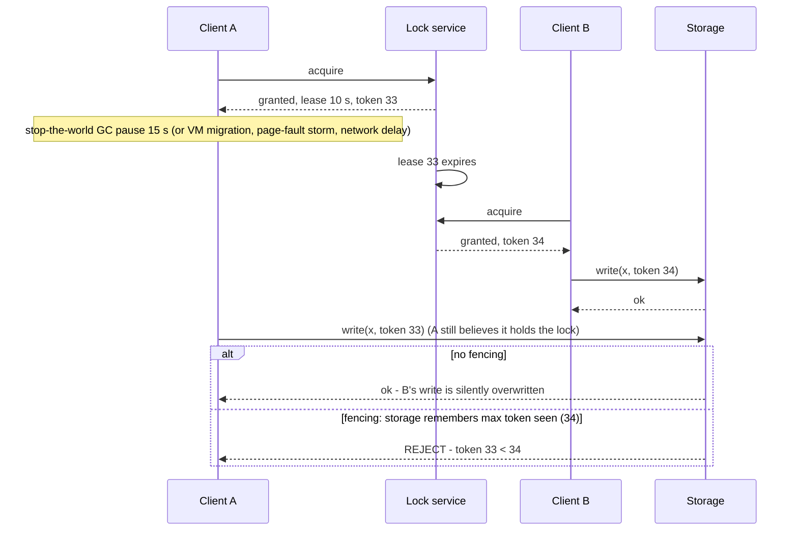
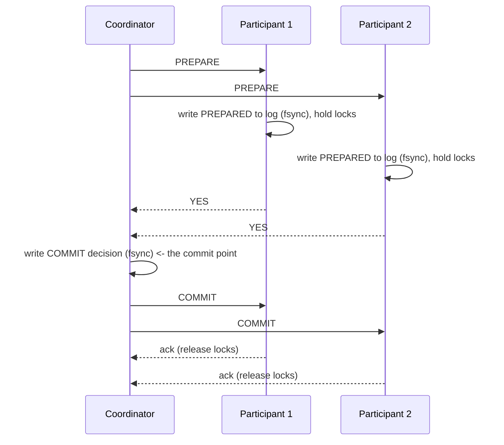

# Distributed Locking, Fencing Tokens, 2PC, Percolator, and Sagas

> **Folder 03 · File 03** of the Distributed Systems & System Design L7 Reference.
> **Prerequisites:** [file 01](01-paxos-multi-paxos-raft-zab-and-dynamic-membership-changes.md) (consensus),
> [file 02](02-time-clocks-ntp-skew-lamport-vector-clocks-and-hlc.md) (clocks, leases).
> **Listing:** `coordination_lab.py` covers:
> - lease locks with and without fencing, under GC pauses and clock jumps;
> - 2PC lock-hold times with coordinator failure;
> - Percolator transactions with client crashes;
> - a saga with ambiguous timeouts and compensations.
>
> The output is deterministic.

---

## 0. Two reasons to coordinate, and why the distinction matters

Martin Kleppmann's framing (*How to do distributed locking*, 2016) is the one to use in an interview:

- **Efficiency locks** prevent *duplicate work*, such as two workers sending the same email digest. If the lock
  occasionally fails, you waste some work. A single Redis instance with `SET key val NX PX ttl` is fine.
- **Correctness locks** prevent *corruption*, such as two writers updating the same file or account. If the lock
  ever fails, data is wrong. That needs a lock service built on **consensus**, *plus* **fencing at the resource**.
  No lock alone is enough.

Most lock designs in interviews fail because they are efficiency locks being used for correctness.

---

## 1. Why a lease alone cannot guarantee mutual exclusion



A process cannot reliably know it still holds a lease, because a pause can occur *between* its check and its action.
No amount of lease-checking code fixes this.

The lab (§A, 20,000 grants, TTL 10 s, 2% of holders pausing 5–40 s):

| Configuration | Deposed holders' writes that reached storage after a newer holder's | Writes applied over newer data |
|---|---|---|
| Lease only | 327 | **327** |
| Lease only, plus 1% lock-server clock jumps of 9.5 s | 384 | **384** |
| **Lease + fencing token** | 384 | **0** |

**Fencing doesn't stop late writes from *arriving*. It stops them from being *applied*.** That is the only place the
guarantee can be enforced. The requirements:
- the lock service issues **monotonically increasing tokens**: ZooKeeper's zxid or znode version, etcd's revision,
  Chubby's sequencer;
- **the resource checks them**.

If the resource cannot check tokens (a third-party API, a legacy database), use the resource's own conditional write
(compare-and-set on a version column) or an idempotency key. Then the lock is only an efficiency hint.

### 1.1 The Redlock debate in one paragraph

**Redlock** (antirez) acquires a lock on a majority of N independent Redis masters, with timing checks.

Kleppmann's critique:
1. It generates **no fencing token**, so pauses break it exactly as above.
2. It **depends on bounded clock drift and network delay** for safety. A clock jump on a Redis node, or a long delay,
   lets two clients hold the "lock".

antirez's response argued that the timing assumptions are reasonable in practice and that the client can check
elapsed time.

The engineering consensus that followed: **use Redlock, or plain Redis locks, only for efficiency**. For correctness,
use a consensus-backed service with fencing, or design the operation to be safe without a lock: idempotency plus CAS.

### 1.2 Lock-service recipes

| Service | Acquire | Fencing token | Liveness |
|---|---|---|---|
| ZooKeeper | Create an ephemeral *sequential* znode; the lowest sequence holds the lock; each waiter watches its predecessor (no herd) | zxid / sequence number | Session timeout releases the ephemeral node |
| etcd | `Lock` API or a txn on a key attached to a lease | **Key revision** (`mod_revision`) | Lease keep-alive; expiry deletes the key |
| Chubby | Lock file in Chubby; sequencer = (lock name, mode, generation) | Sequencer, checked by servers | Session leases with grace periods |
| DynamoDB / SQL | Conditional put of `{owner, expires, version}` | `version` column | Expiry + takeover by CAS |

---

## 2. Two-phase commit (2PC)

### 2.1 The protocol and its cost



The cost is **2 round trips + 3 forced log writes** on the critical path. Optimizations:
- **presumed abort/commit:** skip some logging and acks;
- **read-only participant elision;**
- **one-phase commit** when only one participant wrote.

### 2.2 The blocking problem

A participant that voted YES is **in doubt**. It may neither commit nor abort on its own, because the coordinator
might have decided either way. If the coordinator dies after collecting the votes, participants **hold their locks
until it recovers**.

From §B of the output (1M transactions, coordinator dies after PREPARE in 0.1% of them):

| Coordinator design | p50 lock hold | p99.99 | Max | Transactions blocked waiting on the coordinator |
|---|---|---|---|---|
| Single coordinator (wait for restart, median ~55 s) | 8 ms | **192 s** | **1,586 s** | 1,002 |
| Cooperative termination (ask peers) | 8 ms | 123 s | 961 s | 458 (resolved only when some peer saw the decision) |
| **Coordinator state replicated in Paxos/Raft** | 8 ms | **2.8 s** | **3.0 s** | 0 |

The tail is the problem. One in a thousand transactions holding row locks for minutes means:
- every other transaction touching those rows queues behind it;
- connection pools fill (Little's law);
- the service degrades far beyond the 0.1%.

**The fix is to make the coordinator a replicated state machine.**
- **Spanner** runs 2PC over Paxos groups. The coordinator *is* a Paxos group, so a new leader knows the decision.
- **Paxos Commit** (Gray & Lamport 2006) replaces the single coordinator log with consensus per participant.

**Three-phase commit** is non-blocking only under synchronous assumptions (bounded delays, no partitions). It is
not used in practice.

### 2.3 XA and the outbox alternative

- XA (2PC across heterogeneous resources, e.g. a database plus a message broker) inherits the blocking problem, with
  much poorer operational tooling. In-doubt XA transactions after a crash are a classic DBA nightmare.
- The modern replacement is the **transactional outbox**:
  1. Write the business row and an `outbox` row in **one local transaction**.
  2. A relay (CDC or poller) publishes outbox rows to the broker *at least once*.
  3. Consumers are **idempotent**.
- That gives "exactly-once *effects*" without distributed transactions, and it is the default answer for
  "update the DB and publish an event".

---

## 3. Percolator (Peng & Dabek, OSDI 2010)

Percolator is snapshot-isolation transactions over Bigtable, which has only single-row atomicity. It powers Google's
incremental indexing, and TiDB/TiKV implement it.

```
 per key, three columns:   data@start_ts = value      lock@start_ts = {primary key, TTL}      write@commit_ts = start_ts
 BEGIN:      start_ts ← TSO
 PREWRITE:   for primary first, then secondaries:
               abort if write@[start_ts, ∞) exists (write-write conflict) or any lock exists
               put data@start_ts and lock@start_ts → (primary)
 COMMIT:     commit_ts ← TSO
             on PRIMARY: check our lock still there → put write@commit_ts=start_ts, erase lock   ◄── COMMIT POINT
             on secondaries: put write@commit_ts, erase lock   (may happen later / never if the client dies)
 READ at ts: if a lock with start_ts ≤ ts: RESOLVE via its primary:
               primary has write record for that start_ts → ROLL FORWARD the secondary
               primary still locked & TTL alive            → wait / back off
               primary lock gone/expired, never committed  → ROLL BACK (erase lock + data)
             then return data written by the latest write@commit_ts ≤ ts
```

**The key idea:** the transaction's fate lives in **one row**, the primary. Bigtable's single-row atomicity makes the
commit point atomic, and any reader can complete or abort an abandoned transaction by looking at it. No coordinator
needs to survive.

§C of the output ran 2,000 rounds of 3 overlapping transfers over 10 accounts, with clients crashing before the
primary commit in 5% of transactions and after it in another 5%:

| Outcome | Count |
|---|---|
| Committed (clean) | 3,227 |
| Committed, client crashed before finishing secondaries | 181, all **rolled forward** by later readers |
| Crashed before the primary commit | 184, rolled back once their lock TTL expired (300 lock rollbacks in total, including primaries) |
| Aborted on write-write conflict | 1,498 (overlapping transfers on shared accounts) |
| Reads that found an unexpired lock (back-off) | 910 |
| **Snapshot reads with a wrong total** | **0 of 1,210** |
| Final total / locks left | 1,000 / 0 |

The costs and their production mitigations:

| Cost | Mitigation |
|---|---|
| Every transaction pays two TSO round trips | TiKV batches TSO requests |
| Prewrite and commit are separate rounds | **Async commit** lets the commit point be "all prewrites succeeded" (with a min-commit-ts), and **1PC** for single-region transactions (⚠ verify the TiKV versions) |
| Readers can block on locks | Lock TTLs + resolution |
| A conflict-heavy workload aborts a lot (1,498 of ~5,100 here) | Pessimistic locking mode for hot rows (TiDB's default is pessimistic) |

---

## 4. Sagas (Garcia-Molina & Salem 1987)

A **saga** is a long-lived business transaction split into local transactions $T_1 … T_n$, each with a
**compensating transaction** $C_i$ that semantically undoes it. If $T_k$ fails, run $C_{k-1} … C_1$. There are no
distributed locks.

```
 order saga (orchestrated):
   T1 reserve inventory ──► T2 charge card ──► T3 create shipment ──► DONE
        ▲ C1 release            ▲ C2 refund           (pivot: after T3, only forward recovery)
        └──── on failure of T2/T3, compensate in reverse ─────┘
 orchestration: a durable orchestrator (Temporal / Step Functions / state table) drives steps and retries
 choreography:  services react to each other's events (simpler to start; harder to reason about at scale)
```

**What sagas give up is isolation.** Other transactions see intermediate states:
- reserved stock for an order that will be cancelled;
- a charge that will be refunded.

Countermeasures, from Garcia-Molina and the microservices literature:
- **Semantic locks:** a PENDING status that readers treat specially.
- **Commutative updates.**
- **Reread value / versioning.**
- **Pivot ordering:** put the step that cannot be compensated (shipping) *last*.

From §D of the output (20,000 orders, 5% step failures, 5% lost responses on the charge call):

| | Completed | Compensated | **Double-charged** | Orphan reservations | Reads that saw a later-compensated reservation |
|---|---|---|---|---|---|
| No idempotency key | 17,151 | 2,849 | **858** | 0 | 824 of 16,336 (5.0%) |
| **Idempotency key per step** | 17,129 | 2,871 | **0** | 0 | 833 of 16,154 (5.2%) |

- **Lost responses are the dominant real-world saga bug.** A charge succeeded, the response was lost, and the retry
  charged again. **Every step must be idempotent**: an idempotency key derived from (saga ID, step). That turns
  at-least-once retries into exactly-once *effects*. Stripe's idempotency keys are the canonical API (Folder 08
  problem 26).
- **Compensations must be idempotent and retried until they succeed.** A compensation that fails permanently is a
  page to a human, with the saga's state persisted.
- **~5% of concurrent readers saw stock that was never really sold.** For inventory display that is fine. For anything
  that triggers external effects (sending "your item is reserved" emails), the reader must respect the semantic lock.

---

## 5. The listing

```python
"""coordination_lab.py - locks, fencing tokens, 2PC blocking, Percolator recovery and sagas (Folder 03, file 03).

  A. Lease locks without vs with fencing tokens, under heavy-tailed process pauses (GC) and a lock-server clock jump.
  B. Two-phase commit: how long participants hold locks when the coordinator dies after PREPARE, with a single
     coordinator, cooperative termination, and a consensus-replicated coordinator.
  C. Percolator transactions over a toy Bigtable (data/lock/write columns + timestamp oracle): random transfers with
     client crashes before and after the primary commit; readers resolve locks by rolling forward or back.
  D. A saga (reserve -> charge -> ship) with failures, ambiguous timeouts and compensations: idempotency keys vs none.
Standard library only; seeded, deterministic.
"""
import random


# ---------------------------------------------------------------- A. fencing
def lease_locks(grants: int, ttl: float, fencing: bool, clock_jump: float, rng: random.Random) -> dict:
    """Successive lease grants k = 1..n (token k). Holder k writes at start + work; work occasionally includes a
    long pause. If the lease runs out (or the lock server's clock jumps forward), the next holder starts while the
    old one still believes it holds the lock."""
    start, writes = 0.0, []
    for k in range(1, grants + 1):
        work = rng.uniform(0.2, 2.0) + (rng.uniform(5, 40) if rng.random() < 0.02 else 0.0)   # 2% long GC pauses
        lease_end = start + ttl - (clock_jump if rng.random() < 0.01 else 0.0)                # 1% server clock jumps
        writes.append((start + work, k))
        start = min(start + work + 0.05, lease_end)          # explicit release, or expiry
    max_token = applied_stale = overlaps = 0
    last_applied_token = 0
    for t, k in sorted(writes):
        if k < last_applied_token:
            overlaps += 1                                    # a deposed holder's write reaches storage late
        if fencing and k < max_token:
            continue                                         # storage rejects tokens older than one it has seen
        if k < last_applied_token:
            applied_stale += 1                               # newer holder's data overwritten by an older holder
        last_applied_token = max(last_applied_token, k)
        max_token = max(max_token, k)
    return {"late_writes": overlaps, "stale_applied": applied_stale}


# ---------------------------------------------------------------- B. 2PC blocking
def two_pc(txns: int, mode: str, rng: random.Random) -> dict:
    holds = []
    blocked = 0
    for _ in range(txns):
        base = rng.uniform(0.004, 0.012)                     # normal prepare + commit: 2 RTT + 2 fsyncs
        if rng.random() < 0.001:                             # coordinator dies after every participant PREPAREd
            some_got_decision = rng.random() < 0.5           # died mid-broadcast of the decision
            if mode == "coop" and some_got_decision:
                base += rng.uniform(0.05, 0.2)               # participants ask each other and find the decision
            elif mode == "replicated":
                base += rng.uniform(1.0, 3.0)                # new coordinator leader elected; decision is in its log
            else:
                base += rng.lognormvariate(4.0, 1.0)         # wait for the coordinator to restart (median ~55 s)
                blocked += 1
        holds.append(base)
    holds.sort()
    return {"p50": holds[len(holds) // 2], "p999": holds[int(len(holds) * 0.999)],
            "p9999": holds[int(len(holds) * 0.9999)], "max": holds[-1], "blocked": blocked}


# ---------------------------------------------------------------- C. Percolator
class Bigtable:
    def __init__(self, init: dict):
        self.data = {k: {0: v} for k, v in init.items()}    # key -> {start_ts: value}
        self.lock: dict = {}                                 # key -> (primary, start_ts, expires_step)
        self.write = {k: {0: 0} for k in init}               # key -> {commit_ts: start_ts}
        self.ts = 0
        self.step = 0
        self.stats = {"roll_forward": 0, "roll_back": 0}

    def tso(self) -> int:
        self.ts += 1
        return self.ts

    def resolve(self, key: str) -> bool:
        """A reader/writer found a lock: decide its fate from the PRIMARY. Returns True if the lock is gone."""
        primary, sts, expires = self.lock[key]
        committed = next((c for c, s in self.write[primary].items() if s == sts), None)
        if committed is not None:                            # primary committed -> roll this key forward
            self.write[key][committed] = sts
            del self.lock[key]
            self.stats["roll_forward"] += 1
            return True
        if primary in self.lock and self.lock[primary][1] == sts and self.step < expires:
            return False                                     # owner may still be alive: back off
        if key != primary and primary in self.lock and self.lock[primary][1] == sts:
            del self.lock[primary]                           # expired and uncommitted: roll back the primary first
            self.data[primary].pop(sts, None)
        del self.lock[key]
        self.data[key].pop(sts, None)
        self.stats["roll_back"] += 1
        return True

    def read(self, key: str, start_ts: int):
        if key in self.lock and self.lock[key][1] <= start_ts and not self.resolve(key):
            return None                                      # unresolved lock: caller retries later
        c = max(c for c in self.write[key] if c <= start_ts)
        return self.data[key][self.write[key][c]]


def percolator_txn(bt: Bigtable, writes: dict, start_ts: int, crash: str | None) -> str:
    keys = sorted(writes)
    primary = keys[0]
    done = []
    for k in keys:                                           # prewrite, primary first
        if (k in bt.lock and not bt.resolve(k)) or k in bt.lock or max(bt.write[k]) > start_ts:
            for d in done:                                   # conflict: undo our prewrites
                del bt.lock[d]
                bt.data[d].pop(start_ts, None)
            return "aborted"
        bt.lock[k] = (primary, start_ts, bt.step + 5)
        bt.data[k][start_ts] = writes[k]
        done.append(k)
    if crash == "before_primary_commit":
        return "crashed"
    commit_ts = bt.tso()
    if bt.lock.get(primary, (None, None))[1] != start_ts:
        return "aborted"                                     # someone rolled us back
    bt.write[primary][commit_ts] = start_ts                  # THE commit point (single-row atomic in Bigtable)
    del bt.lock[primary]
    if crash == "after_primary_commit":
        return "committed_crashed"
    for k in keys[1:]:
        bt.write[k][commit_ts] = start_ts
        bt.lock.pop(k, None)
    return "committed"


def percolator_bank(rounds: int, rng: random.Random) -> dict:
    accounts = {f"acct{i}": 100 for i in range(10)}
    bt = Bigtable(accounts)
    outcomes: dict = {}
    bad_snapshots = snapshots = 0
    for _ in range(rounds):
        bt.step += 1
        batch = [bt.tso() for _ in range(3)]                 # three overlapping transactions
        for sts in batch:
            a, b = rng.sample(sorted(accounts), 2)
            va, vb = bt.read(a, sts), bt.read(b, sts)
            if va is None or vb is None:
                outcomes["read_blocked"] = outcomes.get("read_blocked", 0) + 1
                continue
            amt = rng.randint(1, 10)
            r = rng.random()
            crash = "before_primary_commit" if r < 0.05 else "after_primary_commit" if r < 0.10 else None
            res = percolator_txn(bt, {a: va - amt, b: vb + amt}, sts, crash)
            outcomes[res] = outcomes.get(res, 0) + 1
        snap = bt.tso()
        vals = [bt.read(k, snap) for k in sorted(accounts)]
        if None not in vals:
            snapshots += 1
            bad_snapshots += sum(vals) != 1000
    bt.step += 100                                           # every abandoned lock has expired
    final = [bt.read(k, bt.tso()) for k in sorted(accounts)]
    return {"outcomes": outcomes, "snapshots": snapshots, "bad_snapshots": bad_snapshots,
            "final_total": sum(final), "locks_left": len(bt.lock), **bt.stats}


# ---------------------------------------------------------------- D. saga
def saga_run(orders: int, idempotent: bool, rng: random.Random) -> dict:
    charges: dict = {}                                       # order -> number of successful charges
    inventory_reserved: dict = {}
    dirty_reads = reads = completed = compensated = 0
    for o in range(orders):
        state = []
        failed = False
        reads_this_order = 0
        for step in ("reserve", "charge", "ship"):
            if rng.random() < 0.05:                          # business/technical failure of this step
                failed = True
                break
            if step == "reserve":
                inventory_reserved[o] = True
            if step == "charge":
                charges[o] = charges.get(o, 0) + 1
                if rng.random() < 0.05:                      # response lost: client times out and RETRIES
                    if not idempotent:
                        charges[o] += 1                      # the provider charges again
            state.append(step)
            if rng.random() < 0.3 and o in inventory_reserved:   # a concurrent reader sees the reservation mid-saga
                reads += 1
                reads_this_order += 1
        if failed:
            for step in reversed(state):                     # compensate in reverse; each retried until success
                if step == "reserve":
                    inventory_reserved.pop(o, None)
                if step == "charge":
                    charges[o] = 0                           # refund (idempotent per order)
            compensated += 1
            dirty_reads += reads_this_order              # they saw stock that was never really sold
        else:
            completed += 1
    double = sum(1 for c in charges.values() if c > 1)
    return {"completed": completed, "compensated": compensated, "double_charged": double,
            "reads_of_intermediate_state": reads, "dirty_reads": dirty_reads,
            "orphan_reservations": sum(1 for o in inventory_reserved if charges.get(o, 0) == 0)}


def main() -> None:
    rng = random.Random(2016)
    print("== A. lease locks (TTL 10 s), 20,000 grants, 2% of holders pause 5-40 s")
    la = {}
    for label, fencing, jump in (("lease only", False, 0.0), ("lease only + 9.5 s clock jumps", False, 9.5),
                                 ("lease + fencing token", True, 9.5)):
        la[label] = lease_locks(20_000, 10.0, fencing, jump, random.Random(7))   # same pauses in every row
        r = la[label]
        print(f"  {label:<30} deposed-holder writes arriving late {r['late_writes']:>4}; "
              f"applied over newer data {r['stale_applied']:>4}")

    print("\n== B. 2PC lock-hold time, 1M transactions, coordinator dies after PREPARE in 0.1% of them")
    tp = {}
    for mode, label in (("single", "single coordinator (wait for restart)"),
                        ("coop", "cooperative termination"), ("replicated", "coordinator state in Paxos/Raft")):
        tp[mode] = two_pc(1_000_000, mode, rng)
        r = tp[mode]
        print(f"  {label:<40} p50 {r['p50'] * 1e3:5.1f} ms  p99.9 {r['p999']:7.2f} s  p99.99 {r['p9999']:7.2f} s  "
              f"max {r['max']:7.1f} s  blocked-on-coordinator {r['blocked']}")

    print("\n== C. Percolator bank: 10 accounts x 100, 2,000 rounds of 3 overlapping transfers, 5%+5% client crashes")
    pb = percolator_bank(2000, rng)
    print(f"  outcomes {dict(sorted(pb['outcomes'].items()))}")
    print(f"  locks rolled forward {pb['roll_forward']}, rolled back {pb['roll_back']}; snapshot reads "
          f"{pb['snapshots']}, with wrong total {pb['bad_snapshots']}; final total {pb['final_total']}, "
          f"locks left {pb['locks_left']}")

    print("\n== D. saga reserve -> charge -> ship, 20,000 orders, 5% step failures, 5% lost charge responses")
    sg = {}
    for idem in (False, True):
        sg[idem] = saga_run(20_000, idem, rng)
        r = sg[idem]
        print(f"  idempotency key {'yes' if idem else 'no ':<3}: completed {r['completed']}, compensated "
              f"{r['compensated']}, double-charged {r['double_charged']}, orphan reservations "
              f"{r['orphan_reservations']}; reads that saw an in-flight reservation {r['reads_of_intermediate_state']}, "
              f"of which later compensated (dirty) {r['dirty_reads']}")

    assert la["lease only"]["stale_applied"] > 0 and la["lease + fencing token"]["stale_applied"] == 0
    assert la["lease only + 9.5 s clock jumps"]["late_writes"] > la["lease only"]["late_writes"] + 50
    assert tp["single"]["max"] > 100 and tp["replicated"]["max"] < 4 and tp["coop"]["blocked"] > 0
    assert pb["bad_snapshots"] == 0 and pb["final_total"] == 1000 and pb["locks_left"] == 0
    assert pb["roll_forward"] > 0 and pb["roll_back"] > 0
    assert sg[False]["double_charged"] > 0 and sg[True]["double_charged"] == 0
    assert sg[True]["orphan_reservations"] == 0
    print("\nself-test: all assertions passed")


if __name__ == "__main__":
    main()
```

Output (verified; deterministic):

```text
== A. lease locks (TTL 10 s), 20,000 grants, 2% of holders pause 5-40 s
  lease only                     deposed-holder writes arriving late  327; applied over newer data  327
  lease only + 9.5 s clock jumps deposed-holder writes arriving late  384; applied over newer data  384
  lease + fencing token          deposed-holder writes arriving late  384; applied over newer data    0

== B. 2PC lock-hold time, 1M transactions, coordinator dies after PREPARE in 0.1% of them
  single coordinator (wait for restart)    p50   8.0 ms  p99.9    3.53 s  p99.99  192.43 s  max  1586.1 s  blocked-on-coordinator 1002
  cooperative termination                  p50   8.0 ms  p99.9    0.01 s  p99.99  123.06 s  max   961.1 s  blocked-on-coordinator 458
  coordinator state in Paxos/Raft          p50   8.0 ms  p99.9    0.01 s  p99.99    2.82 s  max     3.0 s  blocked-on-coordinator 0

== C. Percolator bank: 10 accounts x 100, 2,000 rounds of 3 overlapping transfers, 5%+5% client crashes
  outcomes {'aborted': 1498, 'committed': 3227, 'committed_crashed': 181, 'crashed': 184, 'read_blocked': 910}
  locks rolled forward 181, rolled back 300; snapshot reads 1210, with wrong total 0; final total 1000, locks left 0

== D. saga reserve -> charge -> ship, 20,000 orders, 5% step failures, 5% lost charge responses
  idempotency key no : completed 17151, compensated 2849, double-charged 858, orphan reservations 0; reads that saw an in-flight reservation 16336, of which later compensated (dirty) 824
  idempotency key yes: completed 17129, compensated 2871, double-charged 0, orphan reservations 0; reads that saw an in-flight reservation 16154, of which later compensated (dirty) 833

self-test: all assertions passed
```

---

## 6. Choosing a coordination mechanism

| Need | Use | Not |
|---|---|---|
| Avoid duplicate work | Redis `SET NX PX`, DynamoDB conditional put with TTL | Consensus (overkill) |
| Mutual exclusion for correctness | ZooKeeper/etcd lock **+ fencing at the resource**, or no lock: CAS/version on the resource itself | Redlock alone |
| Atomic multi-row change in one database | A local transaction | Anything distributed |
| Atomic change across shards of one system | That system's distributed transactions (Spanner/CRDB/TiDB) | Hand-rolled 2PC |
| DB update + event publish | **Transactional outbox** + idempotent consumers | XA / dual writes |
| Multi-service business process (minutes–days) | **Saga** with a durable orchestrator, idempotent steps, compensations, semantic locks | 2PC across services (blocking, couples availability) |
| Exactly-once *effects* | Idempotency keys + dedup tables, or transactional sinks | "Exactly-once delivery" |

---

## 7. L5 vs L6 vs L7

| Topic | L5 (Senior) | L6 (Staff) | L7 (Principal) |
|---|---|---|---|
| Locks | "Use a Redis lock with TTL" | Efficiency vs correctness; ZooKeeper/etcd for correctness | Proves why leases can't guarantee exclusion (pauses); fencing at the resource, or no lock at all (CAS); lock-service blast radius |
| 2PC | "Use distributed transactions" | 2PC phases, blocking, presumed abort, outbox instead of XA | Quantifies the blocking tail (minutes of lock hold at 0.1% coordinator failure) and its contagion; replicated coordinators (Paxos Commit, Spanner) |
| Percolator | — | TSO, primary lock, SI | The primary row as the single atomic commit point; lock resolution by readers; async commit / 1PC trade-offs; conflict-heavy workloads → pessimistic mode |
| Sagas | "Use a saga" | Orchestration vs choreography; compensations | Isolation loss and countermeasures; idempotency keys per step (0 vs 858 double charges); pivot ordering; durable orchestrators; human escalation paths |

---

## 8. Bar-raiser probing chains

### Chain A: "Ensure only one worker processes each job."

1. **L5:** "Workers take a Redis lock on the job ID."
2. **Probe:** "A worker pauses for 40 s mid-job." **L6:** "Its lock expires and a second worker starts. Use a
   ZooKeeper/etcd lock and keep leases alive."
3. **Probe:** "Keep-alives can't help during the pause itself." **L7:**
   - "Right. Correctness must come from the side effects."
   - Each job result is written with the lock's fencing token, or with a conditional write
     `UPDATE jobs SET state='done', result=... WHERE id=? AND attempt=?`.
   - External effects (emails, charges) use idempotency keys derived from the job ID.
   - "The lock becomes an efficiency optimization; duplicates are harmless."

### Chain B: "Transfer money between accounts on two different database shards."

1. **L5:** "Two-phase commit across the shards."
2. **Probe:** "The coordinator dies mid-commit." **L6:** "Participants are in doubt and hold locks until it recovers.
   Use a replicated coordinator, or a database with native distributed transactions."
3. **Probe:** "We can't change databases." **L7:**
   - "Model it as a ledger saga. Debit the source with an idempotency key, recording the transfer as PENDING in the
     source shard's outbox."
   - "A relay credits the destination idempotently, then marks the transfer COMPLETE. Failures compensate with a
     reversing entry."
   - "Balances are derived from entries, so the invariant is 'sum of entries = 0 per transfer', checked by a
     reconciliation job."
   - "No locks span shards, and in-flight money is visible as PENDING, which is a semantic lock."

### Chain C: "Our saga sometimes leaves orders half-done for days."

1. **L5:** "Add retries."
2. **Probe:** "Which part is failing?" **L6:** "Compensations that throw. A refund fails because the payment is still
   settling, and the orchestrator gives up."
3. **Probe:** "Design it so this can't silently happen." **L7:**
   - Durable orchestrator state with timers.
   - Compensations retried with backoff until they succeed or reach a human queue, with an SLO on time-in-limbo.
   - Steps classified as compensatable, pivot, or retriable.
   - A reconciliation job that scans for sagas older than X in non-terminal states.
   - Alert on that count, not on individual errors.

---

## 9. Invariants checklist

- [ ] Every lock is classified as efficiency or correctness; correctness locks are consensus-backed **and** fenced
      at the resource (or replaced by CAS).
- [ ] Lease logic uses monotonic clocks; nothing assumes a lease check holds after a pause.
- [ ] 2PC coordinators are replicated, or 2PC is avoided; in-doubt transactions are monitored.
- [ ] DB + event updates use the outbox; consumers are idempotent.
- [ ] Saga steps and compensations are idempotent (keys from saga ID + step), retried, and escalated; the pivot is
      ordered last; intermediate states carry semantic locks.
- [ ] Reconciliation jobs verify global invariants (balances, inventory) independently of the happy path.

---

## 10. References

- M. Kleppmann. *How to do distributed locking*, 2016. S. Sanfilippo (antirez), *Is Redlock safe?*, 2016. Redis
  documentation, *Distributed locks with Redis*.
- M. Burrows. *The Chubby Lock Service for Loosely-Coupled Distributed Systems.* OSDI 2006.
- P. Hunt, M. Konar, F. Junqueira, B. Reed. *ZooKeeper: Wait-free Coordination for Internet-scale Systems.* USENIX
  ATC 2010. ZooKeeper recipes (locks, leader election).
- J. Gray. *Notes on Data Base Operating Systems*, 1978 (2PC). J. Gray, L. Lamport, *Consensus on Transaction
  Commit*, TODS 31(1), 2006 (Paxos Commit).
- C. Mohan, B. Lindsay, R. Obermarck. *Transaction Management in the R\* Distributed Database Management System.*
  TODS 1986 (presumed abort/commit).
- D. Peng, F. Dabek. *Large-scale Incremental Processing Using Distributed Transactions and Notifications.* OSDI 2010.
- H. Garcia-Molina, K. Salem. *Sagas.* SIGMOD 1987.
- C. Richardson. *Microservices Patterns*, ch. 4 (sagas, countermeasures), and the transactional outbox pattern
  (microservices.io).
- Stripe Engineering. *Designing robust and predictable APIs with idempotency*, 2017.
- TiKV/TiDB documentation: Percolator, async commit, 1PC, pessimistic transactions.
