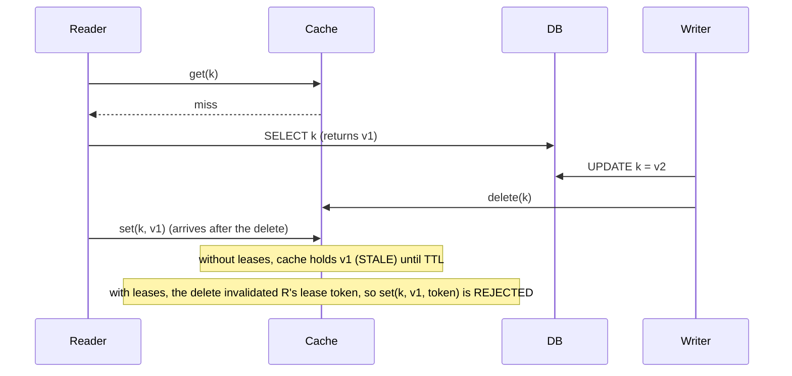

# Distributed Caching: TAO, Lease Tokens, Thundering Herds, and Hot-Key Salting

> **Folder 04 · File 02** of the Distributed Systems & System Design L7 Reference.
> **Prerequisites:**
> - [Folder 01 file 01 §6.7](../01-First-Principles-Physics-and-L5-L6-L7-Rubric/01-l5-vs-l6-vs-l7-interview-evaluation-rubric-and-signals.md#67-zipf-and-cache-sizing)
>   (Zipf);
> - [Folder 01 file 02 §7.3](../01-First-Principles-Physics-and-L5-L6-L7-Rubric/02-hardware-network-physics-latency-numbers-and-finops-math.md#73-the-five-minute-rule-cloud-edition)
>   (the five-minute rule);
> - [Folder 02 file 03 §5](../02-Storage-Engines-Replication-and-Sharding-Internals/03-consistent-hashing-bounded-loads-virtual-nodes-and-range-splitting.md#5-hot-keys-what-hashing-cannot-fix)
>   (hot keys).
>
> **Listing:** `cache_lab.py` covers:
> - stampede protection: none, lease, stale-while-revalidate, XFetch;
> - the stale-set race with and without lease tokens;
> - hot-key salting and L1 caching under Zipf.
>
> The output is deterministic.

---

## 0. A cache is a load-bearing component, not an optimization

At scale, caches are part of the capacity plan, not a bonus.

> If the cache absorbs 95% of reads, the database is sized for 5%. Losing the cache multiplies database load by 20×,
> an overload that does not end when the cache returns, because the cache is now cold.

That is a metastable failure (Folder 05 file 02), and it is the reason this file exists.

The three questions every caching design must answer:
1. **What happens on a miss storm?** Expiry of a hot key, a cache restart, a new cluster.
2. **How does the cache stay consistent with the source of truth?** Invalidation races.
3. **How is skew handled?** Hot keys, hot shards.

---

## 1. Patterns and their consistency properties

| Pattern | Read | Write | Consistency risk |
|---|---|---|---|
| **Cache-aside / look-aside** | App reads cache; on miss reads DB and **sets** cache | App writes DB, then **deletes** (or updates) cache | The stale-set race (§3); delete-vs-update ordering |
| Read-through | Cache library loads from DB on miss | — | Same as look-aside, centralized |
| Write-through | — | Write cache and DB synchronously (cache in front) | Partial failure between the two writes |
| Write-behind | — | Write cache; flush to DB asynchronously | Data loss on cache failure; ordering |
| Refresh-ahead | Refresh before expiry | — | Wasted refreshes on cold keys |
| **CDC-driven invalidation** | Look-aside | DB commit → binlog/WAL → invalidator deletes keys | Lag window; ordering per key |

**Delete, don't update, on write.** Updating the cache from the writer races with other writers: two writers can
apply in different orders to the DB and the cache. Deleting converges on the next read. The remaining race is the
stale set (§3).

---

## 2. Memcache at Facebook (Nishtala et al., NSDI 2013): the playbook

```
 region
 ┌──────────────────────────────────────────────────────────────────────────────────────┐
 │ frontend cluster A        frontend cluster B         (many web servers + memcached)  │
 │  web ─mcrouter─► memcached pool      web ─mcrouter─► memcached pool                  │
 │        │ miss → MySQL (read replicas)                                                │
 │ regional pool (shared, for low-value/large keys)     gutter pool (takes over failed servers' keys) │
 │ MySQL primary/replica ── binlog ──► mcsqueal: invalidation daemons → deletes to every cluster │
 └──────────────────────────────────────────────────────────────────────────────────────┘
 cross-region: the master region's MySQL replicates to others; "remote markers" give read-your-writes
```

| Mechanism | Problem it solves |
|---|---|
| **Leases** | A miss returns a 64-bit lease token. Only the token holder may set the key, and a delete invalidates outstanding tokens. Fixes **stale sets**, and, by issuing at most one token per key per ~10 s, **thundering herds**: other clients wait briefly or accept a slightly stale value |
| **mcrouter** (proxy) | Consistent hashing, connection pooling, replication of hot pools, failover routing |
| **Gutter pool** | When a memcached server fails, its keys go to a small gutter pool with short TTLs, instead of rehashing onto survivors (which would cascade overload) or falling through to the DB |
| **Cold-cluster warmup** | A new cluster reads misses from a *warm* cluster's cache instead of the DB until its hit rate recovers |
| **Invalidation via binlog** (mcsqueal) | Deletes are derived from committed DB changes, so they are reliable and batched across clusters |
| **Remote markers** | After a write in a non-master region, set a marker so reads go to the master region until replication catches up (read-your-writes) |

---

## 3. The stale-set race and lease tokens



§B of the output (one key, 20% writes, slow DB reads):

| | Fraction of time the cache holds a stale value |
|---|---|
| Delete-on-write without leases | **28.3%** |
| With lease tokens | **0.00%** |

That is not a rare edge case. Under contention it is a large fraction of the time. Without leases, the only bound on
staleness is the TTL. Alternatives:
- **versioned sets:** `set if version > cached version`, using a version from the DB row;
- **delayed double delete:** delete again after the maximum replication lag. Probabilistic; it shrinks the window
  without closing it.

---

## 4. Thundering herds and stampedes

When a hot key expires, every concurrent request misses and recomputes. §A of the output (one key, 2,000 req/s,
200 ms recompute, TTL 10 s):

| Protection | DB calls per expiry | Requests that waited | Served stale |
|---|---|---|---|
| None | **369** | 4,427 | 0 |
| Lease / single-flight | **≈ 1** | 4,427 (waited ~≤ 200 ms) | 0 |
| Stale-while-revalidate | ≈ 1 | **0** | 4,427 |
| **XFetch** (probabilistic early recompute) | ≈ 1.1 | **0** | **0** |

- **Without protection, the database sees 369× the load once per TTL per hot key.** Multiply by the number of hot
  keys expiring together, for example after a deploy that flushed the cache, and the database falls over.
- **Single-flight** (one recompute in flight per key per process or cluster) fixes the database load but makes
  requests wait.
- **Stale-while-revalidate** (HTTP `Cache-Control: stale-while-revalidate`, or a soft TTL) serves the old value while
  one request refreshes. This is the right default for most data.
- **XFetch** (Vattani, Chierichetti & Lowenstein, VLDB 2015) recomputes *early* with probability rising as expiry
  approaches. On each read, refresh if $t - \delta\beta\ln(U) \ge \text{expiry}$, where δ is the recompute time,
  $U$ is uniform on (0,1], and β ≥ 1 tunes eagerness. Hot keys refresh just before expiry, nobody waits or sees stale
  data, and cold keys rarely refresh at all.
- **Jitter TTLs** (±10–20%) so keys populated together don't expire together.

---

## 5. TAO: Facebook's social-graph cache (Bronson et al., USENIX ATC 2013)

TAO replaced look-aside memcache for the social graph with a **graph-aware, write-through** cache.

- **Data model:**
  - **objects** `(id) → (otype, key-value data)`;
  - **associations** `(id1, atype, id2) → (time, data)`, plus **association lists** ordered by time: "the 50 most
    recent comments on a post".
- **API:** `assoc_add`, `assoc_range(id1, atype, pos, limit)`, `assoc_count`, `assoc_time_range`, `obj_get`.
- **Topology:**

  ```
  region (follower)                          master region (leader)
  ┌─────────────────────────────┐            ┌─────────────────────────────┐
  │ web → follower tier cache ──┼─ miss/write─► leader tier cache ──► MySQL shards (master)
  │       (many per region)     │            │  (one per shard per region) │
  │ ◄── async invalidations/refills ─────────┤                             │
  └─────────────────────────────┘            └─────────────────────────────┘
  writes go through the leader cache (write-through); followers get invalidations; reads mostly hit followers
  ```

- **Consistency:**
  - Within a tier, read-after-write holds for the writer: the follower that forwarded the write updates itself.
  - Across regions it is eventual, with the master region authoritative.
  - TAO accepts this for social data and offers "critical" reads that go to the master.
- **Why it matters for design interviews:** it is the reference answer for any **graph-shaped, read-dominated** cache
  (feeds, follows, likes, comments). Cache *lists* and *counts*, not just objects. Make writes go through the cache
  tier that owns the shard, so invalidation is local and ordered. (Reads outnumber writes by roughly 500:1 in the
  paper's workload, ⚠ verify.)

---

## 6. Hot keys and hot shards

§C of the output (100 cache shards, Zipf s = 1.1 over 200k keys):

| Measure | Value |
|---|---|
| Share of all traffic for the hottest key | **13.1%** |
| Hottest shard vs mean load | **13.7×** |
| After salting the top-100 keys into 16 copies each | **1.7×** |
| Requests absorbed by an in-process L1 holding the top-1,000 keys | **73.0%** |

A cache server is a single-threaded or few-threaded process: Redis is one main thread (⚠ I/O threads optional),
roughly 100k–1M simple ops/s. A shard at 13.7× mean load saturates long before the fleet does.

The mitigations, in the order to apply them:
1. **L1 in-process caches** for the very top keys. A few thousand entries, short TTL (1–5 s), refreshed via XFetch.
   This takes most of the hot traffic off the network entirely. The cost is staleness ≤ the L1 TTL. Budget memory per
   process.
2. **Salting/replicating hot keys:** store `k#0..k#15` on different shards; reads pick one at random; writes delete or
   update all copies. Detect hot keys dynamically (top-K sketch in the proxy) rather than hard-coding them.
3. **Bounded-load consistent hashing** for read-through caches (Folder 02 file 03 §4).
4. **Request coalescing at the proxy:** mcrouter-style collapse of identical concurrent gets.

---

## 7. Sizing and cost

- **Memory per item.** Memcached slab overhead is ~50–60 bytes per item plus key and value. Redis is higher per key,
  because of the dict entry, object header and expiry (⚠ verify for your version). For 1 billion 200-byte items with
  ~40-byte keys, that is ~300 GB including overhead.
- **Working set and hit ratio** come from the Zipf model (Folder 01 file 01 §6.7), and recency matters more than
  all-time popularity.
- **Tiering.** RAM for the hottest data, local NVMe as a second tier (CacheLib-style hybrid caches), and the
  five-minute-rule break-even for the next tier (Folder 01 file 02 §7.3). For S3-backed small objects, caching pays
  almost always.
- **Network.** A cache node at 1M ops/s × 1 KB = 8 Gbps. **Cache tiers are often NIC-bound**, which is why value size
  matters as much as ops/s.

---

## 8. Failure modes

| Failure | Mechanism | Defense |
|---|---|---|
| Cache node dies | Its keys miss and the DB load spikes | Gutter pool; replicate hot pools; consistent hashing so only 1/N of keys move |
| Whole cache tier restart / new cluster | Cold cache → DB overload → metastable | Warm from a peer cluster; ramp traffic gradually; admission control at the DB |
| Mass expiry (synchronized TTLs, a deploy flush) | Stampede | TTL jitter; XFetch; leases |
| Stale-set race | Stale data until TTL | Leases or versioned sets |
| Invalidation pipeline lag/outage | Stale reads grow | Lag SLI; TTL as backstop; bounded-staleness SLO |
| Hot key | One shard saturates | L1 + salting + detection |
| Cache-as-database (no persistence) | Data loss on restart | Never store data you can't recompute; use a real store with a cache in front |

---

## 9. The listing

```python
"""cache_lab.py - cache stampedes, the stale-set race, and hot keys (Folder 04, file 02).

  A. Stampede on expiry of one hot key (2,000 req/s, 200 ms recompute): no protection vs lease/single-flight vs
     stale-while-revalidate vs probabilistic early expiration (XFetch, Vattani et al. VLDB 2015).
  B. The stale-set race (Nishtala et al., NSDI 2013): look-aside fill racing a delete-on-write leaves a stale value
     until TTL; memcache-style lease tokens reject the late set.
  C. Hot keys on a 100-shard cache under Zipf(1.1): max/mean shard load, plus salting the hottest keys and an
     in-process L1 cache.
Standard library only; seeded, deterministic.
"""
import bisect
import math
import random


# ---------------------------------------------------------------- A. stampede
def stampede(mode: str, seconds: float = 120, rps: float = 2000, ttl: float = 10.0, recompute: float = 0.2,
             seed: int = 1) -> dict:
    rng = random.Random(seed)
    t, value_until, refreshing_until = 0.0, ttl, -1.0
    db_calls = waited = stale_served = 0
    recompute_done_at = None
    while t < seconds:
        t += rng.expovariate(rps)
        if recompute_done_at is not None and t >= recompute_done_at:
            value_until, recompute_done_at = recompute_done_at + ttl, None
        fresh = t < value_until
        if mode == "xfetch" and fresh and recompute_done_at is None:
            # XFetch: recompute early with probability rising as expiry approaches: t - delta*beta*ln(U) >= expiry
            if t - recompute * 1.0 * math.log(rng.random()) >= value_until:
                db_calls += 1
                recompute_done_at = t + recompute
            continue
        if fresh:
            continue
        if mode == "none":
            db_calls += 1                                    # every miss goes to the database
            waited += 1
            if recompute_done_at is None:
                recompute_done_at = t + recompute
        elif mode in ("lease", "xfetch"):
            if recompute_done_at is None:
                db_calls += 1                                # the lease holder recomputes
                recompute_done_at = t + recompute
            waited += 1                                      # others wait (or retry shortly)
        elif mode == "swr":
            if recompute_done_at is None:
                db_calls += 1
                recompute_done_at = t + recompute
            stale_served += 1                                # serve the stale value immediately
    expiries = seconds / ttl
    return {"db_per_expiry": db_calls / expiries, "waited": waited, "stale": stale_served}


# ---------------------------------------------------------------- B. stale-set race
def stale_set(use_leases: bool, ops: int, seed: int = 2) -> dict:
    """One key. Readers: miss -> read DB -> (later) set cache. Writers: update DB -> delete cache.
    Operations interleave with random delays between a reader's DB read and its cache set."""
    rng = random.Random(seed)
    db_version, cache = 0, None                              # cache holds a version number or None
    lease_token, next_token = None, 1
    pending = []                                             # (set_time, version_read, token)
    t = 0.0
    stale_time = observed = 0.0
    last_t = 0.0
    for _ in range(ops):
        t += rng.expovariate(1.0)
        for item in sorted(p for p in pending if p[0] <= t):
            pending.remove(item)
            _, ver, tok = item
            if not use_leases or tok == lease_token:
                cache = ver                                   # set succeeds
                lease_token = None
        if cache is not None and cache != db_version:
            stale_time += t - last_t
        observed += t - last_t
        last_t = t
        if rng.random() < 0.2:                               # writer
            db_version += 1
            cache = None                                     # delete-on-write
            lease_token = None                               # memcache: a delete invalidates outstanding leases
        elif cache is None:                                  # reader miss
            tok = None
            if use_leases:
                if lease_token is not None:
                    continue                                 # someone holds the lease: wait / retry later
                lease_token, tok = next_token, next_token
                next_token += 1
            pending.append((t + rng.expovariate(1 / 3.0), db_version, tok))   # slow DB read, then set
    return {"stale_fraction": stale_time / observed}


# ---------------------------------------------------------------- C. hot keys
def zipf_cdf(n: int, s: float) -> list:
    acc, out = 0.0, []
    for k in range(1, n + 1):
        acc += k ** -s
        out.append(acc)
    return out


def hot_keys(shards: int = 100, keys: int = 200_000, reqs: int = 400_000, s: float = 1.1, seed: int = 3) -> dict:
    rng = random.Random(seed)
    cdf = zipf_cdf(keys, s)
    total = cdf[-1]
    shard_of = [rng.randrange(shards) for _ in range(keys)]
    draws = [bisect.bisect_left(cdf, rng.random() * total) for _ in range(reqs)]
    base = [0] * shards
    for k in draws:
        base[shard_of[k]] += 1
    salted = [0] * shards
    hot = set(range(100))                                    # top-100 keys get 16 salted copies (reads pick one)
    for k in draws:
        sh = (shard_of[k] + rng.randrange(16) * 7919) % shards if k in hot else shard_of[k]
        salted[sh] += 1
    l1_hits = sum(1 for k in draws if k < 1000)              # in-process L1 caching the top-1000 keys
    mean = reqs / shards
    return {"max_mean": max(base) / mean, "salted_max_mean": max(salted) / mean,
            "top1_share": draws.count(0) / reqs, "l1_hit": l1_hits / reqs}


def main() -> None:
    print("== A. stampede: one hot key, 2,000 req/s, TTL 10 s, recompute 200 ms, 120 s")
    st = {}
    for mode, label in (("none", "no protection"), ("lease", "lease / single-flight"),
                        ("swr", "stale-while-revalidate"), ("xfetch", "XFetch early recompute (beta=1)")):
        st[mode] = stampede(mode)
        r = st[mode]
        print(f"  {label:<32} DB calls per expiry {r['db_per_expiry']:7.1f}   requests that waited {r['waited']:6}   "
              f"served stale {r['stale']:6}")

    print("\n== B. stale-set race: look-aside fill vs delete-on-write (20% writes, slow DB reads)")
    ss = {}
    for leases in (False, True):
        ss[leases] = stale_set(leases, 200_000)
        print(f"  {'with lease tokens' if leases else 'no leases':<18}: cache holds a STALE value "
              f"{ss[leases]['stale_fraction'] * 100:6.2f}% of the time")

    print("\n== C. hot keys: 100 cache shards, Zipf s=1.1 over 200k keys, 400k requests")
    hk = hot_keys()
    print(f"  hottest key alone = {hk['top1_share'] * 100:.1f}% of all traffic; hottest shard at "
          f"{hk['max_mean']:.1f}x the mean load")
    print(f"  salting the top-100 keys into 16 copies -> hottest shard at {hk['salted_max_mean']:.1f}x the mean")
    print(f"  an in-process L1 holding the top-1,000 keys absorbs {hk['l1_hit'] * 100:.1f}% of requests before the network")

    assert st["none"]["db_per_expiry"] > 300 and st["lease"]["db_per_expiry"] <= 1.01
    assert st["swr"]["waited"] == 0 and st["xfetch"]["waited"] < st["lease"]["waited"] / 10
    assert ss[False]["stale_fraction"] > 0.05 and ss[True]["stale_fraction"] == 0
    assert hk["max_mean"] > 8 and hk["salted_max_mean"] < hk["max_mean"] / 3 and hk["l1_hit"] > 0.5
    print("\nself-test: all assertions passed")


if __name__ == "__main__":
    main()
```

Output (verified; deterministic):

```text
== A. stampede: one hot key, 2,000 req/s, TTL 10 s, recompute 200 ms, 120 s
  no protection                    DB calls per expiry   368.9   requests that waited   4427   served stale      0
  lease / single-flight            DB calls per expiry     0.9   requests that waited   4427   served stale      0
  stale-while-revalidate           DB calls per expiry     0.9   requests that waited      0   served stale   4427
  XFetch early recompute (beta=1)  DB calls per expiry     1.1   requests that waited      0   served stale      0

== B. stale-set race: look-aside fill vs delete-on-write (20% writes, slow DB reads)
  no leases         : cache holds a STALE value  28.27% of the time
  with lease tokens : cache holds a STALE value   0.00% of the time

== C. hot keys: 100 cache shards, Zipf s=1.1 over 200k keys, 400k requests
  hottest key alone = 13.1% of all traffic; hottest shard at 13.7x the mean load
  salting the top-100 keys into 16 copies -> hottest shard at 1.7x the mean
  an in-process L1 holding the top-1,000 keys absorbs 73.0% of requests before the network

self-test: all assertions passed
```

---

## 10. L5 vs L6 vs L7

| Topic | L5 (Senior) | L6 (Staff) | L7 (Principal) |
|---|---|---|---|
| Pattern | "Put Redis in front of the DB" | Look-aside with delete-on-write, TTLs, CDC invalidation | Cache as a load-bearing component: DB capacity plan for cache loss; warmup strategy; metastability analysis |
| Consistency | "Set a TTL" | Stale-set race; delete vs update | Lease tokens or versioned sets (28% → 0% stale); remote markers for cross-region RYW; staleness SLOs |
| Herds | — | Single-flight, TTL jitter | Quantifies the stampede (369× per expiry); chooses SWR vs XFetch vs leases per data class |
| Skew | — | Hot-key replication | Detection plus L1 + salting (13.7× → 1.7×); NIC-bound sizing; gutter pools |
| Graph data | — | Cache lists and counts | TAO-style write-through ownership per shard; leader/follower tiers |

---

## 11. Bar-raiser probing chains

### Chain A: "Our database fell over when the cache cluster restarted."

1. **L5:** "Scale the database."
2. **Probe:** "It's 20× normal load; you can't keep that much idle capacity." **L6:** "Warm the cache before taking
   traffic, and restart nodes one at a time."
3. **Probe:** "An AZ-wide outage restarted all of them." **L7:**
   - Admission control at the DB tier: a concurrency limit with priority shedding, so it stays at goodput rather
     than collapsing.
   - Stale-while-revalidate from a secondary tier, such as a peer region's cache or local NVMe.
   - Gradual traffic ramp-up per cache node.
   - "And I'd model 'cache hit ratio drops to 0' as a named failure scenario in capacity planning, with a game day."

### Chain B: "Users sometimes see old profile data for minutes."

1. **L5:** "Lower the TTL."
2. **Probe:** "TTL is 1 hour for cost reasons." **L6:** "That's the stale-set race or a lost invalidation. Check
   the invalidation pipeline's lag and errors."
3. **Probe:** "The pipeline is healthy." **L7:**
   - "Then it's the race: a slow reader's fill landing after the writer's delete."
   - Lease tokens (or a version-guarded set from the row's version column) close it; the lab shows 28% → 0%.
   - Add an SLI: sample reads and compare cache vs DB version, alerting on the mismatch rate.

### Chain C: "One celebrity post melts a cache shard."

1. **L5:** "Add more cache nodes."
2. **Probe:** "It's one key." **L6:** "Replicate the key across shards and read a random copy."
3. **Probe:** "The key changes every second (like counts)." **L7:**
   - "Split the data:
     - immutable post content in L1 plus replicated copies (rarely changes);
     - the counter as a sharded, batched CRDT counter: each shard accumulates increments, and the reader sums them
       with ~1 s staleness."
   - "Detection is automatic via proxy top-K sketches, so the next celebrity doesn't need a code change."

---

## 12. Invariants checklist

- [ ] The DB is sized (or protected by admission control) for the cache-loss scenario; warmup is defined.
- [ ] Writes delete (not update) cache entries; invalidations are derived from committed changes (CDC).
- [ ] Stale sets are prevented: leases or version-guarded sets.
- [ ] Every hot path has stampede protection (SWR/XFetch/leases) and TTL jitter.
- [ ] Hot keys are detected dynamically and mitigated (L1, salting, coalescing).
- [ ] Sizing covers memory overhead per item and NIC bandwidth, not just ops/s.
- [ ] Staleness has an SLO and an SLI.

---

## 13. References

- R. Nishtala et al. *Scaling Memcache at Facebook.* NSDI 2013.
- N. Bronson et al. *TAO: Facebook's Distributed Data Store for the Social Graph.* USENIX ATC 2013.
- A. Vattani, F. Chierichetti, K. Lowenstein. *Optimal Probabilistic Cache Stampede Prevention.* VLDB 2015.
- B. Berg et al. *The CacheLib Caching Engine: Design and Experiences at Scale.* OSDI 2020.
- RFC 5861 (`stale-while-revalidate`, `stale-if-error`).
- Redis documentation: cluster spec (16,384 hash slots), replication. Memcached wiki: slab allocator.
- Twitter/X and Pinterest engineering blogs on hot-key detection and mitigation (⚠ verify the URLs in Folder 10).
