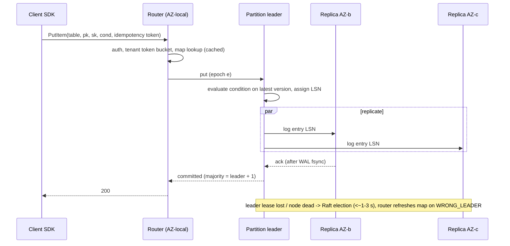

# Problems 1–4: Distributed KV Store, S3 Object Storage, Distributed Lock Service, Global CDN

> **Folder 06 · File 01** of the Distributed Systems & System Design L7 Reference: the 32 Master Problems, Part 1
> (Data, Storage and Infrastructure).
> **Listing:** `erasure_coding_lab.py` is a working systematic Reed-Solomon RS(10,4) codec over GF(256): encode,
> erase any 4 shards, decode. It also computes MTTDL durability for 3× replication vs RS(6,3) vs RS(10,4). The output
> is deterministic.
> **Every problem follows the same blueprint:**
> - (a) scale and SLA numbers;
> - (b) the architecture: data plane, control plane, write, read and failure-recovery paths;
> - (c) the core L7 bottleneck and solution;
> - (d) storage schema and partition key;
> - (e) the L7 failure-mode defense;
> - plus an L5/L6/L7 table and a three-step probing chain.
>
> Concepts are cross-linked to Folders 01–05 rather than repeated.

---

## Problem 1: A Dynamo/Bigtable-class distributed key-value store

### 1.1 Scope, scale and SLAs

**Interpretation.** Build a multi-tenant KV service (DynamoDB-like) that internal teams use as their default
database: get/put/delete/conditional-put/query by partition key with a sort-key range.

| Quantity | Target | Derivation / note |
|---|---|---|
| Peak requests | 50M/s reads, 10M/s writes (fleet) | Hundreds of tenants; the largest tenant is 5% |
| Item size | p50 1 KB, max 400 KB | Large values stored out of line |
| Data | 20 PB logical, 60 PB at RF=3 | Plus 1.5× free-space headroom for compaction: **~90 PB raw** |
| Latency SLO | p99 < 10 ms for single-item ops in-region | Read: 1 network RTT + 1 storage lookup |
| Availability | 99.99% regional; 99.999% with global tables | 4.4 min/month: requires automated failover (Folder 01 file 01 §6.2) |
| Durability | 11 nines of committed writes | Synchronous replication to 3 AZs before ack |

**Capacity math (per storage node: 16 cores, 8 × 7.68 TB NVMe).**
- 90 PB raw / 61 TB per node ≈ **1,500 storage nodes** by capacity.
- By throughput: 50M reads/s at ~1 replica read each, plus 10M writes/s × 3 replicas = 80M replica-ops/s. At ~60k
  ops/s per node that is ~1,300 nodes. **Capacity binds, not throughput.** So:
  - FinOps lever 1 is compression and tiering of cold partitions;
  - lever 2 is space amplification: LSM leveled 1.1×, not tiered 2×.
- Each node hosts ~3,000 partitions of 10 GB. Many small partitions make for fast, many-to-many re-replication.

### 1.2 Storage schema and partition key

```
item key   = (table_id, partition_key, sort_key)            # composite, binary-comparable
partition  = hash(table_id, partition_key) → token ∈ [0, 2^64)  → split range (10 GB / 3,000 WCU-equivalent max)
on disk    = per-partition LSM (RocksDB-style), key = sort_key, value = (version, attrs, ttl)
metadata   = partition map: token range → replica group (3 nodes in 3 AZs) + leader + epoch   (control plane)
```

- **Hash on the partition key, range on the sort key.** Point and range queries within a partition are local
  (Folder 02 file 03 §6).
- **Partitions split on size or throughput,** at the hash-range midpoint or by load-based key sampling, and never by
  re-hashing.
- **Each partition is a Multi-Paxos/Raft group** of 3 replicas across AZs, with a leader holding a lease. This is
  DynamoDB's published design (Elhemali et al., USENIX ATC 2022), not Dynamo's leaderless one.

### 1.3 Architecture

```
               DATA PLANE                                                CONTROL PLANE
 client SDK ─► request router (stateless, per AZ) ─► storage node     ┌──────────────────────────────┐
   (retries,     │  partition map cache (LKG on disk)   (partition       │ partition manager: splits,   │
    backoff,     │  auth + admission (per-tenant          leader)        │ placement, rebalancing,      │
    deadlines)   │  token buckets: RCU/WCU)                 │            │ leader balancing             │
                 │                                          ▼            │ table/DDL service            │
                 │                              Paxos/Raft to 2 replicas │ autoadmin: replaces dead     │
                 │                              in other AZs (WAL fsync) │ replicas from snapshots+logs │
                 │                                          │            └──────────────────────────────┘
                 └─── reads: leader (strong) or any replica (eventual) ──┘   metadata store (consensus)
 async: change stream (per-partition ordered log) → global tables replicator, CDC consumers, backups to S3
```

### 1.4 Write, read and recovery paths



- **Reads:**
  - strongly consistent reads go to the leader (lease-protected);
  - eventually consistent reads go to any replica, at half the cost;
  - queries scan the sort-key range in the partition's LSM.
- **Failure recovery:**
  1. A dead node's ~3,000 partitions each lose one replica.
  2. The control plane picks a new home for each across the fleet. Each one rebuilds from a peer's snapshot + log
     tail (10 GB at a throttled 100 MB/s ≈ 100 s).
  3. Recovery is parallel over thousands of sources, so the fleet's under-replication window is minutes, not hours
     (Folder 02 file 03 §7; file 04 §4.3).

### 1.5 The core L7 bottleneck: multi-tenant skew and predictable latency

The hard problem is not storage. It is **predictable p99 for every tenant while tenants are wildly skewed**:
- hot partitions;
- sudden traffic shifts;
- whales next to small tenants.

1. **Admission at two levels.**
   - Per-tenant token buckets at the router: provisioned or on-demand capacity.
   - Per-partition limits at the storage node, to protect the node.
   - **Adaptive capacity / burst credit:** a hot partition borrows unused capacity from the table's other partitions,
     and a hot partition is split automatically on sustained throughput, not just size.
   - **A single hot *key* cannot be split.** Expose it as throttling with clear errors, and push the fix to the data
     model: write sharding, or a cache in front (Folder 04 file 02 §6).
2. **Isolation of whales.** Very large tenants get dedicated storage-node pools (cells, Folder 05 file 01). Small
   tenants are shuffle-sharded across routers.
3. **Tail latency engineering:**
   - an LSM with leveled compaction and rate-limited compaction I/O (Folder 02 file 01 §2.6);
   - p99.9 fsync on PLP NVMe;
   - hedged eventually consistent reads to a second replica after p95.
4. **Metadata scalability.** The partition map for ~1.5M partitions (4.5M replicas) is a few hundred MB. Routers cache it with
   epochs, and storage nodes reject stale epochs. The control plane can be down without affecting traffic (static
   stability).

### 1.6 L7 failure-mode defense

| Failure | Defense |
|---|---|
| AZ loss | Each partition keeps a majority in the surviving 2 AZs; routers are AZ-local; capacity pre-provisioned 1.5× |
| Metadata service down | Routers serve from the LKG map; splits and placements pause; data plane unaffected |
| Hot partition | Adaptive capacity → automatic split; per-key throttle with backpressure to clients |
| Poison request (a query pattern that crashes a node) | Shuffle-sharded router assignment; crash-loop detection per request signature; per-tenant circuit breaker |
| Retry storms on throttling | SDK retry budget + full-jitter backoff (Folder 05 file 02) |
| Silent corruption | Per-block checksums (CRC32C is free); replica checksum scrubbing; repair from peers |
| Region loss (global tables) | Async multi-active replication with LWW per item: RPO = lag, so document the conflict semantics. A multi-region strong-consistency mode costs a cross-region quorum per write (⚠ verify the AWS feature status) |

### 1.7 L5 vs L6 vs L7

| | L5 | L6 | L7 |
|---|---|---|---|
| Design | Consistent hashing + replication + LSM | Leader per partition with Raft; splits; router caching; strong vs eventual reads | Multi-tenant admission at two levels, adaptive capacity, whale cells, static-stable metadata, fleet recovery math |
| Numbers | QPS, storage | Node count from capacity vs throughput | Capacity binds; space amp and compression as the TCO lever; recovery-window math |
| Failure | Replica failover | AZ loss, hot partitions | Poison requests, retry storms, metadata outages, correlated failures |

### 1.8 Probing chain

1. **Probe:** "One tenant's partition gets 50k writes/s on a single key." **L5:** "Split the partition."
2. **Probe:** "It's one key." **L6:** "Throttle it; recommend write sharding (key#0..#N) or batching."
3. **Probe:** "It's our largest customer's checkout counter." **L7:**
   - "Offer a primitive that fits the access pattern: a sharded atomic counter as a first-class data type, with
     increments spread over N sub-keys and reads summing them, or a CRDT counter."
   - "And isolate that customer in a dedicated cell so their spikes can't touch shared routers."
   - "The platform fix is a product feature, not a ticket."

---

## Problem 2: S3-class object storage (with erasure coding)

### 2.1 Scope, scale and SLAs

| Quantity | Target | Note |
|---|---|---|
| Objects | 10¹³–10¹⁴ (S3 reported 350+ trillion objects in 2024–25, ⚠ verify) | Metadata is the hard part |
| Capacity | Exabytes; growth ~30%/yr | |
| Request rate | 100M+ req/s fleet; 5,500 GET/s and 3,500 PUT/s per prefix (AWS's documented baseline) | Prefix-partitioned index |
| Object size | Bytes to 5 TB (multipart: 5 MB–5 GB parts, ≤ 10,000 parts) | |
| Durability | **11 nines** per object per year (design target) | Erasure coding + scrubbing + many-to-many repair |
| Availability | 99.99% (Standard) | |
| Consistency | **Strong read-after-write** for PUT/DELETE and LIST (since Dec 2020) | Requires an index with linearizable per-key writes |

### 2.2 Storage schema and partition key

```
INDEX (metadata, strongly consistent, range-partitioned by (bucket, key) prefix):
  (bucket, key, version_id) → {etag, size, storage_class, created, chunk_map: [(stripe_id, offsets)], acl_ref}
DATA (immutable chunks):
  stripe_id → RS(k, m) shards, e.g. RS(10,4), each shard on a different drive/host/rack, across ≥ 3 AZs
  shard = fixed-size extent (e.g. 64–256 MB container of many objects' bytes), CRC per 4 KB block
PLACEMENT (control plane): drive → health, free space, failure domain; stripe → shard locations
```

- **The index is partitioned by key prefix,** so LIST is a range scan. Prefixes split automatically under load: the
  "3,500 PUT/s per prefix" baseline is per partition, and AWS scales partitions behind the scenes.
- **Small objects are packed into large extents.** Erasure-coding a 1 KB object into 14 shards would cost 14 I/Os
  and enormous metadata. That is the "data that dies together lives together" principle at the object layer, and
  deletes become garbage collection of extents.

### 2.3 Architecture and paths

```
 PUT ─► front end (auth, sigv4, rate limits) ─► placement: choose stripe/extent with free space in 14 failure domains
        ├─ stream bytes → 10 data shards + 4 parity (RS encode in the front end or storage tier)
        ├─ wait for ≥ k+1 (or all 14) shard acks (fsync'd)
        └─ commit index entry (linearizable conditional write on (bucket,key)) ─► 200 OK   ← the commit point
 GET ─► index lookup (cached) ─► read k data shards in parallel (no decode needed: systematic code) ─► stream
        └─ a shard slow/missing → read 1 parity shard, decode (hedged read after p95)
 background: scrubbers verify CRCs; repair re-creates lost shards (reads k shards each!); GC of deleted extents;
             lifecycle transitions to colder classes (re-encode with wider codes, e.g. RS(17,3)) ; replication rules
```

### 2.4 The listing: Reed-Solomon and durability

```python
"""erasure_coding_lab.py - Reed-Solomon over GF(2^8) and the durability math of object storage (Folder 06, file 01).

  A. A systematic RS(k, m) codec: encoding matrix [I_k ; Cauchy(m x k)] over GF(256) (primitive polynomial 0x11d).
     Encode 10 data shards, erase any 4, decode, and verify byte-for-byte.
  B. Durability (Markov MTTDL approximation, independent failures) for 3x replication vs RS(6,3) vs RS(10,4), with
     slow vs fast (parallel) repair; storage overhead and repair read amplification.
Standard library only; seeded, deterministic.
"""
import math
import random

EXP = [0] * 512
LOG = [0] * 256
_x = 1
for _i in range(255):
    EXP[_i] = _x
    LOG[_x] = _i
    _x <<= 1
    if _x & 0x100:
        _x ^= 0x11D
for _i in range(255, 512):
    EXP[_i] = EXP[_i - 255]


def gmul(a: int, b: int) -> int:
    return 0 if a == 0 or b == 0 else EXP[LOG[a] + LOG[b]]


def ginv(a: int) -> int:
    return EXP[255 - LOG[a]]


def cauchy(m: int, k: int) -> list[list[int]]:
    """C[i][j] = 1 / (x_i + y_j) with x_i = k + i, y_j = j (addition is XOR); every square submatrix is invertible."""
    return [[ginv((k + i) ^ j) for j in range(k)] for i in range(m)]


def mat_inv(a: list[list[int]]) -> list[list[int]]:
    n = len(a)
    aug = [row[:] + [1 if i == j else 0 for j in range(n)] for i, row in enumerate(a)]
    for col in range(n):
        piv = next(r for r in range(col, n) if aug[r][col])
        aug[col], aug[piv] = aug[piv], aug[col]
        inv = ginv(aug[col][col])
        aug[col] = [gmul(v, inv) for v in aug[col]]
        for r in range(n):
            if r != col and aug[r][col]:
                f = aug[r][col]
                aug[r] = [v ^ gmul(f, p) for v, p in zip(aug[r], aug[col])]
    return [row[n:] for row in aug]


def mat_vec_shards(mat: list[list[int]], shards: list[bytes]) -> list[bytes]:
    out = []
    size = len(shards[0])
    for row in mat:
        acc = bytearray(size)
        for coef, sh in zip(row, shards):
            if coef == 0:
                continue
            lc = LOG[coef]
            for i, b in enumerate(sh):
                if b:
                    acc[i] ^= EXP[lc + LOG[b]]
        out.append(bytes(acc))
    return out


def encode(data: list[bytes], m: int) -> list[bytes]:
    return data + mat_vec_shards(cauchy(m, len(data)), data)


def decode(shards: dict, k: int, m: int) -> list[bytes]:
    """shards: index -> bytes for any k surviving shards (0..k-1 data, k..k+m-1 parity)."""
    if len(shards) < k:
        raise ValueError(f"need {k} shards, have {len(shards)}")
    enc = [[1 if i == j else 0 for j in range(k)] for i in range(k)] + cauchy(m, k)
    idx = sorted(shards)[:k]
    inv = mat_inv([enc[i] for i in idx])
    return mat_vec_shards(inv, [shards[i] for i in idx])


# ---------------------------------------------------------------- B. durability
def mttdl_years(n: int, tolerate: int, afr: float, mttr_h: float) -> float:
    """Markov approximation: MTTDL ~ mu^m / (lambda^(m+1) * n (n-1) ... (n-m)) for a group of n devices that
    survives m = tolerate concurrent failures; lambda = per-device failure rate, mu = 1/MTTR."""
    lam = afr / 8766.0
    mu = 1.0 / mttr_h
    denom = lam ** (tolerate + 1)
    for i in range(tolerate + 1):
        denom *= n - i
    return mu ** tolerate / denom / 8766.0


def main() -> None:
    rng = random.Random(10)
    k, m, size = 10, 4, 4096
    data = [bytes(rng.randrange(256) for _ in range(size)) for _ in range(k)]
    stripe = encode(data, m)
    print(f"== A. systematic RS({k},{m}) over GF(256): {k} x {size} B data shards + {m} parity shards")
    trials, ok = 6, 0
    for t in range(trials):
        lost = sorted(rng.sample(range(k + m), m))
        survivors = {i: stripe[i] for i in range(k + m) if i not in lost}
        rec = decode(survivors, k, m)
        ok += rec == data
        print(f"  erase shards {lost} -> recovered all data: {rec == data}")
    try:
        decode({i: stripe[i] for i in range(k - 1)}, k, m)
        print("  9 survivors decoded?!")
    except ValueError:
        print("  with only k-1 = 9 survivors: unrecoverable (as it must be)")

    print("\n== B. durability per placement group (independent failures, AFR 2%)")
    print(f"{'scheme':<16} {'overhead':>9} {'tolerates':>10} {'repair reads':>13} {'MTTR':>6} "
          f"{'MTTDL (years)':>15} {'P(loss)/yr':>11} {'nines':>6}")
    rows = {}
    for name, n, tol, overhead, reads in (("3x replication", 3, 2, 3.0, 1), ("RS(6,3)", 9, 3, 1.5, 6),
                                          ("RS(10,4)", 14, 4, 1.4, 10)):
        for mttr in (24.0, 1.0):
            years = mttdl_years(n, tol, 0.02, mttr)
            p = -math.expm1(-1 / years)                  # P(at least one loss in a year), no underflow
            rows[(name, mttr)] = (years, p)
            print(f"{name:<16} {overhead:>8.1f}x {tol:>10} {reads:>12}x {mttr:>5.0f}h {years:>15.3e} "
                  f"{p:>11.2e} {-math.log10(p):>6.1f}")
    eb_groups = 1e18 / (14 * 256e6)                          # 1 EB raw, RS(10,4) stripes of 14 x 256 MB
    loss_events = eb_groups * rows[("RS(10,4)", 24.0)][1]
    print(f"\n  fleet view: 1 EB of raw capacity in RS(10,4) stripes of 14 x 256 MB chunks = {eb_groups:.2e} stripes; expected stripe-loss events "
          f"per year at 24 h MTTR (independent model): {loss_events:.2e}")
    print("  correlated failures (racks, AZs, firmware, bad deploys) dominate real loss: place each stripe's shards in "
          "distinct failure domains")

    assert ok == trials
    assert rows[("RS(10,4)", 24.0)][0] > rows[("3x replication", 24.0)][0] * 1e3
    for name in ("3x replication", "RS(6,3)", "RS(10,4)"):
        assert rows[(name, 1.0)][0] > rows[(name, 24.0)][0] * 20      # faster repair, much higher durability
    print("\nself-test: all assertions passed")


if __name__ == "__main__":
    main()
```

Output (verified; deterministic):

```text
== A. systematic RS(10,4) over GF(256): 10 x 4096 B data shards + 4 parity shards
  erase shards [2, 3, 8, 12] -> recovered all data: True
  erase shards [2, 4, 5, 13] -> recovered all data: True
  erase shards [0, 3, 4, 10] -> recovered all data: True
  erase shards [0, 3, 4, 5] -> recovered all data: True
  erase shards [1, 3, 6, 13] -> recovered all data: True
  erase shards [0, 2, 7, 10] -> recovered all data: True
  with only k-1 = 9 survivors: unrecoverable (as it must be)

== B. durability per placement group (independent failures, AFR 2%)
scheme            overhead  tolerates  repair reads   MTTR   MTTDL (years)  P(loss)/yr  nines
3x replication        3.0x          2            1x    24h       2.779e+09    3.60e-10    9.4
3x replication        3.0x          2            1x     1h       1.601e+12    6.25e-13   12.2
RS(6,3)               1.5x          3            6x    24h       1.007e+11    9.93e-12   11.0
RS(6,3)               1.5x          3            6x     1h       1.392e+15    7.18e-16   15.1
RS(10,4)              1.4x          4           10x    24h       2.315e+13    4.32e-14   13.4
RS(10,4)              1.4x          4           10x     1h       7.681e+18    1.30e-19   18.9

  fleet view: 1 EB of raw capacity in RS(10,4) stripes of 14 x 256 MB chunks = 2.79e+08 stripes; expected stripe-loss events per year at 24 h MTTR (independent model): 1.21e-05
  correlated failures (racks, AZs, firmware, bad deploys) dominate real loss: place each stripe's shards in distinct failure domains

self-test: all assertions passed
```

### 2.5 The core L7 bottleneck: durability is a repair-bandwidth problem

| Scheme | Storage overhead | Tolerates | Repair reads per lost chunk | P(loss)/group/yr at 24 h MTTR | at 1 h MTTR |
|---|---|---|---|---|---|
| 3× replication | 3.0× | 2 failures | 1× | 3.6×10⁻¹⁰ (9.4 nines) | 6.3×10⁻¹³ |
| RS(6,3) | 1.5× | 3 | 6× | 9.9×10⁻¹² (11.0 nines) | 7.2×10⁻¹⁶ |
| **RS(10,4)** | **1.4×** | **4** | **10×** | **4.3×10⁻¹⁴ (13.4 nines)** | 1.3×10⁻¹⁹ |

1. **Erasure coding beats replication on both cost and durability.** RS(10,4) is under half the storage of 3× and
   four orders of magnitude more durable in the independent-failure model.
2. **Its price is repair bandwidth.** Rebuilding one lost shard reads 10 shards. At exabyte scale with ~2% annual
   drive failure, repair traffic is a constant, large fraction of the network. This is why:
   - **Locally Repairable Codes** (Azure's LRC, Huang et al., ATC 2012) add local parities so most repairs read ~6
     shards instead of 12;
   - repair is **many-to-many**: a dead 20 TB drive's shards are rebuilt by thousands of drives in parallel, turning a
     ~1-day MTTR into ~1 hour. **That 24× MTTR improvement is worth 3–5 orders of magnitude of durability** in the
     table, more than adding a parity shard.
3. **The independent-failure model is the optimistic bound.** Real loss comes from correlated failures:
   - a rack's power;
   - a bad drive firmware batch;
   - a software bug that deletes or corrupts at scale.

   The defenses:
   - shards in distinct racks and ≥ 3 AZs, so an AZ loss removes ≤ 4–5 of 14 shards;
   - mixing drive batches and vendors;
   - **deletion safety:** delayed physical deletion, versioning, object lock;
   - durability reviews of every change to the repair and GC code.

   AWS has described this "durability as a culture" practice publicly (⚠ verify; Folder 10).
4. **Scrubbing finds latent sector errors before they matter.** Every shard is read and verified periodically. A
   latent error found during a repair is how "4 failures tolerated" becomes data loss.

### 2.6 The second bottleneck: the metadata index

- **10¹⁴ keys × ~300 B of metadata ≈ 30 PB** of index, with strongly consistent per-key writes and range-partitioned
  LIST.
- It is a Problem-1 KV store in its own right, with a **witness/sequencer** to order index updates per key. S3's
  strong-consistency launch described adding a replicated, highly available witness to the metadata path (⚠ verify
  the details).
- **Hot prefixes** (all objects under `logs/2026-10-27/`) need automatic splitting and key-design guidance. Random
  prefixes were historically recommended; automatic partition scaling reduced the need.

### 2.7 L7 failure-mode defense

| Failure | Defense |
|---|---|
| Drive / host loss | Many-to-many repair; repair-traffic QoS so foreground p99 holds |
| AZ loss | ≤ m shards per AZ; reads decode from the remaining ≥ k; writes continue to stripes placed in surviving AZs |
| Silent corruption | CRC per block, end-to-end checksums (client-provided `Content-MD5`/CRC64), scrubbing |
| Bug in GC/lifecycle (mass deletion) | Delayed reclamation (tombstone → physical delete after days), canaried GC changes, deletion-rate alarms |
| Hot prefix / request storm | Auto-split index partitions; per-bucket rate limits with 503 SlowDown + client backoff |
| Small-object explosion | Packing into extents; per-request pricing as backpressure (Folder 01 file 02 §7.6) |

### 2.8 L5 vs L6 vs L7

| | L5 | L6 | L7 |
|---|---|---|---|
| Data | Replicate objects 3× | Erasure coding with placement across failure domains | Durability math (MTTDL), repair bandwidth, LRC, many-to-many repair as the dominant lever, correlated-failure defenses |
| Metadata | A database of keys | A range-partitioned index with auto-splitting | Strong consistency via a sequenced index commit point; 30 PB metadata as a distributed KV in itself |
| Ops | — | Scrubbing, lifecycle | Deletion safety; durability-reviewed changes; repair QoS |

### 2.9 Probing chain

1. **Probe:** "Why not 3-way replication? It's simpler." **L5:** "It's more expensive."
2. **Probe:** "How much, and is it more durable?" **L6:** "3× vs 1.4×, and RS(10,4) tolerates 4 failures vs 2."
3. **Probe:** "Then why does anyone still replicate?" **L7:**
   - "Hot, small or latency-critical data. A replica read is one I/O, while EC's systematic read is k parallel I/Os,
     and a degraded read needs decoding."
   - "Repair reads k× more."
   - "So tier it: replicate (or use wide-stripe EC on SSD) for hot objects, EC on HDD for warm, and re-encode wider for
     cold."
   - "And remember the independent-failure MTTDL is a ceiling. Our durability is set by correlated failures and
     software, so the engineering spend goes to placement, scrubbing and deletion safety."

---

## Problem 3: A Chubby/ZooKeeper-class distributed lock and coordination service

### 3.1 Scope, scale and SLAs

**Interpretation.** A coordination service for the whole company: locks, leader election, small configuration,
service membership, with watches. Explicitly *not* a database or a message queue.

| Quantity | Target | Note |
|---|---|---|
| Clients | 1M sessions per cell | Chubby: tens of thousands of clients per cell; scale by many cells + proxies |
| Data | ≤ a few GB per cell, nodes ≤ 1 MB (ZooKeeper's default `jute.maxbuffer`, ⚠ verify) | Small by design: the full state is in RAM on every replica |
| Write rate | 10k–50k writes/s per ensemble | Each write = one consensus round + fsync |
| Read rate | 1M+/s, served locally plus client caches | |
| Latency | Write p99 < 20 ms in-region; read < 1 ms (cache) | |
| Availability | 99.99%+; the most depended-on service in the company | Its blast radius is everything |

**Capacity math.** 1M sessions × a keepalive every 10 s = **100k heartbeats/s**. That is more than the write
capacity, which is why sessions/keepalives are handled by the leader's in-memory session table, by proxies that
aggregate sessions (Chubby proxies), or by an observer tier. Session state is never pushed through consensus per
heartbeat.

### 3.2 Data model and partitioning

```
namespace: hierarchical paths  /ls/<cell>/<service>/lock   (Chubby)   /services/payments/leader   (ZK/etcd)
node = {data ≤ 1 MB, version (CAS), ACL, ephemeral? owner_session, sequence?}
sessions: id → {timeout, last heartbeat, ephemeral nodes owned}
watches: path → subscribers (one-shot in ZK; streams in etcd)
partitioning: NONE inside a cell (single replicated state machine); scale by MANY cells (per region / per org)
```

### 3.3 Architecture and paths

```
 clients (with LIBRARY: session keepalive, cache, watch handling, lock recipes)
    │
    ├──► proxies/observers (fan-in of sessions & reads; non-voting replicas)
    ▼
 5-voter ensemble across 3 AZs (2+2+1): Raft/Zab/Paxos leader + followers, every replica holds full state in RAM
    writes: leader → majority (3/5) → fsync → apply → ack ; reads: local (sequential) or linearizable (ReadIndex/sync)
    snapshots + log on PLP SSD
 control plane: cell provisioning, ACL admin, quota per client (nodes, watches, bytes, write rate)
```

**The lock recipe** (Folder 03 file 03 §1.2):
1. Create an ephemeral sequential node `/lock/req-0000000042`.
2. If it is the lowest, the lock is held. Otherwise, watch the immediate predecessor (no herd).
3. **The fencing token is the sequence number** (or etcd's revision). The protected resource must check it.

### 3.4 The core L7 bottleneck: the coordination service as a shared-fate amplifier

The algorithms are well understood; Folder 03 covers them. The L7 problem is that **every service depends on this
one**, so its failure modes become everyone's:

1. **Session-expiry storms.** A 10 s pause on the leader, or a network blip, makes thousands of sessions expire at
   once. Every ephemeral node vanishes, every lock is released, and every service re-elects simultaneously. That is a
   metastable herd: re-registration load slows the ensemble, which expires more sessions. The defenses:
   - session timeouts ≥ election time + p99.9 pause;
   - a **grace period**: Chubby's "jeopardy", where on leader failover sessions are extended rather than expired;
   - jittered reconnect;
   - per-client rate limits.
2. **Misuse as a database or queue.**
   - Large nodes (MBs of config) and hot znodes with 100k watchers turn every write into a fan-out storm.
   - **Quotas per client** (bytes, nodes, watches, write rate) are mandatory.
   - Push bulk config to a proper distribution system (constant work, Folder 05 file 03) and keep only pointers and
     versions here.
3. **Cells, not one global ensemble.**
   - One ensemble per region, or per organization, with no cross-cell dependency on the request path.
   - Global leader election, if needed, uses a separate small global cell, accepting cross-region write latency.
   - Chubby itself is deployed as many cells. Its paper's headline lesson is that **clients' usage patterns, not the
     consensus algorithm, determine its reliability.**
4. **Clients must survive the service's outage.** That is static stability:
   - a leader keeps acting only as long as its lease plus fencing allows;
   - **caches of config and membership are kept and used** when the service is unreachable;
   - nothing restarts *because* the coordination service is down.

### 3.5 L7 failure-mode defense

| Failure | Defense |
|---|---|
| Leader failure | Election in 1–3 s; sessions extended through the grace period, not expired |
| Quorum loss (2 of 3 AZs) | Fail closed for writes; clients keep cached state; DR runbook for forced reconfiguration (with its data-loss risk) |
| Client herd (mass reconnect) | Jittered backoff in the client library; per-client connection and rate quotas |
| Hot node / watch fan-out | Watch limits; coalesced notifications; move bulk data elsewhere |
| GC/disk stall on a replica | Leadership transfer away; fsync-latency SLI per node |
| Abuse as a lock for correctness without fencing | Library-provided fencing tokens; documentation; design review |

### 3.6 L5 vs L6 vs L7

| | L5 | L6 | L7 |
|---|---|---|---|
| Design | ZooKeeper with 3 nodes | 5 voters across 3 AZs, ephemeral sequential locks, watches, observers | Session-expiry storm prevention; quotas; cells; client-library static stability; fencing tokens as part of the API contract |
| Scale | — | Reads via observers | Sessions/heartbeats outside consensus; capacity math for keepalives |
| Risk | — | Leader failover | The service as the company's highest shared-fate dependency; usage patterns as the main reliability risk |

### 3.7 Probing chain

1. **Probe:** "Every team wants to store their config in it." **L5:** "Sure, it supports data in nodes."
2. **Probe:** "One team stores a 5 MB JSON watched by 20,000 pods." **L6:** "Each update sends 100 GB across watches;
   enforce node-size limits and use a config service."
3. **Probe:** "Design what they should use." **L7:**
   - The coordination service holds the *version pointer*: `/config/payments → v42, sha256`.
   - The blob lives in object storage or a CDN-backed distribution tier.
   - Pods watch the pointer, fetch the blob with jitter, validate it, and keep LKG.
   - "The coordination service sees one tiny write per change; the bulk distribution is constant-work and statically
     stable."

---

## Problem 4: A global CDN

### 4.1 Scope, scale and SLAs

| Quantity | Target | Note |
|---|---|---|
| Edge capacity | 100+ Tbps across 300+ PoPs | Peak = evening video + software releases |
| Requests | 50M+ req/s | Mostly small objects; bytes dominated by video |
| Cache hit ratio | ≥ 95% byte-hit for video, ≥ 85% object-hit overall | Origin offload is the business case |
| Latency | TTFB p50 < 30 ms for cached objects in major metros | Edge within ~10 ms RTT of most users |
| Purge | Global p99 < 1–5 s | Tag-based |
| Availability | 99.99%+ per PoP group; graceful PoP loss | Anycast withdrawal + DNS steering |

**Capacity math.**
- 100 Tbps / 300 PoPs ≈ 333 Gbps average per PoP, with big PoPs at multiple Tbps.
- An edge server at ~100–400 Gbps (kTLS, sendfile; Folder 01 file 02 §5) means **~10–40 servers in a large PoP**.
- Storage per server: ~100–400 TB of NVMe/HDD for the long tail, plus RAM for the hottest objects.
- **Origin load** at a 95% byte-hit ratio is 5 Tbps. A shield tier halves that again (Folder 04 file 03 §1).

### 4.2 Schema and partitioning

```
cache key   = normalize(scheme, host, path, selected query params, Vary-selected headers)
object meta = {key, size, ETag, expires, s-maxage, SWR/SIE windows, surrogate keys/tags, slice map}
placement   = PoP: consistent hash (or Maglev/rendezvous) of cache key → owner server (+ hot-object replication)
              tier: edge PoP → regional shield (hash of key → shield PoP) → origin
purge index = tag → set of keys (per PoP), versioned purge log (fan-out via pub/sub; constant-work catch-up)
```

### 4.3 Architecture and paths

```
 DATA PLANE                                                         CONTROL PLANE
 user ─► anycast VIP ─► PoP L4 (XDP LB, hash on key) ─► owner edge    ┌─────────────────────────────────┐
           server: RAM → NVMe → miss → shield (hash) → origin         │ config (customer rules, certs)  │
           request collapsing on miss; SWR; stale-if-error            │ → validated, staged per PoP grp  │
           TLS termination (session tickets, OCSP stapled)            │ purge service (tags → PoPs)     │
           logs → local buffer → batch upload                         │ traffic mgmt: BGP announcements │
                                                                      │ + DNS steering by capacity/cost  │
                                                                      │ health + capacity telemetry     │
                                                                      └─────────────────────────────────┘
 failure recovery: PoP unhealthy → withdraw anycast (seconds-minutes) + DNS steer away; edges keep LKG config
```

### 4.4 The core L7 bottleneck: cache efficiency per dollar, and change safety

1. **Hit ratio is the business.** The levers, from Folder 04 file 03:
   - in-PoP owner hashing (2.5× edge hit ratio);
   - a shield tier;
   - admission filters for one-hit wonders (+23%);
   - byte-aware eviction;
   - cache-key normalization;
   - proactive fill for predictable content (Open Connect).

   Each percentage point of byte-hit at 100 Tbps is ~1 Tbps less origin and transit traffic.
2. **The most dangerous thing a CDN does is change its configuration globally.** Cloudflare's 2019 WAF regex outage
   (Folder 05 file 03 §2) is the canonical case. The defenses:
   - per-customer rule validation, including regex complexity limits and CPU guards;
   - staged rollout by PoP group;
   - data-plane validation with LKG;
   - kill switches.
3. **Traffic engineering is a control loop.** Steer load across PoPs and transit providers by capacity, cost and
   health. A buggy controller can mis-steer the planet, so give it bounded per-interval changes and fail-static
   behavior.

### 4.5 L7 failure-mode defense

| Failure | Defense |
|---|---|
| PoP failure / overload | Anycast withdrawal of some prefixes, DNS steering, neighbor PoPs pre-provisioned with headroom |
| Origin outage | `stale-if-error`, SWR, long shield TTLs for critical assets |
| Purge storm / purge-all | Soft purge + SWR; rate-limited purge-all; shield absorbs refills |
| Viral object | Hot-object replication across servers; request collapsing |
| Bad config push | Staged per PoP group; validation; LKG; global kill switch |
| DDoS | Anycast spreading, XDP drop, per-customer rate limits, challenge pages |
| Route leak/hijack | RPKI ROV, monitoring, more-specific announcements as an emergency counter |

### 4.6 L5 vs L6 vs L7

| | L5 | L6 | L7 |
|---|---|---|---|
| Design | Edge caches + origin | Anycast/DNS, shield, purge, cache keys, TLS at edge | In-PoP owner hashing, admission, byte-hit economics, proactive fill, traffic-engineering control loops |
| Numbers | — | Hit ratio, TTFB | Servers per PoP from NIC/kTLS limits; origin bytes per byte-hit point; transit cost |
| Change safety | — | Canary configs | Config as the #1 outage source: validation, CPU guards, staged PoP-group rollout, LKG, kill switches |

### 4.7 Probing chain

1. **Probe:** "A customer's purge-all at peak takes their origin down." **L5:** "Tell them not to do that."
2. **Probe:** "They need to purge after a bad deploy." **L6:** "Soft purge plus stale-while-revalidate; the shield
   absorbs refills."
3. **Probe:** "Generalize: how do we stop *any* customer action from harming the platform?" **L7:**
   - Every customer-initiated operation (purges, rule changes, cert changes) runs through per-customer quotas and
     rate limits.
   - Everything is staged by PoP group, with a platform-wide circuit breaker.
   - The data plane gives each customer a bounded share of CPU and cache (shuffle-sharded across servers within a
     PoP).
   - "That's blast-radius isolation (Folder 05 file 01) applied to tenants of a CDN."

---

## 5. References for problems 1–4

- M. Elhemali et al. *Amazon DynamoDB: A Scalable, Predictably Performant, and Fully Managed NoSQL Database
  Service.* USENIX ATC 2022.
- G. DeCandia et al. *Dynamo.* SOSP 2007. F. Chang et al., *Bigtable*, OSDI 2006.
- C. Huang et al. *Erasure Coding in Windows Azure Storage.* USENIX ATC 2012 (LRC).
- B. Calder et al. *Windows Azure Storage: A Highly Available Cloud Storage Service with Strong Consistency.* SOSP
  2011.
- M. Burrows. *The Chubby Lock Service.* OSDI 2006. P. Hunt et al., *ZooKeeper*, USENIX ATC 2010.
- A. Warfield and colleagues, AWS re:Invent/FAST talks on S3 durability and scale (⚠ verify the titles).
- E. Nygren et al. *The Akamai Network.* SIGOPS OSR 2010. Netflix Open Connect documentation.
