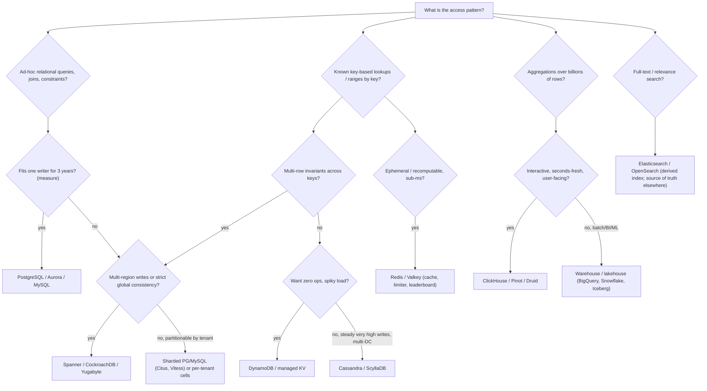

# Database Selection Matrix: PostgreSQL, Cassandra, DynamoDB, Spanner, ClickHouse (and the Rest)

> **Folder 09 · File 01** of the Distributed Systems & System Design L7 Reference.
> **Builds on:**
> - Folder 02 for storage engines, replication, partitioning and NewSQL;
> - [Folder 01 file 02 §7.5](../01-First-Principles-Physics-and-L5-L6-L7-Rubric/02-hardware-network-physics-latency-numbers-and-finops-math.md#75-build-vs-buy-dynamodb-vs-self-managed-cassandra-the-people-term)
>   for the build-vs-buy crossover.
>
> This file is the decision tool: what each engine *is* underneath, what it is good and bad at, and how to choose and
> defend the choice in an interview and in a design review. Version-specific claims are marked ⚠ verify.

---

## 0. The L7 framing: choose by invariant, access pattern, and cost curve, not by brand

Every database choice answers five questions. Ask them in this order:

1. **What invariant must the store protect?**
   - uniqueness;
   - multi-row atomicity;
   - balances;
   - strict ordering;
   - none (an event log).

   The strongest required invariant sets the consistency floor (Folder 01 file 03 §9).
2. **What are the access patterns, and are they known in advance?**
   - point lookups by key;
   - range scans;
   - ad-hoc joins;
   - aggregations over billions of rows;
   - full-text search;
   - graph traversal.
3. **What is the write/read mix and the shape of growth?** Bytes, QPS and skew, now and at 10× (Folder 02 file 01
   RUM).
4. **Where must data live?** Single region, multi-region active-active, residency constraints (Folder 01 file 02 §4:
   physics).
5. **What does it cost to run at our scale,** including people (Folder 01 file 02 §7.5)?

A senior answer names a database. A principal answer names the invariant and the access pattern, shows which engines
satisfy them, and picks by cost curve and operational risk. Often it picks **two stores** with a clear system of
record and a derived, rebuildable index.

---

## 1. The engines, by what they are underneath

| Engine | Data model | Storage engine | Replication / consensus | Partitioning | Transactions & isolation | Sweet spot | Avoid when |
|---|---|---|---|---|---|---|---|
| **PostgreSQL** | Relational + JSONB, extensions (PostGIS, pgvector) | Heap + B-tree/GiST/GIN indexes, MVCC (vacuum) | Async/sync streaming, logical replication; single writer | Manual (Citus for distributed) | Full ACID; RC default; true SERIALIZABLE (SSI) | Default OLTP for most services up to one writer's ceiling; rich queries and constraints | Write throughput beyond one primary; multi-region writes; massive fan-out key-value |
| **MySQL / Aurora MySQL** | Relational | InnoDB clustered B-tree (doublewrite) / Aurora log-structured storage | Binlog async/semi-sync; Aurora 6-copy storage quorum | Manual / Vitess | ACID; RR default (lost-update caveats, Folder 01 file 03 §3.3) | Massive proven OLTP (Vitess sharding at YouTube/Slack scale) | Needing SSI semantics without care; complex analytics |
| **Aurora PostgreSQL** | Relational | PG engine on Aurora storage (redo-only shipping) | 4/6 write, 3/6 read quorum across 3 AZs; fast failover | Single writer; readers share storage | PG semantics | Managed PG with fast failover, 15 readers, storage auto-scaling | Write scaling beyond one instance; very high IOPS cost sensitivity (⚠ check I/O pricing modes) |
| **Cassandra / ScyllaDB** | Wide-column (partition key + clustering columns) | LSM (STCS/LCS/TWCS/UCS); Scylla: shard-per-core | Leaderless, tunable CL (ONE/QUORUM/ALL), hinted handoff, read repair, LWT (Paxos) | Consistent hashing with vnodes | Single-partition atomic batches; LWT for CAS; no multi-partition ACID | Write-heavy, predictable-query, multi-DC active-active (time series, messaging, feeds, IoT) | Ad-hoc queries; joins; strong invariants across partitions; tombstone-heavy queue patterns |
| **DynamoDB** | Key-value / document (PK + SK), GSIs/LSIs | Managed LSM-like storage per partition, Multi-Paxos per partition | 3 AZs synchronous; global tables (multi-active LWW; ⚠ verify multi-region strong mode) | Hash on PK; automatic splits; adaptive capacity | Single-item conditional writes; TransactWriteItems (up to 100 items, ⚠ verify) | Predictable single-digit-ms KV at any scale, zero ops; spiky traffic (on-demand) | Ad-hoc queries; large scans; hot keys; cost at steady very high throughput (§3) |
| **Spanner** | Relational (GoogleSQL/PG dialect), interleaving | Colossus-backed, Paxos-replicated splits | Paxos per split; TrueTime; multi-region configs | Range splits, automatic | **Strict serializable** (external consistency) | Global OLTP needing strong consistency and horizontal writes (ledgers, inventory, identity) | Latency-critical single-region workloads that fit one PG; cost-sensitive small apps |
| **CockroachDB / YugabyteDB** | Relational (PG wire) | Pebble (LSM) / DocDB (RocksDB-based) | Raft per range/tablet; HLC | Range (CRDB) / hash+range (YB) | Serializable (CRDB default) / snapshot or serializable (YB) | Multi-region PG-compatible OLTP without TrueTime hardware | Very low-latency single-node workloads; heavy analytics |
| **TiDB** | Relational (MySQL wire) | TiKV (RocksDB) + TiFlash (columnar) | Raft; Percolator 2PC with TSO | Range regions | SI (RR) / pessimistic mode | MySQL-compatible scale-out + HTAP | Cross-region writes (TSO RTT) |
| **MongoDB** | Document | WiredTiger (B-tree, MVCC) | Raft-like replica sets; read/write concerns | Hash/range sharding (mongos) | Multi-document ACID transactions (4.0+); tunable concerns | Document-shaped data with flexible schemas; developer velocity | Relational integrity needs; misconfigured concerns (`w:1`) for critical data |
| **Redis / Valkey** | In-memory structures (strings, hashes, ZSETs, streams) | RAM (+ RDB/AOF persistence) | Async primary→replica; Cluster with 16,384 slots | Hash slots | Single-threaded atomic commands, MULTI, Lua; **not linearizable across failover** | Caches, rate limiters, leaderboards, ephemeral state, pub/sub | System of record for data you can't lose or recompute |
| **ClickHouse / Druid / Pinot** | Columnar OLAP | Column stores, sparse primary indexes, MergeTree parts (ClickHouse) | Replicated tables (Keeper) / segment replication | Shards + partitions by time | Eventually consistent ingest; no OLTP | Real-time analytics on billions of rows (ad clicks, observability, user-facing dashboards) | OLTP; point updates; frequent deletes (mutations are expensive) |
| **BigQuery / Snowflake / Redshift / Databricks** | Columnar warehouse / lakehouse | Separated storage (object store) and compute | Managed | Micro-partitions / clustering | Snapshot isolation for batch DML | Analytics, ML training sets, BI; pay per scan or compute | Low-latency serving; high-QPS point reads |
| **Elasticsearch / OpenSearch** | Inverted index + doc values | Lucene segments (LSM-like merges) | Primary/replica shards | Document-partitioned shards | None (near-real-time, refresh interval) | Full-text search, log search, faceting | System of record; strong consistency; heavy updates |
| **Lakehouse tables (Iceberg/Delta/Hudi on S3)** | Tables on object storage | Parquet + manifests/snapshots | Object-store durability; optimistic commits via a catalog | Hidden partitioning (Iceberg) | Snapshot isolation per table commit | Petabyte history, time travel, open formats, feature stores' offline side | Low-latency serving |

---

## 2. Decision flow

---

## 3. Cost and scale crossovers (reusing Folder 01 file 02 §7)

| Comparison | Crossover logic | What the numbers said |
|---|---|---|
| DynamoDB on-demand vs provisioned | On-demand ≈ 2.4× provisioned at steady load | Use on-demand for spiky/unknown load, provisioned + autoscaling for steady load |
| DynamoDB vs self-managed Cassandra | People cost is fixed; infrastructure is linear | At 0.1× managed wins; at 1× it's a tie (~$85–91k/month); at 10×, self-managed is ~2× cheaper with a team |
| Aurora/PG vs distributed SQL | One-writer ceiling vs per-statement consensus latency and price | Stay on one writer until measured peak writes approach ~60% of its ceiling; design tenant partitioning early |
| ClickHouse vs warehouse for user-facing analytics | Per-query latency and QPS vs per-scan pricing | Warehouses price per TB scanned: a dashboard refreshed every 5 s over a big table is a cost bug; serve from an OLAP store with pre-aggregation |
| Redis vs DynamoDB DAX vs in-process L1 | Network hop vs memory per process | Hot-key traffic belongs in L1 (73% absorbed in Folder 04 file 02); Redis for shared state |
| Object storage vs block for cold data | $0.023 vs $0.08–0.125/GiB-month plus request costs | Tier by the five-minute rule (Folder 01 file 02 §7.3) |

---

## 4. Failure behavior: what each one does on a bad day

| Engine | Node loss | AZ loss | Region loss | Classic production failure |
|---|---|---|---|---|
| PostgreSQL (streaming replicas) | Failover via Patroni/managed service (seconds–minutes); async RPO = lag | Same | Manual/DR replica promotion; RPO = lag | Replication slot fills disk; vacuum debt/bloat; connection exhaustion (pgbouncer) |
| Aurora | Storage self-heals; writer failover ~30 s or less (⚠ verify) | Survives (storage AZ+1) | Global Database promotion (RPO ~1 s) | I/O cost surprises; writer CPU ceiling |
| Cassandra | Transparent at QUORUM | Transparent with RF=3 across AZs | Multi-DC active-active (LOCAL_QUORUM) | Tombstones; compaction backlog; GC pauses (JVM); repair not running → resurrection |
| DynamoDB | Transparent | Transparent | Global tables (async multi-active) | Hot partitions/keys throttling; GSI back-pressure throttling the base table |
| Spanner / CRDB | Transparent (Paxos/Raft) | Transparent (with 3+ zones) | Survives with multi-region configs (write latency = cross-region quorum) | Hotspots from monotonic keys; transaction retries; clock offset (CRDB self-fencing) |
| Redis | Failover loses acknowledged writes (async) | Cluster loses quorum if masters are co-located | Not designed for it | Memory eviction surprises; fork latency (BGSAVE); hot keys on one shard |
| ClickHouse | Replicas serve; Keeper quorum needed for writes | Depends on replica placement | — | Too many parts (small inserts); mutation storms; memory-limit errors on big joins |
| Elasticsearch | Replica promotion; cluster yellow | Shard allocation awareness | Cross-cluster replication | Mapping explosions; split brain (older versions); heap pressure; slow refresh under heavy indexing |

---

## 5. Which store each of the 32 problems used, and why

| Problem | System of record | Derived / serving stores | Deciding invariant or pattern |
|---|---|---|---|
| 1 KV store | Per-partition LSM + Raft | — | Predictable p99 multi-tenant KV |
| 2 Object storage | Erasure-coded extents + strongly consistent index | Caches | Durability per $; per-key linearizable index |
| 3 Lock service | Replicated state machine (Raft/Zab) | Client caches | Linearizable small state, sessions |
| 5 Rate limiter | In-memory GCRA + async aggregation | — | Low latency over exactness |
| 9 TSDB | Gorilla chunks + object storage | Inverted label index | Compression, recency |
| 11 Zanzibar | Spanner | Leopard index, caches | Snapshot reads at zookie |
| 12 News feed | Posts KV + social graph (TAO-like) | Inboxes (KV), caches, ranking features | Fan-out cost, read latency |
| 13 Chat | Per-conversation partitioned log (Cassandra/HBase-like) | Search index (Slack) | Per-conversation order |
| 19 Search | Source DB / crawl store | Inverted index (Lucene) | Relevance, fan-out tail |
| 22 Geo-dispatch | Trips: OLTP (sharded SQL/KV) | In-memory geo index per city | Ephemeral high-rate writes |
| 23–24 Tickets / booking | Relational/KV with CAS (seat rows, night rows) | Cached availability, search index | Uniqueness via materialized conflicts |
| 26–27 Payments / ledger | Strongly consistent relational (PG/Spanner) | OLAP for reporting | Exactly-once effects, balanced entries |
| 28 Exchange | In-memory engine + journal | Market-data fan-out | Determinism, µs latency |
| 29 Ad clicks | Raw log on object storage | OLAP (ClickHouse/Pinot), budget counters | Auditability, event time |
| 30 Leaderboard | KV of scores | Redis ZSETs + histograms | Tiered exactness |
| 31 Feature store | Lakehouse (offline) | KV (online) | Point-in-time joins |
| 32 LLM gateway | Usage/audit logs (append-only) | Caches, quota counters | Token budgets, tenant isolation |

**The recurring L7 pattern: one system of record, chosen for its invariant, plus derived stores, each chosen for one
access pattern, all rebuildable from the record via CDC or replay.** When a derived store is wrong (and eventually
one will be), you rebuild it. You never have to reconcile two sources of truth.

---

## 6. L5 vs L6 vs L7

| | L5 (Senior) | L6 (Staff) | L7 (Principal) |
|---|---|---|---|
| Selection | Names a familiar database | Justifies by access pattern, consistency and scale; knows engine internals (B-tree vs LSM, leaderless vs Raft) | Starts from the invariant; system of record + derived stores; cost crossovers with people cost; migration path as part of the choice |
| Failure | — | Node/AZ behavior | Classic production failure modes per engine (tombstones, slots, hot partitions, fork latency) and their operational cost |
| Evolution | — | Schema migration plans | One-writer ceiling forecasting; tenant partitioning early so later moves are data migrations, not rewrites |

---

## 7. Bar-raiser probing chains

### Chain A: "Why not just use DynamoDB for everything?"

1. **L5:** "It scales infinitely and is fully managed."
2. **Probe:** "We need to query orders by status, date range and customer, and run monthly reports." **L6:** "That's
   GSIs per access pattern; reports go to a warehouse via streams. Ad-hoc queries don't fit."
3. **Probe:** "Cost is now $400k/month at steady 300k writes/s." **L7:**
   - "Steady, high, predictable throughput is where managed per-request pricing loses. Provisioned with reserved
     capacity first."
   - "Then compare to self-managed Cassandra/Scylla with our team cost; the crossover math says ~1–10× our scale."
   - "Keep DynamoDB for spiky or low-volume tables where zero-ops wins."

### Chain B: "PostgreSQL or Cassandra for a messaging system?"

1. **L5:** "Cassandra, because it scales."
2. **Probe:** "What's the access pattern?" **L6:** "Messages by conversation, ordered by time: partition key
   conversation_id, clustering key seq. A natural fit for wide-column, write-heavy, multi-DC."
3. **Probe:** "We also need per-user unread counts and message search." **L7:**
   - "Different invariants and patterns, different stores."
   - Messages live in Cassandra (or sharded PG if volume allows), as the system of record.
   - Unread counters are derived (Redis/KV), rebuildable from the log.
   - Search is an Elasticsearch index fed by CDC.
   - "Each derived store can be dropped and rebuilt; the message log is the only thing we must never lose."

### Chain C: "We need a globally consistent database for our user profiles."

1. **L5:** "Spanner."
2. **Probe:** "What invariant needs global strong consistency?" **L6:** "Unique usernames and emails; most profile
   fields don't."
3. **Probe:** "Design it." **L7:**
   - "Profiles live in a home-region store (users rarely move), replicated async elsewhere for reads."
   - "Uniqueness goes in a small, strongly consistent registry (Spanner/CRDB, or a conditional-write table with
     global coordination) touched only on signup and rename."
   - "The global consistency bill is paid only on the rare operation that needs it (Folder 01 file 03 §5.2)."

---

## 8. References

- M. Stonebraker, U. Çetintemel. *"One Size Fits All": An Idea Whose Time Has Come and Gone.* ICDE 2005.
- M. Kleppmann. *Designing Data-Intensive Applications*, ch. 2–3, 5–7.
- M. Elhemali et al. *Amazon DynamoDB.* USENIX ATC 2022. J. Corbett et al., *Spanner*, OSDI 2012. R. Taft et al.,
  *CockroachDB*, SIGMOD 2020. A. Verbitski et al., *Aurora*, SIGMOD 2017.
- A. Lakshman, P. Malik. *Cassandra.* LADIS 2009.
- ClickHouse documentation (MergeTree), Apache Pinot/Druid documentation, Apache Iceberg specification.
- Vitess documentation (vitess.io); Citus documentation.
