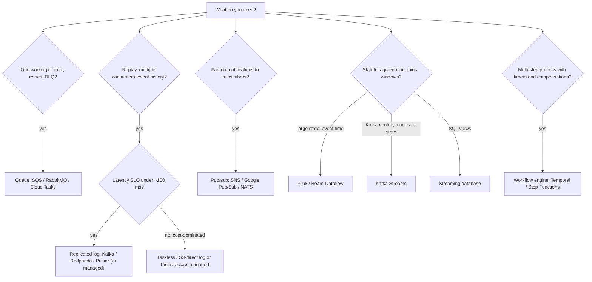

# Async Messaging and Stream Processing: The Decision Matrix

> **Folder 09 · File 02** of the Distributed Systems & System Design L7 Reference.
> **Builds on:**
> - [Folder 06 problem 8](../06-32-Master-Problems-Part1-Data-Storage-and-Infra/02-problems-05-to-08-rate-limiter-id-generator-job-scheduler-and-message-broker.md#problem-8-a-distributed-log--message-broker-kafka-class)
>   (the broker internals);
> - [Folder 05 file 02](../05-Resiliency-Multi-Region-and-Metastable-Failures/02-metastable-failures-retry-storms-load-shedding-and-adaptive-lifo.md)
>   (retries, backpressure);
> - [Folder 08 problem 29](../08-32-Master-Problems-Part3-Commerce-Geo-and-FinTech/03-problems-29-to-32-ad-click-aggregator-leaderboard-feature-store-and-ai-gateway.md)
>   (event time, exactly-once effects).
>
> Version-specific claims are marked ⚠ verify.

---

## 0. First, which abstraction do you need?

Most messaging mistakes are abstraction mistakes: using a queue where you need a log, or a log where you need a
workflow engine.

| Abstraction | Semantics | Consumers | Retention | Ordering | Typical tools |
|---|---|---|---|---|---|
| **Work queue** | Each message processed by **one** worker; acked and then deleted | Competing consumers | Until acked (+ DLQ) | Usually none (FIFO variants are per group) | SQS, RabbitMQ, Cloud Tasks, NATS JetStream work-queue mode |
| **Pub/sub fan-out** | Each subscriber gets a copy | Independent subscriptions | Per subscription, short | Usually per key/ordering key | SNS, Google Pub/Sub, NATS, Redis pub/sub (no durability) |
| **Replayable log** | Append-only, ordered per partition; consumers track offsets | Many independent groups, each with its own position | Time/size-based (days → forever with tiering) | **Per partition** | Kafka, Redpanda, Pulsar, Kinesis, Event Hubs, WarpStream/diskless |
| **Stream processing** | Stateful computation over logs: windows, joins, aggregates | Jobs with checkpointed state | State + output topics/tables | Event-time aware | Flink, Kafka Streams, Spark Structured Streaming, Beam/Dataflow, RisingWave/Materialize |
| **Durable workflow / orchestration** | Multi-step business processes with timers, retries, compensations | Workflow workers | Workflow history | Per workflow instance | Temporal, AWS Step Functions, Cadence |

The decision rules:
- **Need replay, multiple independent consumers, or an event-sourced history?** Use a log.
- **Need one-of-N task distribution with per-message retry/visibility semantics?** Use a queue.
- **Need "wait 3 days, then charge, else refund"?** Use a workflow engine, not a queue with cron jobs (Folder 03 file
  03 §4 sagas).

---

## 1. Logs and brokers compared

| | Kafka (KRaft) | Redpanda | Pulsar | Kinesis Data Streams | Google Pub/Sub | SQS (standard / FIFO) | RabbitMQ (quorum queues/streams) | Diskless/S3-direct (WarpStream, KIP-1150-style) |
|---|---|---|---|---|---|---|---|---|
| Model | Partitioned log | Kafka-API log (C++, thread-per-core) | Segmented log on BookKeeper; brokers stateless | Sharded log (managed) | Managed pub/sub, ordering keys | Managed queue | Broker queues (Raft-based quorum queues) + streams | Kafka-API log with data in object storage |
| Ordering | Per partition | Per partition | Per partition / key | Per shard | Per ordering key | None / per message group (FIFO) | Per queue | Per partition |
| Retention / replay | Configurable; tiered storage | Configurable; tiered | Tiered to object storage natively | 24 h–365 days (⚠ verify) | Up to days; seek/snapshots | 14 days max; no replay after ack | Streams replay; queues delete on ack | Long, cheap (object storage) |
| Throughput per partition/shard | High (tens of MB/s) | High | High | 1 MB/s or 1,000 records/s in per shard (⚠ verify) | Auto-scaled | Effectively unlimited (standard) | Moderate | High aggregate; per-partition latency higher |
| Latency (p99) | ~5–20 ms in-region (acks=all) | Lower tails (no JVM GC) | Low–moderate | ~100s of ms | ~100 ms | ~10s–100s of ms | ms | **Hundreds of ms – ~1 s** (object-store PUTs) |
| Exactly-once | Idempotent producers + transactions (within Kafka) | Kafka-compatible EOS | Transactions (⚠ verify maturity) | At-least-once; dedupe in consumers | At-least-once; exactly-once delivery option within Pub/Sub (⚠ verify) | Standard: at-least-once; FIFO: dedupe window 5 min | At-least-once; publisher confirms | Kafka-API semantics (⚠ verify per vendor) |
| Ops burden | Medium–high (self-managed); managed options | Medium | High (BookKeeper + brokers + ZK/metadata) | None | None | None | Medium | Low (stateless agents) |
| Cost drivers | Brokers + disks + **cross-AZ replication** | Similar, fewer nodes | Brokers + bookies | Shard-hours + PUT payload units | Per GB delivered | Per request | Nodes | Object-store requests + storage (no cross-AZ replication) |
| Choose when | The default replayable event backbone | Kafka API with tighter tails/simpler ops | Multi-tenancy, geo-replication, tiered by design | AWS-native, modest throughput, zero ops | GCP-native fan-out, global | Task queues, decoupling, retries with DLQ | Rich routing (exchanges), per-message acks, RPC-ish patterns | High-volume, latency-tolerant streams where cross-AZ cost dominates |

**The L7 cost reminder** (Folder 01 file 02 §7.4): on a 3-AZ cloud deployment, Kafka's replication traffic, not its
brokers, is often the largest line item. At 1 GiB/s it is ~$175k/month on list prices, against ~$5.6k for an
S3-direct design. **Pick per topic by latency SLO.**

---

## 2. Delivery semantics, precisely

| Claim | What it really means | How you get it |
|---|---|---|
| At-most-once | Messages may be lost, never duplicated | Ack before processing; fire-and-forget |
| **At-least-once** | Never lost; **may be duplicated** | Ack after processing; producer retries. This is the default everywhere |
| "Exactly-once delivery" | Not achievable across a network boundary in general | — |
| **Exactly-once effects** | Each message's effect applied once | At-least-once delivery + **idempotent consumers** (dedupe by message/business ID, upserts, conditional writes) or **transactional** consume-process-produce within one system (Kafka transactions, Flink two-phase-commit sinks) |
| Ordering | Per partition/key only, never global (at scale) | Partition by the entity whose order matters; single writer per key |

**Consumer idempotency is not optional.** Rebalances, retries and replays re-deliver. Folder 07 problem 13 (chat)
and Folder 08 problems 26 and 29 (payments, clicks) are the worked examples.

---

## 3. Stream processors compared

| | Apache Flink | Kafka Streams | Spark Structured Streaming | Beam on Dataflow | Streaming databases (RisingWave, Materialize) |
|---|---|---|---|---|---|
| Model | Dataflow operators, event time, watermarks, timers | Library in your app; KStream/KTable | Micro-batch (continuous mode limited) | Unified batch/stream model; runners | Incrementally maintained SQL views |
| State | Large keyed state (RocksDB), incremental checkpoints, savepoints | RocksDB state stores + changelog topics | State store; checkpoint to object storage | Managed (Dataflow shuffle/state) | Internal storage |
| Exactly-once | Checkpoints + 2PC sinks | Kafka transactions (EOS v2) | Checkpoints + idempotent/transactional sinks | Runner-dependent; Dataflow exactly-once processing | Internal consistency |
| Latency | ms–s | ms–s | ~100 ms – s | s | s |
| Ops | A cluster (or managed) | None beyond your app + Kafka | A cluster (Databricks/EMR) | Fully managed | Managed/self-hosted DB |
| Choose when | Complex event-time logic, large state, high scale | Kafka-centric microservices, moderate state | Teams already on Spark; batch + streaming code reuse | GCP; unified pipelines; autoscaling | SQL-first teams; materialized views over streams |

The companion *Unified Dataflow/Beam/Flink L7 Reference* in this workspace goes deep on watermarks, windowing,
exactly-once and state.

---

## 4. Decision flow

---

## 5. Patterns and anti-patterns

| Pattern | Use | Note |
|---|---|---|
| **Transactional outbox** | DB change + event publish atomically | The relay gives at-least-once; consumers are idempotent (Folder 03 file 03 §2.3) |
| **CDC** (Debezium, native change streams) | Derive search indexes, caches, analytics from the system of record | Slot/WAL retention bounded; per-key ordering; schema evolution (Folder 02 file 02 §1.2) |
| **Event sourcing** | The log *is* the state; projections rebuildable | Snapshots for replay time; schema versioning of events forever |
| **Claim check** | Large payloads in object storage, references in messages | Keeps brokers fast; lifecycle the objects |
| **DLQ with redrive** | Poison messages | Alert on DLQ depth; redrive tooling; never infinite retry loops |
| **Backpressure via lag** | Consumer lag as the SLI | Autoscale consumers ≤ partition count; shed or degrade upstream when lag grows |

| Anti-pattern | Why it hurts |
|---|---|
| A queue as a database ("we'll query the queue") | No indexes; replay is gone after ack |
| A database as a queue (polling with `SELECT … FOR UPDATE SKIP LOCKED` at huge scale) | Fine up to moderate rates; at scale, tombstones/bloat and lock contention (Folder 02 file 01 §2.7) |
| One topic partition for global order | Throughput = one partition; order rarely needs to be global, only per entity |
| Retries inside consumers *and* in the broker *and* in clients | Amplification (Folder 05 file 02: 4⁵ = 1,024×) |
| Unbounded retention of PII in logs | Compliance risk; use crypto-shredding (per-user keys) for erasure |
| Synchronous request/reply over a log for latency-critical calls | Adds broker latency and coupling; use RPC with deadlines |

---

## 6. L5 vs L6 vs L7

| | L5 (Senior) | L6 (Staff) | L7 (Principal) |
|---|---|---|---|
| Choice | "Use Kafka" | Queue vs log vs pub/sub vs workflow by semantics; partitioning for order | Per-topic tiering by latency SLO and cost (cross-AZ vs diskless); exactly-once *effects* end to end; workflow engines for long-running business processes |
| Semantics | "Exactly-once" | At-least-once + idempotency; transactions within Kafka | Where exactly-once boundaries end (external sinks); reconciliation as the proof (problem 29) |
| Operations | — | Lag, DLQs, rebalances | Backpressure as a system property; retry ownership at one layer; schema evolution and PII retention as multi-year constraints |

---

## 7. Bar-raiser probing chains

### Chain A: "Use Kafka between the order service and the email service."

1. **L5:** "Order service publishes; email service consumes."
2. **Probe:** "The order service writes to its DB and then publishes. It crashes between the two." **L6:**
   "Transactional outbox: write the event in the same DB transaction; a relay publishes."
3. **Probe:** "The email gets sent twice after a consumer rebalance." **L7:**
   - "At-least-once is the contract, so the email consumer dedupes by order_id + email type in a store with a TTL,
     or the email provider's idempotency key."
   - "And ask whether Kafka is even the right tool for a one-consumer task with retries. A queue with a DLQ is
     simpler. Kafka earns its place when several consumers need the order-event history."

### Chain B: "We need exactly-once counting of clicks into our warehouse."

1. **L5:** "Kafka has exactly-once."
2. **Probe:** "The warehouse isn't Kafka." **L6:** "Flink with checkpointing and a 2PC sink, or idempotent upserts
   keyed by (ad, minute)."
3. **Probe:** "How do you prove it to advertisers?" **L7:**
   - "Keep the raw immutable log; recompute daily in batch; compare and invoice from the reconciled numbers
     (problem 29)."
   - "Exactly-once inside the pipeline is an optimization; reconciliation against the raw log is the guarantee."

### Chain C: "Our Kafka bill is too high."

1. **L5:** "Reduce retention."
2. **Probe:** "Retention is already 3 days." **L6:** "Cross-AZ: enable rack-aware consumers and compress at the
   producer."
3. **Probe:** "Still too high." **L7:**
   - Classify topics: the 20% that need < 50 ms stay on replicated brokers.
   - The 80% that tolerate ~1 s move to a diskless, object-storage-backed log (Folder 01 file 02 §7.4: ~31× cheaper
     in the model).
   - Long-tail retention moves to tiered storage.
   - "Price the latency change with each consumer team, and make it a per-topic decision, not a platform-wide one."

---

## 8. References

- J. Kreps. *The Log: What every software engineer should know about real-time data's unifying abstraction*, 2013.
- T. Akidau et al. *The Dataflow Model.* VLDB 2015. P. Carbone et al., *State Management in Apache Flink*, VLDB
  2017.
- Confluent. *Exactly-Once Semantics Are Possible: Here's How Kafka Does It*, 2017; KIP-98, KIP-447.
- Apache Pulsar, RabbitMQ (quorum queues, streams), NATS JetStream, Amazon SQS/Kinesis, Google Pub/Sub
  documentation.
- Temporal documentation (durable execution). C. Richardson, *Microservices Patterns* (outbox, sagas).
