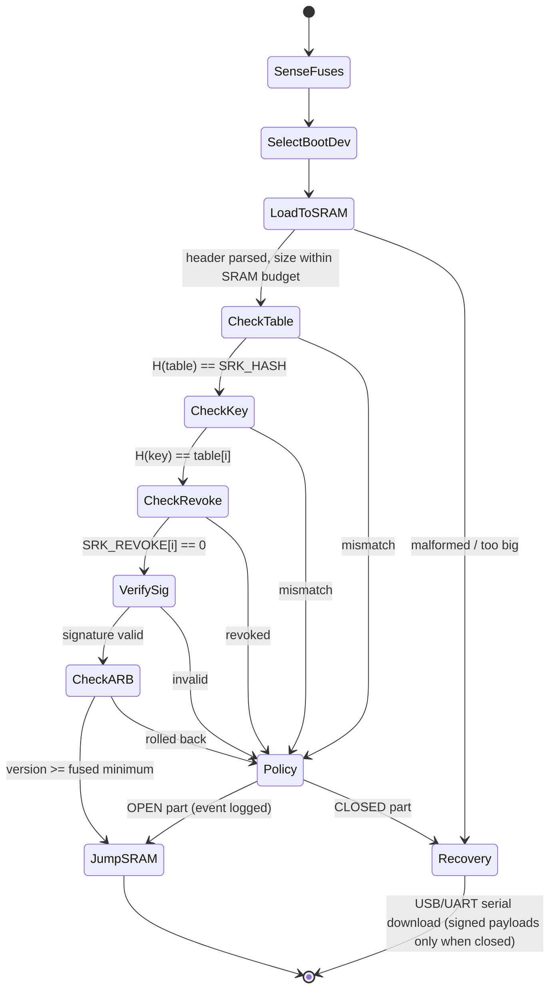

# 01.1 · BootROM, eFUSE/OTP, PUF and the Cryptographic Chain of Trust

> **Folder 01 · File 1 of 4.** Every security property of an embedded Linux product rests on roughly 32 KiB of mask ROM and 256 bits of fuse. If the BootROM accepts the wrong first-stage image, nothing built above it (TF-A, OP-TEE, verified FIT, dm-verity, TUF) can recover, because the attacker now runs before all of it.
>
> This file goes from the physical reset vector to the first mutable instruction:
> - what the BootROM reads from OTP, in what order, and why it verifies in on-chip SRAM **before** DDR exists;
> - eFUSE/antifuse physics and fuse maps, and why you fuse the **hash of a key table**, not a key;
> - anti-rollback monotonic fuses, and the commit-on-success rule that keeps A/B updates from bricking;
> - PUF-derived keys and the error-correction margin that decides your field failure rate;
> - vendor implementations: NXP HABv4/AHAB, Qualcomm SecBoot, NVIDIA PKC/SBK, AMD PSP, Apple SecureROM/SEP.
>
> **Verified listings (✅)** were compiled warning-free with GCC 16.2 (`-Wall -Wextra -Wpedantic -Werror -Wconversion -Wsign-conversion …`) and Clang 21.1 for `aarch64-linux-gnu`. They were run against images signed by the OpenSSL 3.5 CLI, and the output shown is the captured run. **📄** marks configuration taken from upstream documentation at the pinned version (U-Boot v2026.10). **⚠** marks vendor details that are under NDA or only partly public: confirm them against your SoC's security reference manual.

---

## 1. First-Principles Architecture & Hardware State Machines

### 1.1 From the reset vector to the first mutable instruction

On an ARMv8-A core that implements EL3, a cold reset puts the PE in **AArch64 EL3**. It fetches its first instruction from the address in **RVBAR_EL3**, a read-only register whose value is IMPLEMENTATION DEFINED: the SoC drives it from reset-vector configuration signals sampled at reset. (On 32-bit ARMv7-A the equivalent is 0x00000000, or 0xFFFF0000 when high vectors are selected at reset.) SoC vendors point that vector into **mask ROM**: transistors patterned at fabrication, which no software, JTAG probe or fuse can change.

```text
 power-good / POR deasserts
        │
        ▼
 ┌──────────────────────────────────────────────────────────────────────────────┐
 │ BootROM (mask ROM, on-die, EL3, MMU off, caches off or ROM-managed)          │
 │  1. sense fuses → shadow registers (SEC_CONFIG, SRK_HASH, BOOT_CFG, ARB ctr)  │
 │  2. pick boot device: BOOT_MODE pins, or BOOT_CFG fuses if BT_FUSE_SEL blown  │
 │  3. bring up minimal clocks, on-chip SRAM, boot-device controller only        │
 │  4. copy stage-1 (SPL/BL2 + DDR-training firmware) from flash INTO SRAM       │
 │  5. verify the SRAM copy:  H(SRK table) == SRK_HASH fuses                     │
 │                            H(pubkey)    == table[index], index not revoked    │
 │                            RSA/ECDSA(signature) over header ‖ payload         │
 │                            image security_version ≥ ARB fuse counter          │
 │  6. CLOSED part + any failure → refuse; enter serial-download recovery        │
 │     OPEN part  + any failure → log an event, boot anyway                      │
 │  7. jump to the verified SRAM copy (never re-fetch from flash)                │
 └──────────────────────────────────────────────────────────────────────────────┘
        │  first mutable code, still in SRAM
        ▼
 stage-1: SPL / TF-A BL2  — trains DDR, then loads and verifies BL31, BL32, BL33
        │                  (via ROM-exported verify API, or its own crypto + ROTPK hash)
        ▼
 BL31 (EL3 runtime) → BL32 OP-TEE (S-EL1) → BL33 U-Boot (NS-EL2/EL1) → Linux   (01.2–01.4)
```



### 1.2 Why stage 1 is verified in SRAM before DDR is initialized

DDR doesn't exist when the BootROM runs. It needs a controller and PHY configuration plus a training sequence, and that is itself firmware. The ROM therefore verifies **the stage that trains DDR**. U-Boot's i.MX8M guide says it plainly: out of reset the ROM authenticates the SPL **and** the DDR PHY initialization blobs, which together bring up DDR. Only then does SPL load the rest into DRAM and extend the chain.

There are three reasons the order is non-negotiable:

| Threat | Why external memory makes it possible | What the SRAM-first rule buys |
|---|---|---|
| **TOCTOU / double fetch** | Flash and DRAM are off-die; an interposer, or a flash part emulator, can return different bytes on the second read | The ROM reads once into on-die SRAM, verifies that copy and executes that copy (§2.1, test [9]) |
| **Bus probing and interposers on DDR** | DDR lines are long, slow and physically reachable; cold-boot and interposer attacks target exactly this | Secrets and the verifier's working state never leave the die during stage 1 |
| **Unauthenticated DDR training code** | DDR PHY firmware runs with full bus-master power; if it were loaded unverified, the root of trust would have a hole the size of a firmware blob | The training firmware is inside the signed stage-1 envelope |

**Consequence for architects:** the stage-1 image has a hard size budget, which is the SRAM size minus ROM stack and buffers. Every feature you add to SPL/BL2 competes with that budget, and running out of SRAM is a classic late-program surprise.

### 1.3 eFUSE / OTP physics, and what "one-time" really means

| Technology | Mechanism | Read path | Engineering consequences |
|---|---|---|---|
| **eFuse** (poly/metal link) | A programming current causes electromigration that opens the link: 0 → 1 | Sense amplifiers at power-on; values latched into **shadow registers** that software reads via the OTP controller | Programming needs a dedicated supply at a specified voltage and timing; a brown-out mid-burn leaves a **marginal** bit that can read differently across temperature |
| **Antifuse** (oxide breakdown) | High voltage ruptures a gate oxide and forms a conductive path | Same pattern: sense, then shadow | Common in advanced nodes; denser and harder to read optically than eFuse |

Software-visible rules that follow from the physics, and are enforced by the model in §2.1:
1. **Bits only go 0 → 1.** Writing zeros is a no-op, not a clear (test [7]).
2. **Sticky locks.** Most fuse controllers have lock bits that write-protect (and sometimes read-protect) a field. On NXP i.MX6, **SRK_LOCK** is bank 0 word 0 bit 14 (`0x4000`).
3. **Shadow registers can be overridden until reset** on some parts, for testing. That's why the BootROM itself, not software, must sense the security fields.
4. **Device-unique secret keys** (NXP OTPMK, Qualcomm/NVIDIA device keys ⚠) are wired to the crypto engine's key bus and are **not readable by any software**. That's the property that makes CAAM blobs and TEE hardware-unique keys meaningful (01.3).

**NXP i.MX fuse map for secure boot** (📄 values from U-Boot v2026.10 `doc/imx/habv4/guides/mx6_mx7_secure_boot.txt`):

| Field | i.MX6 series | i.MX7D/S | i.MX7ULP |
|---|---|---|---|
| SRK_HASH[255:0] | bank 3, words 0–7 | bank 6, words 0–3 (bits 127:0) and bank 7, words 0–3 (bits 255:128) | bank 5, words 0–7 |
| SEC_CONFIG[1] (close) | bank 0 word 6 = `0x00000002` | bank 1 word 3 = `0x02000000` | bank 29 word 6 = `0x80000000` |
| SRK_LOCK | bank 0 word 0 = `0x00004000` | bank 0 word 0 = `0x00000200` | bank 1 word 1 = `0x00000080` |
| DIR_BT_DIS | bank 0 word 6 = `0x00000008` | bank 1 word 3 = `0x08000000` | bank 1 word 1 = `0x00002000` |
| SJC_DISABLE | bank 0 word 6 = `0x00100000` | bank 1 word 3 = `0x00200000` | bank 1 word 1 = `0x00000020` |
| JTAG_SMODE (no debug) | bank 0 word 6 = `0x00C00000` | bank 1 word 3 = `0x00C00000` | bank 1 word 1 = `0x000000C0` |

### 1.4 Why you fuse the hash of a key table, not a key

256 bits of fuse can't hold an RSA-4096 modulus, and a single fused key can never be rotated. So every serious BootROM fuses a **digest of a table of root public keys**:

```text
 SRK table = H(pubkey0) ‖ H(pubkey1) ‖ H(pubkey2) ‖ H(pubkey3)      (shipped in every image)
 SRK_HASH fuses = H(SRK table)                                       (256 bits, burned once)
 image carries: table, the full pubkey i, index i, signature by key i
 ROM checks:    H(table) == fuses  →  H(pubkey i) == table[i]  →  SRK_REVOKE[i] == 0  →  signature
```

With four keys you can **revoke** a compromised one by blowing its revoke bit, and continue with another. The fuses never change, because the table hash still matches. NXP HABv4 and AHAB both use four super-root keys. ⚠ On HABv4 parts, not every SRK slot is necessarily revocable (check your reference manual for the SRK_REVOKE field width). Always keep at least one key you can never revoke offline and air-gapped.

A HABv4 PKI is deeper than the root: the **SRK** signs a **CSF key** and an **IMG key** certificate; the CSF (command sequence file) is signed by the CSF key; image data is signed by the IMG key. NXP's "fast authentication" mode signs directly with the SRK, which is convenient for development but removes your ability to rotate image keys without touching the root.

### 1.5 Vendor implementations at a glance

| Vendor / family | First code | Root of trust in fuses | Stage-1 format | Anti-rollback | Notes |
|---|---|---|---|---|---|
| **NXP i.MX6/7/8M (HABv4)** | On-die BootROM | SRK_HASH (SHA-256 of 4-key table); SEC_CONFIG closes the part | IVT + boot data + image + **CSF** (CMS signatures), signed with NXP CST | Software-managed (fuses or RPMB counters in later stages) | Open parts log **HAB events** but boot; `hab_status` reports them. ROM HAB API callable from SPL |
| **NXP i.MX8/8X/9, i.MX93/95 (AHAB)** | ROM plus a security subsystem (SECO / EdgeLock Secure Enclave) | SRK hash of 4-key table in fuses | **Containers**: header, image array, signature block with SRK table | Container fuse version field ⚠ | U-Boot `ahab_status` / `ahab_close` |
| **Qualcomm Snapdragon** ⚠ | PBL (primary boot loader) in ROM | OEM root-certificate hash (OEM_PK_HASH) in QFPROM fuses | Hash-segmented ELF ("MBN"): a signed hash table covers every program segment | Version fuses in QFPROM | Recovery via the ROM's emergency download mode; on secure parts it only accepts a signed programmer |
| **NVIDIA Tegra / Jetson** ⚠ | BootROM, on recent parts running on an on-die security/management core rather than the CPU cluster | **PKC**: hash of the OEM public key; **SBK**: AES secure-boot key for optional encrypted boot; OEM keys (K1/K2) | BCT + MB1/MB2 boot chain, signed by NVIDIA's flashing tools | Fused / BCT-controlled ⚠ | RCM recovery accepts only signed payloads once PKC is fused |
| **AMD PSP / ASP** ⚠ | ROM in the Platform Security Processor (an Arm core inside the x86 SoC), before any x86 core runs | AMD root-key hash in ROM/fuses. **Platform Secure Boot (PSB)** optionally fuses the OEM's BIOS-signing key hash | Signed PSP firmware directory entries | PSP security patch level ⚠ | Enabling PSB permanently binds a CPU to one OEM's firmware key: a "vendor-locked" CPU can't move to another vendor's board |
| **Apple** | Boot ROM ("SecureROM") holding the Apple Root CA public key | Keys in ROM. A per-device **UID** key is fused into the AP and the Secure Enclave, and is inaccessible to software | **Image4** manifests, personalized per device (ECID) with a nonce from Apple's signing server | Personalization: an old signed image can't be replayed without a fresh, per-device server signature | The Secure Enclave has its own boot ROM and boot chain (Apple Platform Security Guide) |

### 1.6 Anti-rollback: monotonic fuses as a thermometer code

A signed old image is still validly signed, so signatures alone don't stop a downgrade to firmware with a known vulnerability. The fix is a **monotonic counter** the attacker can't decrement:

```text
 ARB fuse field (128 bits):  0000…0000000000011111   popcount = 5  → minimum security_version = 5
 commit to version 7:        0000…0000000001111111   blow bits 5 and 6; bits never return to 0
```

- **Thermometer (unary) coding**, one fuse per step, because a binary counter can't be incremented using only 0 → 1 transitions. The budget is fixed for life: 64 bits means 64 security-relevant releases. Bump `security_version` only for security fixes, not every build.
- **Read it with popcount**, not "highest bit set". An interrupted burn that leaves a gap then reads as a *lower* minimum, which fails safe for availability. It's still never lower than the last completed commit.
- **Who blows the fuses, and when, is the most important design decision** (§2.4). The BootROM only *reads* the counter. A later stage *commits* it after the new image has proven it boots. Commit early, and your A/B fallback slot becomes a rolled-back image the ROM refuses: a brick (Folder 03).

Other monotonic stores serve later stages: TF-A's TBBR **non-volatile counters** (`plat_get_nv_ctr`/`plat_set_nv_ctr`, 01.2), OP-TEE secure storage in **RPMB** (01.3) and **TPM NV counters** (01.4).

### 1.7 PUF-derived keys

A **physically unclonable function** derives a device-unique secret from manufacturing variation. The common one is **SRAM power-up state**: each bit settles to a value biased by transistor mismatch. Nothing is stored, so there's no fuse to read optically. But the response is **noisy** (temperature, voltage, aging), so a **fuzzy extractor** is needed:
- At **enrollment**, a random key K is encoded with an error-correcting code C, and helper data **W = C(K) ⊕ R** is stored in ordinary flash. W is public.
- At **every boot**, the fresh response R′ = R ⊕ noise gives K′ = Decode(W ⊕ R′); the device key is KDF(K′).

The error-correction margin is a **field-failure knob**. If Decode fails, the device can't derive its key, which means it can't decrypt its firmware or attest. Production PUF IP uses concatenated codes (BCH or Golay plus repetition) and is characterized at temperature and voltage corners. The model below uses a plain repetition code to show the shape of the trade-off (§2.5).

---

## 2. Production Code & Configuration Blueprints

### 2.1 ✅ A BootROM verifier, from first principles

This is a reference model, not vendor ROM code. It implements the exact checks of §1.1 with no crypto library:
- SHA-256 per FIPS 180-4;
- RSA-2048 PKCS#1 v1.5 verification by Montgomery multiplication;
- OTP 0 → 1 semantics with sticky locks;
- SRK-table hashing, revocation, a thermometer anti-rollback counter;
- open/closed policy;
- two load paths: fragile and hardened.

Signing happens in OpenSSL, so the verifier is checked against an independent implementation.

```c
/* rot_model.h - BootROM chain-of-trust reference model: public API (image format, OTP map, verdicts) */
#ifndef ROT_MODEL_H
#define ROT_MODEL_H

#include <stddef.h>
#include <stdint.h>

/* ---------------- SHA-256 (FIPS 180-4) ---------------- */
#define ROT_SHA256_LEN 32u
typedef struct {
    uint32_t h[8];
    uint64_t total;      /* bytes hashed so far */
    uint8_t  buf[64];
    size_t   used;
} rot_sha256_ctx;

void rot_sha256_init(rot_sha256_ctx *c);
void rot_sha256_update(rot_sha256_ctx *c, const uint8_t *p, size_t n);
void rot_sha256_final(rot_sha256_ctx *c, uint8_t out[ROT_SHA256_LEN]);
void rot_sha256(const uint8_t *p, size_t n, uint8_t out[ROT_SHA256_LEN]);

/* ---------------- RSA-2048 PKCS#1 v1.5 (SHA-256) verify ---------------- */
#define ROT_RSA_BYTES 256u
int rot_rsa2048_verify(const uint8_t n_be[ROT_RSA_BYTES], uint32_t e,
                       const uint8_t sig_be[ROT_RSA_BYTES],
                       const uint8_t digest[ROT_SHA256_LEN]);

/* ---------------- OTP / eFUSE model ----------------
 * Word map (32-bit words), loosely modelled on NXP HAB/AHAB and Qualcomm QFPROM layouts:
 *   0..7   SRK_HASH[255:0]      SHA-256 of the 4-entry super-root-key table
 *   8      SRK_REVOKE[3:0]      bit k set => SRK k may never sign again
 *   9      SEC_CONFIG           bit 1 = CLOSED (enforce), bit 2 = JTAG disabled
 *   10..13 ARB_COUNTER[127:0]   anti-rollback thermometer code: min version = popcount
 *   14     LOCK                 bit w set => word w is write-locked (sticky)
 */
#define ROT_OTP_WORDS          15u
#define ROT_OTP_SRK_HASH       0u
#define ROT_OTP_SRK_REVOKE     8u
#define ROT_OTP_SEC_CONFIG     9u
#define ROT_OTP_ARB_FIRST      10u
#define ROT_OTP_ARB_WORDS      4u
#define ROT_OTP_LOCK           14u
#define ROT_SEC_CLOSED         (1u << 1)
#define ROT_SEC_JTAG_OFF       (1u << 2)
#define ROT_ARB_MAX_VERSION    (32u * ROT_OTP_ARB_WORDS)

typedef struct {
    uint32_t word[ROT_OTP_WORDS];
} rot_otp;

typedef enum {
    ROT_OTP_OK = 0,
    ROT_OTP_LOCKED,      /* word is write-locked                        */
    ROT_OTP_RANGE,       /* bad word index                              */
    ROT_OTP_NOOP         /* requested bits already blown: nothing to do */
} rot_otp_status;

rot_otp_status rot_otp_program(rot_otp *otp, unsigned word, uint32_t set_bits);
unsigned rot_otp_min_version(const rot_otp *otp);
rot_otp_status rot_otp_commit_version(rot_otp *otp, unsigned version);

/* ---------------- Signed image format (little-endian header) ----------------
 *   rot_hdr | srk_table[4][32] | pubkey n[256] (big-endian) | payload | signature[256]
 * The signature covers every byte before it (header .. payload).
 */
#define ROT_MAGIC        0x31546f52u   /* "RoT1" */
#define ROT_SRK_COUNT    4u
#define ROT_MAX_PAYLOAD  (64u * 1024u) /* on-chip SRAM budget for stage 1 */

typedef struct {
    uint32_t magic;
    uint16_t hdr_version;
    uint8_t  srk_index;          /* which SRK signed this image  */
    uint8_t  flags;
    uint32_t security_version;   /* anti-rollback version          */
    uint32_t payload_len;
    uint32_t pub_exponent;       /* must be 65537                  */
    uint32_t reserved;
} rot_hdr;                       /* 24 bytes, no padding           */

#define ROT_HDR_LEN      24u
#define ROT_TABLE_LEN    (ROT_SRK_COUNT * ROT_SHA256_LEN)
#define ROT_FIXED_LEN    (ROT_HDR_LEN + ROT_TABLE_LEN + ROT_RSA_BYTES)

typedef enum {
    ROT_BOOT_OK = 0,             /* verified, jump to entry                     */
    ROT_BOOT_OK_UNVERIFIED,      /* OPEN part: failure logged as event, booted  */
    ROT_FAIL_FORMAT,
    ROT_FAIL_TOO_BIG,
    ROT_FAIL_SRK_TABLE,          /* table hash != SRK_HASH fuses                */
    ROT_FAIL_KEY_NOT_IN_TABLE,
    ROT_FAIL_REVOKED,
    ROT_FAIL_SIGNATURE,
    ROT_FAIL_ROLLBACK
} rot_verdict;

const char *rot_verdict_name(rot_verdict v);

/* Abstract boot medium: reads bytes from external flash (untrusted, attacker-writable). */
typedef struct rot_medium {
    int (*read)(struct rot_medium *m, size_t off, uint8_t *dst, size_t len);
    void *ctx;
} rot_medium;

typedef struct {
    rot_verdict verdict;
    uint32_t    security_version;
    size_t      payload_len;
    rot_verdict open_event;      /* what an OPEN part would have rejected for */
} rot_result;

/* Hardened: copy once into SRAM, verify the SRAM copy, execute the SRAM copy. */
rot_result rot_boot_hardened(const rot_otp *otp, rot_medium *flash,
                             uint8_t *sram, size_t sram_len);

/* Fragile: verify in place on flash, then re-read flash to "execute" (double fetch). */
rot_result rot_boot_fragile(const rot_otp *otp, rot_medium *flash,
                            uint8_t *sram, size_t sram_len);

#endif /* ROT_MODEL_H */
```

```c
/* rot_model.c - BootROM chain-of-trust reference model: SHA-256, RSA-2048 PKCS#1 v1.5 verify, OTP semantics, TOCTOU-safe load */
#include "rot_model.h"

#include <string.h>

/* ======================= SHA-256 (FIPS 180-4) ======================= */
static const uint32_t K256[64] = {
    0x428a2f98u, 0x71374491u, 0xb5c0fbcfu, 0xe9b5dba5u, 0x3956c25bu, 0x59f111f1u, 0x923f82a4u, 0xab1c5ed5u,
    0xd807aa98u, 0x12835b01u, 0x243185beu, 0x550c7dc3u, 0x72be5d74u, 0x80deb1feu, 0x9bdc06a7u, 0xc19bf174u,
    0xe49b69c1u, 0xefbe4786u, 0x0fc19dc6u, 0x240ca1ccu, 0x2de92c6fu, 0x4a7484aau, 0x5cb0a9dcu, 0x76f988dau,
    0x983e5152u, 0xa831c66du, 0xb00327c8u, 0xbf597fc7u, 0xc6e00bf3u, 0xd5a79147u, 0x06ca6351u, 0x14292967u,
    0x27b70a85u, 0x2e1b2138u, 0x4d2c6dfcu, 0x53380d13u, 0x650a7354u, 0x766a0abbu, 0x81c2c92eu, 0x92722c85u,
    0xa2bfe8a1u, 0xa81a664bu, 0xc24b8b70u, 0xc76c51a3u, 0xd192e819u, 0xd6990624u, 0xf40e3585u, 0x106aa070u,
    0x19a4c116u, 0x1e376c08u, 0x2748774cu, 0x34b0bcb5u, 0x391c0cb3u, 0x4ed8aa4au, 0x5b9cca4fu, 0x682e6ff3u,
    0x748f82eeu, 0x78a5636fu, 0x84c87814u, 0x8cc70208u, 0x90befffau, 0xa4506cebu, 0xbef9a3f7u, 0xc67178f2u};

static uint32_t rotr(uint32_t x, unsigned n) { return (x >> n) | (x << (32u - n)); }

static void sha256_block(uint32_t h[8], const uint8_t blk[64])
{
    uint32_t w[64];
    for (unsigned i = 0; i < 16; i++)
        w[i] = (uint32_t)blk[4 * i] << 24 | (uint32_t)blk[4 * i + 1] << 16 |
               (uint32_t)blk[4 * i + 2] << 8 | (uint32_t)blk[4 * i + 3];
    for (unsigned i = 16; i < 64; i++) {
        uint32_t s0 = rotr(w[i - 15], 7) ^ rotr(w[i - 15], 18) ^ (w[i - 15] >> 3);
        uint32_t s1 = rotr(w[i - 2], 17) ^ rotr(w[i - 2], 19) ^ (w[i - 2] >> 10);
        w[i] = w[i - 16] + s0 + w[i - 7] + s1;
    }
    uint32_t a = h[0], b = h[1], c = h[2], d = h[3], e = h[4], f = h[5], g = h[6], hh = h[7];
    for (unsigned i = 0; i < 64; i++) {
        uint32_t t1 = hh + (rotr(e, 6) ^ rotr(e, 11) ^ rotr(e, 25)) + ((e & f) ^ (~e & g)) + K256[i] + w[i];
        uint32_t t2 = (rotr(a, 2) ^ rotr(a, 13) ^ rotr(a, 22)) + ((a & b) ^ (a & c) ^ (b & c));
        hh = g; g = f; f = e; e = d + t1; d = c; c = b; b = a; a = t1 + t2;
    }
    h[0] += a; h[1] += b; h[2] += c; h[3] += d; h[4] += e; h[5] += f; h[6] += g; h[7] += hh;
}

void rot_sha256_init(rot_sha256_ctx *c)
{
    static const uint32_t iv[8] = {0x6a09e667u, 0xbb67ae85u, 0x3c6ef372u, 0xa54ff53au,
                                   0x510e527fu, 0x9b05688cu, 0x1f83d9abu, 0x5be0cd19u};
    memcpy(c->h, iv, sizeof iv);
    c->total = 0;
    c->used = 0;
}

void rot_sha256_update(rot_sha256_ctx *c, const uint8_t *p, size_t n)
{
    c->total += n;
    while (n > 0) {
        size_t take = 64u - c->used;
        if (take > n)
            take = n;
        memcpy(c->buf + c->used, p, take);
        c->used += take;
        p += take;
        n -= take;
        if (c->used == 64u) {
            sha256_block(c->h, c->buf);
            c->used = 0;
        }
    }
}

void rot_sha256_final(rot_sha256_ctx *c, uint8_t out[ROT_SHA256_LEN])
{
    uint64_t bits = c->total * 8u;
    uint8_t pad = 0x80u;
    rot_sha256_update(c, &pad, 1);
    pad = 0;
    while (c->used != 56u)
        rot_sha256_update(c, &pad, 1);
    uint8_t len[8];
    for (unsigned i = 0; i < 8; i++)
        len[i] = (uint8_t)(bits >> (56u - 8u * i));
    rot_sha256_update(c, len, 8);
    for (unsigned i = 0; i < 8; i++) {
        out[4 * i]     = (uint8_t)(c->h[i] >> 24);
        out[4 * i + 1] = (uint8_t)(c->h[i] >> 16);
        out[4 * i + 2] = (uint8_t)(c->h[i] >> 8);
        out[4 * i + 3] = (uint8_t)c->h[i];
    }
}

void rot_sha256(const uint8_t *p, size_t n, uint8_t out[ROT_SHA256_LEN])
{
    rot_sha256_ctx c;
    rot_sha256_init(&c);
    rot_sha256_update(&c, p, n);
    rot_sha256_final(&c, out);
}

/* ============ RSA-2048 verify: Montgomery multiplication, 32-bit limbs ============ */
#define LIMBS 64u /* 2048 / 32 */

static void be_to_limbs(uint32_t r[LIMBS], const uint8_t be[ROT_RSA_BYTES])
{
    for (unsigned i = 0; i < LIMBS; i++) {
        const uint8_t *q = be + ROT_RSA_BYTES - 4u * (i + 1u);
        r[i] = (uint32_t)q[0] << 24 | (uint32_t)q[1] << 16 | (uint32_t)q[2] << 8 | (uint32_t)q[3];
    }
}

static void limbs_to_be(uint8_t be[ROT_RSA_BYTES], const uint32_t r[LIMBS])
{
    for (unsigned i = 0; i < LIMBS; i++) {
        uint8_t *q = be + ROT_RSA_BYTES - 4u * (i + 1u);
        q[0] = (uint8_t)(r[i] >> 24);
        q[1] = (uint8_t)(r[i] >> 16);
        q[2] = (uint8_t)(r[i] >> 8);
        q[3] = (uint8_t)r[i];
    }
}

/* a >= b ? */
static int geq(const uint32_t a[LIMBS], const uint32_t b[LIMBS])
{
    for (unsigned i = LIMBS; i-- > 0;) {
        if (a[i] != b[i])
            return a[i] > b[i];
    }
    return 1;
}

static void sub_in_place(uint32_t a[LIMBS], const uint32_t b[LIMBS])
{
    uint64_t borrow = 0;
    for (unsigned i = 0; i < LIMBS; i++) {
        uint64_t d = (uint64_t)a[i] - b[i] - borrow;
        a[i] = (uint32_t)d;
        borrow = (d >> 63) & 1u;
    }
}

/* r = a * b * R^-1 mod n  (CIOS). r may alias a or b. */
static void mont_mul(uint32_t r[LIMBS], const uint32_t a[LIMBS], const uint32_t b[LIMBS],
                     const uint32_t n[LIMBS], uint32_t n0inv)
{
    uint32_t t[LIMBS + 2];
    memset(t, 0, sizeof t);
    for (unsigned i = 0; i < LIMBS; i++) {
        uint64_t c = 0;
        for (unsigned j = 0; j < LIMBS; j++) {
            uint64_t s = (uint64_t)t[j] + (uint64_t)a[j] * b[i] + c;
            t[j] = (uint32_t)s;
            c = s >> 32;
        }
        uint64_t s = (uint64_t)t[LIMBS] + c;
        t[LIMBS] = (uint32_t)s;
        t[LIMBS + 1] = (uint32_t)(s >> 32);

        uint32_t m = t[0] * n0inv;
        c = ((uint64_t)t[0] + (uint64_t)m * n[0]) >> 32;
        for (unsigned j = 1; j < LIMBS; j++) {
            s = (uint64_t)t[j] + (uint64_t)m * n[j] + c;
            t[j - 1] = (uint32_t)s;
            c = s >> 32;
        }
        s = (uint64_t)t[LIMBS] + c;
        t[LIMBS - 1] = (uint32_t)s;
        t[LIMBS] = t[LIMBS + 1] + (uint32_t)(s >> 32);
    }
    if (t[LIMBS] != 0 || geq(t, n))
        sub_in_place(t, n);
    memcpy(r, t, LIMBS * sizeof(uint32_t));
}

/* DigestInfo prefix for SHA-256 (RFC 8017 section 9.2, note 1). */
static const uint8_t SHA256_DIGESTINFO[19] = {0x30, 0x31, 0x30, 0x0d, 0x06, 0x09, 0x60, 0x86, 0x48, 0x01,
                                              0x65, 0x03, 0x04, 0x02, 0x01, 0x05, 0x00, 0x04, 0x20};

static int ct_equal(const uint8_t *a, const uint8_t *b, size_t n)
{
    uint8_t d = 0;
    for (size_t i = 0; i < n; i++)
        d |= (uint8_t)(a[i] ^ b[i]);
    return d == 0;
}

int rot_rsa2048_verify(const uint8_t n_be[ROT_RSA_BYTES], uint32_t e,
                       const uint8_t sig_be[ROT_RSA_BYTES], const uint8_t digest[ROT_SHA256_LEN])
{
    uint32_t n[LIMBS], s[LIMBS], r2[LIMBS], x[LIMBS], sm[LIMBS], one[LIMBS];
    if (e != 65537u)
        return 0;                       /* fixed exponent: no attacker-chosen e */
    be_to_limbs(n, n_be);
    be_to_limbs(s, sig_be);
    if ((n[0] & 1u) == 0 || (n[LIMBS - 1] >> 31) == 0)
        return 0;                       /* modulus must be odd and a full 2048 bits */
    if (geq(s, n))
        return 0;                       /* s must be < n (RFC 8017 RSAVP1 step 1) */

    uint32_t inv = n[0];                /* Newton: inv = n0^-1 mod 2^32 */
    for (unsigned i = 0; i < 5; i++)
        inv *= 2u - n[0] * inv;
    uint32_t n0inv = (uint32_t)0u - inv;

    memset(r2, 0, sizeof r2);           /* r2 = R^2 mod n, by 2*2048 modular doublings of 1 */
    r2[0] = 1;
    for (unsigned k = 0; k < 2u * 32u * LIMBS; k++) {
        uint32_t carry = 0;
        for (unsigned i = 0; i < LIMBS; i++) {
            uint32_t nc = r2[i] >> 31;
            r2[i] = (r2[i] << 1) | carry;
            carry = nc;
        }
        if (carry || geq(r2, n))
            sub_in_place(r2, n);
    }

    mont_mul(sm, s, r2, n, n0inv);      /* sm = s*R mod n          */
    memcpy(x, sm, sizeof x);
    for (unsigned i = 0; i < 16; i++)   /* x = s^(2^16) * R        */
        mont_mul(x, x, x, n, n0inv);
    mont_mul(x, x, sm, n, n0inv);       /* x = s^65537 * R         */
    memset(one, 0, sizeof one);
    one[0] = 1;
    mont_mul(x, x, one, n, n0inv);      /* x = s^65537 mod n       */

    uint8_t em[ROT_RSA_BYTES], expect[ROT_RSA_BYTES];
    limbs_to_be(em, x);
    /* EM = 0x00 || 0x01 || PS (0xFF..) || 0x00 || DigestInfo || H  (EMSA-PKCS1-v1_5) */
    size_t ps = ROT_RSA_BYTES - 3u - sizeof SHA256_DIGESTINFO - ROT_SHA256_LEN;
    expect[0] = 0x00;
    expect[1] = 0x01;
    memset(expect + 2, 0xff, ps);
    expect[2 + ps] = 0x00;
    memcpy(expect + 3 + ps, SHA256_DIGESTINFO, sizeof SHA256_DIGESTINFO);
    memcpy(expect + 3 + ps + sizeof SHA256_DIGESTINFO, digest, ROT_SHA256_LEN);
    return ct_equal(em, expect, ROT_RSA_BYTES); /* compare the whole encoding: no parsing */
}

/* ============================ OTP model ============================ */
rot_otp_status rot_otp_program(rot_otp *otp, unsigned word, uint32_t set_bits)
{
    if (word >= ROT_OTP_WORDS)
        return ROT_OTP_RANGE;
    if (otp->word[ROT_OTP_LOCK] & (1u << word))
        return ROT_OTP_LOCKED;
    if ((otp->word[word] & set_bits) == set_bits)
        return ROT_OTP_NOOP;
    otp->word[word] |= set_bits;        /* fuses only go 0 -> 1, never back */
    return ROT_OTP_OK;
}

static unsigned popcount32(uint32_t v)
{
    unsigned n = 0;
    while (v) {
        v &= v - 1u;
        n++;
    }
    return n;
}

unsigned rot_otp_min_version(const rot_otp *otp)
{
    unsigned n = 0;
    for (unsigned i = 0; i < ROT_OTP_ARB_WORDS; i++)
        n += popcount32(otp->word[ROT_OTP_ARB_FIRST + i]);
    return n;
}

rot_otp_status rot_otp_commit_version(rot_otp *otp, unsigned version)
{
    if (version > ROT_ARB_MAX_VERSION)
        return ROT_OTP_RANGE;
    unsigned have = rot_otp_min_version(otp);
    if (version <= have)
        return ROT_OTP_NOOP;            /* monotonic: a lower request is not an error, just ignored */
    for (unsigned bit = have; bit < version; bit++) {
        rot_otp_status st = rot_otp_program(otp, ROT_OTP_ARB_FIRST + bit / 32u, 1u << (bit % 32u));
        if (st != ROT_OTP_OK && st != ROT_OTP_NOOP)
            return st;
    }
    return ROT_OTP_OK;
}

/* ============================ Boot flow ============================ */
const char *rot_verdict_name(rot_verdict v)
{
    switch (v) {
    case ROT_BOOT_OK: return "BOOT_OK";
    case ROT_BOOT_OK_UNVERIFIED: return "BOOT_OK_UNVERIFIED(open part)";
    case ROT_FAIL_FORMAT: return "FAIL_FORMAT";
    case ROT_FAIL_TOO_BIG: return "FAIL_TOO_BIG";
    case ROT_FAIL_SRK_TABLE: return "FAIL_SRK_TABLE";
    case ROT_FAIL_KEY_NOT_IN_TABLE: return "FAIL_KEY_NOT_IN_TABLE";
    case ROT_FAIL_REVOKED: return "FAIL_REVOKED";
    case ROT_FAIL_SIGNATURE: return "FAIL_SIGNATURE";
    case ROT_FAIL_ROLLBACK: return "FAIL_ROLLBACK";
    }
    return "?";
}

static uint32_t le32(const uint8_t *p)
{
    return (uint32_t)p[0] | (uint32_t)p[1] << 8 | (uint32_t)p[2] << 16 | (uint32_t)p[3] << 24;
}

static int parse_hdr(const uint8_t *p, rot_hdr *h)
{
    h->magic = le32(p);
    h->hdr_version = (uint16_t)(p[4] | p[5] << 8);
    h->srk_index = p[6];
    h->flags = p[7];
    h->security_version = le32(p + 8);
    h->payload_len = le32(p + 12);
    h->pub_exponent = le32(p + 16);
    h->reserved = le32(p + 20);
    return h->magic == ROT_MAGIC && h->hdr_version == 1u && h->srk_index < ROT_SRK_COUNT &&
           h->pub_exponent == 65537u && h->reserved == 0u;
}

/* SRK_HASH fuse word i holds digest bytes 4i..4i+3, little-endian. */
static int srk_hash_matches(const rot_otp *otp, const uint8_t digest[ROT_SHA256_LEN])
{
    uint32_t diff = 0, any = 0;
    for (unsigned i = 0; i < 8; i++) {
        diff |= otp->word[ROT_OTP_SRK_HASH + i] ^ le32(digest + 4u * i);
        any |= otp->word[ROT_OTP_SRK_HASH + i];
    }
    return any != 0 && diff == 0;       /* an unprogrammed (all-zero) hash never matches */
}

/* Checks 2..6 on an image already resident in `img` (hdr|table|key|payload|sig). */
static rot_verdict verify_resident(const rot_otp *otp, const uint8_t *img, const rot_hdr *h)
{
    uint8_t d[ROT_SHA256_LEN];
    const uint8_t *table = img + ROT_HDR_LEN;
    const uint8_t *key = table + ROT_TABLE_LEN;
    const uint8_t *sig = img + ROT_FIXED_LEN + h->payload_len;

    rot_sha256(table, ROT_TABLE_LEN, d);                      /* 2. table is the one fused */
    if (!srk_hash_matches(otp, d))
        return ROT_FAIL_SRK_TABLE;

    uint8_t keyblob[ROT_RSA_BYTES + 4];                      /* 3. key is in the table    */
    memcpy(keyblob, key, ROT_RSA_BYTES);
    keyblob[ROT_RSA_BYTES] = 0x00;
    keyblob[ROT_RSA_BYTES + 1] = 0x01;
    keyblob[ROT_RSA_BYTES + 2] = 0x00;
    keyblob[ROT_RSA_BYTES + 3] = 0x01;                        /* e = 65537, big-endian     */
    rot_sha256(keyblob, sizeof keyblob, d);
    if (!ct_equal(d, table + ROT_SHA256_LEN * h->srk_index, ROT_SHA256_LEN))
        return ROT_FAIL_KEY_NOT_IN_TABLE;

    if (otp->word[ROT_OTP_SRK_REVOKE] & (1u << h->srk_index)) /* 4. key not revoked        */
        return ROT_FAIL_REVOKED;

    rot_sha256(img, ROT_FIXED_LEN + h->payload_len, d);       /* 5. signature over all     */
    if (!rot_rsa2048_verify(key, h->pub_exponent, sig, d))
        return ROT_FAIL_SIGNATURE;

    if (h->security_version < rot_otp_min_version(otp))        /* 6. anti-rollback          */
        return ROT_FAIL_ROLLBACK;
    return ROT_BOOT_OK;
}

static rot_result finish(const rot_otp *otp, rot_verdict v, const rot_hdr *h)
{
    rot_result r = {v, h->security_version, h->payload_len, ROT_BOOT_OK};
    int closed = (otp->word[ROT_OTP_SEC_CONFIG] & ROT_SEC_CLOSED) != 0;
    if (v != ROT_BOOT_OK && v != ROT_FAIL_FORMAT && v != ROT_FAIL_TOO_BIG && !closed) {
        r.open_event = v;                /* OPEN part: log the event, boot anyway */
        r.verdict = ROT_BOOT_OK_UNVERIFIED;
    }
    return r;
}

rot_result rot_boot_hardened(const rot_otp *otp, rot_medium *flash, uint8_t *sram, size_t sram_len)
{
    rot_hdr h;
    memset(&h, 0, sizeof h);
    rot_result bad = {ROT_FAIL_FORMAT, 0, 0, ROT_BOOT_OK};
    if (sram_len < ROT_FIXED_LEN || flash->read(flash, 0, sram, ROT_FIXED_LEN) != 0)
        return bad;
    if (!parse_hdr(sram, &h))
        return bad;
    if (h.payload_len > ROT_MAX_PAYLOAD || ROT_FIXED_LEN + h.payload_len + ROT_RSA_BYTES > sram_len) {
        bad.verdict = ROT_FAIL_TOO_BIG;
        return bad;
    }
    /* One copy from untrusted flash into on-chip SRAM. Nothing below touches flash again. */
    if (flash->read(flash, ROT_FIXED_LEN, sram + ROT_FIXED_LEN, h.payload_len + ROT_RSA_BYTES) != 0)
        return bad;
    return finish(otp, verify_resident(otp, sram, &h), &h);
}

rot_result rot_boot_fragile(const rot_otp *otp, rot_medium *flash, uint8_t *sram, size_t sram_len)
{
    rot_hdr h;
    memset(&h, 0, sizeof h);
    rot_result bad = {ROT_FAIL_FORMAT, 0, 0, ROT_BOOT_OK};
    if (sram_len < ROT_FIXED_LEN || flash->read(flash, 0, sram, ROT_FIXED_LEN) != 0 || !parse_hdr(sram, &h))
        return bad;
    if (h.payload_len > ROT_MAX_PAYLOAD || ROT_FIXED_LEN + h.payload_len + ROT_RSA_BYTES > sram_len) {
        bad.verdict = ROT_FAIL_TOO_BIG;
        return bad;
    }
    /* "Verify in place": read everything once to check it ... */
    if (flash->read(flash, ROT_FIXED_LEN, sram + ROT_FIXED_LEN, h.payload_len + ROT_RSA_BYTES) != 0)
        return bad;
    rot_verdict v = verify_resident(otp, sram, &h);
    /* ... then fetch the payload AGAIN to execute it: time-of-check != time-of-use. */
    if (flash->read(flash, ROT_FIXED_LEN, sram + ROT_FIXED_LEN, h.payload_len) != 0)
        return bad;
    return finish(otp, v, &h);
}
```

The factory signing tool. In production the private keys live in an HSM, reached through PKCS#11 (§2.6), never in files.

```python
# mkrotimg.py - factory signing tool for the rot_model image format (OpenSSL CLI does all private-key work)
"""Usage: python mkrotimg.py <outdir>

Creates, in <outdir>:
  srk0..3.pem        the four super-root keys (in production: four HSM-resident keys, never files)
  attacker.pem       a key the attacker controls
  srk_hash.bin       SHA-256 of the SRK table: the 32 bytes burned into SRK_HASH fuses
  srk_fuse_words.txt the same value as eight 32-bit fuse words (little-endian per word)
  *.img              signed images (see IMAGES below) and *.sha256 digests of each signed region
"""
import hashlib
import pathlib
import struct
import subprocess
import sys

MAGIC = 0x31546F52          # "RoT1"
E = 65537


def openssl(*args: str) -> bytes:
    return subprocess.run(["openssl", *args], check=True, capture_output=True).stdout


def genkey(path: pathlib.Path) -> None:
    if not path.exists():
        openssl("genpkey", "-algorithm", "RSA", "-pkeyopt", "rsa_keygen_bits:2048", "-out", str(path))


def modulus(path: pathlib.Path) -> bytes:
    out = openssl("rsa", "-in", str(path), "-noout", "-modulus").decode().strip()
    n = bytes.fromhex(out.split("=", 1)[1])
    assert len(n) == 256 and n[0] & 0x80, "need a full 2048-bit modulus"
    return n


def key_hash(n: bytes) -> bytes:
    return hashlib.sha256(n + E.to_bytes(4, "big")).digest()


def sign(key: pathlib.Path, data: bytes, work: pathlib.Path) -> bytes:
    blob, sig = work / "tbs.bin", work / "sig.bin"
    blob.write_bytes(data)
    openssl("dgst", "-sha256", "-sign", str(key), "-out", str(sig), str(blob))
    return sig.read_bytes()


def verify(key: pathlib.Path, data: bytes, sig: bytes, work: pathlib.Path) -> bool:
    pub, blob, sigf = work / "pub.pem", work / "tbs.bin", work / "sig.bin"
    openssl("pkey", "-in", str(key), "-pubout", "-out", str(pub))
    blob.write_bytes(data)
    sigf.write_bytes(sig)
    r = subprocess.run(["openssl", "dgst", "-sha256", "-verify", str(pub), "-signature", str(sigf), str(blob)],
                       capture_output=True)
    return r.returncode == 0


def build(table: bytes, srk_index: int, version: int, payload: bytes, pub_n: bytes,
          signer: pathlib.Path, work: pathlib.Path) -> tuple[bytes, bytes]:
    hdr = struct.pack("<IHBBIIII", MAGIC, 1, srk_index, 0, version, len(payload), E, 0)
    assert len(hdr) == 24
    signed = hdr + table + pub_n + payload
    sig = sign(signer, signed, work)
    assert verify(signer, signed, sig, work), "OpenSSL rejected its own signature"
    return signed + sig, hashlib.sha256(signed).digest()


def main() -> None:
    out = pathlib.Path(sys.argv[1])
    out.mkdir(parents=True, exist_ok=True)
    srk = [out / f"srk{i}.pem" for i in range(4)]
    for k in srk + [out / "attacker.pem"]:
        genkey(k)
    n = [modulus(k) for k in srk]
    table = b"".join(key_hash(m) for m in n)
    srk_hash = hashlib.sha256(table).digest()
    (out / "srk_hash.bin").write_bytes(srk_hash)
    words = struct.unpack("<8I", srk_hash)
    (out / "srk_fuse_words.txt").write_text("".join(f"SRK_HASH word {i} = 0x{w:08x}\n" for i, w in enumerate(words)))

    att = out / "attacker.pem"
    att_n = modulus(att)
    att_table = key_hash(att_n) * 4
    stage1 = bytes.fromhex("1f2003d5") * 1024 + b"STAGE1-GENUINE\0\0"      # 4 KiB of AArch64 NOPs + tag

    images = {
        "good_k0_v5": (table, 0, 5, stage1, n[0], srk[0]),
        "good_k1_v5": (table, 1, 5, stage1, n[1], srk[1]),
        "old_k0_v3": (table, 0, 3, stage1, n[0], srk[0]),
        "attacker_own_table": (att_table, 0, 9, stage1, att_n, att),
        "attacker_key_in_genuine_table": (table, 0, 9, stage1, att_n, att),
    }
    for name, args in images.items():
        img, digest = build(*args, work=out)
        (out / f"{name}.img").write_bytes(img)
        (out / f"{name}.sha256").write_text(digest.hex() + "\n")
        print(f"{name:32s} {len(img):6d} bytes  signed-region sha256 {digest.hex()[:16]}...")
    print("srk_hash", srk_hash.hex())


if __name__ == "__main__":
    main()
```

The test drives every verdict path against those OpenSSL-signed images:

```c
/* rot_test.c - drives rot_model against OpenSSL-signed images: fuses, revocation, rollback, TOCTOU */
#include "rot_model.h"

#include <stdio.h>
#include <stdlib.h>
#include <string.h>

static int failures;
#define CHECK(cond, what)                                              \
    do {                                                               \
        if (cond)                                                      \
            printf("  ok   %s\n", what);                               \
        else {                                                         \
            printf("  FAIL %s  (line %d)\n", what, __LINE__);          \
            failures++;                                                \
        }                                                              \
    } while (0)

typedef struct {
    uint8_t *data;
    size_t   len;
    unsigned reads;
    unsigned tamper_after;   /* 0 = never; else flip payload byte once `reads` reaches this */
    int      tampered;
} flash_t;

static int flash_read(rot_medium *m, size_t off, uint8_t *dst, size_t len)
{
    flash_t *f = m->ctx;
    if (off > f->len || len > f->len - off)
        return -1;
    memcpy(dst, f->data + off, len);
    f->reads++;
    if (f->tamper_after && f->reads == f->tamper_after && !f->tampered) {
        /* Interposer: once the verifier has read the payload, swap in attacker code. */
        memcpy(f->data + ROT_FIXED_LEN, "EVIL", 4);
        f->tampered = 1;
    }
    return 0;
}

static uint8_t *slurp(const char *dir, const char *name, size_t *len)
{
    char path[512];
    snprintf(path, sizeof path, "%s/%s", dir, name);
    FILE *fp = fopen(path, "rb");
    if (!fp) {
        fprintf(stderr, "cannot open %s\n", path);
        exit(2);
    }
    fseek(fp, 0, SEEK_END);
    long n = ftell(fp);
    fseek(fp, 0, SEEK_SET);
    uint8_t *buf = malloc((size_t)n);
    if (!buf || fread(buf, 1, (size_t)n, fp) != (size_t)n) {
        fprintf(stderr, "read error %s\n", path);
        exit(2);
    }
    fclose(fp);
    *len = (size_t)n;
    return buf;
}

static uint8_t sram[ROT_MAX_PAYLOAD + ROT_FIXED_LEN + ROT_RSA_BYTES];

static rot_result boot(const rot_otp *otp, uint8_t *img, size_t len, int fragile, unsigned tamper_after)
{
    uint8_t *copy = malloc(len);
    memcpy(copy, img, len);
    flash_t f = {copy, len, 0, tamper_after, 0};
    rot_medium m = {flash_read, &f};
    rot_result r = fragile ? rot_boot_fragile(otp, &m, sram, sizeof sram)
                           : rot_boot_hardened(otp, &m, sram, sizeof sram);
    free(copy);
    return r;
}

static void burn_srk_hash(rot_otp *otp, const uint8_t h[32])
{
    for (unsigned i = 0; i < 8; i++) {
        uint32_t w = (uint32_t)h[4 * i] | (uint32_t)h[4 * i + 1] << 8 | (uint32_t)h[4 * i + 2] << 16 |
                     (uint32_t)h[4 * i + 3] << 24;
        rot_otp_program(otp, ROT_OTP_SRK_HASH + i, w);
    }
}

static int executed_payload_is_genuine(void)
{
    return memcmp(sram + ROT_FIXED_LEN, "EVIL", 4) != 0;
}

int main(int argc, char **argv)
{
    const char *dir = argc > 1 ? argv[1] : ".";
    size_t n_hash, n_k0, n_k1, n_old, n_att, n_splice, n_dig;
    uint8_t *srk_hash = slurp(dir, "srk_hash.bin", &n_hash);
    uint8_t *k0 = slurp(dir, "good_k0_v5.img", &n_k0);
    uint8_t *k1 = slurp(dir, "good_k1_v5.img", &n_k1);
    uint8_t *old = slurp(dir, "old_k0_v3.img", &n_old);
    uint8_t *att = slurp(dir, "attacker_own_table.img", &n_att);
    uint8_t *splice = slurp(dir, "attacker_key_in_genuine_table.img", &n_splice);
    uint8_t *dig_txt = slurp(dir, "good_k0_v5.sha256", &n_dig);

    puts("[1] SHA-256 known answers");
    {
        uint8_t d[32];
        static const uint8_t abc[32] = {0xba, 0x78, 0x16, 0xbf, 0x8f, 0x01, 0xcf, 0xea, 0x41, 0x41, 0x40,
                                        0xde, 0x5d, 0xae, 0x22, 0x23, 0xb0, 0x03, 0x61, 0xa3, 0x96, 0x17,
                                        0x7a, 0x9c, 0xb4, 0x10, 0xff, 0x61, 0xf2, 0x00, 0x15, 0xad};
        rot_sha256((const uint8_t *)"abc", 3, d);
        CHECK(memcmp(d, abc, 32) == 0, "SHA-256(\"abc\") matches FIPS 180-4 vector");
        char hex[65];
        rot_sha256(k0, n_k0 - ROT_RSA_BYTES, d);
        for (unsigned i = 0; i < 32; i++)
            snprintf(hex + 2 * i, 3, "%02x", d[i]);
        CHECK(memcmp(hex, dig_txt, 64) == 0, "signed-region digest equals Python hashlib's");
    }

    rot_otp otp;
    memset(&otp, 0, sizeof otp);

    puts("[2] OPEN part, fuses blank: BootROM logs events but boots anything");
    {
        rot_result r = boot(&otp, att, n_att, 0, 0);
        CHECK(r.verdict == ROT_BOOT_OK_UNVERIFIED && r.open_event == ROT_FAIL_SRK_TABLE,
              "attacker image boots on an open part (event: FAIL_SRK_TABLE)");
    }

    puts("[3] SRK hash burned, still OPEN: genuine images verify cleanly (the pre-close check)");
    burn_srk_hash(&otp, srk_hash);
    CHECK(boot(&otp, k0, n_k0, 0, 0).verdict == ROT_BOOT_OK, "SRK0 image: no events");
    CHECK(boot(&otp, k1, n_k1, 0, 0).verdict == ROT_BOOT_OK, "SRK1 image: no events");

    puts("[4] CLOSED: enforcement");
    rot_otp_program(&otp, ROT_OTP_SEC_CONFIG, ROT_SEC_CLOSED);
    CHECK(boot(&otp, k0, n_k0, 0, 0).verdict == ROT_BOOT_OK, "genuine SRK0 image boots");
    {
        uint8_t *t = malloc(n_k0);
        memcpy(t, k0, n_k0);
        t[ROT_FIXED_LEN + 100] ^= 0x01;
        CHECK(boot(&otp, t, n_k0, 0, 0).verdict == ROT_FAIL_SIGNATURE, "one flipped payload bit -> FAIL_SIGNATURE");
        free(t);
    }
    CHECK(boot(&otp, att, n_att, 0, 0).verdict == ROT_FAIL_SRK_TABLE,
          "attacker's self-consistent table -> FAIL_SRK_TABLE");
    CHECK(boot(&otp, splice, n_splice, 0, 0).verdict == ROT_FAIL_KEY_NOT_IN_TABLE,
          "attacker key spliced into the genuine table -> FAIL_KEY_NOT_IN_TABLE");
    {
        uint8_t *t = malloc(n_k0);
        memcpy(t, k0, n_k0);
        memcpy(t + n_k0 - ROT_RSA_BYTES, t + ROT_HDR_LEN + ROT_TABLE_LEN, ROT_RSA_BYTES); /* sig := n */
        CHECK(boot(&otp, t, n_k0, 0, 0).verdict == ROT_FAIL_SIGNATURE, "signature value s >= n rejected");
        free(t);
    }

    puts("[5] SRK revocation");
    rot_otp_program(&otp, ROT_OTP_SRK_REVOKE, 1u << 0);
    CHECK(boot(&otp, k0, n_k0, 0, 0).verdict == ROT_FAIL_REVOKED, "SRK0-signed image refused after revoke");
    CHECK(boot(&otp, k1, n_k1, 0, 0).verdict == ROT_BOOT_OK, "SRK1-signed image still boots");

    puts("[6] Anti-rollback thermometer");
    CHECK(rot_otp_commit_version(&otp, 5) == ROT_OTP_OK && rot_otp_min_version(&otp) == 5, "commit v5 -> min 5");
    CHECK(rot_otp_commit_version(&otp, 3) == ROT_OTP_NOOP && rot_otp_min_version(&otp) == 5, "commit v3 is a no-op");
    {
        rot_otp o2 = otp;
        o2.word[ROT_OTP_SRK_REVOKE] = 0;    /* model a fresh part where SRK0 is live */
        CHECK(boot(&o2, old, n_old, 0, 0).verdict == ROT_FAIL_ROLLBACK, "validly signed v3 image -> FAIL_ROLLBACK");
        CHECK(boot(&o2, k0, n_k0, 0, 0).verdict == ROT_BOOT_OK, "v5 image boots");
    }

    puts("[7] OTP physics");
    CHECK(rot_otp_program(&otp, ROT_OTP_SRK_REVOKE, 0) == ROT_OTP_NOOP && (otp.word[ROT_OTP_SRK_REVOKE] & 1u),
          "programming zeros cannot clear a blown bit");
    rot_otp_program(&otp, ROT_OTP_LOCK, 1u << ROT_OTP_SRK_HASH);
    CHECK(rot_otp_program(&otp, ROT_OTP_SRK_HASH, 0xffffffffu) == ROT_OTP_LOCKED,
          "SRK_HASH word 0 refuses writes after SRK_LOCK");

    puts("[8] Closed part with blank SRK hash = brick");
    {
        rot_otp blank;
        memset(&blank, 0, sizeof blank);
        rot_otp_program(&blank, ROT_OTP_SEC_CONFIG, ROT_SEC_CLOSED);
        CHECK(boot(&blank, k1, n_k1, 0, 0).verdict == ROT_FAIL_SRK_TABLE, "no image can ever boot");
    }

    puts("[9] TOCTOU: interposer swaps flash after the verifier's read");
    {
        rot_result r = boot(&otp, k1, n_k1, 1, 2);
        CHECK(r.verdict == ROT_BOOT_OK && !executed_payload_is_genuine(),
              "FRAGILE: verdict BOOT_OK, but executes attacker bytes");
        r = boot(&otp, k1, n_k1, 0, 2);
        CHECK(r.verdict == ROT_BOOT_OK && executed_payload_is_genuine(),
              "HARDENED: executes exactly the bytes it verified");
    }

    printf("%s: %d failure(s)\n", failures ? "FAILED" : "ALL PASSED", failures);
    free(srk_hash); free(k0); free(k1); free(old); free(att); free(splice); free(dig_txt);
    return failures != 0;
}
```

Captured run (`gcc … rot_model.c rot_test.c && rot_test.exe out/`):

```text
[1] SHA-256 known answers
  ok   SHA-256("abc") matches FIPS 180-4 vector
  ok   signed-region digest equals Python hashlib's
[2] OPEN part, fuses blank: BootROM logs events but boots anything
  ok   attacker image boots on an open part (event: FAIL_SRK_TABLE)
[3] SRK hash burned, still OPEN: genuine images verify cleanly (the pre-close check)
  ok   SRK0 image: no events
  ok   SRK1 image: no events
[4] CLOSED: enforcement
  ok   genuine SRK0 image boots
  ok   one flipped payload bit -> FAIL_SIGNATURE
  ok   attacker's self-consistent table -> FAIL_SRK_TABLE
  ok   attacker key spliced into the genuine table -> FAIL_KEY_NOT_IN_TABLE
  ok   signature value s >= n rejected
[5] SRK revocation
  ok   SRK0-signed image refused after revoke
  ok   SRK1-signed image still boots
[6] Anti-rollback thermometer
  ok   commit v5 -> min 5
  ok   commit v3 is a no-op
  ok   validly signed v3 image -> FAIL_ROLLBACK
  ok   v5 image boots
[7] OTP physics
  ok   programming zeros cannot clear a blown bit
  ok   SRK_HASH word 0 refuses writes after SRK_LOCK
[8] Closed part with blank SRK hash = brick
  ok   no image can ever boot
[9] TOCTOU: interposer swaps flash after the verifier's read
  ok   FRAGILE: verdict BOOT_OK, but executes attacker bytes
  ok   HARDENED: executes exactly the bytes it verified
ALL PASSED: 0 failure(s)
```

What the run demonstrates:
- **[2]** is the most misunderstood fact in secure boot: an **open** part with blank fuses boots an attacker's image. "We enabled secure boot" means nothing until SEC_CONFIG is blown.
- **[3] before [4]** is the production order: burn the SRK hash, boot every image class on the still-open part, confirm **zero events**, and only then close.
- **[8]**: close a part whose SRK hash is blank or wrong, and no image can ever boot it.

### 2.2 Stage-1 load path: verify where you execute

#### The Fragile Way

Verify the image where it sits in flash (or in DRAM after a DMA), then copy or execute it again from that external memory. `rot_boot_fragile()` above is this design. It "verifies" a genuine image, then re-reads the payload for execution. In test [9] an interposer swaps four bytes between the two reads, and the part executes attacker code with a clean `BOOT_OK` verdict.

The same bug appears in later stages:
- a U-Boot command that authenticates an image at one address, then boots from another;
- an SPL that hashes a FIT in place, then loads its external data again from eMMC;
- a TEE that checks a shared-memory buffer, then reads it a second time (01.3, double fetch).

#### The Silicon-Hardened Production Way

**One copy across the trust boundary, into memory the attacker can't write; verify that copy; execute that copy.** `rot_boot_hardened()` copies once into SRAM and never touches flash again, so test [9]'s interposer achieves nothing.

The same rule at every later stage:
- SPL authenticates the fitImage at its load address and boots from that exact buffer (the i.MX8M HAB flow appends IVT+CSF to the loaded fitImage for exactly this reason);
- OP-TEE copies parameters into secure memory before validating them (01.3).

### 2.3 📄 NXP HABv4: the CSF that the ROM executes

The CSF is a program for the ROM's HAB library: install the SRK, authenticate the CSF itself, install the image key, and authenticate the data blocks. This is U-Boot's i.MX6/7 example, verbatim from `doc/imx/habv4/csf_examples/mx6_mx7/csf_uboot.txt` (v2026.10). The `Blocks` line names the load address, file offset, length and file that the signature covers:

```ini
[Header]
    Version = 4.2
    Hash Algorithm = sha256
    Engine Configuration = 0
    Certificate Format = X509
    Signature Format = CMS
    Engine = CAAM

[Install SRK]
    # Index of the key location in the SRK table to be installed
    File = "../crts/SRK_1_2_3_4_table.bin"
    Source index = 0

[Install CSFK]
    # Key used to authenticate the CSF data
    File = "../crts/CSF1_1_sha256_2048_65537_v3_usr_crt.pem"

[Authenticate CSF]

[Install Key]
    # Key slot index used to authenticate the key to be installed
    Verification index = 0
    # Target key slot in HAB key store where key will be installed
    Target Index = 2
    # Key to install
    File= "../crts/IMG1_1_sha256_2048_65537_v3_usr_crt.pem"

[Authenticate Data]
    # Key slot index used to authenticate the image data
    Verification index = 2
    # Authenticate Start Address, Offset, Length and file
    Blocks =  0x877ff400 0x00000000 0x0009ec00 "u-boot-dtb.imx"
```

On i.MX8M with SPL, U-Boot v2026.10 generates this CSF with **binman** and invokes NXP's CST itself. Enable `CONFIG_IMX_HAB=y`, `CONFIG_FSL_CAAM=y`, `CONFIG_ARCH_MISC_INIT=y` and `CONFIG_SPL_CRYPTO=y` per `doc/imx/habv4/guides/mx8m_spl_secure_boot.txt`. Two signed regions result: SPL plus DDR PHY firmware, authenticated by the ROM; and the fitImage, authenticated by SPL through the ROM's HAB API. The ROM API is reached directly in SPL, and through an SMC to TF-A from U-Boot proper.

### 2.4 The fuse-provisioning runbook

#### The Fragile Way

```text
=> fuse prog -y 3 0 0x20593752
...                                  (SRK_HASH words 1–7)
=> fuse prog -y 0 6 0x00000002       # close in the same session
=> reset
```

This one-shot script bricks boards in three ways:
- **No verification that the burned hash matches the signing PKI.** A copy-paste from the wrong `SRK_*_fuse.bin`, or a word-order mistake, produces a part where no image can ever boot (test [8]).
- **Closes before proving every boot path is event-free.** The main image may be clean while the recovery image, the factory-test image or the DDR blob of a second memory vendor isn't.
- **`-y` without a stable fuse supply.** A brown-out mid-burn leaves marginal bits that pass at the station and fail in a cold field.

#### The Silicon-Hardened Production Way

A two-phase, gated flow, run by the station software rather than by an operator typing commands:

```text
# Phase 1 — personalize (part stays OPEN)                         i.MX6 values from the U-Boot guide
=> fuse read 3 0 8                 # all zero? if not, STOP: part was already provisioned
=> fuse prog -y 3 0 0x20593752     # SRK_HASH[31:0]   … words 1–7 from SRK_1_2_3_4_fuse.bin
=> fuse read 3 0 8                 # read back; station compares all 8 words to the PKI record
=> reset
# Phase 2 — prove (still OPEN): boot EVERY image class the product will ever run
=> hab_status                      # must print "No HAB Events Found!" for each:
                                   #   production, recovery, factory test, each DDR vendor's SPL
# Phase 3 — close and lock, only after Phase 2 passes on this board
=> fuse prog -y 0 6 0x00000002     # SEC_CONFIG[1]: closed
=> fuse prog -y 0 0 0x00004000     # SRK_LOCK: SRK_HASH can no longer be altered
=> fuse prog -y 0 6 0x00000008     # DIR_BT_DIS: no direct external boot
=> fuse prog -y 0 6 0x00C00000     # JTAG_SMODE: no-debug (or secure-JTAG mode with challenge/response)
=> reset
# Phase 4 — confirm closed: boot production image, then try an unsigned image: it must NOT boot
```

The station also:
- logs the die's unique ID with the fuse readback, so field returns can be traced to a provisioning run;
- powers the fuse supply from a monitored rail, and aborts and quarantines the board on any rail excursion;
- **samples** boards from every lot through a temperature soak with a fuse readback, which catches marginal burns before they ship.

### 2.5 Anti-rollback commit and PUF margin

#### The Fragile Way

- **Burn the anti-rollback fuses in the OTA installer, before rebooting into the new slot.** If the new image fails its health check, the bootloader falls back to the old slot, and the ROM (or BL2) now refuses it as rolled back. Both slots are dead.
- **Ship a PUF configuration validated only at room temperature**, like the repetition-5 row below. One boot in nine fails to reconstruct the key at a 5% bit-error rate, which a cold start can easily reach.

#### The Silicon-Hardened Production Way

- **Commit on success.** The rule: raise the fuse minimum only after the new image has booted, passed health checks, and been marked good, which is when the bootloader's `upgrade_available` flag is cleared (Folder 03). Make the commit idempotent and restartable. `rot_otp_commit_version()` returns `NOOP` for a lower or equal version, so a retry after power loss is harmless. Keep the previous slot at the same security version whenever possible, so fallback stays legal.
- **Size the PUF's error correction from characterization data, with margin**, at the worst corner: low temperature, low voltage, end-of-life aging. The model shows the cliff: at a 15% bit-error rate, even repetition-15 fails 7% of boots, so real designs use stronger concatenated codes. Separately, **the helper data must be integrity-protected**. An attacker who can rewrite it can't learn the key, but can brick the device or mount helper-data manipulation attacks.

```python
# puf_fuzzy.py - SRAM-PUF key reconstruction model: code-offset fuzzy extractor (repetition code) + KDF
"""Why a PUF key needs public helper data, and why the error-correction margin is a brick-rate knob.

Enrollment (factory, once):   R  = SRAM power-up pattern            (noisy, device-unique)
                               K  = random secret, C = Enc(K)        (repetition code, rate 1/rep)
                               W  = C xor R                          (helper data: stored in plain flash)
Reconstruction (every boot):   R' = fresh power-up pattern = R xor noise
                               K' = Dec(W xor R') = Dec(C xor noise) (majority vote per rep-bit group)
                               device_key = SHA-256("puf-v1" || K')
W reveals nothing useful about K without R (one-time-pad-like, up to the code's redundancy leakage).
"""
import hashlib
import random

KEY_BITS = 128


def enc(bits: list[int], rep: int) -> list[int]:
    return [b for b in bits for _ in range(rep)]


def dec(bits: list[int], rep: int) -> list[int]:
    return [1 if sum(bits[i:i + rep]) * 2 > rep else 0 for i in range(0, len(bits), rep)]


def xor(a: list[int], b: list[int]) -> list[int]:
    return [x ^ y for x, y in zip(a, b)]


def kdf(bits: list[int]) -> bytes:
    raw = int("".join(map(str, bits)), 2).to_bytes(KEY_BITS // 8, "big")
    return hashlib.sha256(b"puf-v1" + raw).digest()


def enroll(rng: random.Random, rep: int) -> tuple[list[int], list[int], bytes]:
    r = [rng.getrandbits(1) for _ in range(KEY_BITS * rep)]        # this device's SRAM fingerprint
    k = [rng.getrandbits(1) for _ in range(KEY_BITS)]
    w = xor(enc(k, rep), r)
    return r, w, kdf(k)


def reconstruct(r: list[int], w: list[int], ber: float, rep: int, rng: random.Random) -> bytes:
    noisy = [b ^ (rng.random() < ber) for b in r]                  # temperature/voltage/aging noise
    return kdf(dec(xor(w, noisy), rep))


def failure_rate(rep: int, ber: float, devices: int, boots: int, seed: int) -> float:
    rng = random.Random(seed)
    fails = 0
    for _ in range(devices):
        r, w, key = enroll(rng, rep)
        fails += sum(reconstruct(r, w, ber, rep, rng) != key for _ in range(boots))
    return fails / (devices * boots)


def main() -> None:
    print(f"{'rep':>4} {'BER':>5} {'boot failure rate':>18}")
    for rep in (5, 9, 15):
        for ber in (0.05, 0.15):
            print(f"{rep:4d} {ber:5.2f} {failure_rate(rep, ber, devices=40, boots=50, seed=rep * 100 + int(ber * 100)):18.4f}")
    # Cross-device check: another chip's SRAM cannot unlock this chip's helper data.
    rng = random.Random(7)
    _, w, key = enroll(rng, 15)
    other, _, _ = enroll(rng, 15)
    print("other device reconstructs key:", reconstruct(other, w, 0.0, 15, rng) == key)


if __name__ == "__main__":
    main()
```

```text
 rep   BER  boot failure rate
   5  0.05             0.1185
   5  0.15             0.9680
   9  0.05             0.0040
   9  0.15             0.4835
  15  0.05             0.0000
  15  0.15             0.0695
other device reconstructs key: False
```

### 2.6 Signing keys: where the root actually lives

#### The Fragile Way

SRK private keys as PEM files on a build server, with signing in CI. Anyone with CI access, or a compromised dependency in the build, can sign firmware that every device in the field will trust forever. You can revoke three times; after that, the fleet is permanently trusted to the attacker.

#### The Silicon-Hardened Production Way

- **Root keys are generated inside an HSM and never exported.** Signing goes through PKCS#11. U-Boot's `mkimage` supports this directly for FIT signing (`-N pkcs11` with a `pkcs11:` key URI, per `doc/usage/fit/signature.rst`), and NXP's CST supports HSM back-ends.
- **Split by role**:
  - SRKs are offline, in an M-of-N ceremony, used only to sign intermediate (IMG/CSF) certificates;
  - a separate online release key signs builds, after a release-approval gate;
  - development uses a **different SRK table**, fused only into engineering samples.
- **Reproducible builds** (Folder 02): the HSM signs a digest the release gate recomputed independently, not whatever artifact CI hands it.

---

## 3. Failure Modes, Brick Recovery & Post-Mortem Debugging

### 3.1 Failure modes

| Failure | Symptom | Recoverable? | Root cause and prevention |
|---|---|---|---|
| Wrong SRK hash burned, part still OPEN | Boots unsigned images; `hab_status` shows events for every signed image | Board usable for development only; can never be closed | Station readback compares against the PKI record (§2.4, Phase 1) |
| Wrong SRK hash, part CLOSED | Nothing boots. The ROM drops to serial download, which rejects unsigned payloads | **No.** Scrap the board | Never close before Phase 2 passes on this board |
| Closed, but one boot path was never tested (recovery image, second DDR vendor's SPL) | Boards with that memory vendor die at first boot; others are fine | No for those boards | Phase 2 must cover the full boot-path matrix |
| Anti-rollback burned before the new slot proved itself | Both A/B slots refused after a failed update | No (rolled-back slot) unless a newer signed image can be delivered via serial download | Commit on success (§2.5) |
| Marginal fuse bit (brown-out during burn) | Intermittent boot failures, temperature-correlated, in the field | Sometimes, by re-burning the same value: programming an already-blown bit is a no-op, and a weak bit may complete ⚠ vendor-specific | Monitored fuse supply; sampled temperature soak |
| Key leak | Attacker-signed images accepted | Yes, if planned: re-sign with key k+1, update the fleet, **then** revoke key k | Revocation ordering (Chain 4) |
| SRAM budget exceeded | Stage-1 grows past SRAM; the ROM refuses (`TOO_BIG`) or the image overlaps ROM data | Rebuild | Size gate in CI against the SRAM map |
| PUF reconstruction fails at temperature | Device can't decrypt firmware or keys on cold mornings | Re-enroll only if helper data and PUF are still accessible ⚠ | Corner characterization, ECC margin |

### 3.2 Recovery paths, and what "closed" does to them

Every BootROM has a **serial-download / recovery mode**: NXP USB SDP, used by `uuu`; Qualcomm's emergency download mode; NVIDIA RCM; Apple DFU. On a closed part the ROM still runs it, **but it only executes payloads that pass the same signature checks**. Plan for this explicitly:
- **Keep a signed recovery image for every SRK you might still be using**, and test that it loads over serial download on a closed board every release. It's your only way back from a corrupted boot medium.
- **Recovery images must carry a security version at or above the fused minimum**, or they're refused like any rolled-back image.

### 3.3 Post-mortem: a closed board that won't boot, with JTAG disabled

1. **Did the ROM run at all?** Look for the ROM's serial-download enumeration on USB, or a power-rail current signature. If it enumerates, the ROM rejected the boot image.
2. **Is the boot medium intact?** Read it back over serial download (if your signed recovery programmer allows it) and compare its hash with the release record.
3. **Does the image's security version meet the fuses?** A part bricked by an early anti-rollback commit shows up here.
4. **Reproduce on an open sample** from the same lot: same image, same boot path, same DDR vendor. `hab_status` on the open part tells you which event the closed part hit.
5. **Read the fuse record** from the station log for that die ID: SRK hash, closing fuses, lock state, programming-rail log.
6. **If none of that explains it**, suspect marginal fuses. Correlate with temperature, re-test at the fuse-supply corner, and escalate to the SoC vendor's field-return process (some families have a field-return fuse that re-enables debug on returned parts ⚠).

---

## 4. L7 Bar-Raiser Q&A Chains

### Chain 1 · The first microsecond

**Initial Prompt:** "Walk me through what happens between power-on and the first instruction of U-Boot on a secure-boot ARMv8 SoC."

**L5 Answer:** "The BootROM loads U-Boot from eMMC, checks its signature with the public key, and jumps to it. U-Boot then loads Linux."

**Why L5 Bricks Devices at Scale:** It skips the facts that drive production decisions:
- the key is a **hash in fuses**, not a key, so rotation and revocation are possible;
- verification happens in **SRAM before DDR exists**, so stage 1 has a hard size budget and the DDR training firmware is inside the signature;
- **open parts boot anyway**;
- there are at least three images before U-Boot (SPL/BL2, BL31, BL32), and each must extend the chain.

An engineer with this model ships a product that was never closed, or one whose SPL outgrows SRAM a month before launch.

**L7 Principal Defense:** The L7 answer walks the full chain and its constraints:
- **Reset and ROM:** the core resets into EL3 at RVBAR_EL3, in mask ROM. The ROM senses fuses into shadow registers and selects the boot device from pins or fuses.
- **Stage 1:** it copies stage 1 (SPL or BL2, *plus DDR training firmware*) into on-chip SRAM. It verifies that copy against the fused SRK hash, the key index and revocation bit, the signature and the anti-rollback minimum. On a **closed** part it refuses on any failure; on an open part it logs and boots.
- **Then:** stage 1 trains DDR, loads BL31/BL32/BL33 into DRAM and verifies them, either through the ROM's exported API (NXP HAB) or with its own crypto against a ROTPK hash (TF-A TBBR, 01.2).
- **Design implications:** a stage-1 size budget enforced in CI; a fuse-provisioning flow that proves every boot path before closing; and a revocation plan based on the key table.

### Chain 2 · Fusing on the production line

**Initial Prompt:** "You're shipping a million units. Design how secure-boot fuses get programmed."

**L5 Answer:** "We'll script the fuse commands in U-Boot and run them at the end of the line, then close the device."

**Why L5 Bricks Devices at Scale:** A script with no readback, no gating on `hab_status` across *every* boot path, and no rail monitoring scraps boards in batches. One wrong word order scraps a whole lot. One untested DDR-vendor SPL scraps every board with that memory. One brown-out creates marginal bits that fail in winter.

**L7 Principal Defense:** Four phases, run by station software (§2.4):
1. **Personalize** with readback against the PKI record.
2. **Prove** on the still-open part: the full boot-path matrix, zero events.
3. **Close and lock**: SEC_CONFIG, SRK_LOCK, direct-boot disable, JTAG mode.
4. **Confirm** that an unsigned image fails.

Around that, the station logs die ID, values and rail telemetry; the fuse supply sits on a monitored rail; and boards are temperature-sampled per lot. The development SRK table is distinct from production, so a leaked engineering board can't sign production firmware. Finally, measure: scrap rate per phase is a station KPI, and any non-zero Phase-3 failure stops the line.

### Chain 3 · Anti-rollback without bricking

**Initial Prompt:** "Add anti-rollback to our secure boot. We use A/B updates."

**L5 Answer:** "Each image has a version number; when we install a new one, we increment the version fuse so older images can't boot."

**Why L5 Bricks Devices at Scale:** "When we install" is the bug. If the fuse is raised at install time and the new image fails its first boot, A/B fallback lands on an image the ROM now refuses. The fleet's first bad update becomes a brick wave. It also burns the fuse budget on every release, and 64 steps don't last a product lifetime.

**L7 Principal Defense:**
- **Separate the build version from the security version.** Bump the security version only when a fix must be made un-downgradable.
- **Encode it as a thermometer** read with popcount.
- **Commit after** the new slot has booted and been marked good, idempotently, so a power cut mid-commit is safe.
- **Keep both slots at the same security version** where possible, so fallback stays legal.
- **Use cheaper monotonic stores for later stages:** TF-A NV counters for BL2-loaded images, RPMB counters in OP-TEE for application-level rollback, and TPM NV.
- **Budget the fuses:** count the bits, project security releases over the support life, and reserve headroom.

### Chain 4 · A root key leaks

**Initial Prompt:** "One of our four SRK private keys was exfiltrated. What do you do, in order?"

**L5 Answer:** "Blow the revoke fuse for that key on all devices immediately and re-sign everything with another key."

**Why L5 Bricks Devices at Scale:** Revoke first, and every device still running a bootloader signed with the leaked key bricks on next boot, including those mid-update or offline. Revocation is a fuse write that devices must perform on themselves. Doing it before the fleet runs images signed by the new key makes the remedy worse than the breach.

**L7 Principal Defense:** Order is everything:
1. **Contain:** stop using the key, and assess what it signed and whether attacker-signed images exist.
2. **Re-sign** all boot images and recovery images with key k+1; verify them on open and closed samples.
3. **Ship the re-signed bootloader**, and confirm through fleet telemetry that devices booted it successfully.
4. **Revoke key k on-device** (a signed instruction executed by the trusted later stage), gated on the device already running k+1-signed images.
5. **Update recovery tooling** and factory images.

Until revocation completes, the leaked key can still sign images that devices will accept. So raise the anti-rollback minimum alongside, to block any older vulnerable image the attacker might pair with it. Afterwards, ask why one key could sign alone, and move to HSM-held keys with M-of-N control.

### Chain 5 · "We have 2 GB of DDR, why verify in SRAM?"

**Initial Prompt:** "Our SPL is getting big. Can we have the ROM load it to DDR and verify it there?"

**L5 Answer:** "The ROM can't use DDR because it isn't initialized yet, so we need to keep SPL small."

**Why L5 Bricks Devices at Scale:** The answer is correct but stops at the mechanism. Without the threat model, the team "solves" the size problem in a way that reintroduces it. For example, they move DDR training into a second, unsigned blob, or verify a FIT in place on eMMC and then load its external data again.

**L7 Principal Defense:** DDR doesn't exist until training firmware runs, so that firmware must be inside the ROM-verified envelope, and the verified copy must sit in memory the attacker can't rewrite between check and use (§1.2, test [9]). To solve the size problem without breaking that:
- move features out of stage 1;
- keep stage 1 to clocks, PMIC, DDR and boot-device drivers, plus the verifier;
- load and authenticate everything else from DRAM **using the copy-once, verify-that-copy rule**;
- enforce the SRAM budget in CI, with a link-map check.

### Chain 6 · PUF or fused key?

**Initial Prompt:** "Should our device-unique key come from a PUF or from fuses?"

**L5 Answer:** "PUF is more secure because the key isn't stored anywhere."

**Why L5 Bricks Devices at Scale:** A PUF trades storage attacks for **reliability risk**. If the error-correction margin is sized at room temperature, a fraction of devices fail to reconstruct their key at cold start. In the model, that's one boot in nine at a 5% bit-error rate with a weak code. Those devices can't decrypt their own firmware or authenticate to the cloud. Helper data also becomes a single point of failure if it isn't integrity-protected.

**L7 Principal Defense:**
- **The case for a PUF** is resistance to invasive or optical readout; no secret exists at rest.
- **The case for fuses** is deterministic reads, but they need anti-tamper measures and a hardware-only key path. The best fused keys (NXP OTPMK) are never software-readable.
- **Either way the key must reach the crypto engine without passing through software.**
- **For a PUF:** characterize the bit-error rate at temperature, voltage and aging corners; choose concatenated codes with a target reconstruction-failure rate (e.g., below 10⁻⁹ per boot); integrity-protect the helper data; and plan re-enrollment and RMA.
- **The deciding factor is often the vendor's IP and certification.** Security certifications (e.g., PSA or Common Criteria levels) frequently decide the question.

### Chain 7 · Closed board, no JTAG, won't boot

**Initial Prompt:** "A batch of closed boards from the line won't boot. JTAG is fused off. Debug it."

**L5 Answer:** "Reflash the eMMC with the right image, and if it still fails, RMA the boards."

**Why L5 Bricks Devices at Scale:** Reflashing doesn't address any of the likely causes: wrong fuses, an untested boot path, a rolled-back image, marginal bits. RMA-ing without root cause means the next batch fails the same way.

**L7 Principal Defense:** Follow the §3.3 sequence:
1. Does the ROM run (serial-download enumeration)?
2. Does the boot medium match the release hash?
3. Does the image's security version meet the fuses?
4. Reproduce on an open sample from the same lot, with `hab_status`.
5. Pull the station's fuse and rail records for those die IDs.

Then **correlate the failing set** by DDR vendor, station, lot and temperature. A clean split by DDR vendor points at an untested SPL; by station or rail, at marginal fuses; by firmware version, at rollback. Fix the process gate that let it through, not just the boards.

---

## 5. Invariants Checklist

- [ ] Stage 1 (including DDR training firmware) is verified in on-chip SRAM, from a single copy, before DDR is used.
- [ ] Fuses hold the hash of a multi-key table; at least one key is held offline and never used routinely.
- [ ] The part is closed only after every boot path (production, recovery, factory test, every DDR vendor) shows zero events on an open sample of that board.
- [ ] SRK_LOCK (or equivalent) is blown after the hash; debug is set to the intended mode; direct external boot is disabled.
- [ ] Anti-rollback: thermometer coding, security version separate from build version, commit on success, fuse budget documented.
- [ ] Signed recovery images exist for every live key and are tested on a closed board each release.
- [ ] Root keys are HSM-resident, used via PKCS#11, with M-of-N control; development and production use different SRK tables.
- [ ] PUF error-correction margin comes from corner characterization; helper data is integrity-protected.

## 6. References

- U-Boot v2026.10, NXP HABv4 guides and CSF examples. <https://github.com/u-boot/u-boot/tree/v2026.10/doc/imx/habv4>
- U-Boot v2026.10, FIT signature documentation (PKCS#11 signing with `-N pkcs11`). <https://github.com/u-boot/u-boot/blob/v2026.10/doc/usage/fit/signature.rst>
- NIST FIPS 180-4, *Secure Hash Standard*. <https://csrc.nist.gov/pubs/fips/180-4/upd1/final>
- RFC 8017, *PKCS #1: RSA Cryptography Specifications v2.2* (EMSA-PKCS1-v1_5, RSAVP1). <https://www.rfc-editor.org/rfc/rfc8017>
- NXP AN4581, *i.MX Secure Boot on HABv4 Supported Devices* (NXP documentation portal; login may be required).
- Apple, *Apple Platform Security Guide* (Boot ROM, Image4, Secure Enclave). <https://support.apple.com/guide/security/welcome/web>
- Arm, *Arm Architecture Reference Manual for A-profile* (RVBAR_EL3, reset behavior). <https://developer.arm.com/documentation/ddi0487/latest>
- Y. Dodis, L. Reyzin and A. Smith, "Fuzzy Extractors: How to Generate Strong Keys from Biometrics and Other Noisy Data", EUROCRYPT 2004: the code-offset construction behind §1.7.
- In this KB: [01.2 TF-A and exception levels](02-arm-trusted-firmware-tfa-bl1-bl2-bl31-exception-levels-el3-to-el0.md) · [01.3 OP-TEE and RPMB](03-optee-os-trustzone-tzasc-tzma-smc-world-switch-and-rpmb-storage.md) · [01.4 Verified boot, dm-verity, fscrypt, TPM2](04-uboot-verified-boot-fit-images-dm-verity-fscrypt-and-tpm2-measured-boot.md)
