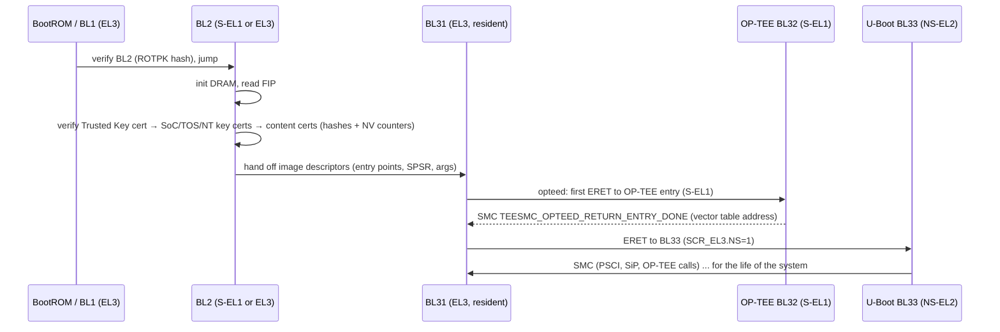

# 01.2 · Arm Trusted Firmware (TF-A): BL1/BL2/BL31 and Exception Levels EL3 → EL0

> **Folder 01 · File 2 of 4.** After the BootROM (01.1), TF-A is the next owner of the root of trust. BL2 extends the chain to every later image, and BL31 stays resident at EL3 for the life of the system. It's the only code that can flip a core between Secure and Non-secure state, and it runs on every core, concurrently, at the highest privilege the SoC has. A bug in an EL3 handler is a bug in the one place where no other layer can contain it.
>
> This file covers:
> - exception levels, security states and the SCR_EL3 bits that define them;
> - the boot stages (BL1, BL2, BL31, BL32, BL33), with `RESET_TO_BL2` for SoCs whose BootROM replaces BL1;
> - the TBBR chain of trust: ROTPK hash, key and content certificates, NV counters;
> - **the SMC world switch, register by register**, traced through TF-A v2.15's real code path;
> - SMCCC function IDs and BL31's dispatch, modelled and tested;
> - a vendor SiP service and a TBBR platform port, each in a fragile and a hardened version, compiled against TF-A v2.15;
> - EL3 failure modes and how to debug them with secure debug fused off.
>
> **Verification.** TF-A sources (✅) were compiled with Clang 21.1 for `aarch64-freestanding` against **TF-A v2.15.0's own headers and libc** (`-Werror -Wconversion -Wsign-conversion -Wmissing-prototypes`). That proves the code uses the real API and prototypes; it was not linked into a BL31 or booted. The SMCCC model was compiled with GCC 16.2 and run. Code paths quoted from TF-A are cited by file and function at v2.15.0.

---

## 1. First-Principles Architecture & Hardware State Machines

### 1.1 Exception levels and security states

```text
             Non-secure world                      Secure world
        ┌──────────────────────────┐        ┌──────────────────────────────┐
  EL0   │ Linux userspace          │        │ S-EL0: OP-TEE Trusted Apps   │
        ├──────────────────────────┤        ├──────────────────────────────┤
  EL1   │ Linux kernel             │        │ S-EL1: OP-TEE OS (BL32)      │
        ├──────────────────────────┤        ├──────────────────────────────┤
  EL2   │ Hypervisor / KVM / U-Boot│        │ S-EL2: SPMC (Hafnium), only  │
        │ (BL33 runs here or EL1)  │        │ with FEAT_SEL2 + SCR.EEL2=1  │
        └─────────────┬────────────┘        └───────────────┬──────────────┘
                      │            SMC #0                    │
                      └──────────────────┬───────────────────┘
  EL3                         ┌──────────▼──────────┐
                              │ BL31: Secure Monitor │  owns SCR_EL3, routes SMCs, PSCI,
                              │ (always "Secure")    │  saves/restores both worlds' contexts
                              └──────────────────────┘
```

The **security state** of EL0 to EL2 is decided by one bit: **SCR_EL3.NS**. EL3 always executes in Secure state, and only EL3 can write SCR_EL3. So the world switch is a privileged software operation, not a hardware mode: BL31 saves one world's context, rewrites SCR_EL3, restores the other world's context, and executes `ERET`. (Armv9 RME adds Realm and Root states via **SCR_EL3.NSE**; see Folder 08 for CCA.)

**SCR_EL3 bits** that a principal engineer must be able to justify (bit positions from TF-A v2.15 `include/arch/aarch64/arch.h`):

| Bit | Name | Meaning | Why it matters |
|---|---|---|---|
| 0 | **NS** | Lower ELs are Non-secure | *The* world bit. Secure memory (TZASC, 01.3) is enforced on the bus by the NS attribute it produces |
| 1 | IRQ | Route physical IRQs to EL3 | Interrupt model: with OP-TEE, secure interrupts are typically FIQs (Group 0/1S on GICv3) |
| 2 | FIQ | Route physical FIQs to EL3 | Lets EL3 regain control from the normal world when a secure interrupt fires |
| 3 | EA | Route external aborts / SError to EL3 | RAS and firmware-first error handling (`FFH_SUPPORT`) |
| 7 | **SMD** | SMC disable | Set it and `SMC` becomes UNDEFINED at lower ELs |
| 8 | HCE | HVC enable | Hypervisor calls allowed from EL1 |
| 9 | **SIF** | Secure instruction fetch from Non-secure memory disabled | Stops secure code from executing attacker-controlled NS pages (a classic TEE exploit primitive) |
| 10 | RW | Next lower EL is AArch64 | Wrong value: the lower EL runs in the wrong execution state after `ERET` |
| 11 | ST | Secure EL1 access to the physical timer | Timer isolation |
| 12, 13 | TWI, TWE | Trap WFI / WFE to EL3 | Power management and scheduling policy |
| 16, 17 | APK, API | Pointer-authentication key / instruction access allowed at lower ELs | PAC enablement per world |
| 18 | EEL2 | Secure EL2 enabled | Needed for Hafnium/S-EL2 partitions |

### 1.2 The boot stages

| Stage | Runs at | Lives in | Job | Notes |
|---|---|---|---|---|
| **BL1** (AP Trusted ROM) | EL3 | ROM (Arm reference platforms) | Load and verify BL2 (BL2 content certificate against the ROTPK hash) | On most SoCs the **vendor BootROM** plays this role, and TF-A is built with **`RESET_TO_BL2=1`** so BL2 is the reset-time entry (01.1) |
| **BL2** (Trusted Boot Firmware) | S-EL1, or EL3 with `RESET_TO_BL2` | SRAM | Initialize DRAM (often), load and **authenticate** BL31, BL32 and BL33 from the **FIP** using TBBR (§1.3), then hand off | The **chain-of-trust extender**: every later image's integrity depends on its auth module and platform port (§2.2) |
| **BL31** (EL3 Runtime) | EL3 | SRAM or a protected DRAM carve-out | Resident monitor: SMC dispatch, **PSCI** (CPU on/off/suspend), SPD (opteed), errata workarounds, RAS | Never exits. Its attack surface is every SMC handler on every core |
| **BL32** (Secure payload) | S-EL1 | Secure DRAM (`BL32_RAM_LOCATION=tdram` on QEMU) | OP-TEE OS (01.3) | Initialized by opteed on the boot core, then on each core via PSCI hooks |
| **BL33** (Non-trusted firmware) | NS-EL2 / NS-EL1 | DRAM | U-Boot or UEFI (01.4) | Gets the Non-trusted NV counter; its own verified-boot chain begins here |



### 1.3 The TBBR chain of trust

TF-A's Trusted Board Boot (TBBR; `docs/design/trusted-board-boot.rst`) authenticates images with X.509 certificates whose extensions carry public keys, image hashes and **non-volatile counters**:

```text
 OTP: ROTPK hash ──verifies──► Trusted key certificate (signed by ROT key)
                                 ├── Trusted World public key ──► SoC firmware key cert ──► SoC firmware content cert ──► H(BL31)
                                 │                               └► Trusted OS key cert   ──► Trusted OS content cert ──► H(BL32)
                                 ├── Non-Trusted World public key ► Non-trusted firmware key cert ► NT content cert ───► H(BL33)
                                 └── Trusted NV counter (in cert)                                        Non-trusted NV counter
 BL1 separately verifies the BL2 content certificate against the same ROTPK hash.
```

- **The ROTPK is not stored, its hash is.** With `ROTPK_IS_HASH`, the platform hook `plat_get_rotpk_info()` returns a DER `DigestInfo` (§2.2).
- **NV counters are anti-rollback for every firmware image.** The auth module rejects a certificate whose counter is **below** the platform's (`plat_get_nv_ctr`). When the certificate's counter is **above** it, the module calls `plat_set_nv_ctr2()` → `plat_set_nv_ctr()` **as soon as the signature authenticates** (`drivers/auth/auth_mod.c`). That's install time, not after the image has proven itself. The exception: with `PSA_FWU_SUPPORT` in BL2, the upgrade happens only once the active firmware bank is **ACCEPTED**. §2.2 explains why this one detail decides whether a failed update bricks the device.
- Only certificates signed with the ROT key may raise the **Trusted** NV counter. `plat/common/tbbr/plat_tbbr.c` refuses the update if the issuing certificate has a parent.

### 1.4 The SMC world switch, register by register

Here is a yielding OP-TEE call from Linux (`OPTEE_SMC_CALL_WITH_ARG`, FID `0x32000004`), traced through TF-A v2.15:

| # | Who | State | What happens |
|---|---|---|---|
| 1 | Linux (NS-EL1) | `x0`=0x32000004; `x1`/`x2` = upper/lower 32 bits of the physical address of a `struct optee_msg_arg`; `x3` = cache settings (unused if the buffer is in the predefined shared area); `x4`–`x6` unused; `x7` = hypervisor client ID (per `optee_smc.h`). Current Linux drivers prefer `CALL_WITH_REGD_ARG`, which passes a registered-SHM cookie instead of a raw address | Executes `smc #0` |
| 2 | Hardware | Exception to EL3 | `ELR_EL3` ← address of the instruction **after** the SMC. `SPSR_EL3` ← NS PSTATE (EL1h, DAIF). `ESR_EL3.EC` = **0x17** (SMC64; 0x13 for AArch32). PC ← **VBAR_EL3 + 0x400** ("Lower EL using AArch64, synchronous"). `SP_EL3` points at this core's **Non-secure `cpu_context_t`** |
| 3 | BL31 vector `sync_exception_aarch64` (`bl31/aarch64/runtime_exceptions.S`) | EL3, SCR_EL3.NS still **1** | `save_x30`, speculative-AT workaround, pending-SError sync, `handle_sync_exception`: save GP registers into the NS context (`prepare_el3_entry`) |
| 4 | `handler_sync_exception(ctx)` (`common/runtime_svc.c`; in C as of v2.15) | EL3 | Reads x0 (FID) and ESR_EL3. For EC 0x17/0x13: reject SMC64 from AArch32; reject fast calls with reserved bits 23:17 set; mask the SVE hint bit. Look up `rt_svc_descs_indices[(type << 6) | OEN]` → **opteed_std** (OEN 50, yielding). `flags` bit 0 ← **SCR_EL3.NS** |
| 5 | `opteed_smc_handler()` (`services/spd/opteed/opteed_main.c`) | EL3 | `is_caller_non_secure(flags)`, then `cm_el1_sysregs_context_save(NON_SECURE)`: SCTLR_EL1, TTBR0/1_EL1, TCR_EL1, MAIR_EL1, VBAR_EL1, SP_EL1, ELR_EL1, SPSR_EL1… |
| 6 | opteed | EL3 | `cm_set_elr_el3(SECURE, &optee_vector_table->yield_smc_entry)` (or `fast_smc_entry` for fast calls). `cm_el1_sysregs_context_restore(SECURE)`. `cm_set_next_eret_context(SECURE)` makes `SP_EL3` point at the **Secure** context, whose saved SCR_EL3 has **NS=0** |
| 7 | opteed | EL3 | Copies x4–x7 from the NS context into the Secure context, then `SMC_RET4(&optee_ctx->cpu_ctx, smc_fid, x1, x2, x3)` writes x0–x3 of the Secure context |
| 8 | `el3_exit` | EL3 | Restores SCR_EL3 (NS=0), SPSR_EL3 (S-EL1h, DAIF masked), ELR_EL3 (OP-TEE's yield entry) and GP registers from the Secure context. `ERET` |
| 9 | OP-TEE (S-EL1) | Secure | `thread_std_smc_entry` → validates the argument buffer (01.3), does the work, or returns an **RPC** to the normal world (e.g., "allocate shared memory", "load TA", "RPMB frames") |
| 10 | OP-TEE | Secure | `smc` with `TEESMC_OPTEED_RETURN_CALL_DONE`, results in x1–x4 |
| 11 | opteed | EL3 | `cm_el1_sysregs_context_save(SECURE)`, `cm_el1_sysregs_context_restore(NON_SECURE)`, `cm_set_next_eret_context(NON_SECURE)`, `SMC_RET4(ns_cpu_context, x1, x2, x3, x4)` |
| 12 | `el3_exit` | EL3 → NS-EL1 | SCR_EL3.NS=1 restored. `ERET` to the instruction after Linux's `smc #0`, with OP-TEE's results in x0–x3 |

The heart of step 5–7, quoted from TF-A v2.15 `services/spd/opteed/opteed_main.c` (BSD-3-Clause, abridged):

```c
		cm_el1_sysregs_context_save(NON_SECURE);
		/* ... */
		if (GET_SMC_TYPE(smc_fid) == SMC_TYPE_FAST) {
			cm_set_elr_el3(SECURE, (uint64_t)
					&optee_vector_table->fast_smc_entry);
		} else {
			cm_set_elr_el3(SECURE, (uint64_t)
					&optee_vector_table->yield_smc_entry);
		}

		cm_el1_sysregs_context_restore(SECURE);
		cm_set_next_eret_context(SECURE);
		/* ... x4..x7 copied from the NS context into the secure context ... */
		SMC_RET4(&optee_ctx->cpu_ctx, smc_fid, x1, x2, x3);
```

Three consequences an L7 is expected to know:
1. **The "world" is just which `cpu_context_t` SP_EL3 points at when `el3_exit` runs.** A bug that returns with the wrong context, or a stale saved SCR_EL3, puts one world's code in the other's privileges.
2. **EL1 system registers are swapped, but EL2 registers are not, unless `CTX_INCLUDE_EL2_REGS`.** Secure EL2 and some hypervisor setups need it. Get it wrong and a hypervisor's state leaks or is corrupted across worlds.
3. **Yielding calls can be preempted.** A normal-world interrupt arriving while OP-TEE runs a yielding call goes back to Linux as `OPTEE_SMC_RETURN_RPC_FOREIGN_INTR`, and Linux resumes the call later. Fast calls run to completion with interrupts masked, so they must be short.

### 1.5 SMCCC function IDs and BL31 dispatch

Every SMC's x0 encodes **type** (fast vs yielding), **convention** (SMC32 vs SMC64), **owner** (OEN) and **function**. BL31 builds a 128-entry index of `(type << 6) | OEN` from every `DECLARE_RT_SVC` descriptor at boot, and dispatches each SMC through it. This model reproduces the constants and the dispatch rules:

```c
/* smccc_fid.c - SMCCC function-ID codec and a model of TF-A's BL31 dispatch (unique OEN index -> service) */
#include <stdint.h>
#include <stdio.h>
#include <string.h>

/* Bit layout (SMC Calling Convention, Arm DEN 0028; field names as in TF-A include/lib/smccc.h):
 *   [31]    type     1 = fast (atomic, IRQs masked in callee), 0 = yielding (preemptible)
 *   [30]    cc       1 = SMC64 (X regs), 0 = SMC32 (W regs; callee must ignore upper halves)
 *   [29:24] OEN      owning entity: 0 Arm arch, 1 CPU, 2 SiP, 3 OEM, 4 std secure (PSCI...),
 *                    5 std hyp, 6 vendor hyp, 7 vendor EL3, 48-49 trusted apps, 50-63 trusted OS
 *   [23:17] reserved must be zero for fast calls (TF-A returns SMC_UNK otherwise)
 *   [16]    SVE hint (SMCCC v1.3): caller has no live SVE state; masked off before dispatch
 *   [15:0]  function number
 */
#define FID_TYPE(f)  (((f) >> 31) & 1u)
#define FID_CC(f)    (((f) >> 30) & 1u)
#define FID_OEN(f)   (((f) >> 24) & 0x3fu)
#define FID_RSVD(f)  (((f) >> 17) & 0x7fu)
#define FID_SVE(f)   (((f) >> 16) & 1u)
#define FID_NUM(f)   ((f) & 0xffffu)

static uint32_t fid(unsigned fast, unsigned smc64, unsigned oen, unsigned num)
{
    return (uint32_t)fast << 31 | (uint32_t)smc64 << 30 | (uint32_t)oen << 24 | (num & 0xffffu);
}

/* TF-A: get_unique_oen(oen, type) = (type << 6) | oen  ->  128 slots, fast and yielding kept apart. */
static unsigned unique_oen(uint32_t f) { return FID_TYPE(f) << 6 | FID_OEN(f); }

typedef enum { SVC_NONE, SVC_ARM_ARCH, SVC_SIP, SVC_STD_PSCI, SVC_OPTEED_FAST, SVC_OPTEED_YIELD } svc_t;
static const char *svc_name[] = {"SMC_UNK", "arm_arch_svc", "sip_svc", "std_svc(PSCI)", "opteed_fast", "opteed_std"};
static svc_t table[128];

/* Mirrors TF-A runtime_svc_init(): each DECLARE_RT_SVC(start_oen..end_oen, call_type) claims slots. */
static void register_svc(svc_t s, unsigned start, unsigned end, unsigned type)
{
    for (unsigned o = start; o <= end; o++)
        table[type << 6 | o] = s;
}

/* Mirrors handler_sync_exception() -> sync_handler(): validate, mask SVE hint, look up, call. */
static svc_t dispatch(uint32_t f, int from_aarch32)
{
    if (from_aarch32 && FID_CC(f))
        return SVC_NONE;                        /* SMC64 FID from AArch32 caller: SMC_UNK */
    if (FID_TYPE(f) == 1u && FID_RSVD(f) != 0u)
        return SVC_NONE;                        /* fast call with reserved bits set       */
    f &= ~(1u << 16);                           /* strip SVE hint before lookup            */
    return table[unique_oen(f)];
}

static int failures;
static void expect(const char *what, uint32_t f, int aarch32, svc_t want)
{
    svc_t got = dispatch(f, aarch32);
    printf("  %-34s 0x%08x  type=%u cc=%u oen=%2u num=0x%04x -> %-14s %s\n", what, f, FID_TYPE(f), FID_CC(f),
           FID_OEN(f), FID_NUM(f), svc_name[got], got == want ? "ok" : "FAIL");
    failures += got != want;
}

int main(void)
{
    register_svc(SVC_ARM_ARCH, 0, 0, 1);         /* arm_arch_svc: OEN_ARM, fast                   */
    register_svc(SVC_SIP, 2, 2, 1);              /* platform SiP service, fast                    */
    register_svc(SVC_STD_PSCI, 4, 4, 1);         /* std_svc (PSCI, SDEI...), fast                 */
    register_svc(SVC_OPTEED_FAST, 50, 63, 1);    /* opteed_fast: OEN_TOS_START..END, SMC_TYPE_FAST */
    register_svc(SVC_OPTEED_YIELD, 50, 63, 0);   /* opteed_std:  same OENs, SMC_TYPE_YIELD         */

    puts("[1] encoder reproduces the constants in TF-A v2.15 / OP-TEE 4.11 headers");
    struct { const char *n; uint32_t got, want; } k[] = {
        {"SMCCC_VERSION", fid(1, 0, 0, 0x0000), 0x80000000u},
        {"SMCCC_ARCH_WORKAROUND_1", fid(1, 0, 0, 0x8000), 0x80008000u},
        {"PSCI_VERSION", fid(1, 0, 4, 0x0000), 0x84000000u},
        {"PSCI_CPU_OFF", fid(1, 0, 4, 0x0002), 0x84000002u},
        {"PSCI_CPU_ON_AARCH64", fid(1, 1, 4, 0x0003), 0xc4000003u},
        {"PSCI_SYSTEM_RESET", fid(1, 0, 4, 0x0009), 0x84000009u},
        {"OPTEE_SMC_CALL_GET_OS_UUID (fast)", fid(1, 0, 50, 0x0000), 0xb2000000u},
        {"OPTEE_SMC_CALL_WITH_ARG (yielding)", fid(0, 0, 50, 0x0004), 0x32000004u},
        {"OPTEE_SMC_CALLS_UID (OEN 63)", fid(1, 0, 63, 0xff01), 0xbf00ff01u},
    };
    for (unsigned i = 0; i < sizeof k / sizeof k[0]; i++) {
        printf("  %-36s 0x%08x %s\n", k[i].n, k[i].got, k[i].got == k[i].want ? "ok" : "FAIL");
        failures += k[i].got != k[i].want;
    }

    puts("[2] dispatch, as BL31 routes each SMC");
    expect("PSCI_CPU_ON_AARCH64", 0xc4000003u, 0, SVC_STD_PSCI);
    expect("OP-TEE fast (GET_OS_UUID)", 0xb2000000u, 0, SVC_OPTEED_FAST);
    expect("OP-TEE yielding (CALL_WITH_ARG)", 0x32000004u, 0, SVC_OPTEED_YIELD);
    expect("SiP fast call 0x82000010", 0x82000010u, 0, SVC_SIP);
    expect("SiP yielding (no yield SiP svc)", 0x02000010u, 0, SVC_NONE);
    expect("fast call, reserved bit 17 set", 0x82020010u, 0, SVC_NONE);
    expect("SVE hint bit set (masked)", 0x84010000u, 0, SVC_STD_PSCI);
    expect("SMC64 FID from AArch32 caller", 0xc4000003u, 1, SVC_NONE);
    expect("unowned OEN 10", 0x8a000000u, 0, SVC_NONE);

    printf("%s: %d failure(s)\n", failures ? "FAILED" : "ALL PASSED", failures);
    return failures != 0;
}
```

```text
[1] encoder reproduces the constants in TF-A v2.15 / OP-TEE 4.11 headers
  SMCCC_VERSION                        0x80000000 ok
  SMCCC_ARCH_WORKAROUND_1              0x80008000 ok
  PSCI_VERSION                         0x84000000 ok
  PSCI_CPU_OFF                         0x84000002 ok
  PSCI_CPU_ON_AARCH64                  0xc4000003 ok
  PSCI_SYSTEM_RESET                    0x84000009 ok
  OPTEE_SMC_CALL_GET_OS_UUID (fast)    0xb2000000 ok
  OPTEE_SMC_CALL_WITH_ARG (yielding)   0x32000004 ok
  OPTEE_SMC_CALLS_UID (OEN 63)         0xbf00ff01 ok
[2] dispatch, as BL31 routes each SMC
  PSCI_CPU_ON_AARCH64                0xc4000003  type=1 cc=1 oen= 4 num=0x0003 -> std_svc(PSCI)  ok
  OP-TEE fast (GET_OS_UUID)          0xb2000000  type=1 cc=0 oen=50 num=0x0000 -> opteed_fast    ok
  OP-TEE yielding (CALL_WITH_ARG)    0x32000004  type=0 cc=0 oen=50 num=0x0004 -> opteed_std     ok
  SiP fast call 0x82000010           0x82000010  type=1 cc=0 oen= 2 num=0x0010 -> sip_svc        ok
  SiP yielding (no yield SiP svc)    0x02000010  type=0 cc=0 oen= 2 num=0x0010 -> SMC_UNK        ok
  fast call, reserved bit 17 set     0x82020010  type=1 cc=0 oen= 2 num=0x0010 -> SMC_UNK        ok
  SVE hint bit set (masked)          0x84010000  type=1 cc=0 oen= 4 num=0x0000 -> std_svc(PSCI)  ok
  SMC64 FID from AArch32 caller      0xc4000003  type=1 cc=1 oen= 4 num=0x0003 -> SMC_UNK        ok
  unowned OEN 10                     0x8a000000  type=1 cc=0 oen=10 num=0x0000 -> SMC_UNK        ok
ALL PASSED: 0 failure(s)
```

### 1.6 PSCI: how the other cores come up

Secondary cores never run the cold-boot path. Linux calls `PSCI_CPU_ON_AARCH64` (`0xC4000003`) with x1 = target MPIDR, x2 = NS entry point and x3 = context ID. BL31's `psci_cpu_on_start()` validates the target, stores the entry point, and asks the platform to power the core. The core wakes at **`bl31_warm_entrypoint`**, runs `psci_warmboot_entrypoint()`, initializes its own EL3 state (and OP-TEE's per-core state through the SPD hook), then ERETs to the NS entry point. **A per-core bug in EL3 initialization appears only on secondaries**: core 0 boots fine, and core 3 hangs at its first SMC.

---

## 2. Production Code & Configuration Blueprints

All listings in this section depend on one platform interface: an OTP driver and the fuse map it implements.

```c
/* board_otp.h - platform OTP controller interface and fuse map used by the BL2/BL31 code in 01.2 */
#ifndef BOARD_OTP_H
#define BOARD_OTP_H

#include <stdbool.h>
#include <stdint.h>

/* Fuse map (32-bit words). The controller driver behind these calls is SoC-specific. */
#define BOARD_OTP_ROTPK_HASH       0U   /* 8 words: SHA-256 of the ROT public key (DER SubjectPublicKeyInfo) */
#define BOARD_OTP_SEC_CONFIG       8U   /* bit 0: secure boot enforced (part closed)                         */
#define BOARD_OTP_TRUSTED_NV       9U   /* 2 words: 64-step thermometer, trusted firmware (BL2-loaded)       */
#define BOARD_OTP_NON_TRUSTED_NV   11U  /* 2 words: 64-step thermometer, non-trusted firmware (BL33)         */
#define BOARD_OTP_NV_WORDS         2U
#define BOARD_OTP_MAC0             13U  /* public: Ethernet MAC [31:0]                                       */
#define BOARD_OTP_MAC1             14U  /* public: Ethernet MAC [47:32]                                      */
#define BOARD_OTP_BOARD_REV        15U  /* public: board revision                                            */
#define BOARD_OTP_NUM_WORDS        16U

#define BOARD_OTP_SEC_CLOSED       (1U << 0)

/* Returns 0 on success. Reads the sensed (shadow) value, not a cached copy software could alter. */
int board_otp_read(unsigned int word, uint32_t *val);

/* Blows the bits set in `bits` (0 -> 1 only). Returns 0 on success, nonzero if the controller
 * reports a programming or verify-after-program failure. Caller serializes. */
int board_otp_program(unsigned int word, uint32_t bits);

/* Highest anti-rollback version among the images BL2 authenticated on THIS boot, recorded by
 * BL2 and handed to BL31 (e.g. via the transfer list). Commits may never exceed it. */
unsigned int board_verified_running_version(bool trusted);

#endif /* BOARD_OTP_H */
```

### 2.1 A vendor SiP service (exposing fuses and anti-rollback to Linux)

Products always need a few EL3 services the standard doesn't define: read a board-revision fuse, report the boot status, commit an anti-rollback counter. These usually arrive as an afternoon's work, and that's how EL3 vulnerabilities ship.

#### The Fragile Way

```c
/* board_sip_svc_fragile.c - the SiP service as usually first written: EL3 write-what-where and a brick button */
#include <stdint.h>

#include <common/runtime_svc.h>
#include <lib/smccc.h>

#include "board_otp.h"

#define BOARD_SIP_OTP_READ   U(0x82000010)   /* x1 = word, x2 = physical address to store the result */
#define BOARD_SIP_ARB_COMMIT U(0x82000012)   /* x1 = word base, x2 = version                         */

static uintptr_t board_sip_fragile_handler(uint32_t smc_fid, u_register_t x1, u_register_t x2,
					   u_register_t x3, u_register_t x4, void *cookie,
					   void *handle, u_register_t flags)
{
	uint32_t val = 0U;

	(void)x3;
	(void)x4;
	(void)cookie;
	(void)flags;                     /* BUG 1: never asks which world called */

	switch (smc_fid) {
	case BOARD_SIP_OTP_READ:
		/* BUG 2: no allow-list and no bound: any word index, including key-adjacent fields. */
		(void)board_otp_read((unsigned int)x1, &val);
		/* BUG 3: EL3 dereferences a physical address chosen by the normal world. With the
		 * MMU identity map covering BL31, OP-TEE and TZC-protected DRAM, this is a write of a
		 * fuse value to any address at the highest privilege: BL31's own .data, OP-TEE's heap. */
		*(volatile uint32_t *)(uintptr_t)x2 = val;
		SMC_RET1(handle, SMC_OK);

	case BOARD_SIP_ARB_COMMIT:
		/* BUG 4: blows whatever the caller asks for. A rootkit calls this with version 64 and
		 * every older AND current image becomes "rolled back": a permanent brick.
		 * BUG 5: no lock: two cores committing concurrently interleave read-modify-program. */
		for (unsigned int bit = 0U; bit < (unsigned int)x2; bit++)
			(void)board_otp_program((unsigned int)x1 + bit / 32U, U(1) << (bit % 32U));
		SMC_RET1(handle, SMC_OK);

	default:
		SMC_RET1(handle, SMC_UNK);
	}
}

DECLARE_RT_SVC(
	board_sip_fragile,
	OEN_SIP_START,
	OEN_SIP_END,
	SMC_TYPE_FAST,
	NULL,
	board_sip_fragile_handler
);
```

It compiles cleanly against TF-A v2.15 with `-Werror` (see the output below). The compiler can't see any of the five bugs, each of which is critical at EL3:
- **No caller check.** Secure world and normal world get the same behavior, so a compromised TA can use the service as a confused deputy.
- **Unbounded fuse index.**
- **A normal-world-chosen physical address dereferenced at EL3.** This is the EL3 version of the Boomerang bug (01.3). BL31's identity map covers BL31, OP-TEE and TZC-protected DRAM, so the attacker gets a write of chosen data to any secure address.
- **An unbounded fuse commit.** A rootkit's one SMC burns the whole thermometer and permanently bricks the device.
- **No lock.** Cores race on read-modify-program.

#### The Silicon-Hardened Production Way

```c
/* board_sip_svc.c - hardened BL31 SiP service: allow-listed OTP reads, bounded anti-rollback commit (TF-A v2.15 API) */
#include <errno.h>
#include <stdbool.h>
#include <stdint.h>

#include <common/debug.h>
#include <common/runtime_svc.h>
#include <lib/smccc.h>
#include <lib/spinlock.h>

#include "board_otp.h"

/* SiP fast calls, SMC32 (OEN 2): 0x82000000 | function number. */
#define BOARD_SIP_OTP_READ_PUBLIC  U(0x82000010)  /* x1 = logical id          -> x1 = value          */
#define BOARD_SIP_ARB_STATUS       U(0x82000011)  /* x1 = 1 trusted/0 non-trusted -> x1 = min, x2 = running */
#define BOARD_SIP_ARB_COMMIT       U(0x82000012)  /* x1 = trusted flag, x2 = version -> x1 = new min     */

/* Logical ids exported to the normal world. Anything not listed is not readable via this service. */
static const unsigned int public_words[] = {BOARD_OTP_MAC0, BOARD_OTP_MAC1, BOARD_OTP_BOARD_REV};

static spinlock_t arb_lock;   /* SMCs arrive on every core concurrently */

static unsigned int popcount32(uint32_t v)
{
	unsigned int n = 0U;

	while (v != 0U) {
		v &= v - 1U;
		n++;
	}
	return n;
}

static int arb_read(unsigned int base, unsigned int *min)
{
	unsigned int n = 0U;
	uint32_t w;

	for (unsigned int i = 0U; i < BOARD_OTP_NV_WORDS; i++) {
		if (board_otp_read(base + i, &w) != 0)
			return -EIO;
		n += popcount32(w);
	}
	*min = n;
	return 0;
}

static int arb_commit(bool trusted, unsigned int version, unsigned int *new_min)
{
	unsigned int base = trusted ? BOARD_OTP_TRUSTED_NV : BOARD_OTP_NON_TRUSTED_NV;
	unsigned int have;
	int rc;

	if (version > 32U * BOARD_OTP_NV_WORDS)
		return -EINVAL;
	/* The normal world may only ratify what BL2 actually verified on this boot. A compromised
	 * kernel asking for version 64 would otherwise burn every fuse and brick the device. */
	if (version > board_verified_running_version(trusted))
		return -EPERM;

	spin_lock(&arb_lock);
	rc = arb_read(base, &have);
	for (unsigned int bit = have; rc == 0 && bit < version; bit++)
		rc = board_otp_program(base + bit / 32U, U(1) << (bit % 32U));
	if (rc == 0)
		rc = arb_read(base, &have);   /* report what the fuses now say, not what we intended */
	spin_unlock(&arb_lock);

	*new_min = have;
	return rc;
}

static uintptr_t board_sip_handler(uint32_t smc_fid, u_register_t x1, u_register_t x2,
				   u_register_t x3, u_register_t x4, void *cookie,
				   void *handle, u_register_t flags)
{
	/* SMC32: only the low 32 bits of each argument are defined. Never use the upper halves. */
	uint32_t a1 = (uint32_t)x1;
	uint32_t a2 = (uint32_t)x2;
	unsigned int min = 0U;
	uint32_t val = 0U;
	int rc;

	(void)x3;
	(void)x4;
	(void)cookie;

	if (!is_caller_non_secure(flags))
		SMC_RET1(handle, SMC_UNK);   /* these services exist for the normal world only */

	switch (smc_fid) {
	case BOARD_SIP_OTP_READ_PUBLIC:
		for (unsigned int i = 0U; i < ARRAY_SIZE(public_words); i++) {
			if (public_words[i] == a1) {
				rc = board_otp_read(a1, &val);
				SMC_RET2(handle, rc == 0 ? SMC_OK : (u_register_t)SMC_INVALID_PARAM, val);
			}
		}
		SMC_RET1(handle, SMC_DENIED);

	case BOARD_SIP_ARB_STATUS:
		rc = arb_read(a1 != 0U ? BOARD_OTP_TRUSTED_NV : BOARD_OTP_NON_TRUSTED_NV, &min);
		SMC_RET3(handle, rc == 0 ? SMC_OK : (u_register_t)SMC_INVALID_PARAM, min,
			 board_verified_running_version(a1 != 0U));

	case BOARD_SIP_ARB_COMMIT:
		rc = arb_commit(a1 != 0U, a2, &min);
		if (rc == -EPERM)
			SMC_RET1(handle, SMC_DENIED);
		if (rc != 0)
			SMC_RET1(handle, SMC_INVALID_PARAM);
		NOTICE("ARB: %s counter committed to %u\n", a1 != 0U ? "trusted" : "non-trusted", min);
		SMC_RET2(handle, SMC_OK, min);

	default:
		WARN("Unimplemented board SiP call 0x%x\n", smc_fid);
		SMC_RET1(handle, SMC_UNK);
	}
}

DECLARE_RT_SVC(
	board_sip_svc,
	OEN_SIP_START,
	OEN_SIP_END,
	SMC_TYPE_FAST,
	NULL,
	board_sip_handler
);
```

Design rules it encodes:
1. **Values in registers, never pointers.** Anything larger than a few registers goes through OP-TEE's validated shared-memory path, not a raw physical address at EL3.
2. **Use only the low 32 bits of SMC32 arguments.** The SMCCC leaves the upper halves undefined for SMC32 calls.
3. **Allow-list readable fuses** by logical ID.
4. **Bound every irreversible action by what the hardware already verified.** The normal world can *ratify* the counter value that BL2 authenticated on this boot, but can't ask for more (`board_verified_running_version()`), so a compromised kernel can't turn the fuses into a brick.
5. **Serialize** across cores with a spinlock.
6. **Report the readback**, not the request: fuses can fail to program.

### 2.2 The TBBR platform port: ROTPK and NV counters

#### The Fragile Way

```c
/* board_trusted_boot_fragile.c - the TBBR port as usually first written: silent fallback, burn-at-authentication */
#include <stdint.h>
#include <string.h>

#include <plat/common/platform.h>
#include <tools_share/tbbr_oid.h>

#include "board_otp.h"

static unsigned char rotpk_hash_der[19 + 32] = {
	0x30, 0x31, 0x30, 0x0d, 0x06, 0x09, 0x60, 0x86, 0x48, 0x01,
	0x65, 0x03, 0x04, 0x02, 0x01, 0x05, 0x00, 0x04, 0x20,
};

int plat_get_rotpk_info(void *cookie, void **key_ptr, unsigned int *key_len,
			unsigned int *flags)
{
	uint32_t any = 0U, w = 0U;

	(void)cookie;
	for (unsigned int i = 0U; i < 8U; i++) {
		(void)board_otp_read(BOARD_OTP_ROTPK_HASH + i, &w);   /* BUG 1: read errors ignored */
		any |= w;
		memcpy(&rotpk_hash_der[19U + 4U * i], &w, sizeof(w));
	}
	*key_ptr = rotpk_hash_der;
	*key_len = (unsigned int)sizeof(rotpk_hash_der);
	/* BUG 2: "so unprovisioned boards still boot in the lab". On any field unit whose fuses
	 * were never burned, or whose OTP read glitches to zero, trusted boot is silently OFF. */
	*flags = (any == 0U) ? ROTPK_NOT_DEPLOYED : ROTPK_IS_HASH;
	return 0;
}

int plat_get_nv_ctr(void *cookie, unsigned int *nv_ctr)
{
	unsigned int base = strcmp(cookie, TRUSTED_FW_NVCOUNTER_OID) == 0 ? BOARD_OTP_TRUSTED_NV
									  : BOARD_OTP_NON_TRUSTED_NV;
	uint32_t w = 0U;

	(void)board_otp_read(base, &w);
	*nv_ctr = 32U - (unsigned int)__builtin_clz(w | 1U);   /* BUG 3: "highest set bit", and only word 0 */
	return 0;
}

int plat_set_nv_ctr(void *cookie, unsigned int nv_ctr)
{
	unsigned int base = strcmp(cookie, TRUSTED_FW_NVCOUNTER_OID) == 0 ? BOARD_OTP_TRUSTED_NV
									  : BOARD_OTP_NON_TRUSTED_NV;

	/* BUG 4: burns at authentication time, before the new image has run a single instruction.
	 * If it then fails its health check, A/B fallback lands on an image this counter rejects. */
	for (unsigned int bit = 0U; bit < nv_ctr; bit++)
		(void)board_otp_program(base + bit / 32U, 1U << (bit % 32U));
	return 0;
}
```

- **`ROTPK_NOT_DEPLOYED` when the fuses read blank.** TF-A's auth module then prints "ROTPK is not deployed on platform. Skipping ROTPK verification." and accepts **any** signing key (`drivers/auth/auth_mod.c`). The convenience for lab boards becomes "trusted boot off" for any field unit with unprogrammed fuses, or an OTP read glitch.
- **NV counter read as "highest set bit" of one word.** A partially blown or out-of-order bit pattern reads wrong, and the second word is ignored.
- **`plat_set_nv_ctr` burns at authentication time.** This matches upstream's call timing: the counter rises before the new BL31/BL32/BL33 have executed a single instruction. If any of them fails health checks, the A/B fallback images are now below the counter and are refused.

#### The Silicon-Hardened Production Way

```c
/* board_trusted_boot.c - hardened TBBR platform port: ROTPK hash from OTP, staged (commit-on-success) NV counters */
#include <errno.h>
#include <stdbool.h>
#include <stdint.h>
#include <string.h>

#include <common/debug.h>
#include <plat/common/platform.h>
#include <tools_share/tbbr_oid.h>

#include "board_otp.h"

/* DER DigestInfo header for SHA-256 (porting guide: with ROTPK_IS_HASH the platform returns
 * DigestInfo ::= SEQUENCE { AlgorithmIdentifier sha256, OCTET STRING digest }). */
static unsigned char rotpk_hash_der[19 + 32] = {
	0x30, 0x31, 0x30, 0x0d, 0x06, 0x09, 0x60, 0x86, 0x48, 0x01,
	0x65, 0x03, 0x04, 0x02, 0x01, 0x05, 0x00, 0x04, 0x20,
};

/* Highest counter BL2 authenticated this boot, per counter; handed to BL31 by the platform
 * (transfer list or a shared, BL31-owned page) so the SiP commit can be bounded by it. */
void board_stage_verified_version(bool trusted, unsigned int version);

int plat_get_rotpk_info(void *cookie, void **key_ptr, unsigned int *key_len,
			unsigned int *flags)
{
	uint32_t any = 0U;
	uint32_t w;

	(void)cookie;
	for (unsigned int i = 0U; i < 8U; i++) {
		if (board_otp_read(BOARD_OTP_ROTPK_HASH + i, &w) != 0)
			return -EIO;
		any |= w;
		rotpk_hash_der[19U + 4U * i] = (unsigned char)w;
		rotpk_hash_der[20U + 4U * i] = (unsigned char)(w >> 8);
		rotpk_hash_der[21U + 4U * i] = (unsigned char)(w >> 16);
		rotpk_hash_der[22U + 4U * i] = (unsigned char)(w >> 24);
	}
	if (any == 0U) {
		/* Blank fuses. Returning ROTPK_NOT_DEPLOYED would make the auth module print
		 * "Skipping ROTPK verification" and accept ANY signing key. A production port fails. */
		ERROR("ROTPK hash fuses are blank: refusing to boot\n");
		return -ENOENT;
	}
	*key_ptr = rotpk_hash_der;
	*key_len = (unsigned int)sizeof(rotpk_hash_der);
	*flags = ROTPK_IS_HASH;
	return 0;
}

static int nv_base(const void *cookie, unsigned int *base, bool *trusted)
{
	const char *oid = cookie;

	if (strcmp(oid, TRUSTED_FW_NVCOUNTER_OID) == 0) {
		*base = BOARD_OTP_TRUSTED_NV;
		*trusted = true;
	} else if (strcmp(oid, NON_TRUSTED_FW_NVCOUNTER_OID) == 0) {
		*base = BOARD_OTP_NON_TRUSTED_NV;
		*trusted = false;
	} else {
		return -EINVAL;
	}
	return 0;
}

int plat_get_nv_ctr(void *cookie, unsigned int *nv_ctr)
{
	unsigned int base, n = 0U;
	bool trusted;
	uint32_t w;

	if (cookie == NULL || nv_ctr == NULL || nv_base(cookie, &base, &trusted) != 0)
		return -EINVAL;
	for (unsigned int i = 0U; i < BOARD_OTP_NV_WORDS; i++) {
		if (board_otp_read(base + i, &w) != 0)
			return -EIO;
		for (; w != 0U; w &= w - 1U)
			n++;                     /* thermometer: the count of blown bits */
	}
	*nv_ctr = n;
	return 0;
}

/* Called by the TBBR auth module when a certificate carries a higher counter than the fuses.
 * Upstream semantics are "upgrade now" (at authentication time). We stage instead: the image
 * boots as a trial, and the normal world ratifies the value through BOARD_SIP_ARB_COMMIT only
 * after it has proven healthy. A failed update therefore leaves the old slot bootable. */
int plat_set_nv_ctr(void *cookie, unsigned int nv_ctr)
{
	unsigned int base;
	bool trusted;

	if (cookie == NULL || nv_base(cookie, &base, &trusted) != 0)
		return -EINVAL;
	if (nv_ctr > 32U * BOARD_OTP_NV_WORDS)
		return -ERANGE;
	board_stage_verified_version(trusted, nv_ctr);
	return 0;
}
```

- **Blank ROTPK fuses fail closed.** For lab boards, use a separate build with a development ROTPK hash, never a runtime fallback.
- **The NV counter is read as a popcount** across all its words.
- **`plat_set_nv_ctr` stages instead of burning.** The image boots as a trial, and the counter is committed through `BOARD_SIP_ARB_COMMIT` (§2.1) only after the normal world's health check passes. That commit is bounded by the staged value.
- If your platform uses TF-A's **`PSA_FWU_SUPPORT`**, you get the same semantics natively: BL2 only upgrades NV counters when the active bank is ACCEPTED. Choose one mechanism and document it.

Compile results (Clang 21.1, `aarch64-freestanding`, TF-A v2.15.0 headers and libc):

```text
OK   board_sip_svc.c  (IMAGE_BL31, TF-A v2.15 headers, clang 21.1.0)
OK   board_sip_svc_fragile.c  (IMAGE_BL31, TF-A v2.15 headers, clang 21.1.0)
OK   board_trusted_boot.c  (IMAGE_BL2, TF-A v2.15 headers, clang 21.1.0)
OK   board_trusted_boot_fragile.c  (IMAGE_BL2, TF-A v2.15 headers, clang 21.1.0)
generic aarch64: smc_call.c -> error: instruction requires: el3
OK   smc_call.c  (EL1 helper, -mcpu=cortex_a53, clang 21.1.0)
```

### 2.3 The normal-world caller

```c
/* smc_call.c - the normal-world side of an SMC: SMCCC v1.1+ register contract, as an EL1 (kernel) helper */
#include <stdint.h>

struct smc_res {
	uint64_t a0, a1, a2, a3;
};

/*
 * SMCCC v1.1 and later: arguments in x0 (function ID) and x1..x7, results in x0..x3; the callee
 * preserves x4..x17 (v1.0 firmware may corrupt x4..x17: probe SMCCC_VERSION before relying on it).
 * SMC is UNDEFINED at EL0, so this only works from EL1/EL2 (a kernel driver, or U-Boot).
 */
static inline struct smc_res smc_1_1(uint32_t fid, uint64_t a1, uint64_t a2, uint64_t a3,
				     uint64_t a4, uint64_t a5, uint64_t a6, uint64_t a7)
{
	register uint64_t x0 __asm__("x0") = fid;
	register uint64_t x1 __asm__("x1") = a1;
	register uint64_t x2 __asm__("x2") = a2;
	register uint64_t x3 __asm__("x3") = a3;
	register uint64_t x4 __asm__("x4") = a4;
	register uint64_t x5 __asm__("x5") = a5;
	register uint64_t x6 __asm__("x6") = a6;
	register uint64_t x7 __asm__("x7") = a7;

	/* "memory": the callee may read/write shared buffers whose addresses travel in x1..x7. */
	__asm__ volatile("smc #0"
			 : "+r"(x0), "+r"(x1), "+r"(x2), "+r"(x3)
			 : "r"(x4), "r"(x5), "r"(x6), "r"(x7)
			 : "memory");
	return (struct smc_res){x0, x1, x2, x3};
}

#define BOARD_SIP_ARB_STATUS 0x82000011u
#define BOARD_SIP_ARB_COMMIT 0x82000012u
#define SMC_DENIED           ((uint64_t)(int64_t)-3)

int board_arb_commit_after_health_check(unsigned int version);

/* Called once userspace has marked the new slot good (Folder 03). Commits only what BL2 verified. */
int board_arb_commit_after_health_check(unsigned int version)
{
	struct smc_res st = smc_1_1(BOARD_SIP_ARB_STATUS, 0 /* non-trusted ctr */, 0, 0, 0, 0, 0, 0);

	if (st.a0 != 0)
		return -1;              /* service missing or OTP unreadable: do not guess */
	if (version <= st.a1)
		return 0;               /* already at or above: idempotent, power-cut safe */
	if (version > st.a2)
		return -2;              /* asking for more than this boot verified: refuse locally too */

	struct smc_res r = smc_1_1(BOARD_SIP_ARB_COMMIT, 0, version, 0, 0, 0, 0, 0);
	if (r.a0 == SMC_DENIED)
		return -2;
	return (r.a0 == 0 && r.a1 >= version) ? 0 : -3;   /* trust the fuse readback, not the request */
}
```

Two production details hide in this listing:
- **`SMC` is UNDEFINED at EL0.** Userspace can't make SMCs. The commit belongs in a kernel driver, or in an OP-TEE or U-Boot path, exposed to the OTA agent through a narrow interface.
- **The assembler must be told the target has EL3.** Clang 21's integrated assembler rejects `smc #0` for a generic `aarch64` target ("instruction requires: el3", the line in the output above), and accepts it with a real CPU (`-mcpu=cortex_a53`). Build systems that compile firmware for "generic arm64" meet this the first time someone writes an inline SMC.

### 2.4 Building and signing TF-A

#### The Fragile Way

The development recipe from TF-A's QEMU documentation (`docs/plat/qemu.rst`, v2.15), used unchanged in production CI:

```bash
make CROSS_COMPILE=aarch64-linux-gnu- PLAT=qemu BL32=bl32.bin \
    BL32_EXTRA1=bl32_extra1.bin BL32_EXTRA2=bl32_extra2.bin \
    BL33=bl33.bin BL32_RAM_LOCATION=tdram SPD=opteed all fip \
    TRUSTED_BOARD_BOOT=1 GENERATE_COT=1 DECRYPTION_SUPPORT=aes_gcm \
    FW_ENC_STATUS=0 ENCRYPT_BL31=1 ENCRYPT_BL32=1
```

`GENERATE_COT=1` without `ROT_KEY` lets `cert_create` generate keys on the build machine. Adding `CREATE_KEYS=1 SAVE_KEYS=1` "so the next build is consistent" writes the root private key into the build tree, the artifact store and every developer's checkout. `FW_ENC_STATUS=0` with the default test encryption key encrypts BL31/BL32 with a key the whole world knows. NV counters stay at the default `0`, so anti-rollback never engages.

#### The Silicon-Hardened Production Way

```bash
# Release build: keys live in the HSM; counters come from release metadata, not defaults.
make CROSS_COMPILE=aarch64-linux-gnu- PLAT=<soc> \
    SPD=opteed BL32=tee-header_v2.bin BL32_EXTRA1=tee-pager_v2.bin BL32_EXTRA2=tee-pageable_v2.bin \
    BL33=u-boot.bin \
    TRUSTED_BOARD_BOOT=1 GENERATE_COT=1 \
    KEY_ALG=rsa KEY_SIZE=3072 HASH_ALG=sha256 \
    ROT_KEY='pkcs11:token=fw-root;object=tbbr-rot;type=private' \
    TFW_NVCTR_VAL=${TRUSTED_SECURITY_VERSION} NTFW_NVCTR_VAL=${NONTRUSTED_SECURITY_VERSION} \
    ENABLE_STACK_PROTECTOR=strong BRANCH_PROTECTION=1 \
    MEASURED_BOOT=1 \
    all fip
```

- **`ROT_KEY` accepts a PKCS#11 URI** (`build-options.rst`): the ROT private key never leaves the HSM. The intermediate (Trusted World / Non-Trusted World) keys follow the same rule, via `cert_create` key options.
- **`KEY_ALG=rsa` is RSA-PSS** (PKCS#1 v2.1, TBBR-compliant). `rsa_1_5` exists only for legacy compatibility.
- **`TFW_NVCTR_VAL` / `NTFW_NVCTR_VAL`** stamp the security versions into the certificates. Bump them only for security-relevant releases (01.1 §1.6).
- **`ENABLE_STACK_PROTECTOR=strong`** and **`BRANCH_PROTECTION=1`** (PAC and BTI where the CPU supports them) for the resident EL3 image. **`MEASURED_BOOT=1`** records an event log for remote attestation (01.4).
- Encrypted firmware (`DECRYPTION_SUPPORT`) is worth having only with a real per-product key (`FW_ENC_STATUS=0` with a test key is obfuscation, not secrecy).

---

## 3. Failure Modes, Brick Recovery & Post-Mortem Debugging

### 3.1 Failure modes

| Symptom (console) | Likely cause | First check |
|---|---|---|
| `ERROR: BL2: Failed to load image id 3` (BL31) or similar | Certificate chain broken: wrong ROTPK hash, image signed by another key, FIP built with mismatched certificates | Rebuild the FIP from one release; compare `ROTPK hash` printed by `cert_create` with the fuses |
| `NOTICE: ROTPK is not deployed on platform. Skipping ROTPK verification.` | A port returning `ROTPK_NOT_DEPLOYED` | Treat as a security incident on a production unit (§2.2) |
| Old firmware refused after a failed update | NV counters burned at authentication (§1.3) | Was `plat_set_nv_ctr` staging, or burning? |
| `Unhandled Exception in EL3.` followed by a register dump | EL3 fault: often a SiP handler dereferencing a bad pointer, or a missing `xlat` mapping for a new peripheral | Decode ESR_EL3 (below); map ELR_EL3 against `bl31.map` |
| Secondary cores never come online; core 0 fine | Wrong warm-boot entry, missing per-core init, cache or coherency setup missing in the platform's `pwr_domain_on_finish` | PSCI trace with `LOG_LEVEL=50` on a debug build |
| Random hangs under load after an OP-TEE call | Fast SMC doing too much work with interrupts masked; watchdog fires | Move the work to a yielding call |
| Spectre-class issues reported by Linux (`Vulnerable` in `/sys/devices/system/cpu/vulnerabilities/spectre_v2`) | Missing `SMCCC_ARCH_WORKAROUND_1` or the matching CPU errata build flag | `SMCCC_ARCH_FEATURES` probe from Linux |

### 3.2 Decoding an EL3 crash

TF-A's crash reporter (`bl31/aarch64/crash_reporting.S`) prints "Unhandled Exception in EL3." and dumps x0–x30, ELR_EL3, SPSR_EL3, ESR_EL3, SCR_EL3 and more. Decode ESR_EL3 first:
- **EC (bits 31:26)**: 0x25 is a data abort taken without a change in EL, i.e., EL3 itself faulted. 0x17 is an SMC64 (seen in the context when an SMC caused the fault path). 0x00 is an unknown reason, usually an UNDEFINED instruction.
- **ISS.DFSC (bits 5:0)** for data aborts: translation fault at level n (`0b0001nn`), permission fault (`0b0011nn`), synchronous external abort (`0b010000`).
- **FAR_EL3** is the faulting address. If it equals an x-register that came from the normal world, you have found an EL3 pointer-trust bug.

### 3.3 Debugging with secure debug fused off

On a closed production part, invasive debug of Secure state is normally disabled (SPIDEN low; 01.1 JTAG fuses). You can't halt in EL3 or S-EL1. What still works:
- **The BL31 console and crash console.** Keep a minimal one in production builds; it costs little and is often the only evidence.
- **Reproduce on an open sample** with the same FIP and secure debug enabled, then use CoreSight halting debug (DBGEN/SPIDEN high) with Trace32, Lauterbach or OpenOCD.
- **Normal-world tracing of the SMC boundary.** Linux's OP-TEE driver has the tracepoints `optee_invoke_fn_begin` / `optee_invoke_fn_end` (`drivers/tee/optee/optee_trace.h`), which give FIDs, arguments and per-call latency through ftrace. A fast call that takes milliseconds is a design bug.
- **Telemetry counters exported by a SiP status call** (boot stage reached, last error code), readable after reboot from a retained-RAM area or a status register.

---

## 4. L7 Bar-Raiser Q&A Chains

### Chain 1 · The SMC, register by register

**Initial Prompt:** "Linux calls into OP-TEE. Walk me through exactly what the CPU and TF-A do."

**L5 Answer:** "Linux executes an SMC instruction, which traps to the secure monitor at EL3. The monitor switches to the secure world and OP-TEE handles the request, then it switches back."

**Why L5 Bricks Devices at Scale:** "Switches to the secure world" hides the mechanism, and with it every class of bug:
- the world is a saved SCR_EL3 inside a per-core context, so a context mix-up crosses worlds;
- EL2 registers aren't saved by default;
- yielding calls can be preempted and resumed, and fast calls run with IRQs masked, so a slow fast call trips watchdogs fleet-wide;
- SMC32 arguments have undefined upper halves.

An engineer without this model writes the SiP handler in §2.1.

**L7 Principal Defense:** The L7 walks the table in §1.4:
- **Trap:** FID 0x32000004 in x0, buffer address in x1/x2. ELR/SPSR/ESR latched, PC = VBAR_EL3+0x400, SP_EL3 → NS context.
- **Dispatch:** GP save; `handler_sync_exception` validates the FID and indexes `(type << 6) | OEN`; flags bit 0 = SCR.NS.
- **Switch in:** opteed saves NS EL1 sysregs, sets the Secure ELR to `yield_smc_entry`, restores Secure EL1 sysregs, retargets SP_EL3, `SMC_RET4`; `el3_exit` restores SCR.NS=0 and ERETs.
- **Back:** OP-TEE returns via `RETURN_CALL_DONE`, and the reverse sequence runs.

Then the consequences: preemption and RPC, fast-call latency budgets, `CTX_INCLUDE_EL2_REGS`, and argument hygiene.

### Chain 2 · Who can change the world?

**Initial Prompt:** "How does the hardware know which world it's in, and what stops Linux from switching itself into Secure state?"

**L5 Answer:** "TrustZone has a secure bit, and only secure code can set it."

**Why L5 Bricks Devices at Scale:** "Secure code can set it" is wrong in a way that matters. S-EL1 (OP-TEE) **can't** write SCR_EL3; only EL3 can. And the protection of memory isn't the bit itself but **the bus attribute it produces**, checked by the TZASC/TZC (01.3). Teams that think "secure code" is one trust domain grant OP-TEE TAs or the secure world powers that only BL31 should have.

**L7 Principal Defense:**
- **The bit:** SCR_EL3.NS decides the security state of EL0 to EL2. EL3 is always Secure, and only EL3 writes SCR_EL3, so world switches are BL31 software.
- **What enforces it:** every transaction carries an NS attribute derived from the issuing world and the translation tables; the TZASC/TZC-400 and secure peripherals filter on it. A normal-world access to secure DRAM is blocked or faulted on the bus, regardless of what Linux's page tables say.
- **Related controls:** SMD (disable SMC), SIF (no secure instruction fetch from NS memory) and EEL2 (Secure EL2 with Hafnium).
- **Trust split:** EL3 > S-EL1 > S-EL0. OP-TEE can't change the world or touch SCR, and a TA can't touch OP-TEE's memory.

### Chain 3 · Designing a SiP service

**Initial Prompt:** "Product wants Linux to read a board-revision fuse and commit the anti-rollback counter after an OTA. Design the EL3 interface."

**L5 Answer:** "Add a SiP SMC that takes the fuse index and a buffer address, reads the fuse into the buffer, and another SMC that sets the rollback counter to the new version."

**Why L5 Bricks Devices at Scale:** That's the fragile listing in §2.1:
- **A pointer trusted at EL3:** write-what-where at the highest privilege.
- **An unbounded fuse commit:** one compromised kernel can brick the whole fleet.
- **No caller check, no lock, no readback.** Every bug ships to every unit, and EL3 bugs can't be patched without a signed firmware update that the bug may itself prevent.

**L7 Principal Defense:**
- **Values in registers, never pointers.** Allow-list fuses by logical ID. Use only the low 32 bits of SMC32 arguments. Check the caller's world.
- **Make irreversible actions monotonic and bounded by verified state:** commit only up to the version BL2 authenticated this boot, idempotently, under a cross-core lock, and return the readback.
- **Expose SMC only from a kernel driver.** The OTA agent gets a narrow ioctl.
- **Fuzz the handler** with an SMC fuzzer from a debug kernel, and review EL3 changes with the same rigor as ROM code.

### Chain 4 · Blank ROTPK fuses

**Initial Prompt:** "In your TBBR port, what does `plat_get_rotpk_info` return when the ROTPK fuses are blank?"

**L5 Answer:** "Return `ROTPK_NOT_DEPLOYED` so unprovisioned boards still boot during bring-up."

**Why L5 Bricks Devices at Scale:** It doesn't brick them; it **opens** them. TF-A then skips ROTPK verification and accepts any key, so every unit that leaves the line unfused, or whose OTP read glitches, runs attacker firmware with no error. Nothing tells you this happened unless someone reads the boot log.

**L7 Principal Defense:**
- **Fail closed:** return an error when the fuses are blank or unreadable.
- **Lab boards** get a separate build with a development ROTPK hash, enforced by the provisioning station (01.1).
- **Production fuses** are proven at the station: readback, then boot with the production FIP before closing.
- **Monitoring:** grep for the "Skipping ROTPK verification" notice in factory logs and fleet telemetry, and treat a hit as an incident.

### Chain 5 · When do the NV counters move?

**Initial Prompt:** "We use TBBR NV counters and A/B firmware banks. When do the counters increment, and is that a problem?"

**L5 Answer:** "They increment when a newer image is installed, which blocks rollback to older vulnerable images."

**Why L5 Bricks Devices at Scale:** That's exactly the problem. TF-A's auth module calls `plat_set_nv_ctr` as soon as the certificate's signature verifies. The counter rises before the new image runs. If the new BL31 or U-Boot fails its health check, the fallback bank is now rolled back and refused. A fleet-wide bad update becomes a fleet-wide brick.

**L7 Principal Defense:**
- **Read the code path** (`auth_mod.c`: `need_nv_ctr_upgrade && sig_auth_done` → `plat_set_nv_ctr2`), and choose **commit-on-success**.
- **Either** enable `PSA_FWU_SUPPORT`, where BL2 upgrades only when the active bank is ACCEPTED, **or** make `plat_set_nv_ctr` stage the value for a bounded SiP commit after the OS marks the update good (§2.2, §2.1).
- **Keep both banks at the same security version** where you can, and bump the security version only for security fixes.
- **Test it:** inject a failing health check after an update that raises the counter, and prove the fallback boots.

### Chain 6 · Secondary cores hang

**Initial Prompt:** "After a BSP update, core 0 boots Linux fine but cores 1–3 hang when Linux brings them online. Debug it."

**L5 Answer:** "Check the device tree CPU nodes and the enable-method, then add prints in Linux's SMP bring-up."

**Why L5 Bricks Devices at Scale:** The device tree and Linux are rarely the problem when core 0 works. Secondaries take a different EL3 path (`bl31_warm_entrypoint` → `psci_warmboot_entrypoint` → per-core EL3 and SPD init), and per-core state bugs only show up there:
- cache and coherency enablement;
- a per-core stack overlapping another core's;
- OP-TEE's per-core init;
- a missing errata workaround on a different core type in a big.LITTLE cluster.

Debugging Linux wastes days.

**L7 Principal Defense:**
1. Confirm the PSCI call and its return code from Linux (`psci: failed to boot CPU1 (-22)` means invalid parameters; a timeout means the core never reported back).
2. Use a debug BL31 (`LOG_LEVEL=50`) to trace `psci_cpu_on_start` and the platform's `pwr_domain_on` and `pwr_domain_on_finish`.
3. On an open sample, halt the stuck core with CoreSight and read its PC: still in the platform power controller (power-up handshake), in `bl31_warm_entrypoint` (EL3 init), or in OP-TEE's per-core init (SPD).
4. Check per-core resources: stack sizing (`PLATFORM_STACK_SIZE`) versus the core count, and per-core context arrays.
5. Check that the CPU ops and errata for every core type in the SoC are linked in.

---

## 5. Invariants Checklist

- [ ] Only BL31 writes SCR_EL3; every world switch saves one `cpu_context_t` and restores the other; `CTX_INCLUDE_EL2_REGS` is set when any EL2 state must survive the switch.
- [ ] Every SiP/OEM handler: checks the caller's world, takes values not pointers, uses only the low 32 bits of SMC32 arguments, allow-lists IDs, serializes shared state, and reports readback.
- [ ] Irreversible actions (fuses, counters) are bounded by state the hardware already verified this boot.
- [ ] `plat_get_rotpk_info` fails closed on blank or unreadable fuses; `ROTPK_NOT_DEPLOYED` never appears in a production build.
- [ ] NV counters commit on success (PSA FWU or staged commit); A/B fallback tested with a failing health check.
- [ ] Release builds sign with HSM-held keys (`ROT_KEY` as a PKCS#11 URI); no `SAVE_KEYS`; security versions stamped from release metadata.
- [ ] BL31 is built with stack protection and branch protection where supported; a crash console is kept in production.
- [ ] Fast SMCs are short and bounded; long operations use yielding calls.

## 6. References

- TF-A v2.15.0 source (`bl31/aarch64/runtime_exceptions.S`, `common/runtime_svc.c`, `services/spd/opteed/opteed_main.c`, `drivers/auth/auth_mod.c`). <https://github.com/ARM-software/arm-trusted-firmware/tree/v2.15.0>
- TF-A documentation: Trusted Board Boot design, porting guide, build options. <https://trustedfirmware-a.readthedocs.io/en/latest/>
- Arm, *SMC Calling Convention* (DEN 0028). <https://developer.arm.com/documentation/den0028/latest>
- Arm, *Power State Coordination Interface* (DEN 0022). <https://developer.arm.com/documentation/den0022/latest>
- Arm, *Arm Architecture Reference Manual for A-profile* (SCR_EL3, ESR_EL3). <https://developer.arm.com/documentation/ddi0487/latest>
- OP-TEE 4.11.0, `core/arch/arm/include/sm/optee_smc.h` (OP-TEE SMC function IDs). <https://github.com/OP-TEE/optee_os/tree/4.11.0>
- In this KB: [01.1 BootROM and fuses](01-bootrom-efuse-otp-puf-and-cryptographic-chain-of-trust.md) · [01.3 OP-TEE, TZASC and RPMB](03-optee-os-trustzone-tzasc-tzma-smc-world-switch-and-rpmb-storage.md) · [01.4 Verified boot and measured boot](04-uboot-verified-boot-fit-images-dm-verity-fscrypt-and-tpm2-measured-boot.md)
