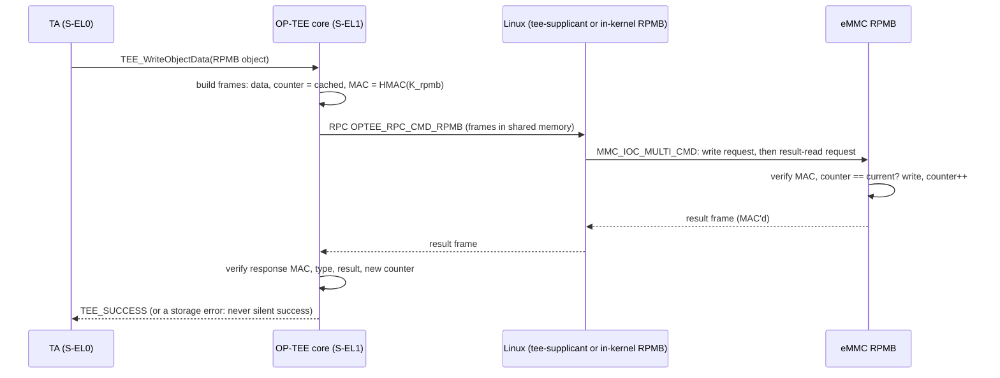

# 01.3 · OP-TEE OS: TrustZone, TZASC/TZMA, the SMC World Switch and RPMB Storage

> **Folder 01 · File 3 of 4.** OP-TEE is where device secrets live at runtime: the device key, attestation credentials, DRM keys, anti-rollback counters. Its security rests on three hardware facts and three software disciplines:
> - **Hardware:** the bus carries a Non-secure attribute on every transaction; a TrustZone address-space controller (TZASC, e.g. Arm TZC-400) filters DRAM on that attribute; and an RPMB partition gives replay-protected storage inside a storage device the normal world controls.
> - **Software:** **never trust an address the normal world gave you**, the Boomerang class; **never read shared memory twice**, the double-fetch class; and **never ship the development defaults**.
>
> This file covers:
> - the OP-TEE architecture and its normal-world plumbing (`/dev/tee0`, tee-supplicant, RPC);
> - TrustZone hardware: NS propagation, the TZASC (TZC-400 register map, filters, NSAIDs), TZMA and TZPC;
> - the world switch from OP-TEE's side: threads, yielding calls, RPC, foreign interrupts;
> - shared memory and the **Boomerang attack**, with OP-TEE's actual defense code;
> - **RPMB**: frame format, HMAC, write counter, nonces, how frames transit an untrusted Linux safely, and key derivation;
> - production listings: TZC-400 setup, the device-tree carve-out, a Trusted Application with its Linux client, an RPMB frame model, and the OP-TEE build profile, each fragile vs hardened.
>
> **Verification.**
> - TA sources were compiled (Clang 21.1, aarch64) against **OP-TEE 4.11.0's** `libutee`/`libutils` headers, and the client against **optee_client 4.11.0**'s `libteec` header. OP-TEE's own `ta/user_ta_header.c` was compiled with this TA's `user_ta_header_defines.h`, and the TA UUID was confirmed in the resulting `.ta_head` section.
> - TZC code was compiled against TF-A v2.15.0.
> - The RPMB and Boomerang models were compiled with GCC 16.2 and run.
> - The DTS was checked with a structural linter (`dtc` could not be run in this environment; see the README).
> - None of this was booted on hardware.

---

## 1. First-Principles Architecture & Hardware State Machines

### 1.1 The pieces, and who trusts whom

```text
 Normal world (NS)                                     │ Secure world
                                                       │
  app ──► libteec ──► /dev/tee0 ──┐                    │   S-EL0: user TAs (signed ELF, loaded at runtime)
                                  │ drivers/tee/optee   │          + early TAs (built into OP-TEE)
  tee-supplicant ◄─► /dev/teepriv0┤  (Linux, NS-EL1)    │   S-EL1: OP-TEE core: threads, mobj/MMU, crypto,
    • TA loading (/lib/optee_armtz/<uuid>.ta)           │          secure storage (REE FS, RPMB FS), PTAs
    • REE FS files (/data/tee)                          │   ───────────────────────────────────────────
    • RPMB frames (or the in-kernel RPMB path)          │   EL3: BL31 + opteed (01.2)
                                  └── SMC ─────────────┼──►
```

**Linux is an untrusted transport.** It allocates shared memory, loads TA files, and moves RPMB frames and storage blocks. OP-TEE must assume that Linux:
- lies about every address;
- changes shared buffers while OP-TEE reads them;
- replays old storage;
- substitutes TA files.

Every defense below exists because of one of those four.

### 1.2 TrustZone hardware: how "secure memory" is actually enforced

- **The NS attribute.** Every bus transaction from a core carries a Non-secure bit, AXI `AxPROT[1]`. It comes from the issuing world (SCR_EL3.NS, 01.2) combined with the NS bit in the secure world's own translation tables. Bus masters other than cores (DMA engines, GPUs, PCIe) carry an NS attribute and a **non-secure access ID (NSAID)** assigned by SoC integration.
- **TZASC (e.g. TZC-400).** It sits between the interconnect and each DDR port and filters every DRAM transaction on its address, NS bit and NSAID:
  - for secure transactions, against the region's secure read/write enables;
  - for non-secure transactions, against the region's per-NSAID read/write enables.
  - On a violation it can return a bus error, raise an interrupt, both, or silently read zero and ignore writes.
- **TZMA (TrustZone Memory Adapter).** It splits on-chip SRAM into a secure part and a non-secure part at a boundary set by integration. The BootROM and BL31 often live in that secure part.
- **TZPC / secure peripheral controls.** These mark peripherals (OTP controller, crypto engine, secure UART, RPMB-capable storage controller registers ⚠ SoC-specific) as secure-only.

**TZC-400 register map** (offsets from TF-A v2.15 `include/drivers/arm/tzc400.h` and `drivers/arm/tzc/tzc400.c`):

| Offset | Register | Meaning |
|---|---|---|
| 0x000 | BUILD_CONFIG | Number of regions (NR), address width (AW), number of filters (NF) |
| 0x004 | ACTION | Response on violation: none (RAZ/WI), bus error, interrupt, or error + interrupt |
| 0x008 | GATE_KEEPER | Per-filter open/close request and status. Filters must be opened for traffic to flow |
| 0x00C | SPECULATION_CTRL | Read/write speculation controls |
| 0x010 / 0x014 | INT_STATUS / INT_CLEAR | Per-filter violation status, overrun, overlap |
| 0x020… | FAIL_ADDRESS_LOW/HIGH, FAIL_CONTROL, FAIL_ID (0x02C) | Address, direction, NS state and master ID of the first failing access, per filter |
| 0x100 + 0x20·n | REGION_BASE_LOW/HIGH_n, REGION_TOP_LOW/HIGH_n | Region n bounds (inclusive top) |
| 0x110 + 0x20·n | REGION_ATTRIBUTES_n | Bits 31:30 secure write/read enable; bits 3:0 which filters (DDR ports) apply the region |
| 0x114 + 0x20·n | REGION_ID_ACCESS_n | Bits 31:16 NSAID write enables; bits 15:0 NSAID read enables |

Region 0 is the **background region**, covering the whole address space; regions 1…n are programmed on top of it. Keep regions 1…n non-overlapping: INT_STATUS has per-filter overlap bits for accesses that match more than one region ⚠ (see the TRM for the exact semantics). The production rule follows: **background = deny everything**, then grant explicitly (§2.1).

### 1.3 The world switch, from OP-TEE's side

01.2 §1.4 traced the EL3 half. Inside OP-TEE:
1. opteed ERETs to an entry in **`thread_vector_table`**: `yield_smc_entry`, `fast_smc_entry`, CPU on/off/suspend hooks, and the FIQ entry. OP-TEE registers this table with opteed at boot.
2. A **yielding call** (`OPTEE_SMC_CALL_WITH_ARG` and friends) allocates one of `CFG_NUM_THREADS` OP-TEE threads; the call runs in it. If all are busy, OP-TEE returns `OPTEE_SMC_RETURN_ETHREAD_LIMIT` and Linux retries.
3. A **foreign (normal-world) interrupt** during a yielding call suspends the thread and returns to Linux with `OPTEE_SMC_RETURN_RPC_FOREIGN_INTR`; Linux handles the IRQ, then resumes the thread with `OPTEE_SMC_CALL_RETURN_FROM_RPC`.
4. **RPC**: when OP-TEE needs the normal world to do something (allocate shared memory, load a TA, move RPMB frames, read an REE FS file), it returns an `OPTEE_SMC_RETURN_RPC_*` code. Linux, or tee-supplicant via `/dev/teepriv0`, services the request (`OPTEE_RPC_CMD_LOAD_TA`, `OPTEE_RPC_CMD_RPMB`, `OPTEE_RPC_CMD_FS`, `OPTEE_RPC_CMD_SHM_ALLOC`…) and resumes the call.
5. **Fast calls** run to completion with interrupts masked. Keep them short (01.2 §1.4).

**Design consequence:** OP-TEE can't make progress on storage or TA loading without a cooperating normal world. So the normal world can always **deny service**. What OP-TEE guarantees is **integrity, confidentiality and freshness**, never availability.

### 1.4 Shared memory, and the Boomerang attack

Linux passes buffers to OP-TEE in three ways:

| Mechanism | Message attribute | What OP-TEE must check |
|---|---|---|
| **Static reserved SHM** | `OPTEE_MSG_ATTR_TYPE_TMEM_*` with an address inside the pre-agreed NS SHM area | The whole range is inside `CORE_MEM_NSEC_SHM` |
| **Registered (dynamic) SHM** | `OPTEE_MSG_CMD_REGISTER_SHM` / `RMEM_*`, with a cookie | Each page of the registered list is non-secure |
| **Non-contiguous page lists** | `OPTEE_MSG_ATTR_NONCONTIG` | **Every** page aligned and non-secure, and the size consistent with the list |

**The Boomerang attack** (Machiry et al., NDSS 2017) is a semantic-gap attack. The normal world hands the TEE a *physical address that points into secure memory*. The TEE, running with access to both worlds, reads or writes it on the attacker's behalf, so the attacker gets the TEE's privileges through the TEE's own code. The same shape appears at EL3 (the fragile SiP service in 01.2) and in TAs (type confusion, §2.4).

OP-TEE 4.11's defense is visible in its code:
- **Every page of a registered page list must be non-secure.** `core/mm/mobj_dyn_shm.c`, `mobj_reg_shm_alloc()`:

  ```c
  	/* Ensure loaded references match format and security constraints */
  	for (i = 0; i < num_pages; i++) {
  		if (mobj_reg_shm->pages[i] & SMALL_PAGE_MASK)
  			goto err;

  		/* Only Non-secure memory can be mapped there */
  		if (!core_pbuf_is(CORE_MEM_NON_SEC, mobj_reg_shm->pages[i],
  				  SMALL_PAGE_SIZE))
  			goto err;
  	}
  ```

  A further check (`check_protmem_conflict()`) rejects overlap with protected memory.
- **The argument buffer is validated, read once, then re-validated at its real size.** `core/arch/arm/kernel/thread_optee_smc.c`, `std_entry_with_parg()`:
  1. `core_pbuf_is(CORE_MEM_NSEC_SHM, parg, sizeof(struct optee_msg_arg))`;
  2. `num_params = READ_ONCE(arg->num_params)`, bounded by `OPTEE_MSG_MAX_NUM_PARAMS`;
  3. a second `core_pbuf_is()` over `OPTEE_MSG_GET_ARG_SIZE(num_params)`.

  Reading `num_params` once and re-checking the full size is the **double-fetch** defense: the normal world can rewrite the buffer from another core between any two reads.

### 1.5 RPMB: replay-protected storage inside a device Linux controls

eMMC (and UFS) devices contain an **RPMB partition**. Writes to it are authenticated with an HMAC-SHA256 key programmed once into the device, and stamped with a **write counter** that only the device increments. Reads are authenticated and bound to a host-chosen **nonce**. Because the MAC key is shared only between OP-TEE and the storage device, Linux can carry the frames but can't forge, replay or roll them back.

**Frame layout** (512 bytes, big-endian fields; struct `rpmb_data_frame` in OP-TEE 4.11 `core/tee/tee_rpmb_fs.c`):

```text
 offset  size  field
   0     196   stuff bytes
 196      32   key / MAC          ← HMAC-SHA256(key, bytes 228..511) for each frame of a request
 228     256   data
 484      16   nonce              ← host-chosen for reads; echoed by the device under MAC
 500       4   write counter      ← must equal the device's counter for an authenticated write
 504       2   address            (256-byte half-sector units)
 506       2   block count
 508       2   result             0 OK, 1 general, 2 auth, 3 counter, 4 address, 5 write, 6 read,
                                  7 key not programmed; bit 7 = write counter expired
 510       2   request/response   0x0001 program key, 0x0002 read counter, 0x0003 auth write,
                                  0x0004 auth read, 0x0005 result read; responses 0x0100…0x0400
```

The OP-TEE code computes the MAC with `crypto_mac_update(ctx, datafrms[i].data, RPMB_MAC_PROTECT_DATA_SIZE)` over each frame, where `RPMB_MAC_PROTECT_DATA_SIZE = 512 − 228 = 284`.



**The RPMB key.**
- In OP-TEE 4.11, `tee_rpmb_key_gen()` derives it with `huk_subkey_derive(HUK_SUBKEY_RPMB, CID…)` from the **hardware unique key** and the storage device's **CID**. The CID's PRV and CRC bytes are masked so an eMMC firmware update doesn't change the key. UFS devices use their identifier as-is.
- **The key is programmed into the device once**, at the factory, by a build with `CFG_RPMB_WRITE_KEY=y` (§2.6). Production builds don't carry that capability.

**Routing.**
- Classically, tee-supplicant opens `/dev/mmcblk<N>rpmb` (`CFG_RPMB_FS_DEV_ID`) and issues `MMC_IOC_MULTI_CMD`.
- With `CFG_RPMB_ANNOUNCE_PROBE_CAP=y` (the 4.11 default), OP-TEE announces that it can use the kernel's own RPMB subsystem. Recent kernels then route frames in-kernel (`OPTEE_RPC_CMD_RPMB_PROBE_RESET` / `_PROBE_NEXT` / `_RPMB_FRAMES`), and secure storage no longer depends on a userspace daemon at boot ⚠ (check your kernel version).

**Secure storage options in OP-TEE:**
- **REE FS** (`CFG_REE_FS=y`, the default): encrypted, authenticated files in Linux's filesystem, protected by a hash tree. Without RPMB, **Linux can restore an older copy (rollback)**. `CFG_REE_FS_INTEGRITY_RPMB` anchors the hash tree's root in RPMB to stop that.
- **RPMB FS** (`CFG_RPMB_FS=y`): objects stored inside the RPMB partition. Small (typically 4 MiB or less ⚠ device-specific), slow, and replay-proof.

---

## 2. Production Code & Configuration Blueprints

### 2.1 The TZASC: who may touch which DRAM

#### The Fragile Way

```c
/* board_tzc_fragile.c - TZC-400 setup as usually first written: one filter, DMA into the TEE, silent faults */
#include <stdint.h>

#include <drivers/arm/tzc400.h>

#define BOARD_TZC_BASE    0x2a4a0000UL
#define DRAM_BASE         0x40000000ULL
#define DRAM_TOP          0x7fffffffULL
#define OPTEE_BASE        0x4e000000ULL
#define OPTEE_TOP         0x4fffffffULL
#define NSAID_CPU         0U
#define NSAID_DMA_PCIE    3U

void board_tzc_setup(void);

void board_tzc_setup(void)
{
	tzc400_init(BOARD_TZC_BASE);

	/* BUG 1: background region left wide open, "so bring-up doesn't fault". Any address the
	 * later regions forget (a new carve-out, a DRAM size change) is accessible to all. */
	tzc400_configure_region0(TZC_REGION_S_RDWR, TZC_REGION_ACCESS_RDWR(NSAID_CPU) |
				 TZC_REGION_ACCESS_RDWR(NSAID_DMA_PCIE));

	/* BUG 2: only filter 0. A TZC-400 has one filter per DDR port; traffic arriving through
	 * ports 1-3 (GPU, display, PCIe on many SoCs) is not checked against this region at all. */
	tzc400_configure_region(TZC_400_REGION_ATTR_FILTER_BIT(0), 1U, DRAM_BASE, OPTEE_BASE - 1ULL,
				TZC_REGION_S_NONE, TZC_REGION_ACCESS_RDWR(NSAID_CPU));

	/* BUG 3: "the crypto DMA writes results into OP-TEE buffers", so the DMA master's NSAID is
	 * granted on the secure carve-out. Linux programs that DMA engine: it can now read and write
	 * OP-TEE's memory, keys included. */
	tzc400_configure_region(TZC_400_REGION_ATTR_FILTER_BIT(0), 2U, OPTEE_BASE, OPTEE_TOP,
				TZC_REGION_S_RDWR, TZC_REGION_ACCESS_RDWR(NSAID_DMA_PCIE));

	tzc400_configure_region(TZC_400_REGION_ATTR_FILTER_BIT(0), 3U, OPTEE_TOP + 1ULL, DRAM_TOP,
				TZC_REGION_S_NONE, TZC_REGION_ACCESS_RDWR(NSAID_CPU));

	/* BUG 4: violations read as zero / writes ignored, with no error and no interrupt: an attack
	 * (or a driver bug) is invisible. */
	tzc400_set_action(TZC_ACTION_NONE);
	tzc400_enable_filters();
}
```

Every bug in it has shipped somewhere:
- **An open background region.** Any address the later regions forget is accessible to everyone.
- **Filter 0 only.** Traffic arriving through the other DDR ports bypasses the region entirely; on many SoCs those carry the GPU, display and PCIe.
- **A DMA master's NSAID granted on the TEE carve-out.** Linux programs that DMA engine, so Linux can read and write OP-TEE memory.
- **`TZC_ACTION_NONE`.** Violations are invisible.

#### The Silicon-Hardened Production Way

```c
/* board_tzc.c - hardened TZC-400 (TZASC) setup in BL2: default-deny, OP-TEE carve-out, per-master NSAID control */
#include <stdint.h>

#include <drivers/arm/tzc400.h>

#define BOARD_TZC_BASE    0x2a4a0000UL          /* SoC-specific; FVP-like value for illustration */

/* DRAM map (inclusive tops, as tzc400_configure_region expects). */
#define DRAM_LO_BASE      0x40000000ULL
#define OPTEE_BASE        0x4e000000ULL          /* OP-TEE core + TA RAM: 30 MiB           */
#define OPTEE_TOP         0x4fdfffffULL
#define SHM_BASE          0x4fe00000ULL          /* OP-TEE static shared memory: 2 MiB     */
#define SHM_TOP           0x4fffffffULL
#define DRAM_HI_BASE      0x50000000ULL
#define DRAM_TOP          0x7fffffffULL

/* Non-secure access IDs: which bus master issued a transaction (SoC integration-defined). */
#define NSAID_CPU         0U
#define NSAID_GPU         1U
#define NSAID_DISPLAY     2U
#define NSAID_DMA_PCIE    3U

#define NS_ALL_MASTERS    (TZC_REGION_ACCESS_RDWR(NSAID_CPU) | TZC_REGION_ACCESS_RDWR(NSAID_GPU) | \
			   TZC_REGION_ACCESS_RDWR(NSAID_DISPLAY) | TZC_REGION_ACCESS_RDWR(NSAID_DMA_PCIE))

void board_tzc_setup(void);

void board_tzc_setup(void)
{
	tzc400_init(BOARD_TZC_BASE);
	tzc400_disable_filters();

	/* Region 0 is the background: anything not covered below is denied to everyone. */
	tzc400_configure_region0(TZC_REGION_S_NONE, 0U);

	/* Non-secure DRAM below the carve-out: every NS master may use it. */
	tzc400_configure_region(TZC_400_REGION_ATTR_FILTER_BIT_ALL, 1U, DRAM_LO_BASE, OPTEE_BASE - 1ULL,
				TZC_REGION_S_NONE, NS_ALL_MASTERS);

	/* OP-TEE: secure read/write only. No NSAID at all, so no NS CPU or DMA master can reach it. */
	tzc400_configure_region(TZC_400_REGION_ATTR_FILTER_BIT_ALL, 2U, OPTEE_BASE, OPTEE_TOP,
				TZC_REGION_S_RDWR, 0U);

	/* Static SHM: non-secure, but only the CPU; DMA masters cannot be aimed at TEE messages. */
	tzc400_configure_region(TZC_400_REGION_ATTR_FILTER_BIT_ALL, 3U, SHM_BASE, SHM_TOP,
				TZC_REGION_S_NONE, TZC_REGION_ACCESS_RDWR(NSAID_CPU));

	/* Non-secure DRAM above. */
	tzc400_configure_region(TZC_400_REGION_ATTR_FILTER_BIT_ALL, 4U, DRAM_HI_BASE, DRAM_TOP,
				TZC_REGION_S_NONE, NS_ALL_MASTERS);

	/* Violations: bus error to the master AND an interrupt to the secure world for logging. */
	tzc400_set_action(TZC_ACTION_ERR_INT);

	/* All filters (one per DDR port) enabled last, after every region is programmed. */
	tzc400_enable_filters();
}
```

The rules: **deny by default** (region 0 has no access); give the carve-out **secure-only** access with **no NSAID**; scope each NS region to the masters that need it (static SHM is CPU-only); apply every region to **all filters**; **error and interrupt** on violation, so attacks and driver bugs are visible; and **enable the filters last**.

Compile results (TF-A v2.15.0 headers):

```text
OK   board_tzc.c  (IMAGE_BL2, TF-A v2.15 headers, clang 21.1.0)
OK   board_tzc_fragile.c  (IMAGE_BL2, TF-A v2.15 headers, clang 21.1.0)
```

### 2.2 The Linux view of the carve-out (device tree)

#### The Fragile Way

Leaving the OP-TEE carve-out out of `reserved-memory`, or listing it **without `no-map`**:
- **Not reserved at all:** Linux hands secure pages to the page allocator, and the first access faults through the TZC.
- **Reserved but mapped:** the kernel's linear map covers the carve-out as normal cacheable memory. Nothing in Linux touches it deliberately, but **speculative and prefetch accesses do**, and the TZC answers with errors. The symptom is a random, rare SError or "bad mode" on a fraction of boards, under load, months into the program.

#### The Silicon-Hardened Production Way

```dts
/* optee-carveout.dtsi - Linux-side view of the OP-TEE carve-out (matches board_tzc.c regions 2 and 3) */
/ {
	#address-cells = <2>;
	#size-cells = <2>;

	reserved-memory {
		#address-cells = <2>;
		#size-cells = <2>;
		ranges;

		/* TZC region 2: secure-only. no-map keeps it out of Linux's linear map entirely, so
		 * neither the kernel nor speculative prefetch ever issues a transaction to it. */
		optee_core: optee-core@4e000000 {
			reg = <0x0 0x4e000000 0x0 0x01e00000>;
			no-map;
		};

		/* TZC region 3: non-secure static SHM shared with OP-TEE. no-map as well: the
		 * OP-TEE driver maps it itself with the attributes OP-TEE expects. */
		optee_shm: optee-shm@4fe00000 {
			reg = <0x0 0x4fe00000 0x0 0x00200000>;
			no-map;
		};
	};

	firmware {
		optee {
			compatible = "linaro,optee-tz";
			method = "smc";
			/* Optional: OP-TEE asynchronous-notification interrupt (GIC SPI 187, edge rising). */
			interrupts = <0 187 1>;
		};
	};
};
```

Structural check (my own linter, `dts_lint.py`, standing in for `dtc`: unit address vs `reg`, cell counts, required properties, and references; see the README):

```text
optee-carveout.dtsi: 6 nodes, 0 error(s)
```

The `firmware/optee` node follows the Linux binding `Documentation/devicetree/bindings/arm/firmware/linaro,optee-tz.yaml` (v7.2): `compatible = "linaro,optee-tz"`, `method` = `"smc"` or `"hvc"`, an optional notification interrupt, and no additional properties. Many platforms have OP-TEE insert these nodes into the DTB it passes on ⚠ (platform-dependent). Whichever way they arrive, the carve-out in the DTB and the TZC regions in BL2 must describe the **same** addresses; a CI check that diffs the two catches drift.

### 2.3 Validating normal-world buffers: Boomerang and double fetch

#### The Fragile Way

- Check only the **first page** of a non-contiguous page list, or only the **base address** of a contiguous buffer.
- Validate a length field in shared memory, then read it **again** to use it.

#### The Silicon-Hardened Production Way

- Validate **every page**: aligned and fully inside a non-secure region.
- Validate the **whole range**, rejecting wrap-around.
- Bound the size against the list.
- Read shared fields **once** (`READ_ONCE`) into private memory, and validate and use only the private copy.

This is what OP-TEE does (§1.4). The model below proves the difference on concrete attack inputs:

```c
/* shm_check.c - Boomerang and double-fetch defenses: validating normal-world buffers the way OP-TEE does */
#include <stdint.h>
#include <stdio.h>
#include <string.h>

#define PAGE 4096u

/* Physical memory map as the secure side sees it (QEMU-virt-like). `secure` regions are TZC-protected. */
typedef struct { uint64_t base, size; int secure; const char *name; } region;
static const region map[] = {
	{0x40000000u, 0x0e000000u, 0, "NS DRAM (Linux)"},
	{0x4e000000u, 0x01e00000u, 1, "OP-TEE core + TA RAM"},
	{0x4fe00000u, 0x00200000u, 0, "static SHM (NS)"},
	{0x50000000u, 0x30000000u, 0, "NS DRAM (Linux)"},
	{0x09040000u, 0x00001000u, 1, "secure crypto engine MMIO"},
};
#define NREG (sizeof map / sizeof map[0])

/* Is [pa, pa+len) entirely inside ONE non-secure region? (OP-TEE: core_pbuf_is(CORE_MEM_NON_SEC, pa, len)) */
static int pbuf_is_nonsec(uint64_t pa, uint64_t len)
{
	if (len == 0 || pa + len < pa)                 /* empty or wraps the address space */
		return 0;
	for (unsigned i = 0; i < NREG; i++) {
		const region *r = &map[i];
		if (!r->secure && pa >= r->base && pa + len <= r->base + r->size)
			return 1;
	}
	return 0;
}

/* ---- Fragile: checks a contiguous buffer by its base address only ---- */
static int fragile_contig_ok(uint64_t pa, uint64_t len)
{
	(void)len;
	return pbuf_is_nonsec(pa, 1);                  /* "the buffer starts in Linux memory" */
}

/* ---- Fragile: checks only the first page of a non-contiguous page list ---- */
static int fragile_pagelist_ok(const uint64_t *pages, size_t n)
{
	return n > 0 && pbuf_is_nonsec(pages[0], PAGE);
}

/* ---- Hardened: every page aligned, every page fully non-secure, size consistent with the list ---- */
static int hardened_pagelist_ok(const uint64_t *pages, size_t n, uint64_t page_offset, uint64_t size)
{
	if (n == 0 || n > 512 || page_offset >= PAGE)
		return 0;
	if (size == 0 || size > (uint64_t)n * PAGE - page_offset)
		return 0;
	for (size_t i = 0; i < n; i++) {
		if (pages[i] & (PAGE - 1u))
			return 0;
		if (!pbuf_is_nonsec(pages[i], PAGE))
			return 0;
	}
	return 1;
}

/* ---- Double fetch: a TA command struct that lives in shared memory ---- */
typedef struct { uint32_t len; uint8_t payload[4096]; } shm_cmd;
static void (*race_hook)(volatile shm_cmd *);       /* the normal world, running on another core */

static void attacker_grows_len(volatile shm_cmd *c) { c->len = 4096; }

static size_t fragile_copy(volatile shm_cmd *c, uint8_t *dst, size_t cap)
{
	if (c->len > cap)                               /* fetch 1: check */
		return 0;
	if (race_hook) race_hook(c);
	size_t n = c->len;                              /* fetch 2: use   */
	memcpy(dst, (const void *)c->payload, n);
	return n;
}

static size_t hardened_copy(volatile shm_cmd *c, uint8_t *dst, size_t cap)
{
	size_t n = *(volatile uint32_t *)&c->len;       /* READ_ONCE: one fetch, then only the local copy */
	if (race_hook) race_hook(c);
	if (n > cap)
		return 0;
	memcpy(dst, (const void *)c->payload, n);
	return n;
}

static int failures;
#define CHECK(c, w) do { printf("  %s %s\n", (c) ? "ok  " : "FAIL", w); failures += !(c); } while (0)

int main(void)
{
	puts("[1] Page lists from the normal world (OPTEE_MSG_ATTR_NONCONTIG)");
	uint64_t good[] = {0x41000000u, 0x41001000u, 0x7ff00000u};
	CHECK(fragile_pagelist_ok(good, 3) && hardened_pagelist_ok(good, 3, 0x10, 3 * PAGE - 0x10),
	      "three Linux pages: both accept");
	uint64_t boomerang[] = {0x41000000u, 0x4e100000u, 0x41002000u};   /* page 1 = OP-TEE's own heap */
	CHECK(fragile_pagelist_ok(boomerang, 3), "FRAGILE accepts a list whose 2nd page is OP-TEE memory");
	CHECK(!hardened_pagelist_ok(boomerang, 3, 0, 3 * PAGE), "HARDENED rejects it (Boomerang)");
	uint64_t mmio[] = {0x41000000u, 0x09040000u};
	CHECK(!hardened_pagelist_ok(mmio, 2, 0, 2 * PAGE), "HARDENED rejects a secure MMIO page");
	uint64_t unaligned[] = {0x41000800u};
	CHECK(!hardened_pagelist_ok(unaligned, 1, 0, 16), "HARDENED rejects an unaligned page address");
	CHECK(!hardened_pagelist_ok(good, 3, 0, 4 * PAGE), "HARDENED rejects size larger than the list covers");

	puts("[2] Contiguous buffers given by physical address");
	CHECK(fragile_contig_ok(0x4dfff000u, 0x3000u), "FRAGILE accepts [0x4dfff000, +12K): runs into OP-TEE");
	CHECK(!pbuf_is_nonsec(0x4dfff000u, 0x3000u), "HARDENED (whole range) rejects it");
	CHECK(!pbuf_is_nonsec(0xfffffffffffff000ull, 0x2000u), "HARDENED rejects a range that wraps 2^64");

	puts("[3] Double fetch of a length field in shared memory");
	static shm_cmd cmd;
	/* The TA's 64-byte buffer followed by its neighbour (e.g. a key schedule). Copying through the
	 * struct keeps the "overflow" inside one object, so the test itself has no undefined behaviour. */
	static struct { uint8_t buf[64]; uint8_t neighbour[4096]; } ta;
	memset(&ta, 0xA5, sizeof ta);
	memset(cmd.payload, 0x00, sizeof cmd.payload);
	cmd.len = 16;
	race_hook = attacker_grows_len;
	size_t n = fragile_copy(&cmd, (uint8_t *)&ta, sizeof ta.buf);
	CHECK(n == 4096 && ta.neighbour[100] == 0x00,
	      "FRAGILE: checked len=16, copied 4096 bytes, overwrote the neighbouring secret");
	memset(&ta, 0xA5, sizeof ta);
	cmd.len = 16;
	n = hardened_copy(&cmd, (uint8_t *)&ta, sizeof ta.buf);
	CHECK(n == 16 && ta.neighbour[0] == 0xA5 && ta.neighbour[100] == 0xA5,
	      "HARDENED: copied the 16 bytes it validated; neighbour intact");

	printf("%s: %d failure(s)\n", failures ? "FAILED" : "ALL PASSED", failures);
	return failures != 0;
}
```

```text
[1] Page lists from the normal world (OPTEE_MSG_ATTR_NONCONTIG)
  ok   three Linux pages: both accept
  ok   FRAGILE accepts a list whose 2nd page is OP-TEE memory
  ok   HARDENED rejects it (Boomerang)
  ok   HARDENED rejects a secure MMIO page
  ok   HARDENED rejects an unaligned page address
  ok   HARDENED rejects size larger than the list covers
[2] Contiguous buffers given by physical address
  ok   FRAGILE accepts [0x4dfff000, +12K): runs into OP-TEE
  ok   HARDENED (whole range) rejects it
  ok   HARDENED rejects a range that wraps 2^64
[3] Double fetch of a length field in shared memory
  ok   FRAGILE: checked len=16, copied 4096 bytes, overwrote the neighbouring secret
  ok   HARDENED: copied the 16 bytes it validated; neighbour intact
ALL PASSED: 0 failure(s)
```

### 2.4 A Trusted Application and its client

The shared ABI and TA properties:

```c
/* vault_ta.h - UUID and command ABI shared by the vault TA and its Linux client */
#ifndef VAULT_TA_H
#define VAULT_TA_H

/* 6f3b1c2a-91d4-4e7b-a82e-5c119d4073e6. Generate your own with uuidgen; never copy one from an example. */
#define TA_VAULT_UUID \
	{ 0x6f3b1c2a, 0x91d4, 0x4e7b, { 0xa8, 0x2e, 0x5c, 0x11, 0x9d, 0x40, 0x73, 0xe6 } }

/* CMD_PROVISION   : no params. Generate a device key inside the TA; fail if one exists.
 * CMD_HMAC        : [0] MEMREF_INPUT message (<= VAULT_MAX_MSG)  [1] MEMREF_OUTPUT 32-byte MAC
 * CMD_COUNTER     : [0] VALUE_INOUT a = requested minimum; on return a = counter (never decreases)
 */
#define TA_VAULT_CMD_PROVISION 0
#define TA_VAULT_CMD_HMAC      1
#define TA_VAULT_CMD_COUNTER   2

#define VAULT_MAX_MSG 4096
#define VAULT_MAC_LEN 32

#endif /* VAULT_TA_H */
```

```c
/* user_ta_header_defines.h - properties OP-TEE's loader reads from the vault TA's ELF header */
#ifndef USER_TA_HEADER_DEFINES_H
#define USER_TA_HEADER_DEFINES_H

#include "vault_ta.h"

#define TA_UUID        TA_VAULT_UUID
/* Single instance + multi-session: one key cache shared safely by all sessions of this TA. */
#define TA_FLAGS       (TA_FLAG_SINGLE_INSTANCE | TA_FLAG_MULTI_SESSION)
#define TA_STACK_SIZE  (4 * 1024)
#define TA_DATA_SIZE   (32 * 1024)
#define TA_VERSION     "1.0"
#define TA_DESCRIPTION "Device key vault and monotonic counter in RPMB"

#endif /* USER_TA_HEADER_DEFINES_H */
```

#### The Fragile Way

```c
/* vault_ta_fragile.c - the same TA as usually first written: type confusion, double fetch, rollback, key export */
#include <string.h>
#include <tee_internal_api.h>
#include <tee_internal_api_extensions.h>

#include "vault_ta.h"

#define TA_VAULT_CMD_EXPORT_KEY 99   /* "for the factory test station" */

static const char key_id[] = "vault.key";

TEE_Result TA_CreateEntryPoint(void) { return TEE_SUCCESS; }
void TA_DestroyEntryPoint(void) { }

TEE_Result TA_OpenSessionEntryPoint(uint32_t ptypes, TEE_Param params[TEE_NUM_PARAMS], void **sess)
{
	(void)ptypes; (void)params;
	*sess = NULL;
	return TEE_SUCCESS;
}

void TA_CloseSessionEntryPoint(void *sess) { (void)sess; }

TEE_Result TA_InvokeCommandEntryPoint(void *sess, uint32_t cmd, uint32_t ptypes,
				      TEE_Param params[TEE_NUM_PARAMS])
{
	TEE_ObjectHandle obj = TEE_HANDLE_NULL;
	uint8_t key[32];
	size_t n = 0;

	(void)sess;
	(void)ptypes;   /* BUG 1: parameter types never checked. A client passing VALUE in slot 0
			 * makes params[0].memref.buffer an attacker-chosen pointer into TA memory. */

	switch (cmd) {
	case TA_VAULT_CMD_PROVISION:
		TEE_GenerateRandom(key, sizeof(key));
		/* BUG 2: REE FS (files in /data/tee on Linux). Without CFG_REE_FS_INTEGRITY_RPMB the
		 * normal world can restore yesterday's files: rollback.
		 * BUG 3: OVERWRITE lets any caller re-provision, replacing the device key at will. */
		return TEE_CreatePersistentObject(TEE_STORAGE_PRIVATE, key_id, sizeof(key_id) - 1,
						  TEE_DATA_FLAG_ACCESS_READ | TEE_DATA_FLAG_OVERWRITE,
						  TEE_HANDLE_NULL, key, sizeof(key), &obj);

	case TA_VAULT_CMD_HMAC: {
		TEE_OperationHandle op = TEE_HANDLE_NULL;
		TEE_ObjectHandle hkey = TEE_HANDLE_NULL;
		TEE_Attribute attr;
		size_t mac_len = VAULT_MAC_LEN;

		(void)TEE_OpenPersistentObject(TEE_STORAGE_PRIVATE, key_id, sizeof(key_id) - 1,
					       TEE_DATA_FLAG_ACCESS_READ, &obj);
		(void)TEE_ReadObjectData(obj, key, sizeof(key), &n);   /* BUG 4: errors ignored */
		TEE_CloseObject(obj);
		(void)TEE_AllocateOperation(&op, TEE_ALG_HMAC_SHA256, TEE_MODE_MAC, 256);
		(void)TEE_AllocateTransientObject(TEE_TYPE_HMAC_SHA256, 256, &hkey);
		TEE_InitRefAttribute(&attr, TEE_ATTR_SECRET_VALUE, key, sizeof(key));
		(void)TEE_PopulateTransientObject(hkey, &attr, 1);
		(void)TEE_SetOperationKey(op, hkey);
		TEE_MACInit(op, NULL, 0);
		/* BUG 5: MACs the SHARED buffer in place: the normal world can change it mid-MAC.
		 * BUG 6: output size never checked: writes 32 bytes whatever the client allocated. */
		(void)TEE_MACComputeFinal(op, params[0].memref.buffer, params[0].memref.size,
					  params[1].memref.buffer, &mac_len);
		TEE_FreeTransientObject(hkey);
		TEE_FreeOperation(op);
		return TEE_SUCCESS;
	}

	case TA_VAULT_CMD_EXPORT_KEY:
		/* BUG 7: a "debug" command that returns the device key. It ships, because the
		 * factory needed it once; now every root shell on every unit can read the key. */
		(void)TEE_OpenPersistentObject(TEE_STORAGE_PRIVATE, key_id, sizeof(key_id) - 1,
					       TEE_DATA_FLAG_ACCESS_READ, &obj);
		(void)TEE_ReadObjectData(obj, params[0].memref.buffer, 32, &n);
		TEE_CloseObject(obj);
		return TEE_SUCCESS;

	default:
		return TEE_ERROR_NOT_SUPPORTED;
	}
}
```

It compiles cleanly against OP-TEE 4.11 (output below). The seven bugs map onto the attacker model of §1.1:
- **Unchecked parameter types.** A client puts a VALUE in a MEMREF slot, and the TA dereferences an attacker-chosen pointer inside its own address space.
- **REE FS without RPMB anchoring.** Linux restores an old key file.
- **`OVERWRITE` on provisioning.** Anyone who can open a session replaces the device key.
- **Ignored errors.**
- **MAC over shared memory.** Linux changes the message mid-computation.
- **An unchecked output size.**
- **A debug export command.**

#### The Silicon-Hardened Production Way

```c
/* vault_ta.c - hardened OP-TEE TA: non-exportable device key + monotonic counter in RPMB (GP TEE Internal Core API 1.3) */
#include <string.h>
#include <tee_internal_api.h>
#include <tee_internal_api_extensions.h>

#include "vault_ta.h"

static const char key_id[] = "vault.key";
static const char ctr_id[] = "vault.ctr";

/* RPMB-backed storage: integrity, confidentiality AND replay protection (01.3 section 2.3). */
#define VAULT_STORAGE TEE_STORAGE_PRIVATE_RPMB

TEE_Result TA_CreateEntryPoint(void) { return TEE_SUCCESS; }
void TA_DestroyEntryPoint(void) { }

TEE_Result TA_OpenSessionEntryPoint(uint32_t ptypes, TEE_Param params[TEE_NUM_PARAMS], void **sess)
{
	(void)params;
	*sess = NULL;
	if (ptypes != TEE_PARAM_TYPES(TEE_PARAM_TYPE_NONE, TEE_PARAM_TYPE_NONE,
				      TEE_PARAM_TYPE_NONE, TEE_PARAM_TYPE_NONE))
		return TEE_ERROR_BAD_PARAMETERS;
	return TEE_SUCCESS;
}

void TA_CloseSessionEntryPoint(void *sess) { (void)sess; }

static TEE_Result provision(uint32_t ptypes)
{
	uint8_t key[32];
	TEE_ObjectHandle obj = TEE_HANDLE_NULL;
	TEE_Result res;

	if (ptypes != TEE_PARAM_TYPES(TEE_PARAM_TYPE_NONE, TEE_PARAM_TYPE_NONE,
				      TEE_PARAM_TYPE_NONE, TEE_PARAM_TYPE_NONE))
		return TEE_ERROR_BAD_PARAMETERS;

	TEE_GenerateRandom(key, sizeof(key));      /* born inside the TEE; never crosses the boundary */
	/* No TEE_DATA_FLAG_OVERWRITE: provisioning twice is refused (ACCESS_CONFLICT), so a caller
	 * can never replace the device key with one it chose. */
	res = TEE_CreatePersistentObject(VAULT_STORAGE, key_id, sizeof(key_id) - 1,
					 TEE_DATA_FLAG_ACCESS_READ, TEE_HANDLE_NULL,
					 key, sizeof(key), &obj);
	TEE_MemFill(key, 0, sizeof(key));
	if (res == TEE_SUCCESS)
		TEE_CloseObject(obj);
	return res;
}

static TEE_Result load_key(uint8_t key[32])
{
	TEE_ObjectHandle obj = TEE_HANDLE_NULL;
	size_t n = 0;
	TEE_Result res;

	res = TEE_OpenPersistentObject(VAULT_STORAGE, key_id, sizeof(key_id) - 1,
				       TEE_DATA_FLAG_ACCESS_READ, &obj);
	if (res != TEE_SUCCESS)
		return res;
	res = TEE_ReadObjectData(obj, key, 32, &n);
	TEE_CloseObject(obj);
	if (res == TEE_SUCCESS && n != 32)
		res = TEE_ERROR_CORRUPT_OBJECT;
	return res;
}

static TEE_Result hmac(uint32_t ptypes, TEE_Param params[TEE_NUM_PARAMS])
{
	TEE_OperationHandle op = TEE_HANDLE_NULL;
	TEE_ObjectHandle hkey = TEE_HANDLE_NULL;
	TEE_Attribute attr;
	uint8_t key[32];
	uint8_t mac[VAULT_MAC_LEN];
	size_t mac_len = sizeof(mac);
	void *msg = NULL;
	size_t msg_len;
	TEE_Result res;

	/* 1. Exact parameter types: a VALUE param in a MEMREF slot would be a pointer forgery. */
	if (ptypes != TEE_PARAM_TYPES(TEE_PARAM_TYPE_MEMREF_INPUT, TEE_PARAM_TYPE_MEMREF_OUTPUT,
				      TEE_PARAM_TYPE_NONE, TEE_PARAM_TYPE_NONE))
		return TEE_ERROR_BAD_PARAMETERS;

	/* 2. Bounds, read once. */
	msg_len = params[0].memref.size;
	if (msg_len > VAULT_MAX_MSG)
		return TEE_ERROR_BAD_PARAMETERS;
	if (params[1].memref.size < VAULT_MAC_LEN) {
		params[1].memref.size = VAULT_MAC_LEN;   /* GP convention: report the size needed */
		return TEE_ERROR_SHORT_BUFFER;
	}

	/* 3. Copy-in: the client's buffer is shared memory the normal world can change while we
	 *    work. MAC the private copy, never the shared original. */
	msg = TEE_Malloc(msg_len ? msg_len : 1, TEE_MALLOC_FILL_ZERO);
	if (!msg)
		return TEE_ERROR_OUT_OF_MEMORY;
	TEE_MemMove(msg, params[0].memref.buffer, msg_len);

	res = load_key(key);
	if (res != TEE_SUCCESS)
		goto out;
	res = TEE_AllocateOperation(&op, TEE_ALG_HMAC_SHA256, TEE_MODE_MAC, 256);
	if (res != TEE_SUCCESS)
		goto out;
	res = TEE_AllocateTransientObject(TEE_TYPE_HMAC_SHA256, 256, &hkey);
	if (res != TEE_SUCCESS)
		goto out;
	TEE_InitRefAttribute(&attr, TEE_ATTR_SECRET_VALUE, key, sizeof(key));
	res = TEE_PopulateTransientObject(hkey, &attr, 1);
	if (res != TEE_SUCCESS)
		goto out;
	res = TEE_SetOperationKey(op, hkey);
	if (res != TEE_SUCCESS)
		goto out;
	TEE_MACInit(op, NULL, 0);
	res = TEE_MACComputeFinal(op, msg, msg_len, mac, &mac_len);
	if (res != TEE_SUCCESS)
		goto out;

	/* 4. Copy-out exactly what was validated, once. */
	TEE_MemMove(params[1].memref.buffer, mac, VAULT_MAC_LEN);
	params[1].memref.size = VAULT_MAC_LEN;
out:
	TEE_MemFill(key, 0, sizeof(key));
	if (hkey != TEE_HANDLE_NULL)
		TEE_FreeTransientObject(hkey);
	if (op != TEE_HANDLE_NULL)
		TEE_FreeOperation(op);
	TEE_Free(msg);
	return res;
}

static TEE_Result counter(uint32_t ptypes, TEE_Param params[TEE_NUM_PARAMS])
{
	TEE_ObjectHandle obj = TEE_HANDLE_NULL;
	uint32_t cur = 0, want;
	size_t n = 0;
	TEE_Result res;

	if (ptypes != TEE_PARAM_TYPES(TEE_PARAM_TYPE_VALUE_INOUT, TEE_PARAM_TYPE_NONE,
				      TEE_PARAM_TYPE_NONE, TEE_PARAM_TYPE_NONE))
		return TEE_ERROR_BAD_PARAMETERS;
	want = params[0].value.a;

	res = TEE_OpenPersistentObject(VAULT_STORAGE, ctr_id, sizeof(ctr_id) - 1,
				       TEE_DATA_FLAG_ACCESS_READ | TEE_DATA_FLAG_ACCESS_WRITE, &obj);
	if (res == TEE_ERROR_ITEM_NOT_FOUND) {
		res = TEE_CreatePersistentObject(VAULT_STORAGE, ctr_id, sizeof(ctr_id) - 1,
						 TEE_DATA_FLAG_ACCESS_READ | TEE_DATA_FLAG_ACCESS_WRITE,
						 TEE_HANDLE_NULL, &cur, sizeof(cur), &obj);
	} else if (res == TEE_SUCCESS) {
		res = TEE_ReadObjectData(obj, &cur, sizeof(cur), &n);
		if (res == TEE_SUCCESS && n != sizeof(cur))
			res = TEE_ERROR_CORRUPT_OBJECT;
	}
	if (res != TEE_SUCCESS)
		goto out;

	if (want > cur) {                          /* monotonic: requests below the current value are no-ops */
		res = TEE_SeekObjectData(obj, 0, TEE_DATA_SEEK_SET);
		if (res == TEE_SUCCESS)
			res = TEE_WriteObjectData(obj, &want, sizeof(want));
		if (res == TEE_SUCCESS)
			cur = want;
	}
	params[0].value.a = cur;
out:
	if (obj != TEE_HANDLE_NULL)
		TEE_CloseObject(obj);
	return res;
}

TEE_Result TA_InvokeCommandEntryPoint(void *sess, uint32_t cmd, uint32_t ptypes,
				      TEE_Param params[TEE_NUM_PARAMS])
{
	(void)sess;
	switch (cmd) {
	case TA_VAULT_CMD_PROVISION:
		return provision(ptypes);
	case TA_VAULT_CMD_HMAC:
		return hmac(ptypes, params);
	case TA_VAULT_CMD_COUNTER:
		return counter(ptypes, params);
	default:
		return TEE_ERROR_NOT_SUPPORTED;
	}
}
```

The rules it encodes:
- **Exact `TEE_PARAM_TYPES` match per command.**
- **Bounds checked on sizes read once.** Report the needed size with `TEE_ERROR_SHORT_BUFFER`.
- **Copy-in before use, copy-out once.**
- **The key is generated inside the TEE and stored in `TEE_STORAGE_PRIVATE_RPMB`** (`0x80000100`); it is never exported.
- **Provisioning refuses to overwrite** (`TEE_ERROR_ACCESS_CONFLICT`).
- **Monotonic counters only move up.**
- **Secrets are wiped** from the stack after use.

The Linux client (GP TEE Client API):

```c
/* vault_client.c - Linux userspace client for the vault TA (GP TEE Client API, optee_client libteec) */
#include <err.h>
#include <stdio.h>
#include <string.h>

#include <tee_client_api.h>

#include "vault_ta.h"

static void check(TEEC_Result res, uint32_t origin, const char *what)
{
	if (res != TEEC_SUCCESS)
		errx(1, "%s failed: 0x%08x (origin %u)", what, res, origin);
}

int main(int argc, char **argv)
{
	TEEC_Context ctx;
	TEEC_Session sess;
	TEEC_Operation op;
	TEEC_UUID uuid = TA_VAULT_UUID;
	uint32_t origin = 0;
	uint8_t mac[VAULT_MAC_LEN];
	const char *msg = argc > 1 ? argv[1] : "attestation-challenge";

	check(TEEC_InitializeContext(NULL, &ctx), 0, "TEEC_InitializeContext");
	check(TEEC_OpenSession(&ctx, &sess, &uuid, TEEC_LOGIN_PUBLIC, NULL, NULL, &origin),
	      origin, "TEEC_OpenSession");

	/* Provision once per device. A second call returns TEE_ERROR_ACCESS_CONFLICT by design. */
	memset(&op, 0, sizeof(op));
	op.paramTypes = TEEC_PARAM_TYPES(TEEC_NONE, TEEC_NONE, TEEC_NONE, TEEC_NONE);
	TEEC_Result res = TEEC_InvokeCommand(&sess, TA_VAULT_CMD_PROVISION, &op, &origin);
	if (res != TEEC_SUCCESS && res != TEEC_ERROR_ACCESS_CONFLICT)
		check(res, origin, "provision");

	/* HMAC with the non-exportable key. Temp memrefs: libteec copies or registers them. */
	memset(&op, 0, sizeof(op));
	op.paramTypes = TEEC_PARAM_TYPES(TEEC_MEMREF_TEMP_INPUT, TEEC_MEMREF_TEMP_OUTPUT,
					 TEEC_NONE, TEEC_NONE);
	op.params[0].tmpref.buffer = (void *)msg;
	op.params[0].tmpref.size = strlen(msg);
	op.params[1].tmpref.buffer = mac;
	op.params[1].tmpref.size = sizeof(mac);
	check(TEEC_InvokeCommand(&sess, TA_VAULT_CMD_HMAC, &op, &origin), origin, "hmac");
	printf("MAC(%s) = ", msg);
	for (size_t i = 0; i < op.params[1].tmpref.size; i++)
		printf("%02x", mac[i]);
	printf("\n");

	/* Monotonic counter: ask for at least 7; the TA never lowers it. */
	memset(&op, 0, sizeof(op));
	op.paramTypes = TEEC_PARAM_TYPES(TEEC_VALUE_INOUT, TEEC_NONE, TEEC_NONE, TEEC_NONE);
	op.params[0].value.a = 7;
	check(TEEC_InvokeCommand(&sess, TA_VAULT_CMD_COUNTER, &op, &origin), origin, "counter");
	printf("counter = %u\n", op.params[0].value.a);

	TEEC_CloseSession(&sess);
	TEEC_FinalizeContext(&ctx);
	return 0;
}
```

Compile results:

```text
OK   vault_ta.c  (TA, OP-TEE 4.11.0 libutee/libutils headers, clang 21.1.0, aarch64)
OK   vault_ta_fragile.c  (TA, OP-TEE 4.11.0 libutee/libutils headers, clang 21.1.0, aarch64)
OK   vault_client.c  (Linux client, optee_client 4.11.0 libteec headers, clang 21.1.0, aarch64)
OK   optee_os-4.11.0/ta/user_ta_header.c built with this user_ta_header_defines.h (TA UUID present in .ta_head)
OK   board_tzc.c  (IMAGE_BL2, TF-A v2.15 headers, clang 21.1.0)
OK   board_tzc_fragile.c  (IMAGE_BL2, TF-A v2.15 headers, clang 21.1.0)
```

### 2.5 RPMB: what the frames actually guarantee

#### The Fragile Way

- Keeping secrets and counters in **REE FS without `CFG_REE_FS_INTEGRITY_RPMB`**. The hash tree detects tampering but not **rollback**: Linux restores yesterday's `/data/tee`, and yesterday's counter and keys come back.
- **`CFG_RPMB_TESTKEY=y` in any build that ever touches a real device.** RPMB keys are one-time programmable. A unit whose eMMC was programmed with the public test key (it's in `tee_rpmb_fs.c`) has, for its entire life, an RPMB that anyone can write.

#### The Silicon-Hardened Production Way

- **Anchor storage in RPMB:** `CFG_RPMB_FS=y`, plus `CFG_REE_FS_INTEGRITY_RPMB=y` if REE FS is used for bulk data.
- **Derive the RPMB key from the HUK**, the default when `CFG_RPMB_TESTKEY=n`.
- **Program the key only from a factory build** (`CFG_RPMB_WRITE_KEY=y`, optionally pinned to a CID with `CFG_RPMB_WRITE_KEY_CID`).
- **Verify every response:** MAC, type, result and nonce, which OP-TEE does.

The model below plays all three parties (OP-TEE, a hostile Linux, the eMMC) and shows each guarantee:

```c
/* rpmb_frame.c - eMMC RPMB data frames (JEDEC layout, as in OP-TEE core/tee/tee_rpmb_fs.c), HMAC-SHA256, device model, replay tests */
#include "rot_model.h"   /* SHA-256 from 01.1 */

#include <stdio.h>
#include <string.h>

/* 512-byte frame; multi-byte fields are big-endian. MAC covers bytes 228..511 (284 bytes). */
enum {
	F_STUFF = 0,   F_MAC = 196,   F_DATA = 228,  F_NONCE = 484, F_WCNT = 500,
	F_ADDR = 504,  F_BLKCNT = 506, F_RESULT = 508, F_TYPE = 510, FRAME = 512
};
#define MAC_FROM F_DATA
#define MAC_LEN  (FRAME - F_DATA)

enum { REQ_KEY = 0x0001, REQ_RD_CNT = 0x0002, REQ_WRITE = 0x0003, REQ_READ = 0x0004, REQ_RESULT = 0x0005,
       RSP_KEY = 0x0100, RSP_RD_CNT = 0x0200, RSP_WRITE = 0x0300, RSP_READ = 0x0400 };
enum { RES_OK = 0x00, RES_GENERAL = 0x01, RES_AUTH = 0x02, RES_COUNTER = 0x03, RES_ADDR = 0x04,
       RES_WRITE = 0x05, RES_READ = 0x06, RES_NO_KEY = 0x07 };

static void put16(uint8_t *f, unsigned off, unsigned v) { f[off] = (uint8_t)(v >> 8); f[off + 1] = (uint8_t)v; }
static unsigned get16(const uint8_t *f, unsigned off) { return (unsigned)f[off] << 8 | f[off + 1]; }
static void put32(uint8_t *f, unsigned off, uint32_t v)
{
	for (unsigned i = 0; i < 4; i++)
		f[off + i] = (uint8_t)(v >> (24u - 8u * i));
}
static uint32_t get32(const uint8_t *f, unsigned off)
{
	return (uint32_t)f[off] << 24 | (uint32_t)f[off + 1] << 16 | (uint32_t)f[off + 2] << 8 | f[off + 3];
}

/* HMAC-SHA256 (RFC 2104) */
static void hmac_sha256(const uint8_t *key, size_t klen, const uint8_t *msg, size_t mlen, uint8_t out[32])
{
	uint8_t k[64] = {0}, pad[64], inner[32];
	rot_sha256_ctx c;
	if (klen > 64) {
		rot_sha256(key, klen, k);
	} else {
		memcpy(k, key, klen);
	}
	for (unsigned i = 0; i < 64; i++)
		pad[i] = (uint8_t)(k[i] ^ 0x36u);
	rot_sha256_init(&c);
	rot_sha256_update(&c, pad, 64);
	rot_sha256_update(&c, msg, mlen);
	rot_sha256_final(&c, inner);
	for (unsigned i = 0; i < 64; i++)
		pad[i] = (uint8_t)(k[i] ^ 0x5cu);
	rot_sha256_init(&c);
	rot_sha256_update(&c, pad, 64);
	rot_sha256_update(&c, inner, 32);
	rot_sha256_final(&c, out);
}

static void frame_mac(const uint8_t key[32], const uint8_t *frame, uint8_t mac[32])
{
	hmac_sha256(key, 32, frame + MAC_FROM, MAC_LEN, mac);
}

static int mac_ok(const uint8_t key[32], const uint8_t *frame)
{
	uint8_t m[32], d = 0;
	frame_mac(key, frame, m);
	for (unsigned i = 0; i < 32; i++)
		d |= (uint8_t)(m[i] ^ frame[F_MAC + i]);
	return d == 0;
}

/* ---------------- Device model: the eMMC's RPMB partition ---------------- */
#define BLOCKS 16u
typedef struct {
	uint8_t  key[32];
	int      key_set;
	uint32_t wcnt;                    /* write counter: monotonic, 32-bit, saturates "expired" */
	uint8_t  data[BLOCKS][256];
	uint8_t  last[FRAME];             /* response latched for the next RESULT READ */
} rpmb_dev;

static void dev_latch(rpmb_dev *d, unsigned type, unsigned result, unsigned addr)
{
	memset(d->last, 0, FRAME);
	put32(d->last, F_WCNT, d->wcnt);
	put16(d->last, F_ADDR, addr);
	put16(d->last, F_RESULT, result);
	put16(d->last, F_TYPE, type);
	if (d->key_set)
		frame_mac(d->key, d->last, d->last + F_MAC);
}

/* A write-type request (key program / authenticated write); the response is fetched by RESULT READ. */
static void dev_write(rpmb_dev *d, const uint8_t *req)
{
	unsigned type = get16(req, F_TYPE), addr = get16(req, F_ADDR);
	if (type == REQ_KEY) {
		if (d->key_set) {                        /* one-time: the key can never be replaced */
			dev_latch(d, RSP_KEY, RES_WRITE, 0);
			return;
		}
		memcpy(d->key, req + F_MAC, 32);
		d->key_set = 1;
		dev_latch(d, RSP_KEY, RES_OK, 0);
		return;
	}
	if (type == REQ_WRITE) {
		if (!d->key_set) { dev_latch(d, RSP_WRITE, RES_NO_KEY, addr); return; }
		if (!mac_ok(d->key, req)) { dev_latch(d, RSP_WRITE, RES_AUTH, addr); return; }
		if (get32(req, F_WCNT) != d->wcnt) { dev_latch(d, RSP_WRITE, RES_COUNTER, addr); return; }
		if (addr >= BLOCKS || get16(req, F_BLKCNT) != 1) { dev_latch(d, RSP_WRITE, RES_ADDR, addr); return; }
		memcpy(d->data[addr], req + F_DATA, 256);
		d->wcnt++;                               /* the counter moves only on a successful write */
		dev_latch(d, RSP_WRITE, RES_OK, addr);
	}
}

/* A read-type request (result / counter / data): the device answers with a frame. */
static void dev_read(rpmb_dev *d, const uint8_t *req, uint8_t *rsp)
{
	unsigned type = get16(req, F_TYPE), addr = get16(req, F_ADDR);
	if (type == REQ_RESULT) {
		memcpy(rsp, d->last, FRAME);
		return;
	}
	memset(rsp, 0, FRAME);
	memcpy(rsp + F_NONCE, req + F_NONCE, 16);    /* freshness: the host's nonce is echoed under MAC */
	put16(rsp, F_ADDR, addr);
	if (type == REQ_RD_CNT) {
		put32(rsp, F_WCNT, d->wcnt);
		put16(rsp, F_TYPE, RSP_RD_CNT);
	} else {
		put16(rsp, F_TYPE, RSP_READ);
		put16(rsp, F_BLKCNT, 1);
		if (addr < BLOCKS)
			memcpy(rsp + F_DATA, d->data[addr], 256);
		else
			put16(rsp, F_RESULT, RES_ADDR);
	}
	if (!d->key_set)
		put16(rsp, F_RESULT, RES_NO_KEY);
	else
		frame_mac(d->key, rsp, rsp + F_MAC);
}

/* ---------------- Host side (the role OP-TEE plays); Linux only relays frames ---------------- */
static int host_check(const uint8_t key[32], const uint8_t *rsp, unsigned want_type,
		      const uint8_t *nonce, unsigned *result)
{
	*result = get16(rsp, F_RESULT) & 0x3fu;
	if (get16(rsp, F_TYPE) != want_type) return 0;
	if (!mac_ok(key, rsp)) return 0;                       /* forged or corrupted on the way back */
	if (nonce && memcmp(rsp + F_NONCE, nonce, 16) != 0) return 0; /* replayed old response    */
	return 1;
}

static int failures;
#define CHECK(c, w) do { printf("  %s %s\n", (c) ? "ok  " : "FAIL", w); failures += !(c); } while (0)

int main(void)
{
	static const uint8_t key[32] = "RPMB-KEY derived from HUK + CID";
	rpmb_dev dev;
	uint8_t req[FRAME], rsp[FRAME], saved_write[FRAME], stale_read[FRAME];
	uint8_t nonce[16];
	unsigned res;

	puts("[1] HMAC-SHA256 known answer (RFC 4231 test case 2)");
	{
		static const uint8_t want[32] = {0x5b, 0xdc, 0xc1, 0x46, 0xbf, 0x60, 0x75, 0x4e, 0x6a, 0x04, 0x24,
						 0x26, 0x08, 0x95, 0x75, 0xc7, 0x5a, 0x00, 0x3f, 0x08, 0x9d, 0x27,
						 0x39, 0x83, 0x9d, 0xec, 0x58, 0xb9, 0x64, 0xec, 0x38, 0x43};
		uint8_t m[32];
		const char *msg = "what do ya want for nothing?";
		hmac_sha256((const uint8_t *)"Jefe", 4, (const uint8_t *)msg, strlen(msg), m);
		CHECK(memcmp(m, want, 32) == 0, "HMAC-SHA256(\"Jefe\", ...) = 5bdcc146...");
	}
	memset(&dev, 0, sizeof dev);

	puts("[2] Key programming is one-time");
	memset(req, 0, FRAME); put16(req, F_TYPE, REQ_KEY); memcpy(req + F_MAC, key, 32);
	dev_write(&dev, req);
	memset(req, 0, FRAME); put16(req, F_TYPE, REQ_RESULT); dev_read(&dev, req, rsp);
	CHECK(host_check(key, rsp, RSP_KEY, NULL, &res) && res == RES_OK, "first program: OK");
	memset(req, 0, FRAME); put16(req, F_TYPE, REQ_KEY); memset(req + F_MAC, 0x41, 32);
	dev_write(&dev, req);
	memset(req, 0, FRAME); put16(req, F_TYPE, REQ_RESULT); dev_read(&dev, req, rsp);
	CHECK(host_check(key, rsp, RSP_KEY, NULL, &res) && res == RES_WRITE, "second program refused; original key still answers");

	puts("[3] Read write-counter with a fresh nonce");
	memset(req, 0, FRAME); put16(req, F_TYPE, REQ_RD_CNT); memcpy(nonce, "nonce-0000000001", 16);
	memcpy(req + F_NONCE, nonce, 16); dev_read(&dev, req, rsp);
	CHECK(host_check(key, rsp, RSP_RD_CNT, nonce, &res) && get32(rsp, F_WCNT) == 0, "counter = 0, MAC and nonce verify");

	puts("[4] Authenticated write, then a replay of the same frame");
	memset(req, 0, FRAME); put16(req, F_TYPE, REQ_WRITE); put16(req, F_ADDR, 3); put16(req, F_BLKCNT, 1);
	put32(req, F_WCNT, 0); memcpy(req + F_DATA, "secure object v1", 16); frame_mac(key, req, req + F_MAC);
	memcpy(saved_write, req, FRAME);                           /* the hostile kernel keeps a copy */
	dev_write(&dev, req);
	memset(req, 0, FRAME); put16(req, F_TYPE, REQ_RESULT); dev_read(&dev, req, rsp);
	CHECK(host_check(key, rsp, RSP_WRITE, NULL, &res) && res == RES_OK && get32(rsp, F_WCNT) == 1, "v1 written, counter -> 1");
	memset(req, 0, FRAME); put16(req, F_TYPE, REQ_WRITE); put16(req, F_ADDR, 3); put16(req, F_BLKCNT, 1);
	put32(req, F_WCNT, 1); memcpy(req + F_DATA, "secure object v2", 16); frame_mac(key, req, req + F_MAC);
	dev_write(&dev, req);
	dev_write(&dev, saved_write);                              /* replay v1 to roll the object back */
	memset(req, 0, FRAME); put16(req, F_TYPE, REQ_RESULT); dev_read(&dev, req, rsp);
	CHECK(host_check(key, rsp, RSP_WRITE, NULL, &res) && res == RES_COUNTER, "replayed v1 write -> COUNTER_FAILURE");
	CHECK(memcmp(dev.data[3], "secure object v2", 16) == 0 && dev.wcnt == 2, "block still holds v2; counter = 2");

	puts("[5] Kernel flips a data byte in transit");
	memset(req, 0, FRAME); put16(req, F_TYPE, REQ_WRITE); put16(req, F_ADDR, 4); put16(req, F_BLKCNT, 1);
	put32(req, F_WCNT, 2); memcpy(req + F_DATA, "keys: AAAA", 10); frame_mac(key, req, req + F_MAC);
	req[F_DATA + 6] = 'Z';
	dev_write(&dev, req);
	memset(req, 0, FRAME); put16(req, F_TYPE, REQ_RESULT); dev_read(&dev, req, rsp);
	CHECK(host_check(key, rsp, RSP_WRITE, NULL, &res) && res == RES_AUTH && dev.wcnt == 2, "-> AUTH_FAILURE, nothing written");

	puts("[6] Authenticated read, then a stale response substituted by the kernel");
	memset(req, 0, FRAME); put16(req, F_TYPE, REQ_READ); put16(req, F_ADDR, 3);
	memcpy(nonce, "nonce-0000000002", 16); memcpy(req + F_NONCE, nonce, 16); dev_read(&dev, req, rsp);
	CHECK(host_check(key, rsp, RSP_READ, nonce, &res) && memcmp(rsp + F_DATA, "secure object v2", 16) == 0,
	      "read returns v2 with valid MAC and our nonce");
	memcpy(stale_read, rsp, FRAME);
	memcpy(nonce, "nonce-0000000003", 16);                     /* next read: kernel answers with the old frame */
	CHECK(!host_check(key, stale_read, RSP_READ, nonce, &res), "stale response rejected: nonce mismatch");

	printf("%s: %d failure(s)\n", failures ? "FAILED" : "ALL PASSED", failures);
	return failures != 0;
}
```

```text
[1] HMAC-SHA256 known answer (RFC 4231 test case 2)
  ok   HMAC-SHA256("Jefe", ...) = 5bdcc146...
[2] Key programming is one-time
  ok   first program: OK
  ok   second program refused; original key still answers
[3] Read write-counter with a fresh nonce
  ok   counter = 0, MAC and nonce verify
[4] Authenticated write, then a replay of the same frame
  ok   v1 written, counter -> 1
  ok   replayed v1 write -> COUNTER_FAILURE
  ok   block still holds v2; counter = 2
[5] Kernel flips a data byte in transit
  ok   -> AUTH_FAILURE, nothing written
[6] Authenticated read, then a stale response substituted by the kernel
  ok   read returns v2 with valid MAC and our nonce
  ok   stale response rejected: nonce mismatch
ALL PASSED: 0 failure(s)
```

⚠ The device's exact result code for an attempt to re-program an already-programmed key is device-defined. The model returns a write failure. The guarantee that matters, that the original key can't be replaced, is the JEDEC requirement.

### 2.6 The OP-TEE build profile

#### The Fragile Way

Building production OP-TEE with the upstream defaults. Every line below is the default in OP-TEE 4.11 `mk/config.mk`:

```make
CFG_INSECURE ?= y               # compiles a weak tee_otp_get_hw_unique_key() that returns an ALL-ZERO HUK
TA_SIGN_KEY ?= keys/default_ta.pem   # the TA signing private key published in the OP-TEE repository
CFG_TEE_CORE_LOG_LEVEL ?= 2     # informational logs from the secure world on the console
CFG_RPMB_FS ?= n                # secure storage only in REE FS: rollback-able by Linux
CFG_CORE_BTI ?= n
CFG_CORE_PAUTH ?= n
```

Consequences:
- **An all-zero HUK** means every device derives the same secure-storage and RPMB keys, so one device's extracted data opens every other device's. The only hint is an info-level "WARNING: This OP-TEE configuration might be insecure!" at boot.
- **The default TA key** lets anyone sign a TA your OP-TEE will load.

#### The Silicon-Hardened Production Way

A product's `core/arch/arm/plat-<soc>/conf.mk`, plus release build variables:

```make
# Product security profile (OP-TEE 4.11.0)
CFG_INSECURE = n                    # stubs must be replaced: platform implements tee_otp_get_hw_unique_key()
                                    # from a fused, software-unreadable key (or a key the crypto engine derives)
TA_SIGN_KEY = $(RELEASE_KEYDIR)/ta_release.pem     # or offline/HSM signing of the TA digest
TA_PUBLIC_KEY = $(RELEASE_KEYDIR)/ta_release_pub.pem
CFG_RPMB_FS = y                     # replay-protected objects (TEE_STORAGE_PRIVATE_RPMB)
CFG_REE_FS_INTEGRITY_RPMB = y       # bulk REE FS data anchored in RPMB
CFG_RPMB_TESTKEY = n
CFG_RPMB_WRITE_KEY = n              # = y only in the separate factory build that provisions eMMC keys
CFG_TEE_CORE_LOG_LEVEL = 1          # errors only
CFG_TEE_TA_LOG_LEVEL = 1
CFG_CORE_ASLR = y                   # default y; keep it
CFG_TA_ASLR = y
CFG_WITH_STACK_CANARIES = y
CFG_CORE_BTI = y                    # if the CPUs implement FEAT_BTI (Armv8.5+)
CFG_CORE_PAUTH = y                  # if the CPUs implement FEAT_PAuth (Armv8.3+)
CFG_ENABLE_EMBEDDED_TESTS = n
```

- **`CFG_INSECURE=n` is the switch that forces you to replace the stubs.** The zero-HUK implementation is compiled only under `CFG_INSECURE` (`core/kernel/otp_stubs.c`), so a production build either provides a real HUK or fails to link.
- **TA signing:** OP-TEE verifies every user TA's signature against the public key built into the OP-TEE image. Rotate it like any firmware key, and sign with HSM-held keys, as in 01.2.

---

## 3. Failure Modes, Brick Recovery & Post-Mortem Debugging

### 3.1 Failure modes

| Symptom | Cause | Recovery / prevention |
|---|---|---|
| Rare SErrors or `bad mode` panics under load on some boards | Carve-out mapped by Linux (no `no-map`): speculative accesses fault in the TZC | Fix the DTB; diff DTB carve-outs against TZC regions in CI |
| DMA engine or GPU corrupts TEE state | NSAID granted on a secure region, or a region that applies only to some filters | Audit REGION_ATTRIBUTES filter bits and REGION_ID_ACCESS per region; enable all filters |
| TA open fails with `TEE_ERROR_ITEM_NOT_FOUND` (0xFFFF0008) at boot | tee-supplicant not yet running, or the TA file is missing from `/lib/optee_armtz` | Order the service before clients; use early TAs for boot-critical functions |
| TA open fails with `TEE_ERROR_SECURITY` (0xFFFF000F) | TA signed with a key OP-TEE doesn't trust (after key rotation, or a TA built with the default key) | Sign TAs with the release key; keep a TA rotation plan |
| All secure-storage reads fail after a firmware update | The HUK derivation changed (`CFG_CORE_HUK_SUBKEY_COMPAT`, or a new platform HUK implementation) | Freeze key-derivation configuration across releases; test the upgrade path with existing storage |
| RPMB writes fail with counter or auth errors on a repaired unit | eMMC replaced: new CID, so a new derived key, and the new part is unprogrammed while production OP-TEE can't program keys | A field-repair flow: re-provision in a service mode, and re-enrol secrets that were stored in RPMB |
| RPMB permanently read-only | Write counter expired (result bit 7) | Budget writes: never put a high-frequency counter in RPMB without batching |
| `TEE_ERROR_TARGET_DEAD` (0xFFFF3024) from a session | The TA panicked (abort or `TEE_Panic`); the session can't be used | Close and reopen; fix the panic; check the abort dump |

### 3.2 Post-mortem in the secure world

- **OP-TEE abort dumps** on the secure console show the exception type, the faulting address and the register state, with the core's load address. Run them through **`scripts/symbolize.py`** with the matching `tee.elf` (and TA ELFs) to get symbolized stack traces. Keep the ELFs of every release; ASLR makes addresses meaningless without them.
- **The TZC fault registers** (FAIL_ADDRESS, FAIL_CONTROL, FAIL_ID) name the address, direction, NS state and **master ID** of the first violation per filter. Log them from the TZC interrupt (§2.1 sets `TZC_ACTION_ERR_INT`). A FAIL_ID belonging to a DMA master is the signature of a DMA-into-TEE bug.
- **The normal-world view:** Linux's tracepoints `optee_invoke_fn_begin` / `optee_invoke_fn_end` time every SMC (01.2 §3.3). `tee-supplicant`'s log shows the RPC traffic (TA loads, RPMB frames).
- **Regression:** run OP-TEE's **xtest** suite (optee_test) on every BSP change. It covers storage, RPMB, crypto and TA isolation, and catches most configuration regressions.

---

## 4. L7 Bar-Raiser Q&A Chains

### Chain 1 · The Boomerang attack

**Initial Prompt:** "Explain the Boomerang attack and how you'd make sure our TEE is immune."

**L5 Answer:** "It's when the normal world passes a bad pointer to the TEE. The TEE should validate pointers before using them."

**Why L5 Bricks Devices at Scale:** "Validate pointers" is how fragile code gets written:
- checking the base and not the range;
- checking the first page and not every page;
- checking once and reading twice;
- forgetting TA-level type confusion, where a VALUE parameter becomes a pointer.

Every one of those is a full TEE compromise, and the attack works through the TEE's own legitimate code, so no exploit mitigation fires.

**L7 Principal Defense:**
- **The mechanism:** a semantic gap. The TEE can access both worlds, so a normal-world-supplied physical address that points into secure memory turns the TEE into the attacker's proxy (NDSS 2017).
- **Core defenses**, citing OP-TEE's code:
  - `mobj_reg_shm_alloc` requires **every** page to be aligned and `CORE_MEM_NON_SEC`, and rejects protected-memory conflicts;
  - `std_entry_with_parg` validates, reads `num_params` once and re-validates the full size.
- **TA defenses:** exact `TEE_PARAM_TYPES` match, size bounds, copy-in/copy-out.
- **Hardware backstop:** TZC regions mean an NS-attributed access to the carve-out faults even if software errs.
- **The same review at EL3:** SiP services take values, never pointers (01.2).

### Chain 2 · Where do device secrets live?

**Initial Prompt:** "We need a per-device key and an anti-rollback counter. We have eMMC and OP-TEE. Where do they go?"

**L5 Answer:** "OP-TEE secure storage: it's encrypted with a device-unique key, so it's safe."

**Why L5 Bricks Devices at Scale:**
- **"Secure storage" defaults to REE FS.** Encrypted and integrity-protected, yes, but stored in Linux's filesystem, so **Linux can restore an old copy**. The anti-rollback counter becomes rollback-able, which defeats its only purpose.
- **"Device-unique key"** is all-zero on a default `CFG_INSECURE=y` build, so one device's data opens all of them.

**L7 Principal Defense:**
- **The counter and the device key go in RPMB** (`TEE_STORAGE_PRIVATE_RPMB`). Bulk data may use REE FS, with `CFG_REE_FS_INTEGRITY_RPMB`.
- **The keys underneath** are derived from a real HUK (`CFG_INSECURE=n` forces the platform implementation). The RPMB key is derived from the HUK and the storage CID, and programmed once at the factory.
- **Write budget:** RPMB writes are slow and counted, so batch counter updates.
- **Field repair:** an eMMC swap changes the CID and loses RPMB contents, so the service flow re-provisions and re-enrols.

### Chain 3 · RPMB through an untrusted kernel

**Initial Prompt:** "Every RPMB frame goes through Linux. Why is that safe?"

**L5 Answer:** "The frames are encrypted, so Linux can't read them."

**Why L5 Bricks Devices at Scale:** RPMB frames are **not encrypted**. They're **authenticated**. A team that believes "encrypted" stores secrets in RPMB plaintext and leaks them. OP-TEE's RPMB FS encrypts object contents itself, but an RPMB design done outside OP-TEE often doesn't. The same misunderstanding leads teams to skip response verification, which lets a hostile kernel substitute results.

**L7 Principal Defense:**
- **Writes:** the HMAC (key shared only by OP-TEE and the eMMC) covers bytes 228–511 of every frame, including the write counter. Tampering → `AUTH_FAILURE`; replay → `COUNTER_FAILURE`, because the device's counter has moved.
- **Reads:** carry a host nonce echoed under MAC, so a stale response fails.
- **Results:** come back MAC'd as well.
- **Linux can only deny service**, never forge or roll back. The model in §2.5 shows each case.
- **Confidentiality** comes from OP-TEE encrypting object data with HUK-derived keys, not from RPMB.
- **The key** is HUK-derived and programmed once: never the test key.

### Chain 4 · Configuring the TZASC

**Initial Prompt:** "You own the memory protection for a new SoC: TZC-400, four DDR ports, a GPU and a PCIe root complex. Configure it."

**L5 Answer:** "Make one region for OP-TEE that's secure-only and leave the rest as non-secure."

**Why L5 Bricks Devices at Scale:** It leaves out the details that matter:
- the background region's policy;
- **which filters** each region applies to (four DDR ports means four filters; configure one, and the other ports bypass it);
- **NSAID scoping** for the bus masters Linux can program;
- the violation action;
- keeping the device-tree reservations consistent.

Any of those gaps is a DMA-into-TEE vulnerability, or a random-SError field issue, across the whole fleet.

**L7 Principal Defense:**
- **Region 0 denies all.**
- **The carve-out is secure RW with no NSAID, on all filters.**
- **NS DRAM regions are scoped to the masters that need them.** The static SHM is CPU-only.
- **`TZC_ACTION_ERR_INT`**, with an interrupt handler that logs FAIL_ADDRESS/FAIL_ID.
- **Filters are enabled last.**
- **The device tree** reserves the same ranges with `no-map`.
- **CI** diffs TZC regions against the DTB.
- **The SMMU** is used for device isolation within the normal world (Folder 04). The TZC is the coarse secure/non-secure wall, not a per-device IOMMU.

### Chain 5 · Shipping OP-TEE

**Initial Prompt:** "OP-TEE builds and the tests pass. What do you change before it ships?"

**L5 Answer:** "Turn off debug logging and enable secure storage."

**Why L5 Bricks Devices at Scale:** It misses the two settings that silently void every security claim:
- **`CFG_INSECURE` defaults to `y`**, which includes an all-zero HUK stub;
- **`TA_SIGN_KEY` defaults to a key published in the repository.**

A product shipped that way has fleet-wide shared storage keys and accepts anyone's TAs, and nothing fails.

**L7 Principal Defense:** Go through the profile in §2.6:
- `CFG_INSECURE=n`, so the platform must provide a real HUK;
- release TA signing keys, held in the HSM;
- RPMB FS with REE FS integrity anchored in RPMB, `CFG_RPMB_TESTKEY=n`, and key programming confined to the factory build;
- log levels down; ASLR, canaries, BTI and PAuth where supported; no embedded tests.

Then **verify** it, mechanically:
- **CI reads the generated configuration**, which OP-TEE writes every final `CFG_` value to (`$(out-dir)/conf.mk`), and fails the release on `CFG_INSECURE=y`, `CFG_RPMB_TESTKEY=y` or the default `TA_SIGN_KEY`.
- **Don't rely on the boot log.** At release log level 1, the info-level "might be insecure" warning and the debug-level "RPMB: Using test key" message never print.
- **Run xtest on the release build**, and audit fuses and keys on a production sample.

### Chain 6 · The repaired unit

**Initial Prompt:** "A service center replaced a unit's eMMC. Now secure storage fails and the device can't authenticate to our cloud. What happened, and how should we have designed this?"

**L5 Answer:** "The new eMMC doesn't have the data. We need to restore a backup of secure storage."

**Why L5 Bricks Devices at Scale:**
- **RPMB contents can't be restored:** the new part has a different CID, so a different derived key, and an unprogrammed RPMB that production firmware can't program.
- **Backups of secure storage are rollback by definition.**
- **Without a designed flow,** every repair becomes an RMA, and someone eventually proposes leaving `CFG_RPMB_WRITE_KEY=y` in production "for repairs", which lets any compromise reprogram keys.

**L7 Principal Defense:**
- **Design for repair from day one.**
- **Separate durable identity from storage.** The device identity key is derived in the TEE from the HUK (fused in the SoC, not the eMMC), so it survives a storage swap. Only state (counters, enrolled credentials) lives in RPMB.
- **Define a service mode:** a signed, authenticated service image, or a key-programming TA reachable only with a service credential. It programs the new eMMC's RPMB key and re-initializes counters at a value from the cloud (never lower than the last attested value), then re-enrols credentials through an attested cloud flow.
- **Production firmware never carries unauthenticated key programming.**
- **Test the repair path** in the release checklist.

---

## 5. Invariants Checklist

- [ ] TZC: region 0 denies all; the TEE carve-out is secure-only, no NSAID, all filters; NS regions are scoped per master; violations raise an error and an interrupt; filters are enabled last.
- [ ] The device tree reserves every secure range with `no-map`, and CI checks it against the TZC configuration.
- [ ] Every normal-world buffer: every page and the whole range checked non-secure, sizes read once, data copied in before use.
- [ ] Every TA command: exact `TEE_PARAM_TYPES`, bounded sizes, copy-in/copy-out, errors propagated, no debug export paths.
- [ ] Device keys are generated in the TEE and stored in RPMB; counters are monotonic and in RPMB; REE FS integrity is anchored in RPMB.
- [ ] `CFG_INSECURE=n`, a real HUK, release TA signing keys, `CFG_RPMB_TESTKEY=n`, RPMB key programming only in the factory build.
- [ ] CI fails the release when the generated `out/.../conf.mk` shows `CFG_INSECURE=y`, `CFG_RPMB_TESTKEY=y` or the default TA key (release log levels hide the runtime warnings); xtest runs on release builds.
- [ ] A field-repair flow exists for storage replacement, and is tested.

## 6. References

- OP-TEE 4.11.0 source: `core/mm/mobj_dyn_shm.c`, `core/arch/arm/kernel/thread_optee_smc.c`, `core/tee/tee_rpmb_fs.c`, `core/kernel/otp_stubs.c`, `mk/config.mk`. <https://github.com/OP-TEE/optee_os/tree/4.11.0>
- OP-TEE documentation (architecture, secure storage, porting guidelines). <https://optee.readthedocs.io/en/latest/>
- optee_client 4.11.0 (libteec, tee-supplicant). <https://github.com/OP-TEE/optee_client/tree/4.11.0>
- A. Machiry et al., "BOOMERANG: Exploiting the Semantic Gap in Trusted Execution Environments", NDSS 2017. <https://www.ndss-symposium.org/ndss2017/ndss-2017-programme/boomerang-exploiting-semantic-gap-trusted-execution-environments/>
- GlobalPlatform, *TEE Internal Core API Specification* v1.3 and *TEE Client API Specification*. <https://globalplatform.org/specs-library/>
- Arm, *CoreLink TZC-400 TrustZone Address Space Controller Technical Reference Manual* (DDI 0504). <https://developer.arm.com/documentation/ddi0504/latest>
- Linux v7.2, `Documentation/devicetree/bindings/arm/firmware/linaro,optee-tz.yaml`. <https://github.com/torvalds/linux/blob/v7.2/Documentation/devicetree/bindings/arm/firmware/linaro%2Coptee-tz.yaml>
- JEDEC JESD84-B51, *Embedded MultiMediaCard (e•MMC) Electrical Standard 5.1* (RPMB). <https://www.jedec.org/standards-documents/docs/jesd84-b51>
- In this KB: [01.1 Fuses and the HUK](01-bootrom-efuse-otp-puf-and-cryptographic-chain-of-trust.md) · [01.2 The EL3 half of the world switch](02-arm-trusted-firmware-tfa-bl1-bl2-bl31-exception-levels-el3-to-el0.md) · [01.4 dm-verity, fscrypt and TPM2](04-uboot-verified-boot-fit-images-dm-verity-fscrypt-and-tpm2-measured-boot.md)
