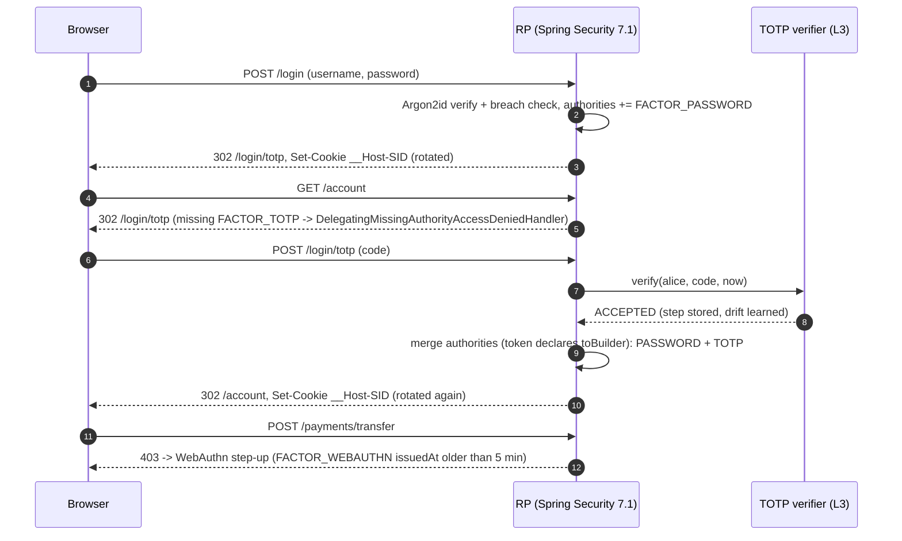

# AuthN Physics: Passwords, Argon2id, MFA/TOTP, and Session vs Token State

> Folder 01 · File 01 of 03 · Identity, AuthN/AuthZ, OAuth 2.1/OIDC/FAPI 2.0 L7 Reference
> Next: [02 · WebAuthn / FIDO2 passkeys](02-webauthn-fido2-passkeys-public-key-challenges-and-origin-binding.md) · [03 · JOSE and JWT internals](03-jose-and-jwt-internals-jws-jwe-jwk-ed25519-es256-rs256-and-key-rotation.md)

| Listing | What it proves | Oracle |
|---|---|---|
| L0 `KbSupport.java` | Shared helper: fixture loading, RFC text cleaning, strict base64url, PASS/FAIL verdict | — |
| L1 `Argon2id.java` | Argon2d/i/id (RFC 9106) and BLAKE2b (RFC 7693) written from first principles; PHC strings; a rehash policy; a GPU memory-bandwidth model; `--bench` timings | RFC 7693 App. A digest, RFC 9106 §5 H0 and tags parsed from `fixtures/` |
| L2 `PasswordStorageL7.java` | Spring Security 7.1.2 password storage: a strict Argon2id upgrade policy, pepper-as-encryption with key rotation, a NIST 800-63B-4 policy, bcrypt's 72-byte cliff, and upgrade-on-login through `DaoAuthenticationProvider` | BouncyCastle 1.86 via Spring vs L1, bit for bit |
| L3 `Totp.java` | HOTP/TOTP from first principles; L5 vs L7 verifier on replay, relay phishing, brute force, drift and secret strength | All of RFC 4226 App. D and RFC 6238 App. B, parsed from `fixtures/` |
| L4 `SessionTokenState.java` | Session fixation, hashed-at-rest session ids, AAL timeouts, step-up, `__Host-` cookie rules, revocation latency | SP 800-63B-4 limits |
| L5 `AuthnSecurityConfig.java` | Spring Security 7.1 `SecurityFilterChain`: password plus a custom TOTP factor via `@EnableMultiFactorAuthentication`, factor freshness for payments, and the `toBuilder()` factor-merge contract | Real `AuthorizationManager`s |

**Verification.** Every listing in this folder compiles as one unit with `javac --release 21 -Xlint:all -Werror` on Temurin JDK 25.0.4.1. The compile classpath is Spring Security 7.1.2, Spring Framework 7.0.10, BouncyCastle 1.86 and Nimbus JOSE+JWT 10.9.1 jars, each SHA-1-checked against Maven Central (2026-11-05). Every `output` block below is the captured stdout of that listing, and the folder gate re-runs it and demands byte-identical output. Test vectors are not typed in: the listings parse them out of the RFC texts kept in [`fixtures/`](fixtures/). `measured-output` blocks are wall-clock timings from one Windows 11 laptop (12 logical CPUs); the gate checks only that they still run. Spring behaviour quoted as [D] was read from the 7.1.2 `-sources.jar`, and the listings exercise it at run time.

Labels: **[D]** documented in a spec or a shipped source file · **[M]** measured by a listing here · **[E]** engineering judgment · **⚠** trap.

---

## 0. Orientation

Authentication answers one question: *is the party on this connection the subscriber they claim to be, right now?* Everything else follows from that answer. Authorization decisions, audit trails, fraud models and regulatory liability all inherit its errors. An L5 engineer treats authentication as a feature: a login form, a hash, a cookie. An L7 engineer treats it as a pipeline of secrets with different physical properties. Each stage has its own threat model, failure mode and revocation latency, and the weakest stage sets the system's assurance.

This file covers the three stages every later folder builds on:

1. **Verifier secrets at rest.** These are password hashes and OTP seeds: what an attacker gets when your database leaks (§2–§3).
2. **The authentication ceremony.** This is how a claimant proves possession, and which proofs survive phishing (§4). Passkeys, the phishing-resistant answer, get their own file ([02](02-webauthn-fido2-passkeys-public-key-challenges-and-origin-binding.md)).
3. **The post-authentication bearer secret.** This is the session cookie or token that *is* the user for every later request, plus how fast you can take it back (§5). JWT byte-level mechanics are in [03](03-jose-and-jwt-internals-jws-jwe-jwk-ed25519-es256-rs256-and-key-rotation.md).

Ten results in this file that an interviewer will not expect you to have measured:

- **[M]** A from-scratch Argon2/BLAKE2b in plain JDK Java reproduces RFC 9106 §5 for all three variants, and also reproduces BouncyCastle 1.86's output through Spring's `Argon2PasswordEncoder` bit for bit (L1, L2).
- **[D][M]** In Spring Security 7.1.2, `PasswordEncoderFactories.createDelegatingPasswordEncoder()` maps the `{argon2}` id to `defaultsForSpringSecurity_v5_2()`: **m=4 MiB, t=3**. The non-deprecated `v5_8` defaults are **m=16 MiB, t=2**, still below the OWASP floor of 19 MiB.
- **[D][M]** Spring's `Argon2PasswordEncoder.upgradeEncoding` compares only memory and iterations, so a stored `$argon2i$` hash with large parameters is never migrated to Argon2id (L2).
- **[M]** bcrypt `encode()` rejects inputs over 72 bytes, but `matches()` silently truncates. A stored 72-byte prefix therefore verifies **any** suffix. This is the class of bug behind Okta's 2024 cache-key advisory (§7 A3).
- **[M]** Spring Security 7.1 merges a second factor's authorities only if the token class *declares* `toBuilder()`. A token that inherits it silently replaces the password login instead of adding to it (L5).
- **[M]** A ±1-step TOTP verifier with exponential lockout lets an online attacker evaluate **16 guesses in 24 hours**, against 864,000 for an unthrottled endpoint at 10 req/s. That moves the success probability from about 92.5% to about 0.005% (L3).
- **[M]** One-time-use TOTP stops replay but cannot stop a real-time relay. The relayed code is accepted. The *victim's* later submission is flagged `REPLAYED`, and that flag is the only server-side trace of the phish (L3).
- **[M]** Revocation latency for a credential stolen at t=0 and revoked at t=600 s: server session 0 s, pushed jti denylist 2 s, cached introspection 30 s, 5-minute JWT 299 s, 60-minute JWT 3,000 s (L4).
- **[M]** Raising the GPU-side DRAM traffic per guess from Spring's legacy `{argon2}` parameters (44 MiB/guess) to the OWASP floor (133 MiB/guess) costs the attacker 3.0× per guess. The defender pays about 36 ms of one core (L1).
- **[D]** NIST SP 800-63B-4 (2025) *forbids* composition rules and periodic rotation. It requires 15 characters for single-factor passwords, caps consecutive failures at 100, and bars syncable passkeys from AAL3.

---

## 1. First principles: authentication is a proof about a key, not a check of a string

### 1.1 Vocabulary that interviewers use precisely

NIST SP 800-63-4 is the vocabulary most FAANG and FinTech security reviews use, even outside government:

- **Subscriber**: the enrolled identity. **Claimant**: whoever is on the wire claiming to be the subscriber. **Verifier**: the component that checks the proof. **Relying party (RP)**: the application that consumes the result.
- **Authenticator**: something the claimant controls (a memorized secret, an OTP device, a cryptographic key). **Factor**: something you know, have or are. A passkey that unlocks with a fingerprint is *one authenticator providing two factors*: possession of the key, and a biometric that is checked locally and never sent.
- **Authentication intent**: proof that a human meant to authenticate. This is the touch on a security key, or the "user present" (UP) flag in WebAuthn. It defeats malware that silently drives a connected authenticator.
- **Phishing resistance** [D: SP 800-63B-4 §3.2.5]: the authenticator output is bound either to the verifier's *name* (WebAuthn signs over the RP ID hash and the origin) or to the *channel* (client-authenticated TLS signs the handshake transcript). A proof that a human can type into a look-alike site is not phishing-resistant, however many digits it has.

### 1.2 The three kinds of secret, and what a database breach gives the attacker

```text
 kind of secret            what the verifier stores        verifier DB breach gives the attacker
 ------------------------  ------------------------------  -----------------------------------------------
 shared, human-chosen      salted, slow hash of password   an OFFLINE guessing oracle (cost = your params)
   (password)
 shared, machine-chosen    the seed itself (it must        an immediate CLONE of every user's OTP device
   (TOTP/HOTP seed)          compute the same HMAC)          (unless the seed column is KMS-encrypted)
 asymmetric                public key + credential id      nothing reusable: a public key cannot sign
   (WebAuthn, mTLS, PIV)
 ------------------------  ------------------------------  -----------------------------------------------
 post-login bearer secret  session id (hash), refresh      a live session for every row, unless only
   (cookie / token)          token (hash), jti denylist      H(id) is stored (L4) - then nothing
```

This table explains the push toward passkeys. Only the asymmetric row makes a verifier breach worthless. The TOTP row is the one teams forget: an unencrypted `otp_secret` column turns a read-only SQL injection into an MFA bypass for every user [E].

### 1.3 The authentication pipeline and where each stage dies

```text
  claimant                         verifier                                  every later request
  --------                         --------                                  -------------------
  password  --TLS-->  rate limit -> lookup -> Argon2id verify (36 ms CPU) --+
  TOTP code --TLS-->  rate limit -> HMAC +-1 step, one-time-use ------------+--> mint session secret
  passkey   --TLS-->  challenge  -> signature over rpIdHash||clientData ----+    (256-bit, HttpOnly,
                                                                                 __Host-, rotated)
                                                                                        |
    stage dies by:                                                                      v
    - online guessing / stuffing (rate limit, breach list)               cookie or token = the user
    - phishing relay (only passkeys / mTLS survive)                      dies by: theft (infostealer),
    - verifier DB breach (slow hash, encrypted seeds, public keys)                fixation, XSS read,
    - account recovery (the weakest factor you allow)                             long TTL, no revocation
```

The **assurance of the whole pipeline is the minimum over its stages** [E]. A passkey login that falls back to "email me a magic link" is as strong as the mailbox. A perfect ceremony that mints a 30-day bearer cookie readable by JavaScript ends up as strong as your worst XSS.

### 1.4 Threat model

| Adversary capability | Example | Stage hit | First-line control | What does *not* help |
|---|---|---|---|---|
| Online guessing against one account | Targeted brute force | Ceremony | Per-account lockout (≤100 per NIST), exponential backoff | Password complexity rules (NIST forbids them) |
| Online guessing across many accounts | Password spraying, credential stuffing with breach corpora | Ceremony | Breached-password blocklist, per-IP and ASN reputation, device signals, MFA | Per-account lockout (the attacker spreads guesses thin) |
| Verifier database exfiltration | SQL injection, backup leak | Secrets at rest | Memory-hard hash, pepper in KMS/HSM, encrypted OTP seeds, passkeys | Encryption-at-rest of the disk (the DB reads it decrypted) |
| Real-time phishing relay (AitM) | Evilginx-style reverse proxy | Ceremony | WebAuthn (origin-bound), mTLS | TOTP, SMS, push without number matching |
| Push fatigue / social engineering | Uber 2022 | Ceremony | Number matching, phishing-resistant MFA, help-desk verification | "Educate users" |
| Post-auth bearer theft | Infostealer exfiltrates cookies | Session | Short absolute lifetime, device-bound sessions (DBSC), anomaly re-auth | Longer passwords, more MFA prompts at login |
| Recovery-path abuse | SIM swap, help-desk impersonation | Recovery | Recovery at the same assurance as login, waiting periods, out-of-band verification | Strong primary login |

### 1.5 Authenticator Assurance Levels (SP 800-63B-4)

| | AAL1 | AAL2 | AAL3 |
|---|---|---|---|
| Factors | 1 | 2 (or one multi-factor authenticator) | 2, with a **non-exportable** key and phishing resistance |
| Phishing-resistant option | not required | **SHALL be offered** | **required** |
| Syncable passkeys | allowed | allowed (sync fabric protected by AAL2-equivalent MFA) | **SHALL NOT** be used |
| Overall reauthentication timeout | SHOULD ≤ 30 days | SHOULD ≤ 24 h | SHALL ≤ 12 h |
| Inactivity timeout | optional | SHOULD ≤ 1 h | SHOULD ≤ 15 min |

[D: SP 800-63B-4 §2.1–§2.3 and Appendix B.] L4 enforces exactly these limits.

---

## 2. Password storage physics: why fast hashes die and memory-hard functions survive

### 2.1 The offline attacker's arithmetic

After a breach, each stored hash is a local guessing oracle. The attacker's throughput is `hardware rate / cost per guess`. The defender controls only the denominator, and pays it on every legitimate login. Three mechanisms raise it:

- **Salt** (unique per hash, ≥32 bits per NIST, 16 bytes in practice). It stops one guess from testing every account at once, and it kills precomputed tables. It adds **no** work per guess.
- **Work factor** (iterations, memory). It multiplies the cost of every guess. A *memory-hard* function also forces each guess to hold *m* bytes. GPUs have enormous compute but limited memory bandwidth and capacity per core, so memory, not arithmetic, becomes the bottleneck.
- **Pepper** (a secret key outside the database). If the key does not leak with the rows, the hashes cannot be tested at all [D: SP 800-63B-4 §3.1.1.2: "SHOULD perform an additional iteration of a keyed hashing or encryption operation using a secret key known only to the verifier … stored separately … within a hardware-protected area"].

| Scheme | Cost per guess | Memory per guess | GPU/ASIC resistance | Input limit | When to use (2026) |
|---|---|---|---|---|---|
| SHA-256(salt‖pw) | 1 compression | ~0 | none | none | never |
| PBKDF2-HMAC-SHA256 | 600,000 iterations = 1.2 M compressions | ~0 | weak (embarrassingly parallel) | none (pre-hashes >64 B) | FIPS-140 mandates only [D: OWASP] |
| bcrypt (cost 10–12) | 2^cost Blowfish key schedules | 4 KiB | moderate (small cache-resident state) | **72 bytes** | legacy only [D: OWASP] |
| scrypt N=2^17, r=8, p=1 | sequential memory-hard | 128 MiB | good | none | when Argon2id is unavailable |
| **Argon2id m=19 MiB, t=2, p=1** | 2 passes over 19,456 blocks | 19 MiB | good (bandwidth-bound) | 2^32−1 bytes | **default** [D: OWASP, RFC 9106] |

### 2.2 Argon2 internals, at the level an interviewer can probe

Argon2 (RFC 9106) fills a matrix of 1 KiB blocks and makes each new block depend on its predecessor and on one pseudo-randomly chosen earlier block. Computing the last block without having stored the whole matrix is very expensive. That is the memory-hardness. The pieces:

1. **Pre-hash H0.** H0 = BLAKE2b-512 over the little-endian 32-bit encodings of p, T, m, t, version 0x13 and type y, then each length-prefixed input: password P, salt S, secret K (the pepper slot), associated data X. Every parameter is inside H0, so changing any of them changes everything.
2. **Matrix geometry.** m' = 4p·⌊m/4p⌋ blocks, arranged as **p lanes** (rows) × **4 slices** (column groups). One lane-slice is a *segment*. Lanes are filled in parallel. Slices are synchronization points: a block may reference other lanes only in slices that are already finished.
3. **First two columns.** B[i][0] = H'^1024(H0‖0‖i) and B[i][1] = H'^1024(H0‖1‖i). Here H' is a BLAKE2b-based variable-length hash: it chains 64-byte outputs and keeps 32 bytes of each, so a 1024-byte output takes 32 BLAKE2b calls.
4. **Compression G.** R = X ⊕ Y is viewed as an 8×8 matrix of 16-byte registers. A BLAKE2b round without message input is applied to each row, then to each column. G returns R ⊕ permuted(R). The round function is not BLAKE2b's add: it is **BlaMka**, `a + b + 2·lo32(a)·lo32(b)`. The 32×32→64 multiply is cheap on CPUs and costs area and latency on ASICs.
5. **Choosing the reference block.** A 64-bit value J1‖J2 gives the lane (J2 mod p) and, through `indexAlpha`, a position. `indexAlpha` squares J1 and takes the high bits, which biases references toward *recent* blocks (x² distribution). This makes tradeoff attacks that recompute old blocks expensive.
   - **Argon2d** takes J1‖J2 from the previous block's first word. That is data-dependent: maximum tradeoff resistance, but the memory access pattern leaks through cache timing.
   - **Argon2i** takes it from a counter-mode stream G(0, G(0, input block)). That is data-independent: no timing side channel, but weaker against time-memory tradeoffs.
   - **Argon2id** uses the i-mode for **pass 0, slices 0–1** and the d-mode everywhere else. It gets side-channel resistance while the most sensitive early blocks are being written, and tradeoff resistance afterwards [D: RFC 9106 §3.4.1].
6. **Later passes** XOR the new G output into the existing block (version 0x13) instead of overwriting it.
7. **Finalization.** C = XOR of every lane's last block; tag = H'^T(C).

```text
  Argon2 memory matrix, p = 4 lanes, m' = 32 blocks (the RFC 9106 test vector geometry), pass 0

             slice 0          slice 1          slice 2          slice 3
          +----------------+----------------+----------------+----------------+
  lane 0  | B0 B1 b  b     | b  b  b  b     | b  b  b  b     | b  b  b  b*    |
  lane 1  | B0 B1 b  b     | b  b  b  b     | b  b  b  b     | b  b  b  b*    |
  lane 2  | B0 B1 b  b     | b  b  b  b     | b  b  b  b     | b  b  b  b*    |
  lane 3  | B0 B1 b  b     | b  b  b  b     | b  b  b  b     | b  b  b  b*    |
          +----------------+----------------+----------------+----------------+
            B0,B1 = H'(H0||col||lane)          b = G(prev, ref), each 1 KiB
            Argon2id: slices 0-1 of pass 0 pick 'ref' data-INdependently, everything after: data-dependent
            slice 0 of pass 0 may only reference its own lane; later slices may reference finished slices
            of ANY lane;  tag = H'^T( b*(lane0) xor b*(lane1) xor b*(lane2) xor b*(lane3) )
```

⚠ **Parallelism does not multiply memory.** m is the *total* across lanes. Setting p=4 at the same m splits the matrix four ways: the defender can use four cores to finish sooner, and an attacker with many cores loses nothing [D: the OWASP cheat sheet says exactly this]. p is a **latency** knob for the defender, not a strength knob.

### 2.3 L1: Argon2 and BLAKE2b from first principles

Listing L1 implements BLAKE2b (RFC 7693), H', G with BlaMka, `indexAlpha`, the address generator and all three variants, using only the JDK. It then proves correctness: it parses the expected H0 and tags out of the RFC text in `fixtures/rfc9106.txt`. It also includes the PHC string codec that Spring, libsodium and argon2-cffi all use, a rehash policy that is stricter than Spring's, and an attacker model.

<!-- listing:Argon2id.java -->
```java
import java.nio.charset.StandardCharsets;
import java.nio.file.Path;
import java.security.MessageDigest;
import java.util.Arrays;
import java.util.Base64;

/**
 * L1 - Argon2 (RFC 9106: Argon2d / Argon2i / Argon2id, version 0x13) and BLAKE2b (RFC 7693) from first
 * principles, JDK only. Checked against the RFC 7693 Appendix A digest, all three RFC 9106 section 5
 * vectors (pre-hash H0 and tag) and the PHC string format; then a rehash policy and an attacker
 * memory-bandwidth model. {@code --bench} times parameter sets on this machine (measured, not asserted).
 */
public final class Argon2id {

    /** RFC 7693 BLAKE2b, unkeyed, digest length 1..64 bytes. */
    static final class Blake2b {
        private static final long[] IV = {0x6a09e667f3bcc908L, 0xbb67ae8584caa73bL, 0x3c6ef372fe94f82bL,
            0xa54ff53a5f1d36f1L, 0x510e527fade682d1L, 0x9b05688c2b3e6c1fL, 0x1f83d9abfb41bd6bL, 0x5be0cd19137e2179L};
        private static final byte[][] SIGMA = {
            {0, 1, 2, 3, 4, 5, 6, 7, 8, 9, 10, 11, 12, 13, 14, 15}, {14, 10, 4, 8, 9, 15, 13, 6, 1, 12, 0, 2, 11, 7, 5, 3},
            {11, 8, 12, 0, 5, 2, 15, 13, 10, 14, 3, 6, 7, 1, 9, 4}, {7, 9, 3, 1, 13, 12, 11, 14, 2, 6, 5, 10, 4, 0, 15, 8},
            {9, 0, 5, 7, 2, 4, 10, 15, 14, 1, 11, 12, 6, 8, 3, 13}, {2, 12, 6, 10, 0, 11, 8, 3, 4, 13, 7, 5, 15, 14, 1, 9},
            {12, 5, 1, 15, 14, 13, 4, 10, 0, 7, 6, 3, 9, 2, 8, 11}, {13, 11, 7, 14, 12, 1, 3, 9, 5, 0, 15, 4, 8, 6, 2, 10},
            {6, 15, 14, 9, 11, 3, 0, 8, 12, 2, 13, 7, 1, 4, 10, 5}, {10, 2, 8, 4, 7, 6, 1, 5, 15, 11, 9, 14, 3, 12, 13, 0}};
        private final long[] h = new long[8];
        private final long[] m = new long[16];
        private final long[] v = new long[16];
        private final byte[] buf = new byte[128];
        private final int outLen;
        private int bufLen;
        private long t0;
        private long t1;

        Blake2b(int outLen) {
            if (outLen < 1 || outLen > 64) {
                throw new IllegalArgumentException("BLAKE2b digest length must be 1..64");
            }
            this.outLen = outLen;
            System.arraycopy(IV, 0, h, 0, 8);
            h[0] ^= 0x01010000L ^ outLen; // parameter block: depth 1, fanout 1, key length 0
        }

        Blake2b update(byte[] in) {
            int off = 0;
            int len = in.length;
            while (len > 0) {
                if (bufLen == 128) { // only compress a full block once more input exists: the last block is final
                    counter(128);
                    compress(false);
                    bufLen = 0;
                }
                int n = Math.min(len, 128 - bufLen);
                System.arraycopy(in, off, buf, bufLen, n);
                bufLen += n;
                off += n;
                len -= n;
            }
            return this;
        }

        Blake2b le32(int x) {
            return update(new byte[] {(byte) x, (byte) (x >>> 8), (byte) (x >>> 16), (byte) (x >>> 24)});
        }

        byte[] digest() {
            counter(bufLen);
            Arrays.fill(buf, bufLen, 128, (byte) 0);
            compress(true);
            byte[] out = new byte[outLen];
            for (int i = 0; i < outLen; i++) {
                out[i] = (byte) (h[i >>> 3] >>> (8 * (i & 7)));
            }
            return out;
        }

        private void counter(int n) {
            t0 += n;
            if (Long.compareUnsigned(t0, n) < 0) {
                t1++;
            }
        }

        private void compress(boolean last) {
            for (int i = 0; i < 16; i++) {
                m[i] = le64(buf, 8 * i);
            }
            System.arraycopy(h, 0, v, 0, 8);
            System.arraycopy(IV, 0, v, 8, 8);
            v[12] ^= t0;
            v[13] ^= t1;
            if (last) {
                v[14] = ~v[14];
            }
            for (int r = 0; r < 12; r++) {
                byte[] s = SIGMA[r % 10];
                mix(0, 4, 8, 12, m[s[0]], m[s[1]]);
                mix(1, 5, 9, 13, m[s[2]], m[s[3]]);
                mix(2, 6, 10, 14, m[s[4]], m[s[5]]);
                mix(3, 7, 11, 15, m[s[6]], m[s[7]]);
                mix(0, 5, 10, 15, m[s[8]], m[s[9]]);
                mix(1, 6, 11, 12, m[s[10]], m[s[11]]);
                mix(2, 7, 8, 13, m[s[12]], m[s[13]]);
                mix(3, 4, 9, 14, m[s[14]], m[s[15]]);
            }
            for (int i = 0; i < 8; i++) {
                h[i] ^= v[i] ^ v[i + 8];
            }
        }

        private void mix(int a, int b, int c, int d, long x, long y) {
            v[a] = v[a] + v[b] + x;
            v[d] = Long.rotateRight(v[d] ^ v[a], 32);
            v[c] = v[c] + v[d];
            v[b] = Long.rotateRight(v[b] ^ v[c], 24);
            v[a] = v[a] + v[b] + y;
            v[d] = Long.rotateRight(v[d] ^ v[a], 16);
            v[c] = v[c] + v[d];
            v[b] = Long.rotateRight(v[b] ^ v[c], 63);
        }
    }

    enum Type {
        D(0, "argon2d"), I(1, "argon2i"), ID(2, "argon2id");

        final int y;
        final String phc;

        Type(int y, String phc) {
            this.y = y;
            this.phc = phc;
        }
    }

    static final int VERSION = 0x13;
    private static final int SYNC_POINTS = 4;
    private static final int QWORDS = 128; // one 1024-byte block = 128 little-endian 64-bit words
    private static final int[][] ROWS = new int[8][16];
    private static final int[][] COLS = new int[8][16];

    static {
        for (int i = 0; i < 8; i++) {
            for (int k = 0; k < 16; k++) {
                ROWS[i][k] = 16 * i + k;
                COLS[i][k] = 2 * i + (k & 1) + 16 * (k >>> 1);
            }
        }
    }

    private final Type type;
    private final int passes;
    private final int lanes;
    private final int blocks;
    private final int laneLen;
    private final int segLen;
    private final long[] mem;
    private final long[] r = new long[QWORDS];
    private final long[] tmp = new long[QWORDS];

    private Argon2id(Type type, int mKiB, int passes, int lanes) {
        this.type = type;
        this.passes = passes;
        this.lanes = lanes;
        this.blocks = 4 * lanes * (mKiB / (4 * lanes)); // m' = 4p * floor(m / 4p)
        this.laneLen = blocks / lanes;
        this.segLen = laneLen / SYNC_POINTS;
        this.mem = new long[blocks * QWORDS];
    }

    /** Argon2 tag per RFC 9106 section 3 (all inputs explicit, nothing defaulted). */
    static byte[] hash(Type type, byte[] pwd, byte[] salt, byte[] secret, byte[] ad, int mKiB, int t, int p, int tagLen) {
        if (p < 1 || p > 0xFFFFFF || tagLen < 4 || t < 1 || mKiB < 8 * p || salt.length < 8) {
            throw new IllegalArgumentException("parameters outside RFC 9106 section 3.1 ranges");
        }
        byte[] h0 = new Blake2b(64).le32(p).le32(tagLen).le32(mKiB).le32(t).le32(VERSION).le32(type.y)
                .le32(pwd.length).update(pwd).le32(salt.length).update(salt)
                .le32(secret.length).update(secret).le32(ad.length).update(ad).digest();
        Argon2id a = new Argon2id(type, mKiB, t, p);
        for (int lane = 0; lane < p; lane++) {
            a.load(lane * a.laneLen, hPrime(1024, h0, le32(0), le32(lane)));
            a.load(lane * a.laneLen + 1, hPrime(1024, h0, le32(1), le32(lane)));
        }
        for (int pass = 0; pass < t; pass++) {
            for (int slice = 0; slice < SYNC_POINTS; slice++) {
                for (int lane = 0; lane < p; lane++) { // lanes of one slice are independent: order is irrelevant
                    a.fillSegment(pass, lane, slice);
                }
            }
        }
        long[] c = Arrays.copyOfRange(a.mem, (a.laneLen - 1) * QWORDS, a.laneLen * QWORDS);
        for (int lane = 1; lane < p; lane++) {
            int off = (lane * a.laneLen + a.laneLen - 1) * QWORDS;
            for (int i = 0; i < QWORDS; i++) {
                c[i] ^= a.mem[off + i];
            }
        }
        byte[] cb = new byte[1024];
        for (int i = 0; i < QWORDS; i++) {
            for (int k = 0; k < 8; k++) {
                cb[8 * i + k] = (byte) (c[i] >>> (8 * k));
            }
        }
        return hPrime(tagLen, cb);
    }

    /** RFC 9106 section 3.3 variable-length hash H'^T. */
    static byte[] hPrime(int outLen, byte[]... parts) {
        Blake2b first = new Blake2b(Math.min(outLen, 64)).le32(outLen);
        for (byte[] part : parts) {
            first.update(part);
        }
        if (outLen <= 64) {
            return first.digest();
        }
        byte[] out = new byte[outLen];
        byte[] v = first.digest();
        System.arraycopy(v, 0, out, 0, 32);
        int r = (outLen + 31) / 32 - 2;
        int pos = 32;
        for (int i = 2; i <= r; i++) {
            v = new Blake2b(64).update(v).digest();
            System.arraycopy(v, 0, out, pos, 32);
            pos += 32;
        }
        byte[] last = new Blake2b(outLen - 32 * r).update(v).digest();
        System.arraycopy(last, 0, out, pos, last.length);
        return out;
    }

    private void load(int block, byte[] bytes) {
        for (int i = 0; i < QWORDS; i++) {
            mem[block * QWORDS + i] = le64(bytes, 8 * i);
        }
    }

    private void fillSegment(int pass, int lane, int slice) {
        boolean independent = type == Type.I || (type == Type.ID && pass == 0 && slice < SYNC_POINTS / 2);
        long[] address = new long[QWORDS];
        long[] input = new long[QWORDS];
        long[] zero = new long[QWORDS];
        if (independent) {
            input[0] = pass;
            input[1] = lane;
            input[2] = slice;
            input[3] = blocks;
            input[4] = passes;
            input[5] = type.y;
        }
        int start = 0;
        if (pass == 0 && slice == 0) {
            start = 2; // B[i][0], B[i][1] came from H'
            if (independent) {
                nextAddresses(address, input, zero);
            }
        }
        int cur = lane * laneLen + slice * segLen + start;
        int prev = cur % laneLen == 0 ? cur + laneLen - 1 : cur - 1;
        for (int i = start; i < segLen; i++, cur++, prev++) {
            if (cur % laneLen == 1) {
                prev = cur - 1;
            }
            long pseudo;
            if (independent) {
                if (i % QWORDS == 0) {
                    nextAddresses(address, input, zero);
                }
                pseudo = address[i % QWORDS];
            } else {
                pseudo = mem[prev * QWORDS]; // Argon2d: J1||J2 = first word of the previous block (data-dependent)
            }
            int refLane = pass == 0 && slice == 0 ? lane : (int) Long.remainderUnsigned(pseudo >>> 32, lanes);
            int refIndex = indexAlpha(pass, slice, i, pseudo & 0xFFFFFFFFL, refLane == lane);
            fillBlock(mem, prev * QWORDS, mem, (refLane * laneLen + refIndex) * QWORDS, mem, cur * QWORDS, pass != 0);
        }
    }

    /** RFC 9106 section 3.4.2: map J1 onto the allowed reference window with the x^2 bias toward recent blocks. */
    private int indexAlpha(int pass, int slice, int index, long j1, boolean sameLane) {
        long area;
        if (pass == 0) {
            area = slice == 0 ? index - 1 : sameLane ? (long) slice * segLen + index - 1 : (long) slice * segLen + (index == 0 ? -1 : 0);
        } else {
            area = sameLane ? laneLen - segLen + index - 1 : laneLen - segLen + (index == 0 ? -1 : 0);
        }
        long x = (j1 * j1) >>> 32;
        long rel = area - 1 - ((area * x) >>> 32);
        long startPos = pass != 0 && slice != SYNC_POINTS - 1 ? (long) (slice + 1) * segLen : 0;
        return (int) ((startPos + rel) % laneLen);
    }

    private void nextAddresses(long[] address, long[] input, long[] zero) {
        input[6]++;
        fillBlock(zero, 0, input, 0, address, 0, false);
        fillBlock(zero, 0, address, 0, address, 0, false);
    }

    /** Compression function G (RFC 9106 section 3.5): BLAKE2b round without message, BlaMka multiply-add. */
    private void fillBlock(long[] x, int xo, long[] y, int yo, long[] out, int oo, boolean xorInto) {
        for (int i = 0; i < QWORDS; i++) {
            r[i] = x[xo + i] ^ y[yo + i];
            tmp[i] = xorInto ? r[i] ^ out[oo + i] : r[i];
        }
        for (int i = 0; i < 8; i++) {
            permute(ROWS[i]);
        }
        for (int i = 0; i < 8; i++) {
            permute(COLS[i]);
        }
        for (int i = 0; i < QWORDS; i++) {
            out[oo + i] = tmp[i] ^ r[i];
        }
    }

    private void permute(int[] s) {
        gb(s[0], s[4], s[8], s[12]);
        gb(s[1], s[5], s[9], s[13]);
        gb(s[2], s[6], s[10], s[14]);
        gb(s[3], s[7], s[11], s[15]);
        gb(s[0], s[5], s[10], s[15]);
        gb(s[1], s[6], s[11], s[12]);
        gb(s[2], s[7], s[8], s[13]);
        gb(s[3], s[4], s[9], s[14]);
    }

    private void gb(int a, int b, int c, int d) {
        r[a] = blaMka(r[a], r[b]);
        r[d] = Long.rotateRight(r[d] ^ r[a], 32);
        r[c] = blaMka(r[c], r[d]);
        r[b] = Long.rotateRight(r[b] ^ r[c], 24);
        r[a] = blaMka(r[a], r[b]);
        r[d] = Long.rotateRight(r[d] ^ r[a], 16);
        r[c] = blaMka(r[c], r[d]);
        r[b] = Long.rotateRight(r[b] ^ r[c], 63);
    }

    /** x + y + 2 * lo32(x) * lo32(y): the multiplication is what makes ASIC/GPU shortcuts expensive. */
    private static long blaMka(long x, long y) {
        return x + y + 2 * (x & 0xFFFFFFFFL) * (y & 0xFFFFFFFFL);
    }

    static long le64(byte[] b, int off) {
        long v = 0;
        for (int k = 7; k >= 0; k--) {
            v = (v << 8) | (b[off + k] & 0xFF);
        }
        return v;
    }

    static byte[] le32(int x) {
        return new byte[] {(byte) x, (byte) (x >>> 8), (byte) (x >>> 16), (byte) (x >>> 24)};
    }

    // ---------------------------------------------------------------- PHC string format + rehash policy

    /** Parameters as stored in a PHC string: $argon2id$v=19$m=19456,t=2,p=1$salt$hash (unpadded std base64). */
    record Phc(Type type, int version, int mKiB, int t, int p, byte[] salt, byte[] hash) {
        String encode() {
            Base64.Encoder e = Base64.getEncoder().withoutPadding();
            return "$" + type.phc + "$v=" + version + "$m=" + mKiB + ",t=" + t + ",p=" + p + "$"
                    + e.encodeToString(salt) + "$" + e.encodeToString(hash);
        }

        static Phc parse(String s) {
            String[] f = s.split("\\$", -1);
            if (f.length != 6 || !f[0].isEmpty() || !f[2].startsWith("v=")) {
                throw new IllegalArgumentException("not a versioned argon2 PHC string");
            }
            Type type = Arrays.stream(Type.values()).filter(x -> x.phc.equals(f[1])).findFirst()
                    .orElseThrow(() -> new IllegalArgumentException("unknown variant " + f[1]));
            int m = 0;
            int t = 0;
            int p = 0;
            for (String kv : f[3].split(",")) {
                String[] x = kv.split("=", 2);
                int val = Integer.parseInt(x[1]);
                switch (x[0]) {
                    case "m" -> m = val;
                    case "t" -> t = val;
                    case "p" -> p = val;
                    default -> throw new IllegalArgumentException("unknown parameter " + x[0]);
                }
            }
            Base64.Decoder d = Base64.getDecoder();
            return new Phc(type, Integer.parseInt(f[2].substring(2)), m, t, p, d.decode(f[4]), d.decode(f[5]));
        }
    }

    record Policy(int mKiB, int t, int p, int saltLen, int tagLen) {
        /** Rehash on login if ANY stored parameter is weaker than policy, or the variant/version differs. */
        String rehashReason(Phc s) {
            if (s.type() != Type.ID) {
                return "variant " + s.type().phc + " != argon2id";
            }
            if (s.version() != VERSION) {
                return "version " + s.version() + " != 19";
            }
            if (s.mKiB() < mKiB || s.t() < t) {
                return "cost m=" + s.mKiB() + ",t=" + s.t() + " below m=" + mKiB + ",t=" + t;
            }
            if (s.salt().length < saltLen || s.hash().length < tagLen) {
                return "salt/tag " + s.salt().length + "/" + s.hash().length + " bytes below " + saltLen + "/" + tagLen;
            }
            return null;
        }

        String encode(byte[] password, byte[] salt) {
            return new Phc(Type.ID, VERSION, mKiB, t, p, salt,
                    hash(Type.ID, password, salt, new byte[0], new byte[0], mKiB, t, p, tagLen)).encode();
        }
    }

    /** Constant-time verify against a stored PHC string; parameters come from the string, not the policy. */
    static boolean verify(String stored, byte[] password) {
        Phc s = Phc.parse(stored);
        byte[] again = hash(s.type(), password, s.salt(), new byte[0], new byte[0], s.mKiB(), s.t(), s.p(), s.hash().length);
        return MessageDigest.isEqual(again, s.hash());
    }

    /** Lower bound on DRAM traffic per guess: pass 0 reads prev+ref and writes cur; later passes also read cur. */
    static double trafficMiB(int mKiB, int t) {
        return mKiB * (3.0 + 4.0 * (t - 1)) / 1024.0;
    }

    // ---------------------------------------------------------------- main

    public static void main(String[] args) throws Exception {
        Path fx = KbSupport.fixtures(args);
        if (KbSupport.flag(args, "--bench")) {
            bench(KbSupport.flag(args, "--quick"));
            KbSupport.verdict();
            return;
        }
        KbSupport.section("RFC 7693 Appendix A: BLAKE2b-512(\"abc\")");
        String r7693 = KbSupport.rfc(fx, "rfc7693.txt");
        byte[] want = KbSupport.hexAfter(r7693, "Appendix A.  Example of BLAKE2b Computation", "BLAKE2b-512(\"abc\") =");
        byte[] got = new Blake2b(64).update("abc".getBytes(StandardCharsets.US_ASCII)).digest();
        KbSupport.check("BLAKE2b-512(abc) = " + KbSupport.hex(got).substring(0, 32) + "...", Arrays.equals(want, got));

        KbSupport.section("RFC 9106 section 5 vectors: m=32 KiB, t=3, p=4, T=32, P=32x01, S=16x02, K=8x03, X=12x04");
        String r9106 = KbSupport.rfc(fx, "rfc9106.txt");
        byte[] pwd = filled(32, 0x01);
        byte[] salt = filled(16, 0x02);
        byte[] secret = filled(8, 0x03);
        byte[] ad = filled(12, 0x04);
        String[][] sections = {{"5.1.  Argon2d Test Vectors", "D"}, {"5.2.  Argon2i Test Vectors", "I"},
            {"5.3.  Argon2id Test Vectors", "ID"}};
        for (String[] sec : sections) {
            Type type = Type.valueOf(sec[1]);
            byte[] h0Want = KbSupport.hexAfter(r9106, sec[0], "Pre-hashing digest:");
            byte[] h0 = new Blake2b(64).le32(4).le32(32).le32(32).le32(3).le32(VERSION).le32(type.y)
                    .le32(32).update(pwd).le32(16).update(salt).le32(8).update(secret).le32(12).update(ad).digest();
            KbSupport.check(type.phc + " pre-hash digest H0 matches the RFC", Arrays.equals(h0Want, h0));
            byte[] tagWant = KbSupport.hexAfter(r9106, sec[0], "Tag:");
            byte[] tag = hash(type, pwd, salt, secret, ad, 32, 3, 4, 32);
            KbSupport.check(type.phc + " tag " + KbSupport.hex(tag) + " matches the RFC", Arrays.equals(tagWant, tag));
        }

        KbSupport.section("PHC string round trip + verify");
        Policy owasp = new Policy(19456, 2, 1, 16, 32);
        byte[] fixedSalt = "saltsaltsaltsalt".getBytes(StandardCharsets.US_ASCII); // fixed only so output is reproducible
        String phc = owasp.encode("correct horse battery staple".getBytes(StandardCharsets.UTF_8), fixedSalt);
        KbSupport.info("%s", phc);
        KbSupport.check("PHC string parses back to identical parameters", Phc.parse(phc).encode().equals(phc));
        KbSupport.check("verify(correct password) = true", verify(phc, "correct horse battery staple".getBytes(StandardCharsets.UTF_8)));
        KbSupport.check("verify(one-character change) = false", !verify(phc, "correct horse battery stapler".getBytes(StandardCharsets.UTF_8)));

        KbSupport.section("Rehash-on-login policy (target: OWASP 2026 floor m=19456 KiB, t=2, p=1, 16-byte salt, 32-byte tag)");
        String[] legacy = {
            "$argon2id$v=19$m=4096,t=3,p=1$" + b64(fixedSalt) + "$" + b64(new byte[32]),   // Spring {argon2} = v5_2 defaults
            "$argon2id$v=19$m=16384,t=2,p=1$" + b64(fixedSalt) + "$" + b64(new byte[32]),  // Spring v5_8 defaults
            "$argon2i$v=19$m=65536,t=3,p=4$" + b64(fixedSalt) + "$" + b64(new byte[32]),   // strong cost, wrong variant
            "$argon2id$v=19$m=19456,t=2,p=1$" + b64(new byte[8]) + "$" + b64(new byte[32]), // RFC-minimum 8-byte salt
            phc};
        for (String s : legacy) {
            String why = owasp.rehashReason(Phc.parse(s));
            KbSupport.info("%-34s -> %s", s.substring(0, s.indexOf('$', s.indexOf("m=")) + 1), why == null ? "keep" : "REHASH: " + why);
        }
        KbSupport.check("variant downgrade (argon2i) is caught even when m and t exceed policy",
                owasp.rehashReason(Phc.parse(legacy[2])) != null);
        KbSupport.check("current OWASP-floor hash is kept", owasp.rehashReason(Phc.parse(phc)) == null);

        KbSupport.section("Attacker model: DRAM traffic per guess bounds a GPU (assumption: 1008 GB/s, 24 GB card)");
        int[][] sets = {{4096, 3, 1}, {16384, 2, 1}, {19456, 2, 1}, {47104, 1, 1}, {65536, 3, 4}, {2097152, 1, 4}};
        String[] names = {"Spring {argon2} (v5_2)", "Spring v5_8 default", "OWASP floor", "OWASP alt (t=1)",
            "RFC 9106 option 2", "RFC 9106 option 1"};
        double bw = 1008e9;
        double vram = 24e9;
        for (int i = 0; i < sets.length; i++) {
            double mib = trafficMiB(sets[i][0], sets[i][1]);
            double bwBound = bw / (mib * 1024 * 1024);
            double inFlight = vram / (sets[i][0] * 1024.0);
            KbSupport.info("%-24s m=%7d t=%d p=%d  traffic %8.1f MiB/guess  <= %9.0f guesses/s (bandwidth)  <= %6.0f in flight (VRAM)",
                    names[i], sets[i][0], sets[i][1], sets[i][2], mib, bwBound, inFlight);
        }
        double weak = bw / (trafficMiB(4096, 3) * 1048576.0);
        double floor = bw / (trafficMiB(19456, 2) * 1048576.0);
        KbSupport.info("OWASP floor costs the attacker %.1fx more DRAM traffic per guess than Spring's legacy {argon2} id", weak / floor);
        KbSupport.check("traffic model monotonic in m and t", trafficMiB(19456, 2) > trafficMiB(16384, 2)
                && trafficMiB(65536, 3) > trafficMiB(65536, 1));
        KbSupport.verdict();
    }

    private static void bench(boolean quick) {
        int[][] sets = quick ? new int[][] {{1024, 1, 1}} : new int[][] {{4096, 3, 1}, {16384, 2, 1}, {19456, 2, 1}, {47104, 1, 1}, {65536, 3, 4}};
        int reps = quick ? 1 : 5;
        byte[] pwd = "correct horse battery staple".getBytes(StandardCharsets.UTF_8);
        byte[] salt = filled(16, 7);
        KbSupport.section("Argon2id single-thread timing on this JVM (" + System.getProperty("java.vm.name") + " "
                + System.getProperty("java.version") + ", " + Runtime.getRuntime().availableProcessors() + " logical CPUs)");
        long lastNs = 0;
        for (int[] s : sets) {
            for (int w = 0; w < (quick ? 0 : 2); w++) {
                hash(Type.ID, pwd, salt, new byte[0], new byte[0], s[0], s[1], s[2], 32);
            }
            long[] ns = new long[reps];
            for (int k = 0; k < reps; k++) {
                long t0 = System.nanoTime();
                hash(Type.ID, pwd, salt, new byte[0], new byte[0], s[0], s[1], s[2], 32);
                ns[k] = System.nanoTime() - t0;
            }
            Arrays.sort(ns);
            lastNs = ns[reps / 2];
            KbSupport.info("m=%6d KiB t=%d p=%d : median %7.1f ms over %d runs  (%.2f us per 1 KiB block)", s[0], s[1], s[2],
                    lastNs / 1e6, reps, lastNs / 1e3 / ((double) s[0] * s[1]));
        }
        KbSupport.check("timings collected", lastNs > 0);
    }

    private static byte[] filled(int n, int b) {
        byte[] x = new byte[n];
        Arrays.fill(x, (byte) b);
        return x;
    }

    private static String b64(byte[] b) {
        return Base64.getEncoder().withoutPadding().encodeToString(b);
    }
}
```

<!-- output:Argon2id.java -->
```text

== RFC 7693 Appendix A: BLAKE2b-512("abc")
  [PASS] BLAKE2b-512(abc) = ba80a53f981c4d0d6a2797b69f12f6e9...

== RFC 9106 section 5 vectors: m=32 KiB, t=3, p=4, T=32, P=32x01, S=16x02, K=8x03, X=12x04
  [PASS] argon2d pre-hash digest H0 matches the RFC
  [PASS] argon2d tag 512b391b6f1162975371d30919734294f868e3be3984f3c1a13a4db9fabe4acb matches the RFC
  [PASS] argon2i pre-hash digest H0 matches the RFC
  [PASS] argon2i tag c814d9d1dc7f37aa13f0d77f2494bda1c8de6b016dd388d29952a4c4672b6ce8 matches the RFC
  [PASS] argon2id pre-hash digest H0 matches the RFC
  [PASS] argon2id tag 0d640df58d78766c08c037a34a8b53c9d01ef0452d75b65eb52520e96b01e659 matches the RFC

== PHC string round trip + verify
  $argon2id$v=19$m=19456,t=2,p=1$c2FsdHNhbHRzYWx0c2FsdA$QKHrg5tayLGcN+Y0HVPNaBqykOVLUxlMkZycXE1uWRM
  [PASS] PHC string parses back to identical parameters
  [PASS] verify(correct password) = true
  [PASS] verify(one-character change) = false

== Rehash-on-login policy (target: OWASP 2026 floor m=19456 KiB, t=2, p=1, 16-byte salt, 32-byte tag)
  $argon2id$v=19$m=4096,t=3,p=1$     -> REHASH: cost m=4096,t=3 below m=19456,t=2
  $argon2id$v=19$m=16384,t=2,p=1$    -> REHASH: cost m=16384,t=2 below m=19456,t=2
  $argon2i$v=19$m=65536,t=3,p=4$     -> REHASH: variant argon2i != argon2id
  $argon2id$v=19$m=19456,t=2,p=1$    -> REHASH: salt/tag 8/32 bytes below 16/32
  $argon2id$v=19$m=19456,t=2,p=1$    -> keep
  [PASS] variant downgrade (argon2i) is caught even when m and t exceed policy
  [PASS] current OWASP-floor hash is kept

== Attacker model: DRAM traffic per guess bounds a GPU (assumption: 1008 GB/s, 24 GB card)
  Spring {argon2} (v5_2)   m=   4096 t=3 p=1  traffic     44.0 MiB/guess  <=     21848 guesses/s (bandwidth)  <=   5722 in flight (VRAM)
  Spring v5_8 default      m=  16384 t=2 p=1  traffic    112.0 MiB/guess  <=      8583 guesses/s (bandwidth)  <=   1431 in flight (VRAM)
  OWASP floor              m=  19456 t=2 p=1  traffic    133.0 MiB/guess  <=      7228 guesses/s (bandwidth)  <=   1205 in flight (VRAM)
  OWASP alt (t=1)          m=  47104 t=1 p=1  traffic    138.0 MiB/guess  <=      6966 guesses/s (bandwidth)  <=    498 in flight (VRAM)
  RFC 9106 option 2        m=  65536 t=3 p=4  traffic    704.0 MiB/guess  <=      1365 guesses/s (bandwidth)  <=    358 in flight (VRAM)
  RFC 9106 option 1        m=2097152 t=1 p=4  traffic   6144.0 MiB/guess  <=       156 guesses/s (bandwidth)  <=     11 in flight (VRAM)
  OWASP floor costs the attacker 3.0x more DRAM traffic per guess than Spring's legacy {argon2} id
  [PASS] traffic model monotonic in m and t

verdict: OK (13 checks)
```

Reading the output:

- **All three variants match the RFC, including H0.** An implementation that matches the tag but not H0 is a coincidence. Matching H0 proves the parameter encoding, which is where real interop bugs live: a missing length prefix, or the secret placed in the wrong slot.
- **The rehash policy catches the downgrade a naive implementation misses.** `$argon2i$v=19$m=65536,t=3,p=4` has *more* memory and passes than the policy, but it is the wrong variant. An "is m ≥ policy.m and t ≥ policy.t" check keeps it forever. L2 shows Spring's stock encoder does exactly that.
- **The attacker model.** Pass 0 reads two blocks and writes one per block; later passes read three and write one. So the DRAM traffic per guess is about m × (3 + 4(t−1)) KiB. That is a *lower bound on the attacker's cost* and an *upper bound on the guess rate*, given a card's memory bandwidth. With the assumed 1008 GB/s, 24 GB card, the OWASP floor caps a perfect implementation at about 7,200 guesses/s per card, and Spring's legacy `{argon2}` parameters at about 21,800 [M, model]. Real crackers come in below the bound. The ratio between parameter sets is the robust number, not the absolute value [E].

### 2.4 What it costs the defender

<!-- measured-output:Argon2id.java --bench -->
```text

== Argon2id single-thread timing on this JVM (OpenJDK 64-Bit Server VM 25.0.4.1, 12 logical CPUs)
  m=  4096 KiB t=3 p=1 : median    24.1 ms over 5 runs  (1.96 us per 1 KiB block)
  m= 16384 KiB t=2 p=1 : median    30.0 ms over 5 runs  (0.91 us per 1 KiB block)
  m= 19456 KiB t=2 p=1 : median    36.4 ms over 5 runs  (0.93 us per 1 KiB block)
  m= 47104 KiB t=1 p=1 : median    45.7 ms over 5 runs  (0.97 us per 1 KiB block)
  m= 65536 KiB t=3 p=4 : median   191.3 ms over 5 runs  (0.97 us per 1 KiB block)
  [PASS] timings collected

verdict: OK (1 checks)
```

How to read this for capacity planning [E, from the M numbers]:

- **CPU.** At the OWASP floor, one hash costs about 36 ms of one core in pure Java. Native implementations (libsodium, or BouncyCastle's on a warmed JIT) land in the same order of magnitude. A peak of 500 logins/s therefore needs about 18 cores busy *only* hashing. Size the login tier from this number, not from your request-per-second dashboards.
- **Memory.** Each in-flight hash pins m bytes. Sixty-four concurrent verifications at 19 MiB pin about 1.2 GiB of heap, and an attacker who can open unlimited concurrent login requests can push you into GC thrash or OOM. **Bound hashing with a semaphore or a dedicated executor, and put rate limits in front of it**: a memory-hard function is a DoS amplifier you deployed on purpose.
- **Latency.** Users do not notice 36 ms. They notice 500 ms. RFC 9106 option 2 (64 MiB, t=3, p=4) at about 191 ms single-threaded is acceptable for interactive login only if you actually run the four lanes on four threads. Neither L1 nor BouncyCastle 1.86 (which Spring uses) does that: both fill lanes sequentially.

### 2.5 Parameter selection, as a rule

1. Use **Argon2id, version 19, a 16-byte salt and a 32-byte tag.**
2. Choose memory first: the largest m that keeps peak concurrent hashing inside your memory budget, and never below 19 MiB. Then raise t until one hash takes about 30–100 ms on production hardware. Set p to the number of cores you are willing to spend on one login (usually 1 in shared application servers).
3. Store the parameters with the hash (the PHC string), and **rehash on login** whenever stored parameters, variant or version are weaker than policy.
4. Re-benchmark yearly and raise the parameters. NIST says the cost factor "SHOULD be increased over time" [D].

---

## 3. Production password lifecycle on Spring Security 7.1.2

### 3.1 What the framework does by default [D: spring-security-crypto-7.1.2-sources.jar]

`PasswordEncoderFactories.createDelegatingPasswordEncoder()` builds a `DelegatingPasswordEncoder` with id-for-encode `bcrypt` (`new BCryptPasswordEncoder()`, cost 10). It registers a dozen other ids for *matching*: `ldap`, `MD4`, `MD5`, `noop`, `pbkdf2`, `scrypt`, `SHA-1`, `SHA-256`, `sha256`, `argon2`, plus the `@SpringSecurity_v5_8` variants. Three consequences:

- `{argon2}` → `Argon2PasswordEncoder.defaultsForSpringSecurity_v5_2()` = **(salt 16, hash 32, p=1, m=4096 KiB, t=3)**, deprecated but still the mapping. `{argon2@SpringSecurity_v5_8}` → `defaultsForSpringSecurity_v5_8()` = **(16, 32, 1, 16384, 2)**.
- `Argon2PasswordEncoder.upgradeEncodingNonNull` returns `memory < this.memory || iterations < this.iterations`. It ignores the variant, version, parallelism, salt and tag length.
- `{noop}` and `{MD5}` stay matchable. If an attacker gets write access to the user table (or a careless migration script does), they can install `{noop}hunter2` and log in with it [E]. Build your own map with only the ids you actually have in the database.

### 3.2 bcrypt's 72-byte cliff

The bcrypt key schedule consumes at most 72 bytes. Spring 7.1.2's `BCrypt.hashpw` throws `"password cannot be more than 72 bytes"` for *new* hashes, but explicitly not when called for a check (`if (!for_check && passwordb.length > 72)`) [D]. So `matches()` keeps the historical truncation. L2 proves that a hash of a 72-byte string verifies that string with any suffix. The damage is limited when the input is just a password, since users rarely type 72 bytes. It becomes catastrophic when someone uses bcrypt as a **general-purpose hash** over a concatenation like `userId + username + password`. That is exactly Okta's 2024 AD/LDAP delegated-authentication cache key: with a username of 52 characters or more, the password fell past byte 72, so any password matched the cache. Okta's fix was to switch to PBKDF2 [D: Okta advisory, see References].

### 3.3 Pepper: as an encryption layer, not as a secret salt

There are two ways to apply a pepper. In the *HMAC-before-hash* form, `argon2(HMAC(pepper, pw))`, rotating the pepper requires every user's password, so in practice it never rotates. In the *encryption-after-hash* form, the PHC string is AES-256-GCM-encrypted under a key held in KMS or an HSM. Rotation is then an offline re-wrap with no passwords involved, and a new key id can simply become the new `idForEncode` prefix. L2 implements the second form as `PepperedPasswordEncoder` inside a `DelegatingPasswordEncoder` keyed `{pepper-2026a}`, `{pepper-2026b}` [E, consistent with SP 800-63B-4's "keyed hashing or encryption operation"].

What it buys:

- **A database-only breach yields no crackable material.** L2 checks that the decoded row contains no `$argon2id$` string.
- **Tampering fails closed.** A flipped bit fails the GCM tag, and `unwrap` returns null rather than falling back to anything.
- **Key rotation is a prefix change plus a batch job.**

What it costs: the login path now depends on the key service. Cache the unwrapped *key*, never the passwords, in memory at boot, and plan for KMS outages [E].

### 3.4 NIST SP 800-63B-4 rules that change code [D]

- **Minimum length:** 15 characters if the password is the only factor, 8 if it is part of MFA. Accept at least 64. Count **Unicode code points after NFC normalization**.
- **No other composition rules**, and **no periodic forced change**. Force a change only on evidence of compromise.
- **Blocklist** of common, expected and compromised values, compared against the *whole* password. Tell the user why it was rejected.
- **No truncation**, no hints, no knowledge-based questions.
- **At most 100 consecutive failures** per authenticator before disabling it and requiring re-binding. Lower limits are allowed.

Spring ships `HaveIBeenPwnedRestApiPasswordChecker` (a SHA-1 k-anonymity range query: only the first five hex characters leave the server). `DaoAuthenticationProvider` calls the configured `CompromisedPasswordChecker` inside `createSuccessAuthentication`, that is, **only after the password has matched** [D]. That ordering is right: checking unauthenticated guesses would leak the corpus as an oracle and spend the API quota on attackers. L2 uses an offline range checker with the same interface so the run is deterministic.

### 3.5 Upgrade-on-login, and the timing leak it creates

`DaoAuthenticationProvider.createSuccessAuthentication` asks `passwordEncoder.upgradeEncoding(stored)`. If the answer is true and a `UserDetailsPasswordService` is configured, it re-encodes the *presented* password and saves it. L2 drives the real provider: a `{bcrypt}` row becomes `{pepper-2026b}<…>` on the first successful login.

⚠ **User-enumeration during migration.** For unknown usernames, the provider runs `matches()` against a dummy hash, `userNotFoundEncodedPassword`, which is encoded with the **current** encoder [D: `prepareTimingAttackProtection`]. During a migration, an existing user with a legacy bcrypt-10 row (about 60 ms) and a non-existent user (Argon2id plus AES-GCM, about 40 ms) take measurably different times, so the login endpoint becomes an account-existence oracle [E]. Mitigations:

- pad every failed login to a constant deadline;
- or make the dummy hash use the slowest scheme still present in the table;
- and finish migrations quickly with a forced reset of stragglers after N months.

<!-- listing:PasswordStorageL7.java -->
```java
import java.nio.ByteBuffer;
import java.nio.charset.StandardCharsets;
import java.security.GeneralSecurityException;
import java.security.MessageDigest;
import java.security.SecureRandom;
import java.text.Normalizer;
import java.util.Base64;
import java.util.HashMap;
import java.util.HexFormat;
import java.util.Map;
import java.util.Set;
import javax.crypto.Cipher;
import javax.crypto.spec.GCMParameterSpec;
import javax.crypto.spec.SecretKeySpec;

import org.springframework.context.annotation.Bean;
import org.springframework.context.annotation.Configuration;
import org.springframework.security.authentication.UsernamePasswordAuthenticationToken;
import org.springframework.security.authentication.dao.DaoAuthenticationProvider;
import org.springframework.security.authentication.password.CompromisedPasswordChecker;
import org.springframework.security.authentication.password.CompromisedPasswordDecision;
import org.springframework.security.core.Authentication;
import org.springframework.security.core.authority.FactorGrantedAuthority;
import org.springframework.security.core.userdetails.User;
import org.springframework.security.crypto.argon2.Argon2PasswordEncoder;
import org.springframework.security.crypto.bcrypt.BCryptPasswordEncoder;
import org.springframework.security.crypto.factory.PasswordEncoderFactories;
import org.springframework.security.crypto.password.DelegatingPasswordEncoder;
import org.springframework.security.crypto.password.PasswordEncoder;
import org.springframework.security.provisioning.InMemoryUserDetailsManager;

/**
 * L2 - hardened password storage on Spring Security 7.1.2 (spring-security-crypto + BouncyCastle 1.86).
 *
 * <ul>
 *   <li>{@link StrictArgon2PasswordEncoder}: OWASP-floor Argon2id whose upgradeEncoding also catches variant,
 *       version, salt and tag downgrades (the stock encoder compares only memory and iterations);</li>
 *   <li>{@link PepperedPasswordEncoder}: the PHC string is AES-256-GCM encrypted under a KMS/HSM-held key whose
 *       id is the DelegatingPasswordEncoder prefix, so key rotation is a prefix change plus an offline re-wrap;</li>
 *   <li>{@link Nist80063bPasswordPolicy}: SP 800-63B-4 length/blocklist rules on NFC code points.</li>
 * </ul>
 * main() runs the real Spring classes: BouncyCastle-vs-L1 cross-check, Spring defaults, bcrypt's 72-byte cliff,
 * and a DaoAuthenticationProvider login that transparently upgrades a legacy {bcrypt} row.
 */
@Configuration(proxyBeanMethods = false)
public class PasswordStorageL7 {

    static final int M_KIB = 19456;
    static final int T = 2;
    static final int P = 1;

    /** Argon2id at the OWASP floor; rehash-on-login for any weaker or different stored parameter set. */
    static final class StrictArgon2PasswordEncoder extends Argon2PasswordEncoder {
        private final Argon2id.Policy policy = new Argon2id.Policy(M_KIB, T, P, 16, 32);

        StrictArgon2PasswordEncoder() {
            super(16, 32, P, M_KIB, T);
        }

        @Override
        protected boolean upgradeEncodingNonNull(String encodedPassword) {
            return policy.rehashReason(Argon2id.Phc.parse(encodedPassword)) != null;
        }
    }

    /** Wraps a delegate's output in AES-256-GCM. The key never sits in the database that holds the hashes. */
    static final class PepperedPasswordEncoder implements PasswordEncoder {
        private static final byte[] AAD = "pwd-hash/v1".getBytes(StandardCharsets.US_ASCII);
        private final SecretKeySpec key;
        private final PasswordEncoder inner;
        private final SecureRandom rng = new SecureRandom();

        PepperedPasswordEncoder(byte[] key256, PasswordEncoder inner) {
            this.key = new SecretKeySpec(key256, "AES");
            this.inner = inner;
        }

        @Override
        public String encode(CharSequence raw) {
            byte[] iv = new byte[12];
            rng.nextBytes(iv);
            byte[] ct = crypt(Cipher.ENCRYPT_MODE, iv, inner.encode(raw).getBytes(StandardCharsets.US_ASCII));
            return Base64.getEncoder().encodeToString(ByteBuffer.allocate(12 + ct.length).put(iv).put(ct).array());
        }

        @Override
        public boolean matches(CharSequence raw, String encoded) {
            String phc = unwrap(encoded);
            return phc != null && inner.matches(raw, phc);
        }

        @Override
        public boolean upgradeEncoding(String encoded) {
            String phc = unwrap(encoded);
            return phc == null || inner.upgradeEncoding(phc);
        }

        /** Offline rotation: re-wrap under a new key without knowing any password. */
        String rewrapTo(PepperedPasswordEncoder target, String encoded) {
            String phc = unwrap(encoded);
            if (phc == null) {
                throw new IllegalStateException("row does not decrypt under this key");
            }
            byte[] iv = new byte[12];
            rng.nextBytes(iv);
            byte[] ct = target.crypt(Cipher.ENCRYPT_MODE, iv, phc.getBytes(StandardCharsets.US_ASCII));
            return Base64.getEncoder().encodeToString(ByteBuffer.allocate(12 + ct.length).put(iv).put(ct).array());
        }

        private String unwrap(String encoded) {
            try {
                byte[] all = Base64.getDecoder().decode(encoded);
                byte[] pt = crypt(Cipher.DECRYPT_MODE, java.util.Arrays.copyOf(all, 12),
                        java.util.Arrays.copyOfRange(all, 12, all.length));
                return new String(pt, StandardCharsets.US_ASCII);
            } catch (IllegalArgumentException | IllegalStateException e) {
                return null; // tampered row or wrong key: fail closed, never fall back to "plaintext compare"
            }
        }

        private byte[] crypt(int mode, byte[] iv, byte[] in) {
            try {
                Cipher c = Cipher.getInstance("AES/GCM/NoPadding");
                c.init(mode, key, new GCMParameterSpec(128, iv));
                c.updateAAD(AAD);
                return c.doFinal(in);
            } catch (GeneralSecurityException e) {
                throw new IllegalStateException(e);
            }
        }
    }

    /** NIST SP 800-63B-4 section 3.1.1.2 password rules, counted on NFC code points. */
    static final class Nist80063bPasswordPolicy {
        private final Set<String> blocklist;

        Nist80063bPasswordPolicy(Set<String> blocklist) {
            this.blocklist = blocklist;
        }

        static String normalize(String raw) {
            return Normalizer.normalize(raw, Normalizer.Form.NFC);
        }

        /** null = acceptable; otherwise the reason that SHALL be shown to the subscriber. */
        String reject(String raw, boolean usedWithMfa) {
            String pw = normalize(raw);
            int len = pw.codePointCount(0, pw.length());
            int min = usedWithMfa ? 8 : 15;
            if (len < min) {
                return "shorter than " + min + " characters";
            }
            if (len > 256) {
                return "longer than 256 characters (bounded so hashing cost cannot be weaponised)";
            }
            if (blocklist.contains(pw.toLowerCase(java.util.Locale.ROOT))) {
                return "appears in the breached/common-password blocklist";
            }
            return null; // no composition rules, no periodic expiry: both SHALL NOT per 800-63B-4
        }
    }

    /** Offline stand-in for HaveIBeenPwnedRestApiPasswordChecker: same SHA-1 k-anonymity range idea, no network. */
    static final class LocalRangeChecker implements CompromisedPasswordChecker {
        private final Map<String, Set<String>> ranges = new HashMap<>();

        LocalRangeChecker(Set<String> breached) {
            for (String b : breached) {
                String h = sha1Hex(b);
                ranges.computeIfAbsent(h.substring(0, 5), k -> new java.util.HashSet<>()).add(h.substring(5));
            }
        }

        @Override
        public CompromisedPasswordDecision check(String password) {
            String h = sha1Hex(password == null ? "" : password);
            return new CompromisedPasswordDecision(ranges.getOrDefault(h.substring(0, 5), Set.of()).contains(h.substring(5)));
        }

        private static String sha1Hex(String s) {
            try {
                return HexFormat.of().withUpperCase().formatHex(MessageDigest.getInstance("SHA-1").digest(s.getBytes(StandardCharsets.UTF_8)));
            } catch (GeneralSecurityException e) {
                throw new IllegalStateException(e);
            }
        }
    }

    /** Key ids are the DelegatingPasswordEncoder prefixes: {pepper-2026a}..., so a new key = a new idForEncode. */
    @Bean
    PasswordEncoder passwordEncoder(Map<String, byte[]> pepperKeyring) {
        Map<String, PasswordEncoder> encoders = new HashMap<>();
        PasswordEncoder argon = new StrictArgon2PasswordEncoder();
        pepperKeyring.forEach((kid, key) -> encoders.put("pepper-" + kid, new PepperedPasswordEncoder(key, argon)));
        encoders.put("bcrypt", new BCryptPasswordEncoder()); // legacy rows only: matched, then upgraded on login
        return new DelegatingPasswordEncoder("pepper-2026b", encoders); // no {noop}, no {MD5}, no {sha256}
    }

    /** Demo keyring; production fetches these from KMS/HSM at boot and never logs or persists them. */
    @Bean
    Map<String, byte[]> pepperKeyring() {
        return Map.of("2026a", demoKey("2026a"), "2026b", demoKey("2026b"));
    }

    static byte[] demoKey(String kid) {
        try {
            return MessageDigest.getInstance("SHA-256").digest(("demo pepper " + kid).getBytes(StandardCharsets.UTF_8));
        } catch (GeneralSecurityException e) {
            throw new IllegalStateException(e);
        }
    }

    @SuppressWarnings("deprecation") // v5_2 is called on purpose: it is what the factory's {argon2} id still maps to
    public static void main(String[] args) throws Exception {
        String pw = "correct horse battery staple";

        KbSupport.section("BouncyCastle 1.86 (via Spring Argon2PasswordEncoder) vs the from-scratch L1 Argon2id");
        String springPhc = new Argon2PasswordEncoder(16, 32, P, M_KIB, T).encode(pw);
        Argon2id.Phc parsed = Argon2id.Phc.parse(springPhc);
        byte[] mine = Argon2id.hash(Argon2id.Type.ID, pw.getBytes(StandardCharsets.UTF_8), parsed.salt(), new byte[0], new byte[0],
                parsed.mKiB(), parsed.t(), parsed.p(), parsed.hash().length);
        KbSupport.check("Spring emits " + springPhc.substring(0, springPhc.indexOf('$', 20) + 1) + "<salt>$<tag>", springPhc.startsWith("$argon2id$v=19$m=19456,t=2,p=1$"));
        KbSupport.check("L1 recomputes Spring's tag bit-for-bit from the PHC parameters", MessageDigest.isEqual(mine, parsed.hash()));

        KbSupport.section("Spring Security 7.1.2 defaults (read from the shipped classes)");
        PasswordEncoder factory = PasswordEncoderFactories.createDelegatingPasswordEncoder();
        String def = factory.encode(pw);
        KbSupport.check("createDelegatingPasswordEncoder() encodes with " + def.substring(0, def.indexOf('}') + 1) + " (bcrypt, cost 10)", def.startsWith("{bcrypt}$2a$10$"));
        String v52 = Argon2PasswordEncoder.defaultsForSpringSecurity_v5_2().encode(pw);
        String v58 = Argon2PasswordEncoder.defaultsForSpringSecurity_v5_8().encode(pw);
        KbSupport.check("{argon2} id maps to defaultsForSpringSecurity_v5_2: " + v52.substring(0, 30), v52.startsWith("$argon2id$v=19$m=4096,t=3,p=1$"));
        KbSupport.check("defaultsForSpringSecurity_v5_8: " + v58.substring(0, 31) + " (below OWASP 19 MiB)", v58.startsWith("$argon2id$v=19$m=16384,t=2,p=1$"));
        String argon2i = "$argon2i$v=19$m=65536,t=3,p=4$" + parsed.encode().split("\\$")[4] + "$" + parsed.encode().split("\\$")[5];
        KbSupport.check("stock upgradeEncoding ignores a variant downgrade to argon2i (compares m and t only)",
                !new Argon2PasswordEncoder(16, 32, P, M_KIB, T).upgradeEncoding(argon2i));
        KbSupport.check("StrictArgon2PasswordEncoder flags the same argon2i row for rehash", new StrictArgon2PasswordEncoder().upgradeEncoding(argon2i));

        KbSupport.section("bcrypt's 72-byte cliff (the Okta 2024 cache-key class of bug)");
        BCryptPasswordEncoder bc = new BCryptPasswordEncoder();
        String longPw = "u".repeat(52) + "-" + "x".repeat(19); // 72 bytes: e.g. a 52-char username + separator + secret
        String stored = bc.encode(longPw);
        boolean threw;
        try {
            bc.encode(longPw + "!");
            threw = false;
        } catch (IllegalArgumentException e) {
            threw = e.getMessage().contains("72 bytes");
        }
        KbSupport.check("encode() of a 73-byte input throws 'password cannot be more than 72 bytes'", threw);
        KbSupport.check("matches() does NOT enforce it: 72-byte prefix + ANY suffix verifies", bc.matches(longPw + "anything-at-all", stored));

        KbSupport.section("Pepper as an encryption layer + key rotation by prefix");
        Map<String, byte[]> ring = new PasswordStorageL7().pepperKeyring();
        PasswordEncoder enc = new PasswordStorageL7().passwordEncoder(ring);
        String row = enc.encode(pw);
        KbSupport.check("new rows are written as {pepper-2026b}<base64(iv||AES-GCM(PHC))>", row.startsWith("{pepper-2026b}"));
        KbSupport.check("matches(correct) = true, matches(wrong) = false", enc.matches(pw, row) && !enc.matches(pw + "!", row));
        String dbOnly = row.substring(row.indexOf('}') + 1);
        KbSupport.check("a database dump alone contains no PHC string to crack", !new String(Base64.getDecoder().decode(dbOnly), StandardCharsets.ISO_8859_1).contains("$argon2id$"));
        PepperedPasswordEncoder oldKey = new PepperedPasswordEncoder(ring.get("2026a"), new StrictArgon2PasswordEncoder());
        PepperedPasswordEncoder newKey = new PepperedPasswordEncoder(ring.get("2026b"), new StrictArgon2PasswordEncoder());
        String legacyRow = "{pepper-2026a}" + oldKey.encode(pw);
        KbSupport.check("a {pepper-2026a} row still verifies and is flagged for upgrade", enc.matches(pw, legacyRow) && enc.upgradeEncoding(legacyRow));
        String rewrapped = "{pepper-2026b}" + oldKey.rewrapTo(newKey, legacyRow.substring(14));
        KbSupport.check("offline re-wrap to 2026b verifies with no password involved", enc.matches(pw, rewrapped) && !enc.upgradeEncoding(rewrapped));
        byte[] tampered = Base64.getDecoder().decode(dbOnly);
        tampered[tampered.length - 1] ^= 1;
        KbSupport.check("one flipped bit in the row fails closed (GCM tag)", !enc.matches(pw, "{pepper-2026b}" + Base64.getEncoder().encodeToString(tampered)));

        KbSupport.section("Login through DaoAuthenticationProvider upgrades a legacy {bcrypt} row in place");
        InMemoryUserDetailsManager users = new InMemoryUserDetailsManager(
                User.withUsername("alice").password("{bcrypt}" + bc.encode(pw)).roles("USER").build());
        DaoAuthenticationProvider dao = new DaoAuthenticationProvider(users);
        dao.setPasswordEncoder(enc);
        dao.setUserDetailsPasswordService(users);
        dao.setCompromisedPasswordChecker(new LocalRangeChecker(Set.of("password123", "P@ssw0rd2026")));
        Authentication ok = dao.authenticate(UsernamePasswordAuthenticationToken.unauthenticated("alice", pw));
        KbSupport.check("authenticated, and the result carries " + FactorGrantedAuthority.PASSWORD_AUTHORITY,
                ok.isAuthenticated() && ok.getAuthorities().stream().anyMatch(a -> FactorGrantedAuthority.PASSWORD_AUTHORITY.equals(a.getAuthority())));
        String after = users.loadUserByUsername("alice").getPassword();
        KbSupport.check("stored hash rewritten from {bcrypt} to " + after.substring(0, after.indexOf('}') + 1), after.startsWith("{pepper-2026b}"));
        InMemoryUserDetailsManager weak = new InMemoryUserDetailsManager(
                User.withUsername("bob").password(enc.encode("P@ssw0rd2026")).roles("USER").build());
        DaoAuthenticationProvider dao2 = new DaoAuthenticationProvider(weak);
        dao2.setPasswordEncoder(enc);
        dao2.setCompromisedPasswordChecker(new LocalRangeChecker(Set.of("P@ssw0rd2026")));
        String outcome;
        try {
            dao2.authenticate(UsernamePasswordAuthenticationToken.unauthenticated("bob", "P@ssw0rd2026"));
            outcome = "authenticated";
        } catch (org.springframework.security.authentication.password.CompromisedPasswordException e) {
            outcome = "CompromisedPasswordException";
        }
        KbSupport.check("correct-but-breached password -> " + outcome + " (checked only AFTER the hash matched)", outcome.equals("CompromisedPasswordException"));

        KbSupport.section("NIST SP 800-63B-4 policy (NFC, code points, no composition rules)");
        Nist80063bPasswordPolicy policy = new Nist80063bPasswordPolicy(Set.of("passwordpassword", "qwertyuiopasdfgh"));
        String composed = "café au lait every morning";
        String decomposed = "café au lait every morning";
        KbSupport.check("'Tr0ub4dor&3' (11 chars, 'complex') rejected as single factor: " + policy.reject("Tr0ub4dor&3", false), policy.reject("Tr0ub4dor&3", false) != null);
        KbSupport.check("'Tr0ub4dor&3' accepted when the password is one factor of MFA (>= 8)", policy.reject("Tr0ub4dor&3", true) == null);
        KbSupport.check("'PasswordPassword' rejected: " + policy.reject("PasswordPassword", false), policy.reject("PasswordPassword", false) != null);
        KbSupport.check("NFC: composed and decomposed 'cafe' hash to the same bytes", Nist80063bPasswordPolicy.normalize(composed).equals(Nist80063bPasswordPolicy.normalize(decomposed)));
        KbSupport.check("without NFC they differ (user locked out after an OS/keyboard change)", !composed.equals(decomposed));
        KbSupport.verdict();
    }
}
```

<!-- output:PasswordStorageL7.java -->
```text

== BouncyCastle 1.86 (via Spring Argon2PasswordEncoder) vs the from-scratch L1 Argon2id
  [PASS] Spring emits $argon2id$v=19$m=19456,t=2,p=1$<salt>$<tag>
  [PASS] L1 recomputes Spring's tag bit-for-bit from the PHC parameters

== Spring Security 7.1.2 defaults (read from the shipped classes)
  [PASS] createDelegatingPasswordEncoder() encodes with {bcrypt} (bcrypt, cost 10)
  [PASS] {argon2} id maps to defaultsForSpringSecurity_v5_2: $argon2id$v=19$m=4096,t=3,p=1$
  [PASS] defaultsForSpringSecurity_v5_8: $argon2id$v=19$m=16384,t=2,p=1$ (below OWASP 19 MiB)
  [PASS] stock upgradeEncoding ignores a variant downgrade to argon2i (compares m and t only)
  [PASS] StrictArgon2PasswordEncoder flags the same argon2i row for rehash

== bcrypt's 72-byte cliff (the Okta 2024 cache-key class of bug)
  [PASS] encode() of a 73-byte input throws 'password cannot be more than 72 bytes'
  [PASS] matches() does NOT enforce it: 72-byte prefix + ANY suffix verifies

== Pepper as an encryption layer + key rotation by prefix
  [PASS] new rows are written as {pepper-2026b}<base64(iv||AES-GCM(PHC))>
  [PASS] matches(correct) = true, matches(wrong) = false
  [PASS] a database dump alone contains no PHC string to crack
  [PASS] a {pepper-2026a} row still verifies and is flagged for upgrade
  [PASS] offline re-wrap to 2026b verifies with no password involved
  [PASS] one flipped bit in the row fails closed (GCM tag)

== Login through DaoAuthenticationProvider upgrades a legacy {bcrypt} row in place
  [PASS] authenticated, and the result carries FACTOR_PASSWORD
  [PASS] stored hash rewritten from {bcrypt} to {pepper-2026b}
  [PASS] correct-but-breached password -> CompromisedPasswordException (checked only AFTER the hash matched)

== NIST SP 800-63B-4 policy (NFC, code points, no composition rules)
  [PASS] 'Tr0ub4dor&3' (11 chars, 'complex') rejected as single factor: shorter than 15 characters
  [PASS] 'Tr0ub4dor&3' accepted when the password is one factor of MFA (>= 8)
  [PASS] 'PasswordPassword' rejected: appears in the breached/common-password blocklist
  [PASS] NFC: composed and decomposed 'cafe' hash to the same bytes
  [PASS] without NFC they differ (user locked out after an OS/keyboard change)

verdict: OK (23 checks)
```

---

## 4. MFA physics: OTP math, push fatigue, and what "phishing-resistant" means

### 4.1 HOTP and TOTP, exactly

HOTP [D: RFC 4226 §5]: `HOTP(K, C) = Truncate(HMAC-SHA-1(K, C)) mod 10^d`, where C is an 8-byte big-endian counter. Dynamic truncation takes `offset = last byte & 0x0f`, reads 4 bytes there, and masks the top bit so the value fits in 31 bits on every platform. TOTP [D: RFC 6238 §4] replaces C with `T = ⌊(now − T0)/X⌋`, normally with X=30 s and T0=0. The HMAC may be SHA-1, SHA-256 or SHA-512. HMAC-SHA-1 is not weakened by SHA-1's collision attacks, because HMAC security rests on the compression function as a PRF, not on collision resistance [E].

```text
  TOTP timeline (X = 30 s), verifier window +-1 step, one-time use per step

  unix time  ...|  t-30..t-1   |   t .. t+29   |  t+30..t+59  |...
  step T          T-1             T               T+1
  accepted?       yes (late)      yes (on time)   yes (early)     -> 3 codes valid at any instant (w = 3)
  after a code at step T is accepted: lastAcceptedStep = T -> T-1 and T are refused from now on
  learned drift d shifts the whole window to T+d-1 .. T+d+1 (L3 learns one step at a time)
```

What the math says about online guessing. With *w* codes acceptable per attempt and *n* attempts, the success probability is `1 − (1 − w/10^6)^n`. L3 prints it: for w=3, 100 attempts (the NIST cap) give 0.03%, while 864,000 unthrottled attempts in a day give **92.5%**. The digits are not the defense. The **throttle** is.

### 4.2 L3: verifiers, measured

<!-- listing:Totp.java -->
```java
import java.nio.ByteBuffer;
import java.nio.charset.StandardCharsets;
import java.nio.file.Path;
import java.security.GeneralSecurityException;
import java.security.MessageDigest;
import java.util.HashMap;
import java.util.Locale;
import java.util.Map;
import java.util.regex.Matcher;
import java.util.regex.Pattern;
import javax.crypto.Mac;
import javax.crypto.spec.SecretKeySpec;

/**
 * L3 - HOTP (RFC 4226) and TOTP (RFC 6238) from first principles, checked against every vector in both
 * RFCs' appendices (parsed from fixtures/), then the vulnerable L5 verifier vs the hardened L7 verifier:
 * replay, brute force, drift, real-time relay phishing and secret-strength checks.
 */
public final class Totp {
    private static final int[] POW10 = {1, 10, 100, 1_000, 10_000, 100_000, 1_000_000, 10_000_000, 100_000_000};

    /** RFC 4226 section 5.3: HMAC over the 8-byte big-endian counter, dynamic truncation, mod 10^digits. */
    static int hotp(String macAlg, byte[] key, long counter, int digits) {
        try {
            Mac mac = Mac.getInstance(macAlg);
            mac.init(new SecretKeySpec(key, macAlg));
            byte[] h = mac.doFinal(ByteBuffer.allocate(8).putLong(counter).array());
            int off = h[h.length - 1] & 0x0f;
            int bin = ((h[off] & 0x7f) << 24) | ((h[off + 1] & 0xff) << 16) | ((h[off + 2] & 0xff) << 8) | (h[off + 3] & 0xff);
            return bin % POW10[digits];
        } catch (GeneralSecurityException e) {
            throw new IllegalStateException(e);
        }
    }

    /** RFC 6238 section 4: T = floor((unixTime - T0) / X); TOTP = HOTP(K, T). */
    static long step(long unixSeconds, long periodSeconds) {
        return Math.floorDiv(unixSeconds, periodSeconds);
    }

    static String code(byte[] key, long step, int digits) {
        return String.format(Locale.ROOT, "%0" + digits + "d", hotp("HmacSHA1", key, step, digits));
    }

    // ------------------------------------------------------------------ RFC 4648 base32 (otpauth secrets)
    private static final String B32 = "ABCDEFGHIJKLMNOPQRSTUVWXYZ234567";

    static String base32(byte[] in) {
        StringBuilder sb = new StringBuilder();
        int buffer = 0;
        int bits = 0;
        for (byte b : in) {
            buffer = (buffer << 8) | (b & 0xff);
            bits += 8;
            while (bits >= 5) {
                sb.append(B32.charAt((buffer >>> (bits - 5)) & 31));
                bits -= 5;
            }
        }
        if (bits > 0) {
            sb.append(B32.charAt((buffer << (5 - bits)) & 31));
        }
        return sb.toString();
    }

    // ------------------------------------------------------------------ verifiers

    /** The L5 verifier as it is usually written: wide window, String.equals, no state, no limit. */
    static final class L5Verifier {
        private final byte[] key;

        L5Verifier(byte[] key) {
            this.key = key;
        }

        boolean verify(String submitted, long now) {
            for (int d = -10; d <= 10; d++) { // "users complained about clock skew"
                if (code(key, step(now, 30) + d, 6).equals(submitted)) {
                    return true;
                }
            }
            return false;
        }
    }

    enum Result { ACCEPTED, REJECTED, REPLAYED, LOCKED }

    /** Per-credential state the L7 verifier keeps server-side (secret itself lives encrypted under a KMS key). */
    static final class Credential {
        final byte[] key;
        long lastAcceptedStep = Long.MIN_VALUE;
        int consecutiveFailures;
        long lockedUntil;
        int driftSteps;
        boolean disabled;

        Credential(byte[] key) {
            if (key.length * 8 < 128) {
                throw new IllegalArgumentException("secret below 128 bits (NIST >= 112; RFC 4226 recommends 160)");
            }
            this.key = key;
        }
    }

    /**
     * L7: +-1 step around the learned drift, constant-time compare, one-time use per step (NIST "accept a given
     * OTP only once"), exponential lockout, hard disable at 100 consecutive failures (NIST upper bound).
     */
    static final class L7Verifier {
        private final Map<String, Credential> store = new HashMap<>();
        final StringBuilder audit = new StringBuilder();

        void enroll(String user, byte[] key) {
            store.put(user, new Credential(key));
        }

        synchronized Result verify(String user, String submitted, long now) {
            Credential c = store.get(user);
            if (c == null || c.disabled || now < c.lockedUntil) {
                return Result.LOCKED;
            }
            long t = step(now, 30) + c.driftSteps;
            byte[] in = submitted.getBytes(StandardCharsets.US_ASCII);
            for (long s = t - 1; s <= t + 1; s++) {
                if (MessageDigest.isEqual(code(c.key, s, 6).getBytes(StandardCharsets.US_ASCII), in)) {
                    if (s <= c.lastAcceptedStep) {
                        audit.append("ALERT replay of step ").append(s).append(" for ").append(user).append('\n');
                        return Result.REPLAYED; // also a phishing signal: someone used this code first
                    }
                    c.lastAcceptedStep = s;
                    c.driftSteps += (int) (s - t); // learn drift slowly, one step at a time
                    c.consecutiveFailures = 0;
                    return Result.ACCEPTED;
                }
            }
            c.consecutiveFailures++;
            if (c.consecutiveFailures >= 100) {
                c.disabled = true; // SP 800-63B-4 3.2.2: disable, require re-binding
            } else if (c.consecutiveFailures >= 5) {
                c.lockedUntil = now + (30L << Math.min(c.consecutiveFailures - 5, 10)); // 30 s, 60 s, ... capped
            }
            return Result.REJECTED;
        }
    }

    /** P(at least one hit) for n independent guesses when w distinct codes are acceptable per attempt. */
    static double guessSuccess(int window, long attempts) {
        return 1 - Math.exp(attempts * Math.log1p(-window / 1e6));
    }

    public static void main(String[] args) throws Exception {
        Path fx = KbSupport.fixtures(args);
        byte[] seed20 = "12345678901234567890".getBytes(StandardCharsets.US_ASCII);
        byte[] seed32 = "12345678901234567890123456789012".getBytes(StandardCharsets.US_ASCII);
        byte[] seed64 = "1234567890123456789012345678901234567890123456789012345678901234".getBytes(StandardCharsets.US_ASCII);

        KbSupport.section("RFC 4226 Appendix D (parsed from fixtures/rfc4226.txt)");
        String r4226 = KbSupport.rfc(fx, "rfc4226.txt");
        String appD = r4226.substring(r4226.lastIndexOf("Appendix D - HOTP Algorithm: Test Values"));
        Matcher hm = Pattern.compile("(?m)^\\s+(\\d)\\s+([0-9a-f]{40})$").matcher(appD);
        int nHmac = 0;
        boolean hmacOk = true;
        while (hm.find()) {
            Mac mac = Mac.getInstance("HmacSHA1");
            mac.init(new SecretKeySpec(seed20, "HmacSHA1"));
            String got = KbSupport.hex(mac.doFinal(ByteBuffer.allocate(8).putLong(Long.parseLong(hm.group(1))).array()));
            hmacOk &= got.equals(hm.group(2));
            nHmac++;
        }
        KbSupport.check(nHmac + "/10 intermediate HMAC-SHA-1 values match", nHmac == 10 && hmacOk);
        Matcher vm = Pattern.compile("(?m)^\\s+(\\d)\\s+[0-9a-f]+\\s+\\d+\\s+(\\d{6})$").matcher(appD);
        int nHotp = 0;
        boolean hotpOk = true;
        StringBuilder row = new StringBuilder();
        while (vm.find()) {
            String got = code(seed20, Long.parseLong(vm.group(1)), 6);
            hotpOk &= got.equals(vm.group(2));
            row.append(got).append(' ');
            nHotp++;
        }
        KbSupport.check(nHotp + "/10 HOTP values match: " + row.toString().trim(), nHotp == 10 && hotpOk);

        KbSupport.section("RFC 6238 Appendix B (parsed from fixtures/rfc6238.txt; 8 digits, X=30, T0=0)");
        String r6238 = KbSupport.rfc(fx, "rfc6238.txt");
        Matcher tm = Pattern.compile("\\|\\s+(\\d+)\\s+\\|[^|]+\\|\\s+([0-9A-F]{16})\\s+\\|\\s+(\\d{8})\\s+\\|\\s+(SHA\\d+)\\s+\\|").matcher(r6238);
        int nTotp = 0;
        boolean totpOk = true;
        while (tm.find()) {
            long time = Long.parseLong(tm.group(1));
            long t = step(time, 30);
            String mode = tm.group(4);
            byte[] key = mode.equals("SHA1") ? seed20 : mode.equals("SHA256") ? seed32 : seed64;
            String got = String.format(Locale.ROOT, "%08d", hotp("Hmac" + mode, key, t, 8));
            boolean ok = got.equals(tm.group(3)) && String.format(Locale.ROOT, "%016X", t).equals(tm.group(2));
            totpOk &= ok;
            nTotp++;
            if (time == 59 || time == 20000000000L) {
                KbSupport.info("t=%-11d T=%s %-6s -> %s %s", time, tm.group(2), mode, got, ok ? "ok" : "MISMATCH");
            }
        }
        KbSupport.check(nTotp + "/18 TOTP rows match (SHA256/SHA512 rows need the 32/64-byte seeds of Appendix A)", nTotp == 18 && totpOk);
        KbSupport.mustCite(r6238, "seed32 = \"3132333435363738393031323334353637383930\" + \"313233343536373839303132\"", "Appendix A 32-byte seed");

        KbSupport.section("Replay inside the validity window");
        long now = 1_767_225_600L; // 2026-01-01T00:00:00Z
        String c = code(seed20, step(now, 30), 6);
        L5Verifier l5 = new L5Verifier(seed20);
        L7Verifier l7 = new L7Verifier();
        l7.enroll("alice", seed20);
        KbSupport.check("L5 accepts the same code twice (" + l5.verify(c, now) + ", " + l5.verify(c, now + 5) + ")", l5.verify(c, now) && l5.verify(c, now + 5));
        Result first = l7.verify("alice", c, now);
        Result second = l7.verify("alice", c, now + 5);
        KbSupport.check("L7: first use " + first + ", second use " + second, first == Result.ACCEPTED && second == Result.REPLAYED);

        KbSupport.section("Real-time relay phishing (attacker proxies the code within the same step)");
        long t2 = now + 300;
        String victimTyped = code(seed20, step(t2, 30), 6);
        Result attacker = l7.verify("alice", victimTyped, t2 + 2);   // proxy submits first
        Result victim = l7.verify("alice", victimTyped, t2 + 3);     // the real user's request arrives second
        KbSupport.check("attacker's relayed code " + attacker + " -> TOTP is NOT phishing-resistant", attacker == Result.ACCEPTED);
        KbSupport.check("victim's own submission " + victim + " -> the only server-side signal of the relay", victim == Result.REPLAYED);
        KbSupport.info("audit: %s", l7.audit.toString().trim().replace('\n', ';'));

        KbSupport.section("Online brute force: P(success) = 1 - (1 - w/10^6)^n");
        long[] attempts = {5, 100, 10_000, 864_000};
        for (int w : new int[] {3, 21}) {
            StringBuilder sb = new StringBuilder();
            for (long n : attempts) {
                sb.append(String.format(Locale.ROOT, "n=%-7d %8.4f%%   ", n, 100 * guessSuccess(w, n)));
            }
            KbSupport.info("window w=%-2d (%s): %s", w, w == 3 ? "L7 +-1" : "L5 +-10", sb.toString().trim());
        }
        L7Verifier l7b = new L7Verifier();
        l7b.enroll("bob", seed20);
        Credential bob = l7b.store.get("bob");
        int evaluated = 0;
        int guess = 0;
        long clock = now;
        for (; clock < now + 86_400; clock++) { // one request per second for 24 h
            String g = nextWrongGuess(seed20, clock, guess++); // never a valid code: we measure how far they get
            if (l7b.verify("bob", g, clock) != Result.LOCKED) {
                evaluated++;
            }
        }
        KbSupport.check("L7 exponential lockout: " + evaluated + " guesses evaluated in 24 h (L5 at 10 req/s: 864,000)", evaluated < 20);
        int total = evaluated;
        while (!bob.disabled) { // the same attacker keeps going for weeks, retrying the instant each lock expires
            clock = Math.max(clock, bob.lockedUntil);
            l7b.verify("bob", nextWrongGuess(seed20, clock, guess++), clock);
            total++;
        }
        KbSupport.check("disabled after " + total + " consecutive failures (SP 800-63B-4 cap); even the right code is now "
                + l7b.verify("bob", code(seed20, step(clock, 30), 6), clock), total == 100
                && l7b.verify("bob", code(seed20, step(clock, 30), 6), clock) == Result.LOCKED);

        KbSupport.section("Clock drift");
        L7Verifier l7c = new L7Verifier();
        l7c.enroll("carol", seed20);
        Result d1 = l7c.verify("carol", code(seed20, step(now + 45, 30), 6), now);              // phone +45 s = +1 step
        Result d2 = l7c.verify("carol", code(seed20, step(now + 600 + 75, 30), 6), now + 600);  // later +75 s = +2 steps
        L7Verifier fresh = new L7Verifier();
        fresh.enroll("carol", seed20);
        Result d3 = fresh.verify("carol", code(seed20, step(now + 600 + 75, 30), 6), now + 600);
        KbSupport.check("phone +45 s: " + d1 + "; later +75 s: " + d2 + " (learned +1 step); without learning: " + d3,
                d1 == Result.ACCEPTED && d2 == Result.ACCEPTED && d3 == Result.REJECTED);

        KbSupport.section("Secret strength and enrolment URI");
        KbSupport.check("16-char base32 secret = 80 bits -> refused (< 128-bit floor)", rejects(new byte[10]));
        KbSupport.check("32-char base32 secret = 160 bits (RFC 4226 recommendation) -> accepted", !rejects(new byte[20]));
        String secret = base32(seed20);
        KbSupport.check("base32(\"12345678901234567890\") = " + secret, secret.equals("GEZDGNBVGY3TQOJQGEZDGNBVGY3TQOJQ"));
        KbSupport.info("otpauth://totp/Example:alice%%40example.com?secret=%s&issuer=Example&algorithm=SHA1&digits=6&period=30", secret);
        KbSupport.verdict();
    }

    /** Sequential guesses, skipping any value that happens to be valid in the +-1 window at this instant. */
    private static String nextWrongGuess(byte[] key, long clock, int n) {
        long s = step(clock, 30);
        for (int k = n; ; k++) {
            String g = String.format(Locale.ROOT, "%06d", k % 1_000_000);
            if (!g.equals(code(key, s - 1, 6)) && !g.equals(code(key, s, 6)) && !g.equals(code(key, s + 1, 6))) {
                return g;
            }
        }
    }

    private static boolean rejects(byte[] key) {
        try {
            new Credential(key);
            return false;
        } catch (IllegalArgumentException e) {
            return true;
        }
    }
}
```

<!-- output:Totp.java -->
```text

== RFC 4226 Appendix D (parsed from fixtures/rfc4226.txt)
  [PASS] 10/10 intermediate HMAC-SHA-1 values match
  [PASS] 10/10 HOTP values match: 755224 287082 359152 969429 338314 254676 287922 162583 399871 520489

== RFC 6238 Appendix B (parsed from fixtures/rfc6238.txt; 8 digits, X=30, T0=0)
  t=59          T=0000000000000001 SHA1   -> 94287082 ok
  t=59          T=0000000000000001 SHA256 -> 46119246 ok
  t=59          T=0000000000000001 SHA512 -> 90693936 ok
  t=20000000000 T=0000000027BC86AA SHA1   -> 65353130 ok
  t=20000000000 T=0000000027BC86AA SHA256 -> 77737706 ok
  t=20000000000 T=0000000027BC86AA SHA512 -> 47863826 ok
  [PASS] 18/18 TOTP rows match (SHA256/SHA512 rows need the 32/64-byte seeds of Appendix A)
  [PASS] constant cited verbatim from fixture: Appendix A 32-byte seed

== Replay inside the validity window
  [PASS] L5 accepts the same code twice (true, true)
  [PASS] L7: first use ACCEPTED, second use REPLAYED

== Real-time relay phishing (attacker proxies the code within the same step)
  [PASS] attacker's relayed code ACCEPTED -> TOTP is NOT phishing-resistant
  [PASS] victim's own submission REPLAYED -> the only server-side signal of the relay
  audit: ALERT replay of step 58907520 for alice;ALERT replay of step 58907530 for alice

== Online brute force: P(success) = 1 - (1 - w/10^6)^n
  window w=3  (L7 +-1): n=5         0.0015%   n=100       0.0300%   n=10000     2.9555%   n=864000   92.5130%
  window w=21 (L5 +-10): n=5         0.0105%   n=100       0.2098%   n=10000    18.9418%   n=864000  100.0000%
  [PASS] L7 exponential lockout: 16 guesses evaluated in 24 h (L5 at 10 req/s: 864,000)
  [PASS] disabled after 100 consecutive failures (SP 800-63B-4 cap); even the right code is now LOCKED

== Clock drift
  [PASS] phone +45 s: ACCEPTED; later +75 s: ACCEPTED (learned +1 step); without learning: REJECTED

== Secret strength and enrolment URI
  [PASS] 16-char base32 secret = 80 bits -> refused (< 128-bit floor)
  [PASS] 32-char base32 secret = 160 bits (RFC 4226 recommendation) -> accepted
  [PASS] base32("12345678901234567890") = GEZDGNBVGY3TQOJQGEZDGNBVGY3TQOJQ
  otpauth://totp/Example:alice%40example.com?secret=GEZDGNBVGY3TQOJQGEZDGNBVGY3TQOJQ&issuer=Example&algorithm=SHA1&digits=6&period=30

verdict: OK (14 checks)
```

Points the output makes, which come up as follow-ups in interviews:

- **Vectors.** All 10 HOTP values and all 18 TOTP rows are parsed from the RFC text and match. The SHA-256 and SHA-512 rows only match with the 32- and 64-byte seeds from the RFC 6238 Appendix A reference code. The Appendix B prose mentions only the 20-byte ASCII seed. Implementers who copy the prose fail two thirds of the table.
- **Replay vs relay.** One-time use per step (NIST: "accept a given OTP only once while it is valid") stops a code being replayed later. It cannot stop an adversary-in-the-middle who forwards the code *first*. The relay produces exactly one server-side trace: the victim's own submission arrives second and is `REPLAYED`. Alert on `REPLAYED` immediately after a success from a different IP or ASN, and kill the newer session.
- **Lockout shape.** Exponential lock after 5 failures caps a patient attacker at 16 evaluated guesses per 24 h, and the hard disable at 100 consecutive failures satisfies SP 800-63B-4. Lock the *authenticator*, not the account, so an attacker cannot lock users out of their passkey by spamming OTP guesses. Pair it with per-IP and global budgets so a spray across a million accounts at 5 guesses each still trips something [E].
- **Seed strength.** A 16-character base32 secret is 80 bits, under NIST's 112-bit floor. Generate 20 bytes (160 bits, the RFC 4226 recommendation), encrypt the column under a KMS key, and never log the otpauth URI.

### 4.3 Push, SMS, and the phishing-resistance boundary

- **SMS and voice OTP** are "restricted" authenticators in SP 800-63B-4: allowed only with extra conditions, with alternatives offered, and changing the phone number counts as binding a new authenticator [D]. SIM swap and SS7 interception make them recovery-grade at best [E].
- **Push approval** without context is an *intent* signal that humans give away under fatigue. Uber's 2022 breach paired a purchased contractor password with repeated push prompts and a WhatsApp message posing as IT until one prompt was accepted [D: Uber security update]. **Number matching** (the user types a number shown on the login screen into the app) restores some binding between the two screens, but it is still relayable by a proxy that shows the victim the number [E].
- **Phishing-resistant** means the authenticator itself refuses to produce a proof that is valid for a different site. WebAuthn signs `SHA-256(rpId) ‖ flags ‖ counter ‖ SHA-256(clientDataJSON)`, and the browser, not the user, writes the origin into clientDataJSON. A look-alike domain gets a signature that is useless to the real RP. File [02](02-webauthn-fido2-passkeys-public-key-challenges-and-origin-binding.md) verifies this on the W3C test vectors. Cloudflare's 2022 report of the same SMS-phishing campaign that hit other companies is the canonical existence proof: hardware security keys stopped it [D: Cloudflare blog].



---

## 5. Session state vs token state

### 5.1 After authentication, possession is identity

Every scheme ends by minting a bearer secret. Its properties dominate the security of everything after login:

| Property | Server-side session (opaque id) | Self-contained token (JWT access token) | Hybrid: BFF session + server-held tokens |
|---|---|---|---|
| Revocation | immediate: delete the row | not possible until `exp`, unless you add state (denylist or introspection) | immediate at the BFF; downstream tokens are short-lived |
| Per-request cost | one store round trip (Redis, DB) | one signature verification, local CPU | one store round trip at the BFF only |
| Horizontal scale | needs a shared store or sticky sessions | stateless verification anywhere | BFF tier needs a shared store |
| Payload exposure | nothing leaves the server | claims are readable by anyone holding the token (JWS is signed, not encrypted) | browser sees only an opaque cookie |
| Cross-service use | no: only the issuing app understands the id | yes: any service with the JWKS | the BFF exchanges or relays tokens east-west |
| Theft impact | until idle or absolute timeout, or revocation | until `exp` | until session timeout; tokens never reach the browser |

The L7 default for **browser** applications is the hybrid. The browser holds an `HttpOnly` `__Host-` cookie pointing at server-side state, and access and refresh tokens never reach JavaScript. RFC 10017 (OAuth 2.0 for Browser-Based Applications, BCP 212, August 2026) makes this the recommended architecture. Folder 04 builds the BFF and token-handler pattern in full. JWTs are the right tool for **service-to-service** calls, with short lifetimes and audience restriction (file [03](03-jose-and-jwt-internals-jws-jwe-jwk-ed25519-es256-rs256-and-key-rotation.md)).

```text
  where the bearer secret lives, and who can steal it

  [ browser ]                                   [ BFF / RP ]                     [ APIs ]
   JS heap  <- XSS reads tokens here (L5 SPA)
   localStorage <- XSS + any same-origin script
   cookie jar:  __Host-SID (HttpOnly)  ------->  session store: H(SID) -> {user,   access token (5 min,
                ^ infostealer malware reads       aal, authTime, tokens}  ---->   aud=api) per call
                  the jar from disk -> DBSC binds the cookie to a TPM key
```

### 5.2 Cookie hardening, on the wire

```http
POST /login HTTP/1.1
Host: app.example.com
Content-Type: application/x-www-form-urlencoded
Cookie: __Host-SID=pre-login-anonymous-id
Origin: https://app.example.com

username=alice&password=correct+horse+battery+staple&_csrf=5f2b...
```

```http
HTTP/1.1 302 Found
Location: /login/totp
Set-Cookie: __Host-SID=Xz4P...43-chars...Qa; Path=/; Secure; HttpOnly; SameSite=Lax
Cache-Control: no-store
Strict-Transport-Security: max-age=31536000; includeSubDomains; preload
```

What each attribute buys you, and what it does not:

- **`__Host-` prefix.** The browser rejects the cookie unless it is `Secure`, has `Path=/` and has **no** `Domain`. A compromised or attacker-controlled sibling subdomain (`evil.example.com`) therefore cannot set or overwrite it. That closes cookie-tossing fixation [D: RFC 6265bis prefixes; NIST SHOULD]. L4 validates the rules.
- **`HttpOnly`.** JavaScript cannot read the cookie. XSS can still *use* the session by making requests from the page, but it cannot exfiltrate it for use elsewhere [E].
- **`SameSite=Lax`.** The cookie is not sent on cross-site subresource or POST requests, but it is sent on top-level GET navigations. `Strict` also drops it on cross-site navigations, which breaks "click a link in an email and land logged in". Banks often use `Strict` on a second, high-privilege cookie [E]. SameSite is defense in depth for CSRF, not a replacement for CSRF tokens on state-changing requests.
- **No `Max-Age`/`Expires`.** A session cookie disappears with the browser session, and NIST says session secrets SHOULD NOT be persistent. *Server-side* timeouts enforce the real limit, because the client controls cookie expiry.

### 5.3 Fixation, rotation, timeouts and step-up

- **Fixation.** If the id issued before login survives login, whoever planted it now shares the authenticated session. The fix is rotation on *every* change of authentication state: login, second factor, step-up and privilege change. Spring's `sessionFixation().changeSessionId()` (servlet `changeSessionId()`) does this per authentication. L4 shows the L5 failure and the L7 fix.
- **Store only H(id).** If the session store keys on SHA-256(id), a Redis dump or a backup leak contains no replayable cookie. L4 checks this. ⚠ Spring Session's Redis repository stores the raw session id in the key name [E: by design, the id is the lookup key]. Protect that Redis like a credential store (TLS, ACLs, no shared tenancy), or add a hashing layer.
- **Timeouts per AAL** [D]: AAL2 1 h idle / 24 h overall; AAL3 15 min idle / 12 h overall. The *absolute* limit is what bounds an infostealer's window, because a thief's automation keeps the session from ever going idle. L4 shows a perfectly active session still being cut at absolute + 1 s.
- **Step-up.** Sensitive operations require a *recent* authentication at a *sufficient* level, not merely a valid session. OIDC expresses this as `max_age` and `auth_time` (Folder 03). Spring Security 7 expresses it as `RequiredFactor.validDuration` on a `FactorGrantedAuthority` with `issuedAt`. L5 shows a 10-minute-old WebAuthn factor denied on `/payments/**` with `validDuration(5 min)`.

### 5.4 Revocation latency: the number that decides sessions vs JWTs

<!-- listing:SessionTokenState.java -->
```java
import java.nio.charset.StandardCharsets;
import java.security.GeneralSecurityException;
import java.security.MessageDigest;
import java.security.SecureRandom;
import java.util.HashMap;
import java.util.LinkedHashMap;
import java.util.Map;
import java.util.Set;

/**
 * L4 - session state vs token state, measured on a deterministic clock.
 *
 * <ol>
 *   <li>A hardened server-side session store: 256-bit ids, only SHA-256(id) at rest, rotation on every
 *       authentication-level change (fixation), AAL-specific idle/absolute limits (SP 800-63B-4), step-up via auth_time.</li>
 *   <li>Cookie construction and validation of the {@code __Host-} prefix rules.</li>
 *   <li>Revocation latency: how long a stolen credential keeps working after the defender pulls the plug, for
 *       server sessions, long and short JWTs, a jti denylist and cached introspection.</li>
 * </ol>
 */
public final class SessionTokenState {

    enum Aal {
        AAL1(Long.MAX_VALUE, 30L * 86_400), AAL2(3_600, 86_400), AAL3(900, 43_200);

        final long idle;
        final long absolute;

        Aal(long idle, long absolute) {
            this.idle = idle;
            this.absolute = absolute;
        }
    }

    record Session(String user, Aal aal, long createdAt, long authTime, long lastSeen) {
    }

    /** Server-side session store. The map key is SHA-256(session id): a dump of the store cannot be replayed. */
    static final class SessionStore {
        private final Map<String, Session> byHash = new HashMap<>();
        private final SecureRandom rng;
        private final boolean rotateOnLogin;
        long now;

        SessionStore(boolean rotateOnLogin, SecureRandom rng) {
            this.rotateOnLogin = rotateOnLogin;
            this.rng = rng;
        }

        String anonymous() {
            String id = newId();
            byHash.put(sha256(id), new Session(null, null, now, 0, now));
            return id;
        }

        /** Login or step-up. L7 rotates the id whenever the authentication level changes. */
        String authenticate(String presentedId, String user, Aal aal) {
            String id = presentedId;
            if (rotateOnLogin || presentedId == null || !byHash.containsKey(sha256(presentedId))) {
                if (presentedId != null) {
                    byHash.remove(sha256(presentedId));
                }
                id = newId();
            }
            byHash.put(sha256(id), new Session(user, aal, now, now, now));
            return id;
        }

        /** Returns the user or null; enforces idle + absolute limits and slides lastSeen. */
        String validate(String id) {
            if (id == null) {
                return null;
            }
            String key = sha256(id);
            Session s = byHash.get(key);
            if (s == null || s.user() == null) {
                return null;
            }
            if (now - s.lastSeen() > s.aal().idle || now - s.authTime() > s.aal().absolute) {
                byHash.remove(key);
                return null;
            }
            byHash.put(key, new Session(s.user(), s.aal(), s.createdAt(), s.authTime(), now));
            return s.user();
        }

        /** Step-up gate for sensitive operations: requires a recent enough auth_time at the required AAL. */
        boolean freshEnough(String id, Aal required, long maxAgeSeconds) {
            Session s = byHash.get(sha256(id));
            return s != null && s.aal() != null && s.aal().compareTo(required) >= 0 && now - s.authTime() <= maxAgeSeconds;
        }

        void revokeAllFor(String user) {
            byHash.values().removeIf(s -> user.equals(s.user()));
        }

        Set<String> storedKeys() {
            return byHash.keySet();
        }

        private String newId() {
            byte[] b = new byte[32];
            rng.nextBytes(b);
            return KbSupport.b64u(b);
        }
    }

    static String sha256(String s) {
        try {
            return KbSupport.hex(MessageDigest.getInstance("SHA-256").digest(s.getBytes(StandardCharsets.US_ASCII)));
        } catch (GeneralSecurityException e) {
            throw new IllegalStateException(e);
        }
    }

    // ------------------------------------------------------------------ cookies

    static String setCookie(String name, String value, String sameSite) {
        return name + "=" + value + "; Path=/; Secure; HttpOnly; SameSite=" + sameSite;
    }

    /** RFC 6265bis cookie prefixes: __Host- requires Secure, Path=/ and no Domain; __Secure- requires Secure. */
    static String prefixViolation(String header) {
        String[] parts = header.split(";\\s*");
        String name = parts[0].substring(0, parts[0].indexOf('='));
        Map<String, String> attrs = new LinkedHashMap<>();
        for (int i = 1; i < parts.length; i++) {
            String[] kv = parts[i].split("=", 2);
            attrs.put(kv[0].toLowerCase(java.util.Locale.ROOT), kv.length > 1 ? kv[1] : "");
        }
        if (name.startsWith("__Host-")) {
            if (!attrs.containsKey("secure")) {
                return "__Host- without Secure";
            }
            if (attrs.containsKey("domain")) {
                return "__Host- with Domain (would be shared with sibling subdomains)";
            }
            if (!"/".equals(attrs.get("path"))) {
                return "__Host- without Path=/";
            }
        }
        if (name.startsWith("__Secure-") && !attrs.containsKey("secure")) {
            return "__Secure- without Secure";
        }
        if (!attrs.containsKey("httponly")) {
            return "session cookie readable by JavaScript (no HttpOnly)";
        }
        return null;
    }

    // ------------------------------------------------------------------ revocation latency model

    record Mechanism(String name, long revocationLatencySeconds, String perRequestCost) {
    }

    /** Seconds a thief keeps access after the defender revokes at time r, given the token was minted at time m. */
    static long exposureAfterRevoke(Mechanism mech, long mintedAt, long revokedAt, long ttl) {
        long natural = mintedAt + ttl;
        long effective = Math.min(natural, revokedAt + mech.revocationLatencySeconds());
        return Math.max(0, effective - revokedAt);
    }

    public static void main(String[] args) {
        SecureRandom rng = new SecureRandom();

        KbSupport.section("Session fixation: attacker plants a pre-login session id, victim logs in");
        for (boolean rotate : new boolean[] {false, true}) {
            SessionStore store = new SessionStore(rotate, rng);
            String planted = store.anonymous();                 // attacker obtains an anonymous id ...
            String victims = store.authenticate(planted, "victim", Aal.AAL2); // ... and the victim logs in with it
            String attackerSees = store.validate(planted);
            KbSupport.check((rotate ? "L7 rotate-on-login" : "L5 keep-id") + ": planted id now resolves to "
                    + (attackerSees == null ? "nothing" : "'" + attackerSees + "'"), rotate == (attackerSees == null));
            KbSupport.check((rotate ? "L7" : "L5") + ": victim's id works", "victim".equals(store.validate(victims)));
        }

        KbSupport.section("Store holds only SHA-256(id): a dump cannot be replayed as a cookie");
        SessionStore store = new SessionStore(true, rng);
        String sid = store.authenticate(null, "alice", Aal.AAL2);
        String dumped = store.storedKeys().iterator().next();
        KbSupport.check("id is 43 base64url chars = 256 bits (NIST floor: 64 bits)", sid.length() == 43);
        KbSupport.check("presenting the dumped key as a cookie fails", store.validate(dumped) == null);
        KbSupport.check("presenting the real id succeeds", "alice".equals(store.validate(sid)));

        KbSupport.section("AAL-specific timeouts (SP 800-63B-4: AAL2 1 h idle / 24 h; AAL3 15 min idle / 12 h)");
        for (Aal aal : new Aal[] {Aal.AAL2, Aal.AAL3}) {
            SessionStore s = new SessionStore(true, rng);
            String id = s.authenticate(null, "bob", aal);
            s.now += aal.idle - 1;
            boolean aliveBeforeIdle = s.validate(id) != null;
            s.now += aal.idle + 1;
            boolean deadAfterIdle = s.validate(id) == null;
            SessionStore s2 = new SessionStore(true, rng);
            String id2 = s2.authenticate(null, "bob", aal);
            boolean alive = true;
            for (long t = 0; t <= aal.absolute; t += aal.idle / 2) { // perfectly active user, never idle
                s2.now = t;
                alive = s2.validate(id2) != null;
            }
            s2.now = aal.absolute + 1;
            boolean deadAfterAbs = s2.validate(id2) == null;
            KbSupport.check(aal + ": alive at idle-1 s, dead after idle, active user still cut at absolute+1 s",
                    aliveBeforeIdle && deadAfterIdle && alive && deadAfterAbs);
        }

        KbSupport.section("Step-up: transfer requires AAL2 auth_time <= 5 min even inside a valid session");
        SessionStore st = new SessionStore(true, rng);
        String id = st.authenticate(null, "carol", Aal.AAL2);
        st.now += 1_200;
        boolean stale = !st.freshEnough(id, Aal.AAL2, 300) && "carol".equals(st.validate(id));
        String stepped = st.authenticate(id, "carol", Aal.AAL2);
        KbSupport.check("20 min after login: session valid but NOT fresh enough -> re-prompt", stale);
        KbSupport.check("after step-up: fresh, and the id rotated", st.freshEnough(stepped, Aal.AAL2, 300) && !stepped.equals(id)
                && st.validate(id) == null);

        KbSupport.section("Cookie prefix rules");
        String good = setCookie("__Host-sid", sid, "Lax");
        KbSupport.info("%s", good.replace(sid, "<43 chars>"));
        KbSupport.check("hardened cookie has no prefix violation", prefixViolation(good) == null);
        String[] bad = {"__Host-sid=x; Path=/; HttpOnly; SameSite=Lax", "__Host-sid=x; Domain=example.com; Path=/; Secure; HttpOnly",
            "__Host-sid=x; Path=/app; Secure; HttpOnly", "SESSION=x; Path=/; Secure; SameSite=Lax"};
        for (String b : bad) {
            String v = prefixViolation(b);
            KbSupport.check("rejected: " + v, v != null);
        }

        KbSupport.section("Revocation latency: credential stolen at t=0, defender revokes at t=600 s");
        Mechanism[] mechs = {
            new Mechanism("server session (store lookup per request)", 0, "1 store round trip"),
            new Mechanism("JWT access token, 60 min TTL, no revocation", Long.MAX_VALUE / 4, "local signature verify"),
            new Mechanism("JWT access token, 5 min TTL + refresh rotation", Long.MAX_VALUE / 4, "local verify; refresh revoked"),
            new Mechanism("JWT 15 min + jti/sub denylist pushed in 2 s", 2, "local verify + in-memory set"),
            new Mechanism("opaque token + introspection cached 30 s", 30, "1 introspection per 30 s per token")};
        long[] ttls = {0, 3_600, 300, 900, 3_600};
        long[] exposure = new long[mechs.length];
        for (int i = 0; i < mechs.length; i++) {
            long ttl = i == 0 ? Long.MAX_VALUE / 4 : ttls[i];
            long mintedAt = i == 2 ? 600 - 1 : 0; // worst case for short tokens: thief refreshed just before revocation
            exposure[i] = exposureAfterRevoke(mechs[i], mintedAt, 600, ttl);
            KbSupport.info("%-48s exposure after revoke: %5d s   per-request cost: %s", mechs[i].name(), exposure[i], mechs[i].perRequestCost());
        }
        KbSupport.check("ordering: session 0 s < denylist 2 s < introspection 30 s < 5-min JWT 299 s < 60-min JWT 3000 s",
                exposure[0] == 0 && exposure[3] == 2 && exposure[4] == 30 && exposure[2] == 299 && exposure[1] == 3_000);
        SessionStore r = new SessionStore(true, rng);
        String a1 = r.authenticate(null, "dave", Aal.AAL2);
        String a2 = r.authenticate(null, "dave", Aal.AAL2);
        r.revokeAllFor("dave");
        KbSupport.check("revokeAllFor(user) kills every device's session at once", r.validate(a1) == null && r.validate(a2) == null);
        KbSupport.verdict();
    }
}
```

<!-- output:SessionTokenState.java -->
```text

== Session fixation: attacker plants a pre-login session id, victim logs in
  [PASS] L5 keep-id: planted id now resolves to 'victim'
  [PASS] L5: victim's id works
  [PASS] L7 rotate-on-login: planted id now resolves to nothing
  [PASS] L7: victim's id works

== Store holds only SHA-256(id): a dump cannot be replayed as a cookie
  [PASS] id is 43 base64url chars = 256 bits (NIST floor: 64 bits)
  [PASS] presenting the dumped key as a cookie fails
  [PASS] presenting the real id succeeds

== AAL-specific timeouts (SP 800-63B-4: AAL2 1 h idle / 24 h; AAL3 15 min idle / 12 h)
  [PASS] AAL2: alive at idle-1 s, dead after idle, active user still cut at absolute+1 s
  [PASS] AAL3: alive at idle-1 s, dead after idle, active user still cut at absolute+1 s

== Step-up: transfer requires AAL2 auth_time <= 5 min even inside a valid session
  [PASS] 20 min after login: session valid but NOT fresh enough -> re-prompt
  [PASS] after step-up: fresh, and the id rotated

== Cookie prefix rules
  __Host-sid=<43 chars>; Path=/; Secure; HttpOnly; SameSite=Lax
  [PASS] hardened cookie has no prefix violation
  [PASS] rejected: __Host- without Secure
  [PASS] rejected: __Host- with Domain (would be shared with sibling subdomains)
  [PASS] rejected: __Host- without Path=/
  [PASS] rejected: session cookie readable by JavaScript (no HttpOnly)

== Revocation latency: credential stolen at t=0, defender revokes at t=600 s
  server session (store lookup per request)        exposure after revoke:     0 s   per-request cost: 1 store round trip
  JWT access token, 60 min TTL, no revocation      exposure after revoke:  3000 s   per-request cost: local signature verify
  JWT access token, 5 min TTL + refresh rotation   exposure after revoke:   299 s   per-request cost: local verify; refresh revoked
  JWT 15 min + jti/sub denylist pushed in 2 s      exposure after revoke:     2 s   per-request cost: local verify + in-memory set
  opaque token + introspection cached 30 s         exposure after revoke:    30 s   per-request cost: 1 introspection per 30 s per token
  [PASS] ordering: session 0 s < denylist 2 s < introspection 30 s < 5-min JWT 299 s < 60-min JWT 3000 s
  [PASS] revokeAllFor(user) kills every device's session at once

verdict: OK (18 checks)
```

For a 60-minute bearer token, revocation latency is about the token's lifetime, and no amount of clever verification shortens it. The levers are, in order of effectiveness: shorter tokens, sender-constraining (DPoP or mTLS, Folder 04, which makes a stolen token useless off the client's key), and pushed denylists keyed on `jti` or `sub` (a few seconds of propagation). Cached introspection is the compromise for opaque tokens (Folder 05's phantom-token pattern) [E].

### 5.5 The infostealer era: binding sessions to devices

Credential phishing is increasingly *cookie* theft. Malware reads the browser's cookie store from disk and replays the cookies elsewhere, and MFA does not help because the session was minted after MFA. Chrome shipped **Device Bound Session Credentials (DBSC)** on Windows in Chrome 146 (announced April 2026). The browser creates a TPM-protected key pair per session. The server issues short-lived cookies and refreshes them only after a proof of possession of that key. A stolen cookie then expires in minutes, and the key cannot be exported [D: Google security blog; Help Net Security]. Until DBSC is available on all of your clients, the L7 compensating controls [E] are:

- short absolute lifetimes on high-value sessions;
- re-authentication on IP, ASN or device-fingerprint discontinuity for sensitive actions;
- binding refresh tokens to DPoP keys in non-browser clients;
- watching for one session used from two network locations at the same time.

The earlier Token Binding RFCs (8471–8473) tried to solve the same problem at the TLS layer and never reached mainstream browser deployment, which is why DBSC works at the application layer instead.

---

## 6. The vulnerable L5 implementation vs the hardened L7 zero-trust implementation

### 6.1 The L5 login service: plausible, reviewed, and broken

This is a composite of patterns seen in real code reviews, not code from any one system:

```java
// L5 - DO NOT USE. Every line below corresponds to an attack in section 7.
@RestController
class LoginController {
    private static final String SALT = "s3cr3t-salt";                       // A1: one global salt
    @PostMapping("/login")
    ResponseEntity<?> login(@RequestParam String user, @RequestParam String pw, HttpSession session) {
        UserRow row = users.find(user);
        if (row == null) return ResponseEntity.status(404).body("no such user"); // A8: enumeration
        String h = sha256Hex(SALT + pw);                                     // A1: fast hash, GPU-friendly
        if (!h.equals(row.hash())) {                                         // early-exit compare
            return ResponseEntity.status(401).body("wrong password");       // A2: no throttle at all
        }
        if (row.totpEnabled() && !totp.matchesAnyStepWithin(row.secret(), 10)) // A5: +-10 steps, no replay state
            return ResponseEntity.status(401).build();
        session.setAttribute("user", user);                                  // A4: same id as pre-login
        String jwt = jwt(user, Duration.ofHours(24));                        // 24 h bearer, no revocation
        return ResponseEntity.ok(Map.of("token", jwt));                      // stored in localStorage by the SPA
    }
}
```

### 6.2 The L7 web tier on Spring Security 7.1.2

L5 below is the security configuration. Passwords come from L2's encoder, the second factor from L3's verifier, and the session rules from §5. Its `main` exercises the real Spring authorization managers without a servlet container.

<!-- listing:AuthnSecurityConfig.java -->
```java
import java.lang.reflect.Method;
import java.time.Duration;
import java.time.Instant;
import java.util.Collection;
import java.util.List;
import java.util.function.Supplier;

import jakarta.servlet.http.HttpServletRequest;
import jakarta.servlet.http.HttpServletResponse;

import org.springframework.context.annotation.Bean;
import org.springframework.context.annotation.Configuration;
import org.springframework.http.HttpMethod;
import org.springframework.security.authentication.AbstractAuthenticationToken;
import org.springframework.security.authentication.AuthenticationManager;
import org.springframework.security.authentication.AuthenticationProvider;
import org.springframework.security.authentication.BadCredentialsException;
import org.springframework.security.authentication.UsernamePasswordAuthenticationToken;
import org.springframework.security.authorization.AuthorizationManager;
import org.springframework.security.authorization.AuthorizationManagerFactories;
import org.springframework.security.authorization.AuthorizationResult;
import org.springframework.security.authorization.DefaultAuthorizationManagerFactory;
import org.springframework.security.config.Customizer;
import org.springframework.security.config.annotation.authorization.EnableMultiFactorAuthentication;
import org.springframework.security.config.annotation.web.builders.HttpSecurity;
import org.springframework.security.config.annotation.web.configuration.EnableWebSecurity;
import org.springframework.security.core.Authentication;
import org.springframework.security.core.AuthenticationException;
import org.springframework.security.core.GrantedAuthority;
import org.springframework.security.core.authority.FactorGrantedAuthority;
import org.springframework.security.core.authority.SimpleGrantedAuthority;
import org.springframework.security.core.context.SecurityContextHolder;
import org.springframework.security.web.SecurityFilterChain;
import org.springframework.security.web.access.intercept.RequestAuthorizationContext;
import org.springframework.security.web.authentication.AbstractAuthenticationProcessingFilter;
import org.springframework.security.web.authentication.LoginUrlAuthenticationEntryPoint;
import org.springframework.security.web.authentication.UsernamePasswordAuthenticationFilter;
import org.springframework.security.web.servlet.util.matcher.PathPatternRequestMatcher;

/**
 * L5 - Spring Security 7.1.2 web tier: password + a custom TOTP factor on the 7.x multi-factor API.
 *
 * <ul>
 *   <li>every page needs FACTOR_PASSWORD and FACTOR_TOTP (or FACTOR_WEBAUTHN, which is phishing-resistant);</li>
 *   <li>/payments/** additionally needs a WebAuthn assertion no older than 5 minutes (step-up via validDuration);</li>
 *   <li>session id rotated on every authentication, 3 concurrent sessions, CSP/HSTS, CSRF left ON.</li>
 * </ul>
 * main() exercises the real AuthorizationManagers and the factor-merge contract without a servlet container.
 */
@Configuration(proxyBeanMethods = false)
@EnableWebSecurity
@EnableMultiFactorAuthentication(authorities = {}) // MFA filters on; which factors are needed is decided per route below
public class AuthnSecurityConfig {

    static final String TOTP_AUTHORITY = "FACTOR_TOTP";

    /** Second-factor token. It MUST declare toBuilder(): Spring merges factors only if the class declares it. */
    static final class TotpAuthenticationToken extends AbstractAuthenticationToken {
        private static final long serialVersionUID = 1L;
        private final String principal;
        private final String code;

        TotpAuthenticationToken(String principal, String code) {
            super(List.of());
            this.principal = principal;
            this.code = code;
        }

        private TotpAuthenticationToken(Builder b) {
            super(b);
            this.principal = b.principal;
            this.code = null; // never keep the OTP after authentication
        }

        static TotpAuthenticationToken authenticated(String principal, Collection<? extends GrantedAuthority> authorities) {
            TotpAuthenticationToken t = new TotpAuthenticationToken(principal, null);
            return t.toBuilder().authorities(a -> a.addAll(authorities)).build();
        }

        @Override
        public Object getCredentials() {
            return code;
        }

        @Override
        public Object getPrincipal() {
            return principal;
        }

        @Override
        public Builder toBuilder() {
            return new Builder(this);
        }

        static final class Builder extends AbstractAuthenticationBuilder<Builder> {
            private String principal;

            Builder(TotpAuthenticationToken t) {
                super(t);
                this.principal = t.principal;
            }

            @Override
            public Builder principal(Object p) {
                this.principal = (String) p;
                return this;
            }

            @Override
            public TotpAuthenticationToken build() {
                return new TotpAuthenticationToken(this);
            }
        }
    }

    /** Verifies the code with the L3 replay-protected verifier; grants only the factor authority. */
    static final class TotpAuthenticationProvider implements AuthenticationProvider {
        private final Totp.L7Verifier verifier;
        private final Supplier<Long> clock;

        TotpAuthenticationProvider(Totp.L7Verifier verifier, Supplier<Long> clock) {
            this.verifier = verifier;
            this.clock = clock;
        }

        @Override
        public Authentication authenticate(Authentication authentication) {
            TotpAuthenticationToken t = (TotpAuthenticationToken) authentication;
            Totp.Result r = verifier.verify((String) t.getPrincipal(), (String) t.getCredentials(), clock.get());
            if (r != Totp.Result.ACCEPTED) {
                throw new BadCredentialsException("TOTP " + r); // REPLAYED should also raise a security event
            }
            return TotpAuthenticationToken.authenticated((String) t.getPrincipal(),
                    List.of(FactorGrantedAuthority.withAuthority(TOTP_AUTHORITY).issuedAt(Instant.ofEpochSecond(clock.get())).build()));
        }

        @Override
        public boolean supports(Class<?> type) {
            return TotpAuthenticationToken.class.isAssignableFrom(type);
        }
    }

    /** POST /login/totp with the code; the principal comes from the ALREADY password-authenticated context. */
    static final class TotpAuthenticationFilter extends AbstractAuthenticationProcessingFilter {
        TotpAuthenticationFilter(AuthenticationManager manager) {
            super(PathPatternRequestMatcher.withDefaults().matcher(HttpMethod.POST, "/login/totp"), manager);
            setMfaEnabled(true); // created with 'new', so @EnableMultiFactorAuthentication's BeanPostProcessor never sees it
        }

        @Override
        public Authentication attemptAuthentication(HttpServletRequest request, HttpServletResponse response)
                throws AuthenticationException {
            Authentication current = SecurityContextHolder.getContext().getAuthentication();
            if (current == null || !current.isAuthenticated()) {
                throw new BadCredentialsException("password step first");
            }
            String code = request.getParameter("code");
            return getAuthenticationManager().authenticate(new TotpAuthenticationToken(current.getName(), code == null ? "" : code));
        }
    }

    static DefaultAuthorizationManagerFactory<RequestAuthorizationContext> baseline() {
        return AuthorizationManagerFactories.<RequestAuthorizationContext>multiFactor()
                .requireFactors(FactorGrantedAuthority.PASSWORD_AUTHORITY, TOTP_AUTHORITY).build();
    }

    static DefaultAuthorizationManagerFactory<RequestAuthorizationContext> paymentsStepUp() {
        return AuthorizationManagerFactories.<RequestAuthorizationContext>multiFactor()
                .requireFactor(f -> f.webauthnAuthority().validDuration(Duration.ofMinutes(5))).build();
    }

    @Bean
    SecurityFilterChain web(HttpSecurity http, Totp.L7Verifier totp) throws Exception {
        TotpAuthenticationProvider provider = new TotpAuthenticationProvider(totp, () -> Instant.now().getEpochSecond());
        TotpAuthenticationFilter totpFilter = new TotpAuthenticationFilter(provider::authenticate);
        http
            .authorizeHttpRequests(a -> a
                .requestMatchers("/login", "/login/totp", "/error", "/webauthn/**", "/login/webauthn").permitAll()
                .requestMatchers("/payments/**").access(paymentsStepUp().hasRole("CUSTOMER"))
                .anyRequest().access(baseline().authenticated()))
            .formLogin(Customizer.withDefaults())
            .addFilterAfter(totpFilter, UsernamePasswordAuthenticationFilter.class)
            .exceptionHandling(e -> e
                .defaultDeniedHandlerForMissingAuthority(new LoginUrlAuthenticationEntryPoint("/login/totp"), TOTP_AUTHORITY))
            .sessionManagement(s -> s
                .sessionFixation(f -> f.changeSessionId())        // new id on EVERY successful authentication step
                .sessionConcurrency(c -> c.maximumSessions(3)))
            .headers(h -> h
                .contentSecurityPolicy(c -> c.policyDirectives("default-src 'self'; frame-ancestors 'none'; object-src 'none'"))
                .httpStrictTransportSecurity(hsts -> hsts.includeSubDomains(true).maxAgeInSeconds(31_536_000).preload(true)));
        // CSRF stays enabled (default). Login throttling lives in front of the provider (see L3 lockout policy).
        return http.build();
    }

    @Bean
    Totp.L7Verifier totpVerifier() {
        return new Totp.L7Verifier(); // production: secrets decrypted from a KMS-wrapped column on demand
    }

    // ------------------------------------------------------------------ container-free checks

    private static boolean granted(AuthorizationManager<RequestAuthorizationContext> m, Authentication a) {
        AuthorizationResult r = m.authorize(() -> a, null);
        return r != null && r.isGranted();
    }

    private static Authentication user(String... authorities) {
        List<GrantedAuthority> list = new java.util.ArrayList<>();
        for (String s : authorities) {
            list.add(s.startsWith("FACTOR_") ? FactorGrantedAuthority.fromAuthority(s) : new SimpleGrantedAuthority(s));
        }
        return UsernamePasswordAuthenticationToken.authenticated("alice", null, list);
    }

    private static boolean declaresToBuilder(Class<?> c) { // the exact rule AbstractAuthenticationProcessingFilter applies
        for (Method m : c.getDeclaredMethods()) {
            if (m.getName().equals("toBuilder") && m.getParameterCount() == 0) {
                return true;
            }
        }
        return false;
    }

    /** A plausible-looking second-factor token that inherits toBuilder() instead of declaring it. */
    static final class NaiveOtpToken extends UsernamePasswordAuthenticationToken {
        private static final long serialVersionUID = 1L;

        NaiveOtpToken(String p, Collection<? extends GrantedAuthority> a) {
            super(p, null, a);
        }
    }

    public static void main(String[] args) {
        KbSupport.section("Route policy built from AuthorizationManagerFactories.multiFactor() (Spring Security 7.1.2)");
        AuthorizationManager<RequestAuthorizationContext> any = baseline().authenticated();
        KbSupport.check("password only            -> denied", !granted(any, user(FactorGrantedAuthority.PASSWORD_AUTHORITY)));
        KbSupport.check("TOTP only                -> denied", !granted(any, user(TOTP_AUTHORITY)));
        KbSupport.check("password + TOTP          -> granted", granted(any, user(FactorGrantedAuthority.PASSWORD_AUTHORITY, TOTP_AUTHORITY)));

        AuthorizationManager<RequestAuthorizationContext> pay = paymentsStepUp().hasRole("CUSTOMER");
        Authentication fresh = UsernamePasswordAuthenticationToken.authenticated("alice", null, List.<GrantedAuthority>of(new SimpleGrantedAuthority("ROLE_CUSTOMER"),
                FactorGrantedAuthority.withAuthority(FactorGrantedAuthority.WEBAUTHN_AUTHORITY).issuedAt(Instant.now()).build()));
        Authentication stale = UsernamePasswordAuthenticationToken.authenticated("alice", null, List.<GrantedAuthority>of(new SimpleGrantedAuthority("ROLE_CUSTOMER"),
                FactorGrantedAuthority.withAuthority(FactorGrantedAuthority.WEBAUTHN_AUTHORITY)
                        .issuedAt(Instant.now().minus(Duration.ofMinutes(10))).build()));
        KbSupport.check("/payments: WebAuthn 0 min ago + ROLE_CUSTOMER -> granted", granted(pay, fresh));
        KbSupport.check("/payments: WebAuthn 10 min ago (validDuration 5 min) -> denied: step-up", !granted(pay, stale));
        KbSupport.check("/payments: fresh WebAuthn but no ROLE_CUSTOMER -> denied",
                !granted(pay, user(FactorGrantedAuthority.WEBAUTHN_AUTHORITY)));

        KbSupport.section("Factor merge contract (AbstractAuthenticationProcessingFilter.shouldPerformMfa)");
        KbSupport.check("TotpAuthenticationToken declares toBuilder() -> factors merge", declaresToBuilder(TotpAuthenticationToken.class));
        KbSupport.check("NaiveOtpToken inherits it -> NOT merged: the TOTP login REPLACES the password login",
                !declaresToBuilder(NaiveOtpToken.class));
        Totp.L7Verifier v = new Totp.L7Verifier();
        byte[] seed = "12345678901234567890".getBytes(java.nio.charset.StandardCharsets.US_ASCII);
        v.enroll("alice", seed);
        long now = 1_767_225_600L;
        TotpAuthenticationProvider p = new TotpAuthenticationProvider(v, () -> now);
        Authentication second = p.authenticate(new TotpAuthenticationToken("alice", Totp.code(seed, Totp.step(now, 30), 6)));
        Authentication current = user(FactorGrantedAuthority.PASSWORD_AUTHORITY);
        Authentication merged = second.toBuilder().authorities(a -> { // what the filter does when names match
            for (GrantedAuthority g : current.getAuthorities()) {
                if (a.stream().noneMatch(x -> x.getAuthority().equals(g.getAuthority()))) {
                    a.add(g);
                }
            }
        }).build();
        KbSupport.check("merged authentication now satisfies the baseline route", granted(any, merged));
        KbSupport.check("merged token is a TotpAuthenticationToken with no OTP retained", merged instanceof TotpAuthenticationToken
                && merged.getCredentials() == null);
        String replay;
        try {
            p.authenticate(new TotpAuthenticationToken("alice", Totp.code(seed, Totp.step(now, 30), 6)));
            replay = "accepted";
        } catch (BadCredentialsException e) {
            replay = e.getMessage();
        }
        KbSupport.check("same code again through the provider -> " + replay, replay.equals("TOTP REPLAYED"));
        KbSupport.verdict();
    }
}
```

<!-- output:AuthnSecurityConfig.java -->
```text

== Route policy built from AuthorizationManagerFactories.multiFactor() (Spring Security 7.1.2)
  [PASS] password only            -> denied
  [PASS] TOTP only                -> denied
  [PASS] password + TOTP          -> granted
  [PASS] /payments: WebAuthn 0 min ago + ROLE_CUSTOMER -> granted
  [PASS] /payments: WebAuthn 10 min ago (validDuration 5 min) -> denied: step-up
  [PASS] /payments: fresh WebAuthn but no ROLE_CUSTOMER -> denied

== Factor merge contract (AbstractAuthenticationProcessingFilter.shouldPerformMfa)
  [PASS] TotpAuthenticationToken declares toBuilder() -> factors merge
  [PASS] NaiveOtpToken inherits it -> NOT merged: the TOTP login REPLACES the password login
  [PASS] merged authentication now satisfies the baseline route
  [PASS] merged token is a TotpAuthenticationToken with no OTP retained
  [PASS] same code again through the provider -> TOTP REPLAYED

verdict: OK (11 checks)
```

Two ⚠ that cost teams days:

1. `@EnableMultiFactorAuthentication` enables MFA merging with a `BeanPostProcessor` that calls `setMfaEnabled(true)` on filter **beans** [D: `EnableMfaFiltersConfiguration`]. A custom filter created with `new` inside the `SecurityFilterChain` method is not a bean, so you must call `setMfaEnabled(true)` yourself.
2. The merge runs only when the new authentication's name equals the current one's, **and** the new token's class *declares* `toBuilder()` [D: `AbstractAuthenticationProcessingFilter.shouldPerformMfa`/`declaresToBuilder`]. Otherwise the second login *replaces* the first: the user ends up with only `FACTOR_TOTP` and loops back to the password page forever. This fails closed, so it is merely a user-facing outage rather than a breach.

Boot properties for the servlet session cookie (Spring Boot 4.1.2 metadata keys, verified in the shipped `spring-configuration-metadata.json`):

```yaml
server:
  servlet:
    session:
      timeout: 60m            # AAL2 inactivity limit; the absolute 24 h limit is enforced in a filter or session repository
      cookie:
        name: __Host-SID      # prefix forces Secure + Path=/ + no Domain in the browser
        http-only: true
        secure: true
        same-site: lax
        path: /
      tracking-modes: cookie  # never put session ids in URLs
```

### 6.3 L5 vs L7, side by side

| Concern | L5 | L7 (this file) |
|---|---|---|
| Hash | SHA-256 + global salt | Argon2id m=19 MiB t=2 p=1, 16-byte salt, PHC string; strict rehash policy (L1/L2) |
| Pepper | none, or HMAC with an unrotatable key | AES-256-GCM wrap under a KMS key; id = encoder prefix; offline re-wrap (L2) |
| Password policy | 8 chars + complexity + 90-day expiry | NIST 800-63B-4: 15 (single factor) / 8 (MFA) NFC code points, blocklist, no composition, no expiry (L2) |
| Online guessing | none | per-authenticator exponential lockout + 100 cap; per-IP/ASN/global budgets; breach check after match (L2/L3) |
| Second factor | TOTP ±10 steps, no state | ±1 step, one-time use, drift learning, encrypted seed, replay alerting; passkeys preferred (L3, file 02) |
| Session | pre-login id kept; 24 h JWT in localStorage | rotated `__Host-` HttpOnly cookie, H(id) at rest, AAL timeouts, step-up via factor freshness (L4/L5) |
| Enumeration | 404 vs 401, early-exit compare | identical responses and timing; dummy hash with the slowest live scheme (§3.5) |

### 6.4 The shared verification helper

Every listing in this folder ends by calling L0's `verdict()`. Its `mustCite` and `hexAfter` are what make the outputs auditable: a constant either comes out of the RFC text or is proven to occur in it.

<!-- listing:KbSupport.java -->
```java
import java.io.IOException;
import java.nio.charset.StandardCharsets;
import java.nio.file.Files;
import java.nio.file.Path;
import java.util.Base64;
import java.util.HexFormat;
import java.util.Locale;
import java.util.regex.Matcher;
import java.util.regex.Pattern;

/**
 * L0 - shared helpers for every Folder 01 listing: fixture loading, RFC text cleaning, strict
 * hex/base64url codecs and PASS/FAIL bookkeeping that ends in a single "verdict:" line.
 *
 * <p>Oracles are never typed in by hand: the listings read the RFC / W3C text in fixtures/ and
 * either parse the vectors directly or prove that every hard-coded constant occurs verbatim in it.
 */
final class KbSupport {
    private static int checks;
    private static int failures;

    private KbSupport() {
    }

    /** fixtures/ next to the markdown file whose path the build passes as argv[0]. */
    static Path fixtures(String[] args) {
        Path md = Path.of(args.length > 0 ? args[0] : ".").toAbsolutePath();
        return (Files.isDirectory(md) ? md : md.getParent()).resolve("fixtures");
    }

    static boolean flag(String[] args, String name) {
        for (String a : args) {
            if (a.equals(name)) {
                return true;
            }
        }
        return false;
    }

    /** RFC plain text with form feeds, page footers ("[Page 12]") and running headers removed. */
    static String rfc(Path fixtures, String file) throws IOException {
        StringBuilder sb = new StringBuilder();
        for (String raw : Files.readAllLines(fixtures.resolve(file), StandardCharsets.UTF_8)) {
            String line = raw.replace("\f", "");
            if (line.matches(".*\\[Page \\d+]\\s*$") || line.matches("^RFC \\d{4,5} {2,}.*")) {
                continue;
            }
            sb.append(line).append('\n');
        }
        return sb.toString();
    }

    static String text(Path fixtures, String file) throws IOException {
        return Files.readString(fixtures.resolve(file), StandardCharsets.UTF_8);
    }

    /** All whitespace removed: lets a value that the RFC wrapped over several lines be matched exactly. */
    static String squash(String s) {
        return s.replaceAll("\\s+", "");
    }

    /** Proves a hard-coded constant was copied from the fixture, not typed from memory. */
    static void mustCite(String fixtureText, String constant, String what) {
        check("constant cited verbatim from fixture: " + what,
                squash(fixtureText).toLowerCase(Locale.ROOT).contains(squash(constant).toLowerCase(Locale.ROOT)));
    }

    /**
     * The hex bytes printed after {@code label} inside the section headed {@code from}, up to a blank line.
     * The LAST occurrence of the heading is used so a table-of-contents entry is never mistaken for it.
     */
    static byte[] hexAfter(String text, String from, String label) {
        int start = text.lastIndexOf(from);
        int at = text.indexOf(label, start);
        if (start < 0 || at < 0) {
            throw new IllegalStateException("anchor not found: " + from + " / " + label);
        }
        int end = text.indexOf("\n\n", at);
        Matcher m = Pattern.compile("\\b[0-9a-fA-F]{2}\\b").matcher(text.substring(at + label.length(), end));
        StringBuilder hex = new StringBuilder();
        while (m.find()) {
            hex.append(m.group());
        }
        return HexFormat.of().parseHex(hex.toString());
    }

    static String hex(byte[] b) {
        return HexFormat.of().formatHex(b);
    }

    static byte[] unhex(String s) {
        return HexFormat.of().parseHex(squash(s));
    }

    static String b64u(byte[] b) {
        return Base64.getUrlEncoder().withoutPadding().encodeToString(b);
    }

    /**
     * Strict base64url: no padding, URL alphabet only, and canonical (re-encoding must give the same
     * string). The JDK decoder alone accepts non-zero trailing bits, i.e. two strings for one value.
     */
    static byte[] unb64u(String s) {
        if (!s.matches("[A-Za-z0-9_-]*") || s.length() % 4 == 1) {
            throw new IllegalArgumentException("not base64url");
        }
        byte[] out = Base64.getUrlDecoder().decode(s);
        if (!b64u(out).equals(s)) {
            throw new IllegalArgumentException("non-canonical base64url");
        }
        return out;
    }

    static void section(String title) {
        System.out.println();
        System.out.println("== " + title);
    }

    static void check(String label, boolean ok) {
        checks++;
        if (!ok) {
            failures++;
        }
        System.out.println("  [" + (ok ? "PASS" : "FAIL") + "] " + label);
    }

    static void info(String fmt, Object... a) {
        System.out.println("  " + String.format(Locale.ROOT, fmt, a));
    }

    /** Last line of every listing; the gate requires "verdict: OK". */
    static void verdict() {
        System.out.println();
        if (failures == 0) {
            System.out.println("verdict: OK (" + checks + " checks)");
        } else {
            System.out.println("verdict: FAIL (" + failures + " of " + checks + " checks failed)");
            System.exit(1);
        }
    }
}
```

---

## 7. Real-world attack vectors & mitigations

### A1 · Offline cracking after a verifier database breach

**Attack.** The attacker exfiltrates the user table, by SQL injection, a leaked backup or a misconfigured replica, and runs hashcat or John on GPUs against fast or weakly parameterized hashes, starting with breach-derived wordlists and rules.
**Wire signature.** There is none on your side: it is offline. The first signal is usually credential-stuffing success against *other* sites, or the dump appearing for sale.
**Root cause.** The cost per guess is too low (SHA-family, PBKDF2 with low iterations, Spring's legacy `{argon2}` at 4 MiB). There is no pepper outside the database, so every row is testable.
**Mitigation.** Argon2id at or above the OWASP floor with rehash-on-login (L1/L2). Pepper the PHC string as AES-GCM under KMS (L2). Encrypt OTP seeds. Move users to passkeys, whose stored public keys are useless to the attacker.
**Detection.** Canary accounts with unique passwords, seeded in the table and monitored for login attempts anywhere. Database egress anomaly alerts. Breach-corpus monitoring for your domain.

### A2 · Credential stuffing and password spraying

**Attack.** Stuffing replays breached `email:password` pairs from other sites. Spraying tries a handful of common passwords across many accounts to stay under per-account lockouts. Both are distributed across residential proxy networks.
**Wire signature.** A high `POST /login` rate with a success rate of 0.1–2%, many accounts per IP or ASN, uniform user agents or TLS fingerprints, low reuse of each username, and logins from geographies the users have never used.
**Root cause.** Passwords are reused across sites, and controls are per-account only, which spraying is designed to evade.
**Mitigation.** A breached-password check at set and at login after a match (L2). MFA, ideally passkeys. Global and per-ASN rate budgets with risk-based challenges. Device-bound cookies for returning devices. Never reveal whether the username exists.
**Detection.** Rolling login failure-rate and accounts-per-source cardinality alerts. A jump in successful logins with an immediate password-reset or payout-change pattern.

### A3 · bcrypt's 72-byte truncation (Okta, 2024)

**Attack.** When bcrypt hashes a concatenation (a cache key or a "remember-me" token such as `userId+username+password`) and the prefix is long, everything past byte 72 is ignored. Okta's AD/LDAP delegated-authentication cache let users with 52+ character usernames authenticate with **any** password whenever the cached key was consulted.
**Wire signature.** Successful authentications with wrong passwords, only for long identifiers, only on the cache path (for example while the AD agent is unreachable).
**Root cause.** bcrypt was used as a general-purpose hash. Spring's `BCrypt` enforces the 72-byte limit on `encode` but not on `matches` (L2 proves suffix-insensitivity).
**Mitigation.** Never feed bcrypt anything but a password. For composite keys, use HMAC-SHA-256 with a real key. If you must keep bcrypt for passwords, reject passwords over 72 *bytes* (UTF-8) at set time, or pre-hash with `base64(HMAC-SHA-384(pepper, pw))` [D: OWASP]. Migrate to Argon2id.
**Detection.** Property tests asserting that `matches(prefix + X)` is false for random X. A review rule that flags `BCrypt` or `BCryptPasswordEncoder` used outside the password path.

### A4 · Session fixation and cookie tossing

**Attack.** The attacker obtains a valid pre-login session id and plants it in the victim's browser, through a URL-rewritten id, a sibling subdomain setting `Domain=example.com`, or a response-header injection. The attacker then waits for the victim to log in and uses the same id.
**Wire signature.** The same session id sees a pre-authentication request from one IP and authenticated traffic from another. `Set-Cookie` from a subdomain with a parent `Domain`.
**Root cause.** No id rotation on authentication, cookies without `__Host-`, and URL session tracking enabled.
**Mitigation.** Rotate on every authentication-state change (`changeSessionId()`), use the `__Host-` prefix, set `server.servlet.session.tracking-modes: cookie`, and store H(id) (L4/L5).
**Detection.** Alert when a session id's first authenticated request comes from an IP or user agent different from the one that created it.

### A5 · TOTP replay and brute force

**Attack.** The attacker reuses a shoulder-surfed or logged OTP within its window, or brute-forces 6 digits against an endpoint without throttling. Wide windows (±10 steps = 21 valid codes) multiply the success rate.
**Wire signature.** Many `POST /login/totp` failures per account or session at a steady rate. A success after a burst of failures. The same code accepted twice.
**Root cause.** A stateless verifier with no one-time-use state, wide windows and no lockout. L3's L5 verifier accepts the same code twice.
**Mitigation.** ±1 step with learned drift, `lastAcceptedStep` per credential, exponential lockout with a hard disable at 100, and constant-time comparison (L3).
**Detection.** `REPLAYED` events (L3 writes them to an audit log). The failure counter's distribution per credential.

### A6 · Adversary-in-the-middle phishing and push fatigue

**Attack.** A reverse proxy (Evilginx-class) on a look-alike domain relays the real login page and captures the password, the OTP and the *post-MFA session cookie*. Push-based MFA is bombed until the user approves, sometimes with a call or message posing as IT (Uber 2022).
**Wire signature.** A successful MFA from a hosting-provider ASN seconds after the user's own request. A `REPLAYED` OTP from the user's real IP. Burst push denials followed by an approval. A `Referer` or `Origin` mismatch on the login POST.
**Root cause.** OTPs and push approvals are not bound to the origin the user is actually on.
**Mitigation.** Passkeys or security keys (the origin is signed, file [02](02-webauthn-fido2-passkeys-public-key-challenges-and-origin-binding.md)). Number matching and push rate limits as an interim measure. Device-bound sessions. Conditional-access rules that require a phishing-resistant factor for administrators and payments.
**Detection.** Impossible-travel checks between factor and session. Alerts on `REPLAYED` after a success. Spikes in push denials.

### A7 · Pass-the-cookie (infostealer session theft)

**Attack.** Malware on the user's machine copies the browser's cookie database and session tokens, and the operator replays them from attacker infrastructure. This defeats MFA completely, because it happens after MFA.
**Wire signature.** The same session id from two networks at once. A sudden user-agent or TLS-fingerprint change mid-session. Sensitive actions without any preceding interactive navigation.
**Root cause.** Bearer cookies are portable and long-lived, and no proof of possession is bound to the device.
**Mitigation.** DBSC where available. Short absolute session lifetimes at AAL2/AAL3. Re-authentication on network or device discontinuity for sensitive actions. Sender-constrained tokens for API clients (Folder 04).
**Detection.** Concurrent-use detection per session id. Session-id reuse across ASNs. Endpoint telemetry for known stealer families.

### A8 · User enumeration through responses, timing and side doors

**Attack.** The attacker distinguishes "no such user" from "wrong password" by status code, message, response time, or the reset and registration flows ("this email is already registered"), then focuses stuffing on valid accounts.
**Wire signature.** High-cardinality username probing with no password variation. Probing that concentrates on `/forgot-password` and `/register`.
**Root cause.** Different code paths for unknown and known users. Spring's dummy-hash timing defense uses the *current* encoder, so legacy-hash users are distinguishable during migrations (§3.5).
**Mitigation.** Identical status, body and time for every failure (a pad-to-deadline). "If an account exists, we sent an email" for resets. Registration that sends the email rather than answering inline. Make the dummy hash use the slowest live scheme.
**Detection.** Measure response-time distributions for known vs unknown usernames in synthetic tests, as part of CI.

### A9 · Account recovery and help-desk social engineering

**Attack.** The attacker skips the strong login and goes through recovery: SIM swap to receive SMS codes, security questions, or a call to the help desk posing as an employee to reset MFA. The 2023 MGM Resorts intrusion is the widely reported example.
**Wire signature.** An MFA reset or new-authenticator binding followed within minutes by a login from a new device and privilege use. A phone-number change followed by an SMS-OTP login.
**Root cause.** The recovery path has lower assurance than the login path. The system's assurance equals that of its weakest recovery route.
**Mitigation.** Recovery at the *same* AAL: re-proof identity, require a remaining bound authenticator, or use waiting periods with notifications to all channels. Help-desk verification through an independent channel. Treat any new binding as a high-risk event that requires step-up.
**Detection.** Alert on authenticator bind or reset events, especially for privileged users, and on a reset followed by a sensitive action within N hours.

---

## 8. FAANG / FinTech L7 bar-raiser Q&A chains

<details><summary><b>Q1 · Design password storage for 500 million users with a 10k logins/s peak.</b></summary>

**Initial Prompt.** You own the credential store for a consumer platform. What do you store, how do you size it, and what happens the day the table leaks?

**L5 Textbook Answer.** "bcrypt with cost 12, unique salts, stored in Postgres. bcrypt is slow, so it's safe."

**How an Attacker Bypasses L5.** bcrypt's 4 KiB state fits in GPU shared memory, so crackers run it massively in parallel. A breach corpus plus rules recovers the weak 30–60% of passwords within days. The 72-byte truncation becomes a bug the day someone reuses `BCryptPasswordEncoder` for a composite key (A3). With no pepper, every leaked row is testable offline. Cost 12 at 10k logins/s also needs hundreds of cores, so someone will "temporarily" lower it during an incident and never raise it back.

**L7 Principal Defense.**
- **Algorithm.** Argon2id at m ≥ 19 MiB, t ≥ 2, chosen by benchmark (L1: about 36 ms/core). 10k/s × 36 ms means about 360 cores dedicated to hashing. Isolate that in its own autoscaled tier behind a semaphore so a login storm cannot starve the rest of the application, and so memory-hard hashing cannot be turned into a DoS amplifier.
- **Pepper.** The PHC string is AES-GCM-wrapped under a KMS/HSM key, with the key id as the encoder prefix (L2). A table-only breach is then uncrackable, and rotation is an offline re-wrap.
- **Migration.** Rehash on login under a *strict* policy that also covers variant, version, salt and tag (L2 shows Spring's stock check misses argon2i).
- **Policy.** NIST 800-63B-4 rules: length, blocklist, no composition, breach check after match.
- **The real answer:** shrink the problem. Drive passkey enrolment so the password becomes a recovery factor, and the breach impact for enrolled users goes to zero.
- **Breach runbook.** Rotate the KMS key, force a reset of rows not yet re-wrapped, notify, and monitor canary accounts.

</details>

<details><summary><b>Q2 · Your colleague raised Argon2id parallelism from 1 to 8 "to make it 8× stronger". Review it.</b></summary>

**Initial Prompt.** The PR changes `new Argon2PasswordEncoder(16, 32, 1, 19456, 2)` to `new Argon2PasswordEncoder(16, 32, 8, 19456, 2)`. Approve?

**L5 Textbook Answer.** "More parallelism means more work, so yes, it's stronger."

**How an Attacker Bypasses L5.** m stays 19 MiB *total*, now split into 8 lanes of about 2.4 MiB each. The attacker's per-guess memory and DRAM traffic are unchanged, so the cost per guess is unchanged. Meanwhile the defender gets no latency benefit either. Spring delegates to BouncyCastle 1.86's `Argon2BytesGenerator`, which fills all lanes sequentially on the calling thread: its bytecode contains no `Thread`, `Executor` or `ForkJoin` reference [D: `javap -c`]. Every stored hash's PHC string also changes `p`, which a naive upgrade check treats as "different, rehash", churning every row for nothing.

**L7 Principal Defense.** Reject it. p is a *defender latency* knob and buys nothing against the attacker [D: RFC 9106 §4, OWASP]. Strength comes from m and t, so measure them: the L1 traffic model says the attacker's cost scales with m·(3+4(t−1)). If the goal is a higher margin, raise m to the largest value that peak concurrency × m fits in the memory budget, then raise t to the latency budget. Only after that, consider p>1, and only if the hashing tier has idle cores *per request*. Make the upgrade policy explicit about which parameter changes trigger a rehash: L1's `rehashReason` requires m and t to be at least the policy values and ignores p.

</details>

<details><summary><b>Q3 · Migrate 200 million legacy hashes to Argon2id without forcing resets.</b></summary>

**Initial Prompt.** The table holds a mix of `md5(pw)`, `sha1(salt+pw)` and bcrypt-10 rows. Legal says no forced resets. Design the migration.

**L5 Textbook Answer.** "Add a column, and rehash each user on their next login."

**How an Attacker Bypasses L5.** Dormant accounts never log in, so the md5 rows sit there for years: in the next breach those are cracked instantly, and they are also the accounts nobody would notice being taken over. During the migration, the timing difference between legacy-hash users and the dummy hash for unknown users turns the login endpoint into an enumeration oracle (§3.5). Prefix-less legacy rows also break `DelegatingPasswordEncoder` with "no PasswordEncoder mapped for id null", and someone "fixes" it with a `setDefaultPasswordEncoderForMatches` that accepts anything.

**L7 Principal Defense.** Two phases.
- **(1) Wrap immediately, offline.** Replace each legacy hash `h` with `argon2id(h)` stored under a distinct id such as `{argon2id-over-md5}` [D: OWASP "use the existing password hashes as inputs for a more secure algorithm"]. Every row is then memory-hard on day one, and no row stays crackable in fast hashes.
- **(2) Unwrap on login.** On a successful login, rehash the *presented* password into the clean `{pepper-…}` format, using the upgrade-on-login path shown in L2.
- **Supporting controls:**
  - give the dummy-hash path the slowest live scheme's timing;
  - set a deadline after which unconverted dormant accounts are disabled, with a recovery email;
  - track a dashboard of rows per id, with an SLO for when the legacy ids reach zero;
  - delete the legacy encoders from the map once they do.

</details>

<details><summary><b>Q4 · Where does the pepper live, and how do you rotate it after a suspected KMS key leak?</b></summary>

**Initial Prompt.** Security wants a pepper. Where is it applied, where is it stored, and what is the rotation runbook?

**L5 Textbook Answer.** "Put a secret string in application.yml and HMAC the password with it before bcrypt."

**How an Attacker Bypasses L5.** The secret is in the same Git repository, configuration server and container image as the database credentials, so any breach that exposes the database usually exposes the pepper too. Rotating an HMAC-before-hash pepper needs every user's plaintext, so after a leak the team simply cannot rotate. Some implementations also fall back to "try without pepper" on failure, which turns the pepper into a no-op.

**L7 Principal Defense.**
- **Apply the pepper *after* hashing, as AES-256-GCM over the PHC string**, keyed from KMS or an HSM.
- **Fetch the key at boot**, keep it in memory only, and grant the IAM decrypt permission to the authentication service only.
- **Make the key id the `DelegatingPasswordEncoder` prefix** (L2: `{pepper-2026b}`).
- **Rotation is then routine:**
  1. add the new key and make it `idForEncode`;
  2. logins upgrade rows automatically (`upgradeEncoding` returns true for an old prefix);
  3. a batch job re-wraps the remaining rows offline without passwords (L2 `rewrapTo`);
  4. remove the old key when the count of old-prefix rows is zero.
- **Fail closed**: GCM tag failure means no match, never a fallback (L2 checks a flipped bit).
- **After a suspected leak**: run the same procedure with priority. The leaked key exposes only the PHC strings, which are still Argon2id, so the remaining risk is the offline-cracking cost of A1, not instant compromise.

</details>

<details><summary><b>Q5 · A bank's regulator asks whether TOTP MFA is "strong customer authentication". What do you tell the board?</b></summary>

**Initial Prompt.** You have TOTP for all customers. Is that enough for high-risk payments in 2026?

**L5 Textbook Answer.** "Yes. It's two-factor: the password and the phone. Codes rotate every 30 seconds so they can't be stolen."

**How an Attacker Bypasses L5.** An AitM kit relays the password and the TOTP in real time, then keeps the post-MFA session cookie. One-time use doesn't help because the attacker uses the code first (L3 shows the relayed code `ACCEPTED`). Malware steals the session after MFA. If the seed column isn't encrypted, a database read clones every customer's authenticator. Help-desk or SIM-swap recovery resets the second factor.

**L7 Principal Defense.**
- **The framing:** TOTP is a second *factor* but not a *phishing-resistant* one. SP 800-63B-4 already requires AAL2 verifiers to *offer* a phishing-resistant option. Payment authentication should require one, plus dynamic linking of amount and payee (PSD2-style SCA).
- **Plan:**
  - passkeys for customers (UV required, file 02);
  - TOTP kept as a fallback, with one-time use, lockout and replay alerting (L3);
  - transaction signing or a WebAuthn step-up for payments (L5's `validDuration`);
  - recovery at the same assurance level;
  - device-bound or short-lived sessions against cookie theft.
- **Metrics:** the share of payment volume authenticated with phishing-resistant factors, and the fraud rate per factor type.

</details>

<details><summary><b>Q6 · Sessions or JWTs for a web application at 1M requests per second?</b></summary>

**Initial Prompt.** The team wants JWTs "because sessions don't scale". Decide.

**L5 Textbook Answer.** "JWTs are stateless and scale infinitely; sessions need a database lookup on every request."

**How an Attacker Bypasses L5.** A stolen 1-hour JWT stays valid for up to 3,000 s after you revoke it (L4). The token sits in localStorage, where any XSS or compromised npm dependency can exfiltrate it. Team after team bolts on a denylist that every service must check on every request, which recreates the session store without its consistency guarantees.

**L7 Principal Defense.**
- **Quantify both sides.**
  - A Redis GET is one in-AZ round trip. At 1M RPS that is a sharded cluster, entirely achievable, and you are already running one for rate limiting.
  - A JWT verify is local CPU, and on the JVM the algorithm matters more than people expect. File 03's L13 measured one JDK 25 core at about 21,700 RS256 verifications/s but only about 1,500 ES256 and about 880 Ed25519. At 1M RPS that is roughly 46 cores of RS256 verification, or about 650 cores of ES256, unless repeat presentations of the same token are served from a bounded verified-token cache.
- **Neither is a scaling wall.** The decision is about *revocation and exposure*.
- **For browsers:** a server-side session at the edge (BFF, RFC 10017), H(id) at rest, absolute timeouts.
- **For east-west calls:** short-lived audience-restricted JWTs (≤5 min), minted per hop or exchanged (Folder 05), plus a pushed `sub`/`jti` denylist for emergencies (2 s latency).
- **The choice is not binary.** The browser gets an opaque cookie; the services get JWTs.

</details>

<details><summary><b>Q7 · "Log this user out everywhere, within five seconds." Design it.</b></summary>

**Initial Prompt.** An account takeover has been confirmed. Every session and token for this user must be dead within 5 s, across web, mobile and APIs.

**L5 Textbook Answer.** "Delete their sessions from Redis and tell them to change their password."

**How an Attacker Bypasses L5.** Mobile apps hold 30-day refresh tokens. Microservices accept 1-hour access tokens that are never checked against Redis. Partner integrations hold OAuth grants. The attacker's tokens survive the deletion, and the password change doesn't touch any of them.

**L7 Principal Defense.** Model revocation as an event: a `user.sessions_revoked` event carrying `sub` and a `not_before` timestamp.
1. The session store deletes every row for `sub` (L4 `revokeAllFor`).
2. The authorization server revokes refresh tokens and grants (RFC 7009, Folder 02) and stamps `not_before`.
3. A pushed denylist of `sub` with `iat < not_before` reaches every resource server's in-memory set within seconds. This is the 2 s row in L4.
4. OIDC back-channel logout or CAEP events notify federated RPs (Folder 03).
5. Sender-constrained tokens (DPoP or mTLS) make any token copy useless without the key.

The 5 s SLO is met by step 3. Short access-token lifetimes bound the blast radius if the push fails.

</details>

<details><summary><b>Q8 · How do you prevent session fixation and hijacking in a Spring application behind a CDN?</b></summary>

**Initial Prompt.** Walk me through every control between the login POST and the authenticated request.

**L5 Textbook Answer.** "Spring Security handles session fixation by default, and we use HTTPS."

**How an Attacker Bypasses L5.**
- **Cookie tossing.** The cookie is `JSESSIONID` with `Domain=.example.com`, so a sibling marketing subdomain on a SaaS CMS can set it.
- **Missed rotation.** A custom second-factor filter authenticates without the session-authentication strategy running, so the id isn't rotated at the MFA step.
- **CDN cache.** The CDN caches a `Set-Cookie` response because nobody set `Cache-Control: private, no-store` on the login redirect.

**L7 Principal Defense.**
- **`__Host-` cookie** with Secure, HttpOnly and SameSite=Lax, and no Domain (L4 validates the rules).
- **Rotation at *every* authentication step.** The L5 TOTP filter extends `AbstractAuthenticationProcessingFilter`, whose success path calls `sessionStrategy.onAuthentication`.
- **Cookie-only tracking** (`tracking-modes: cookie`).
- **`no-store`** on every response that sets a session cookie, and the CDN configured to never cache `Set-Cookie`.
- **H(id) at rest**, so a store dump cannot be replayed.
- **Absolute timeouts per AAL.**
- **Detection:** first authenticated use from a different IP or user agent than the one that created the id.

</details>

<details><summary><b>Q9 · Implement step-up authentication for payments without logging the user out.</b></summary>

**Initial Prompt.** The user logged in with password and TOTP two hours ago. They now initiate a $50k transfer. What happens?

**L5 Textbook Answer.** "Check `isAuthenticated()` and the `ROLE_CUSTOMER` role; they're logged in."

**How an Attacker Bypasses L5.** Any stolen or hijacked session authorizes the transfer: cookie theft (A7), an unlocked laptop, or an AitM session (A6). Re-prompting for the password doesn't help, because the attacker who phished the session phished the password too.

**L7 Principal Defense.**
- **Require a *fresh* phishing-resistant factor for the payment route.**
  - Spring Security 7.1: `multiFactor().requireFactor(f -> f.webauthnAuthority().validDuration(Duration.ofMinutes(5)))`, combined with `hasRole("CUSTOMER")`. L5 shows that a factor from 0 minutes ago is granted, one from 10 minutes ago is denied, and a fresh factor without the role is denied.
  - The missing-authority handler sends the user to the WebAuthn ceremony. On success the factor merges (the token declares `toBuilder`) and the session id rotates.
- **Bind the assertion to the transaction.** Put the amount and payee in a server-generated challenge, so the signature authorizes *this* payment. This is FAPI and PSD2 dynamic linking; Folder 04 covers RAR.
- **Federated case:** the OIDC equivalent is `max_age=300` plus `acr_values`, with `auth_time` and `acr` checked in the ID token (Folder 03).

</details>

<details><summary><b>Q10 · The login endpoint is taking 50k requests per second of credential stuffing. You're on call.</b></summary>

**Initial Prompt.** CPU on the authentication tier is at 100%, real users are timing out, and success rate on the attack traffic is 0.8%.

**L5 Textbook Answer.** "Lower the bcrypt or Argon2 cost temporarily to free up CPU, and block the top IPs."

**How an Attacker Bypasses L5.** Lowering the cost makes every *new* hash written during the incident weaker, and it usually never gets raised again. Residential proxy networks rotate through hundreds of thousands of IPs, so blocking the top N achieves nothing. The 0.8% success rate means real accounts are being taken over *while* you tune.

**L7 Principal Defense.** First, shed load *before* the hash:
- a global token bucket on `POST /login`;
- per-ASN and per-subnet budgets;
- JA4/TLS-fingerprint and user-agent clustering into a challenge tier;
- a bounded hashing executor, so real users queue rather than the box falling over (§2.4).

Do not touch the KDF parameters.

Second, stop the takeovers:
- force step-up on logins from new devices for accounts hit in the attack window;
- enable the breach-password check to block known-pair reuse;
- invalidate sessions minted from flagged sources (L4).

Third, communicate: lock and notify the accounts confirmed compromised. After the incident, make passkeys the default for returning devices so stuffing yields nothing.

</details>

<details><summary><b>Q11 · Your password reset flow is being used to enumerate accounts. Fix the whole surface.</b></summary>

**Initial Prompt.** A pentest found that `/forgot-password`, `/register` and `/login` all reveal whether an email exists.

**L5 Textbook Answer.** "Return the same message on the forgot-password page."

**How an Attacker Bypasses L5.** The message is fixed, but the response for existing users takes 400 ms longer because an email is sent synchronously. Registration still says "email already in use". Login returns 404 vs 401. And Spring's dummy-hash timing defense uses the current encoder while half the table is still on legacy bcrypt-10 (§3.5).

**L7 Principal Defense.** Treat existence as secret on every surface.
- **Reset:** always respond identically, enqueue the email asynchronously, and give the reset link a single-use, short-lived, hashed-at-rest token.
- **Registration:** always say "check your inbox". For an existing account, the email says "someone tried to register; was it you?".
- **Login:** identical status and body, and a pad-to-deadline so every failure takes the same wall time. Make the dummy hash use the slowest live scheme.
- **Throttle by source** on all three endpoints.
- **CI:** an automated timing test compares the latency distributions of known and unknown usernames, with a budget such as a Kolmogorov–Smirnov distance below a threshold.

</details>

<details><summary><b>Q12 · A user lost their phone (TOTP) and their passkey device. Design recovery that isn't the weakest link.</b></summary>

**Initial Prompt.** How do they get back in, without your support desk becoming the attack surface?

**L5 Textbook Answer.** "Support verifies their date of birth and the last four digits of the card, then disables MFA."

**How an Attacker Bypasses L5.** Knowledge-based facts are in breach dumps. The help desk is social-engineered (A9). "Disable MFA" drops the account to password-only, which is stuffable. SIM swap defeats SMS-based recovery. The account's real assurance becomes "knows public data".

**L7 Principal Defense.** Recovery must reach the *same* assurance as login.
- **Self-service first:**
  - pre-issued recovery codes, stored hashed and single-use;
  - a second passkey enrolled at onboarding (prompted, and synced passkeys reduce the problem);
  - another device still logged in, approving the new binding.
- **When no factor remains:** identity re-proofing (document plus liveness at IAL2), then a waiting period such as 24–72 h, with notifications to every channel, a cancel link, and a freeze on sensitive actions such as payouts and email changes during the period.
- **Help-desk agents cannot remove factors.** They can only start the re-proofing flow.
- **Every new binding** is a high-risk event that triggers step-up and monitoring for N days.
- **Measure** recovery-initiated takeovers as a separate fraud metric.

</details>

---

## 9. Invariants checklist

- [ ] Passwords: Argon2id v19, m ≥ 19 MiB, t ≥ 2, 16-byte salt, 32-byte tag, PHC string; parameters benchmarked on production hardware and reviewed yearly.
- [ ] Rehash-on-login triggers on *any* weaker parameter **or** a different variant or version; it does not trigger on p alone.
- [ ] The `DelegatingPasswordEncoder` map contains only ids that exist in the table: no `{noop}`, `{MD5}` or `{sha256}`.
- [ ] Pepper = AES-GCM wrap under a KMS or HSM key, key id = encoder prefix, fail closed, offline re-wrap job exists.
- [ ] bcrypt (if any remains) is never used on anything but a password, and passwords over 72 UTF-8 bytes are rejected at set time.
- [ ] NIST rules: 15 / 8 code points after NFC, ≥ 64 accepted, blocklist, no composition, no expiry, breach check after match.
- [ ] Hashing runs on a bounded executor, with rate limits in front; KDF parameters are never lowered during an incident.
- [ ] Login, reset and registration responses are identical in status, body and timing for existing and non-existing users.
- [ ] TOTP: 160-bit seed encrypted at rest, ±1 step plus learned drift, one-time use, exponential lockout, disable at 100, `REPLAYED` alerting.
- [ ] A phishing-resistant authenticator (passkey or security key) is offered to everyone and required for admin and payment routes.
- [ ] Session id: ≥ 128 bits (256 here), stored as H(id), `__Host-` + Secure + HttpOnly + SameSite, cookie-only tracking.
- [ ] Session id rotates on every authentication-state change, including the second factor and step-up.
- [ ] Idle and absolute timeouts per AAL are enforced server-side (AAL2 1 h / 24 h, AAL3 15 min / 12 h).
- [ ] Sensitive routes require factor freshness (`validDuration` / `max_age`), not only a valid session.
- [ ] "Revoke everything for a user" is one event, with a measured end-to-end latency SLO.
- [ ] Recovery reaches the same assurance as login; help desk cannot remove factors; new bindings trigger step-up and monitoring.

---

## 10. References

Specifications and standards (fetched 2026-11-05; the RFC texts are in [`fixtures/`](fixtures/)):
- RFC 9106, *Argon2 Memory-Hard Function for Password Hashing and Proof-of-Work Applications* — <https://www.rfc-editor.org/rfc/rfc9106>
- RFC 7693, *The BLAKE2 Cryptographic Hash and MAC* — <https://www.rfc-editor.org/rfc/rfc7693>
- RFC 4226, *HOTP* — <https://www.rfc-editor.org/rfc/rfc4226> · RFC 6238, *TOTP* — <https://www.rfc-editor.org/rfc/rfc6238>
- RFC 10017, *OAuth 2.0 for Browser-Based Applications* (BCP 212, August 2026) — <https://www.rfc-editor.org/rfc/rfc10017>
- NIST SP 800-63B-4, *Authentication and Authenticator Management* (final) — <https://pages.nist.gov/800-63-4/sp800-63b.html> · PDF <https://nvlpubs.nist.gov/nistpubs/SpecialPublications/NIST.SP.800-63B-4.pdf> · source <https://github.com/usnistgov/800-63-4>
- OWASP Password Storage Cheat Sheet — <https://cheatsheetseries.owasp.org/cheatsheets/Password_Storage_Cheat_Sheet.html>
- OWASP Session Management Cheat Sheet — <https://cheatsheetseries.owasp.org/cheatsheets/Session_Management_Cheat_Sheet.html>
- Cookie prefixes, RFC 6265bis draft — <https://datatracker.ietf.org/doc/draft-ietf-httpbis-rfc6265bis/>

Source code read for the [D] claims (Maven Central, 7.1.2):
- Spring Security reference, multi-factor authentication — <https://docs.spring.io/spring-security/reference/servlet/authentication/mfa.html>
- Spring Security on GitHub — <https://github.com/spring-projects/spring-security> (`Argon2PasswordEncoder`, `PasswordEncoderFactories`, `BCrypt`, `DaoAuthenticationProvider`, `AbstractAuthenticationProcessingFilter`, `EnableMfaFiltersConfiguration`, `FactorGrantedAuthority`, `RequiredFactor`)
- BouncyCastle (`Argon2BytesGenerator`) — <https://github.com/bcgit/bc-java>

Incidents and deployments:
- Okta, *AD/LDAP Delegated Authentication – Username Above 52 Characters* (Nov 2024) — <https://trust.okta.com/security-advisories/okta-ad-ldap-delegated-authentication-username/>
- Uber, *Security update* (Sept 2022) — <https://www.uber.com/newsroom/security-update/>
- Cloudflare, *The mechanics of a sophisticated phishing scam and how we stopped it* (Aug 2022) — <https://blog.cloudflare.com/2022-07-sms-phishing-attacks/>
- Google, *Protecting cookies with Device Bound Session Credentials* — <https://blog.google/security/protecting-cookies-with-device-bound-session-credentials/> · Help Net Security, *Chrome ships DBSC* (Apr 2026) — <https://www.helpnetsecurity.com/2026/04/10/google-chrome-device-bound-session-credentials/>
- Have I Been Pwned, Pwned Passwords range API — <https://haveibeenpwned.com/API/v3#PwnedPasswords>
