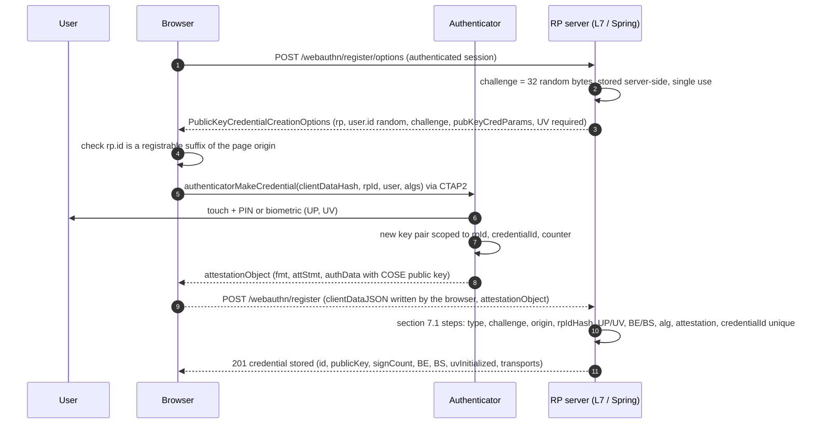
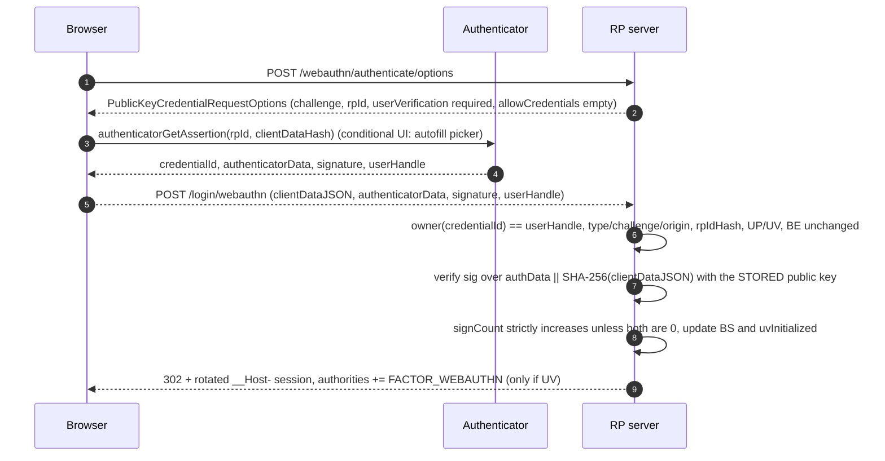

# WebAuthn / FIDO2 Passkeys: Public-Key Challenges, Origin Binding, and the Relying-Party Verifier

> Folder 01 · File 02 of 03 · Identity, AuthN/AuthZ, OAuth 2.1/OIDC/FAPI 2.0 L7 Reference
> Previous: [01 · AuthN physics](01-authn-physics-passwords-argon2id-mfa-totp-and-session-vs-token-state.md) · Next: [03 · JOSE and JWT internals](03-jose-and-jwt-internals-jws-jwe-jwk-ed25519-es256-rs256-and-key-rotation.md)

| Listing | What it proves | Oracle |
|---|---|---|
| L6 `MiniJson.java` | Strict I-JSON parser and canonical writer: duplicate member names are an error; bounded depth and size; no lone surrogates. Shared by L7 and file 03 | Parser differential shown in L7 |
| L7 `WebAuthnRp.java` | A WebAuthn Level 3 relying-party verifier written from scratch: CBOR, COSE_Key → JCA (EC2 on-curve check, OKP, RSA), authenticator data, the §7.1 and §7.2 ceremonies, `packed` (self and x5c) and `fido-u2f` attestation with chain validation, single-use challenges, counter and BE/BS rules. It runs every W3C §16 vector pair, then a 12-attack suite against a signature-only L5 verifier | W3C WebAuthn L3 §16: all 15 vector pairs plus 168 HKDF derivations, parsed from `fixtures/` |
| L8 `PasskeySecurityConfig.java` | Spring Security 7.1.2 passkeys (`webAuthn()` DSL, JDBC repositories, hardened `Webauthn4JRelyingPartyOperations`) and `MonotonicCounterUserCredentialRepository`. It drives the **real** Spring + webauthn4j 0.31.10 stack to show the counter-regression and UV-defaults gaps, then the fixes | Real `Webauthn4JRelyingPartyOperations`, `WebAuthnAuthenticationProvider` |

**Verification.** Compiled with the rest of Folder 01 by `javac --release 21 -Xlint:all -Werror` on Temurin JDK 25.0.4.1. L8 adds spring-security-webauthn 7.1.2, webauthn4j-core 0.31.10.RELEASE, Jackson 3.2.1 (the version webauthn4j declares; a Boot 4.1.2 BOM would pin 3.1.7) and spring-jdbc 7.0.10, all SHA-1-checked against Maven Central on 2026-11-05. The W3C fixture is §16 of the *WebAuthn Level 3 W3C Recommendation, 25 August 2026*, extracted verbatim from <https://www.w3.org/TR/webauthn-3/>. The gate re-runs every `output` block and requires byte-identical results. Statements about Spring internals marked [D] were read from the 7.1.2 `-sources.jar` (and re-checked against 7.2.0-RC1). L8 then exercises them at run time.

Labels: **[D]** documented in a spec or a shipped source file · **[M]** measured by a listing here · **[E]** engineering judgment · **⚠** trap.

---

## 0. Orientation

[File 01](01-authn-physics-passwords-argon2id-mfa-totp-and-session-vs-token-state.md) ended on one uncomfortable fact: every secret a human can type, read aloud or approve can be relayed by a proxy in real time. WebAuthn removes the human from the proof. The authenticator signs a challenge together with **the identity of the site the browser is actually talking to**, and the browser, not the user, supplies that identity. A look-alike domain receives a perfectly valid signature that is useless to the real site.

This file treats the protocol the way an RP implementer must: as bytes. It goes through the authenticator data layout, the CBOR attestation object, COSE keys, `clientDataJSON` and each verification step of the two ceremonies. All of it runs against the W3C Recommendation's own test vectors. Then it examines what a mainstream framework actually checks.

What this file establishes, all measured or read from source:

- **[M]** A from-scratch RP (L7) registers and authenticates **all 15 W3C §16 vector pairs**:
  - credential algorithms ES256, ES384, ES512, RS256, Ed25519 (COSE −8) and Ed448 (COSE −53);
  - attestation formats `none`, `packed` self-attestation and `packed` x5c (chain validated to the §16.1 test CA), `fido-u2f`, plus `tpm`, `android-key` and `apple` statements accepted as *unverified*.
  It also reproduces all **168** HKDF-derived values in the vectors.
- **[M]** Against a software authenticator, the signature-only L5 verifier accepts **11 of 12** attacks: phishing origin, rpId relay, suffix-match origin, ceremony-type confusion, missing UV, iframe embedding, wrong user handle, replay, stale challenge, cloned counter, BE flip. L7 rejects all 12.
- **[M][D]** In Spring Security **7.1.2** (unchanged in 7.2.0-RC1), a cloned authenticator that presents counter 50 after the stored counter reached 100 is **accepted**, and the stored counter **regresses to 50**. The cause: `Webauthn4JRelyingPartyOperations.authenticate` rebuilds webauthn4j's credential record from the *registration* attestation object, so the clone check compares against the registration-time counter (5). L8 reproduces this on the real stack and fixes it with a repository decorator.
- **[M][D]** Spring's shipped defaults are `userVerification=preferred` (both ceremonies), `attestation=none`, `residentKey=required`, a 5-minute timeout, and a *non-strict* webauthn4j manager. `WebAuthnAuthenticationProvider` grants `FACTOR_WEBAUTHN` whether or not UV was performed. A UP-only assertion therefore satisfies a "two-factor" rule unless you require UV.
- **[D]** NIST SP 800-63B-4 Appendix B: verifiers SHALL request UV as preferred and SHALL *inspect* the UV flag. A credential without UV is treated as single-factor. Syncable passkeys are allowed up to AAL2 and SHALL NOT be used at AAL3.

---

## 1. First principles: why a signature over the origin defeats phishing

### 1.1 Three parties, two protocols, one key per site

```text
   Relying Party (server)            Client (browser / OS)                 Authenticator
   ----------------------            ---------------------                 -------------
   issues challenge, stores          enforces origin -> rpId rules,        holds the private key, scoped to rpId;
   public key + counter +            WRITES clientDataJSON (type,          checks UP (touch) and UV (PIN/biometric)
   flags, verifies everything        challenge, ORIGIN, crossOrigin,       LOCALLY; signs authenticatorData ||
                                     topOrigin), speaks CTAP2 to the       SHA-256(clientDataJSON)
                                     authenticator (USB/NFC/BLE/hybrid)
          <---------- WebAuthn (JS API, JSON over HTTPS) ---------->  <---------- CTAP2 (CBOR) ---------->

   what the attacker controls on a phishing site:   the page, its JS, the challenge it relays
   what the attacker can NOT control:               the origin the browser writes; the rpId the browser lets
                                                    the page request (must be a registrable suffix of the
                                                    origin); the authenticator's refusal to use example.org's
                                                    key for rpId examp1e.org
```

The security argument has three links [D: WebAuthn L3 §5.1.3, §5.1.4, §13]:

1. **Key scoping.** A credential is created for an **RP ID**, a registrable domain such as `example.org`. Authenticators only ever use it for that RP ID.
2. **The browser enforces RP ID ⊆ origin.** A page at `https://examp1e.org` may request RP ID `examp1e.org`, but not `example.org`. The real credential is therefore never even offered to the phishing page.
3. **The browser writes the origin into the signed data.** `clientDataJSON.origin` is the page's actual origin, and its SHA-256 is covered by the signature. Even a relay that somehow obtained a signature would deliver one whose origin and `rpIdHash` the real RP rejects. L7 attacks 1–3 show exactly those two rejections.

This is **verifier name binding** in SP 800-63B-4 terms. mTLS and PIV use *channel binding*, which signs TLS handshake material. Both count as phishing-resistant [D].

### 1.2 What the server must still check

Phishing resistance is a property of the *ceremony*, and the RP's verifier can throw it away. L7's attack suite is a catalogue of verifiers that check the signature and nothing else (the L5 `NaiveRp`):

| Check the RP skips | What then works for the attacker |
|---|---|
| `clientDataJSON.origin` against an **exact** allow-list | assertions minted on any origin the attacker controls |
| `rpIdHash == SHA-256(rpId)` | assertions for a different RP ID relayed to you |
| `type == "webauthn.get"` | a registration response replayed as a login |
| challenge equality **and** single use | replay of a captured assertion |
| UP and UV flags against policy | silent use of a connected key by malware; a "2FA" with no user verification |
| `crossOrigin` and `topOrigin` policy | the ceremony embedded in an attacker's iframe |
| user handle owns the credential | logging in as bob with alice's credential |
| signature counter monotonic (when non-zero) | cloned key material used in parallel |
| BE immutable | a device-bound credential silently re-categorised as synced |

### 1.3 Threat model

| Adversary | Passwords + TOTP | Passkeys (WebAuthn, UV required) |
|---|---|---|
| Phishing site, real-time relay | defeated: relays everything | **resists**: origin and rpIdHash mismatch |
| RP database breach | offline cracking; TOTP seeds clone devices | public keys only: nothing reusable |
| Credential stuffing | works wherever passwords are reused | not applicable: keys are per-site |
| Malware on the client that drives the authenticator | n/a | UP requires a touch; UV requires PIN/biometric; malware can still ride an *existing session* |
| XSS on the RP origin | steals session, can read the password field | can call `navigator.credentials.get()` **on your origin**, so the user's touch authorises the attacker's request |
| Sync-fabric (cloud account) takeover | n/a | synced passkeys are only as strong as the platform account's own MFA |
| Account recovery abuse | weakest-link recovery | same: recovery must stay at passkey-level assurance |

The XSS row matters most. Origin binding protects you from *other* origins. It cannot protect you from script running on *your* origin. CSP, Trusted Types and a minimal script surface on the login origin remain mandatory [E].

---

## 2. Byte-level anatomy

### 2.1 Authenticator data

```text
  authenticatorData (W3C 16.2 registration, 164 bytes)

  offset  len  field                  value (hex)
  0       32   rpIdHash               bfabc374 32958b06 3360d3ad 6461c9c4 735ae7f8 edd46592 a5e0f014 52b2e4b5
                                      = SHA-256("example.org")
  32      1    flags                  59 = 0101 1001b -> UP(0x01) BE(0x08) BS(0x10) AT(0x40)
  33      4    signCount              00000000  (big-endian; synced passkeys typically always 0)
  -- attestedCredentialData (present because AT=1) --
  37      16   aaguid                 8446ccb9 ab1db374 750b2367 ff6f3a1f  (authenticator model id)
  53      2    credentialIdLength     0020 = 32   (L3 caps credential ids at 1023 bytes)
  55      32   credentialId           f91f391d b4c9b2fd e0ea7018 9cba3fb6 3f579ba6 122b33ad 94ff3ec3 30084be4
  87      77   credentialPublicKey    a5 01 02 03 26 20 01 21 58 20 <x:32> 22 58 20 <y:32>   (COSE_Key, CBOR)
  -- extensions (present only if ED=1), CBOR map --

  flags:  bit 0 UP  user present        bit 3 BE  backup eligible (fixed at creation)
          bit 1 RFU                     bit 4 BS  backup state (may change: credential now synced)
          bit 2 UV  user verified       bit 6 AT  attested credential data present
          bit 5 RFU                     bit 7 ED  extension data present

  authenticatorData in an assertion (W3C 16.2 authentication, 37 bytes):
          bfabc374...52b2e4b5 | 19 (UP BE BS) | 00000000
```

The COSE key `a5 01 02 03 26 20 01 21 58 20 …` decodes as a 5-entry map. Label 1 (kty) = 2 (EC2), label 3 (alg) = −7 (ES256), label −1 (crv) = 1 (P-256), labels −2/−3 are the 32-byte x and y coordinates. In CBOR, `0x26` is negative integer −7 and `0x20` is −1 [D: RFC 8949 major type 1].

### 2.2 COSE keys and algorithms

| kty | Key labels | alg (COSE) | JCA verify | Notes |
|---|---|---|---|---|
| 2 EC2 | −1 crv, −2 x, −3 y | −7 ES256 (P-256), −35 ES384 (P-384), −36 ES512 (P-521) | `SHA256withECDSA` etc., **DER** signature | the alg must match crv; check the point is on the curve |
| 1 OKP | −1 crv (6 = Ed25519, 7 = Ed448), −2 x | −8 EdDSA (deprecated polymorphic), −19 Ed25519, −53 Ed448 | `Ed25519` / `Ed448`, raw 64- or 114-byte signature | RFC 9864 (Oct 2025) deprecates −8 in favour of the fully specified ids |
| 3 RSA | −1 n, −2 e | −257 RS256 | `SHA256withRSA` | Windows Hello platform credentials commonly use RS256 [E]; enforce n ≥ 2048 |

The W3C vectors exercise both naming eras: §16.11 registers an Ed25519 key under **−8 (EdDSA)**, and §16.12 an Ed448 key under **−53**. An RP that accepts only the new ids rejects many existing authenticators. One that accepts −8 must look at `crv` to know what −8 means. That ambiguity is exactly what RFC 9864 removes [D]. Spring's default `pubKeyCredParams` are `EdDSA, ES256, RS256` [D: 7.1.2 source].

### 2.3 clientDataJSON

```json
{"type":"webauthn.get","challenge":"OcDnUhQXulTUPo3JUXT0I97pvzzYBP9tZchXyav01Ag","origin":"https://example.org","crossOrigin":false}
```

That is W3C §16.2's authentication `clientDataJSON`, byte for byte. The browser produces it, and the RP must parse it, not just pattern-match it. L3 explicitly allows extra members, and the registration vector carries an `extraData` member to keep RPs honest. Two parsing rules matter:

- **Reject duplicate members.** `{"origin":"https://example.org","origin":"https://evil.example"}` is valid JSON to a last-wins parser. L6 rejects it, and L7 shows the last-wins reading is the attacker's value.
- **Compare the challenge as base64url without padding,** against the server-held value, in constant time, and *consume* it. Challenges are single-use server state, not signed cookies that can be replayed [E].

### 2.4 The attestation object

`attestationObject` is a CBOR map `{ "fmt": tstr, "attStmt": map, "authData": bstr }`. §16.2's begins `a3 63 666d74 64 6e6f6e65 …`: a map of 3 entries, then key "fmt" (`63` = 3-character text) and value "none" (`64` = 4-character text). The signature input for *every* attestation format, and for every assertion, is

```text
   signed bytes = authenticatorData || SHA-256(clientDataJSON)
```

with one historical exception, `fido-u2f`, whose input is `0x00 ‖ rpIdHash ‖ clientDataHash ‖ credentialId ‖ 0x04‖x‖y` (L7 implements it and verifies §16.16).

---

## 3. Registration (`navigator.credentials.create`)



The options the RP sends. This is a JSON form that `PublicKeyCredential.parseCreationOptionsFromJSON()` (L3) accepts; binary fields are base64url:

```json
{
  "rp": {"id": "example.org", "name": "Example Bank"},
  "user": {"id": "3q2-7wAAAAAAAAAAAAAAAA", "name": "alice@example.org", "displayName": "Alice"},
  "challenge": "AMMPt4UxxGTStncdq417YDwBFi8vpIa-pw8oOuVW4TA",
  "pubKeyCredParams": [{"type": "public-key", "alg": -8}, {"type": "public-key", "alg": -7}, {"type": "public-key", "alg": -257}],
  "authenticatorSelection": {"residentKey": "required", "userVerification": "required"},
  "attestation": "none",
  "excludeCredentials": [{"type": "public-key", "id": "-R85HbTJsv3g6nAYnLo_tj9Xm6YSKzOtlP8-wzAIS-Q"}],
  "hints": ["client-device"],
  "timeout": 300000,
  "extensions": {"credProps": true}
}
```

Decisions an L7 reviewer looks for:

- **`user.id` is a random opaque handle, never the email or a database key.** It is stored on the authenticator, returned as `userHandle` in discoverable logins, and must not leak identity or enable correlation [D: L3 §5.4.3].
- **`residentKey: required`** creates a *discoverable* credential, which makes username-less login and autofill (`mediation: "conditional"`) possible. **`userVerification: required`** makes the passkey a multi-factor authenticator.
- **`excludeCredentials`** lists the user's existing credential ids so the same authenticator isn't registered twice.
- **`attestation: none`** is right for consumer passkeys. Requesting `direct` without a policy for verifying it only collects data you will be blamed for (§5).
- **Exact verification order** (L3 §7.1, implemented in `RelyingParty.register`):
  1. parse `clientDataJSON` strictly;
  2. check `type`, the challenge (and consume it), `origin`, `crossOrigin` and `topOrigin`;
  3. hash `clientDataJSON`;
  4. CBOR-decode the attestation object;
  5. check `rpIdHash`, UP, UV, BS⇒BE and AT;
  6. decode the COSE key (alg/crv consistency, on-curve) and check its alg against `pubKeyCredParams`;
  7. verify the attestation statement per `fmt`;
  8. reject a credential id longer than 1023 bytes, or already registered **to anyone**;
  9. store the record: id, user handle, public key, signCount, uvInitialized, BE, BS, transports, plus the attestation object and clientDataJSON if you want to re-verify later.

---

## 4. Authentication (`navigator.credentials.get`)



### 4.1 Discoverable credentials and conditional mediation

When `allowCredentials` is empty, the authenticator chooses among its discoverable credentials for the RP ID and returns the `userHandle`. The RP then learns *who* is logging in only from that handle, which is why the handle → credential ownership check is critical (L7 attack 7). **Conditional mediation** (`navigator.credentials.get({mediation: "conditional", publicKey})`, feature-detected with `PublicKeyCredential.isConditionalMediationAvailable()`) shows passkeys in the username field's autofill dropdown. That is the UX change that makes passkeys usable at consumer scale [D: L3 §5.1.4, Credential Management].

```javascript
// Browser side, conditional UI. The server-provided JSON options are parsed with the L3 helper.
if (await PublicKeyCredential.isConditionalMediationAvailable?.()) {
  const options = PublicKeyCredential.parseRequestOptionsFromJSON(await (await fetch("/webauthn/authenticate/options", {method: "POST"})).json());
  const cred = await navigator.credentials.get({ mediation: "conditional", publicKey: options });
  await fetch("/login/webauthn", { method: "POST", headers: {"Content-Type": "application/json"}, body: JSON.stringify(cred.toJSON()) });
}
```

### 4.2 Counters, BE and BS

- **signCount.** If either the stored or the presented count is non-zero, the presented count must be strictly greater than the stored one. Otherwise there is evidence of a clone, a malfunction or a race. The spec leaves the response to RP policy [D: L3 §7.2 step 22], but the comparison is always against the **last stored** count. Synced passkeys usually report 0 forever, so for them the counter carries no signal, and the 0/0 case must not fail (L8 checks both).
- **BE (backup eligible)** is fixed when the credential is created. A change means it is not the same credential class, so L7 rejects it.
- **BS (backup state)** may legitimately flip from 0 to 1 when a passkey starts syncing. Update the stored BS so risk engines and UIs reflect it ("this passkey is synced to your platform account").
- **uvInitialized** records whether UV has ever been performed with this credential. This is useful when a policy demands UV only for some operations.

[D] **Spring 7.1.2 gap 1, counters.** `Webauthn4JRelyingPartyOperations.authenticate` builds `new CredentialRecordImpl(attestationObjectFromRegistration, null, null, transports)`. webauthn4j's `CoreCredentialRecordImpl(AttestationObject)` takes its counter from `attestationObject.getAuthenticatorData().getSignCount()`, which is the **registration-time** value. The updated `CredentialRecord.getSignatureCount()` is never passed in. The authentication path then saves `signatureCount(presented)` and `lastUsed(now)`, but not `backupState`. L8's run shows the consequence on the real stack: counters 6, 7, 100 accepted, a clone's 50 **accepted**, stored counter **50**. The same construction appears in 7.2.0-RC1's source.

---

## 5. Attestation: when the model of the authenticator matters

| fmt | Who signs | Trust you can derive | Use |
|---|---|---|---|
| `none` | nobody | none | consumer passkeys (default) |
| `packed`, self | the credential key itself | proves only possession: no model, no provenance | treat like `none` |
| `packed`, x5c | an attestation key, with a certificate chain | the authenticator model (AAGUID) if the chain reaches a root you trust (FIDO MDS) | enterprise allow-lists, AAL3 |
| `fido-u2f` | U2F attestation certificate | as above, legacy U2F keys | legacy hardware keys |
| `tpm`, `android-key`, `apple` | platform-specific | platform statements; each format has its own verification rules | only if you need them |

L7 verifies `packed` x5c against §8.2.1's certificate requirements:
- version 3;
- subject OU "Authenticator Attestation";
- not a CA;
- the `id-fido-gen-ce-aaguid` extension (1.3.6.1.4.1.45724.1.1.4) equal to authData's AAGUID when present;

and then the chain to the §16.1 test CA, at a fixed validation date so the run is reproducible. It labels `tpm`, `android-key` and `apple` as *unverified* instead of pretending to verify them.

The L7 policy question is not "can we verify attestation" but **"what decision will we make with it?"**
- **Consumers:** none, because attestation adds privacy cost and support burden and does not prevent phishing.
- **Workforce at AAL3:** require attestation and an AAGUID allow-list of FIPS-validated, device-bound keys backed by the FIDO Metadata Service. SP 800-63B-4 forbids syncable authenticators at AAL3 [D].
- **High-risk consumer flows** (payments): use BE/BS and AAGUID as risk *signals*, not gates [E].

---

## 6. Passkeys in production

### 6.1 Synced vs device-bound

| | Synced passkey (BE=1, typically BS=1) | Device-bound key (BE=0) |
|---|---|---|
| Key location | platform sync fabric (end-to-end encrypted), usable on every device of the account | one secure element; non-exportable |
| Loss recovery | built in: a new device gets the key | needs a second registered key or recovery |
| Clone detection | counter usually 0, so no signal | counter often real |
| NIST | allowed up to AAL2 when the sync fabric is protected by AAL2-equivalent MFA; **SHALL NOT** be used at AAL3 | AAL3-capable with UV and FIPS validation |
| Threat that remains | takeover of the platform account (its own recovery path) | physical theft plus PIN guessing (rate-limited by the authenticator) |

### 6.2 RP ID scope, related origins, and subdomains

The RP ID should be the narrowest registrable domain that covers every origin that needs the credential, often `example.org` for `https://example.org` and `https://login.example.org`. **Any** origin under that RP ID can *use* the credential, so a subdomain takeover (a dangling CNAME on `promo.example.org`) or an untrusted user-content subdomain becomes a place where your passkeys can be exercised. L7's L5 bug is the suffix-matching version of the same mistake: `origin.endsWith("example.org")` also matches `https://evilexample.org`.

For a *different* registrable domain (for example `example.co.uk` sharing credentials with `example.com`), WebAuthn L3 defines **Related Origin Requests**. The RP publishes `https://example.com/.well-known/webauthn` listing the allowed origins. The client honours it up to a client-policy maximum number of registrable-domain labels [D: L3 §5.11]. Treat that file like a CORS allow-list: it is an authorization boundary for credentials.

### 6.3 Keeping the credential list honest: L3 signals

L3 adds `PublicKeyCredential.signalUnknownCredential()`, `signalAllAcceptedCredentials()` and `signalCurrentUserDetails()`. These let the RP tell the authenticator that a credential was deleted server-side, or that the user's name changed, so users stop being offered dead passkeys [D: L3]. Call them after credential deletion and account renames. Without them, users hit "this passkey isn't recognized" and fall back to the weakest factor you still allow (A6).

### 6.4 Cross-device ("hybrid") and the fallback problem

Hybrid transport lets a phone's passkey sign for a laptop browser. A QR code establishes the session, and BLE proximity proves the phone is physically near. It inherits phishing resistance because the *laptop* browser still writes the origin [E]. The weak point of every passkey deployment is what you allow **instead**. If "try another way" leads to SMS or a password reset by email, the attacker simply chooses that path. Measure the share of logins and recoveries that end on a non-phishing-resistant factor, and drive it to zero for sensitive accounts.

---

## 7. L6 and L7: the verifier, the vectors, the attacks

<!-- listing:MiniJson.java -->
```java
import java.math.BigDecimal;
import java.util.ArrayList;
import java.util.LinkedHashMap;
import java.util.List;
import java.util.Map;
import java.util.TreeMap;

/**
 * L6 - a strict I-JSON (RFC 7493) parser and a canonical serializer, JDK only.
 *
 * <p>Security-relevant strictness: duplicate member names are an ERROR (the classic JWS/clientDataJSON
 * parser-differential: one library keeps the first "alg", another the last); no trailing commas, no
 * leading zeros, no unescaped control characters, no lone surrogates, bounded depth and size.
 * Objects become {@code LinkedHashMap<String,Object>}, arrays {@code List<Object>}, integers {@code Long},
 * other numbers {@code BigDecimal}, JSON null becomes Java null.
 */
final class MiniJson {
    static final int MAX_DEPTH = 32;
    static final int MAX_CHARS = 64 * 1024;

    private final String s;
    private final boolean allowDuplicates;
    private int i;

    private MiniJson(String s, boolean allowDuplicates) {
        this.s = s;
        this.allowDuplicates = allowDuplicates;
    }

    static Object parse(String text) {
        return parse(text, false);
    }

    /** allowDuplicates=true reproduces the permissive "last one wins" behaviour of many parsers (for demos only). */
    static Object parse(String text, boolean allowDuplicates) {
        if (text.length() > MAX_CHARS) {
            throw new IllegalArgumentException("JSON too large");
        }
        MiniJson p = new MiniJson(text, allowDuplicates);
        p.ws();
        Object v = p.value(0);
        p.ws();
        if (p.i != text.length()) {
            throw p.err("trailing data");
        }
        return v;
    }

    @SuppressWarnings("unchecked")
    static Map<String, Object> object(String text) {
        Object v = parse(text);
        if (!(v instanceof Map)) {
            throw new IllegalArgumentException("JSON value is not an object");
        }
        return (Map<String, Object>) v;
    }

    private Object value(int depth) {
        if (depth > MAX_DEPTH) {
            throw err("nesting too deep");
        }
        if (i >= s.length()) {
            throw err("unexpected end");
        }
        char c = s.charAt(i);
        return switch (c) {
            case '{' -> obj(depth);
            case '[' -> arr(depth);
            case '"' -> str();
            case 't' -> lit("true", Boolean.TRUE);
            case 'f' -> lit("false", Boolean.FALSE);
            case 'n' -> lit("null", null);
            default -> num();
        };
    }

    private Map<String, Object> obj(int depth) {
        Map<String, Object> m = new LinkedHashMap<>();
        i++;
        ws();
        if (peek() == '}') {
            i++;
            return m;
        }
        while (true) {
            ws();
            if (peek() != '"') {
                throw err("member name must be a string");
            }
            String k = str();
            ws();
            expect(':');
            ws();
            Object v = value(depth + 1);
            if (m.containsKey(k) && !allowDuplicates) {
                throw err("duplicate member name \"" + k + "\"");
            }
            m.put(k, v);
            ws();
            char c = next();
            if (c == '}') {
                return m;
            }
            if (c != ',') {
                throw err("expected , or }");
            }
        }
    }

    private List<Object> arr(int depth) {
        List<Object> a = new ArrayList<>();
        i++;
        ws();
        if (peek() == ']') {
            i++;
            return a;
        }
        while (true) {
            ws();
            a.add(value(depth + 1));
            ws();
            char c = next();
            if (c == ']') {
                return a;
            }
            if (c != ',') {
                throw err("expected , or ]");
            }
        }
    }

    private String str() {
        expect('"');
        StringBuilder b = new StringBuilder();
        while (true) {
            char c = next();
            if (c == '"') {
                break;
            }
            if (c < 0x20) {
                throw err("unescaped control character");
            }
            if (c == '\\') {
                char e = next();
                switch (e) {
                    case '"', '\\', '/' -> b.append(e);
                    case 'b' -> b.append('\b');
                    case 'f' -> b.append('\f');
                    case 'n' -> b.append('\n');
                    case 'r' -> b.append('\r');
                    case 't' -> b.append('\t');
                    case 'u' -> {
                        if (i + 4 > s.length()) {
                            throw err("short \\u escape");
                        }
                        b.append((char) Integer.parseInt(s.substring(i, i + 4), 16));
                        i += 4;
                    }
                    default -> throw err("bad escape");
                }
            } else {
                b.append(c);
            }
        }
        String out = b.toString();
        for (int k = 0; k < out.length(); k++) { // I-JSON: no lone surrogates
            char c = out.charAt(k);
            if (Character.isHighSurrogate(c)) {
                if (k + 1 >= out.length() || !Character.isLowSurrogate(out.charAt(k + 1))) {
                    throw err("lone surrogate");
                }
                k++;
            } else if (Character.isLowSurrogate(c)) {
                throw err("lone surrogate");
            }
        }
        return out;
    }

    private Object num() {
        int start = i;
        if (peek() == '-') {
            i++;
        }
        if (peek() == '0') {
            i++;
            if (i < s.length() && Character.isDigit(s.charAt(i))) {
                throw err("leading zero");
            }
        } else {
            digits();
        }
        boolean integral = true;
        if (i < s.length() && s.charAt(i) == '.') {
            integral = false;
            i++;
            digits();
        }
        if (i < s.length() && (s.charAt(i) == 'e' || s.charAt(i) == 'E')) {
            integral = false;
            i++;
            if (i < s.length() && (s.charAt(i) == '+' || s.charAt(i) == '-')) {
                i++;
            }
            digits();
        }
        String t = s.substring(start, i);
        if (integral) {
            try {
                return Long.parseLong(t);
            } catch (NumberFormatException e) {
                return new BigDecimal(t);
            }
        }
        return new BigDecimal(t);
    }

    private void digits() {
        int start = i;
        while (i < s.length() && Character.isDigit(s.charAt(i))) {
            i++;
        }
        if (i == start) {
            throw err("digit expected");
        }
    }

    private Object lit(String word, Object v) {
        if (!s.startsWith(word, i)) {
            throw err("bad literal");
        }
        i += word.length();
        return v;
    }

    private void ws() {
        while (i < s.length() && (s.charAt(i) == ' ' || s.charAt(i) == '\t' || s.charAt(i) == '\n' || s.charAt(i) == '\r')) {
            i++;
        }
    }

    private char peek() {
        if (i >= s.length()) {
            throw err("unexpected end");
        }
        return s.charAt(i);
    }

    private char next() {
        char c = peek();
        i++;
        return c;
    }

    private void expect(char c) {
        if (next() != c) {
            throw err("expected " + c);
        }
    }

    private IllegalArgumentException err(String msg) {
        return new IllegalArgumentException("JSON: " + msg + " at offset " + i);
    }

    // ---------------------------------------------------------------- serializer

    /** Compact serialization preserving map order (what you sign). */
    static String write(Object v) {
        StringBuilder b = new StringBuilder();
        write(b, v, false);
        return b.toString();
    }

    /** Members sorted by UTF-16 code unit order, no whitespace: RFC 7638 thumbprint input. */
    static String canonical(Object v) {
        StringBuilder b = new StringBuilder();
        write(b, v, true);
        return b.toString();
    }

    @SuppressWarnings("unchecked")
    private static void write(StringBuilder b, Object v, boolean sorted) {
        if (v == null) {
            b.append("null");
        } else if (v instanceof String str) {
            quote(b, str);
        } else if (v instanceof Boolean || v instanceof Long || v instanceof Integer || v instanceof BigDecimal) {
            b.append(v);
        } else if (v instanceof Map<?, ?> m) {
            Map<String, Object> mm = sorted ? new TreeMap<>((Map<String, Object>) m) : (Map<String, Object>) m;
            b.append('{');
            boolean first = true;
            for (Map.Entry<String, Object> e : mm.entrySet()) {
                if (!first) {
                    b.append(',');
                }
                first = false;
                quote(b, e.getKey());
                b.append(':');
                write(b, e.getValue(), sorted);
            }
            b.append('}');
        } else if (v instanceof List<?> l) {
            b.append('[');
            for (int k = 0; k < l.size(); k++) {
                if (k > 0) {
                    b.append(',');
                }
                write(b, l.get(k), sorted);
            }
            b.append(']');
        } else {
            throw new IllegalArgumentException("not JSON-serializable: " + v.getClass());
        }
    }

    private static void quote(StringBuilder b, String str) {
        b.append('"');
        for (int k = 0; k < str.length(); k++) {
            char c = str.charAt(k);
            switch (c) {
                case '"' -> b.append("\\\"");
                case '\\' -> b.append("\\\\");
                case '\n' -> b.append("\\n");
                case '\r' -> b.append("\\r");
                case '\t' -> b.append("\\t");
                default -> {
                    if (c < 0x20) {
                        b.append(String.format("\\u%04x", (int) c));
                    } else {
                        b.append(c);
                    }
                }
            }
        }
        b.append('"');
    }
}
```

<!-- listing:WebAuthnRp.java -->
```java
import java.io.ByteArrayInputStream;
import java.io.ByteArrayOutputStream;
import java.math.BigInteger;
import java.nio.ByteBuffer;
import java.nio.charset.StandardCharsets;
import java.nio.file.Path;
import java.security.AlgorithmParameters;
import java.security.GeneralSecurityException;
import java.security.KeyFactory;
import java.security.KeyPair;
import java.security.KeyPairGenerator;
import java.security.MessageDigest;
import java.security.PrivateKey;
import java.security.PublicKey;
import java.security.SecureRandom;
import java.security.Signature;
import java.security.cert.CertificateFactory;
import java.security.cert.X509Certificate;
import java.security.interfaces.ECPublicKey;
import java.security.spec.ECFieldFp;
import java.security.spec.ECGenParameterSpec;
import java.security.spec.ECParameterSpec;
import java.security.spec.ECPoint;
import java.security.spec.ECPrivateKeySpec;
import java.security.spec.ECPublicKeySpec;
import java.security.spec.EdECPoint;
import java.security.spec.EdECPrivateKeySpec;
import java.security.spec.EdECPublicKeySpec;
import java.security.spec.NamedParameterSpec;
import java.security.spec.RSAPublicKeySpec;
import java.util.ArrayList;
import java.util.Arrays;
import java.util.Date;
import java.util.HashMap;
import java.util.HashSet;
import java.util.LinkedHashMap;
import java.util.List;
import java.util.Map;
import java.util.Set;
import java.util.regex.Matcher;
import java.util.regex.Pattern;
import javax.crypto.Mac;
import javax.crypto.spec.SecretKeySpec;

/**
 * L7 - a WebAuthn Level 3 Relying Party verifier from first principles (JDK only): CBOR, COSE_Key, authenticator
 * data, the section 7.1 registration and 7.2 authentication ceremonies, packed (self + x5c) and fido-u2f attestation.
 *
 * <p>Oracle: every registration/authentication pair in W3C WebAuthn L3 section 16 (fixture), including every
 * "Derived by: HKDF-SHA-256(...)" comment. Then a software authenticator drives an attack suite against a
 * signature-only L5 verifier and this L7 verifier.
 */
public final class WebAuthnRp {

    // ================================================================ CBOR (RFC 8949), definite lengths only

    static final class Cbor {
        private final byte[] b;
        int pos;

        Cbor(byte[] b, int pos) {
            this.b = b;
            this.pos = pos;
        }

        static Object decodeAll(byte[] b) {
            Cbor c = new Cbor(b, 0);
            Object v = c.read(0);
            if (c.pos != b.length) {
                throw new IllegalArgumentException("CBOR: trailing bytes");
            }
            return v;
        }

        Object read(int depth) {
            if (depth > 16) {
                throw new IllegalArgumentException("CBOR: too deep");
            }
            int ib = b[pos++] & 0xff;
            int major = ib >>> 5;
            long arg = argument(ib & 31);
            switch (major) {
                case 0:
                    return arg;
                case 1:
                    return -1 - arg;
                case 2:
                    return Arrays.copyOfRange(b, pos, (pos += len(arg)));
                case 3:
                    return new String(Arrays.copyOfRange(b, pos, (pos += len(arg))), StandardCharsets.UTF_8);
                case 4: {
                    List<Object> a = new ArrayList<>();
                    for (long k = 0; k < arg; k++) {
                        a.add(read(depth + 1));
                    }
                    return a;
                }
                case 5: {
                    Map<Object, Object> m = new LinkedHashMap<>();
                    for (long k = 0; k < arg; k++) {
                        Object key = read(depth + 1);
                        if (m.containsKey(key)) {
                            throw new IllegalArgumentException("CBOR: duplicate map key " + key);
                        }
                        m.put(key, read(depth + 1));
                    }
                    return m;
                }
                case 7:
                    if (arg == 20) {
                        return Boolean.FALSE;
                    }
                    if (arg == 21) {
                        return Boolean.TRUE;
                    }
                    if (arg == 22) {
                        return null;
                    }
                    throw new IllegalArgumentException("CBOR: unsupported simple/float " + arg);
                default:
                    throw new IllegalArgumentException("CBOR: tags not supported");
            }
        }

        private long argument(int ai) {
            if (ai < 24) {
                return ai;
            }
            int n = switch (ai) {
                case 24 -> 1;
                case 25 -> 2;
                case 26 -> 4;
                case 27 -> 8;
                default -> throw new IllegalArgumentException("CBOR: indefinite/reserved length");
            };
            long v = 0;
            for (int k = 0; k < n; k++) {
                v = (v << 8) | (b[pos++] & 0xff);
            }
            return v;
        }

        private int len(long arg) {
            if (arg < 0 || pos + arg > b.length) {
                throw new IllegalArgumentException("CBOR: length beyond input");
            }
            return (int) arg;
        }

        // ---- encoder (for the software authenticator)
        static byte[] encode(Object v) {
            ByteArrayOutputStream o = new ByteArrayOutputStream();
            enc(o, v);
            return o.toByteArray();
        }

        private static void enc(ByteArrayOutputStream o, Object v) {
            if (v instanceof Long || v instanceof Integer) {
                long x = ((Number) v).longValue();
                head(o, x >= 0 ? 0 : 1, x >= 0 ? x : -1 - x);
            } else if (v instanceof byte[] bytes) {
                head(o, 2, bytes.length);
                o.writeBytes(bytes);
            } else if (v instanceof String s) {
                byte[] u = s.getBytes(StandardCharsets.UTF_8);
                head(o, 3, u.length);
                o.writeBytes(u);
            } else if (v instanceof List<?> l) {
                head(o, 4, l.size());
                for (Object e : l) {
                    enc(o, e);
                }
            } else if (v instanceof Map<?, ?> m) {
                head(o, 5, m.size());
                for (Map.Entry<?, ?> e : m.entrySet()) {
                    enc(o, e.getKey());
                    enc(o, e.getValue());
                }
            } else {
                throw new IllegalArgumentException("CBOR encode: " + v);
            }
        }

        private static void head(ByteArrayOutputStream o, int major, long arg) {
            int m = major << 5;
            if (arg < 24) {
                o.write(m | (int) arg);
            } else if (arg < 256) {
                o.write(m | 24);
                o.write((int) arg);
            } else if (arg < 65536) {
                o.write(m | 25);
                o.write((int) (arg >>> 8));
                o.write((int) arg);
            } else {
                o.write(m | 26);
                for (int k = 3; k >= 0; k--) {
                    o.write((int) (arg >>> (8 * k)));
                }
            }
        }
    }

    // ================================================================ COSE_Key -> JCA (RFC 9052/9053, RFC 9864)

    record CoseKey(PublicKey key, long alg, String jcaSig, String desc) {
    }

    static final Map<Long, String> ALG_NAMES = Map.of(-7L, "ES256", -35L, "ES384", -36L, "ES512", -257L, "RS256",
            -8L, "EdDSA", -19L, "Ed25519", -53L, "Ed448", -65535L, "RS1");

    static CoseKey coseKey(Map<Object, Object> m) {
        try {
            long kty = (Long) m.get(1L);
            long alg = (Long) m.get(3L);
            if (kty == 2) { // EC2
                long crv = (Long) m.get(-1L);
                String[] c = switch ((int) crv) {
                    case 1 -> new String[] {"secp256r1", "SHA256withECDSA", "-7", "P-256"};
                    case 2 -> new String[] {"secp384r1", "SHA384withECDSA", "-35", "P-384"};
                    case 3 -> new String[] {"secp521r1", "SHA512withECDSA", "-36", "P-521"};
                    default -> throw new IllegalArgumentException("unsupported EC2 crv " + crv);
                };
                if (alg != Long.parseLong(c[2])) {
                    throw new IllegalArgumentException("alg " + alg + " does not match crv " + c[3]);
                }
                ECParameterSpec p = ecParams(c[0]);
                BigInteger x = new BigInteger(1, (byte[]) m.get(-2L));
                BigInteger y = new BigInteger(1, (byte[]) m.get(-3L));
                requireOnCurve(p, x, y);
                PublicKey k = KeyFactory.getInstance("EC").generatePublic(new ECPublicKeySpec(new ECPoint(x, y), p));
                return new CoseKey(k, alg, c[1], "EC2 " + c[3]);
            }
            if (kty == 1) { // OKP
                long crv = (Long) m.get(-1L);
                byte[] enc = (byte[]) m.get(-2L);
                NamedParameterSpec ps = crv == 6 ? NamedParameterSpec.ED25519 : crv == 7 ? NamedParameterSpec.ED448 : null;
                if (ps == null || !(alg == -8 || (crv == 6 && alg == -19) || (crv == 7 && alg == -53))) {
                    throw new IllegalArgumentException("unsupported OKP crv/alg " + crv + "/" + alg);
                }
                PublicKey k = KeyFactory.getInstance(ps.getName()).generatePublic(new EdECPublicKeySpec(ps, edPoint(enc)));
                return new CoseKey(k, alg, ps.getName(), "OKP " + ps.getName());
            }
            if (kty == 3) { // RSA
                if (alg != -257) {
                    throw new IllegalArgumentException("unsupported RSA alg " + alg);
                }
                BigInteger n = new BigInteger(1, (byte[]) m.get(-1L));
                BigInteger e = new BigInteger(1, (byte[]) m.get(-2L));
                if (n.bitLength() < 2048) {
                    throw new IllegalArgumentException("RSA modulus below 2048 bits");
                }
                PublicKey k = KeyFactory.getInstance("RSA").generatePublic(new RSAPublicKeySpec(n, e));
                return new CoseKey(k, alg, "SHA256withRSA", "RSA-" + n.bitLength());
            }
            throw new IllegalArgumentException("unsupported kty " + kty);
        } catch (GeneralSecurityException e) {
            throw new IllegalArgumentException(e);
        }
    }

    static ECParameterSpec ecParams(String curve) throws GeneralSecurityException {
        AlgorithmParameters ap = AlgorithmParameters.getInstance("EC");
        ap.init(new ECGenParameterSpec(curve));
        return ap.getParameterSpec(ECParameterSpec.class);
    }

    /** y^2 = x^3 + ax + b (mod p): never build a key from an off-curve point. */
    static void requireOnCurve(ECParameterSpec ps, BigInteger x, BigInteger y) {
        BigInteger p = ((ECFieldFp) ps.getCurve().getField()).getP();
        BigInteger lhs = y.modPow(BigInteger.TWO, p);
        BigInteger rhs = x.pow(3).add(ps.getCurve().getA().multiply(x)).add(ps.getCurve().getB()).mod(p);
        if (x.signum() < 0 || x.compareTo(p) >= 0 || y.signum() < 0 || y.compareTo(p) >= 0 || !lhs.equals(rhs)) {
            throw new IllegalArgumentException("EC point not on curve");
        }
    }

    /** RFC 8032 encoding: little-endian y, top bit of the last byte = parity of x. */
    static EdECPoint edPoint(byte[] enc) {
        byte[] le = enc.clone();
        boolean xOdd = (le[le.length - 1] & 0x80) != 0;
        le[le.length - 1] &= 0x7f;
        byte[] be = new byte[le.length];
        for (int k = 0; k < le.length; k++) {
            be[k] = le[le.length - 1 - k];
        }
        return new EdECPoint(xOdd, new BigInteger(1, be));
    }

    // ================================================================ authenticator data (section 6.1)

    static final int UP = 0x01;
    static final int UV = 0x04;
    static final int BE = 0x08;
    static final int BS = 0x10;
    static final int AT = 0x40;
    static final int ED = 0x80;

    record AuthData(byte[] raw, byte[] rpIdHash, int flags, long signCount, byte[] aaguid, byte[] credentialId,
                    Map<Object, Object> credentialKey) {
        static AuthData parse(byte[] a) {
            if (a.length < 37) {
                throw new IllegalArgumentException("authData shorter than 37 bytes");
            }
            ByteBuffer bb = ByteBuffer.wrap(a);
            byte[] rp = new byte[32];
            bb.get(rp);
            int flags = bb.get() & 0xff;
            long count = bb.getInt() & 0xffffffffL;
            byte[] aaguid = null;
            byte[] credId = null;
            Map<Object, Object> key = null;
            int end = 37;
            if ((flags & AT) != 0) {
                aaguid = new byte[16];
                bb.get(aaguid);
                int idLen = bb.getShort() & 0xffff;
                if (idLen > 1023) {
                    throw new IllegalArgumentException("credentialId longer than 1023 bytes");
                }
                credId = new byte[idLen];
                bb.get(credId);
                Cbor c = new Cbor(a, bb.position());
                @SuppressWarnings("unchecked")
                Map<Object, Object> k = (Map<Object, Object>) c.read(0);
                key = k;
                end = c.pos;
            }
            if ((flags & ED) != 0) {
                Cbor c = new Cbor(a, end);
                c.read(0); // extensions map: parsed for length, ignored by this RP
                end = c.pos;
            }
            if (end != a.length) {
                throw new IllegalArgumentException("trailing bytes after authenticator data");
            }
            return new AuthData(a, rp, flags, count, aaguid, credId, key);
        }

        String flagString() {
            return ((flags & UP) != 0 ? "UP " : "-- ") + ((flags & UV) != 0 ? "UV " : "-- ") + ((flags & BE) != 0 ? "BE " : "-- ")
                    + ((flags & BS) != 0 ? "BS" : "--");
        }
    }

    // ================================================================ relying party

    record RpConfig(String rpId, Set<String> origins, boolean allowCrossOrigin, Set<String> topOrigins, boolean requireUv,
                    Set<Long> algs, boolean requireAttestation, X509Certificate trustAnchor) {
    }

    static final class CredentialRecord {
        final byte[] id;
        final byte[] userHandle;
        final CoseKey key;
        long signCount;
        boolean uvInitialized;
        final boolean backupEligible;
        boolean backupState;
        final String attestation;

        CredentialRecord(byte[] id, byte[] userHandle, CoseKey key, long signCount, boolean uv, boolean be, boolean bs, String att) {
            this.id = id;
            this.userHandle = userHandle;
            this.key = key;
            this.signCount = signCount;
            this.uvInitialized = uv;
            this.backupEligible = be;
            this.backupState = bs;
            this.attestation = att;
        }
    }

    static final class CeremonyException extends RuntimeException {
        private static final long serialVersionUID = 1L;

        CeremonyException(String m) {
            super(m);
        }
    }

    /** L7: every step of sections 7.1/7.2 that a server can check, single-use challenges, attestation policy. */
    static final class RelyingParty {
        final RpConfig cfg;
        final Map<String, CredentialRecord> credentials = new HashMap<>();
        private final Set<String> liveChallenges = new HashSet<>();
        final List<String> riskSignals = new ArrayList<>();

        RelyingParty(RpConfig cfg) {
            this.cfg = cfg;
        }

        void issue(byte[] challenge) {
            if (challenge.length < 16) {
                throw new IllegalArgumentException("challenge below 16 bytes");
            }
            liveChallenges.add(KbSupport.b64u(challenge));
        }

        private Map<String, Object> clientData(byte[] json, String type, byte[] challenge) {
            Map<String, Object> c = MiniJson.object(new String(json, StandardCharsets.UTF_8));
            if (!type.equals(c.get("type"))) {
                throw new CeremonyException("clientData.type " + c.get("type") + " != " + type);
            }
            String ch = (String) c.get("challenge");
            String expected = KbSupport.b64u(challenge);
            if (ch == null || !MessageDigest.isEqual(ch.getBytes(StandardCharsets.US_ASCII), expected.getBytes(StandardCharsets.US_ASCII))) {
                throw new CeremonyException("challenge mismatch");
            }
            if (!liveChallenges.remove(expected)) { // consumed exactly once, server-side
                throw new CeremonyException("challenge not issued or already used");
            }
            if (!cfg.origins().contains(c.get("origin"))) { // exact string match, never suffix/regex
                throw new CeremonyException("origin " + c.get("origin") + " not allowed");
            }
            boolean cross = Boolean.TRUE.equals(c.get("crossOrigin"));
            if (cross && !cfg.allowCrossOrigin()) {
                throw new CeremonyException("cross-origin (iframe) ceremony not allowed");
            }
            Object top = c.get("topOrigin");
            if (top != null && (!cross || !cfg.topOrigins().contains(top))) {
                throw new CeremonyException("topOrigin " + top + " not allowed");
            }
            return c;
        }

        private void commonAuthDataChecks(AuthData ad) {
            if (!MessageDigest.isEqual(ad.rpIdHash(), sha256(cfg.rpId().getBytes(StandardCharsets.UTF_8)))) {
                throw new CeremonyException("rpIdHash is not SHA-256(\"" + cfg.rpId() + "\")");
            }
            if ((ad.flags() & UP) == 0) {
                throw new CeremonyException("user presence (UP) not set");
            }
            if (cfg.requireUv() && (ad.flags() & UV) == 0) {
                throw new CeremonyException("user verification required but UV not set");
            }
            if ((ad.flags() & BE) == 0 && (ad.flags() & BS) != 0) {
                throw new CeremonyException("BS set without BE");
            }
        }

        /** Section 7.1 registration. Returns the attestation trust verdict. */
        String register(byte[] challenge, byte[] clientDataJson, byte[] attestationObject, byte[] userHandle) {
            clientData(clientDataJson, "webauthn.create", challenge);
            byte[] clientDataHash = sha256(clientDataJson);
            @SuppressWarnings("unchecked")
            Map<Object, Object> ao = (Map<Object, Object>) Cbor.decodeAll(attestationObject);
            String fmt = (String) ao.get("fmt");
            AuthData ad = AuthData.parse((byte[]) ao.get("authData"));
            commonAuthDataChecks(ad);
            if ((ad.flags() & AT) == 0) {
                throw new CeremonyException("no attested credential data");
            }
            CoseKey key = coseKey(ad.credentialKey());
            if (!cfg.algs().contains(key.alg())) {
                throw new CeremonyException("alg " + key.alg() + " not in pubKeyCredParams");
            }
            @SuppressWarnings("unchecked")
            Map<Object, Object> stmt = (Map<Object, Object>) ao.get("attStmt");
            String trust = attestation(fmt, stmt, ad, clientDataHash, key);
            if (cfg.requireAttestation() && !trust.startsWith("trusted")) {
                throw new CeremonyException("attestation required, got: " + trust);
            }
            String id = KbSupport.b64u(ad.credentialId());
            if (credentials.containsKey(id)) { // a credential id may belong to exactly one user
                throw new CeremonyException("credential id already registered");
            }
            credentials.put(id, new CredentialRecord(ad.credentialId(), userHandle, key, ad.signCount(),
                    (ad.flags() & UV) != 0, (ad.flags() & BE) != 0, (ad.flags() & BS) != 0, trust));
            return trust;
        }

        private String attestation(String fmt, Map<Object, Object> stmt, AuthData ad, byte[] cdh, CoseKey key) {
            byte[] signed = concat(ad.raw(), cdh);
            switch (fmt) {
                case "none":
                    if (!stmt.isEmpty()) {
                        throw new CeremonyException("fmt none with non-empty attStmt");
                    }
                    return "none";
                case "packed": {
                    long alg = (Long) stmt.get("alg");
                    byte[] sig = (byte[]) stmt.get("sig");
                    @SuppressWarnings("unchecked")
                    List<Object> x5c = (List<Object>) stmt.get("x5c");
                    if (x5c == null) { // self attestation: signed by the credential key itself
                        if (alg != key.alg()) {
                            throw new CeremonyException("self attestation alg != credential alg");
                        }
                        if (!verify(key.jcaSig(), key.key(), signed, sig)) {
                            throw new CeremonyException("packed self-attestation signature invalid");
                        }
                        return "self (no trust path)";
                    }
                    X509Certificate leaf = cert((byte[]) x5c.get(0));
                    if (!verify(jcaFor(alg, leaf.getPublicKey()), leaf.getPublicKey(), signed, sig)) {
                        throw new CeremonyException("packed attestation signature invalid");
                    }
                    checkPackedCert(leaf, ad.aaguid());
                    return chain(x5c);
                }
                case "fido-u2f": {
                    @SuppressWarnings("unchecked")
                    List<Object> x5c = (List<Object>) stmt.get("x5c");
                    if (x5c == null || x5c.size() != 1 || !(key.key() instanceof ECPublicKey ec)
                            || ec.getParams().getCurve().getField().getFieldSize() != 256) {
                        throw new CeremonyException("fido-u2f needs exactly one cert and a P-256 credential key");
                    }
                    X509Certificate leaf = cert((byte[]) x5c.get(0));
                    byte[] u2fKey = concat(new byte[] {4}, fixed(ec.getW().getAffineX(), 32), fixed(ec.getW().getAffineY(), 32));
                    byte[] data = concat(new byte[] {0}, ad.rpIdHash(), cdh, ad.credentialId(), u2fKey);
                    if (!verify("SHA256withECDSA", leaf.getPublicKey(), data, (byte[]) stmt.get("sig"))) {
                        throw new CeremonyException("fido-u2f signature invalid");
                    }
                    return chain(x5c);
                }
                default:
                    return "unverified (fmt '" + fmt + "' not implemented here)";
            }
        }

        private String chain(List<Object> x5c) {
            try {
                Date at = new Date(1_767_225_600_000L); // fixed 2026-01-01 so the run is reproducible
                X509Certificate prev = null;
                for (int k = x5c.size() - 1; k >= 0; k--) {
                    X509Certificate c = cert((byte[]) x5c.get(k));
                    c.checkValidity(at);
                    c.verify(prev == null ? cfg.trustAnchor().getPublicKey() : prev.getPublicKey());
                    prev = c;
                }
                return "trusted (chains to the test-vector attestation CA)";
            } catch (GeneralSecurityException e) {
                return "untrusted (" + e.getClass().getSimpleName() + ")";
            }
        }

        /** Section 8.2.1 packed attestation certificate requirements. */
        private static void checkPackedCert(X509Certificate c, byte[] aaguid) {
            if (c.getVersion() != 3 || c.getBasicConstraints() != -1
                    || !c.getSubjectX500Principal().getName().contains("OU=Authenticator Attestation")) {
                throw new CeremonyException("attestation certificate violates section 8.2.1");
            }
            byte[] ext = c.getExtensionValue("1.3.6.1.4.1.45724.1.1.4"); // id-fido-gen-ce-aaguid
            if (ext != null && !Arrays.equals(Arrays.copyOfRange(ext, ext.length - 16, ext.length), aaguid)) {
                throw new CeremonyException("certificate AAGUID != authenticator data AAGUID");
            }
        }

        /** Section 7.2 authentication. Returns the user handle of the authenticated subscriber. */
        byte[] authenticate(byte[] challenge, byte[] credentialId, byte[] clientDataJson, byte[] authData, byte[] signature,
                            byte[] userHandle, List<byte[]> allowCredentials) {
            if (allowCredentials != null && allowCredentials.stream().noneMatch(a -> Arrays.equals(a, credentialId))) {
                throw new CeremonyException("credential not in allowCredentials");
            }
            CredentialRecord rec = credentials.get(KbSupport.b64u(credentialId));
            if (rec == null) {
                throw new CeremonyException("unknown credential");
            }
            if (userHandle != null && !Arrays.equals(userHandle, rec.userHandle)) {
                throw new CeremonyException("userHandle does not own this credential");
            }
            clientData(clientDataJson, "webauthn.get", challenge);
            AuthData ad = AuthData.parse(authData);
            commonAuthDataChecks(ad);
            if (((ad.flags() & BE) != 0) != rec.backupEligible) {
                throw new CeremonyException("BE flag changed: backup eligibility is fixed at creation");
            }
            if (!verify(rec.key.jcaSig(), rec.key.key(), concat(authData, sha256(clientDataJson)), signature)) {
                throw new CeremonyException("assertion signature invalid");
            }
            if (ad.signCount() != 0 || rec.signCount != 0) {
                if (ad.signCount() <= rec.signCount) {
                    riskSignals.add("signCount " + ad.signCount() + " <= stored " + rec.signCount + ": possible clone");
                    throw new CeremonyException("signature counter did not increase (possible cloned authenticator)");
                }
                rec.signCount = ad.signCount();
            }
            rec.backupState = (ad.flags() & BS) != 0; // BS may legitimately change: update it
            rec.uvInitialized |= (ad.flags() & UV) != 0;
            return rec.userHandle;
        }
    }

    /** L5: "the signature checks out, so it's the user" - ignores origin, rpIdHash, type, flags, counter. */
    static final class NaiveRp {
        final Map<String, CoseKey> keys = new HashMap<>();

        boolean authenticate(byte[] credentialId, byte[] clientDataJson, byte[] authData, byte[] signature) {
            CoseKey k = keys.get(KbSupport.b64u(credentialId));
            return k != null && verify(k.jcaSig(), k.key(), concat(authData, sha256(clientDataJson)), signature);
        }
    }

    // ================================================================ software authenticator (attack suite driver)

    static final class SoftAuthenticator {
        final KeyPair kp;
        final byte[] credentialId = new byte[16];
        long counter;
        final boolean backupEligible;

        SoftAuthenticator(SecureRandom rng, boolean backupEligible) throws GeneralSecurityException {
            KeyPairGenerator g = KeyPairGenerator.getInstance("EC");
            g.initialize(new ECGenParameterSpec("secp256r1"), rng);
            kp = g.generateKeyPair();
            rng.nextBytes(credentialId);
            this.backupEligible = backupEligible;
        }

        Map<Object, Object> cose() {
            ECPublicKey ec = (ECPublicKey) kp.getPublic();
            Map<Object, Object> m = new LinkedHashMap<>();
            m.put(1L, 2L);
            m.put(3L, -7L);
            m.put(-1L, 1L);
            m.put(-2L, fixed(ec.getW().getAffineX(), 32));
            m.put(-3L, fixed(ec.getW().getAffineY(), 32));
            return m;
        }

        byte[] authData(String rpId, int flags, boolean attested) {
            ByteArrayOutputStream o = new ByteArrayOutputStream();
            o.writeBytes(sha256(rpId.getBytes(StandardCharsets.UTF_8)));
            o.write(flags | (attested ? AT : 0) | (backupEligible ? BE : 0));
            o.writeBytes(ByteBuffer.allocate(4).putInt((int) counter).array());
            if (attested) {
                o.writeBytes(new byte[16]);
                o.writeBytes(ByteBuffer.allocate(2).putShort((short) credentialId.length).array());
                o.writeBytes(credentialId);
                o.writeBytes(Cbor.encode(cose()));
            }
            return o.toByteArray();
        }

        byte[] attestationNone(byte[] authData) {
            Map<Object, Object> m = new LinkedHashMap<>();
            m.put("fmt", "none");
            m.put("attStmt", new LinkedHashMap<>());
            m.put("authData", authData);
            return Cbor.encode(m);
        }

        byte[] sign(byte[] authData, byte[] clientDataJson) {
            try {
                Signature s = Signature.getInstance("SHA256withECDSA");
                s.initSign(kp.getPrivate());
                s.update(concat(authData, sha256(clientDataJson)));
                return s.sign();
            } catch (GeneralSecurityException e) {
                throw new IllegalStateException(e);
            }
        }
    }

    static byte[] clientDataJson(String type, byte[] challenge, String origin, Boolean crossOrigin, String topOrigin) {
        Map<String, Object> m = new LinkedHashMap<>();
        m.put("type", type);
        m.put("challenge", KbSupport.b64u(challenge));
        m.put("origin", origin);
        if (crossOrigin != null) {
            m.put("crossOrigin", crossOrigin);
        }
        if (topOrigin != null) {
            m.put("topOrigin", topOrigin);
        }
        return MiniJson.write(m).getBytes(StandardCharsets.UTF_8);
    }

    // ================================================================ crypto helpers

    static byte[] sha256(byte[] in) {
        try {
            return MessageDigest.getInstance("SHA-256").digest(in);
        } catch (GeneralSecurityException e) {
            throw new IllegalStateException(e);
        }
    }

    static boolean verify(String alg, PublicKey k, byte[] data, byte[] sig) {
        try {
            Signature s = Signature.getInstance(alg);
            s.initVerify(k);
            s.update(data);
            return s.verify(sig);
        } catch (GeneralSecurityException e) {
            return false; // malformed DER etc. is a failed verification, not a crash
        }
    }

    static String jcaFor(long alg, PublicKey k) {
        return switch ((int) alg) {
            case -7 -> "SHA256withECDSA";
            case -35 -> "SHA384withECDSA";
            case -36 -> "SHA512withECDSA";
            case -257 -> "SHA256withRSA";
            case -8 -> k instanceof java.security.interfaces.EdECPublicKey ed ? ed.getParams().getName() : "Ed25519";
            default -> throw new CeremonyException("unsupported attestation alg " + alg);
        };
    }

    static X509Certificate cert(byte[] der) {
        try {
            return (X509Certificate) CertificateFactory.getInstance("X.509").generateCertificate(new ByteArrayInputStream(der));
        } catch (GeneralSecurityException e) {
            throw new CeremonyException("bad certificate: " + e.getMessage());
        }
    }

    static byte[] concat(byte[]... parts) {
        ByteArrayOutputStream o = new ByteArrayOutputStream();
        for (byte[] p : parts) {
            o.writeBytes(p);
        }
        return o.toByteArray();
    }

    static byte[] fixed(BigInteger v, int len) {
        byte[] raw = v.toByteArray();
        byte[] out = new byte[len];
        int n = Math.min(raw.length, len);
        System.arraycopy(raw, raw.length - n, out, len - n, n);
        return out;
    }

    /** RFC 5869 HKDF-SHA-256 (extract + expand). */
    static byte[] hkdf(byte[] ikm, byte[] salt, byte[] info, int len) {
        try {
            Mac mac = Mac.getInstance("HmacSHA256");
            mac.init(new SecretKeySpec(salt.length == 0 ? new byte[32] : salt, "HmacSHA256"));
            byte[] prk = mac.doFinal(ikm);
            mac.init(new SecretKeySpec(prk, "HmacSHA256"));
            ByteArrayOutputStream out = new ByteArrayOutputStream();
            byte[] t = new byte[0];
            for (int k = 1; out.size() < len; k++) {
                mac.update(t);
                mac.update(info);
                mac.update((byte) k);
                t = mac.doFinal();
                out.writeBytes(t);
            }
            return Arrays.copyOf(out.toByteArray(), len);
        } catch (GeneralSecurityException e) {
            throw new IllegalStateException(e);
        }
    }

    // ================================================================ W3C section 16 fixture

    record Vector(String section, String title, Map<String, byte[]> reg, Map<String, byte[]> auth) {
    }

    static List<Vector> vectors(String text) {
        Matcher sec = Pattern.compile("(?m)^   16\\.(\\d+)\\. (.+)$").matcher(text);
        List<Integer> starts = new ArrayList<>();
        List<String[]> heads = new ArrayList<>();
        while (sec.find()) {
            starts.add(sec.start());
            heads.add(new String[] {sec.group(1), sec.group(2).trim()});
        }
        List<Vector> out = new ArrayList<>();
        for (int k = 0; k < starts.size(); k++) {
            String body = text.substring(starts.get(k), k + 1 < starts.size() ? starts.get(k + 1) : text.length());
            int r = body.indexOf("Registration:");
            int a = body.indexOf("Authentication:");
            if (r < 0 || a < 0) {
                continue;
            }
            out.add(new Vector("16." + heads.get(k)[0], heads.get(k)[1], fields(body.substring(r, a)), fields(body.substring(a))));
        }
        return out;
    }

    static Map<String, byte[]> fields(String s) {
        Map<String, byte[]> m = new LinkedHashMap<>();
        Matcher f = Pattern.compile("(?m)^(\\w+) = h'([0-9a-f]*)'").matcher(s);
        while (f.find()) {
            m.put(f.group(1), KbSupport.unhex(f.group(2)));
        }
        return m;
    }

    static RpConfig vectorRp(X509Certificate ca) {
        return new RpConfig("example.org", Set.of("https://example.org"), true, Set.of("https://example.com"), false,
                Set.of(-7L, -35L, -36L, -257L, -8L, -19L, -53L), false, ca);
    }

    // ================================================================ main

    public static void main(String[] args) throws Exception {
        Path fx = KbSupport.fixtures(args);
        String tv = KbSupport.text(fx, "w3c-webauthn-l3-sec16-test-vectors.txt");

        KbSupport.section("Every 'Derived by: HKDF-SHA-256(...)' comment in W3C WebAuthn L3 section 16");
        Matcher d = Pattern.compile("(?m)^(\\w+) = h'([0-9a-f]+)'(?: = b64'([A-Za-z0-9_-]*)')?\\s+; Derived by: HKDF-SHA-256\\(IKM='WebAuthn test vectors', salt=h'([0-9a-f]*)', info='([^']*)', L=(\\d+)\\)").matcher(tv);
        int nh = 0;
        int bad = 0;
        while (d.find()) {
            byte[] want = KbSupport.unhex(d.group(2));
            byte[] got = hkdf("WebAuthn test vectors".getBytes(StandardCharsets.US_ASCII), KbSupport.unhex(d.group(4)),
                    d.group(5).getBytes(StandardCharsets.US_ASCII), Integer.parseInt(d.group(6)));
            if (!Arrays.equals(want, got) || (d.group(3) != null && !KbSupport.b64u(want).equals(d.group(3)))) {
                bad++;
            }
            nh++;
        }
        KbSupport.check(nh + " HKDF-derived values reproduced with an RFC 5869 implementation (" + bad + " mismatches)", nh > 100 && bad == 0);

        byte[] caDer = KbSupport.unhex(tv.substring(tv.indexOf("attestation_ca_cert = h'") + 24, tv.indexOf("'", tv.indexOf("attestation_ca_cert = h'") + 24)));
        X509Certificate ca = cert(caDer);
        KbSupport.check("attestation CA (16.1) is self-signed: " + ca.getSubjectX500Principal().getName().replace(",", ", "),
                verify("SHA256withECDSA", ca.getPublicKey(), ca.getTBSCertificate(), ca.getSignature()));

        KbSupport.section("Registration + authentication for every section 16 vector pair (RP id example.org, UV preferred)");
        List<Vector> vs = vectors(tv);
        int pass = 0;
        for (Vector v : vs) {
            RelyingParty rp = new RelyingParty(vectorRp(ca));
            String verdict;
            String alg = "?";
            String flags = "";
            try {
                rp.issue(v.reg().get("challenge"));
                byte[] user = "user-handle-01".getBytes(StandardCharsets.US_ASCII);
                String trust = rp.register(v.reg().get("challenge"), v.reg().get("clientDataJSON"), v.reg().get("attestationObject"), user);
                CredentialRecord rec = rp.credentials.values().iterator().next();
                alg = ALG_NAMES.getOrDefault(rec.key.alg(), "" + rec.key.alg());
                keyMatchesPrivate(rec.key, v.reg().get("credential_private_key"));
                rp.issue(v.auth().get("challenge"));
                byte[] who = rp.authenticate(v.auth().get("challenge"), rec.id, v.auth().get("clientDataJSON"),
                        v.auth().get("authenticatorData"), v.auth().get("signature"), user, null);
                flags = AuthData.parse(v.auth().get("authenticatorData")).flagString();
                verdict = Arrays.equals(who, user) ? "OK  attestation=" + trust : "WRONG USER";
                pass += Arrays.equals(who, user) ? 1 : 0;
            } catch (RuntimeException e) {
                verdict = "FAIL " + e.getMessage();
            }
            KbSupport.info("%-5s %-7s %-11s %s  %s", v.section(), alg, "[" + flags + "]", verdict, v.title().length() > 46 ? v.title().substring(0, 46) : v.title());
        }
        KbSupport.check(pass + "/" + vs.size() + " vector pairs register and authenticate", pass == vs.size() && vs.size() == 15);

        attacks();
        KbSupport.verdict();
    }

    /** Cross-checks the COSE public key against the vector's private key by a sign/verify round trip. */
    static void keyMatchesPrivate(CoseKey k, byte[] priv) throws GeneralSecurityException {
        if (priv == null) {
            return;
        }
        PrivateKey pk;
        if (k.key() instanceof ECPublicKey ec) {
            pk = KeyFactory.getInstance("EC").generatePrivate(new ECPrivateKeySpec(new BigInteger(1, priv), ec.getParams()));
        } else if (k.jcaSig().startsWith("Ed")) {
            NamedParameterSpec ps = k.jcaSig().equals("Ed448") ? NamedParameterSpec.ED448 : NamedParameterSpec.ED25519;
            pk = KeyFactory.getInstance(ps.getName()).generatePrivate(new EdECPrivateKeySpec(ps, priv));
        } else {
            return; // RSA vector key is given as Mersenne-prime construction, not a raw scalar
        }
        Signature s = Signature.getInstance(k.jcaSig());
        s.initSign(pk);
        s.update(new byte[] {1, 2, 3});
        if (!verify(k.jcaSig(), k.key(), new byte[] {1, 2, 3}, s.sign())) {
            throw new CeremonyException("credential_private_key does not match the attested public key");
        }
    }

    static void attacks() throws GeneralSecurityException {
        KbSupport.section("Attack suite: software authenticator vs L5 (signature-only) and L7 (full ceremony)");
        SecureRandom rng = new SecureRandom();
        RpConfig prod = new RpConfig("example.org", Set.of("https://example.org", "https://login.example.org"), false, Set.of(),
                true, Set.of(-7L, -8L, -19L, -257L), false, null);
        String origin = "https://example.org";
        byte[] alice = "alice-handle".getBytes(StandardCharsets.US_ASCII);
        byte[] bob = "bob-handle".getBytes(StandardCharsets.US_ASCII);

        SoftAuthenticator dev = new SoftAuthenticator(rng, true); // a synced passkey: BE=1, counter always 0
        RelyingParty l7 = new RelyingParty(prod);
        NaiveRp l5 = new NaiveRp();
        byte[] ch = random(rng);
        l7.issue(ch);
        l7.register(ch, clientDataJson("webauthn.create", ch, origin, false, null),
                dev.attestationNone(dev.authData("example.org", UP | UV, true)), alice);
        l5.keys.put(KbSupport.b64u(dev.credentialId), coseKey(dev.cose()));
        KbSupport.check("baseline: alice registered on L7 with UV, attestation 'none'", l7.credentials.size() == 1);

        int[] tally = new int[2];
        attack(tally, "phishing origin https://examp1e.org (browser writes the real origin)", l5, l7, dev, rng,
                c -> clientDataJson("webauthn.get", c, "https://examp1e.org", false, null), "example.org", UP | UV, alice);
        attack(tally, "assertion for rpId examp1e.org relayed to example.org", l5, l7, dev, rng,
                c -> clientDataJson("webauthn.get", c, origin, false, null), "examp1e.org", UP | UV, alice);
        attack(tally, "L5 suffix check: origin https://evilexample.org", l5, l7, dev, rng,
                c -> clientDataJson("webauthn.get", c, "https://evilexample.org", false, null), "example.org", UP | UV, alice);
        attack(tally, "registration clientData (webauthn.create) replayed as a login", l5, l7, dev, rng,
                c -> clientDataJson("webauthn.create", c, origin, false, null), "example.org", UP | UV, alice);
        attack(tally, "UP only (no UV) where policy requires user verification", l5, l7, dev, rng,
                c -> clientDataJson("webauthn.get", c, origin, false, null), "example.org", UP, alice);
        attack(tally, "embedded in a third-party iframe (crossOrigin=true)", l5, l7, dev, rng,
                c -> clientDataJson("webauthn.get", c, origin, true, "https://ads.example.net"), "example.org", UP | UV, alice);
        attack(tally, "alice's credential presented with userHandle=bob", l5, l7, dev, rng,
                c -> clientDataJson("webauthn.get", c, origin, false, null), "example.org", UP | UV, bob);

        // a captured valid assertion, presented again (same challenge) and against a fresh challenge
        byte[] c1 = random(rng);
        l7.issue(c1);
        byte[] cdj = clientDataJson("webauthn.get", c1, origin, false, null);
        byte[] ad = dev.authData("example.org", UP | UV, false);
        byte[] sig = dev.sign(ad, cdj);
        boolean firstOk = Arrays.equals(alice, l7.authenticate(c1, dev.credentialId, cdj, ad, sig, alice, null));
        KbSupport.check("the captured assertion was accepted once, legitimately", firstOk);
        tallyAttack("replay of the captured assertion (challenge already consumed)", tally, l5.authenticate(dev.credentialId, cdj, ad, sig),
                reason(() -> l7.authenticate(c1, dev.credentialId, cdj, ad, sig, alice, null)));
        byte[] fresh = random(rng);
        l7.issue(fresh);
        tallyAttack("the same assertion against a freshly issued challenge", tally, l5.authenticate(dev.credentialId, cdj, ad, sig),
                reason(() -> l7.authenticate(fresh, dev.credentialId, cdj, ad, sig, alice, null)));

        // tampering: UV flipped after the authenticator signed a UP-only assertion
        byte[] c2 = random(rng);
        l7.issue(c2);
        byte[] cdj2 = clientDataJson("webauthn.get", c2, origin, false, null);
        byte[] ad2 = dev.authData("example.org", UP, false);
        byte[] sig2 = dev.sign(ad2, cdj2);
        byte[] forged = ad2.clone();
        forged[32] |= UV;
        tallyAttack("UV bit flipped in authenticatorData after signing", tally, l5.authenticate(dev.credentialId, cdj2, forged, sig2),
                reason(() -> l7.authenticate(c2, dev.credentialId, cdj2, forged, sig2, alice, null)));

        // a device-bound hardware key with a real counter; a clone presents a stale counter
        SoftAuthenticator hw = new SoftAuthenticator(rng, false);
        byte[] c3 = random(rng);
        l7.issue(c3);
        hw.counter = 5;
        l7.register(c3, clientDataJson("webauthn.create", c3, origin, false, null),
                hw.attestationNone(hw.authData("example.org", UP | UV, true)), bob);
        l5.keys.put(KbSupport.b64u(hw.credentialId), coseKey(hw.cose()));
        for (long n : new long[] {6, 7, 100}) {
            byte[] c = random(rng);
            l7.issue(c);
            hw.counter = n;
            byte[] j = clientDataJson("webauthn.get", c, origin, false, null);
            byte[] a = hw.authData("example.org", UP | UV, false);
            l7.authenticate(c, hw.credentialId, j, a, hw.sign(a, j), bob, null);
        }
        byte[] c4 = random(rng);
        l7.issue(c4);
        hw.counter = 50; // the key material was copied when its counter was ~50
        byte[] j4 = clientDataJson("webauthn.get", c4, origin, false, null);
        byte[] a4 = hw.authData("example.org", UP | UV, false);
        byte[] s4 = hw.sign(a4, j4);
        tallyAttack("cloned key presents counter 50 after the real key reached 100", tally, l5.authenticate(hw.credentialId, j4, a4, s4),
                reason(() -> l7.authenticate(c4, hw.credentialId, j4, a4, s4, bob, null)));
        KbSupport.info("risk signal recorded: %s", l7.riskSignals.get(l7.riskSignals.size() - 1));
        KbSupport.check("the clone check compares with the LAST stored count (100), not the registration count (5)",
                l7.credentials.get(KbSupport.b64u(hw.credentialId)).signCount == 100);

        // BE is fixed at creation: a device-bound credential that suddenly claims backup eligibility
        byte[] c5 = random(rng);
        l7.issue(c5);
        hw.counter = 101;
        byte[] j5 = clientDataJson("webauthn.get", c5, origin, false, null);
        byte[] a5 = hw.authData("example.org", UP | UV, false);
        a5[32] |= BE;
        byte[] s5 = hw.sign(a5, j5);
        tallyAttack("BE flag appears on a credential registered as device-bound", tally, l5.authenticate(hw.credentialId, j5, a5, s5),
                reason(() -> l7.authenticate(c5, hw.credentialId, j5, a5, s5, bob, null)));

        KbSupport.info("summary: L5 accepted %d of 12 attacks, L7 rejected %d of 12", tally[0], tally[1]);
        KbSupport.check("L7 rejects all 12 assertion-time attacks", tally[1] == 12);
        KbSupport.check("L5 (signature-only) accepts 11 of 12: only the post-signature UV flip breaks its signature", tally[0] == 11);

        KbSupport.section("Registration-time and parser attacks");
        byte[] c6 = random(rng);
        l7.issue(c6);
        String injection = reason(() -> l7.register(c6, clientDataJson("webauthn.create", c6, origin, false, null),
                dev.attestationNone(dev.authData("example.org", UP | UV, true)), bob));
        KbSupport.check("re-registering alice's credential id under bob (credential injection): " + injection,
                injection != null && Arrays.equals(l7.credentials.get(KbSupport.b64u(dev.credentialId)).userHandle, alice));
        SoftAuthenticator weird = new SoftAuthenticator(rng, false);
        Map<Object, Object> cose = weird.cose();
        cose.put(3L, -35L); // claims ES384 on a P-256 key
        KbSupport.check("COSE key claiming ES384 on curve P-256: " + reason(() -> coseKey(cose)), reason(() -> coseKey(cose)) != null);
        Map<Object, Object> offCurve = weird.cose();
        byte[] y = ((byte[]) offCurve.get(-3L)).clone();
        y[31] ^= 1;
        offCurve.put(-3L, y);
        KbSupport.check("COSE EC2 key with an off-curve point: " + reason(() -> coseKey(offCurve)), reason(() -> coseKey(offCurve)) != null);
        Map<Object, Object> rsKey = new LinkedHashMap<>();
        rsKey.put(1L, 3L);
        rsKey.put(3L, -65535L); // RS1: RSASSA-PKCS1-v1_5 with SHA-1
        rsKey.put(-1L, new byte[256]);
        rsKey.put(-2L, new byte[] {1, 0, 1});
        KbSupport.check("COSE RS1 (SHA-1) key: " + reason(() -> coseKey(rsKey)), reason(() -> coseKey(rsKey)) != null);
        String dupJson = "{\"type\":\"webauthn.get\",\"challenge\":\"AAAA\",\"origin\":\"https://example.org\",\"origin\":\"https://evil.example\"}";
        String strict = reason(() -> MiniJson.object(dupJson));
        Object lastWins = ((Map<?, ?>) MiniJson.parse(dupJson, true)).get("origin");
        KbSupport.check("clientDataJSON with two \"origin\" members: " + strict + " (a last-wins parser reads " + lastWins + ")",
                strict != null && "https://evil.example".equals(lastWins));
    }

    interface CdjFactory {
        byte[] make(byte[] challenge);
    }

    private static void attack(int[] tally, String name, NaiveRp l5, RelyingParty l7, SoftAuthenticator dev, SecureRandom rng,
                               CdjFactory cdjf, String signedRpId, int flags, byte[] userHandle) {
        byte[] c = random(rng);
        l7.issue(c);
        byte[] cdj = cdjf.make(c);
        byte[] ad = dev.authData(signedRpId, flags, false);
        byte[] sig = dev.sign(ad, cdj);
        tallyAttack(name, tally, l5.authenticate(dev.credentialId, cdj, ad, sig),
                reason(() -> l7.authenticate(c, dev.credentialId, cdj, ad, sig, userHandle, null)));
    }

    private static void tallyAttack(String name, int[] tally, boolean l5Accepts, String l7Reason) {
        tally[0] += l5Accepts ? 1 : 0;
        tally[1] += l7Reason != null ? 1 : 0;
        KbSupport.info("%-64s L5 %-7s | L7 %s", name, l5Accepts ? "ACCEPTS" : "rejects", l7Reason == null ? "ACCEPTS" : "rejects: " + l7Reason);
    }

    /** null if the action succeeded, otherwise the rejection message. */
    private static String reason(java.util.function.Supplier<?> s) {
        try {
            s.get();
            return null;
        } catch (CeremonyException | IllegalArgumentException e) {
            return e.getMessage();
        }
    }

    private static byte[] random(SecureRandom rng) {
        byte[] b = new byte[32];
        rng.nextBytes(b);
        return b;
    }
}
```

<!-- output:WebAuthnRp.java -->
```text

== Every 'Derived by: HKDF-SHA-256(...)' comment in W3C WebAuthn L3 section 16
  [PASS] 168 HKDF-derived values reproduced with an RFC 5869 implementation (0 mismatches)
  [PASS] attestation CA (16.1) is self-signed: C=AA, OU=Authenticator Attestation CA, O=W3C, CN=WebAuthn test vectors

== Registration + authentication for every section 16 vector pair (RP id example.org, UV preferred)
  16.2  ES256   [UP -- BE BS] OK  attestation=none  ES256 Credential with No Attestation
  16.3  ES256   [UP -- BE --] OK  attestation=self (no trust path)  ES256 Credential with Self Attestation
  16.4  ES256   [UP UV -- --] OK  attestation=none  ES256 Credential with "crossOrigin": true in c
  16.5  ES256   [UP UV -- --] OK  attestation=none  ES256 Credential with "topOrigin" in clientDat
  16.6  ES256   [UP UV BE --] OK  attestation=none  ES256 Credential with very long credential ID
  16.7  ES256   [UP UV BE --] OK  attestation=trusted (chains to the test-vector attestation CA)  Packed Attestation with ES256 Credential
  16.8  ES384   [UP UV BE --] OK  attestation=trusted (chains to the test-vector attestation CA)  Packed Attestation with ES384 Credential
  16.9  ES512   [UP -- BE BS] OK  attestation=trusted (chains to the test-vector attestation CA)  Packed Attestation with ES512 Credential
  16.10 RS256   [UP -- BE BS] OK  attestation=trusted (chains to the test-vector attestation CA)  Packed Attestation with RS256 Credential
  16.11 EdDSA   [UP -- -- --] OK  attestation=trusted (chains to the test-vector attestation CA)  Packed Attestation with Ed25519 Credential
  16.12 Ed448   [UP UV BE BS] OK  attestation=trusted (chains to the test-vector attestation CA)  Packed Attestation with Ed448 Credential
  16.13 ES256   [UP UV BE --] OK  attestation=unverified (fmt 'tpm' not implemented here)  TPM Attestation with ES256 Credential
  16.14 ES256   [UP -- BE --] OK  attestation=unverified (fmt 'android-key' not implemented here)  Android Key Attestation with ES256 Credential
  16.15 ES256   [UP -- BE --] OK  attestation=unverified (fmt 'apple' not implemented here)  Apple Anonymous Attestation with ES256 Credent
  16.16 ES256   [UP -- -- --] OK  attestation=trusted (chains to the test-vector attestation CA)  FIDO U2F Attestation with ES256 Credential
  [PASS] 15/15 vector pairs register and authenticate

== Attack suite: software authenticator vs L5 (signature-only) and L7 (full ceremony)
  [PASS] baseline: alice registered on L7 with UV, attestation 'none'
  phishing origin https://examp1e.org (browser writes the real origin) L5 ACCEPTS | L7 rejects: origin https://examp1e.org not allowed
  assertion for rpId examp1e.org relayed to example.org            L5 ACCEPTS | L7 rejects: rpIdHash is not SHA-256("example.org")
  L5 suffix check: origin https://evilexample.org                  L5 ACCEPTS | L7 rejects: origin https://evilexample.org not allowed
  registration clientData (webauthn.create) replayed as a login    L5 ACCEPTS | L7 rejects: clientData.type webauthn.create != webauthn.get
  UP only (no UV) where policy requires user verification          L5 ACCEPTS | L7 rejects: user verification required but UV not set
  embedded in a third-party iframe (crossOrigin=true)              L5 ACCEPTS | L7 rejects: cross-origin (iframe) ceremony not allowed
  alice's credential presented with userHandle=bob                 L5 ACCEPTS | L7 rejects: userHandle does not own this credential
  [PASS] the captured assertion was accepted once, legitimately
  replay of the captured assertion (challenge already consumed)    L5 ACCEPTS | L7 rejects: challenge not issued or already used
  the same assertion against a freshly issued challenge            L5 ACCEPTS | L7 rejects: challenge mismatch
  UV bit flipped in authenticatorData after signing                L5 rejects | L7 rejects: assertion signature invalid
  cloned key presents counter 50 after the real key reached 100    L5 ACCEPTS | L7 rejects: signature counter did not increase (possible cloned authenticator)
  risk signal recorded: signCount 50 <= stored 100: possible clone
  [PASS] the clone check compares with the LAST stored count (100), not the registration count (5)
  BE flag appears on a credential registered as device-bound       L5 ACCEPTS | L7 rejects: BE flag changed: backup eligibility is fixed at creation
  summary: L5 accepted 11 of 12 attacks, L7 rejected 12 of 12
  [PASS] L7 rejects all 12 assertion-time attacks
  [PASS] L5 (signature-only) accepts 11 of 12: only the post-signature UV flip breaks its signature

== Registration-time and parser attacks
  [PASS] re-registering alice's credential id under bob (credential injection): credential id already registered
  [PASS] COSE key claiming ES384 on curve P-256: alg -35 does not match crv P-256
  [PASS] COSE EC2 key with an off-curve point: EC point not on curve
  [PASS] COSE RS1 (SHA-1) key: unsupported RSA alg -65535
  [PASS] clientDataJSON with two "origin" members: JSON: duplicate member name "origin" at offset 104 (a last-wins parser reads https://evil.example)

verdict: OK (13 checks)
```

How to read the run:

- **HKDF line.** The vector generator derives every challenge, key and flag byte from HKDF-SHA-256 (RFC 5869). Reproducing all 168 derivations checks L7's HKDF and also proves the fixture was transcribed intact: one corrupted hex digit fails the count.
- **The vector table.** The bracketed flags are those of the *authentication* assertion. Note §16.2: UP, BE and BS, but **no UV**. Under a `userVerification: required` policy, the vector RP itself would reject that W3C vector. That is the point of making UV a policy decision instead of a default. The vector RP uses `preferred` precisely so every vector can be exercised.
- **Attestation column.** `trusted` for the five x5c chains and U2F; `self (no trust path)` for §16.3; `unverified` for TPM, Android Key and Apple, which L7 deliberately does not implement. The registrations still succeed because the vector policy does not require attestation.
- **Attack table.** The only attack the L5 verifier stops is the one that breaks its signature check (UV flipped *after* signing). Everything else succeeds because those checks live outside the signature: in `clientDataJSON` fields and in RP state (challenges, owners, counters, BE).

---

## 8. The vulnerable L5 implementation vs the hardened L7 zero-trust implementation

### 8.1 The L5 passkey endpoint

```java
// L5 - DO NOT USE. A composite of real review findings; each comment maps to section 9.
@PostMapping("/login/webauthn")
ResponseEntity<?> login(@RequestBody AssertionDto a) {
    Credential c = credentials.findById(a.credentialId());             // A5: never checks userHandle ownership
    Map<String, Object> cd = jackson.readValue(a.clientDataJSON(), Map.class); // A7: last-wins on duplicate keys
    if (!((String) cd.get("origin")).endsWith("example.org")) return status(401).build(); // A2: suffix match
    if (!cd.get("challenge").equals(session.getAttribute("challenge"))) return status(401).build(); // A4: never cleared
    // A3: no rpIdHash check, no type check, no UP/UV policy, no counter, no BE/BS
    if (!verify(c.publicKey(), concat(a.authenticatorData(), sha256(a.clientDataJSON())), a.signature()))
        return status(401).build();
    session.setAttribute("user", c.userId());                          // file 01 A4: session id not rotated
    return ok().build();
}
```

### 8.2 The L7 configuration on Spring Security 7.1.2

`HttpSecurity.webAuthn()` registers:
- the options endpoints (`/webauthn/register/options`, `/webauthn/authenticate/options`);
- the registration endpoint (`/webauthn/register`);
- the login filter (`/login/webauthn`);
- a default registration page.

It looks up `UserCredentialRepository`, `PublicKeyCredentialUserEntityRepository` and a `WebAuthnRelyingPartyOperations` as **beans** if you define them [D: `WebAuthnConfigurer.getSharedOrBean`/`getBeanOrNull`]. L8 uses that to inject three hardenings:

1. **UV required** at creation and at assertion, via `setCustomizeCreationOptions` and `setCustomizeRequestOptions`. Without it, `WebAuthnAuthenticationProvider` adds `FACTOR_WEBAUTHN` to *any* successful assertion, UV or not [D: provider source; M: L8].
2. **Counter monotonicity against the last stored value**, as a `UserCredentialRepository` decorator. Spring's authentication path calls `save(updatedRecord)` after webauthn4j has verified the assertion, and the provider maps the decorator's exception to `BadCredentialsException` [D: `catch (RuntimeException ex) { throw new BadCredentialsException(...) }`].
3. **Exact origins** and a deliberately chosen RP ID.

<!-- listing:PasskeySecurityConfig.java -->
```java
import java.nio.charset.StandardCharsets;
import java.security.SecureRandom;
import java.time.Instant;
import java.util.List;
import java.util.Set;

import org.springframework.context.annotation.Bean;
import org.springframework.context.annotation.Configuration;
import org.springframework.jdbc.core.JdbcOperations;
import org.springframework.security.authentication.BadCredentialsException;
import org.springframework.security.authentication.UsernamePasswordAuthenticationToken;
import org.springframework.security.config.Customizer;
import org.springframework.security.config.annotation.web.builders.HttpSecurity;
import org.springframework.security.config.annotation.web.configuration.EnableWebSecurity;
import org.springframework.security.core.Authentication;
import org.springframework.security.core.authority.FactorGrantedAuthority;
import org.springframework.security.core.userdetails.User;
import org.springframework.security.provisioning.InMemoryUserDetailsManager;
import org.springframework.security.web.SecurityFilterChain;
import org.springframework.security.web.webauthn.api.AuthenticatorAssertionResponse;
import org.springframework.security.web.webauthn.api.AuthenticatorSelectionCriteria;
import org.springframework.security.web.webauthn.api.Bytes;
import org.springframework.security.web.webauthn.api.CredentialRecord;
import org.springframework.security.web.webauthn.api.ImmutableCredentialRecord;
import org.springframework.security.web.webauthn.api.ImmutablePublicKeyCose;
import org.springframework.security.web.webauthn.api.ImmutablePublicKeyCredentialUserEntity;
import org.springframework.security.web.webauthn.api.PublicKeyCredential;
import org.springframework.security.web.webauthn.api.PublicKeyCredentialCreationOptions;
import org.springframework.security.web.webauthn.api.PublicKeyCredentialRequestOptions;
import org.springframework.security.web.webauthn.api.PublicKeyCredentialRpEntity;
import org.springframework.security.web.webauthn.api.PublicKeyCredentialType;
import org.springframework.security.web.webauthn.api.ResidentKeyRequirement;
import org.springframework.security.web.webauthn.api.UserVerificationRequirement;
import org.springframework.security.web.webauthn.authentication.WebAuthnAuthenticationProvider;
import org.springframework.security.web.webauthn.authentication.WebAuthnAuthenticationRequestToken;
import org.springframework.security.web.webauthn.management.ImmutablePublicKeyCredentialCreationOptionsRequest;
import org.springframework.security.web.webauthn.management.ImmutablePublicKeyCredentialRequestOptionsRequest;
import org.springframework.security.web.webauthn.management.JdbcPublicKeyCredentialUserEntityRepository;
import org.springframework.security.web.webauthn.management.JdbcUserCredentialRepository;
import org.springframework.security.web.webauthn.management.MapPublicKeyCredentialUserEntityRepository;
import org.springframework.security.web.webauthn.management.MapUserCredentialRepository;
import org.springframework.security.web.webauthn.management.PublicKeyCredentialUserEntityRepository;
import org.springframework.security.web.webauthn.management.RelyingPartyAuthenticationRequest;
import org.springframework.security.web.webauthn.management.UserCredentialRepository;
import org.springframework.security.web.webauthn.management.WebAuthnRelyingPartyOperations;
import org.springframework.security.web.webauthn.management.Webauthn4JRelyingPartyOperations;

/**
 * L8 - passkeys on Spring Security 7.1.2 (spring-security-webauthn + webauthn4j-core 0.31.10), hardened.
 *
 * <ul>
 *   <li>UV REQUIRED for creation and for every assertion (the shipped default is PREFERRED, yet
 *       WebAuthnAuthenticationProvider always grants FACTOR_WEBAUTHN);</li>
 *   <li>{@link MonotonicCounterUserCredentialRepository}: enforces signature-counter monotonicity against the LAST
 *       stored count. 7.1.2 hands webauthn4j a record rebuilt from the registration attestationObject, so its
 *       clone check compares with the registration-time counter only.</li>
 * </ul>
 * main() runs the real Spring + webauthn4j stack against the L7 software authenticator to show both gaps and fixes.
 */
@Configuration(proxyBeanMethods = false)
@EnableWebSecurity
public class PasskeySecurityConfig {

    static final String RP_ID = "example.org";
    static final Set<String> ORIGINS = Set.of("https://example.org");

    /** Rejects any authentication-time save whose counter does not strictly increase (unless both are 0). */
    static final class MonotonicCounterUserCredentialRepository implements UserCredentialRepository {
        private final UserCredentialRepository delegate;

        MonotonicCounterUserCredentialRepository(UserCredentialRepository delegate) {
            this.delegate = delegate;
        }

        @Override
        public void save(CredentialRecord updated) {
            CredentialRecord stored = delegate.findByCredentialId(updated.getCredentialId());
            boolean isAssertionUpdate = stored != null && updated.getLastUsed().isAfter(stored.getLastUsed());
            if (isAssertionUpdate) {
                long was = stored.getSignatureCount();
                long now = updated.getSignatureCount();
                if ((was != 0 || now != 0) && now <= was) {
                    throw new IllegalStateException("signature counter regressed " + was + " -> " + now + ": possible cloned authenticator");
                }
            }
            delegate.save(updated);
        }

        @Override
        public void delete(Bytes credentialId) {
            delegate.delete(credentialId);
        }

        @Override
        public CredentialRecord findByCredentialId(Bytes credentialId) {
            return delegate.findByCredentialId(credentialId);
        }

        @Override
        public List<CredentialRecord> findByUserId(Bytes userId) {
            return delegate.findByUserId(userId);
        }
    }

    @Bean
    SecurityFilterChain passkeys(HttpSecurity http) throws Exception {
        http
            .authorizeHttpRequests(a -> a
                .requestMatchers("/login/**", "/webauthn/authenticate/**", "/error").permitAll()
                .anyRequest().authenticated())
            .formLogin(Customizer.withDefaults()) // password remains a recovery factor, behind its own throttle (file 01)
            .webAuthn(w -> w
                .rpName("Example Bank")
                .rpId(RP_ID)                       // registrable suffix of every allowed origin; never a public suffix
                .allowedOrigins(ORIGINS))          // exact origins: no wildcards, no "endsWith"
            .sessionManagement(s -> s.sessionFixation(f -> f.changeSessionId()));
        return http.build();
    }

    @Bean
    PublicKeyCredentialUserEntityRepository userEntities(JdbcOperations jdbc) {
        return new JdbcPublicKeyCredentialUserEntityRepository(jdbc);
    }

    @Bean
    UserCredentialRepository userCredentials(JdbcOperations jdbc) {
        return new MonotonicCounterUserCredentialRepository(new JdbcUserCredentialRepository(jdbc));
    }

    /** Picked up by WebAuthnConfigurer as a bean; replaces the default operations it would build. */
    @Bean
    WebAuthnRelyingPartyOperations relyingPartyOperations(PublicKeyCredentialUserEntityRepository users,
                                                          UserCredentialRepository credentials) {
        return hardened(users, credentials);
    }

    static Webauthn4JRelyingPartyOperations hardened(PublicKeyCredentialUserEntityRepository users, UserCredentialRepository credentials) {
        Webauthn4JRelyingPartyOperations ops = new Webauthn4JRelyingPartyOperations(users, credentials,
                PublicKeyCredentialRpEntity.builder().id(RP_ID).name("Example Bank").build(), ORIGINS);
        ops.setCustomizeCreationOptions(o -> o.authenticatorSelection(AuthenticatorSelectionCriteria.builder()
                .residentKey(ResidentKeyRequirement.REQUIRED)
                .userVerification(UserVerificationRequirement.REQUIRED).build()));
        ops.setCustomizeRequestOptions(o -> o.userVerification(UserVerificationRequirement.REQUIRED));
        return ops;
    }

    // ------------------------------------------------------------------ demo against the real Spring stack

    private record Rig(MapPublicKeyCredentialUserEntityRepository users, UserCredentialRepository creds,
                       Webauthn4JRelyingPartyOperations ops, WebAuthnRp.SoftAuthenticator dev) {
    }

    private static Rig rig(boolean decorate, boolean backupEligible, long registrationCounter) throws Exception {
        SecureRandom rng = new SecureRandom();
        MapPublicKeyCredentialUserEntityRepository users = new MapPublicKeyCredentialUserEntityRepository();
        UserCredentialRepository creds = decorate ? new MonotonicCounterUserCredentialRepository(new MapUserCredentialRepository())
                : new MapUserCredentialRepository();
        Webauthn4JRelyingPartyOperations ops = new Webauthn4JRelyingPartyOperations(users, creds,
                PublicKeyCredentialRpEntity.builder().id(RP_ID).name("Example Bank").build(), ORIGINS);
        WebAuthnRp.SoftAuthenticator dev = new WebAuthnRp.SoftAuthenticator(rng, backupEligible);
        Bytes userId = new Bytes("bob-handle".getBytes(StandardCharsets.US_ASCII));
        users.save(ImmutablePublicKeyCredentialUserEntity.builder().id(userId).name("bob").displayName("Bob").build());
        dev.counter = registrationCounter; // 5 for a hardware key with a real counter, 0 for a synced passkey
        byte[] regAd = dev.authData(RP_ID, WebAuthnRp.UP | WebAuthnRp.UV, true);
        Instant t0 = Instant.parse("2026-01-01T00:00:00Z");
        creds.save(ImmutableCredentialRecord.builder()
                .credentialType(PublicKeyCredentialType.PUBLIC_KEY)
                .credentialId(new Bytes(dev.credentialId))
                .userEntityUserId(userId)
                .publicKey(new ImmutablePublicKeyCose(WebAuthnRp.Cbor.encode(dev.cose())))
                .signatureCount(registrationCounter).uvInitialized(true).backupEligible(backupEligible).backupState(false)
                .transports(Set.of()).attestationObject(new Bytes(dev.attestationNone(regAd)))
                .attestationClientDataJSON(new Bytes(WebAuthnRp.clientDataJson("webauthn.create", new byte[32], "https://example.org", false, null)))
                .created(t0).lastUsed(t0).label("YubiKey").build());
        return new Rig(users, creds, ops, dev);
    }

    private static RelyingPartyAuthenticationRequest assertion(Rig r, long counter, int flags, UserVerificationRequirement uv) {
        byte[] challenge = new byte[32];
        new SecureRandom().nextBytes(challenge);
        r.dev().counter = counter;
        byte[] cdj = WebAuthnRp.clientDataJson("webauthn.get", challenge, "https://example.org", false, null);
        byte[] ad = r.dev().authData(RP_ID, flags, false);
        PublicKeyCredentialRequestOptions options = PublicKeyCredentialRequestOptions.builder()
                .challenge(new Bytes(challenge)).rpId(RP_ID).userVerification(uv).allowCredentials(List.of()).build();
        AuthenticatorAssertionResponse response = AuthenticatorAssertionResponse.builder()
                .authenticatorData(new Bytes(ad)).clientDataJSON(new Bytes(cdj)).signature(new Bytes(r.dev().sign(ad, cdj)))
                .userHandle(new Bytes("bob-handle".getBytes(StandardCharsets.US_ASCII))).build();
        // the builder's fluent methods return the RAW builder type, so call them one by one on a typed variable
        PublicKeyCredential.PublicKeyCredentialBuilder<AuthenticatorAssertionResponse> b = PublicKeyCredential.builder();
        b.id(KbSupport.b64u(r.dev().credentialId));
        b.rawId(new Bytes(r.dev().credentialId));
        b.type(PublicKeyCredentialType.PUBLIC_KEY);
        b.response(response);
        return new RelyingPartyAuthenticationRequest(options, b.build());
    }

    private static String run(Rig r, long counter, int flags, UserVerificationRequirement uv) {
        try {
            r.ops().authenticate(assertion(r, counter, flags, uv));
            return "accepted";
        } catch (RuntimeException e) {
            return "rejected: " + e.getClass().getSimpleName();
        }
    }

    private static long stored(Rig r) {
        return r.creds().findByCredentialId(new Bytes(r.dev().credentialId)).getSignatureCount();
    }

    public static void main(String[] args) throws Exception {
        int upUv = WebAuthnRp.UP | WebAuthnRp.UV;

        KbSupport.section("Signature counter on the stock 7.1.2 stack (registration counter 5)");
        Rig stock = rig(false, false, 5);
        for (long n : new long[] {6, 7, 100}) {
            Thread.sleep(2); // lastUsed must advance between assertions
            run(stock, n, upUv, UserVerificationRequirement.PREFERRED);
        }
        KbSupport.check("after assertions with counters 6, 7, 100 the stored signatureCount is " + stored(stock), stored(stock) == 100);
        Thread.sleep(2);
        String clone = run(stock, 50, upUv, UserVerificationRequirement.PREFERRED);
        KbSupport.check("a cloned key presenting counter 50 is " + clone + " by stock Spring + webauthn4j", clone.equals("accepted"));
        KbSupport.check("... and the stored counter silently REGRESSES to " + stored(stock), stored(stock) == 50);

        KbSupport.section("Same sequence with MonotonicCounterUserCredentialRepository");
        Rig fixed = rig(true, false, 5);
        for (long n : new long[] {6, 7, 100}) {
            Thread.sleep(2);
            run(fixed, n, upUv, UserVerificationRequirement.PREFERRED);
        }
        Thread.sleep(2);
        String blocked = run(fixed, 50, upUv, UserVerificationRequirement.PREFERRED);
        KbSupport.check("counter 50 after 100 is " + blocked, blocked.startsWith("rejected"));
        KbSupport.check("stored counter stays " + stored(fixed), stored(fixed) == 100);
        Thread.sleep(2);
        KbSupport.check("a genuine next assertion (counter 101) still works: " + run(fixed, 101, upUv, UserVerificationRequirement.PREFERRED),
                stored(fixed) == 101);
        Rig synced = rig(true, true, 0);
        Thread.sleep(2);
        String z1 = run(synced, 0, upUv, UserVerificationRequirement.PREFERRED);
        Thread.sleep(2);
        String z2 = run(synced, 0, upUv, UserVerificationRequirement.PREFERRED);
        KbSupport.check("synced passkey (counter always 0): " + z1 + ", " + z2 + " - the decorator leaves 0/0 alone, as the spec requires",
                z1.equals("accepted") && z2.equals("accepted"));

        KbSupport.section("User verification: PREFERRED (shipped default) vs REQUIRED");
        Rig uvRig = rig(true, false, 5);
        InMemoryUserDetailsManager uds = new InMemoryUserDetailsManager(User.withUsername("bob").password("{noop}unused").roles("CUSTOMER").build());
        WebAuthnAuthenticationProvider provider = new WebAuthnAuthenticationProvider(uvRig.ops(), uds);
        Thread.sleep(2);
        Authentication upOnly = provider.authenticate(new WebAuthnAuthenticationRequestToken(
                assertion(uvRig, 200, WebAuthnRp.UP, UserVerificationRequirement.PREFERRED)));
        KbSupport.check("UP-only assertion under PREFERRED -> authenticated with " + FactorGrantedAuthority.WEBAUTHN_AUTHORITY
                + " (no record that the user was NOT verified)", upOnly.getAuthorities().stream()
                .anyMatch(a -> FactorGrantedAuthority.WEBAUTHN_AUTHORITY.equals(a.getAuthority())));
        String required;
        try {
            Thread.sleep(2);
            provider.authenticate(new WebAuthnAuthenticationRequestToken(assertion(uvRig, 201, WebAuthnRp.UP, UserVerificationRequirement.REQUIRED)));
            required = "authenticated";
        } catch (BadCredentialsException e) {
            required = "BadCredentialsException";
        }
        KbSupport.check("the same UP-only assertion under REQUIRED -> " + required, required.equals("BadCredentialsException"));
        Webauthn4JRelyingPartyOperations stockOps = uvRig.ops();
        Webauthn4JRelyingPartyOperations hardOps = hardened(new MapPublicKeyCredentialUserEntityRepository(), new MapUserCredentialRepository());
        UserVerificationRequirement stockReq = stockOps.createCredentialRequestOptions(new ImmutablePublicKeyCredentialRequestOptionsRequest(null)).getUserVerification();
        UserVerificationRequirement hardReq = hardOps.createCredentialRequestOptions(new ImmutablePublicKeyCredentialRequestOptionsRequest(null)).getUserVerification();
        Authentication bob = UsernamePasswordAuthenticationToken.authenticated("bob", null, List.of());
        PublicKeyCredentialCreationOptions stockCreate = stockOps.createPublicKeyCredentialCreationOptions(new ImmutablePublicKeyCredentialCreationOptionsRequest(bob));
        PublicKeyCredentialCreationOptions hardCreate = hardOps.createPublicKeyCredentialCreationOptions(new ImmutablePublicKeyCredentialCreationOptionsRequest(bob));
        KbSupport.check("request options: stock userVerification=" + stockReq.getValue() + ", hardened=" + hardReq.getValue(),
                stockReq == UserVerificationRequirement.PREFERRED && hardReq == UserVerificationRequirement.REQUIRED);
        KbSupport.check("creation options: stock UV=" + stockCreate.getAuthenticatorSelection().getUserVerification().getValue()
                + " attestation=" + stockCreate.getAttestation().getValue() + " timeout=" + stockCreate.getTimeout()
                + "; hardened UV=" + hardCreate.getAuthenticatorSelection().getUserVerification().getValue(),
                hardCreate.getAuthenticatorSelection().getUserVerification() == UserVerificationRequirement.REQUIRED);
        KbSupport.verdict();
    }
}
```

<!-- output:PasskeySecurityConfig.java -->
```text

== Signature counter on the stock 7.1.2 stack (registration counter 5)
  [PASS] after assertions with counters 6, 7, 100 the stored signatureCount is 100
  [PASS] a cloned key presenting counter 50 is accepted by stock Spring + webauthn4j
  [PASS] ... and the stored counter silently REGRESSES to 50

== Same sequence with MonotonicCounterUserCredentialRepository
  [PASS] counter 50 after 100 is rejected: IllegalStateException
  [PASS] stored counter stays 100
  [PASS] a genuine next assertion (counter 101) still works: accepted
  [PASS] synced passkey (counter always 0): accepted, accepted - the decorator leaves 0/0 alone, as the spec requires

== User verification: PREFERRED (shipped default) vs REQUIRED
  [PASS] UP-only assertion under PREFERRED -> authenticated with FACTOR_WEBAUTHN (no record that the user was NOT verified)
  [PASS] the same UP-only assertion under REQUIRED -> BadCredentialsException
  [PASS] request options: stock userVerification=preferred, hardened=required
  [PASS] creation options: stock UV=preferred attestation=none timeout=PT5M; hardened UV=required

verdict: OK (11 checks)
```

(The SLF4J "no providers" notice that webauthn4j prints goes to stderr and is not part of the captured output.)

### 8.3 Schema for the JDBC repositories

The column lists below are the ones `JdbcUserCredentialRepository` and `JdbcPublicKeyCredentialUserEntityRepository` read and write in 7.1.2 [D: their SQL constants]. The types are a PostgreSQL rendering [E]: `credential_id` and `id` are written as base64url strings, and the key and attestation columns as bytes.

```sql
CREATE TABLE user_entities (
  id            VARCHAR(1000) PRIMARY KEY,        -- base64url user handle (random, opaque)
  name          VARCHAR(100)  NOT NULL UNIQUE,    -- the Spring username
  display_name  VARCHAR(200)
);

CREATE TABLE user_credentials (
  credential_id                VARCHAR(1000) PRIMARY KEY,   -- unique across ALL users (credential injection)
  user_entity_user_id          VARCHAR(1000) NOT NULL REFERENCES user_entities(id),
  public_key                   BYTEA         NOT NULL,      -- COSE_Key
  signature_count              BIGINT        NOT NULL,
  uv_initialized               BOOLEAN       NOT NULL,
  backup_eligible              BOOLEAN       NOT NULL,
  authenticator_transports     VARCHAR(1000),
  public_key_credential_type   VARCHAR(100),
  backup_state                 BOOLEAN       NOT NULL,
  attestation_object           BYTEA,
  attestation_client_data_json BYTEA,
  created                      TIMESTAMP,
  last_used                    TIMESTAMP,
  label                        VARCHAR(1000) NOT NULL
);
CREATE INDEX user_credentials_by_user ON user_credentials (user_entity_user_id);
```

### 8.4 L5 vs L7

| Concern | L5 | L7 |
|---|---|---|
| Origin | `endsWith("example.org")` | exact set; RP ID chosen so no untrusted subdomain shares it |
| Challenge | compared, never cleared | 32 random bytes, server-side, single use, constant-time compare |
| Ceremony binding | signature only | type, rpIdHash, UP/UV policy, crossOrigin/topOrigin, owner(credential) = userHandle |
| UV | whatever the default is (Spring: preferred) | required; only UV assertions earn `FACTOR_WEBAUTHN` |
| Counter | ignored (or, on stock Spring 7.1.2, compared with the registration value) | compared with the last stored value; 0/0 allowed; regression rejected and alerted |
| BE/BS | ignored | BE immutable; BS updated |
| JSON | last-wins on duplicates | strict I-JSON |
| Attestation | `direct` requested "just in case", never verified | `none` for consumers; x5c + MDS + AAGUID allow-list for AAL3 |
| Fallbacks | password + SMS reset always available | measured; phishing-resistant recovery for sensitive accounts |

---

## 9. Real-world attack vectors & mitigations

### A1 · Real-time phishing relay against passkey users

**Attack.** An Evilginx-class proxy on `examp1e.org` relays the real login page and tries to get a usable assertion.
**Wire signature.** None succeeds. The browser offers no credentials for the foreign RP ID; if forced through a custom client, the RP sees `origin: https://examp1e.org` or a foreign `rpIdHash`. The attacker's fallback is to steer the user to a weaker method.
**Root cause.** It works against OTP and passwords because those secrets are not bound to the origin.
**Mitigation.** WebAuthn with exact origin and rpIdHash checks (L7 attacks 1–2). Remove or step up the weaker fallbacks (A6).
**Detection.** Origin-mismatch rejections are rare in normal traffic: alert on them. A spike in "try another way" flows from new IPs is the downgrade attempt.

### A2 · Origin allow-list by suffix or regex

**Attack.** The verifier accepts any origin ending in `example.org` or matching a sloppy regex, so `https://evilexample.org` or `https://example.org.evil.net` passes.
**Wire signature.** An assertion whose `clientDataJSON.origin` is not one of your deployed origins.
**Root cause.** String matching on a security boundary (L7 attack 3).
**Mitigation.** An exact set of origins. Keep the RP ID as narrow as possible. Inventory every subdomain under it.
**Detection.** Log the full origin of every assertion and alert on any value outside the deployment manifest.

### A3 · Verifier that checks only the signature

**Attack.** Replaying a registration response as a login (type confusion), relaying an assertion made for another RP ID, embedding your ceremony in a hostile iframe, dropping UV, or flipping BE are all accepted, because the signature over the bytes is valid.
**Wire signature.** `type: webauthn.create` on the login endpoint; `crossOrigin: true` with an unknown `topOrigin`; flags that don't match policy.
**Root cause.** The ceremony's security lives in `clientDataJSON` fields and RP state, not only in the signature (L7: L5 accepts 11 of 12).
**Mitigation.** Implement every §7.2 step. Test each one negatively, as L7's suite does.
**Detection.** Per-step rejection counters. A verifier whose rejections all say "signature invalid" is not checking the other steps.

### A4 · Challenge replay and challenge fixation

**Attack.** A captured assertion is replayed; or the challenge is stored in a client-side signed cookie, so a recorded challenge and assertion pair can be presented again; or the challenge never expires.
**Wire signature.** The same challenge accepted twice; an assertion arriving long after its options were issued.
**Root cause.** The challenge is not single-use server state.
**Mitigation.** 32 random bytes, stored server-side with a TTL (Spring: `HttpSessionPublicKeyCredentialRequestOptionsRepository`), removed on first use (L7 `liveChallenges.remove`). Constant-time compare.
**Detection.** Count "challenge not issued or already used" rejections per user and per IP.

### A5 · Credential injection and user-handle confusion

**Attack.** (a) At registration, the attacker submits a credential id already bound to a victim, hoping the RP overwrites the owner. (b) At login, the attacker presents their own credential with the victim's `userHandle`, or a valid credential under a different account id, and an RP that trusts the handle logs them into the wrong account.
**Wire signature.** A registration whose credential id exists; an assertion where `userHandle` ≠ the stored owner.
**Root cause.** The credential id is not globally unique in storage, or the RP looks up the user by `userHandle` instead of by credential.
**Mitigation.** A primary key on `credential_id` across all users. Resolve the user **from the credential record** and require a supplied `userHandle` to equal it (L7 attack 7 and the registration-injection check).
**Detection.** Duplicate-credential-id registration attempts are near-zero in legitimate traffic: page on them.

### A6 · Downgrade to a weaker factor or recovery path

**Attack.** The attacker never fights the passkey. They click "use another method" (SMS, email magic link, password plus TOTP) or start account recovery, then phish *that*.
**Wire signature.** Fallback-method logins from new devices on accounts that have passkeys. Recovery initiated shortly before a login from a new location.
**Root cause.** Every weaker method left enabled sets the account's real assurance.
**Mitigation.**
- Once a user has two passkeys, disable or step up the legacy methods.
- Make recovery require an existing passkey, or identity re-proofing plus a waiting period (file 01 Q12).
- Use the L3 signal APIs so users aren't pushed onto the fallback by stale credentials.

**Detection.** The fallback-usage rate per account cohort. Alert on fallback use by passkey-enrolled privileged users.

### A7 · Parser differentials in clientDataJSON and CBOR

**Attack.** Duplicate JSON members (`"origin"` twice), non-canonical or indefinite-length CBOR, trailing bytes after authenticator data, or extension data that shifts offsets. Each is crafted so a pre-filter and the verifier read different values.
**Wire signature.** Payloads that parse differently in two components, for example a WAF or logger versus the verifier.
**Root cause.** Permissive parsers.
**Mitigation.** Strict I-JSON (L6); strict CBOR with definite lengths, no duplicate keys and no trailing bytes (L7 `Cbor`, `AuthData.parse`); one parser on the security path.
**Detection.** Fuzz the verifier with duplicate-key and trailing-byte corpora in CI.

### A8 · Cloned authenticator and counter regression (and the Spring 7.1.2 gap)

**Attack.** Key material is extracted from a weak authenticator or a compromised software store and used in parallel with the original.
**Wire signature.** Interleaved assertions from two networks with counters that go backwards.
**Root cause.** No counter check, or a check against a stale baseline. In stock Spring 7.1.2, the baseline is the registration counter, and the stored counter is overwritten with the regressed value (L8).
**Mitigation.**
- Compare against the last stored counter; reject (or step up) on regression; never lower the stored value. L8's `MonotonicCounterUserCredentialRepository` does this.
- For device-bound high-assurance keys, require attestation plus an AAGUID allow-list of models with secure elements.
- Report framework gaps upstream through the project's security policy.

**Detection.** Alert on every regression (L7 records a `riskSignals` entry). Correlate with concurrent session use.

### A9 · XSS on the RP origin drives the ceremony

**Attack.** Injected script on `https://example.org` calls `navigator.credentials.get()` with an attacker-chosen challenge obtained from the RP. The user's touch, or conditional UI, authorises it, and the script posts the assertion to log in, or uses the existing session directly.
**Wire signature.** Assertions whose options were requested from unusual client contexts. Login bursts right after a page-level script change.
**Root cause.** Origin binding defends against *other* origins only.
**Mitigation.** Strict CSP with nonces, Trusted Types, SRI, a minimal-script login origin (file 01, RFC 10017's guidance on malicious JavaScript). Require UV, so the user sees an OS prompt. Use transaction-bound challenges for payments.
**Detection.** CSP violation reports. Anomaly detection on assertion volume per session.

---

## 10. FAANG / FinTech L7 bar-raiser Q&A chains

<details><summary><b>Q1 · Explain, at the byte level, why a passkey cannot be phished.</b></summary>

**Initial Prompt.** A product manager says "it's just another 2FA". Convince the principal engineer reviewing the launch.

**L5 Textbook Answer.** "Passkeys use public-key crypto, so the private key never leaves the device and can't be phished."

**How an Attacker Bypasses L5.** "The key never leaves the device" is also true of a TOTP seed in a phone app, and TOTP is trivially relayed. The attacker doesn't need the key, only a *signature they can use*. If the RP checks only the signature (L5 `NaiveRp`), an assertion obtained on `examp1e.org` through a malicious client, or a registration response replayed as a login, is accepted. The answer explained nothing about *why* a relayed proof fails.

**L7 Principal Defense.**
- **What is signed:** `authenticatorData ‖ SHA-256(clientDataJSON)`.
  - `authenticatorData` starts with `SHA-256(rpId)`, and the authenticator only uses the key for the RP ID it was created for.
  - `clientDataJSON.origin` is written by the **browser**, which also refuses to let `examp1e.org` request RP ID `example.org`.
- **So** a phishing origin cannot obtain an assertion for your RP ID, and any assertion it does obtain carries a foreign origin and `rpIdHash`. That is verifier name binding.
- **The guarantee holds only if the RP verifies** origin (exact), rpIdHash, type, single-use challenge, UP/UV, owner and counter. L7 shows 11 of 12 attacks succeed without those checks.
- **Residual risks:** same-origin XSS (A9), fallbacks (A6), and session theft after login (file 01 A7).

</details>

<details><summary><b>Q2 · Spring's passkey support is "on". Is the login now two-factor?</b></summary>

**Initial Prompt.** Security policy says admin pages need MFA. The team enabled `http.webAuthn(...)` with defaults and gates admin on `FACTOR_WEBAUTHN`.

**L5 Textbook Answer.** "Yes. Passkeys are inherently multi-factor: device plus biometric."

**How an Attacker Bypasses L5.** Spring 7.1.2 defaults to `userVerification=preferred`, and `WebAuthnAuthenticationProvider` grants `FACTOR_WEBAUTHN` on any successful assertion. A security key without a PIN, or a platform that skips UV, produces UP-only assertions that satisfy the admin gate (L8: "UP-only assertion under PREFERRED → authenticated with FACTOR_WEBAUTHN"). Physical access to an unlocked key, or malware touching a connected key, is then a single factor.

**L7 Principal Defense.**
- Set `userVerification=required` for creation **and** request options, as L8's `hardened()` does: the same UP-only assertion becomes `BadCredentialsException`.
- SP 800-63B-4 Appendix B: verifiers SHALL inspect UV, and a credential without UV is single-factor [D].
- If some flows deliberately accept UP-only (for example a low-risk re-authentication), record the UV bit in a separate authority (say `FACTOR_WEBAUTHN_UV`) and gate admin on that.
- Add a test that sends a UP-only assertion to every MFA-protected route.

</details>

<details><summary><b>Q3 · Design the passkey rollout for 100M consumer accounts without increasing account takeover.</b></summary>

**Initial Prompt.** You own identity. Leadership wants "passwordless" in 12 months.

**L5 Textbook Answer.** "Add passkey registration in settings, show a banner, and let users log in with either a passkey or a password."

**How an Attacker Bypasses L5.** With the password, SMS reset and email links all still enabled, the attacker uses those. Account takeover doesn't drop because the strongest *available* path doesn't matter, only the weakest (A6). Users with one synced passkey whose platform account is compromised can also lose the passkey.

**L7 Principal Defense.**
- **Phase the rollout by assurance, with metrics:**
  1. **Enrol at moments of high intent:** right after a successful login, using conditional create and autofill. Use discoverable credentials, UV required, `attestation: none`.
  2. **Make passkeys the default sign-in:** conditional UI on the username field. Keep the password, but behind breach checks and risk scoring.
  3. **Once a user has ≥2 passkeys, or 1 synced passkey plus recovery codes,** offer to disable the password and SMS. For high-value accounts, require it.
  4. **Recovery** at passkey-level assurance: an existing passkey, or re-proofing plus a waiting period.
- **Instrumentation:** enrolment rate, the share of logins on phishing-resistant factors, fallback rate, account-takeover rate per factor class, and recovery-initiated takeovers.
- **Hygiene:** use the L3 signals to prune dead credentials; publish `/.well-known/webauthn` only for vetted related origins.
- **Exit criterion:** account takeover on passkey-only accounts approaches zero, and the remainder is analysed by fallback path.

</details>

<details><summary><b>Q4 · An auditor asks how you detect cloned authenticators. Walk through the counter logic and its failure modes.</b></summary>

**Initial Prompt.** You use Spring Security 7.1.2 passkeys. How does clone detection work in your stack?

**L5 Textbook Answer.** "WebAuthn has a signature counter; the library rejects it if it goes backwards."

**How an Attacker Bypasses L5.** In 7.1.2, webauthn4j receives a credential record rebuilt from the registration attestation object, so the comparison baseline is the registration counter. L8 shows a clone presenting 50 after the real key reached 100 is accepted, and Spring then stores 50, which erases the evidence. Synced passkeys report 0 forever, so "the counter protects us" is false for most consumer credentials anyway.

**L7 Principal Defense.**
- **The rule (L3 §7.2):** if the stored or the presented count is non-zero, require presented > stored. Treat a failure as a risk signal with RP-defined handling.
- **Implement it against the *last stored* value**, and never lower it. L8's `MonotonicCounterUserCredentialRepository` decorates the repository that Spring calls after verification. Its exception becomes `BadCredentialsException`, the counter stays at 100, and a genuine 101 still passes.
- **Be honest about coverage:**
  - counters only help for device-bound keys that implement them;
  - for synced passkeys, the clone threat *is* the sync-fabric account, and BE/BS plus platform-account signals are what you have.
  - for AAL3, require attestation plus an AAGUID allow-list of secure-element devices.
- **Disclosure:** file the framework gap through the project's security reporting channel instead of a public issue.

</details>

<details><summary><b>Q5 · Should we require attestation for passkeys?</b></summary>

**Initial Prompt.** The fraud team wants `attestation: "direct"` "so we know what devices people use".

**L5 Textbook Answer.** "Yes. More data is better, and attestation proves it's a real authenticator."

**How an Attacker Bypasses L5.** Requesting attestation without verifying it gives no assurance: `packed` self-attestation proves only possession of the credential key. Even verified attestation says nothing about phishing, because the ceremony already prevents it. Meanwhile it creates a privacy liability: AAGUIDs and attestation certificates are device-model identifiers. Many platform passkeys return `none` regardless, and the team ends up blocking legitimate users when someone flips "require".

**L7 Principal Defense.** Decide by the action it enables.
- **Consumer:** `attestation: none`. Use BE/BS and transports as soft risk signals.
- **Workforce or regulated AAL3:**
  - require `direct` or `enterprise` attestation;
  - verify x5c against FIDO Metadata Service roots;
  - enforce §8.2.1 certificate rules and the AAGUID extension match (L7 implements both);
  - allow-list device-bound models (SP 800-63B-4: no syncable at AAL3);
  - re-check the allow-list when MDS status changes.
- **Never** treat self-attestation or unverified formats as trusted (L7 labels them).
- **Document the privacy basis** for retaining attestation data.

</details>

<details><summary><b>Q6 · We have `app.example.com`, `example.co.uk`, and a marketing site on a SaaS CMS at `go.example.com`. Choose the RP ID.</b></summary>

**Initial Prompt.** Passkeys must work on the web app and the UK site. Marketing wants "Sign in with passkey" on `go.example.com`.

**L5 Textbook Answer.** "Use `example.com` as the RP ID so it works everywhere, and allow origins matching `*.example.com`."

**How an Attacker Bypasses L5.** RP ID `example.com` means every origin under it can exercise the credential, including `go.example.com`, which is hosted by a third party whose XSS or takeover becomes your passkey attack surface. A wildcard origin check accepts any future or dangling subdomain (A2). And the UK site cannot use it at all without related origins.

**L7 Principal Defense.**
- **RP ID** `example.com` only if every subdomain under it is first-party and inventoried. Otherwise use a dedicated login origin (`login.example.com`) with RP ID `login.example.com`, or move untrusted hosting to another registrable domain.
- **Exact origin list** (`https://app.example.com`, `https://login.example.com`).
- **For `example.co.uk`:** Related Origin Requests, with `https://example.com/.well-known/webauthn` listing `https://example.co.uk`, reviewed like a CORS policy.
- **`go.example.com`** never runs the ceremony. It links to the login origin, which also isolates the login page's CSP from marketing scripts (A9).
- **Monitor:** DNS for dangling CNAMEs under the RP ID.

</details>

<details><summary><b>Q7 · Implement the RP verification steps from memory. What do teams get wrong?</b></summary>

**Initial Prompt.** Whiteboard §7.2 and point out the three most common bugs.

**L5 Textbook Answer.** "Check the challenge, verify the signature with the stored public key, update the counter."

**How an Attacker Bypasses L5.** That set misses rpIdHash (relay from another RP ID), type (create-as-get), exact origin (suffix match), UV policy, crossOrigin/topOrigin (iframe embedding), owner-vs-userHandle (account confusion), single use (replay) and BE immutability. L7's attack table shows each one exploited.

**L7 Principal Defense.** The §7.2 order, as L7 implements it:
1. The credential is in `allowCredentials` (if non-empty).
2. Load the record **by credential id**, and require a supplied `userHandle` to equal its owner.
3. Parse `clientDataJSON` strictly. `type == webauthn.get`; constant-time challenge compare, then **consume** it; exact origin; crossOrigin/topOrigin policy.
4. Parse `authenticatorData` strictly. `rpIdHash`; UP; UV per policy; BS⇒BE; BE equal to the stored value.
5. Verify the signature over `authData ‖ SHA-256(clientDataJSON)` with the stored key and its stored alg.
6. Counter against the last stored value.
7. Update BS and uvInitialized.

The three classic bugs: suffix origin matching, trusting `userHandle`, and challenges that are never consumed. Spring 7.1.2 adds a fourth: the counter baseline (L8).

</details>

<details><summary><b>Q8 · How do synced passkeys change your threat model and NIST mapping?</b></summary>

**Initial Prompt.** A regulator asks whether Apple, Google and Microsoft synced passkeys meet your AAL2 and AAL3 obligations.

**L5 Textbook Answer.** "Passkeys are phishing-resistant FIDO2 credentials, so they meet AAL3."

**How an Attacker Bypasses L5.** A synced passkey's private key is exportable to the sync fabric. Whoever takes over the platform account, through that platform's recovery flow, gets every passkey. That is precisely why NIST excludes syncable authenticators from AAL3.

**L7 Principal Defense.**
- **SP 800-63B-4 Appendix B [D]:** syncable authenticators are allowed up to AAL2 when keys are stored encrypted with ≥112-bit keys, access to the sync fabric is protected by AAL2-equivalent MFA, and private-key operations happen on the local device. They SHALL NOT be used at AAL3, which requires non-exportable keys.
- **Map flows accordingly:**
  - consumer login and payments step-up at AAL2: synced passkeys with UV;
  - privileged workforce and AAL3: device-bound keys with attestation and an AAGUID allow-list.
- **Use flags as signals:** BE=1 means the credential *can* sync; BS=1 means it *is* synced.
- **Document the policy publicly,** as NIST requires for agencies, and monitor platform-account takeover as part of your fraud model.

</details>

<details><summary><b>Q9 · A pentest reports "credential injection" on passkey registration. What is it and how do you close it?</b></summary>

**Initial Prompt.** The finding says an attacker can bind their authenticator to a victim account, or hijack a victim's credential id.

**L5 Textbook Answer.** "Registration requires login, so only the user can add a passkey."

**How an Attacker Bypasses L5.**
- **Missing step-up.** Registration accepts a POST from any authenticated session, so a hijacked session (file 01 A7) or a CSRF-able endpoint adds the attacker's passkey: persistent access that survives a password reset.
- **No unique constraint.** With no uniqueness on `credential_id`, the attacker re-registers a victim's credential id under their own account, or vice versa, depending on upsert semantics.

**L7 Principal Defense.**
- **Registration is a sensitive action:** require a fresh step-up (file 01 L5 `validDuration`), CSRF protection, and notify the user on every new passkey with a one-click revoke.
- **`credential_id` is a global primary key.** L7 rejects "credential id already registered".
- **Use `excludeCredentials`** so the same authenticator is not double-registered.
- **Audit log and alerting:** a passkey added within N minutes of a recovery or a new-device login.

</details>

<details><summary><b>Q10 · Why does Spring default to `residentKey=required`, and what does discoverability cost?</b></summary>

**Initial Prompt.** Storage on security keys is limited. Should credentials be discoverable?

**L5 Textbook Answer.** "Discoverable credentials are just better UX; always use them."

**How an Attacker Bypasses L5.** That answer describes the UX and misses the security consequences.
- **Who is logging in.** With discoverable credentials and empty `allowCredentials`, the RP learns the identity *only* from `userHandle`. If the RP trusts it, account confusion follows (A5).
- **Storage limits.** Older security keys have limited resident-key slots, and failures cascade into fallback methods (A6).
- **User handle leaks.** A user handle derived from the email leaks identity from the authenticator.

**L7 Principal Defense.** Discoverable credentials (Spring's `residentKey=REQUIRED` default [D]) enable username-less and conditional-UI login, which is what drives adoption. Make them safe:
- a random opaque `user.id`;
- resolve the owner from the credential record and require any supplied `userHandle` to match it;
- `credProps` to learn whether the credential actually became discoverable;
- for hardware-key fleets, allow `residentKey=preferred` with an `allowCredentials` flow after the username step;
- prune dead credentials with the L3 signal APIs.

</details>

<details><summary><b>Q11 · The browser API is phishing-resistant. Why do we still need CSP on the login page?</b></summary>

**Initial Prompt.** A staff engineer argues CSP is now redundant on the passkey login page.

**L5 Textbook Answer.** "Agreed: the origin is in the signature, so injected script can't steal anything useful."

**How an Attacker Bypasses L5.** Injected script runs **on your origin**, so the browser writes *your* origin into `clientDataJSON`. The script fetches a real challenge from your options endpoint, calls `navigator.credentials.get()`, and the user's routine touch, or autofill, signs it. The script then posts the assertion and owns the session, or simply uses the session that already exists. Origin binding did its job: the origin really was yours.

**L7 Principal Defense.** Defence in depth on the ceremony origin:
- strict CSP with nonces or hashes, Trusted Types and SRI (RFC 10017 names malicious JavaScript as the primary browser threat);
- a dedicated login origin with minimal third-party script;
- UV required, so an OS prompt appears;
- for payments, challenges that are bound to the transaction (amount and payee) and displayed by the RP, so a script cannot reuse a login assertion to authorise a transfer;
- session cookies `HttpOnly` and `__Host-` (file 01);
- monitoring of CSP reports and assertion-volume anomalies.

</details>

<details><summary><b>Q12 · Implement WebAuthn verification yourself, or use a library? Justify for a bank.</b></summary>

**Initial Prompt.** The team found L7 and wants to run a hand-written verifier in production.

**L5 Textbook Answer.** "Never roll your own crypto; use the library and trust it."

**How an Attacker Bypasses L5.** "Trust the library" is how the Spring 7.1.2 counter baseline and the PREFERRED-UV default reach production unexamined (L8). Teams that treat the library as a black box don't notice when a default doesn't match their policy.

**L7 Principal Defense.**
- **Use a maintained library for parsing and crypto** (webauthn4j, Yubico java-webauthn-server): attestation formats, MDS, CBOR edge cases and the long tail of authenticator quirks.
- **Own the *policy* and verify it with tests:**
  - UV required;
  - exact origins;
  - counter against the last value;
  - BE immutability;
  - owner = userHandle;
  - single-use challenges;
  - attestation requirements by assurance level.
- **Keep an independent conformance harness** (L7's W3C vector runner and attack suite) in CI against the production wiring, so a library upgrade that changes behaviour fails a build instead of reaching users.
- **Decorate rather than fork** where the library falls short (L8's repository decorator), and report the gap upstream.

</details>

---

## 11. Invariants checklist

- [ ] RP ID is the narrowest registrable domain covering first-party origins only; every subdomain under it is inventoried; no wildcards.
- [ ] Allowed origins are an exact set; `crossOrigin` is false unless embedding is intended; `topOrigin` checked against an exact set.
- [ ] Challenges: ≥ 16 (here 32) random bytes, server-side, TTL, single use, constant-time compare.
- [ ] `user.id` is random and opaque; the user is resolved from the credential record; a supplied `userHandle` must equal the owner.
- [ ] `credential_id` is globally unique; registration is a step-up-protected, CSRF-protected, user-notified action; `excludeCredentials` sent.
- [ ] UV required for creation and assertion wherever the factor counts as MFA; UV inspected on every assertion.
- [ ] `type`, `rpIdHash`, UP, BS⇒BE, BE immutability enforced; BS and uvInitialized updated.
- [ ] Counter compared with the **last stored** value; 0/0 allowed; regression rejected, never stored, alerted.
- [ ] COSE: alg/crv consistency, EC points on the curve, RSA ≥ 2048, alg in the configured `pubKeyCredParams`; RFC 9864 ids and legacy −8 both handled.
- [ ] Strict JSON (no duplicate members) and strict CBOR (definite lengths, no duplicate keys, no trailing bytes) on the verification path.
- [ ] Attestation: `none` for consumers; x5c + MDS + AAGUID allow-list for AAL3; self or unverified formats never treated as trusted.
- [ ] No syncable passkeys at AAL3; BE/BS used as risk signals.
- [ ] Fallback and recovery paths measured and stepped up; L3 signal APIs called on credential deletion and renames.
- [ ] Login origin has strict CSP/Trusted Types/SRI; session rotated after the ceremony (`changeSessionId`).
- [ ] A W3C-vector plus negative-attack conformance suite runs in CI against the production verifier wiring.

---

## 12. References

Specifications (fetched 2026-11-05; §16 is in [`fixtures/`](fixtures/)):
- W3C, *Web Authentication: An API for accessing Public Key Credentials – Level 3*, W3C Recommendation, 25 August 2026 — <https://www.w3.org/TR/webauthn-3/>
- FIDO Alliance, *Client to Authenticator Protocol (CTAP) 2.2* — <https://fidoalliance.org/specs/fido-v2.2-ps-20250714/fido-client-to-authenticator-protocol-v2.2-ps-20250714.html>
- FIDO Metadata Service — <https://fidoalliance.org/metadata/>
- RFC 8949, *CBOR* — <https://www.rfc-editor.org/rfc/rfc8949> · RFC 9052/9053, *COSE* — <https://www.rfc-editor.org/rfc/rfc9053>
- RFC 9864, *Fully-Specified Algorithms for JOSE and COSE* (Oct 2025) — <https://www.rfc-editor.org/rfc/rfc9864>
- RFC 5869, *HKDF* — <https://www.rfc-editor.org/rfc/rfc5869> · RFC 7493, *I-JSON* — <https://www.rfc-editor.org/rfc/rfc7493>
- NIST SP 800-63B-4, Appendix B *Syncable Authenticators* — <https://pages.nist.gov/800-63-4/sp800-63b/syncable/>
- W3C WebAuthn test-vector generator scripts — <https://github.com/w3c/webauthn/tree/main/test-vectors>

Libraries (source read for the [D] claims):
- Spring Security passkeys reference — <https://docs.spring.io/spring-security/reference/servlet/authentication/passkeys.html>
- Spring Security source (`Webauthn4JRelyingPartyOperations`, `WebAuthnAuthenticationProvider`, `WebAuthnConfigurer`, `JdbcUserCredentialRepository`) — <https://github.com/spring-projects/spring-security>
- Spring Security vulnerability reporting — <https://spring.io/security-policy>
- webauthn4j (`CoreCredentialRecordImpl`, `CoreAuthenticationDataVerifier`, `DefaultMaliciousCounterValueHandler`) — <https://github.com/webauthn4j/webauthn4j>
- Yubico java-webauthn-server — <https://github.com/Yubico/java-webauthn-server>
- passkeys.dev (implementer guidance) — <https://passkeys.dev/>
