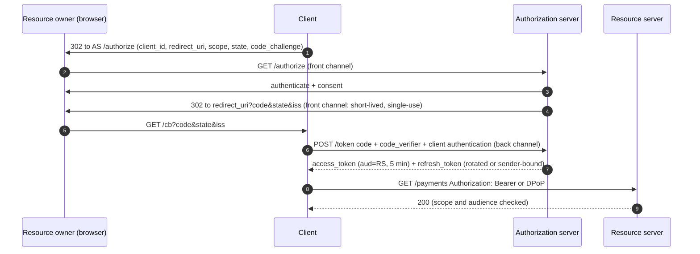

# OAuth 2.0 Roles, the Threat Model, and What OAuth 2.1 and RFC 9700 Changed

> Folder 02 · File 01 of 04 · Identity, AuthN/AuthZ, OAuth 2.1/OIDC/FAPI 2.0 L7 Reference
> Next: [02 · Authorization code + PKCE](02-authorization-code-flow-with-pkce-s256-and-authorization-code-injection-defense.md) · [03 · Refresh tokens](03-refresh-token-rotation-reuse-detection-grace-periods-and-revocation-rfc7009.md) · [04 · Client credentials, device code, CIBA](04-client-credentials-device-code-rfc8628-and-ciba-decoupled-authentication.md)

| Listing | What it proves | Oracle |
|---|---|---|
| L15 `RedirectUriLab.java` | Three redirect-URI matchers seen in production (prefix, host regex, parsed host-suffix) vs RFC 9700's exact string match with the loopback-port exception, over a 15-case bypass corpus. Also a client-registration auditor encoding the OAuth 2.1 / RFC 9700 deltas, run on five registrations | RFC 9700 §2.1, §2.1.1, §2.2.2; OAuth 2.1 draft-17 §7.5; RFC 8252 §7.3 (texts in `fixtures/`) |

**Verification.** Compiled with all Folder 01 and Folder 02 listings by `javac --release 21 -Xlint:all -Werror` on Temurin JDK 25.0.4.1. Spring Security 7.1.2 (including `spring-security-oauth2-authorization-server` and `-oauth2-client`) and Spring Boot 4.1.2 auto-configuration jars were SHA-1-checked against Maven Central on 2026-11-06. The gate re-runs every `output` block and requires byte-identical output. Normative quotes are copied from RFC 6749, RFC 9700, RFC 8252 and `draft-ietf-oauth-v2-1-17` (2026-10-31), all kept in [`fixtures/`](fixtures/). Spring defaults marked [D] were read from the 7.1.2 `-sources.jar` and, for Boot, from the constructor bytecode with `javap`.

Labels: **[D]** documented in a spec or shipped source · **[M]** measured by a listing · **[E]** engineering judgment · **⚠** trap.

---

## 0. Orientation

OAuth answers a narrower question than most teams think: *may this client call that API on behalf of this resource owner, within these limits?* It is a **delegated authorization** protocol. It says nothing about who the user is (OpenID Connect adds that, Folder 03) and nothing about whether the user may do a specific thing inside the API (that is authorization policy, Folder 05). Most OAuth incidents come from treating it as more than it is, or from the eleven years of optional features in RFC 6749 that turned out to be footguns.

OAuth 2.1 (`draft-ietf-oauth-v2-1-17`, still an Internet-Draft on 2026-11-06) and RFC 9700 (*Best Current Practice for OAuth 2.0 Security*, January 2025) are the industry's correction. This file explains what they removed, why, and how to enforce it. L15 makes both enforceable: as a matcher you can drop into an authorization server, and as an auditor you can run over a client registry.

Results:
- **[D]** OAuth 2.1 draft-17 §7.5.1.1: "using code_challenge and code_verifier is REQUIRED for clients, and authorization servers MUST enforce their use". The only exception is a confidential client where the AS has reasonable assurance that the client implements the OIDC nonce correctly. RFC 9700 is softer: PKCE is **MUST** for public clients and **RECOMMENDED** for confidential clients.
- **[D]** RFC 9700 §2.1: "authorization servers MUST utilize exact string matching except for port numbers in localhost redirection URIs of native apps."
- **[M]** Over 15 candidates, the prefix matcher makes 4 wrong decisions, the host-regex matcher 10 and the parsed host-suffix matcher 8. Exact match with the loopback-port exception makes 0 (L15).
- **[D]** OAuth 2.1 draft-17's change list omits implicit, ROPC and bearer tokens in query strings, and prohibits PKCE `plain`. Public-client refresh tokens must be sender-constrained or one-time-use. **The token request no longer carries `redirect_uri`.**
- **[D]** Spring Authorization Server 7.1.2 defaults: `ClientSettings.builder()` sets `requireProofKey(true)` for **every** client, and the validator accepts only `S256`. `TokenSettings` defaults are `reuseRefreshTokens(true)` (no rotation), refresh TTL 60 min, access TTL 5 min, auth code 5 min, ID token RS256. Spring Boot 4.1.2's authorization-server properties mirror these (`require-proof-key=true`, `reuse-refresh-tokens=true`).
- **[D] ⚠** Spring Security's OAuth2 *client* 7.1.2 sends PKCE only for public clients, or when the `ClientRegistration`'s `ClientSettings.requireProofKey` is true. That setting defaults to false, and Boot 4.1.2's `OAuth2ClientPropertiesMapper` never sets `ClientSettings`. So a default Boot **confidential** client sends no `code_challenge` to a default Spring Authorization Server, which requires one.

---

## 1. First principles: four roles, two channels, one delegation

### 1.1 The roles, precisely

```text
  resource owner (alice)                                   resource server (payments API)
        |  consents to "app may read my payments"                 ^  accepts access tokens:
        v                                                         |  aud = this API, scope, exp
  user agent (browser) ----front channel (redirects)----+         |
        |                                              |         | bearer or sender-constrained
        v                                              v         | access token
  client (web app / mobile / CLI / service) ---back channel (TLS POST)--> authorization server
        holds: client_id, maybe a credential                       issues: codes, access tokens,
        never holds: alice's password                              refresh tokens (+ ID tokens with OIDC)

  front channel = URLs in the browser: visible to the user, history, Referer, extensions, proxies, logs
  back channel  = direct client->AS HTTPS: authenticated (for confidential clients), not visible to the browser
```

- **Resource owner**: whoever can grant access. Usually the end user, sometimes an organization admin.
- **Client**: the application acting on the resource owner's behalf.
  - A *confidential* client can keep a credential: a server-side app, or a workload with a key.
  - A *public* client cannot: a SPA, a mobile or desktop app, a CLI. Anything you ship to a device is public, whatever secret you embed in it.
- **Authorization server (AS)**: authenticates the resource owner, records consent, issues tokens.
- **Resource server (RS)**: the API. It validates tokens and enforces scope and audience.

### 1.2 Why the front channel is the attack surface

Everything that travels through the browser's address bar can leak: browser history, the `Referer` header, server and proxy logs, browser extensions, open redirectors, and on mobile a malicious app that registered the same custom URL scheme. OAuth 2.0's original sins all moved secrets through the front channel. The implicit grant put the access token itself in the URL fragment. Query-string bearer tokens put it in logs. Loose redirect matching let the AS deliver codes to attacker-controlled paths. The modern protocol keeps **only short-lived, single-use, sender-bound artefacts** in the front channel (a code bound by PKCE) and moves everything valuable to the back channel.



### 1.3 Tokens and their jobs

| Artefact | Lives | Audience | Lifetime | If stolen |
|---|---|---|---|---|
| authorization code | front channel, once | the client (redeemed at the AS) | ≤ 60 s recommended (SAS default 5 min) | useless without the PKCE verifier and client authentication |
| access token | client → RS on every call | one RS (`aud`, RFC 8707) | minutes | full API access until `exp`, unless sender-constrained (Folder 04) |
| refresh token | client ↔ AS only | the AS | hours to months | new access tokens until revoked; rotation or binding detects or blocks (file 03) |
| ID token (OIDC) | client only | the client (`aud=client_id`) | minutes | **not** an API credential; never send it to an RS (Folder 01 file 03) |

---

## 2. What OAuth 2.0 got wrong, and what RFC 9700 and OAuth 2.1 changed

### 2.1 The removed and hardened features

| OAuth 2.0 (RFC 6749, 2012) | Failure in practice | RFC 9700 (2025) | OAuth 2.1 (draft-17, 2026) |
|---|---|---|---|
| Implicit grant (`response_type=token`) | access token in the URL fragment: history, Referer, extensions, injection; no client authentication; no refresh | clients **SHOULD NOT** use it (§2.1.2) | **removed** |
| Resource owner password credentials (ROPC) | the client sees the password, which trains users to type passwords into apps and blocks MFA and federation | **MUST NOT** be used (§2.4) | **removed** |
| Redirect URI matching left to the AS | prefix and wildcard matching delivered codes to attacker paths and subdomains | exact string match except loopback ports (§2.1) | exact match (§4.1.3 of RFC 9700 cited) |
| PKCE optional (RFC 7636, 2015) | code interception on mobile; code injection on the web | public **MUST**, confidential **RECOMMENDED** (§2.1.1) | **REQUIRED** for all clients, OIDC-nonce exception (§7.5.1.1) |
| PKCE `plain` | challenge = verifier, visible wherever the authorization URL is logged | S256 preferred | `plain` **prohibited** (§7.5.2) |
| Bearer token in the URI query | tokens in access logs and Referer | **MUST NOT** (§4.3.2 cited) | omitted |
| Refresh tokens unconstrained | stolen refresh tokens give silent, long-lived access | public clients: sender-constrained **or** rotation with reuse detection (§2.2.2, §4.14.2) | must be sender-constrained or one-time-use |
| `redirect_uri` echoed in the token request | redundant with PKCE plus exact matching | — | **no longer sent** in the code-redemption request |

The OAuth 2.1 change list, verbatim from draft-17 [D]:

```text
   *  Redirect URIs must be compared using exact string matching as per
      Section 4.1.3 of [RFC9700]
   *  The Implicit grant (response_type=token) is omitted from this
      specification as per Section 2.1.2 of [RFC9700]
   *  The Resource Owner Password Credentials grant is omitted from this
      specification as per Section 2.4 of [RFC9700]
   *  Refresh tokens for public clients must either be sender-
      constrained or one-time-use as per Section 4.14.2 of [RFC9700]
   *  The token endpoint request containing an authorization code no
      longer contains the redirect_uri parameter
   *  The PKCE plain method is removed
```

### 2.2 Why PKCE for confidential clients too

The brief's framing, "PKCE is mandatory for all clients, even confidential server-side clients", is OAuth 2.1's position, and the reason is not code *interception*. A confidential client authenticates at the token endpoint, so an interceptor cannot redeem the code alone. The reason is code **injection**. An attacker who obtains a victim's code (from a log, a Referer or an open redirector) does not redeem it themselves. They paste it into **their own** session with the honest client, and the honest confidential client redeems it with its own valid credentials. Client authentication proves *which client* is redeeming, not *which browser session started the flow*. PKCE binds the code to the session that created the challenge, so the injected code fails at the token endpoint (Folder 02 file 02, L16 attack 2). RFC 9700 §2.1.1 also notes that PKCE "prevents CSRF even in the presence of strong attackers" [D].

The OIDC-nonce exception exists because a correctly implemented nonce also binds the code exchange to the session: the ID token's `nonce` must match the session's. It is fragile, though. It requires the client to validate the ID token *before* trusting the code exchange, and it does nothing for non-OIDC flows. That is why both documents still RECOMMEND PKCE in that case [E].

### 2.3 What OAuth 2.1 does not fix

- **Bearer tokens are still bearer tokens.** Sender-constraining with DPoP or mTLS is a separate specification (Folder 04).
- **Front-channel request parameters can still be tampered with or leaked.** PAR (RFC 9126) and JAR move them to the back channel or sign them (Folder 04).
- **Mix-up attacks between multiple ASes** are addressed by RFC 9207's `iss` response parameter, which OAuth 2.1 references but which only works if the client checks it (file 02, L16 attack 7).
- **Consent phishing.** A perfectly compliant flow can still request `Mail.Read` for a malicious app with a convincing name (A6 below).

---

## 3. Redirect URIs: exact matching, and why normalization is the enemy

The AS delivers the authorization code to the redirect URI. Whoever controls any URL the AS will accept receives the code. Exact string matching is the only rule simple enough to be secure. Every "smart" rule introduces a parser that disagrees with some other parser [E]:

- `https://app.example.com@evil.example/cb` has host `evil.example`; regex and prefix authors usually forget userinfo.
- `/cb/../../attacker` and `/cb%2F..%2Fattacker` pass a prefix check, and the *client's* web server may resolve the dots before routing.
- `HTTPS://APP.EXAMPLE.COM/cb` and `https://app.example.com:443/cb` are "the same URL" to one normalizer and different to another. Normalize on one side but not the other, and the difference becomes an attack.
- `*.example.com` includes every subdomain a marketing team ever pointed at a SaaS vendor (A2).

The **one** exception, in RFC 8252 §7.3 and RFC 9700 §2.1, is native apps using a loopback redirect. An app listening on `http://127.0.0.1:{ephemeral}/` cannot know its port in advance, so the AS ignores the port for loopback IP literals only. RFC 8252 §8.3 recommends the IP literal over `localhost`, which can be re-pointed by hosts-file or DNS tricks [D].

<!-- listing:RedirectUriLab.java -->
```java
import java.net.URI;
import java.util.ArrayList;
import java.util.List;
import java.util.Locale;
import java.util.Set;
import java.util.regex.Pattern;

/**
 * L15 - what OAuth 2.1 / RFC 9700 changed, as executable policy.
 *
 * <ol>
 *   <li>Redirect URI matching: three L5 matchers seen in production (prefix, host regex, parsed host-suffix) vs the
 *       L7 rule of RFC 9700 section 2.1 - exact string match, except the port of a loopback redirect URI for native
 *       apps (RFC 8252 section 7.3) - against a corpus of bypass candidates.</li>
 *   <li>A client-registration auditor that encodes the OAuth 2.1 deltas (no implicit, no ROPC, PKCE S256 for every
 *       client, no plain, exact redirects, no bearer in the query, refresh tokens for public clients sender-constrained
 *       or rotated, asymmetric client authentication preferred) and runs it over four registrations.</li>
 * </ol>
 */
public final class RedirectUriLab {

    interface Matcher {
        boolean allows(String registered, String candidate);
    }

    static final Matcher L5_PREFIX = (reg, cand) -> cand.startsWith(reg);

    static final Matcher L5_HOST_REGEX = (reg, cand) -> {
        URI r = URI.create(reg);
        Pattern p = Pattern.compile("https://.*" + Pattern.quote(r.getHost()) + ".*"); // "allow our subdomains"
        return p.matcher(cand).matches();
    };

    static final Matcher L5_PARSED_SUFFIX = (reg, cand) -> {
        try {
            URI r = URI.create(reg);
            URI c = URI.create(cand);
            String host = c.getHost() == null ? "" : c.getHost().toLowerCase(Locale.ROOT);
            return "https".equalsIgnoreCase(c.getScheme()) && host.endsWith(r.getHost()) && c.getPath() != null
                    && c.getPath().startsWith(r.getPath());
        } catch (IllegalArgumentException e) {
            return false;
        }
    };

    /** RFC 9700 2.1 + RFC 8252 7.3: byte-for-byte equality; only a loopback IP literal may vary its port. */
    static final Matcher L7_EXACT = (reg, cand) -> {
        if (reg.equals(cand)) {
            return true;
        }
        try {
            URI r = URI.create(reg);
            URI c = URI.create(cand);
            boolean loopback = "http".equals(r.getScheme()) && Set.of("127.0.0.1", "[::1]").contains(r.getHost());
            return loopback && r.getPort() == -1 && c.getPort() > 0 && "http".equals(c.getScheme()) && r.getHost().equals(c.getHost())
                    && r.getRawPath().equals(c.getRawPath()) && c.getRawQuery() == null && c.getRawFragment() == null
                    && c.getRawUserInfo() == null;
        } catch (IllegalArgumentException e) {
            return false;
        }
    };

    record Candidate(String uri, boolean legitimate, String why) {
    }

    // ---------------------------------------------------------------- registration audit

    enum ClientType { CONFIDENTIAL, PUBLIC }

    record ClientReg(String id, ClientType type, Set<String> grants, List<String> redirects, String authMethod,
                     boolean pkceRequired, Set<String> pkceMethods, String refreshPolicy, int accessTokenTtlSeconds,
                     boolean bearerInQueryAllowed) {
    }

    static List<String> audit(ClientReg c) {
        List<String> v = new ArrayList<>();
        if (c.grants().contains("implicit")) {
            v.add("implicit grant (response_type=token) - removed in OAuth 2.1, RFC 9700 2.1.2");
        }
        if (c.grants().contains("password")) {
            v.add("resource owner password credentials grant - removed in OAuth 2.1, RFC 9700 2.4");
        }
        if (c.grants().contains("authorization_code") && !c.pkceRequired()) {
            v.add("PKCE not enforced - OAuth 2.1 7.5.1.1 requires it for every client (OIDC-nonce exception only)");
        }
        if (c.pkceMethods().contains("plain")) {
            v.add("PKCE 'plain' allowed - prohibited in OAuth 2.1 7.5.2");
        }
        for (String r : c.redirects()) {
            if (r.contains("*")) {
                v.add("wildcard redirect URI " + r + " - exact string matching, RFC 9700 2.1");
            } else if (r.startsWith("http://") && !r.startsWith("http://127.0.0.1") && !r.startsWith("http://[::1]")) {
                v.add("non-TLS redirect URI " + r + " (only loopback IP literals may use http, RFC 8252 7.3)");
            } else if (r.startsWith("http://localhost")) {
                v.add("'localhost' redirect - RFC 8252 8.3 recommends the IP literal (localhost can be re-pointed)");
            }
            if (r.contains("#")) {
                v.add("redirect URI with a fragment " + r + " - forbidden (RFC 6749 3.1.2)");
            }
        }
        if (c.type() == ClientType.PUBLIC && c.grants().contains("refresh_token")
                && !Set.of("rotation", "dpop-bound", "mtls-bound").contains(c.refreshPolicy())) {
            v.add("public-client refresh token neither rotated nor sender-constrained - RFC 9700 2.2.2");
        }
        if (c.type() == ClientType.PUBLIC && !"none".equals(c.authMethod())) {
            v.add("public client registered with a shared secret it cannot keep (" + c.authMethod() + ")");
        }
        if (c.type() == ClientType.CONFIDENTIAL && Set.of("client_secret_post", "client_secret_basic").contains(c.authMethod())) {
            v.add("shared-secret client authentication (" + c.authMethod() + ") - prefer private_key_jwt or tls_client_auth (RFC 9700 2.5)");
        }
        if (c.accessTokenTtlSeconds() > 3_600) {
            v.add("access token lifetime " + c.accessTokenTtlSeconds() + " s - bearer exposure equals lifetime (keep <= 10 min)");
        }
        if (c.bearerInQueryAllowed()) {
            v.add("access_token in the URI query - omitted from OAuth 2.1 (RFC 9700 4.3.2)");
        }
        return v;
    }

    public static void main(String[] args) {
        String reg = "https://app.example.com/cb";
        String loop = "http://127.0.0.1/oauth2/cb";
        List<Candidate> corpus = List.of(
            new Candidate(reg, true, "the registered value itself"),
            new Candidate("https://app.example.com/cb/../../attacker", false, "path traversal after the prefix"),
            new Candidate("https://app.example.com/cb?next=https://evil.example", false, "open-redirect parameter"),
            new Candidate("https://app.example.com/callback-evil", false, "longer path sharing the prefix"),
            new Candidate("https://app.example.com.evil.example/cb", false, "registrable domain is evil.example"),
            new Candidate("https://evilapp.example.com/cb", false, "sibling host ending with the name"),
            new Candidate("https://app.example.com@evil.example/cb", false, "userinfo trick: host is evil.example"),
            new Candidate("https://user-content.app.example.com/cb", false, "attacker-uploadable subdomain"),
            new Candidate("HTTPS://APP.EXAMPLE.COM/cb", false, "case variant (normalizers disagree)"),
            new Candidate("https://app.example.com:443/cb", false, "explicit default port (normalizers disagree)"),
            new Candidate("https://app.example.com/cb%2F..%2Fattacker", false, "encoded traversal"));
        List<Candidate> loopCorpus = List.of(
            new Candidate("http://127.0.0.1:51734/oauth2/cb", true, "native app, ephemeral port (RFC 8252 7.3)"),
            new Candidate("http://127.0.0.1:51734/oauth2/cb?x=1", false, "loopback with extra query"),
            new Candidate("http://localhost:51734/oauth2/cb", false, "localhost name instead of IP literal"),
            new Candidate("http://127.0.0.1.evil.example:80/oauth2/cb", false, "loopback-looking hostname"));
        Matcher[] ms = {L5_PREFIX, L5_HOST_REGEX, L5_PARSED_SUFFIX, L7_EXACT};
        String[] names = {"L5 prefix", "L5 regex", "L5 suffix", "L7 exact"};

        KbSupport.section("Redirect URI matching against registered " + reg + " (and loopback " + loop + ")");
        KbSupport.info("%-46s %-9s %-9s %-9s %-9s %s", "candidate", names[0], names[1], names[2], names[3], "note");
        int[] wrong = new int[4];
        List<Candidate> all = new ArrayList<>(corpus);
        all.addAll(loopCorpus);
        for (Candidate c : all) {
            String r = loopCorpus.contains(c) ? loop : reg;
            StringBuilder row = new StringBuilder();
            for (int k = 0; k < ms.length; k++) {
                boolean ok;
                try {
                    ok = ms[k].allows(r, c.uri());
                } catch (IllegalArgumentException e) {
                    ok = false;
                }
                if (ok != c.legitimate()) {
                    wrong[k]++;
                }
                row.append(String.format(Locale.ROOT, "%-9s ", ok ? "allow" : "deny"));
            }
            KbSupport.info("%-46s %s%s%s", c.uri().length() > 46 ? c.uri().substring(0, 43) + "..." : c.uri(), row,
                    c.legitimate() ? "LEGIT: " : "", c.why());
        }
        KbSupport.info("wrong decisions: L5 prefix %d, L5 regex %d, L5 suffix %d, L7 exact %d (of %d)", wrong[0], wrong[1], wrong[2],
                wrong[3], all.size());
        KbSupport.check("every L5 matcher makes at least 3 wrong decisions", wrong[0] >= 3 && wrong[1] >= 3 && wrong[2] >= 3);
        KbSupport.check("L7 exact match (with the loopback-port exception) makes none", wrong[3] == 0);

        KbSupport.section("Registration audit against OAuth 2.1 (draft-17) and RFC 9700");
        List<ClientReg> regs = List.of(
            new ClientReg("legacy-spa", ClientType.PUBLIC, Set.of("implicit"), List.of("https://spa.example.com/*"), "none",
                    false, Set.of(), "none", 86_400, true),
            new ClientReg("mobile-v1", ClientType.PUBLIC, Set.of("password", "refresh_token"), List.of("com.example.app:/cb"),
                    "client_secret_post", false, Set.of("plain", "S256"), "static", 3_600, false),
            new ClientReg("web-portal", ClientType.CONFIDENTIAL, Set.of("authorization_code", "refresh_token"),
                    List.of("http://portal.example.com/login/oauth2/code/idp", "http://localhost:8080/cb"), "client_secret_post", false,
                    Set.of("S256"), "static", 7_200, false),
            new ClientReg("web-portal-l7", ClientType.CONFIDENTIAL, Set.of("authorization_code", "refresh_token"),
                    List.of("https://portal.example.com/login/oauth2/code/idp"), "private_key_jwt", true, Set.of("S256"), "rotation",
                    300, false),
            new ClientReg("cli-l7", ClientType.PUBLIC, Set.of("authorization_code", "refresh_token"), List.of(loop), "none", true,
                    Set.of("S256"), "dpop-bound", 300, false));
        int clean = 0;
        for (ClientReg c : regs) {
            List<String> v = audit(c);
            KbSupport.info("%-14s %-12s %d finding(s)", c.id(), c.type(), v.size());
            for (String s : v) {
                KbSupport.info("    - %s", s);
            }
            clean += v.isEmpty() ? 1 : 0;
        }
        KbSupport.check("the three legacy registrations fail; the two L7 registrations are clean", clean == 2
                && audit(regs.get(3)).isEmpty() && audit(regs.get(4)).isEmpty());
        KbSupport.verdict();
    }
}
```

<!-- output:RedirectUriLab.java -->
```text

== Redirect URI matching against registered https://app.example.com/cb (and loopback http://127.0.0.1/oauth2/cb)
  candidate                                      L5 prefix L5 regex  L5 suffix L7 exact  note
  https://app.example.com/cb                     allow     allow     allow     allow     LEGIT: the registered value itself
  https://app.example.com/cb/../../attacker      allow     allow     allow     deny      path traversal after the prefix
  https://app.example.com/cb?next=https://evi... allow     allow     allow     deny      open-redirect parameter
  https://app.example.com/callback-evil          deny      allow     deny      deny      longer path sharing the prefix
  https://app.example.com.evil.example/cb        deny      allow     deny      deny      registrable domain is evil.example
  https://evilapp.example.com/cb                 deny      allow     allow     deny      sibling host ending with the name
  https://app.example.com@evil.example/cb        deny      allow     deny      deny      userinfo trick: host is evil.example
  https://user-content.app.example.com/cb        deny      allow     allow     deny      attacker-uploadable subdomain
  HTTPS://APP.EXAMPLE.COM/cb                     deny      deny      allow     deny      case variant (normalizers disagree)
  https://app.example.com:443/cb                 deny      allow     allow     deny      explicit default port (normalizers disagree)
  https://app.example.com/cb%2F..%2Fattacker     allow     allow     allow     deny      encoded traversal
  http://127.0.0.1:51734/oauth2/cb               deny      deny      deny      allow     LEGIT: native app, ephemeral port (RFC 8252 7.3)
  http://127.0.0.1:51734/oauth2/cb?x=1           deny      deny      deny      deny      loopback with extra query
  http://localhost:51734/oauth2/cb               deny      deny      deny      deny      localhost name instead of IP literal
  http://127.0.0.1.evil.example:80/oauth2/cb     deny      deny      deny      deny      loopback-looking hostname
  wrong decisions: L5 prefix 4, L5 regex 10, L5 suffix 8, L7 exact 0 (of 15)
  [PASS] every L5 matcher makes at least 3 wrong decisions
  [PASS] L7 exact match (with the loopback-port exception) makes none

== Registration audit against OAuth 2.1 (draft-17) and RFC 9700
  legacy-spa     PUBLIC       4 finding(s)
      - implicit grant (response_type=token) - removed in OAuth 2.1, RFC 9700 2.1.2
      - wildcard redirect URI https://spa.example.com/* - exact string matching, RFC 9700 2.1
      - access token lifetime 86400 s - bearer exposure equals lifetime (keep <= 10 min)
      - access_token in the URI query - omitted from OAuth 2.1 (RFC 9700 4.3.2)
  mobile-v1      PUBLIC       4 finding(s)
      - resource owner password credentials grant - removed in OAuth 2.1, RFC 9700 2.4
      - PKCE 'plain' allowed - prohibited in OAuth 2.1 7.5.2
      - public-client refresh token neither rotated nor sender-constrained - RFC 9700 2.2.2
      - public client registered with a shared secret it cannot keep (client_secret_post)
  web-portal     CONFIDENTIAL 5 finding(s)
      - PKCE not enforced - OAuth 2.1 7.5.1.1 requires it for every client (OIDC-nonce exception only)
      - non-TLS redirect URI http://portal.example.com/login/oauth2/code/idp (only loopback IP literals may use http, RFC 8252 7.3)
      - non-TLS redirect URI http://localhost:8080/cb (only loopback IP literals may use http, RFC 8252 7.3)
      - shared-secret client authentication (client_secret_post) - prefer private_key_jwt or tls_client_auth (RFC 9700 2.5)
      - access token lifetime 7200 s - bearer exposure equals lifetime (keep <= 10 min)
  web-portal-l7  CONFIDENTIAL 0 finding(s)
  cli-l7         PUBLIC       0 finding(s)
  [PASS] the three legacy registrations fail; the two L7 registrations are clean

verdict: OK (3 checks)
```

How to read the table: every `allow` on a non-legitimate row is a code-theft primitive, and every `deny` on a legitimate row is an outage. The regex matcher is the worst at 10 of 15 wrong, because it allows anything containing the registered host. The parsed host-suffix matcher, which looks careful because it uses `java.net.URI`, still accepts `evilapp.example.com`, user-content subdomains, case and port variants, and path traversal, 8 wrong in all [M].

---

## 4. Clients, credentials, metadata and audiences

### 4.1 Client authentication methods, ranked

| Method | What proves the client | Weakness | Use |
|---|---|---|---|
| `none` (public) | nothing: PKCE binds the flow instead | anyone can claim the `client_id` | SPAs (prefer a BFF, Folder 04), native apps, CLIs |
| `client_secret_basic` / `_post` | a shared secret sent on every token call | secrets leak through logs, repositories and config sprawl; the AS stores a verifiable copy | legacy confidential clients only |
| `client_secret_jwt` | an HMAC JWT keyed by the shared secret | still a shared secret (the AS can mint as the client) | avoid |
| `private_key_jwt` (RFC 7523) | an ES256/PS256 assertion signed with the client's private key; the AS holds the public key | audience injection if `aud` is not the issuer (CVE-2025-27370/27371, file 04) | **default for confidential clients** |
| `tls_client_auth` / `self_signed_tls_client_auth` (RFC 8705) | mutual-TLS certificate | PKI operations; TLS-terminating proxies must forward the certificate safely | FAPI, B2B, service mesh |

RFC 9700 §2.5 recommends asymmetric client authentication (mTLS or `private_key_jwt`) so the AS never stores client secrets [D]. L15's auditor flags shared-secret methods on confidential clients.

### 4.2 Metadata, issuers and the `iss` response parameter

RFC 8414 metadata (`/.well-known/oauth-authorization-server`, or the OIDC discovery document) tells a client where the endpoints are. Only the `issuer` value can be *validated*, because it must equal the URL the metadata was fetched for. Endpoint URLs cannot be validated. Two consequences:
- A client talking to several ASes must remember **which issuer** it sent the user to, and check RFC 9207's `iss` in the authorization response against it. That is the mix-up defence.
- It must use the **issuer** as the `aud` of its client assertions, never an endpoint value. That is the 2025 audience-injection fix, covered in file 04.

### 4.3 Audience restriction and resource indicators

A token valid at every API is a skeleton key. RFC 8707 lets the client name the target resource (`resource=https://payments.example.com`), and the AS puts it in `aud`. RFC 9700 §2.3 requires access tokens to be restricted to particular resource servers and actions [D]. The RS must check `aud` exactly (Folder 01 file 03, L10 attack 8).

---

## 5. The Spring defaults you inherit

[D: spring-security 7.1.2 sources; Boot 4.1.2 bytecode]

| Setting | Spring Authorization Server (`ClientSettings` / `TokenSettings` builders) | Boot 4.1.2 `spring.security.oauth2.authorizationserver.client.*` | Spring OAuth2 Client (`ClientRegistration`) |
|---|---|---|---|
| PKCE | `requireProofKey(true)` for every client; only `S256` accepted | `require-proof-key: true` | sent for `none` clients, or when `ClientSettings.requireProofKey(true)`, which defaults to **false** |
| Refresh rotation | `reuseRefreshTokens(true)`, i.e. **off** | `reuse-refresh-tokens: true` | — |
| Refresh TTL | 60 min | 60 min | — |
| Access token TTL and format | 5 min, self-contained (JWT) | 5 min, `self-contained` | — |
| Authorization code TTL | 5 min | 5 min | — |
| ID token alg | RS256 | RS256 | — |
| Refresh tokens to public clients | not issued on the code grant (`OAuth2RefreshTokenGenerator`) | — | — |

⚠ **The PKCE interop trap.** A Boot app with `spring.security.oauth2.client.registration.idp.client-authentication-method=client_secret_basic` sends no `code_challenge`, because `OAuth2ClientPropertiesMapper` maps no `ClientSettings`. A Spring Authorization Server registered with defaults rejects the request (`invalid_request`, `code_challenge`). Teams "fix" this by turning `requireProofKey` off on the server, the wrong side. Fix it on the client by registering the `ClientRegistration` in Java with `ClientSettings.builder().requireProofKey(true).build()` (file 02 shows the bean) [E].

---

## 6. The vulnerable L5 implementation vs the hardened L7 zero-trust implementation

### 6.1 L5: a client registry that grew organically

```json
[
  {"client_id": "legacy-spa", "grant_types": ["implicit"], "response_types": ["token"],
   "redirect_uris": ["https://spa.example.com/*"], "token_endpoint_auth_method": "none", "access_token_ttl": 86400},
  {"client_id": "mobile-v1", "grant_types": ["password", "refresh_token"], "client_secret": "s3cr3t-in-the-apk",
   "token_endpoint_auth_method": "client_secret_post", "code_challenge_methods": ["plain", "S256"]},
  {"client_id": "web-portal", "grant_types": ["authorization_code", "refresh_token"],
   "redirect_uris": ["http://portal.example.com/login/oauth2/code/idp"], "token_endpoint_auth_method": "client_secret_post",
   "require_pkce": false, "access_token_ttl": 7200}
]
```

### 6.2 L7: the same estate, registered for OAuth 2.1

RFC 7591 dynamic-registration metadata for the L7 portal and CLI:

```json
[
  {"client_id": "web-portal", "client_name": "Example Portal",
   "grant_types": ["authorization_code", "refresh_token"], "response_types": ["code"],
   "redirect_uris": ["https://portal.example.com/login/oauth2/code/idp"],
   "token_endpoint_auth_method": "private_key_jwt", "token_endpoint_auth_signing_alg": "ES256",
   "jwks_uri": "https://portal.example.com/.well-known/client-jwks.json",
   "require_pushed_authorization_requests": true},
  {"client_id": "cli", "client_name": "Example CLI", "application_type": "native",
   "grant_types": ["authorization_code", "refresh_token", "urn:ietf:params:oauth:grant-type:device_code"],
   "redirect_uris": ["http://127.0.0.1/oauth2/cb"], "token_endpoint_auth_method": "none",
   "dpop_bound_access_tokens": true}
]
```

And on Spring Authorization Server 7.1.2. This uses the same APIs L18 in file 03 runs; `private_key_jwt` keys come from the client's JWKS URI:

```java
RegisteredClient portal = RegisteredClient.withId("web-portal")
    .clientId("web-portal")
    .clientAuthenticationMethod(ClientAuthenticationMethod.PRIVATE_KEY_JWT)
    .authorizationGrantType(AuthorizationGrantType.AUTHORIZATION_CODE)
    .authorizationGrantType(AuthorizationGrantType.REFRESH_TOKEN)
    .redirectUri("https://portal.example.com/login/oauth2/code/idp")           // exact string, https only
    .scope("payments:read")
    .clientSettings(ClientSettings.builder()
        .requireProofKey(true)                                                   // the default - keep it
        .jwkSetUrl("https://portal.example.com/.well-known/client-jwks.json")
        .tokenEndpointAuthenticationSigningAlgorithm(SignatureAlgorithm.ES256)
        .build())
    .tokenSettings(TokenSettings.builder()
        .accessTokenTimeToLive(Duration.ofMinutes(5))
        .reuseRefreshTokens(false)                                               // rotate (and see file 03 for reuse detection)
        .refreshTokenTimeToLive(Duration.ofHours(8))
        .build())
    .build();
```

| Concern | L5 | L7 |
|---|---|---|
| Grants | implicit, ROPC | authorization code + PKCE S256; device code for input-constrained devices; client credentials for workloads |
| Redirects | wildcard, http, prefix match | exact https strings; loopback IP literal with any port for native apps |
| Client auth | secrets in mobile apps, `client_secret_post` | `none` + PKCE for public clients; `private_key_jwt` with aud = issuer, or mTLS, for confidential clients |
| Tokens | 24 h access tokens, query-string bearer | 5-min audience-restricted access tokens; header-only; sender-constrained where possible |
| Refresh | static, long-lived | rotated with reuse detection, or DPoP/mTLS-bound; idle and absolute limits |
| Multi-AS | trust the response | RFC 9207 `iss` check; distinct redirect URI per AS |

---

## 7. Real-world attack vectors & mitigations

### A1 · Implicit-grant token leakage and injection

**Attack.** With `response_type=token`, the access token arrives in the URL fragment. It leaks through browser history, through any script on the page (XSS, third-party analytics), through extensions, and through open redirectors that preserve fragments. An attacker can also *inject* their own token into a victim's client (token substitution), because nothing binds the token to the client instance.
**Wire signature.** `#access_token=` in redirects; long-lived tokens without refresh; no token-endpoint calls in the client's traffic.
**Root cause.** A credential delivered through the front channel with no binding.
**Mitigation.** Remove implicit (OAuth 2.1). Browser apps use the code flow with PKCE, ideally behind a BFF so tokens never reach JavaScript (RFC 10017, Folder 04). L15 flags `implicit` registrations.
**Detection.** AS logs by `response_type`, alerting on any `token`. A CSP `report-uri` for unexpected token-bearing navigations.

### A2 · Redirect URI manipulation (prefix, wildcard, subdomain)

**Attack.** The attacker crafts an authorization URL whose `redirect_uri` passes the AS's loose check but routes the code to them. Examples: `/cb/../../attacker` (a path they control on the same host), a user-content subdomain under a wildcard, or a userinfo or suffix trick. The victim logs in at the real AS, and the code goes to the attacker.
**Wire signature.** Authorization requests whose `redirect_uri` differs from the registered string; codes redeemed shortly after from unexpected networks (public clients).
**Root cause.** Pattern or prefix matching at the AS (L15: 4 to 10 wrong decisions per L5 matcher).
**Mitigation.** Exact string matching. Loopback-port exception only for IP literals. Reject registrations with wildcards, fragments or http. PKCE as a second line, because the attacker lacks the verifier.
**Detection.** Log the raw `redirect_uri` of every authorization request and alert on any mismatch with the registration.

### A3 · Open redirectors on the client or AS

**Attack.** Even with exact matching, the registered callback, or any page on the client or AS, accepts a `?next=`/`?returnTo=` that bounces the browser onward, carrying the code in the URL or `Referer`. RFC 9700 §4.11 covers open redirectors at both ends.
**Wire signature.** A 302 from the callback to an external host with the code still in the query string; `Referer` headers containing `code=` at third-party hosts.
**Root cause.** Unvalidated redirect parameters near the OAuth endpoints.
**Mitigation.** No open redirectors (RFC 9700 §2.1: "MUST NOT expose URLs that forward the user's browser to arbitrary URIs"). The callback consumes the code and redirects only to a server-side-stored, same-origin path. `Referrer-Policy: no-referrer` on callback responses.
**Detection.** Scan for redirect parameters; flag outbound redirects from the callback.

### A4 · Resource owner password credentials (ROPC)

**Attack.** ROPC normalizes typing the AS password into a third-party client. Users can no longer tell a real login page from a phishing form, the client sees and can log the password, and phishing-resistant factors cannot work because the protocol has nowhere to put a WebAuthn ceremony.
**Wire signature.** `grant_type=password` at the token endpoint, frequently from mobile apps holding an embedded "secret".
**Root cause.** A legacy migration shortcut that became permanent.
**Mitigation.** Remove ROPC (OAuth 2.1). Native apps use the system browser with the code flow and PKCE (RFC 8252). Machine identities use client credentials. Legacy devices use the device grant.
**Detection.** Any `grant_type=password` is an incident ticket.

### A5 · Mix-up between authorization servers

**Attack.** A client that supports several ASes, one of them malicious or compromised, is tricked into sending a code issued by the honest AS to the attacker's token endpoint. The user picks the attacker AS, which bounces them to the honest AS, and the client redeems the code where its session says it should. The attacker then redeems the leaked code, plus the PKCE verifier the client sent along, at the honest AS (file 02, L16 attack 7).
**Wire signature.** Authorization responses whose `iss` differs from the AS the client sent the user to; token requests to an AS for codes it never issued.
**Root cause.** The client cannot tell which AS produced a response.
**Mitigation.** RFC 9207 `iss` in authorization responses, checked against the stored expected issuer. A distinct redirect URI per AS. PAR (Folder 04).
**Detection.** Count `iss` mismatches and alert on any.

### A6 · Illicit consent grant (OAuth "consent phishing")

**Attack.** No protocol bug: the attacker registers a real multi-tenant app with a trustworthy-looking name and logo, emails users a perfectly legitimate authorization link requesting `offline_access mail.read files.read.all`, and receives refresh tokens when users click "Accept". MFA does not help, because the user really did authenticate.
**Wire signature.** New third-party client IDs suddenly receiving consent from many users; broad scopes plus `offline_access`; publisher not verified.
**Root cause.** User-consentable high-risk scopes; unverified publishers.
**Mitigation.** Admin consent for high-risk scopes. Publisher verification. Allow-lists of third-party clients. Consent screens that show the publisher domain and the exact data. Periodic review of granted apps, and revoking grants together with their refresh tokens.
**Detection.** Alerts on consent events for new apps with high-risk scopes; anomaly detection on mass consent.

### A7 · Bearer tokens in URLs and logs

**Attack.** `GET /api/report?access_token=…` puts the token in access logs, proxy logs, browser history and `Referer` headers. Anyone with log access, including SaaS log pipelines and support engineers, can replay it until `exp`.
**Wire signature.** `access_token=` in query strings; tokens found by log-scanning tools.
**Root cause.** RFC 6750 §2.3 allowed the query method "when it's not possible to transport the access token in the Authorization request header field". It became a convenience path.
**Mitigation.** Header-only (`Authorization: Bearer` or `DPoP`), as OAuth 2.1 requires. RS rejects tokens in the query. Short lifetimes. Sender-constraining.
**Detection.** Log scrubbers that alert on JWT-shaped strings in URLs; RS metrics on rejected query tokens.

---

## 8. FAANG / FinTech L7 bar-raiser Q&A chains

<details><summary><b>Q1 · "We use OAuth for login." What is wrong with that sentence?</b></summary>

**Initial Prompt.** A product spec says "users log in with OAuth; we read the user id from the access token".

**L5 Textbook Answer.** "OAuth handles authentication. The access token proves who the user is, and we read `sub` from it."

**How an Attacker Bypasses L5.**
- **The access token is not addressed to you.** It is meant for the *resource server*. A malicious app that obtained a token for the same user at the same AS, for its own purposes, can present it to your client, and a client that "logs in" with any valid token logs the attacker in as the victim (the classic "OAuth login" token-substitution bug).
- **No user-authentication claims.** Access tokens may be opaque. And `sub` without `iss` and `aud` checks is not an identity assertion.

**L7 Principal Defense.**
- **OAuth is delegated authorization.** Authentication needs OpenID Connect: an ID token with `aud=client_id`, `nonce`, `iss`, `auth_time` and `acr`, validated by the client (Folder 03).
- **The access token is opaque to the client** by contract. It is for the RS.
- **If you must call an API to learn identity** (userinfo), do it with your *own* freshly obtained token, from a flow your session started (PKCE plus state), and bind it to `iss`/`sub`.
- **In Spring:** `oauth2Login()` with the `openid` scope validates the ID token for you. Never build login on `oauth2Client()` plus a token's `sub`.

</details>

<details><summary><b>Q2 · Why does OAuth 2.1 require PKCE for confidential clients that already authenticate at the token endpoint?</b></summary>

**Initial Prompt.** Your server-side web app has a client secret. Security wants PKCE added. Push back or agree?

**L5 Textbook Answer.** "Push back. PKCE protects public clients from code interception, and our client authenticates, so a stolen code is useless."

**How an Attacker Bypasses L5.** The attacker doesn't redeem the stolen code. They **inject** it. They start their own login with your app, and when the callback arrives they substitute the victim's code. Your confidential client redeems it with its valid secret, and the attacker's browser is now logged in as the victim (L16 attack 2). Client authentication proves the client's identity, not which browser session the code belongs to. Login CSRF (attack 6) is the mirror image.

**L7 Principal Defense.**
- **Agree.** PKCE binds the code to the session that created the challenge, so injection fails at the token endpoint with `invalid_grant`.
- **Spec position:**
  - OAuth 2.1 draft-17 §7.5.1.1 makes it REQUIRED, with an OIDC-nonce exception for confidential clients;
  - RFC 9700 RECOMMENDS it for confidential clients and notes that it also prevents CSRF.
- **Make the AS enforce it:**
  - S256 only;
  - reject a `code_verifier` for a code issued without a challenge (the downgrade rule, L16);
  - the Spring Authorization Server default `requireProofKey(true)` does this.
- **Enable it on the Spring *client* explicitly** for confidential registrations: `ClientSettings.requireProofKey(true)`.

</details>

<details><summary><b>Q3 · An auditor finds `https://*.example.com/callback` registered. How bad is it, and how do you migrate without breaking 40 partner apps?</b></summary>

**Initial Prompt.** The wildcard exists because "every tenant has its own subdomain".

**L5 Textbook Answer.** "It's our domain, so it's safe. We'll add a regex check that the host ends with example.com."

**How an Attacker Bypasses L5.** Any subdomain that serves attacker-influenced content becomes a code sink:
- a dangling CNAME to a deprovisioned SaaS;
- a user-uploads bucket;
- a forgotten staging host.

`host.endsWith("example.com")` also accepts `evilexample.com`. L15 shows the regex and suffix matchers wrong in 10 and 8 of 15 cases.

**L7 Principal Defense.**
- **One client per tenant,** or one client with N exact redirect URIs registered through automated registration (RFC 7591 management API) when tenants onboard.
- **Or a single fixed callback** (`https://login.example.com/cb`) that routes to the tenant using **server-side state**, never a parameter.
- **Migration:**
  1. log every distinct `redirect_uri` actually used for 30 days;
  2. register those exact strings;
  3. switch the matcher to exact with a dual-run shadow mode, then enforce.
- **Keep PKCE and state on,** so a code that leaks during migration is still useless.
- **Monitor** DNS for dangling records under the old wildcard.

</details>

<details><summary><b>Q4 · A mobile team embeds a client secret in the app "so we're a confidential client". Respond.</b></summary>

**Initial Prompt.** The app uses `client_secret_post` with the secret compiled into the APK and IPA.

**L5 Textbook Answer.** "It's obfuscated with ProGuard and stored in the keychain at runtime, so it's fine."

**How an Attacker Bypasses L5.**
- **The secret is public.** `strings` or a decompiler extracts it in minutes, and it is the same for every install. The attacker can now impersonate the client at the token endpoint: password spraying if ROPC is on, or redeeming intercepted codes.
- **Rotation is impossible.** Rotating the secret requires an app release and breaks old versions.
- **The classification is wrong.** The registry says "confidential", so the AS applies weaker rules than it would to a public client.

**L7 Principal Defense.**
- **Anything distributed to devices is a public client:** `token_endpoint_auth_method: none`, PKCE S256, system browser (RFC 8252), claimed HTTPS redirect (App Links / Universal Links) or loopback.
- **Refresh tokens** rotated with reuse detection, or DPoP-bound with a hardware-backed key (file 03, Folder 04).
- **If you need instance-level assurance,** use platform attestation (App Attest / Play Integrity) as a *risk signal* at the AS, not a client secret.
- **L15's auditor flags this registration:** "public client registered with a shared secret it cannot keep".

</details>

<details><summary><b>Q5 · Your Spring Boot client against Spring Authorization Server fails with `invalid_request` after an upgrade. Diagnose.</b></summary>

**Initial Prompt.** After moving to Spring Security 7.1, login fails with an error mentioning `code_challenge`.

**L5 Textbook Answer.** "Turn off `require-proof-key` on the authorization server client registration."

**How an Attacker Bypasses L5.** Disabling PKCE on the AS re-opens code injection and login CSRF for that client (L16 attacks 2 and 6). It also sets a precedent: the next team copies the configuration.

**L7 Principal Defense.**
- **Diagnosis [D]:**
  - Spring Authorization Server's `ClientSettings` default is `requireProofKey(true)`, and Boot's authorization-server properties default `require-proof-key: true`.
  - Spring's OAuth2 *client* sends PKCE for confidential registrations only when `ClientSettings.requireProofKey` is set. That defaults to false, and Boot's client property mapper doesn't set it.
- **Fix the client:** define the `ClientRegistration` bean with `.clientSettings(ClientSettings.builder().requireProofKey(true).build())`, or a custom `OAuth2AuthorizationRequestResolver` with `OAuth2AuthorizationRequestCustomizers.withPkce()`.
- **Add an integration test** that asserts `code_challenge_method=S256` on the authorization redirect.
- **Track the upstream behaviour** on every Spring upgrade.

</details>

<details><summary><b>Q6 · Design the threat model for an AS serving 5,000 third-party clients.</b></summary>

**Initial Prompt.** You run the platform's AS. Third parties self-register apps. What do you defend against?

**L5 Textbook Answer.** "TLS everywhere, strong client secrets, and we validate tokens."

**How an Attacker Bypasses L5.** The attacker *is* a registered client:
- they register a convincing app and run consent phishing (A6);
- they register redirect URIs on infrastructure they later abandon, then reclaim (subdomain takeover);
- they use the platform's open redirectors (A3);
- if the platform supports multiple ASes, they act as the malicious AS in a mix-up (A5).

**L7 Principal Defense.** Model three adversaries:
1. **A network or web attacker.**
2. **A malicious client.** It controls its own registration and its users' attention.
3. **A malicious or compromised AS in a multi-AS ecosystem.**

Controls:
- **Registration:**
  - exact https redirect URIs, verified domain ownership;
  - publisher verification and app review for high-risk scopes;
  - asymmetric client authentication.
- **Flow:** PKCE S256 enforced, PAR for confidential clients, RFC 9207 `iss`, short codes.
- **Tokens:** audience-restricted, short-lived, sender-constrained for high-value APIs.
- **Consent:** admin consent tiers, scope risk ratings, grant review and one-click revocation that revokes refresh tokens.
- **Abuse:** per-client rate limits, mass-consent anomaly detection, a kill switch per `client_id`.
- **Metrics:** share of clients compliant with the L15 audit.

</details>

<details><summary><b>Q7 · Should a first-party SPA talk to the AS directly with PKCE, or go through a BFF?</b></summary>

**Initial Prompt.** The SPA team says OAuth 2.1 plus PKCE makes the browser a safe client.

**L5 Textbook Answer.** "Yes. Code flow plus PKCE is the recommended pattern for SPAs; store the tokens in memory."

**How an Attacker Bypasses L5.** PKCE protects the *flow*, not the *tokens*. Any XSS or compromised dependency in the SPA can:
- run its own silent code flow, since the AS session cookie is there;
- call the token endpoint with the SPA's public `client_id`;
- exfiltrate fresh tokens, including refresh tokens if issued.

In-memory storage only stops theft of tokens at rest. RFC 10017 describes exactly these "acquisition of new tokens" scenarios.

**L7 Principal Defense.**
- **For anything sensitive,** use a BFF or token-handler. The browser holds an `HttpOnly` `__Host-` session cookie, and tokens live server-side. The BFF is a confidential client with PKCE and `private_key_jwt`.
- **If a pure SPA is unavoidable:**
  - strict CSP and Trusted Types;
  - DPoP with a non-extractable WebCrypto key;
  - no refresh tokens, or rotated ones with short absolute lifetimes, as RFC 10017 §6.3.2.3 requires.
- Folder 04 file 03 builds this.

</details>

<details><summary><b>Q8 · What changed in the token request in OAuth 2.1, and why does it matter for your AS implementation?</b></summary>

**Initial Prompt.** A reviewer notices your token endpoint still requires `redirect_uri` on code redemption.

**L5 Textbook Answer.** "RFC 6749 requires it if it was in the authorization request, so we keep it."

**How an Attacker Bypasses L5.** Not an attack, but a compatibility trap. OAuth 2.1 draft-17's change list says the code redemption request "no longer contains the redirect_uri parameter". OAuth 2.1 clients that omit it fail against an AS that requires it. Teams then special-case per client, and someone adds "if missing, accept anything", which weakens the RFC 6749 check for legacy clients.

**L7 Principal Defense.**
- **Why it was dropped:** the redirect-URI binding existed to stop code injection into a different redirect URI. With exact redirect matching at the authorization endpoint plus PKCE binding the code to the session, the token-request echo is redundant.
- **Implementation:**
  - accept requests without `redirect_uri` for clients registered as OAuth 2.1;
  - if a legacy client *does* send it, still compare it exactly with the value used at authorization;
  - never treat absence as a wildcard.
- **Version the client registry** with an `oauth21` flag and enforce the full OAuth 2.1 profile (PKCE, exact redirects, no implicit or ROPC) for those clients.

</details>

<details><summary><b>Q9 · A partner asks for a long-lived access token "because refresh is complicated". Answer as the platform owner.</b></summary>

**Initial Prompt.** The partner's batch job wants a 30-day bearer token.

**L5 Textbook Answer.** "Fine. Issue a 30-day token scoped to their API."

**How an Attacker Bypasses L5.**
- **It is a 30-day credential with no detection.** It sits in a config file, a CI variable and a log line. Whoever copies it has 30 days.
- **Revocation needs state.** If the token is a JWT, revoking it requires every RS to check a denylist (Folder 01 file 01: exposure equals TTL).

**L7 Principal Defense.**
- **A batch job is a workload:**
  - client credentials with `private_key_jwt` (aud = issuer) or mTLS;
  - 5-to-15-minute access tokens, cached and re-requested by the job (L19 shows the assertion);
  - no refresh token needed.
- **Even better, workload identity federation:** the partner's platform-issued identity (Kubernetes service account token, cloud identity) is exchanged for your token, so no long-lived secret exists anywhere (Folder 06).
- **Offer an SDK** that does it in three lines. "Refresh is complicated" is a developer-experience bug, not a security requirement.

</details>

<details><summary><b>Q10 · How do you prove your AS is OAuth 2.1 / RFC 9700 compliant, continuously?</b></summary>

**Initial Prompt.** Compliance wants evidence, not a slide.

**L5 Textbook Answer.** "We passed the OpenID certification two years ago."

**How an Attacker Bypasses L5.** Certification tests the conformance suite's paths. A later configuration change can silently open a gap: a new client type, a "temporary" `plain` allowance, a wildcard redirect added by support. Drift is how compliant systems become vulnerable.

**L7 Principal Defense.** Compliance as code:
- **The client registry is audited in CI** by rules like L15's: grants, PKCE, redirects, authentication methods, refresh policy, TTLs. A failing registration blocks the change.
- **Protocol negative tests run nightly against staging:**
  - challenge-less requests;
  - `plain`;
  - redirect variants (L15's corpus);
  - code replay;
  - refresh reuse (file 03);
  - `iss` presence.
- **Re-run the OpenID conformance suite** on every AS release.
- **Dashboards:** clients per policy violation, `grant_type` distribution (any `password` or implicit is red), PKCE method distribution.
- **Evidence for auditors** is the CI history.

</details>

---

## 9. Invariants checklist

- [ ] No implicit grant; no ROPC; no PKCE `plain`; no bearer tokens in query strings.
- [ ] PKCE S256 enforced by the AS for every authorization-code client; a `code_verifier` for a challenge-less code is rejected.
- [ ] Redirect URIs: exact string match; https only; loopback IP literal with any port only for native apps; no wildcards, fragments or open redirectors.
- [ ] Public clients have no secrets; confidential clients use `private_key_jwt` (aud = issuer) or mTLS.
- [ ] Access tokens audience-restricted (RFC 8707), ≤ 10 min, header-only; sender-constrained for high-value APIs.
- [ ] Public-client refresh tokens rotated with reuse detection or sender-constrained; idle and absolute lifetimes set.
- [ ] Multi-AS clients check RFC 9207 `iss` and use distinct redirect URIs per AS.
- [ ] Token request handling follows OAuth 2.1: `redirect_uri` not required; if sent, compared exactly.
- [ ] Spring: AS `requireProofKey(true)` kept; client `ClientSettings.requireProofKey(true)` set for confidential registrations; `reuseRefreshTokens(false)` plus reuse detection.
- [ ] High-risk scopes need admin consent; publisher verification; grant review and revocation tooling.
- [ ] The client registry is audited in CI against these rules; negative protocol tests run against staging.

---

## 10. References

Specifications (texts in [`fixtures/`](fixtures/), fetched 2026-11-06):
- RFC 6749 *The OAuth 2.0 Authorization Framework* — <https://www.rfc-editor.org/rfc/rfc6749>
- RFC 9700 *Best Current Practice for OAuth 2.0 Security* — <https://www.rfc-editor.org/rfc/rfc9700>
- *The OAuth 2.1 Authorization Framework*, draft-ietf-oauth-v2-1-17 — <https://datatracker.ietf.org/doc/draft-ietf-oauth-v2-1/>
- RFC 8252 *OAuth 2.0 for Native Apps* — <https://www.rfc-editor.org/rfc/rfc8252> · RFC 10017 *OAuth 2.0 for Browser-Based Applications* — <https://www.rfc-editor.org/rfc/rfc10017>
- RFC 7636 *PKCE* — <https://www.rfc-editor.org/rfc/rfc7636> · RFC 9207 *Authorization Server Issuer Identification* — <https://www.rfc-editor.org/rfc/rfc9207>
- RFC 8414 *Authorization Server Metadata* — <https://www.rfc-editor.org/rfc/rfc8414> · RFC 7591 *Dynamic Client Registration* — <https://www.rfc-editor.org/rfc/rfc7591> · RFC 8707 *Resource Indicators* — <https://www.rfc-editor.org/rfc/rfc8707>
- RFC 6750 *Bearer Token Usage* — <https://www.rfc-editor.org/rfc/rfc6750>

Implementations read for [D] claims:
- Spring Security source: `ClientSettings`, `TokenSettings`, `OAuth2AuthorizationCodeRequestAuthenticationValidator`, `CodeVerifierAuthenticator`, `OAuth2RefreshTokenGenerator`, `DefaultOAuth2AuthorizationRequestResolver` — <https://github.com/spring-projects/spring-security>
- Spring Authorization Server reference — <https://docs.spring.io/spring-security/reference/servlet/oauth2/authorization-server/index.html>
- Spring Boot 4.1 OAuth2 properties — <https://docs.spring.io/spring-boot/reference/web/spring-security.html>
- OpenID conformance suite — <https://openid.net/certification/>
