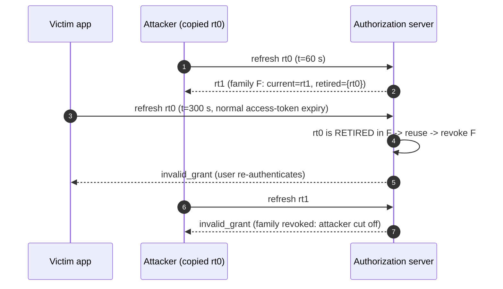

# Refresh Token Rotation, Reuse Detection, Grace Periods, and Revocation (RFC 7009)

> Folder 02 · File 03 of 04 · Identity, AuthN/AuthZ, OAuth 2.1/OIDC/FAPI 2.0 L7 Reference
> Previous: [02 · Authorization code + PKCE](02-authorization-code-flow-with-pkce-s256-and-authorization-code-injection-defense.md) · Next: [04 · Client credentials, device code, CIBA](04-client-credentials-device-code-rfc8628-and-ciba-decoupled-authentication.md)

| Listing | What it proves | Oracle |
|---|---|---|
| L17 `RefreshRotationLab.java` | Refresh-token families as AS policy on a deterministic clock: rotation with reuse detection (attacker-first and victim-first), the benign two-tab race with and without a key-bound grace window, DPoP-bound tokens without rotation, idle and absolute lifetimes, RFC 7009 semantics | RFC 9700 §4.14.2, RFC 10017 §6.3.2.3, RFC 7009 §2.2 |
| L18 `SasRefreshTokenLab.java` | The **real** Spring Authorization Server code shipped in spring-security 7.1.2 (`OAuth2RefreshTokenAuthenticationProvider`, `InMemoryOAuth2AuthorizationService`) driven in-process: default no-rotation; rotation **without** family revocation; a `ReuseDetectingAuthorizationService` decorator that adds it | Observed behaviour of the shipped classes |

**Verification.** Compiled with Folders 01–02 by `javac --release 21 -Xlint:all -Werror` on JDK 25.0.4.1, against the SHA-1-verified spring-security 7.1.2 jars. The gate re-runs both outputs and requires them byte-identical. L18 prints only token *labels* (new token / same token / error), never random values. Normative quotes come from RFC 9700, RFC 10017, RFC 7009 and RFC 7662 in [`fixtures/`](fixtures/) (RFC 10017 is quoted from the RFC Editor text fetched 2026-11-05).

Labels: **[D]** documented · **[M]** measured by a listing · **[E]** engineering judgment · **⚠** trap.

---

## 0. Orientation

Access tokens are short-lived by design. The **refresh token** is what makes a session last days or months, so it is the most valuable credential most clients hold. A stolen access token is a 5-minute problem. A stolen refresh token is an indefinite one, and because the attacker's refreshes look exactly like the client's, it is usually invisible. This file is about making refresh-token theft either impossible (sender-constraining) or self-revealing (rotation with reuse detection), without logging out every user who opens a second tab.

Results:
- **[D]** RFC 9700 §4.14.2: for public clients the AS "MUST utilize one of these methods": sender-constrained refresh tokens, or rotation in which a replayed invalidated token makes the AS "revoke the active refresh token". RFC 10017 §6.3.2.3 adds, for browser-based clients, a maximum lifetime or an idle expiry, and says rotation MUST NOT extend the lifetime beyond the initial token's pre-established one.
- **[M]** Rotation with reuse detection bounds a thief's access to the time until the victim's next refresh: 240 s in L17's attacker-first run, 0 s victim-first.
- **[M]** Without a grace window, the user's *own* second tab refreshing one second later revokes the family, forcing a logout. With a grace window bound to the **same client-instance key**, the second tab gets the same idempotent answer and a thief with a different key is still caught (L17 §2).
- **[M][D] Spring Authorization Server 7.1.2:**
  - `TokenSettings` defaults to `reuseRefreshTokens(true)`, so there is **no rotation**: a copied refresh token works for attacker and victim alike until its 60-minute TTL.
  - With `reuseRefreshTokens(false)` it rotates, but a replayed rotated-out token is only `invalid_grant` and the authorization is **not** revoked. If the attacker refreshes first, the attacker's chain stays valid while the victim sees what looks like an expired session (L18 B).
  - A 60-line `OAuth2AuthorizationService` decorator closes the gap (L18 C, D).

---

## 1. First principles: what a refresh token is, and why rotation detects theft

### 1.1 The grant behind the token

A refresh token is a *handle on a grant*. The grant is the user's consent to a client, for specific scopes and resources, with an authentication context (when, how strongly). The AS keeps the grant. The token is a capability to mint access tokens from it. RFC 9700 §4.14.2: refresh tokens "MUST be bound to the scope and resource servers as consented by the resource owner" [D]. A refresh token must never yield *more* than the grant, so scope narrowing is allowed and widening is not (RFC 6749 §6).

```text
  grant (AS-side, per user x client)            refresh-token FAMILY (one chain per login on one device)
  -------------------------------------          ------------------------------------------------------------
  user=alice, client=mobile-app,                 rt0 --refresh--> rt1 --refresh--> rt2 --refresh--> rt3 (current)
  scopes=payments:read,                           |  rotated-out tokens are RETAINED as "retired, belongs to family F"
  resource=https://payments.example.com,          |  presenting rt1 again => someone else holds a copy => revoke F
  auth_time, acr=aal2, created, last_used         |  F also has: created_at (absolute limit), last_used (idle limit),
                                                  |  bound key (DPoP jkt / mTLS x5t#S256) if sender-constrained
```

### 1.2 Why rotation detects theft

Suppose the attacker copies `rt0`. After rotation, exactly one of the two parties holds the current token and the other holds a retired one. Whoever presents the retired token reveals that a copy exists. The AS cannot know which party is which, so it revokes the whole family, which RFC 9700 says explicitly. Both lose access, and the user re-authenticates. The attacker's window is the interval between the theft and the *next* refresh by whichever party refreshes second [D, M].



### 1.3 Sender-constraining: the alternative that needs no detection

If the refresh token is bound to a key the client proves on every refresh (DPoP, RFC 9449; or the mTLS certificate, RFC 8705), a copied token is useless without the private key. There is nothing to detect. L17 §3 shows a stolen DPoP-bound token rejected and the legitimate device refreshing the *same* token indefinitely. The key must be non-exportable: WebCrypto non-extractable keys in browsers, Secure Enclave or StrongBox on mobile. Otherwise the thief copies the key along with the token (Folder 04) [E].

---

## 2. Policy design: the knobs and their failure modes

| Knob | Too lax | Too strict | L7 setting [E] |
|---|---|---|---|
| Rotation | static tokens: theft invisible | — | rotate on every use (or sender-constrain) |
| Reuse response | `invalid_grant` only (SAS 7.1.2): attacker who refreshed first keeps the grant | — | revoke the family, emit a security event, notify the user |
| Grace window for benign races | none: second tab, retries and flaky mobile networks log users out | long or key-less windows let a fast thief replay inside them | ≤ 10–30 s, **same client-instance key** (DPoP jkt or device id), idempotent answer |
| Idle lifetime | infinite: a token left on a sold phone works forever | hours: users re-login constantly | days to weeks, per client type |
| Absolute lifetime | none: a continuously refreshed stolen chain lasts forever | — | days (browser) to months (mobile), never extended by rotation (RFC 10017) |
| Storage | plaintext tokens in a DB | — | store SHA-256(token); family id inside a signed or random token |
| Revocation | per token only | — | revoke the family on logout, password change, "sign out everywhere" and risk events |

### 2.1 The benign-race problem, precisely

Two tabs, a service worker and a background sync, or a mobile app that retries after a timeout: these all present the *same* refresh token twice within a second. Strict rotation flags the second request as reuse and revokes the family, logging the user out. That is L17 §2's grace-0 row. Teams then disable reuse detection, and theft becomes invisible again.

The grace window must be narrow in three dimensions:

1. **Time.** Seconds, measured from the rotation.
2. **Identity.** The second presentation must come from the **same client instance**: the same DPoP key thumbprint (best), the same mTLS certificate, or a stable device identifier.
3. **Answer.** Return the *same* new token pair the first request received, idempotently. Never mint a second branch, which would create two valid chains.

L17's thief arrives one second later with a different key and is still caught [M].

Better still, avoid the race on the client: one refresh in flight per client instance, coordinated across tabs with a `BroadcastChannel` or Web Locks, or by the BFF holding the token server-side (Folder 04) [E].

### 2.2 Lifetimes from RFC 10017 for browser clients

[D: RFC 10017 §6.3.2.3] Authorization servers issuing refresh tokens to browser-based applications:
- "MUST either rotate refresh tokens on each use OR use sender-constrained refresh tokens";
- "MUST either set a maximum lifetime on refresh tokens OR expire if the refresh token has not been used within some amount of time";
- "MUST NOT, upon issuing a rotated refresh token, extend the lifetime of the new refresh token beyond the lifetime of the initial refresh token if the refresh token has a preestablished expiration time".

L17 §4 enforces both limits from the **family's** creation time and last use, so rotation cannot extend them. A thief refreshing every 5 minutes is still cut at day 90 (25,920 refreshes), and an unused family dies at the 30-day idle limit [M].

---

## 3. L17: the policy, measured

<!-- listing:RefreshRotationLab.java -->
```java
import java.util.HashMap;
import java.util.Map;
import java.util.SplittableRandom;

/**
 * L17 - refresh-token families as an authorization-server policy, on a deterministic clock.
 *
 * <p>Rotation with reuse detection (RFC 9700 4.14.2), a grace window for BENIGN concurrent refreshes (same client
 * instance, short window, idempotent answer), sender-constrained (DPoP-bound) refresh tokens as the alternative,
 * idle + absolute family lifetimes, and RFC 7009 revocation semantics (200 for unknown tokens; revoke the family).
 */
public final class RefreshRotationLab {
    static final SplittableRandom IDS = new SplittableRandom(7009L); // reproducible demo ids; production: SecureRandom

    static String id() {
        return "rt." + Long.toHexString(IDS.nextLong() >>> 16);
    }

    record Policy(boolean rotate, long graceSeconds, boolean bindToKey, long idleTtl, long absoluteTtl) {
    }

    static final class Family {
        final String user;
        final long createdAt;
        boolean revoked;
        String current;
        String previous;        // the token just rotated out (for the grace window)
        long rotatedAt;
        String rotatedBy;       // client-instance key that performed the rotation
        long lastUsed;
        final String boundKey;  // DPoP jkt / mTLS x5t#S256 when sender-constrained

        Family(String user, long now, String boundKey) {
            this.user = user;
            this.createdAt = now;
            this.lastUsed = now;
            this.boundKey = boundKey;
        }
    }

    static final class As {
        final Policy policy;
        final Map<String, Family> byToken = new HashMap<>(); // every token ever issued -> family (hash it at rest)
        int revocations;

        As(Policy policy) {
            this.policy = policy;
        }

        String login(String user, String key, long now) {
            Family f = new Family(user, now, policy.bindToKey() ? key : null);
            f.current = id();
            byToken.put(f.current, f);
            return f.current;
        }

        /** Returns the refresh token to use next, or an error. presenterKey = the DPoP/mTLS key proven on this call. */
        String refresh(String rt, String presenterKey, long now) {
            Family f = byToken.get(rt);
            if (f == null || f.revoked) {
                return "invalid_grant";
            }
            if (f.boundKey != null && !f.boundKey.equals(presenterKey)) {
                return "invalid_grant (not bound to the presented key)";
            }
            if (now - f.lastUsed > policy.idleTtl() || now - f.createdAt > policy.absoluteTtl()) {
                f.revoked = true;
                return "invalid_grant (family expired)";
            }
            if (!policy.rotate()) {
                f.lastUsed = now;
                return rt;
            }
            if (rt.equals(f.current)) {
                f.previous = f.current;
                f.current = id();
                f.rotatedAt = now;
                f.rotatedBy = presenterKey;
                f.lastUsed = now;
                byToken.put(f.current, f);
                return f.current;
            }
            boolean benignRace = rt.equals(f.previous) && now - f.rotatedAt <= policy.graceSeconds()
                    && presenterKey != null && presenterKey.equals(f.rotatedBy);
            if (benignRace) {
                return f.current; // idempotent: the same answer the racing request already got
            }
            f.revoked = true;   // a rotated-out token came back from someone else: revoke the whole family
            revocations++;
            return "invalid_grant (reuse detected, family revoked)";
        }

        /** RFC 7009 2.2: 200 OK whether or not the token was valid - no validity oracle. */
        int revoke(String token) {
            Family f = byToken.get(token);
            if (f != null) {
                f.revoked = true;
            }
            return 200;
        }
    }

    static boolean ok(String r) {
        return r.startsWith("rt.");
    }

    public static void main(String[] args) {
        Policy rotation = new Policy(true, 0, false, 30L * 86_400, 90L * 86_400);
        Policy rotationGrace = new Policy(true, 10, false, 30L * 86_400, 90L * 86_400);
        Policy dpopBound = new Policy(false, 0, true, 30L * 86_400, 90L * 86_400);

        KbSupport.section("1. Stolen refresh token, rotation + reuse detection: exposure is bounded by the victim's next refresh");
        for (boolean attackerFirst : new boolean[] {true, false}) {
            As as = new As(rotation);
            String rt0 = as.login("alice", "k-victim", 0);
            String a;
            String v;
            if (attackerFirst) {
                a = as.refresh(rt0, "k-attacker", 60);   // attacker uses the copy first
                v = as.refresh(rt0, "k-victim", 300);    // victim's normal refresh at access-token expiry
            } else {
                v = as.refresh(rt0, "k-victim", 300);
                a = as.refresh(rt0, "k-attacker", 360);
            }
            String after = as.refresh(attackerFirst ? a : v, attackerFirst ? "k-attacker" : "k-victim", 420);
            KbSupport.info("%-15s attacker: %-12s victim: %-48s then: %s", attackerFirst ? "attacker first" : "victim first",
                    ok(a) ? "new RT" : a, ok(v) ? "new RT" : v, after);
            KbSupport.check((attackerFirst ? "attacker-first" : "victim-first")
                    + ": family revoked; attacker access lasted at most " + (attackerFirst ? 240 : 0) + " s",
                    as.revocations == 1 && after.startsWith("invalid_grant"));
        }

        KbSupport.section("2. Benign race: two browser tabs refresh with the same token 1 s apart");
        for (Policy p : new Policy[] {rotation, rotationGrace}) {
            As as = new As(p);
            String rt0 = as.login("bob", "k-bob", 0);
            String tab1 = as.refresh(rt0, "k-bob", 300);
            String tab2 = as.refresh(rt0, "k-bob", 301);
            String thief = as.refresh(rt0, "k-thief", 302);
            KbSupport.info("grace %2d s: tab1 %-6s tab2 %-46s thief %s", p.graceSeconds(), ok(tab1) ? "new RT" : tab1,
                    ok(tab2) ? (tab2.equals(tab1) ? "same new RT (idempotent)" : "new RT") : tab2, ok(thief) ? "ACCEPTED" : thief);
            if (p.graceSeconds() == 0) {
                KbSupport.check("no grace: the user's own second tab revokes the family (false positive -> forced logout)",
                        tab2.contains("reuse detected"));
            } else {
                KbSupport.check("grace bound to the SAME client-instance key: tab2 gets the same answer; a different key is still caught",
                        tab2.equals(tab1) && thief.contains("reuse detected"));
            }
        }

        KbSupport.section("3. Sender-constrained (DPoP-bound) refresh token, no rotation needed");
        As bound = new As(dpopBound);
        String rtb = bound.login("carol", "jkt-carol-device", 0);
        String stolen = bound.refresh(rtb, "jkt-attacker", 60);
        String legit = bound.refresh(rtb, "jkt-carol-device", 300);
        KbSupport.check("stolen token without the private key -> " + stolen, stolen.contains("not bound"));
        KbSupport.check("the device that holds the key keeps refreshing the same token: " + legit, legit.equals(rtb));

        KbSupport.section("4. Lifetimes: an attacker refreshing every 5 minutes is still cut by the absolute limit");
        As life = new As(new Policy(true, 0, false, 30L * 86_400, 90L * 86_400));
        String rt = life.login("dave", "k-dave", 0);
        long t = 0;
        int refreshes = 0;
        while (ok(rt)) {
            t += 300;
            rt = life.refresh(rt, "k-dave", t);
            refreshes += ok(rt) ? 1 : 0;
        }
        KbSupport.check("chain ends after " + refreshes + " refreshes at t=" + t / 86_400 + " days: " + rt,
                t > 90L * 86_400 && t <= 90L * 86_400 + 300 && rt.contains("expired"));
        As idle = new As(new Policy(true, 0, false, 30L * 86_400, 90L * 86_400));
        String rti = idle.login("erin", "k-erin", 0);
        String idleResult = idle.refresh(rti, "k-erin", 31L * 86_400);
        KbSupport.check("an unused family dies at the idle limit (31 days later): " + idleResult, idleResult.contains("expired"));

        KbSupport.section("5. RFC 7009 revocation");
        As rev = new As(rotation);
        String r0 = rev.login("frank", "k-frank", 0);
        String r1 = rev.refresh(r0, "k-frank", 300);
        KbSupport.check("revoking a garbage token returns " + rev.revoke("rt.not-a-token") + " (no validity oracle)", rev.revoke("rt.x") == 200);
        int status = rev.revoke(r1);
        String afterRevoke = rev.refresh(r1, "k-frank", 400);
        KbSupport.check("logout revokes the CURRENT token (" + status + ") -> the family is dead: " + afterRevoke,
                status == 200 && afterRevoke.equals("invalid_grant"));
        KbSupport.verdict();
    }
}
```

<!-- output:RefreshRotationLab.java -->
```text

== 1. Stolen refresh token, rotation + reuse detection: exposure is bounded by the victim's next refresh
  attacker first  attacker: new RT       victim: invalid_grant (reuse detected, family revoked)   then: invalid_grant
  [PASS] attacker-first: family revoked; attacker access lasted at most 240 s
  victim first    attacker: invalid_grant (reuse detected, family revoked) victim: new RT                                           then: invalid_grant
  [PASS] victim-first: family revoked; attacker access lasted at most 0 s

== 2. Benign race: two browser tabs refresh with the same token 1 s apart
  grace  0 s: tab1 new RT tab2 invalid_grant (reuse detected, family revoked) thief invalid_grant
  [PASS] no grace: the user's own second tab revokes the family (false positive -> forced logout)
  grace 10 s: tab1 new RT tab2 same new RT (idempotent)                       thief invalid_grant (reuse detected, family revoked)
  [PASS] grace bound to the SAME client-instance key: tab2 gets the same answer; a different key is still caught

== 3. Sender-constrained (DPoP-bound) refresh token, no rotation needed
  [PASS] stolen token without the private key -> invalid_grant (not bound to the presented key)
  [PASS] the device that holds the key keeps refreshing the same token: rt.5d722914ccfd

== 4. Lifetimes: an attacker refreshing every 5 minutes is still cut by the absolute limit
  [PASS] chain ends after 25920 refreshes at t=90 days: invalid_grant (family expired)
  [PASS] an unused family dies at the idle limit (31 days later): invalid_grant (family expired)

== 5. RFC 7009 revocation
  [PASS] revoking a garbage token returns 200 (no validity oracle)
  [PASS] logout revokes the CURRENT token (200) -> the family is dead: invalid_grant

verdict: OK (10 checks)
```

---

## 4. Spring Authorization Server 7.1.2: what the shipped code does

### 4.1 The defaults

[D: `TokenSettings.builder()`; Boot 4.1.2 `OAuth2AuthorizationServerProperties$Token` constructor]
- `reuseRefreshTokens(true)`: the same refresh token is returned on every refresh, so there is no rotation.
- `refreshTokenTimeToLive(60 min)`, `accessTokenTimeToLive(5 min)`, `accessTokenFormat(SELF_CONTAINED)`.
- `OAuth2RefreshTokenGenerator` does not issue refresh tokens to public clients (`ClientAuthenticationMethod.NONE`) on the authorization-code grant.
- The refresh provider verifies a DPoP proof if present and, for public clients, checks that the proof's key matches the key bound to the current access token.

### 4.2 Rotation without reuse detection

`OAuth2RefreshTokenAuthenticationProvider.authenticate` looks the token up with `authorizationService.findByToken(token, REFRESH_TOKEN)`. Both the in-memory and the JDBC authorization service index only the authorization's **current** refresh token. A rotated-out token therefore finds nothing, and the provider throws `invalid_grant` before it knows which authorization the token belonged to, so nothing is revoked [D]. L18 B shows the consequence on the real classes:

```text
  attacker rt-0 -> new token; victim rt-0 -> invalid_grant; attacker continues -> new token
```

The victim's client sees `invalid_grant`, which is indistinguishable from ordinary expiry. It sends the user to log in again and creates a *new* authorization, while the attacker keeps refreshing the old one until its TTL, or forever if a custom service extends it [E].

### 4.3 The fix: a reuse-detecting authorization service

`ReuseDetectingAuthorizationService` in L18 wraps any `OAuth2AuthorizationService`:
- **On `save`**, if the stored authorization's refresh token differs from the new one, it records SHA-256(old token) → authorization id.
- **On `findByToken`** for a refresh token, a hit in that map **removes the authorization**, which revokes every token in the family. It emits an event and returns null, so the provider still answers `invalid_grant`.

In production, the retired-token map lives next to the authorization: a `retired_refresh_tokens(token_hash, authorization_id, retired_at)` table with a TTL equal to the family's absolute lifetime, an index on the hash, and the removal plus event in one transaction [E].

<!-- listing:SasRefreshTokenLab.java -->
```java
import java.security.Principal;
import java.time.Instant;
import java.util.ArrayList;
import java.util.List;
import java.util.Map;
import java.util.Set;
import java.util.concurrent.ConcurrentHashMap;

import org.springframework.security.authentication.UsernamePasswordAuthenticationToken;
import org.springframework.security.oauth2.core.AuthorizationGrantType;
import org.springframework.security.oauth2.core.ClientAuthenticationMethod;
import org.springframework.security.oauth2.core.OAuth2AccessToken;
import org.springframework.security.oauth2.core.OAuth2AuthenticationException;
import org.springframework.security.oauth2.core.OAuth2RefreshToken;
import org.springframework.security.oauth2.server.authorization.InMemoryOAuth2AuthorizationService;
import org.springframework.security.oauth2.server.authorization.OAuth2Authorization;
import org.springframework.security.oauth2.server.authorization.OAuth2AuthorizationService;
import org.springframework.security.oauth2.server.authorization.OAuth2TokenType;
import org.springframework.security.oauth2.server.authorization.authentication.OAuth2AccessTokenAuthenticationToken;
import org.springframework.security.oauth2.server.authorization.authentication.OAuth2ClientAuthenticationToken;
import org.springframework.security.oauth2.server.authorization.authentication.OAuth2RefreshTokenAuthenticationProvider;
import org.springframework.security.oauth2.server.authorization.authentication.OAuth2RefreshTokenAuthenticationToken;
import org.springframework.security.oauth2.server.authorization.client.RegisteredClient;
import org.springframework.security.oauth2.server.authorization.context.AuthorizationServerContext;
import org.springframework.security.oauth2.server.authorization.context.AuthorizationServerContextHolder;
import org.springframework.security.oauth2.server.authorization.settings.AuthorizationServerSettings;
import org.springframework.security.oauth2.server.authorization.settings.OAuth2TokenFormat;
import org.springframework.security.oauth2.server.authorization.settings.TokenSettings;
import org.springframework.security.oauth2.server.authorization.token.DelegatingOAuth2TokenGenerator;
import org.springframework.security.oauth2.server.authorization.token.OAuth2AccessTokenGenerator;
import org.springframework.security.oauth2.server.authorization.token.OAuth2RefreshTokenGenerator;

/**
 * L18 - refresh tokens on the REAL Spring Authorization Server code shipped in spring-security 7.1.2
 * (OAuth2RefreshTokenAuthenticationProvider + InMemoryOAuth2AuthorizationService), driven in-process.
 *
 * <ul>
 *   <li>default TokenSettings: reuseRefreshTokens=true - no rotation; a stolen refresh token keeps working;</li>
 *   <li>reuseRefreshTokens=false: rotation, but presenting a rotated-out token is only invalid_grant - the family is
 *       NOT revoked, so whoever refreshed first keeps the grant (RFC 9700 4.14.2 requires revoking it);</li>
 *   <li>{@link ReuseDetectingAuthorizationService}: a decorator that remembers retired tokens and revokes the whole
 *       authorization when one comes back.</li>
 * </ul>
 */
public final class SasRefreshTokenLab {

    /** Remembers every rotated-out refresh token; a replay of one revokes the authorization (the token family). */
    static final class ReuseDetectingAuthorizationService implements OAuth2AuthorizationService {
        private final OAuth2AuthorizationService delegate;
        private final Map<String, String> retired = new ConcurrentHashMap<>(); // SHA-256(old token) -> authorization id
        final List<String> events = new ArrayList<>();

        ReuseDetectingAuthorizationService(OAuth2AuthorizationService delegate) {
            this.delegate = delegate;
        }

        @Override
        public void save(OAuth2Authorization authorization) {
            OAuth2Authorization previous = delegate.findById(authorization.getId());
            if (previous != null && previous.getRefreshToken() != null && authorization.getRefreshToken() != null) {
                String old = previous.getRefreshToken().getToken().getTokenValue();
                if (!old.equals(authorization.getRefreshToken().getToken().getTokenValue())) {
                    retired.put(hash(old), authorization.getId());
                }
            }
            delegate.save(authorization);
        }

        @Override
        public void remove(OAuth2Authorization authorization) {
            delegate.remove(authorization);
        }

        @Override
        public OAuth2Authorization findById(String id) {
            return delegate.findById(id);
        }

        @Override
        public OAuth2Authorization findByToken(String token, OAuth2TokenType tokenType) {
            if (tokenType == null || OAuth2TokenType.REFRESH_TOKEN.equals(tokenType)) {
                String familyId = retired.get(hash(token));
                if (familyId != null) {
                    OAuth2Authorization family = delegate.findById(familyId);
                    if (family != null) {
                        delegate.remove(family); // revoke every token of the grant: attacker and victim both lose it
                        events.add("rotated-out refresh token replayed -> authorization " + familyId + " revoked");
                    }
                    return null;
                }
            }
            return delegate.findByToken(token, tokenType);
        }

        private static String hash(String v) {
            return KbSupport.hex(WebAuthnRp.sha256(v.getBytes(java.nio.charset.StandardCharsets.US_ASCII)));
        }
    }

    record Rig(RegisteredClient client, OAuth2AuthorizationService service, OAuth2RefreshTokenAuthenticationProvider provider) {
    }

    static Rig rig(boolean rotate, boolean detectReuse) {
        TokenSettings ts = TokenSettings.builder().accessTokenFormat(OAuth2TokenFormat.REFERENCE).reuseRefreshTokens(!rotate).build();
        RegisteredClient client = RegisteredClient.withId("rc-1").clientId("mobile-app").clientSecret("{noop}unused")
                .clientAuthenticationMethod(ClientAuthenticationMethod.CLIENT_SECRET_BASIC)
                .authorizationGrantType(AuthorizationGrantType.AUTHORIZATION_CODE)
                .authorizationGrantType(AuthorizationGrantType.REFRESH_TOKEN)
                .redirectUri("https://app.example.com/cb").scope("payments").tokenSettings(ts).build();
        OAuth2AuthorizationService base = new InMemoryOAuth2AuthorizationService();
        OAuth2AuthorizationService svc = detectReuse ? new ReuseDetectingAuthorizationService(base) : base;
        Instant now = Instant.now();
        OAuth2Authorization a = OAuth2Authorization.withRegisteredClient(client).id("family-1").principalName("alice")
                .authorizationGrantType(AuthorizationGrantType.AUTHORIZATION_CODE).authorizedScopes(Set.of("payments"))
                .attribute(Principal.class.getName(), UsernamePasswordAuthenticationToken.authenticated("alice", null, List.of()))
                .token(new OAuth2AccessToken(OAuth2AccessToken.TokenType.BEARER, "at-0", now, now.plusSeconds(300), Set.of("payments")))
                .refreshToken(new OAuth2RefreshToken("rt-0", now, now.plusSeconds(3_600))).build();
        svc.save(a);
        var gen = new DelegatingOAuth2TokenGenerator(new OAuth2AccessTokenGenerator(), new OAuth2RefreshTokenGenerator());
        return new Rig(client, svc, new OAuth2RefreshTokenAuthenticationProvider(svc, gen));
    }

    /** One refresh call; returns the NEW refresh token value, or "invalid_grant". */
    static String refresh(Rig r, String refreshToken) {
        var principal = new OAuth2ClientAuthenticationToken(r.client(), ClientAuthenticationMethod.CLIENT_SECRET_BASIC, null);
        try {
            var result = (OAuth2AccessTokenAuthenticationToken) r.provider()
                    .authenticate(new OAuth2RefreshTokenAuthenticationToken(refreshToken, principal, null, Map.of()));
            return result.getRefreshToken() == null ? "(none)" : result.getRefreshToken().getTokenValue();
        } catch (OAuth2AuthenticationException e) {
            return e.getError().getErrorCode();
        }
    }

    static String label(String rt, String original) {
        return rt.equals(original) ? "rt-0 (same token)" : rt.startsWith("invalid") ? rt : "new token";
    }

    public static void main(String[] args) {
        AuthorizationServerSettings settings = AuthorizationServerSettings.builder().issuer("https://idp.example.com").build();
        AuthorizationServerContextHolder.setContext(new AuthorizationServerContext() {
            @Override
            public String getIssuer() {
                return settings.getIssuer();
            }

            @Override
            public AuthorizationServerSettings getAuthorizationServerSettings() {
                return settings;
            }
        });
        TokenSettings defaults = TokenSettings.builder().build();
        KbSupport.section("TokenSettings.builder() defaults in 7.1.2");
        KbSupport.check("reuseRefreshTokens=" + defaults.isReuseRefreshTokens() + ", refresh TTL=" + defaults.getRefreshTokenTimeToLive()
                + ", access TTL=" + defaults.getAccessTokenTimeToLive() + ", format=" + defaults.getAccessTokenFormat().getValue(),
                defaults.isReuseRefreshTokens());

        KbSupport.section("A. Defaults (no rotation): the attacker copied rt-0 from the device");
        Rig a = rig(false, false);
        String v1 = refresh(a, "rt-0");
        String x1 = refresh(a, "rt-0");
        String v2 = refresh(a, "rt-0");
        KbSupport.info("victim refresh -> %s; attacker refresh -> %s; victim again -> %s", label(v1, "rt-0"), label(x1, "rt-0"), label(v2, "rt-0"));
        KbSupport.check("both parties refresh indefinitely and nothing can tell them apart", v1.equals("rt-0") && x1.equals("rt-0") && v2.equals("rt-0"));

        KbSupport.section("B. reuseRefreshTokens(false), attacker refreshes first");
        Rig b = rig(true, false);
        String xb1 = refresh(b, "rt-0");
        String vb1 = refresh(b, "rt-0");
        String xb2 = refresh(b, xb1);
        KbSupport.info("attacker rt-0 -> %s; victim rt-0 -> %s; attacker continues -> %s", label(xb1, "rt-0"), label(vb1, "rt-0"), label(xb2, "rt-0"));
        KbSupport.check("victim gets invalid_grant (looks like an expired session) while the ATTACKER's chain stays valid",
                vb1.equals("invalid_grant") && !xb2.startsWith("invalid"));

        KbSupport.section("C. Same, with ReuseDetectingAuthorizationService");
        Rig c = rig(true, true);
        String xc1 = refresh(c, "rt-0");
        String vc1 = refresh(c, "rt-0");
        String xc2 = refresh(c, xc1);
        KbSupport.info("attacker rt-0 -> %s; victim rt-0 -> %s; attacker continues -> %s", label(xc1, "rt-0"), label(vc1, "rt-0"), label(xc2, "rt-0"));
        KbSupport.info("event: %s", ((ReuseDetectingAuthorizationService) c.service()).events.get(0));
        KbSupport.check("the replayed rt-0 revokes the family: the attacker's next refresh fails too", vc1.equals("invalid_grant") && xc2.equals("invalid_grant"));

        KbSupport.section("D. Same decorator, victim refreshes first (the common order)");
        Rig d = rig(true, true);
        String vd1 = refresh(d, "rt-0");
        String xd1 = refresh(d, "rt-0");
        String vd2 = refresh(d, vd1);
        KbSupport.check("attacker's stale rt-0 -> " + xd1 + "; family revoked, victim must re-authenticate: " + vd2,
                xd1.equals("invalid_grant") && vd2.equals("invalid_grant"));
        AuthorizationServerContextHolder.resetContext();
        KbSupport.verdict();
    }
}
```

<!-- output:SasRefreshTokenLab.java -->
```text

== TokenSettings.builder() defaults in 7.1.2
  [PASS] reuseRefreshTokens=true, refresh TTL=PT1H, access TTL=PT5M, format=self-contained

== A. Defaults (no rotation): the attacker copied rt-0 from the device
  victim refresh -> rt-0 (same token); attacker refresh -> rt-0 (same token); victim again -> rt-0 (same token)
  [PASS] both parties refresh indefinitely and nothing can tell them apart

== B. reuseRefreshTokens(false), attacker refreshes first
  attacker rt-0 -> new token; victim rt-0 -> invalid_grant; attacker continues -> new token
  [PASS] victim gets invalid_grant (looks like an expired session) while the ATTACKER's chain stays valid

== C. Same, with ReuseDetectingAuthorizationService
  attacker rt-0 -> new token; victim rt-0 -> invalid_grant; attacker continues -> invalid_grant
  event: rotated-out refresh token replayed -> authorization family-1 revoked
  [PASS] the replayed rt-0 revokes the family: the attacker's next refresh fails too

== D. Same decorator, victim refreshes first (the common order)
  [PASS] attacker's stale rt-0 -> invalid_grant; family revoked, victim must re-authenticate: invalid_grant

verdict: OK (5 checks)
```

Wiring it in a Spring Authorization Server application is one bean, because the token endpoint resolves `OAuth2AuthorizationService` from the context:

```java
@Bean
OAuth2AuthorizationService authorizationService(JdbcOperations jdbc, RegisteredClientRepository clients) {
    return new SasRefreshTokenLab.ReuseDetectingAuthorizationService(
            new JdbcOAuth2AuthorizationService(jdbc, clients));   // retired-token map: back it with a table in production
}
```

---

## 5. Revocation (RFC 7009) and introspection (RFC 7662) on the wire

```http
POST /oauth2/revoke HTTP/1.1
Host: idp.example.com
Content-Type: application/x-www-form-urlencoded
Authorization: Basic <client credentials, or use private_key_jwt>

token=45ghiukldjahdnhzdauz&token_type_hint=refresh_token
```

```http
HTTP/1.1 200 OK
Cache-Control: no-store
```

[D: RFC 7009 §2.2] The AS responds 200 "if the token has been revoked successfully or if the client submitted an invalid token". The RFC's note gives the reason: "invalid tokens do not cause an error response since the client cannot handle such an error in a reasonable way". The side effect L7 cares about is that there is no validity oracle (L17 §5). §2.1 adds that when a refresh token is revoked and the AS supports revoking access tokens, it "SHOULD also invalidate all access tokens based on the same authorization grant". An invalid `token_type_hint` "is ignored by the authorization server and does not influence the revocation response" [D]. L7 practice is "revoke the family, push a `sub`/`sid` revocation event to resource servers" (Folder 01 file 01's 2-second denylist; Folder 03's back-channel logout and CAEP) [E].

RFC 7662 introspection lets a resource server, or the gateway (Folder 05's phantom token), ask the AS whether a token is active:

```http
POST /oauth2/introspect HTTP/1.1
Host: idp.example.com
Content-Type: application/x-www-form-urlencoded
Authorization: Basic <resource-server credentials>

token=2YotnFZFEjr1zCsicMWpAA&token_type_hint=access_token
```

```json
{"active": true, "client_id": "mobile-app", "scope": "payments:read", "sub": "248289761001",
 "aud": "https://payments.example.com", "iss": "https://idp.example.com", "exp": 1767225900, "iat": 1767225600,
 "token_type": "Bearer", "cnf": {"jkt": "0ZcOCORZNYy-DWpqq30jZyJGHTN0d2HglBV3uiguA4I"}}
```

For an inactive, unknown or revoked token the only required member is `{"active": false}`. Never reveal why [D: RFC 7662 §2.2].

---

## 6. The vulnerable L5 implementation vs the hardened L7 zero-trust implementation

```java
// L5 - DO NOT USE: "refresh" endpoint of a home-grown AS.
@PostMapping("/token") @RequestMapping(params = "grant_type=refresh_token")
TokenResponse refresh(@RequestParam("refresh_token") String rt) {
    RefreshRow row = repo.findByToken(rt);                              // plaintext tokens at rest
    if (row == null || row.expired()) throw new InvalidGrant();
    return new TokenResponse(jwt(row.user(), row.scopes(), Duration.ofHours(1)), rt); // same rt forever, 1 h access
}
@PostMapping("/revoke")
ResponseEntity<?> revoke(@RequestParam String token) {
    return repo.delete(token) ? ok().build() : status(400).build();    // 400 = validity oracle; access tokens untouched
}
```

| Concern | L5 | L7 |
|---|---|---|
| Rotation | none | every use, or a DPoP/mTLS-bound token |
| Reuse | invisible | family revoked, security event, user notified |
| Races | n/a, or "disable detection" | single-flight on the client; grace ≤ 30 s bound to the client-instance key; idempotent answer |
| Lifetimes | none | idle + absolute per family, never extended by rotation |
| Storage | plaintext | SHA-256(token); family id; retired-token index |
| Revocation | per token, 400 on unknown | 200 always; family-wide; access tokens invalidated (introspection) or denylisted (JWT) |
| Spring AS | `reuseRefreshTokens(true)` default | `reuseRefreshTokens(false)` + `ReuseDetectingAuthorizationService` + DPoP for public clients |

---

## 7. Real-world attack vectors & mitigations

### A1 · Silent refresh-token theft from device storage, backups or logs

**Attack.** Malware, a rooted device, an unencrypted backup, a debug log or a crash report captures the refresh token. The attacker refreshes from their own infrastructure indefinitely, and with static tokens nothing distinguishes them from the app.
**Wire signature.** Refreshes for one grant from two networks or ASNs; refresh cadence that no longer matches app usage.
**Root cause.** A static bearer refresh token with no key binding.
**Mitigation.** Sender-constrain (DPoP with a hardware-backed key) or rotate with reuse detection (L17 §1). Keep the token in the platform keystore and out of logs and backups. Set an absolute lifetime.
**Detection.** Network-discontinuity alerts per grant; reuse events.

### A2 · Rotation without reuse detection (the Spring 7.1.2 behaviour)

**Attack.** The attacker refreshes first. The victim's next refresh fails with `invalid_grant`, which the app treats as expiry and answers with a fresh login. The attacker keeps the original chain (L18 B).
**Wire signature.** `invalid_grant` on refresh shortly followed by a fresh login for the same user and client, while the old authorization keeps refreshing elsewhere.
**Root cause.** Rotated-out tokens are not indexed, so their presentation cannot be tied to the family.
**Mitigation.** Retain retired tokens linked to their family and revoke the family on reuse (L18's decorator).
**Detection.** Count retired-token presentations. Each one is a probable theft.

### A3 · Benign races misread as theft (self-inflicted denial of service)

**Attack.** No attacker is involved: multiple tabs, service workers or mobile retries present the same token twice. Strict reuse detection revokes families and users are logged out repeatedly, so the team disables detection (L17 §2, grace 0).
**Wire signature.** Reuse events within a second of a rotation, from the same client instance.
**Root cause.** Reuse detection without a narrowly bound grace window, and uncoordinated clients.
**Mitigation.** A grace window bound in time and key, with an idempotent answer. Single-flight refresh on the client (Web Locks, `BroadcastChannel`). A BFF for browsers.
**Detection.** Split reuse events by "same key, within the window" (benign) vs "different key or outside it" (theft).

### A4 · Refresh tokens issued to the wrong clients or with the wrong scope

**Attack.**
- A refresh token issued to a browser client with no rotation, binding or lifetime becomes a months-long XSS payoff.
- Scope widening on refresh ("ask for `admin` this time") succeeds where the AS doesn't bind refresh tokens to the consented scope.

**Wire signature.** Refresh requests asking for scopes outside the grant; long-lived refresh tokens on SPA client IDs.
**Root cause.** Refresh treated as a new authorization instead of a capability on an existing grant.
**Mitigation.**
- Refresh scope ⊆ grant scope (RFC 6749 §6).
- RFC 10017 §6.3.2.3 rules for browser clients.
- No refresh tokens to public browser clients without DPoP or rotation plus a maximum lifetime.
- BFF.

**Detection.** Alerts on scope-widening attempts and on refresh-token issuance to SPA clients.

### A5 · Revocation that doesn't revoke

**Attack.** The user clicks "sign out everywhere", or the password is reset. The refresh token is deleted, but self-contained access tokens stay valid for their TTL. Sibling refresh tokens from other logins, and other families, are untouched. A revocation endpoint that answers 400 for unknown tokens leaks validity.
**Wire signature.** API calls with access tokens minted before a revocation event; successful refreshes after "sign out everywhere".
**Root cause.** Per-token revocation in a family-and-grant world; JWTs without a revocation channel.
**Mitigation.** Revoke by grant or user (all families). Push `sub`/`sid` revocation events to resource servers (denylist with `iat < revoked_at`). Short access tokens. 200 for every revocation request (RFC 7009).
**Detection.** Monitor token use after revocation timestamps; this is a key SLO.

### A6 · Refresh-token replay across clients (confidential-client confusion)

**Attack.** A refresh token issued to client A is presented by client B, which has its own valid credentials, perhaps after a token leak across services sharing a cache. An AS that doesn't check the client binding mints tokens for B with A's grant.
**Wire signature.** A refresh token presented with client credentials different from the issuing client's.
**Root cause.** A missing client-binding check (RFC 6749 requires that refresh tokens "can only be used by the client for which they were issued").
**Mitigation.** Bind to `client_id` and check it (SAS does: `registeredClient.getId().equals(authorization.getRegisteredClientId())`). Sender-constraining for public clients.
**Detection.** Alerts on client-mismatch refresh attempts.

---

## 8. FAANG / FinTech L7 bar-raiser Q&A chains

<details><summary><b>Q1 · Why rotate refresh tokens at all, if they're sent only to the AS over TLS?</b></summary>

**Initial Prompt.** The mobile team argues rotation adds complexity for no benefit.

**L5 Textbook Answer.** "Agreed. The refresh token never leaves the device except to the AS, and TLS protects it."

**How an Attacker Bypasses L5.** The theft isn't on the wire. It happens at rest:
- a rooted device;
- a malicious accessibility app;
- a debug build's logcat;
- a cloud backup that included the app's shared preferences.

A static refresh token then gives silent, indefinite access that looks exactly like the app (A1).

**L7 Principal Defense.** RFC 9700 §4.14.2 gives public clients two options, and one is mandatory.
1. **Sender-constrain** with DPoP and a hardware-backed key. Theft of the token alone is useless, and no rotation is needed (L17 §3).
2. **Rotate with reuse detection.** Theft becomes self-revealing, and exposure is bounded by the next refresh (L17 §1: 240 s or 0 s).

Prefer (1) when the platform has a keystore, and add an absolute lifetime and storage hygiene either way.

</details>

<details><summary><b>Q2 · Your AS rotates refresh tokens. A reused token returns `invalid_grant`. Is that enough?</b></summary>

**Initial Prompt.** That is Spring Authorization Server 7.1.2 with `reuseRefreshTokens(false)`.

**L5 Textbook Answer.** "Yes. The old token is rejected, so the attacker can't use it."

**How an Attacker Bypasses L5.** If the *attacker* refreshed first, the rejected party is the *victim*. The attacker's chain stays valid (L18 B). The victim's app treats `invalid_grant` as expiry and logs the user in again, creating a new grant. Nobody notices.

**L7 Principal Defense.**
- **Reuse must revoke the family:** both chains die, and a security event fires.
- **In Spring:** wrap the `OAuth2AuthorizationService` with L18's `ReuseDetectingAuthorizationService` (retired-token hash → authorization id), and persist the retired index in a table with a TTL.
- **Emit an event,** notify the user ("we signed you out because your session was used from another device"), and count these events as theft signals.
- **Test it** with L18's four scenarios in CI.

</details>

<details><summary><b>Q3 · Users get logged out randomly after you enabled reuse detection. Root-cause it.</b></summary>

**Initial Prompt.** The complaint correlates with having two tabs open.

**L5 Textbook Answer.** "Turn off reuse detection; it's too aggressive."

**How an Attacker Bypasses L5.** Turning it off brings back invisible theft (A1, A2). The bug isn't detection itself, it's uncoordinated clients plus a detection rule with no notion of "same client instance".

**L7 Principal Defense.**
- **Diagnose:** both tabs refresh with the same token within milliseconds; the second request is "reuse" (L17 §2, grace 0).
- **Fix the client:** single-flight refresh across tabs (Web Locks API or `BroadcastChannel` leader election), or a BFF.
- **Fix the AS:** a grace window of a few seconds that applies only when the *same* DPoP key (or device id) presents the just-rotated token, and that returns the *same* new token pair, so there is no second branch.
- **Measure:** reuse events split by benign (same key, in window) vs theft. L17 shows the thief still caught.

</details>

<details><summary><b>Q4 · Design "sign out of all devices" with a 5-second SLO.</b></summary>

**Initial Prompt.** Users and support must be able to kill every session immediately.

**L5 Textbook Answer.** "Delete the user's refresh tokens."

**How an Attacker Bypasses L5.**
- **Access tokens survive.** Self-contained access tokens remain valid for their TTL (5 to 60 minutes).
- **The BFF session survives.** A web BFF session holding cached tokens keeps working.
- **Federated sessions survive.** Sessions at downstream RPs are unaffected.

The attacker with a token in hand keeps going.

**L7 Principal Defense.**
- **Revoke by user at the AS:** all families and grants. Stamp `revoked_at`.
- **Push** a `user.sessions_revoked{sub, revoked_at}` event to resource servers' denylists (reject `iat < revoked_at`), BFF session stores and federated RPs (OIDC back-channel logout, CAEP, Folder 03).
- **Bound the residual risk** with short access tokens, and make tokens useless off-device with sender-constraining.
- **Measure** end-to-end: the time from the revocation call until the last accepted token (Folder 01 file 01's L4 models the options).

</details>

<details><summary><b>Q5 · Should the revocation endpoint return 400 for an unknown token?</b></summary>

**Initial Prompt.** QA filed a bug: revoking garbage returns 200.

**L5 Textbook Answer.** "Yes. 400 tells the client the token was wrong, which is more helpful."

**How an Attacker Bypasses L5.** A 400/200 difference is a token validity oracle. An attacker with candidate tokens (from a log, a partial leak or a brute-force space) learns which are live without ever touching the token endpoint's monitoring.

**L7 Principal Defense.**
- **RFC 7009 §2.2:** respond 200 whether or not the token was valid (L17 §5). Errors are only for malformed requests and client authentication failures.
- **Authenticate confidential clients** at the revocation endpoint, and only let a client revoke its own tokens.
- **Rate-limit.**
- **Revoking a refresh token** revokes the family and SHOULD invalidate the grant's access tokens.

</details>

<details><summary><b>Q6 · How do you store refresh tokens at the AS?</b></summary>

**Initial Prompt.** A DB dump of the token table would be catastrophic. Design the schema.

**L5 Textbook Answer.** "Encrypt the column with a database key."

**How an Attacker Bypasses L5.** The application decrypts the column for every lookup, so whoever dumps through the application layer, or steals the database key from the same configuration, has live tokens. Encryption at rest protects disks, not dumps.

**L7 Principal Defense.**
- **Store SHA-256(token) only.** The token is high-entropy random, so no salt or slow hash is needed; lookup by hash.
- **Columns:** family id, client id, user, scopes, resource, `created_at`, `last_used_at`, `bound_jkt`, `status`.
- **A retired-token index** for reuse detection (hash → family, retained until the family's absolute expiry).
- **Self-contained alternative:** if tokens encode the family id, sign them (RFC 9700's implementation note) and still keep state for revocation.
- **A dump yields no usable tokens** (the same idea as Folder 01 file 01's session store).

</details>

<details><summary><b>Q7 · What lifetimes do you pick for refresh tokens in a banking app vs a social app?</b></summary>

**Initial Prompt.** Product wants "never log me out".

**L5 Textbook Answer.** "Infinite refresh tokens with rotation are fine, since rotation detects theft."

**How an Attacker Bypasses L5.**
- **Detection only works if the victim refreshes again.** On an abandoned device, or a sold phone where the old owner never uses the app again, a thief's chain is never challenged.
- **Infinite absolute lifetime means infinite exposure.**
- **Rotation that extends lifetime violates RFC 10017** for browser clients.

**L7 Principal Defense.** Set lifetimes per risk tier and enforce them from the *family's* creation:
- **Banking:**
  - idle 15–30 minutes for the web session;
  - mobile refresh with DPoP, idle 30 days and absolute 90 days, plus step-up for payments (Folder 01 file 01);
  - re-authentication on device change.
- **Social:** idle 90 days, absolute 1 year, DPoP-bound.
- **Always:** revoke on password change and recovery, and never extend lifetime on rotation (L17 §4: cut at day 90 after 25,920 refreshes).

</details>

<details><summary><b>Q8 · A refresh token from service A is accepted when presented by service B. How?</b></summary>

**Initial Prompt.** Two internal confidential clients share a Redis cache for tokens.

**L5 Textbook Answer.** "Both are our services, so it doesn't matter."

**How an Attacker Bypasses L5.** Compromising B, the lower-value service, now yields A's grants, including scopes B was never consented for. That is lateral movement through a cache.

**L7 Principal Defense.**
- **Refresh tokens are bound to the issuing client** (RFC 6749, and SAS checks the registered client id). Verify your AS does, with a negative test.
- **No shared token caches across clients.**
- **Each service gets its own tokens** via token exchange (RFC 8693, Folder 05) with its own audience and scopes.
- **Sender-constrain internal clients with mTLS** (SPIFFE SVIDs, Folder 05).

</details>

<details><summary><b>Q9 · How do you migrate 50M mobile installs from static refresh tokens to DPoP-bound ones?</b></summary>

**Initial Prompt.** The old tokens are static and long-lived.

**L5 Textbook Answer.** "Ship the new app version and force everyone to log in again."

**How an Attacker Bypasses L5.**
- **Forced re-login of 50M users** creates a phishing season: "your session expired, log in here".
- **Old tokens stay usable.** Users on old app versions keep static tokens indefinitely unless the AS stops honouring them, and attackers who already hold copies keep them too.

**L7 Principal Defense.** Upgrade in place:
1. The new app version generates a hardware-backed key.
2. On its next refresh it sends a DPoP proof with the old static token.
3. The AS binds the *new* rotated token to that key (`cnf.jkt`) and retires the static one.
4. From then on, refreshes need the key.

Then:
- **Cap old static tokens** with an absolute lifetime and a date after which the AS rejects unbound tokens.
- **Watch** for static tokens refreshed *after* the same family was bound: that means someone else holds a copy, so revoke.
- **Communicate in-app,** never by email links.

</details>

<details><summary><b>Q10 · Explain how refresh tokens interact with OIDC `offline_access` and consent.</b></summary>

**Initial Prompt.** Why do some IdPs only issue refresh tokens when `offline_access` is requested?

**L5 Textbook Answer.** "It's just a convention; always request `offline_access` to be safe."

**How an Attacker Bypasses L5.** Requesting `offline_access` by default means every login creates a long-lived grant usable while the user is away. That is exactly what consent-phishing apps want (file 01 A6), and what a compromised client exfiltrates.

**L7 Principal Defense.**
- **OIDC Core §11:** `offline_access` requests a refresh token usable when the user is not present, and it requires explicit consent (and `prompt=consent`).
- **Request it only for features that genuinely run without the user,** such as background sync.
- **Interactive web apps** get short-lived sessions at the BFF and re-authenticate silently via the IdP session instead.
- **Show offline grants on the user's "connected apps" page,** with one-click revocation that kills the family.
- **Audit clients** requesting `offline_access` by default.

</details>

---

## 9. Invariants checklist

- [ ] Public-client refresh tokens are sender-constrained (DPoP, mTLS) or rotated with reuse detection; confidential clients are bound to their `client_id`.
- [ ] Reuse of a rotated-out token revokes the whole family, emits a security event and notifies the user.
- [ ] Any grace window is ≤ 30 s, bound to the same client-instance key, and idempotent (same answer, no new branch).
- [ ] Clients refresh single-flight (tabs coordinated, retries not automatic after send); browsers use a BFF where possible.
- [ ] Idle and absolute lifetimes are enforced from the family's creation and never extended by rotation (RFC 10017).
- [ ] Refresh scope ⊆ grant scope; refresh tokens bound to the consented resource.
- [ ] Tokens stored as SHA-256 hashes; a retired-token index is retained until the family's absolute expiry.
- [ ] Revocation returns 200 always, revokes the family and invalidates or denylists access tokens of the grant; "sign out everywhere" has a measured SLO.
- [ ] Spring AS: `reuseRefreshTokens(false)` + a reuse-detecting `OAuth2AuthorizationService`; DPoP for public clients; TTLs set explicitly.
- [ ] Introspection answers `{"active":false}` for anything not active, with no reason given.

---

## 10. References

- RFC 9700 §2.2.2 and §4.14 *Refresh Token Protection* — <https://www.rfc-editor.org/rfc/rfc9700#section-4.14>
- RFC 10017 §6.3.2.3 *Refresh Tokens* (browser-based apps) — <https://www.rfc-editor.org/rfc/rfc10017>
- RFC 6749 §6 *Refreshing an Access Token* — <https://www.rfc-editor.org/rfc/rfc6749#section-6>
- RFC 7009 *OAuth 2.0 Token Revocation* — <https://www.rfc-editor.org/rfc/rfc7009> · RFC 7662 *Token Introspection* — <https://www.rfc-editor.org/rfc/rfc7662>
- RFC 9449 *DPoP* — <https://www.rfc-editor.org/rfc/rfc9449> · RFC 8705 *mTLS* — <https://www.rfc-editor.org/rfc/rfc8705>
- OpenID Connect Core 1.0 §11 *Offline Access* — <https://openid.net/specs/openid-connect-core-1_0.html#OfflineAccess>
- Spring Authorization Server, `OAuth2RefreshTokenAuthenticationProvider` / `TokenSettings` source — <https://github.com/spring-projects/spring-security/tree/main/oauth2/oauth2-authorization-server>
- MDN, Web Locks API (single-flight refresh across tabs) — <https://developer.mozilla.org/en-US/docs/Web/API/Web_Locks_API>
