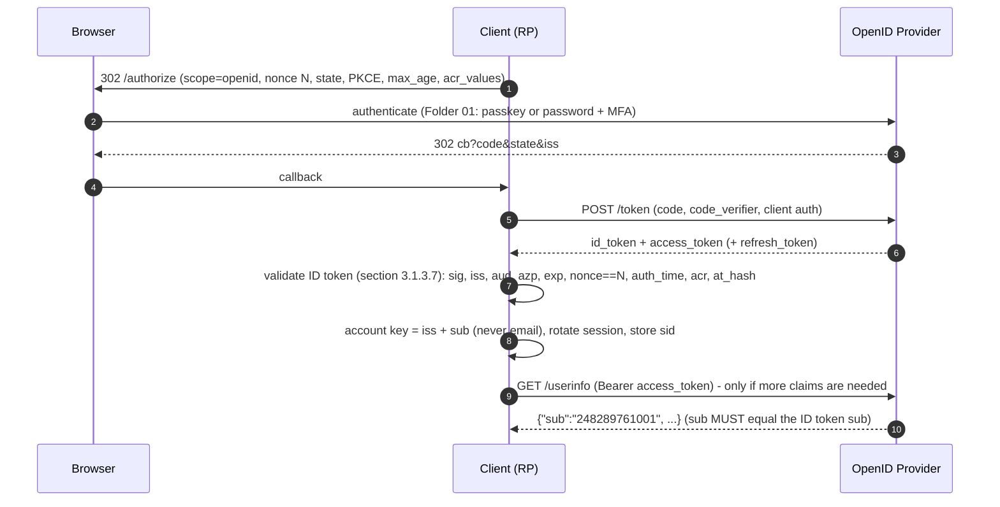

# OIDC Core: ID Token vs Access Token, UserInfo, Discovery, and at_hash / c_hash

> Folder 03 · File 01 of 03 · Identity, AuthN/AuthZ, OAuth 2.1/OIDC/FAPI 2.0 L7 Reference
> Next: [02 · Federation: OIDC vs SAML 2.0, SCIM 2.0](02-federation-showdown-oidc-vs-saml2-assertions-and-scim2-Automated-provisioning.md) · [03 · Logout and CAEP](03-distributed-session-termination-front-channel-vs-back-channel-logout-and-caep.md)

| Listing | What it proves | Oracle |
|---|---|---|
| L20 `OidcIdTokenLab.java` | OIDC Core 1.0 Appendix A as executable oracles: the A.7 key verifies the RS256 ID tokens of A.2/A.3/A.4/A.6, and `at_hash`/`c_hash` reproduce `77QmUPtjPfzWtF2AnpK9RQ` and `LDktKdoQak3Pk0cnXxCltA`. Then the §3.1.3.7 algorithm as an L7 validator vs an L5 "signature + exp" validator over nine attacks, including multi-tenant issuer confusion and nOAuth | OIDC Core 1.0 Appendix A, extracted verbatim into `fixtures/` |
| L21 `SpringOidcLab.java` | Spring Security 7.1.2's real `OidcIdTokenValidator`: it accepts an untrusted extra audience, a stale `auth_time` and a weak `acr`. Three validators close the gaps, plugged in through `OidcIdTokenDecoderFactory` with a pinned algorithm | the shipped validator classes |

**Verification.** Compiled with Folders 01–03 by `javac --release 21 -Xlint:all -Werror` on JDK 25.0.4.1, against SHA-1-verified spring-security 7.1.2 jars. The gate re-runs both outputs and requires them byte-identical; L21 masks wall-clock instants in Spring's error strings. The Appendix A extract comes from <https://openid.net/specs/openid-connect-core-1_0.html> (fetched 2026-11-06), with HTML stripped and the content otherwise unchanged. Spring behaviour marked [D] was read from the 7.1.2 `-sources.jar`, including the in-code comment that leaves the validator's algorithm step unimplemented pending upstream issue gh-4413.

Labels: **[D]** documented · **[M]** measured by a listing · **[E]** engineering judgment · **⚠** trap.

---

## 0. Orientation

OAuth gives a client an access token for an API (Folder 02). OpenID Connect adds a second artefact, the **ID token**: a JWT the OpenID Provider (OP) signs *for the client*, stating who authenticated, when, how, and for which login transaction. Almost every OIDC vulnerability comes from mixing those two up:
- using an access token as proof of login;
- sending an ID token to an API as a bearer token;
- validating an ID token the way you validate an access token, which skips `nonce`, `azp`, `auth_time` and `acr`.

Results:
- **[M]** All four signed example ID tokens in OIDC Core 1.0 Appendix A verify with the Appendix A.7 RSA key. L20 recomputes the hashes: `at_hash` for the A.3 access token is `77QmUPtjPfzWtF2AnpK9RQ`, and `c_hash` for the A.4 code is `LDktKdoQak3Pk0cnXxCltA`, exactly as published.
- **[M]** A "verify signature + check `exp`" validator accepts **8 of 9** attacks:
  - an ID token issued to another client;
  - an extra untrusted audience;
  - a replayed old nonce;
  - a `max_age` bypass;
  - an `acr` downgrade;
  - a token from the attacker's own tenant of a multi-tenant OP;
  - an `at_hash` substitution;
  - nOAuth account takeover by email.
  
  L7 blocks all nine. For nOAuth it keys the account on `iss|sub`, so the attacker's token maps to the attacker's own account.
- **[M][D] Spring Security 7.1.2's `OidcIdTokenValidator`:**
  - It checks `iss`, that `aud` *contains* the client_id, the `azp` rules, and `exp`/`iat` with 60 s skew. Nonce is checked separately, as a SHA-256 hash, in `OidcAuthorizationCodeAuthenticationProvider`.
  - It **does not reject untrusted extra audiences**, even though the code comment quotes that rule, and does not check `auth_time` against `max_age` or check `acr`.
  - Algorithm pinning in the validator is left unimplemented in the source, pending upstream issue gh-4413.
  
  L21's chain fixes all three through `OidcIdTokenDecoderFactory`.

---

## 1. First principles: two tokens, two audiences

```text
                               issued by the OP, after authenticating the user
        +-----------------------------------+------------------------------------------------+
        | ID token (JWT, always)            | access token (opaque or JWT)                   |
        +-----------------------------------+------------------------------------------------+
 aud    | the CLIENT (client_id)            | the RESOURCE SERVER (API identifier, RFC 8707) |
 says   | "user X authenticated to YOU at    | "the bearer may call this API with these       |
        |  time T with method M for login N" |  scopes until exp"                             |
 who    | the client validates it, once,     | the RS validates it on every call; the client  |
 checks |  at login                          |  treats it as OPAQUE                           |
 key    | iss, sub, aud, azp, nonce, auth_   | iss, aud, scope, client_id, exp, cnf           |
 claims |  time, acr, amr, at_hash, c_hash   |  (Folder 01 file 03: typ at+jwt)               |
 never  | send it to an API as a bearer      | treat it as proof of login at the client       |
        +-----------------------------------+------------------------------------------------+
```

The same JWS machinery (Folder 01 file 03) signs both, which is why they get confused. RFC 8725's answer is **explicit typing**: access tokens are `typ: at+jwt` (RFC 9068), logout tokens `logout+jwt`, SETs `secevent+jwt`. Each validator then rejects the other types (Folder 01 L10 attack 9; file 03 L24).

### 1.1 The OIDC code flow on the wire

```http
GET /authorize?response_type=code&client_id=s6BhdRkqt3&redirect_uri=https%3A%2F%2Fclient.example.org%2Fcb&scope=openid%20profile%20email&nonce=n-0S6_WzA2Mj&state=af0ifjsldkj&code_challenge=E9Melhoa2OwvFrEMTJguCHaoeK1t8URWbuGJSstw-cM&code_challenge_method=S256&max_age=300&acr_values=urn%3Aexample%3Aaal2 HTTP/1.1
Host: server.example.com
```

```http
HTTP/1.1 200 OK
Content-Type: application/json
Cache-Control: no-store

{"access_token":"SlAV32hkKG","token_type":"Bearer","expires_in":300,"refresh_token":"8xLOxBtZp8","id_token":"eyJraWQiOiIxZTlnZGs3IiwiYWxnIjoiUlMyNTYifQ.ewogImlzcyI6ICJodHRwczovL3NlcnZlci5leGFtcGxlLmNvbSIs...","scope":"openid profile email"}
```

Decoded ID token claims, from the spec's examples plus the claims a hardened client relies on:

```json
{"iss": "https://server.example.com", "sub": "248289761001", "aud": "s6BhdRkqt3",
 "nonce": "n-0S6_WzA2Mj", "exp": 1311281970, "iat": 1311280970,
 "auth_time": 1311280969, "acr": "urn:example:aal2", "amr": ["pwd", "otp"], "azp": "s6BhdRkqt3",
 "at_hash": "77QmUPtjPfzWtF2AnpK9RQ"}
```



---

## 2. The validation algorithm, step by step (OIDC Core §3.1.3.7)

| # | Check | Stops | Notes |
|---|---|---|---|
| 1 | decrypt if encrypted (JWE) | — | the alg/enc pinned per client registration |
| 2 | `iss` **exactly** equals the issuer from discovery | multi-tenant confusion (L20 #6) | for multi-tenant OPs, validate against an allow-list of tenant issuers |
| 3 | `aud` contains `client_id`, and **no audience the client does not trust** | ID tokens minted for other clients (#1, #2) | Spring checks only "contains" (L21) |
| 4–5 | multiple audiences → `azp` present; `azp` = `client_id` | token issued to another party | Spring enforces both |
| 6–8 | signature with the OP's key; **alg** as registered (`id_token_signed_response_alg`) | alg confusion (Folder 01 file 03) | Spring: alg resolver per registration, but the validator's alg step is unimplemented (gh-4413) |
| 9–10 | `exp` in the future, `iat` reasonable | stale tokens (#9) | 60 s skew by default |
| 11 | `nonce` equals the value sent in the request | replay of an old ID token (#3); code injection for OIDC clients (Folder 02) | Spring sends SHA-256(nonce) and compares the hash |
| 12 | `acr` acceptable if requested | MFA downgrade (#5) | the OP may ignore voluntary `acr_values`; the RP must check |
| 13 | `auth_time` within `max_age` if requested | stale authentication (#4) | step-up for payments uses this (Folder 01) |
| — | `at_hash` / `c_hash` when present (implicit and hybrid flows) | token or code substitution in the front channel (#7) | §3.2.2.9 / §3.3.2.11 |

### 2.1 `at_hash` and `c_hash` exactly

```text
  at_hash = BASE64URL( left-most half of  HASH( ASCII(access_token) ) )     HASH = SHA-256 for RS256/ES256/PS256,
  c_hash  = BASE64URL( left-most half of  HASH( ASCII(code) ) )                    SHA-384 for *384, SHA-512 for *512
  A.3:  access_token = jHkWEdUXMU1BwAsC4vtUsZwnNvTIxEl0z9K3vx5KF0Y   ->  at_hash = 77QmUPtjPfzWtF2AnpK9RQ   (L20)
  A.4:  code = Qcb0Orv1zh30vL1MPRsbm-diHiMwcLyZvn1arpZv-Jxf_11jnpEX3Tgfvk  ->  c_hash = LDktKdoQak3Pk0cnXxCltA
```

The hashes exist because, in implicit and hybrid flows, the access token or code arrives **in the front channel next to the ID token**. Without a hash, an attacker could swap in a different access token or code (their own, or a stolen one) while the signed ID token still validates. In the plain code flow, both arrive over the back channel from the token endpoint, so `at_hash` is optional there [D: §3.1.3.8]. With hybrid and implicit flows removed from the OAuth 2.1 mindset, the hashes matter mostly for legacy flows and FAPI 1.0 Advanced's detached signatures (Folder 04) [E].

---

## 3. L20: the spec's own examples, then nine attacks

<!-- listing:OidcIdTokenLab.java -->
```java
import java.nio.charset.StandardCharsets;
import java.nio.file.Path;
import java.security.SecureRandom;
import java.util.Arrays;
import java.util.LinkedHashMap;
import java.util.List;
import java.util.Map;
import java.util.Set;

/**
 * L20 - OpenID Connect ID tokens from first principles.
 *
 * <ol>
 *   <li>Oracles from OIDC Core 1.0 Appendix A (fixture): the A.7 RSA key verifies the RS256 ID tokens of A.2, A.3,
 *       A.4 and A.6; at_hash/c_hash = BASE64URL(left half of SHA-256(ASCII(token))) reproduce the spec's values.</li>
 *   <li>The section 3.1.3.7 validation algorithm as an L7 validator (iss exact, aud contains client and nothing
 *       untrusted, azp, exp/iat with skew, nonce, auth_time vs max_age, acr, at_hash/c_hash, alg pinned) vs an L5
 *       "signature + exp" validator, over nine attacks - including multi-tenant issuer confusion and nOAuth (identity
 *       keyed on a mutable email instead of iss+sub).</li>
 * </ol>
 */
public final class OidcIdTokenLab {

    /** OIDC Core 3.1.3.6: hash with the alg's SHA-2, take the left-most half, base64url. */
    static String halfHash(String token, String alg) {
        try {
            String h = alg.endsWith("384") ? "SHA-384" : alg.endsWith("512") ? "SHA-512" : "SHA-256";
            byte[] d = java.security.MessageDigest.getInstance(h).digest(token.getBytes(StandardCharsets.US_ASCII));
            return KbSupport.b64u(Arrays.copyOf(d, d.length / 2));
        } catch (java.security.GeneralSecurityException e) {
            throw new IllegalStateException(e);
        }
    }

    /** The value after "name=" in the spec's wrapped example, joined across display line breaks. */
    static String wrappedParam(String text, String section, String name) {
        int s = text.indexOf(section);
        int at = text.indexOf(name + "=", s);
        StringBuilder b = new StringBuilder();
        for (String line : text.substring(at + name.length() + 1).split("\n")) {
            String t = line.trim();
            if (t.isEmpty() || t.startsWith("&")) {
                break;
            }
            b.append(t);
        }
        return b.toString();
    }

    record Request(String clientId, String nonce, Long maxAge, Set<String> acrValues, String accessToken, String code) {
    }

    record Ctx(String expectedIssuer, Set<String> trustedAudiences, Map<String, Jose.Jwk> jwks, long now) {
    }

    /** L5: what tutorials do - verify the signature with "the" key and check exp. */
    static String l5(String idToken, Ctx ctx, Request rq) {
        Jose.Parts p = Jose.parse(idToken);
        Jose.Jwk k = ctx.jwks().values().iterator().next();
        if (!Jose.rawVerify((String) p.header().get("alg"), k, p.signingInput(), p.sig())) {
            return "rejected (signature)";
        }
        Map<String, Object> c = MiniJson.object(new String(p.payload(), StandardCharsets.UTF_8));
        return (Long) c.get("exp") < ctx.now() ? "rejected (expired)" : "accepted as " + c.get("email");
    }

    /** L7: OIDC Core 3.1.3.7 (+3.2.2.9/3.3.2.10 for hashes); returns the account key iss|sub. */
    static String l7(String idToken, Ctx ctx, Request rq) {
        Jose.Parts p = Jose.parse(idToken);
        Object kid = p.header().get("kid");
        Jose.Jwk k = ctx.jwks().get(String.valueOf(kid));
        if (k == null || !k.alg().equals(p.header().get("alg"))) {
            return "rejected (unknown kid or alg not pinned to it)";
        }
        if (!Jose.rawVerify(k.alg(), k, p.signingInput(), p.sig())) {
            return "rejected (signature)";
        }
        Map<String, Object> c = MiniJson.object(new String(p.payload(), StandardCharsets.UTF_8));
        if (!ctx.expectedIssuer().equals(c.get("iss"))) {
            return "rejected (iss " + c.get("iss") + ")";
        }
        List<?> aud = c.get("aud") instanceof List<?> l ? l : List.of(String.valueOf(c.get("aud")));
        if (!aud.contains(rq.clientId())) {
            return "rejected (aud does not contain " + rq.clientId() + ")";
        }
        for (Object a : aud) {
            if (!a.equals(rq.clientId()) && !ctx.trustedAudiences().contains(a)) {
                return "rejected (untrusted extra audience " + a + ")";
            }
        }
        Object azp = c.get("azp");
        if ((aud.size() > 1 && azp == null) || (azp != null && !rq.clientId().equals(azp))) {
            return "rejected (azp)";
        }
        long skew = 60;
        if (!(c.get("exp") instanceof Long exp) || ctx.now() >= exp + skew || !(c.get("iat") instanceof Long iat) || iat > ctx.now() + skew) {
            return "rejected (exp/iat)";
        }
        if (!rq.nonce().equals(c.get("nonce"))) {
            return "rejected (nonce)";
        }
        if (rq.maxAge() != null && (!(c.get("auth_time") instanceof Long at) || ctx.now() - at > rq.maxAge() + skew)) {
            return "rejected (auth_time older than max_age)";
        }
        if (!rq.acrValues().isEmpty() && !rq.acrValues().contains(c.get("acr"))) {
            return "rejected (acr " + c.get("acr") + " not in " + rq.acrValues() + ")";
        }
        if (rq.accessToken() != null && c.containsKey("at_hash") && !halfHash(rq.accessToken(), k.alg()).equals(c.get("at_hash"))) {
            return "rejected (at_hash)";
        }
        if (rq.code() != null && c.containsKey("c_hash") && !halfHash(rq.code(), k.alg()).equals(c.get("c_hash"))) {
            return "rejected (c_hash)";
        }
        return "accepted as account " + c.get("iss") + "|" + c.get("sub");
    }

    static String idToken(Jose.Jwk key, Map<String, Object> claims) {
        Map<String, Object> h = new LinkedHashMap<>();
        h.put("alg", key.alg());
        h.put("kid", key.kid());
        return Jose.sign(h, MiniJson.write(claims).getBytes(StandardCharsets.UTF_8), key);
    }

    static Map<String, Object> claims(String iss, Object aud, String sub, String email, String nonce, long iat) {
        Map<String, Object> c = new LinkedHashMap<>();
        c.put("iss", iss);
        c.put("sub", sub);
        c.put("aud", aud);
        c.put("nonce", nonce);
        c.put("iat", iat);
        c.put("exp", iat + 300);
        c.put("auth_time", iat - 30);
        c.put("acr", "urn:example:aal2");
        c.put("email", email);
        return c;
    }

    public static void main(String[] args) throws Exception {
        Path fx = KbSupport.fixtures(args);
        String a = KbSupport.text(fx, "oidc-core-1_0-appendix-a.txt");

        KbSupport.section("OIDC Core 1.0 Appendix A oracles (fixture)");
        Jose.Jwk opKey = Jose.Jwk.parse(withAlg(Jose.jsonAfter(a, "A.7.")));
        String accessToken = "jHkWEdUXMU1BwAsC4vtUsZwnNvTIxEl0z9K3vx5KF0Y";
        String code = "Qcb0Orv1zh30vL1MPRsbm-diHiMwcLyZvn1arpZv-Jxf_11jnpEX3Tgfvk";
        KbSupport.mustCite(a, accessToken, "A.3 access_token");
        KbSupport.mustCite(a, code, "A.4 code");
        KbSupport.check("at_hash(A.3 access_token) = " + halfHash(accessToken, "RS256") + " (spec: 77QmUPtjPfzWtF2AnpK9RQ)",
                halfHash(accessToken, "RS256").equals("77QmUPtjPfzWtF2AnpK9RQ"));
        KbSupport.check("c_hash(A.4 code) = " + halfHash(code, "RS256") + " (spec: LDktKdoQak3Pk0cnXxCltA)",
                halfHash(code, "RS256").equals("LDktKdoQak3Pk0cnXxCltA"));
        int verified = 0;
        for (String sec : new String[] {"A.2.", "A.3.", "A.4.", "A.6."}) {
            String tok = wrappedParam(a, sec, "id_token");
            Jose.Parts p = Jose.parse(tok);
            boolean ok = Jose.rawVerify("RS256", opKey, p.signingInput(), p.sig());
            Map<String, Object> c = MiniJson.object(new String(p.payload(), StandardCharsets.UTF_8));
            KbSupport.info("%s kid=%s RS256 signature %s; hashes: at_hash=%s c_hash=%s", sec, p.header().get("kid"), ok ? "valid" : "INVALID",
                    c.getOrDefault("at_hash", "-"), c.getOrDefault("c_hash", "-"));
            verified += ok ? 1 : 0;
        }
        KbSupport.check(verified + "/4 Appendix A ID tokens verify with the A.7 key", verified == 4);
        Jose.Parts a6 = Jose.parse(wrappedParam(a, "A.6.", "id_token"));
        Map<String, Object> c6 = MiniJson.object(new String(a6.payload(), StandardCharsets.UTF_8));
        KbSupport.check("A.6 (code id_token token) carries both hashes and they match the A.6 code and token",
                halfHash(wrappedParam(a, "A.6.", "access_token"), "RS256").equals(c6.get("at_hash"))
                        && halfHash(wrappedParam(a, "A.6.", "code"), "RS256").equals(c6.get("c_hash")));

        KbSupport.section("Section 3.1.3.7 validation: L5 (signature + exp) vs L7, nine attacks");
        SecureRandom rng = new SecureRandom();
        Jose.Jwk op = Jose.generate("ES256", rng);
        Jose.Jwk attackerTenantKey = op; // multi-tenant OP: every tenant's tokens are signed with the SAME OP keys
        String iss = "https://login.example.com/tenant-acme/v2.0";
        long now = 1_767_225_600L;
        Ctx ctx = new Ctx(iss, Set.of(), Map.of(op.kid(), op), now);
        Request rq = new Request("payroll-app", "n-0S6_WzA2Mj", 300L, Set.of("urn:example:aal2"), "at-legit", null);

        Map<String, Map<String, Object>> cases = new LinkedHashMap<>();
        cases.put("0 legitimate login", claims(iss, "payroll-app", "248289761001", "alice@acme.example", "n-0S6_WzA2Mj", now - 10));
        cases.put("1 ID token minted for another client (aud=crm-app)", claims(iss, "crm-app", "248289761001", "alice@acme.example",
                "n-0S6_WzA2Mj", now - 10));
        Map<String, Object> extra = claims(iss, List.of("payroll-app", "evil-app"), "248289761001", "alice@acme.example", "n-0S6_WzA2Mj", now - 10);
        extra.put("azp", "payroll-app");
        cases.put("2 aud contains us AND an untrusted client", extra);
        cases.put("3 replayed ID token from an earlier login (old nonce)", claims(iss, "payroll-app", "248289761001", "alice@acme.example",
                "n-OLD", now - 10));
        Map<String, Object> stale = claims(iss, "payroll-app", "248289761001", "alice@acme.example", "n-0S6_WzA2Mj", now - 10);
        stale.put("auth_time", now - 7_200);
        cases.put("4 max_age=300 but the user authenticated 2 h ago", stale);
        Map<String, Object> weak = claims(iss, "payroll-app", "248289761001", "alice@acme.example", "n-0S6_WzA2Mj", now - 10);
        weak.put("acr", "urn:example:aal1");
        cases.put("5 acr downgrade (password only) where aal2 was required", weak);
        cases.put("6 token from attacker's OWN tenant of the same multi-tenant OP", claims("https://login.example.com/tenant-evil/v2.0",
                "payroll-app", "666", "alice@acme.example", "n-0S6_WzA2Mj", now - 10));
        Map<String, Object> hashed = claims(iss, "payroll-app", "248289761001", "alice@acme.example", "n-0S6_WzA2Mj", now - 10);
        hashed.put("at_hash", halfHash("at-ATTACKER", "ES256"));
        cases.put("7 hybrid flow: access token substituted (at_hash mismatch)", hashed);
        Map<String, Object> noauth = claims(iss, "payroll-app", "999-attacker-sub", "alice@acme.example", "n-0S6_WzA2Mj", now - 10);
        cases.put("8 nOAuth: attacker's account in the right tenant sets email=alice@...", noauth);
        cases.put("9 expired a minute and a half ago", claims(iss, "payroll-app", "248289761001", "alice@acme.example", "n-0S6_WzA2Mj",
                now - 390));

        int l5bad = 0;
        int l7ok = 0;
        for (Map.Entry<String, Map<String, Object>> e : cases.entrySet()) {
            boolean legit = e.getKey().startsWith("0");
            String tok = idToken(e.getKey().startsWith("6") ? attackerTenantKey : op, e.getValue());
            String r5 = l5(tok, ctx, rq);
            String r7 = l7(tok, ctx, rq);
            if (!legit) {
                l5bad += r5.startsWith("accepted") ? 1 : 0;
                // nOAuth is neutralised when the token maps to the ATTACKER's own account, not alice's
                l7ok += r7.startsWith("rejected") || (e.getKey().startsWith("8") && !r7.contains("248289761001")) ? 1 : 0;
            }
            KbSupport.info("%-62s L5: %-30s L7: %s", e.getKey(), r5, r7);
        }
        KbSupport.check("L5 accepts " + l5bad + " of 9 attacks (it keys the account on email)", l5bad >= 8);
        KbSupport.check("L7 blocks all 9: rejects 8, and maps the nOAuth token to the attacker's OWN iss|sub account", l7ok == 9);
        KbSupport.check("legitimate token: L7 account key is iss|sub, never the email",
                l7(idToken(op, cases.get("0 legitimate login")), ctx, rq).endsWith("tenant-acme/v2.0|248289761001"));
        KbSupport.verdict();
    }

    private static Map<String, Object> withAlg(Map<String, Object> jwk) {
        Map<String, Object> m = new LinkedHashMap<>(jwk);
        m.putIfAbsent("alg", "RS256");
        return m;
    }
}
```

<!-- output:OidcIdTokenLab.java -->
```text

== OIDC Core 1.0 Appendix A oracles (fixture)
  [PASS] constant cited verbatim from fixture: A.3 access_token
  [PASS] constant cited verbatim from fixture: A.4 code
  [PASS] at_hash(A.3 access_token) = 77QmUPtjPfzWtF2AnpK9RQ (spec: 77QmUPtjPfzWtF2AnpK9RQ)
  [PASS] c_hash(A.4 code) = LDktKdoQak3Pk0cnXxCltA (spec: LDktKdoQak3Pk0cnXxCltA)
  A.2. kid=1e9gdk7 RS256 signature valid; hashes: at_hash=- c_hash=-
  A.3. kid=1e9gdk7 RS256 signature valid; hashes: at_hash=77QmUPtjPfzWtF2AnpK9RQ c_hash=-
  A.4. kid=1e9gdk7 RS256 signature valid; hashes: at_hash=- c_hash=LDktKdoQak3Pk0cnXxCltA
  A.6. kid=1e9gdk7 RS256 signature valid; hashes: at_hash=77QmUPtjPfzWtF2AnpK9RQ c_hash=LDktKdoQak3Pk0cnXxCltA
  [PASS] 4/4 Appendix A ID tokens verify with the A.7 key
  [PASS] A.6 (code id_token token) carries both hashes and they match the A.6 code and token

== Section 3.1.3.7 validation: L5 (signature + exp) vs L7, nine attacks
  0 legitimate login                                             L5: accepted as alice@acme.example L7: accepted as account https://login.example.com/tenant-acme/v2.0|248289761001
  1 ID token minted for another client (aud=crm-app)             L5: accepted as alice@acme.example L7: rejected (aud does not contain payroll-app)
  2 aud contains us AND an untrusted client                      L5: accepted as alice@acme.example L7: rejected (untrusted extra audience evil-app)
  3 replayed ID token from an earlier login (old nonce)          L5: accepted as alice@acme.example L7: rejected (nonce)
  4 max_age=300 but the user authenticated 2 h ago               L5: accepted as alice@acme.example L7: rejected (auth_time older than max_age)
  5 acr downgrade (password only) where aal2 was required        L5: accepted as alice@acme.example L7: rejected (acr urn:example:aal1 not in [urn:example:aal2])
  6 token from attacker's OWN tenant of the same multi-tenant OP L5: accepted as alice@acme.example L7: rejected (iss https://login.example.com/tenant-evil/v2.0)
  7 hybrid flow: access token substituted (at_hash mismatch)     L5: accepted as alice@acme.example L7: rejected (at_hash)
  8 nOAuth: attacker's account in the right tenant sets email=alice@... L5: accepted as alice@acme.example L7: accepted as account https://login.example.com/tenant-acme/v2.0|999-attacker-sub
  9 expired a minute and a half ago                              L5: rejected (expired)             L7: rejected (exp/iat)
  [PASS] L5 accepts 8 of 9 attacks (it keys the account on email)
  [PASS] L7 blocks all 9: rejects 8, and maps the nOAuth token to the attacker's OWN iss|sub account
  [PASS] legitimate token: L7 account key is iss|sub, never the email

verdict: OK (9 checks)
```

Reading the attack table:

- **#1 and #2, audience.** An ID token is a statement *to a client*. A token for `crm-app` presented to `payroll-app`, or a token listing an extra untrusted party, means someone else could replay it to you.
- **#3, nonce.** The nonce ties the token to *this* login transaction. Without it, a captured ID token is a reusable login.
- **#4 and #5, `auth_time` and `acr`.** `max_age` and `acr_values` are *requests*. The OP may not honour them, so the RP must check what came back.
- **#6, multi-tenant OPs.** Many OPs sign every tenant's tokens with the same keys (L20 models this). A client that accepts "any issuer of this OP" accepts the attacker's tenant. Pin the issuer, or an explicit tenant allow-list, and check the tenant claim against it.
- **#8, nOAuth.** Descope's June 2023 disclosure:
  - Apps keyed accounts on the `email` claim. Entra ID allowed unverified, user-settable email attributes, so an attacker could put a victim's address on an account in a tenant they control and sign into the victim's account in the app.
  - Microsoft's guidance is to key on the `iss` + `sub` pair. After June 2023, new app registrations stopped emitting unverified emails by default.
  - Semperis reported continued exposure in 2025 [D].
  
  L20's L7 maps the token to `…|999-attacker-sub`: the attacker's own empty account.

---

## 4. Spring Security 7.1.2: what OIDC login validates, and how to finish the job

[D: `OidcIdTokenValidator`, `OidcAuthorizationCodeAuthenticationProvider`, `OidcIdTokenDecoderFactory`, all 7.1.2]
- `validateRequiredClaims` requires `iss`, `sub`, `aud`, `exp` and `iat`.
- `iss` must equal `ClientRegistration.providerDetails.issuerUri` exactly, when configured.
- `aud` must **contain** `client_id`. The code comment quotes the spec ("or if it contains additional audiences not trusted by the Client"), but the code does not enforce that half.
- Multiple audiences require `azp`, and `azp` must equal `client_id`.
- `exp` and `iat` are checked with a 60 s skew.
- The **nonce** is checked in `OidcAuthorizationCodeAuthenticationProvider.validateNonce`. The request carries SHA-256(nonce), and the ID token's `nonce` must equal that hash.
- **Not checked:** `auth_time` vs `max_age`, `acr`, and `at_hash`/`c_hash`. The last is fine for the code flow.
- Algorithm: `OidcIdTokenDecoderFactory` defaults to RS256 per registration (`setJwsAlgorithmResolver` changes it). The validator's own "alg SHOULD be…" step is a comment, not code: it is deferred until upstream issue gh-4413 lands.

<!-- listing:SpringOidcLab.java -->
```java
import java.time.Duration;
import java.time.Instant;
import java.util.List;
import java.util.Set;

import org.springframework.context.annotation.Bean;
import org.springframework.context.annotation.Configuration;
import org.springframework.security.oauth2.client.oidc.authentication.OidcIdTokenDecoderFactory;
import org.springframework.security.oauth2.client.oidc.authentication.OidcIdTokenValidator;
import org.springframework.security.oauth2.client.registration.ClientRegistration;
import org.springframework.security.oauth2.core.AuthorizationGrantType;
import org.springframework.security.oauth2.core.DelegatingOAuth2TokenValidator;
import org.springframework.security.oauth2.core.OAuth2Error;
import org.springframework.security.oauth2.core.OAuth2TokenValidator;
import org.springframework.security.oauth2.core.OAuth2TokenValidatorResult;
import org.springframework.security.oauth2.jose.jws.SignatureAlgorithm;
import org.springframework.security.oauth2.jwt.Jwt;

/**
 * L21 - what Spring Security 7.1.2's OIDC login validates out of the box, run on the real
 * {@link OidcIdTokenValidator}, and the three validators that close the gaps (untrusted extra audiences, max_age,
 * acr), plugged in through {@link OidcIdTokenDecoderFactory} together with a pinned signature algorithm.
 */
@Configuration(proxyBeanMethods = false)
public class SpringOidcLab {

    static final String ISS = "https://login.example.com/tenant-acme/v2.0";

    /** OIDC Core 3.1.3.7 step 3, second half: reject audiences the client does not trust. */
    record StrictAudienceValidator(String clientId, Set<String> trusted) implements OAuth2TokenValidator<Jwt> {
        @Override
        public OAuth2TokenValidatorResult validate(Jwt t) {
            List<String> aud = t.getAudience();
            boolean ok = aud != null && aud.stream().allMatch(a -> a.equals(clientId) || trusted.contains(a));
            return ok ? OAuth2TokenValidatorResult.success()
                    : OAuth2TokenValidatorResult.failure(new OAuth2Error("invalid_id_token", "untrusted audience in " + aud, null));
        }
    }

    /** Step 11/12: auth_time must be recent enough for the max_age this client always requests. */
    record MaxAgeValidator(Duration maxAge, Duration skew) implements OAuth2TokenValidator<Jwt> {
        @Override
        public OAuth2TokenValidatorResult validate(Jwt t) {
            Instant authTime = t.getClaimAsInstant("auth_time");
            boolean ok = authTime != null && !Instant.now().minus(maxAge).minus(skew).isAfter(authTime);
            return ok ? OAuth2TokenValidatorResult.success()
                    : OAuth2TokenValidatorResult.failure(new OAuth2Error("invalid_id_token", "auth_time older than max_age", null));
        }
    }

    record AcrValidator(Set<String> acceptable) implements OAuth2TokenValidator<Jwt> {
        @Override
        public OAuth2TokenValidatorResult validate(Jwt t) {
            return acceptable.contains(t.getClaimAsString("acr")) ? OAuth2TokenValidatorResult.success()
                    : OAuth2TokenValidatorResult.failure(new OAuth2Error("invalid_id_token", "acr " + t.getClaimAsString("acr"), null));
        }
    }

    static ClientRegistration registration() {
        return ClientRegistration.withRegistrationId("acme").clientId("payroll-app").clientSecret("unused")
                .authorizationGrantType(AuthorizationGrantType.AUTHORIZATION_CODE)
                .redirectUri("https://payroll.example.com/login/oauth2/code/acme").scope("openid")
                .authorizationUri(ISS + "/authorize").tokenUri(ISS + "/token").jwkSetUri(ISS + "/keys").issuerUri(ISS).build();
    }

    static OAuth2TokenValidator<Jwt> hardened(ClientRegistration r) {
        return new DelegatingOAuth2TokenValidator<>(new OidcIdTokenValidator(r), new StrictAudienceValidator(r.getClientId(), Set.of()),
                new MaxAgeValidator(Duration.ofMinutes(5), Duration.ofSeconds(60)), new AcrValidator(Set.of("urn:example:aal2")));
    }

    /** The decoder Spring's OIDC login uses, with the alg pinned and the hardened validator chain. */
    @Bean
    OidcIdTokenDecoderFactory idTokenDecoderFactory() {
        OidcIdTokenDecoderFactory f = new OidcIdTokenDecoderFactory();
        f.setJwsAlgorithmResolver(r -> SignatureAlgorithm.ES256);
        f.setJwtValidatorFactory(SpringOidcLab::hardened);
        return f;
    }

    static Jwt token(String iss, List<String> aud, String azp, Instant iat, Instant authTime, String acr) {
        Jwt.Builder b = Jwt.withTokenValue("id-token").header("alg", "ES256").claim("iss", iss).subject("248289761001")
                .audience(aud).issuedAt(iat).expiresAt(iat.plusSeconds(300)).claim("auth_time", authTime).claim("acr", acr)
                .claim("nonce", "hashed-nonce");
        if (azp != null) {
            b.claim("azp", azp);
        }
        return b.build();
    }

    static String run(OAuth2TokenValidator<Jwt> v, Jwt t) {
        OAuth2TokenValidatorResult r = v.validate(t);
        return r.hasErrors() ? "rejected (" + r.getErrors().iterator().next().getDescription().replaceAll("[0-9]{4}-[0-9]{2}-[0-9T:.]+Z", "<t>") + ")"
                : "accepted";
    }

    public static void main(String[] args) {
        ClientRegistration reg = registration();
        OAuth2TokenValidator<Jwt> stock = new OidcIdTokenValidator(reg);
        OAuth2TokenValidator<Jwt> hard = hardened(reg);
        Instant now = Instant.now();
        Object[][] cases = {
            {"legitimate", token(ISS, List.of("payroll-app"), null, now, now.minusSeconds(30), "urn:example:aal2"), true},
            {"aud [payroll-app, evil-app] + azp=payroll-app", token(ISS, List.of("payroll-app", "evil-app"), "payroll-app", now,
                    now.minusSeconds(30), "urn:example:aal2"), false},
            {"aud [payroll-app, evil-app], no azp", token(ISS, List.of("payroll-app", "evil-app"), null, now, now.minusSeconds(30),
                    "urn:example:aal2"), false},
            {"iss = another tenant", token("https://login.example.com/tenant-evil/v2.0", List.of("payroll-app"), null, now,
                    now.minusSeconds(30), "urn:example:aal2"), false},
            {"auth_time 2 h ago (client always sends max_age=300)", token(ISS, List.of("payroll-app"), null, now,
                    now.minusSeconds(7_200), "urn:example:aal2"), false},
            {"acr aal1 where aal2 is required", token(ISS, List.of("payroll-app"), null, now, now.minusSeconds(30), "urn:example:aal1"), false},
            {"expired 50 s ago (inside the 60 s default skew)", token(ISS, List.of("payroll-app"), null, now.minusSeconds(350),
                    now.minusSeconds(60), "urn:example:aal2"), true},
            {"expired 90 s ago", token(ISS, List.of("payroll-app"), null, now.minusSeconds(390), now.minusSeconds(420), "urn:example:aal2"), false}};

        KbSupport.section("OidcIdTokenValidator (stock, 7.1.2) vs the hardened chain, on the real classes");
        int stockGaps = 0;
        int hardOk = 0;
        for (Object[] c : cases) {
            Jwt t = (Jwt) c[1];
            boolean legit = (Boolean) c[2];
            String s = run(stock, t);
            String h = run(hard, t);
            stockGaps += !legit && s.equals("accepted") ? 1 : 0;
            hardOk += legit == h.equals("accepted") ? 1 : 0;
            KbSupport.info("%-52s stock: %-34s hardened: %s", c[0], s.length() > 34 ? s.substring(0, 34) : s, h);
        }
        KbSupport.check("stock validator accepts " + stockGaps + " bad tokens: extra audience, stale auth_time, weak acr", stockGaps == 3);
        KbSupport.check("hardened chain decides all 8 cases correctly", hardOk == 8);
        OidcIdTokenDecoderFactory f = new SpringSecurityFactoryProbe().factory();
        KbSupport.check("OidcIdTokenDecoderFactory builds a decoder with the pinned alg and hardened chain: "
                + f.createDecoder(reg).getClass().getSimpleName(), f.createDecoder(reg) != null);
        KbSupport.verdict();
    }

    /** Builds the bean outside a container so the configuration itself is exercised. */
    static final class SpringSecurityFactoryProbe {
        OidcIdTokenDecoderFactory factory() {
            return new SpringOidcLab().idTokenDecoderFactory();
        }
    }
}
```

<!-- output:SpringOidcLab.java -->
```text

== OidcIdTokenValidator (stock, 7.1.2) vs the hardened chain, on the real classes
  legitimate                                           stock: accepted                           hardened: accepted
  aud [payroll-app, evil-app] + azp=payroll-app        stock: accepted                           hardened: rejected (untrusted audience in [payroll-app, evil-app])
  aud [payroll-app, evil-app], no azp                  stock: rejected (The ID Token contains in hardened: rejected (The ID Token contains invalid claims: {azp=null})
  iss = another tenant                                 stock: rejected (The ID Token contains in hardened: rejected (The ID Token contains invalid claims: {iss=https://login.example.com/tenant-evil/v2.0})
  auth_time 2 h ago (client always sends max_age=300)  stock: accepted                           hardened: rejected (auth_time older than max_age)
  acr aal1 where aal2 is required                      stock: accepted                           hardened: rejected (acr urn:example:aal1)
  expired 50 s ago (inside the 60 s default skew)      stock: accepted                           hardened: accepted
  expired 90 s ago                                     stock: rejected (The ID Token contains in hardened: rejected (The ID Token contains invalid claims: {exp=<t>})
  [PASS] stock validator accepts 3 bad tokens: extra audience, stale auth_time, weak acr
  [PASS] hardened chain decides all 8 cases correctly
  [PASS] OidcIdTokenDecoderFactory builds a decoder with the pinned alg and hardened chain: NimbusJwtDecoder

verdict: OK (3 checks)
```

Two notes on L21's chain:
- The `max_age` validator here assumes the client *always* requests `max_age=300`. When `max_age` varies per request (step-up), put the check where the authorization request is available, in a custom `AuthenticationProvider` wrapper or an `OAuth2LoginAuthenticationFilter` success handler that reads the stored `OAuth2AuthorizationRequest`, or use Spring Security 7's factor freshness (`RequiredFactor.validDuration`, Folder 01 file 01) [E].
- `StrictAudienceValidator` with an empty trusted set means "only me". Add other client IDs only for deliberate, documented reasons.

---

## 5. UserInfo, discovery, and the claims you can trust

### 5.1 UserInfo

`GET /userinfo` with the access token returns claims about the user. Three rules [D: OIDC Core §5.3.2, §5.3.4]:
- the `sub` in the UserInfo response **MUST** be verified to exactly match the ID token's `sub`;
- if the response is signed, `iss` and `aud` must also be checked;
- TLS server authentication is mandatory.

UserInfo claims are as trustworthy as the OP's source for them. `email` is only an identifier if `email_verified` is true *and* your policy trusts that OP for that domain. It is still never a stable account key [E].

```http
GET /userinfo HTTP/1.1
Host: server.example.com
Authorization: Bearer SlAV32hkKG
```

```json
{"sub": "248289761001", "name": "Jane Doe", "email": "janedoe@example.com", "email_verified": true}
```

### 5.2 Discovery and issuer validation

`https://issuer/.well-known/openid-configuration` lists the endpoints, `jwks_uri`, the supported algorithms and claims, and the `issuer` itself [D: OIDC Discovery 1.0]. The client MUST verify that the `issuer` in the document equals the URL it was fetched for, and must use only that issuer for `iss` checks. Treat the discovery document like code:
- fetch it at startup or on a schedule;
- cache it;
- alert on changes to `jwks_uri` or the endpoints;
- never re-fetch it from a URL found in a token.

That is the same lesson as the rfc7523bis audience fix (Folder 02 file 04).

```json
{"issuer": "https://server.example.com", "authorization_endpoint": "https://server.example.com/authorize",
 "token_endpoint": "https://server.example.com/token", "userinfo_endpoint": "https://server.example.com/userinfo",
 "jwks_uri": "https://server.example.com/jwks.json", "response_types_supported": ["code"],
 "subject_types_supported": ["public", "pairwise"], "id_token_signing_alg_values_supported": ["ES256", "RS256"],
 "code_challenge_methods_supported": ["S256"], "authorization_response_iss_parameter_supported": true,
 "backchannel_logout_supported": true, "backchannel_logout_session_supported": true}
```

### 5.3 Subject identifiers, pairwise `sub`, and account linking

- `sub` is unique and never reassigned **within an issuer**, so the account key is `(iss, sub)` [D: §2]. Email, phone and username are mutable attributes.
- **Pairwise subject identifiers** (`subject_type=pairwise`) give each sector a different `sub` for the same user. That prevents cross-RP correlation, and it means you cannot join users across your own apps unless they share a `sector_identifier_uri` [D: §8.1].
- **Account linking** (adding a second IdP to an existing account) must happen inside an authenticated session with a fresh step-up, never automatically "because the email matches". That rule is the generalisation of nOAuth [E].

---

## 6. The vulnerable L5 implementation vs the hardened L7 zero-trust implementation

```java
// L5 - DO NOT USE: "OIDC" login that trusts the access token and the email claim.
@GetMapping("/login/callback")
String callback(@RequestParam String code, HttpSession s) {
    Tokens t = op.exchange(code);                                              // no PKCE, no state, no nonce (Folder 02)
    Map<String, Object> me = http.get(op.userinfoUri(), bearer(t.accessToken())); // identity from an access token
    User u = users.findByEmail((String) me.get("email"))                       // nOAuth: mutable, maybe unverified
                  .orElseGet(() -> users.create((String) me.get("email")));
    s.setAttribute("user", u.id());                                            // no session rotation, no sid stored
    return "redirect:/";
}
```

```java
// L7 - Spring Security 7.1.2: oauth2Login with the hardened ID-token chain (L21) and an (iss, sub) account key.
@Bean
SecurityFilterChain web(HttpSecurity http, OidcIdTokenDecoderFactory hardened) throws Exception {
    http.oauth2Login(o -> o
            .tokenEndpoint(t -> {})                                        // code + PKCE (ClientSettings.requireProofKey, Folder 02)
            .userInfoEndpoint(u -> u.oidcUserService(accountsByIssuerAndSubject())))
        .sessionManagement(s -> s.sessionFixation(f -> f.changeSessionId()));
    return http.build();
}
// accountsByIssuerAndSubject(): delegate to OidcUserService, then look up/create the local account by
// (idToken.getIssuer(), idToken.getSubject()); NEVER by email. Linking a second IdP requires step-up.
```

| Concern | L5 | L7 |
|---|---|---|
| Proof of login | access token / UserInfo | ID token validated per §3.1.3.7 |
| Audience | unchecked | contains `client_id`, nothing untrusted; `azp` rules |
| Transaction binding | none | `nonce` (hashed) + PKCE + `state` |
| Authentication context | ignored | `auth_time` ≤ `max_age`; `acr` in the acceptable set; `amr` for audit |
| Issuer | any | exact issuer from discovery, or a tenant allow-list |
| Account key | email | `(iss, sub)`; linking only with step-up |
| UserInfo | trusted blindly | `sub` must match the ID token's `sub` |
| Algorithm | whatever the token says | pinned per registration (`setJwsAlgorithmResolver`) |

---

## 7. Real-world attack vectors & mitigations

### A1 · Access token used as proof of login ("OAuth login" token substitution)

**Attack.** A malicious app that legitimately obtained an access token for the victim at the same OP (for example through "Sign in with X" on the attacker's own app) presents it to your client's login endpoint. Your client calls UserInfo with it and logs the attacker in as the victim.
**Wire signature.** A login completed without your client having started an authorization request (no state, no nonce); UserInfo calls with tokens your client never received from the token endpoint.
**Root cause.** Authentication derived from a token that was not issued to you.
**Mitigation.** Use OIDC ID tokens validated for *your* `client_id` and *your* nonce. Treat access tokens as opaque at the client.
**Detection.** Logins without a matching pending authorization request.

### A2 · ID token replay and cross-client substitution

**Attack.** A captured ID token, from logs, a misconfigured SPA, or a partner client, is replayed at your callback or login API, or an ID token issued to `crm-app` is presented to `payroll-app` (L20 #1–#3).
**Wire signature.** ID tokens whose `nonce` matches no pending login; `aud` or `azp` other than your client.
**Root cause.** Missing `aud`, `azp` or `nonce` checks.
**Mitigation.** The full §3.1.3.7 algorithm. A strict audience (L21). One-time nonces stored server-side. Never accept ID tokens through an API that wasn't the redirect flow.
**Detection.** Counts of nonce mismatches and audience rejections.

### A3 · Multi-tenant issuer confusion

**Attack.** A SaaS app registered as multi-tenant with a large OP accepts tokens from *any* tenant ("common" endpoints) and maps users by `oid` or email. An attacker signs in from their own tenant and lands in a victim organization's account or data (L20 #6).
**Wire signature.** Logins whose `iss` tenant is not one of your onboarded customers.
**Root cause.** Issuer validation weakened to "any issuer of this OP".
**Mitigation.** An explicit allow-list of tenant issuers, mapped to your customer organizations. Validate `iss` and the tenant claim together. Key users by `(iss, sub)`.
**Detection.** Alert on unknown tenant issuers.

### A4 · nOAuth: the mutable-identifier account takeover

**Attack.** The app keys accounts on `email`, `preferred_username` or `upn`. The attacker sets the victim's email on an account they control, in an IdP that allows unverified or user-editable values, and signs in as the victim. This was disclosed by Descope in 2023 for Entra ID apps (L20 #8).
**Wire signature.** The same email arriving with a different `iss|sub` than the account's stored one.
**Root cause.** A mutable attribute used as the primary key.
**Mitigation.** `(iss, sub)` as the key. If you must match by email for migration, require `email_verified=true` from a trusted issuer **and** an interactive, step-up-protected linking confirmation.
**Detection.** Alert when an existing email maps to a new `iss|sub`.

### A5 · Authentication-context downgrade (`acr`/`max_age` ignored)

**Attack.** The RP requests `acr_values=aal2` and `max_age=300` for a payment step-up. The OP, or an attacker controlling the request, returns an ID token with `acr=aal1` or an old `auth_time`, and the RP doesn't check (L20 #4–#5, L21).
**Wire signature.** Successful step-ups whose `acr` or `auth_time` don't satisfy the request.
**Root cause.** Treating request parameters as guarantees.
**Mitigation.** Validate `acr` and `auth_time` against what was requested. Use `claims` with `"essential": true` where the OP supports it. Use PAR or signed requests so the parameters can't be stripped (Folder 04).
**Detection.** Metrics on step-up results by `acr`.

### A6 · Hybrid and implicit token or code substitution

**Attack.** In `code id_token` or `id_token token` responses, the attacker swaps the code or access token in the front channel for another one, their own or a victim's, while the signed ID token still validates (L20 #7).
**Wire signature.** `at_hash` or `c_hash` mismatches.
**Root cause.** Front-channel artefacts not bound to the signed ID token.
**Mitigation.** Verify `at_hash` and `c_hash` whenever present. Better, use the code flow with PKCE (OAuth 2.1), where nothing sensitive travels next to the ID token.
**Detection.** Hash-mismatch counters.

### A7 · Discovery and JWKS poisoning

**Attack.** The client re-discovers metadata from a URL derived from user input ("enter your company's IdP"), or follows a changed `jwks_uri` without review. An attacker who controls a look-alike issuer, or a DNS/TLS weakness, serves their own keys.
**Wire signature.** `jwks_uri` or issuer changes; issuer strings that differ by host or path.
**Root cause.** Trust bootstrapped at runtime from untrusted input.
**Mitigation.** Register OPs administratively. Verify `issuer` equals the discovery URL. Pin the issuer. Cache the configuration and alert on changes. Use an egress allow-list for metadata and JWKS fetches.
**Detection.** Configuration-drift alerts on discovery documents.

---

## 8. FAANG / FinTech L7 bar-raiser Q&A chains

<details><summary><b>Q1 · Explain the difference between an ID token and an access token to a team that sends ID tokens to its APIs.</b></summary>

**Initial Prompt.** The SPA sends the ID token in `Authorization: Bearer` because "it has the user's identity".

**L5 Textbook Answer.** "Both are JWTs from the IdP; the ID token has more user info, so it's fine for APIs."

**How an Attacker Bypasses L5.**
- **Any client's ID token works.** The ID token's audience is the *client*. Every client of the OP, including a malicious one, receives ID tokens for its users, so an API that accepts ID tokens accepts tokens issued to anyone's app.
- **Nothing to authorize with.** ID tokens carry no scopes or resource audience, so the API cannot enforce what the token is for.
- **PII leaks.** ID tokens carry personal data into every API log.

**L7 Principal Defense.**
- **Roles:** the ID token is for the client, validated once at login. The access token is for the RS, with `aud` = the API, scopes, short life, and `typ: at+jwt`.
- **Enforce it on the RS:** RFC 9068 validation with `createAtJwtValidator()` rejects ID tokens by `typ` and `aud` (Folder 01 file 03, L14).
- **For the SPA,** a BFF holds both tokens server-side (Folder 04).
- **Add a gateway rule** that rejects JWTs with a `nonce` claim on API routes.

</details>

<details><summary><b>Q2 · Walk through ID token validation and tell me which steps libraries skip.</b></summary>

**Initial Prompt.** You use Spring Security 7.1 `oauth2Login()`.

**L5 Textbook Answer.** "Spring validates the ID token fully; nothing to do."

**How an Attacker Bypasses L5.** Spring 7.1.2 [D, M: L21] checks `iss`, `aud`-contains, `azp`, `exp`/`iat` and (separately) the nonce. It **accepts**:
- an ID token with an extra untrusted audience;
- an `auth_time` older than your `max_age`;
- a weaker `acr` than you required.

The algorithm-pinning step is not implemented in the validator (deferred to gh-4413).

**L7 Principal Defense.**
- **Recite §3.1.3.7** and map each step to the code that enforces it.
- **Add the missing three validators** with `OidcIdTokenDecoderFactory.setJwtValidatorFactory`, and pin the algorithm with `setJwsAlgorithmResolver` (L21).
- **For per-request `max_age`/`acr`,** validate where the stored authorization request is available, or use factor freshness.
- **Test with negative tokens** (L20's nine) in CI against the real login stack.

</details>

<details><summary><b>Q3 · Your SaaS supports "Sign in with Microsoft" for any organization. What could go wrong?</b></summary>

**Initial Prompt.** The app uses the multi-tenant endpoint and maps users by email.

**L5 Textbook Answer.** "Microsoft authenticates the user and the email identifies them; tokens are signed, so they're safe."

**How an Attacker Bypasses L5.**
- **Wrong tenants get in.** The multi-tenant endpoint means tokens from *every* tenant are validly signed by the same keys. An attacker creates a tenant and signs in.
- **Email is not an identity.** Keying on email enabled nOAuth (Descope 2023): the attacker sets the victim's address as an unverified email in their own tenant.

**L7 Principal Defense.**
- **An explicit tenant allow-list,** mapped to customer organizations during onboarding by an admin of that tenant (admin consent).
- **Validate `iss`** against the allow-list, and `tid` consistently with it.
- **Account key `(iss, sub)`.**
- **Email is display data,** used only if `xms_edov`-style verification signals are present, and never for linking without step-up.
- **Monitor** logins from unknown tenants, and email collisions across `iss|sub` (L20 #6, #8).

</details>

<details><summary><b>Q4 · What is the nonce for, if we already use state and PKCE?</b></summary>

**Initial Prompt.** A team proposes dropping `nonce` from OIDC requests.

**L5 Textbook Answer.** "It's redundant with state and PKCE."

**How an Attacker Bypasses L5.**
- **`state` binds the callback, PKCE binds the code redemption.** Neither binds the *ID token* to the login transaction.
- **Replay paths stay open.** An ID token obtained some other way, from a log, from implicit or hybrid responses, or through a client API that accepts ID tokens directly, can be replayed as a login (L20 #3).
- **The OIDC-nonce exception is lost.** RFC 9700's alternative to PKCE for confidential OIDC clients relies on the nonce, so dropping it removes that defence too.

**L7 Principal Defense.**
- **Keep the nonce:** generated per request, stored server-side, sent hashed (Spring does SHA-256), and compared on the ID token.
- **It also lets OPs detect constant values,** which RFC 9700 encourages ASes to look for.
- **The cost is zero,** and the benefit is a third independent binding.

</details>

<details><summary><b>Q5 · How do you implement step-up authentication with OIDC for a payment?</b></summary>

**Initial Prompt.** The user is logged in at aal1. The payment needs aal2 within the last 5 minutes.

**L5 Textbook Answer.** "Redirect with `prompt=login`; when they come back, they're re-authenticated."

**How an Attacker Bypasses L5.**
- **`prompt=login` isn't binding.** The OP may honour it with a remembered device, or a modified request may drop it. The RP never checks `auth_time`.
- **No MFA guarantee.** Without `acr` the RP doesn't know whether MFA happened. An attacker holding a hijacked session completes the "step-up" with the weak factor.

**L7 Principal Defense.**
- **The request:** `max_age=300&acr_values=urn:example:aal2` (or the `claims` parameter with `acr` essential), sent via PAR so it can't be stripped.
- **On return,** validate `auth_time ≥ now − 300 − skew` and `acr ∈ {aal2, aal3}` (L20 #4–#5; L21's validators).
- **Then** rotate the session and record the step-up as a fresh factor with a short validity (Spring 7 `FactorGrantedAuthority` with `issuedAt`).
- **For real transaction binding,** RAR (`authorization_details`, Folder 04) signs the payment details into the grant.

</details>

<details><summary><b>Q6 · When do at_hash and c_hash matter, and when are they irrelevant?</b></summary>

**Initial Prompt.** An auditor asks why you don't validate `at_hash`.

**L5 Textbook Answer.** "We always validate it; it's in the ID token."

**How an Attacker Bypasses L5.**
- **Code flow:** "always validate" is vacuous. The access token comes from the token endpoint, and `at_hash` is optional and often absent.
- **Hybrid flows:** clients that *do* use them, often legacy apps or FAPI 1.0 Advanced, frequently *skip* the `c_hash` check. Attackers then substitute codes in the front channel.

**L7 Principal Defense.**
- **Explain the purpose:** the hashes bind front-channel artefacts to the signed ID token. They are mandatory where the code or token travels next to the ID token: `c_hash` for `code id_token`, `at_hash` for `id_token token`.
- **Validate whenever present** (L20 computes them).
- **Better,** migrate to the code flow with PKCE, where the binding comes from PKCE and the back channel, so the hashes are unnecessary.
- **Know the edge case:** for *384/*512 algorithms the hash is SHA-384/512, and the left half is 24 or 32 bytes.

</details>

<details><summary><b>Q7 · Design account linking between "Sign in with Google" and existing password accounts.</b></summary>

**Initial Prompt.** 5M users have password accounts. You add social login.

**L5 Textbook Answer.** "If the Google email matches an existing account, log them into it."

**How an Attacker Bypasses L5.**
- **Unverified emails.** Any IdP that ever issues unverified or attacker-controlled emails lets the attacker take over the password account. Other social IdPs and enterprise IdPs with editable attributes behave like nOAuth.
- **Stale ownership.** The email may have been reassigned (corporate email recycling).

**L7 Principal Defense.**
- **Link only from an authenticated session:** the user logs in with their password (plus MFA), then adds Google, which stores `(iss, sub)` → account.
- **Offer a matching email as a *suggestion*** that requires proving ownership of the existing account. Never auto-link.
- **Rely on `email_verified=true`** only for issuers authoritative for that domain.
- **Notify the user** on every new linked identity, and give them a one-click unlink.
- **Audit** linkings followed by sensitive actions.

</details>

<details><summary><b>Q8 · How should the client handle the OP's signing-key rotation?</b></summary>

**Initial Prompt.** Logins fail for 15 minutes every quarter.

**L5 Textbook Answer.** "Clear the JWKS cache when logins fail."

**How an Attacker Bypasses L5.** No attacker is needed. Big-bang rotation at the OP plus TTL-only caches at the client cause exactly these windows (Folder 01 file 03, L12: 7.6% of requests rejected). Manually clearing caches on failure, if automated, becomes a refresh-storm DoS against the OP when an attacker sends tokens with random `kid`s.

**L7 Principal Defense.**
- **Ask the OP to publish new keys before using them** (publish → wait → switch → retire).
- **On the client,** use rate-limited single-flight refresh on an unknown `kid`, stale-if-error and negative caching. Nimbus's JWKS source in Spring caches with refresh-ahead.
- **Pin the issuer and alg,** and never accept a key from the token header.
- **Monitor** unknown-kid rates and login failures by `kid`.

</details>

<details><summary><b>Q9 · Pairwise subject identifiers: when and why?</b></summary>

**Initial Prompt.** A privacy review asks you to prevent cross-app tracking of users.

**L5 Textbook Answer.** "Use the same `sub` everywhere; it's simpler for analytics."

**How an Attacker Bypasses L5.** With public `sub`s, any two RPs (or a breach of one) can join user identities across services. A malicious RP learns which other services a user uses, and a leaked RP database becomes a cross-service identity map.

**L7 Principal Defense.**
- **Use `subject_type=pairwise`,** so each sector (`sector_identifier_uri` grouping your own apps) gets its own `sub`.
- **Your own apps share one sector,** so they can still join internally. Third parties cannot.
- **Key accounts on `(iss, sub)`** regardless.
- **Migration** requires a mapping table, because pairwise `sub`s differ from public ones.
- **Document** which claims you release to which RPs, and use the `claims` parameter for minimization.

</details>

<details><summary><b>Q10 · What would you check in an OP's discovery document before onboarding it?</b></summary>

**Initial Prompt.** A partner gives you their issuer URL.

**L5 Textbook Answer.** "Fetch `.well-known/openid-configuration` and use whatever it says."

**How an Attacker Bypasses L5.**
- **Weak configurations get accepted.** The document may advertise `none` or `HS256` signing, `plain` PKCE, implicit grants, or an `issuer` that differs from the URL.
- **Later changes go unnoticed.** Accepting it blindly, and re-fetching it later without review, lets a compromised partner or a DNS hijack swap `jwks_uri`.

**L7 Principal Defense.**
- **Onboarding checklist:**
  - `issuer` equals the URL exactly;
  - HTTPS endpoints on expected hosts;
  - `id_token_signing_alg_values_supported` includes ES256/PS256/RS256 and you pin one;
  - `code_challenge_methods_supported` contains S256;
  - `authorization_response_iss_parameter_supported`;
  - back-channel logout supported;
  - `token_endpoint_auth_methods_supported` includes `private_key_jwt` or mTLS.
- **Store a pinned copy;** alert on diffs to `jwks_uri` and the endpoints; fetch through an egress allow-list.

</details>

---

## 9. Invariants checklist

- [ ] Login proof = an ID token validated per OIDC Core §3.1.3.7 at the client; access tokens are opaque to the client.
- [ ] `iss` exact (or a tenant allow-list); `aud` contains `client_id` with no untrusted extras; `azp` rules; alg pinned per registration.
- [ ] `nonce` per request, stored server-side, compared (Spring: hashed); PKCE and `state` too (Folder 02).
- [ ] `auth_time` ≤ `max_age` and `acr` in the acceptable set whenever they were requested; step-ups recorded with an issue time.
- [ ] `at_hash`/`c_hash` verified whenever present; prefer the code flow so they are unnecessary.
- [ ] Account key `(iss, sub)`; email is display data; account linking only from an authenticated session with step-up.
- [ ] UserInfo `sub` equals the ID token `sub`; signed UserInfo checked for `iss`/`aud`.
- [ ] Discovery: issuer equals the URL; configuration pinned and diff-alerted; JWKS refresh rate-limited and single-flight.
- [ ] Spring: `OidcIdTokenDecoderFactory` with a pinned alg and the strict-audience, `max_age` and `acr` validators (L21).
- [ ] ID tokens never accepted by resource servers (`typ`/`aud` checks; a gateway rule rejecting `nonce`-bearing JWTs).

---

## 10. References

- OpenID Connect Core 1.0 incorporating errata set 2 — <https://openid.net/specs/openid-connect-core-1_0.html> (§2 ID Token, §3.1.3.7 validation, §3.3.2.11 c_hash, §5.3 UserInfo, §8 subject identifiers)
- OpenID Connect Discovery 1.0 — <https://openid.net/specs/openid-connect-discovery-1_0.html>
- RFC 9068 *JWT Profile for OAuth 2.0 Access Tokens* — <https://www.rfc-editor.org/rfc/rfc9068> · RFC 8725 *JWT BCP* (explicit typing) — <https://www.rfc-editor.org/rfc/rfc8725>
- Descope, *nOAuth: How Microsoft OAuth Misconfiguration Can Lead to Full Account Takeover* (2023) — <https://www.descope.com/blog/post/noauth>
- Semperis, *nOAuth abuse alert: full account takeover* (2025) — <https://www.semperis.com/blog/noauth-abuse-alert-full-account-takeover/>
- Microsoft identity platform, *Secure applications against nOAuth / claims validation* — <https://learn.microsoft.com/en-us/entra/identity-platform/claims-validation>
- Spring Security, *OAuth 2.0 Login / OpenID Connect* reference — <https://docs.spring.io/spring-security/reference/servlet/oauth2/login/advanced.html>
