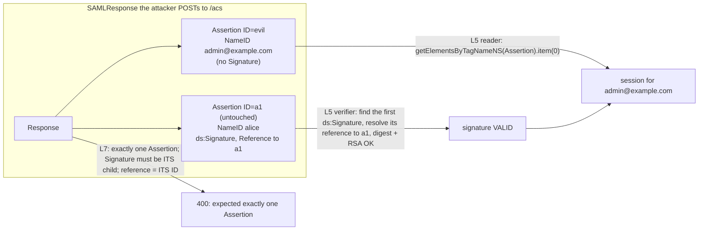

# Federation Showdown: OIDC vs SAML 2.0 Assertions, and SCIM 2.0 Automated Provisioning

> Folder 03 · File 02 of 03 · Identity, AuthN/AuthZ, OAuth 2.1/OIDC/FAPI 2.0 L7 Reference
> Previous: [01 · OIDC Core](01-oidc-core-id-token-vs-access-token-userinfo-discovery-and-at-hash-c-hash.md) · Next: [03 · Logout and CAEP](03-distributed-session-termination-front-channel-vs-back-channel-logout-and-caep.md)

| Listing | What it proves | Oracle |
|---|---|---|
| L22 `SamlXswLab.java` | SAML 2.0 Response signing and validation with the JDK's own XML-DSig (`java.xml.crypto`: RSA-SHA256, exclusive C14N, enveloped). Three SP bugs: **signature wrapping** (L5 validates the real signature, reads a forged Assertion and logs in as admin); **comment injection** in `NameID` (the signature still validates; `getFirstChild()` yields the victim's address); **XXE** (JDK 25's default parser still expands external entities). L7 blocks all three | JDK XML-DSig behaviour |
| L23 `ScimLab.java` | SCIM 2.0: L5 filter-to-SQL produces injections where L7 parses with "and" binding tighter than "or" and binds values; PATCH with value-filtered paths; ETag/If-Match (a stale writer re-enables a leaver without it); a leaver timeline (30 days → 40 min → 5 min) | RFC 7644 §3.4.2.2, §3.5.2, §3.14 |

**Verification.** Compiled with Folders 01–03 by `javac --release 21 -Xlint:all -Werror` on JDK 25.0.4.1. L22 uses only `java.xml` and `java.xml.crypto` from the JDK, with no OpenSAML. The gate re-runs both outputs and requires them byte-identical; RSA keys are generated per run and only verdicts are printed. CVE facts come from vendor and NVD-derived reports cited in §10. SCIM grammar and PATCH semantics come from RFC 7643/7644 (texts in [`fixtures/`](fixtures/)).

Labels: **[D]** documented · **[M]** measured by a listing · **[E]** engineering judgment · **⚠** trap.

---

## 0. Orientation

Enterprise identity runs on two federation protocols that solve the same problem: an identity provider tells a service who the user is.
- **SAML 2.0 (2005)** does it with signed XML assertions in browser POSTs.
- **OIDC (2014)** does it with signed JSON tokens over OAuth.

It also runs on one provisioning protocol: SCIM 2.0 (2015), which creates, updates and **deactivates** accounts before and after anyone logs in. An L7 engineer must be able to say when SAML is still the right answer. They must also know why SAML's XML signatures have produced a steady stream of authentication bypasses (one of which L22 reproduces with the JDK alone), and why provisioning without revocation is not offboarding.

Results:
- **[M] XML signature wrapping.** The L5 SP validates the IdP's genuine signature, because the signed Assertion is untouched, and reads the *first* Assertion in the document: a forged copy naming `admin@example.com`. The L7 SP rejects on structure ("exactly one Assertion, a direct child of Response, enveloping its own signature that references its own ID") before trusting any signature.
- **[M] Comment injection.** An attacker who owns `alice@example.com.evil.test` at the IdP inserts `<!---->` after `alice@example.com`. Exclusive canonicalization drops comments, so **the signature still validates**, and `getFirstChild().getNodeValue()` returns `alice@example.com`. This is the CVE-2017-11427 family, which hit several SAML libraries in 2018. L7 requires a single text node.
- **[M] XXE.** JDK 25.0.4.1's default `DocumentBuilderFactory` expanded an external entity and read a local file. Setting `disallow-doctype-decl` stops it.
- **[D]** The class is not historical: ruby-saml CVE-2025-25291/25292 (fixed in 1.12.4 and 1.18.0, March 2025) were signature-wrapping bypasses caused by a **parser differential** between REXML and Nokogiri. One valid signed document from the IdP sufficed to log in as any user. CVE-2024-45409 (ruby-saml, September 2024) was another signature-verification bypass.
- **[M] SCIM.** Provisioning that deactivates the account but leaves live sessions keeps a leaver in for **30 days**. Push provisioning with session revocation gives 40 min, and adding CAEP from the IdP gives about 5 min (L23).

---

## 1. First principles: what an assertion is, in both worlds

```text
  SAML 2.0 Web SSO (HTTP-POST binding)                         OIDC (code flow)
  ------------------------------------                         ----------------
  SP --AuthnRequest (redirect, maybe signed)--> IdP             RP --/authorize (state, nonce, PKCE)--> OP
  IdP --HTML auto-POST form--> browser --> SP /acs              OP --code--> browser --> RP /cb
     SAMLResponse = base64( <Response>                          RP --back channel /token--> OP
        <Assertion ID=..>                                       OP --> id_token (JWS, compact, JSON)
          <Issuer/> <ds:Signature/> (enveloped XML-DSig)
          <Subject><NameID/><SubjectConfirmation                 claims: iss, sub, aud, nonce, exp, acr
             Recipient InResponseTo NotOnOrAfter/></Subject>
          <Conditions NotBefore NotOnOrAfter><Audience/></Conditions>
          <AuthnStatement SessionIndex/> <AttributeStatement/>
        </Assertion></Response> )
  bearer assertion delivered THROUGH THE BROWSER                token delivered over the BACK CHANNEL
  integrity: XML-DSig over a canonicalized SUBTREE              integrity: JWS over the exact bytes
```

The structural difference is the root of SAML's bug history. A JWS signs **bytes**, and the verifier checks the same bytes it parses (Folder 01 file 03). XML-DSig signs a **canonicalized subtree selected by a reference**, and the verifier then *separately* navigates the document to read claims. Every gap between "the node that was verified" and "the node that was read" is an authentication bypass [E].

### 1.1 Exclusive C14N, references, and why comments vanish

[D: XML-DSig 1.1; Exclusive XML Canonicalization 1.0]
- The `Reference URI="#a1"` selects the element whose ID-typed attribute equals `a1`.
- The *enveloped-signature* transform removes the Signature element itself.
- *Exclusive C14N without comments* serializes the remaining subtree canonically, **dropping comment nodes**.
- SHA-256 of that output is the digest. The digests and the algorithm identifiers form `SignedInfo`, which is canonicalized and signed.

Consequences:
1. The ID-to-element resolution depends on which attributes the parser treats as IDs. Schema-aware, `setIdAttribute` and DTD-based resolution can each disagree, which is fertile ground for signature wrapping.
2. Comments are outside the signature, so anything that reads text "until the first comment" reads less than was signed.
3. Two parsers can build different trees from the same bytes, which was ruby-saml 2025's REXML-vs-Nokogiri differential.

Signature wrapping, exactly as L22 (§3) builds it. The attacker copies a validly signed Response, clones the Assertion, strips the clone's Signature, changes its NameID to `admin@example.com`, and inserts it *before* the untouched signed Assertion:



---

## 2. OIDC vs SAML 2.0: the comparison that matters in design reviews

| Dimension | SAML 2.0 | OIDC |
|---|---|---|
| Token format | XML assertion, XML-DSig/XML-Enc | JWT (JWS/JWE) |
| Delivery | front channel (browser POST) | back channel (token endpoint) for the code flow |
| Replay binding | `InResponseTo` + `SubjectConfirmationData` (Recipient, NotOnOrAfter) + an assertion ID cache | `nonce` + PKCE + single-use code |
| Audience | `<Audience>` in `AudienceRestriction` | `aud` + `azp` |
| Parser attack surface | XML: wrapping, comments, entity expansion, C14N, ID resolution, namespace quirks | JSON: duplicate keys and number edge cases (manageable with strict I-JSON, Folder 01 L6) |
| APIs | none (assertions are for web SSO; the SAML bearer grant RFC 7522 bridges to OAuth) | access tokens for APIs from the same flow |
| Mobile and SPA | poor (POST binding, no API token) | native via RFC 8252; browser via BFF |
| Logout | SLO (front channel, fragile) | back-channel logout, CAEP (file 03) |
| Enterprise reach | ubiquitous in legacy and workforce SaaS | default for new builds; all major IdPs |
| When to choose | integrating with an existing SAML-only SP or IdP; regulated estates with SAML profiles | everything new |

The L7 position [E]:
- **New systems speak OIDC.**
- **SAML stays at the edge,** behind a mature, maintained library (OpenSAML 5 via Spring Security's SAML 2.0 SP, Shibboleth) configured strictly, or behind a broker (Keycloak, an IdP-as-a-service) that converts SAML to OIDC.
- **Never parse SAML by hand in application code.** L22 shows why.

---

## 3. L22: signature wrapping, comment injection and XXE with the JDK's XML-DSig

<!-- listing:SamlXswLab.java -->
```java
import java.io.ByteArrayInputStream;
import java.io.StringWriter;
import java.nio.charset.StandardCharsets;
import java.nio.file.Files;
import java.nio.file.Path;
import java.security.KeyPair;
import java.security.KeyPairGenerator;
import java.security.PublicKey;
import java.util.Collections;
import java.util.List;
import javax.xml.XMLConstants;
import javax.xml.crypto.dsig.CanonicalizationMethod;
import javax.xml.crypto.dsig.DigestMethod;
import javax.xml.crypto.dsig.Reference;
import javax.xml.crypto.dsig.SignatureMethod;
import javax.xml.crypto.dsig.SignedInfo;
import javax.xml.crypto.dsig.Transform;
import javax.xml.crypto.dsig.XMLSignature;
import javax.xml.crypto.dsig.XMLSignatureFactory;
import javax.xml.crypto.dsig.dom.DOMSignContext;
import javax.xml.crypto.dsig.dom.DOMValidateContext;
import javax.xml.crypto.dsig.spec.C14NMethodParameterSpec;
import javax.xml.crypto.dsig.spec.TransformParameterSpec;
import javax.xml.crypto.KeySelector;
import javax.xml.parsers.DocumentBuilder;
import javax.xml.parsers.DocumentBuilderFactory;
import javax.xml.transform.TransformerFactory;
import javax.xml.transform.dom.DOMSource;
import javax.xml.transform.stream.StreamResult;
import org.w3c.dom.Document;
import org.w3c.dom.Element;
import org.w3c.dom.Node;
import org.w3c.dom.NodeList;

/**
 * L22 - SAML 2.0 assertion signatures with the JDK's own XML-DSig (java.xml.crypto), and the three classic
 * service-provider bugs: XML signature wrapping (XSW), comment injection in NameID (CVE-2017-11427 class) and XXE.
 * An L5 SP ("some signature in the document is valid; read the first Assertion; getFirstChild() for the NameID;
 * default parser") vs an L7 SP ("exactly one Assertion, a direct child of Response, signed by its own enveloped
 * signature whose Reference is #its ID, validated with the pinned IdP key; full text content; no DOCTYPE").
 */
public final class SamlXswLab {
    static final String P = "urn:oasis:names:tc:SAML:2.0:protocol";
    static final String A = "urn:oasis:names:tc:SAML:2.0:assertion";
    static final String DS = XMLSignature.XMLNS;

    static String response(String nameId) {
        return "<samlp:Response xmlns:samlp=\"" + P + "\" xmlns:saml=\"" + A + "\" ID=\"r1\" Version=\"2.0\""
                + " IssueInstant=\"2026-01-01T00:00:00Z\" Destination=\"https://sp.example.com/acs\" InResponseTo=\"req-1\">"
                + "<saml:Issuer>https://idp.example.com</saml:Issuer>"
                + "<samlp:Status><samlp:StatusCode Value=\"urn:oasis:names:tc:SAML:2.0:status:Success\"/></samlp:Status>"
                + "<saml:Assertion ID=\"a1\" Version=\"2.0\" IssueInstant=\"2026-01-01T00:00:00Z\">"
                + "<saml:Issuer>https://idp.example.com</saml:Issuer>"
                + "<saml:Subject><saml:NameID Format=\"urn:oasis:names:tc:SAML:1.1:nameid-format:emailAddress\">" + nameId
                + "</saml:NameID><saml:SubjectConfirmation Method=\"urn:oasis:names:tc:SAML:2.0:cm:bearer\">"
                + "<saml:SubjectConfirmationData NotOnOrAfter=\"2026-01-01T00:05:00Z\" Recipient=\"https://sp.example.com/acs\""
                + " InResponseTo=\"req-1\"/></saml:SubjectConfirmation></saml:Subject>"
                + "<saml:Conditions NotBefore=\"2026-01-01T00:00:00Z\" NotOnOrAfter=\"2026-01-01T00:05:00Z\"><saml:AudienceRestriction>"
                + "<saml:Audience>https://sp.example.com</saml:Audience></saml:AudienceRestriction></saml:Conditions>"
                + "<saml:AuthnStatement AuthnInstant=\"2026-01-01T00:00:00Z\" SessionIndex=\"s1\"/>"
                + "</saml:Assertion></samlp:Response>";
    }

    static DocumentBuilder parser(boolean secure) throws Exception {
        DocumentBuilderFactory f = DocumentBuilderFactory.newInstance();
        f.setNamespaceAware(true);
        if (secure) {
            f.setFeature("http://apache.org/xml/features/disallow-doctype-decl", true); // no DTDs at all: no XXE, no billion laughs
            f.setFeature(XMLConstants.FEATURE_SECURE_PROCESSING, true);
            f.setXIncludeAware(false);
            f.setExpandEntityReferences(false);
        }
        return f.newDocumentBuilder();
    }

    static Document parse(String xml, boolean secure) throws Exception {
        return parser(secure).parse(new ByteArrayInputStream(xml.getBytes(StandardCharsets.UTF_8)));
    }

    static String serialize(Document d) throws Exception {
        StringWriter w = new StringWriter();
        var t = TransformerFactory.newInstance().newTransformer();
        t.setOutputProperty("omit-xml-declaration", "yes");
        t.transform(new DOMSource(d), new StreamResult(w));
        return w.toString();
    }

    /** The IdP: enveloped RSA-SHA256 signature over the Assertion, exclusive C14N, placed after the Issuer. */
    static String sign(String xml, KeyPair kp) throws Exception {
        Document d = parse(xml, true);
        Element assertion = (Element) d.getElementsByTagNameNS(A, "Assertion").item(0);
        assertion.setIdAttributeNS(null, "ID", true);
        XMLSignatureFactory f = XMLSignatureFactory.getInstance("DOM");
        Reference ref = f.newReference("#a1", f.newDigestMethod(DigestMethod.SHA256, null),
                List.of(f.newTransform(Transform.ENVELOPED, (TransformParameterSpec) null),
                        f.newTransform(CanonicalizationMethod.EXCLUSIVE, (TransformParameterSpec) null)), null, null);
        SignedInfo si = f.newSignedInfo(f.newCanonicalizationMethod(CanonicalizationMethod.EXCLUSIVE, (C14NMethodParameterSpec) null),
                f.newSignatureMethod(SignatureMethod.RSA_SHA256, null), Collections.singletonList(ref));
        Node subject = assertion.getElementsByTagNameNS(A, "Subject").item(0);
        f.newXMLSignature(si, null).sign(new DOMSignContext(kp.getPrivate(), assertion, subject));
        return serialize(d);
    }

    static boolean validate(Element signature, PublicKey idpKey) throws Exception {
        DOMValidateContext ctx = new DOMValidateContext(KeySelector.singletonKeySelector(idpKey), signature);
        return XMLSignatureFactory.getInstance("DOM").unmarshalXMLSignature(ctx).validate(ctx);
    }

    static void markIds(Document d) {
        NodeList all = d.getElementsByTagNameNS("*", "*");
        for (int i = 0; i < all.getLength(); i++) {
            Element e = (Element) all.item(i);
            if (e.hasAttribute("ID")) {
                e.setIdAttributeNS(null, "ID", true);
            }
        }
    }

    /** L5 SP: any valid signature, then read the FIRST Assertion and its NameID's first child. */
    static String l5(String xml, PublicKey idpKey) {
        try {
            Document d = parse(xml, false);
            markIds(d);
            Element sig = (Element) d.getElementsByTagNameNS(DS, "Signature").item(0);
            if (sig == null || !validate(sig, idpKey)) {
                return "rejected (signature)";
            }
            Element first = (Element) d.getElementsByTagNameNS(A, "Assertion").item(0);
            Element nameId = (Element) first.getElementsByTagNameNS(A, "NameID").item(0);
            return "logged in as " + nameId.getFirstChild().getNodeValue();
        } catch (Exception e) {
            return "rejected (" + e.getClass().getSimpleName() + ")";
        }
    }

    /** L7 SP: structure first, then the signature that envelopes THE assertion, then claims from that element only. */
    static String l7(String xml, PublicKey idpKey) {
        try {
            Document d = parse(xml, true);
            Element resp = d.getDocumentElement();
            NodeList as = d.getElementsByTagNameNS(A, "Assertion");
            if (!P.equals(resp.getNamespaceURI()) || !"Response".equals(resp.getLocalName()) || as.getLength() != 1) {
                return "rejected (expected exactly one Assertion, found " + as.getLength() + ")";
            }
            Element assertion = (Element) as.item(0);
            if (assertion.getParentNode() != resp) {
                return "rejected (Assertion is not a direct child of Response)";
            }
            String id = assertion.getAttribute("ID");
            assertion.setIdAttributeNS(null, "ID", true);
            Element sig = null;
            for (Node n = assertion.getFirstChild(); n != null; n = n.getNextSibling()) {
                if (n instanceof Element e && DS.equals(e.getNamespaceURI()) && "Signature".equals(e.getLocalName())) {
                    sig = e;
                }
            }
            if (sig == null) {
                return "rejected (assertion not signed)";
            }
            Element refEl = (Element) sig.getElementsByTagNameNS(DS, "Reference").item(0);
            if (sig.getElementsByTagNameNS(DS, "Reference").getLength() != 1 || !("#" + id).equals(refEl.getAttribute("URI"))) {
                return "rejected (signature does not reference this assertion)";
            }
            if (!validate(sig, idpKey)) {
                return "rejected (signature)";
            }
            Element nameId = (Element) assertion.getElementsByTagNameNS(A, "NameID").item(0);
            for (Node n = nameId.getFirstChild(); n != null; n = n.getNextSibling()) {
                if (n.getNodeType() != Node.TEXT_NODE) {
                    return "rejected (NameID contains a non-text node)";
                }
            }
            return "logged in as " + nameId.getTextContent();
        } catch (Exception e) {
            return "rejected (" + e.getClass().getSimpleName() + ")";
        }
    }

    public static void main(String[] args) throws Exception {
        KeyPairGenerator g = KeyPairGenerator.getInstance("RSA");
        g.initialize(2048);
        KeyPair idp = g.generateKeyPair();

        KbSupport.section("Baseline: a signed SAML Response (JDK XML-DSig, RSA-SHA256, exclusive C14N, enveloped)");
        String signed = sign(response("alice@example.com"), idp);
        Node sigParent = parse(signed, true).getElementsByTagNameNS(DS, "Signature").item(0).getParentNode();
        KbSupport.check("the enveloped Signature is a child of <" + sigParent.getLocalName() + "> and references #a1",
                "Assertion".equals(sigParent.getLocalName()) && signed.contains("URI=\"#a1\""));
        KbSupport.info("L5: %s | L7: %s", l5(signed, idp.getPublic()), l7(signed, idp.getPublic()));
        KbSupport.check("both SPs accept the untouched response as alice", l5(signed, idp.getPublic()).endsWith("alice@example.com")
                && l7(signed, idp.getPublic()).endsWith("alice@example.com"));

        KbSupport.section("1. XML signature wrapping: forged Assertion inserted BEFORE the signed one");
        Document d = parse(signed, true);
        Element resp = d.getDocumentElement();
        Element original = (Element) d.getElementsByTagNameNS(A, "Assertion").item(0);
        Element forged = (Element) original.cloneNode(true);
        forged.setAttribute("ID", "evil");
        forged.removeChild(forged.getElementsByTagNameNS(DS, "Signature").item(0));
        forged.getElementsByTagNameNS(A, "NameID").item(0).setTextContent("admin@example.com");
        resp.insertBefore(forged, original);
        String wrapped = serialize(d);
        String w5 = l5(wrapped, idp.getPublic());
        String w7 = l7(wrapped, idp.getPublic());
        KbSupport.info("L5: %s | L7: %s", w5, w7);
        KbSupport.check("L5 validates the (untouched) signed assertion but reads the forged one -> admin", w5.endsWith("admin@example.com"));
        KbSupport.check("L7 rejects on structure before trusting any signature", w7.startsWith("rejected (expected exactly one"));

        KbSupport.section("2. Comment injection in NameID (attacker owns the IdP account alice@example.com.evil.test)");
        String signedAttacker = sign(response("alice@example.com.evil.test"), idp);
        String injected = signedAttacker.replace("alice@example.com.evil.test", "alice@example.com<!---->.evil.test");
        String c5 = l5(injected, idp.getPublic());
        String c7 = l7(injected, idp.getPublic());
        KbSupport.info("L5: %s | L7: %s", c5, c7);
        KbSupport.check("exclusive C14N drops the comment, so the SIGNATURE STILL VALIDATES after the edit", c5.startsWith("logged in"));
        KbSupport.check("L5's getFirstChild() reads only the first text node -> logged in as the victim alice@example.com",
                c5.equals("logged in as alice@example.com"));
        KbSupport.check("L7 refuses a NameID made of several nodes", c7.equals("rejected (NameID contains a non-text node)"));

        KbSupport.section("3. XXE through a DOCTYPE in the SAML Response");
        Path secret = Files.createTempFile("saml-secret", ".txt");
        Files.writeString(secret, "db-password=hunter2");
        String xxe = "<!DOCTYPE r [<!ENTITY x SYSTEM \"" + secret.toUri() + "\">]>" + signed.replace(">alice@example.com<", ">&x;<");
        String x5;
        try {
            Document dx = parse(xxe, false);
            x5 = "entity expanded to '" + dx.getElementsByTagNameNS(A, "NameID").item(0).getTextContent() + "'";
        } catch (Exception e) {
            x5 = "parser refused (" + e.getClass().getSimpleName() + ")";
        }
        String x7 = l7(xxe, idp.getPublic());
        Files.deleteIfExists(secret);
        KbSupport.info("L5 parser: %s | L7: %s", x5, x7);
        KbSupport.check("the default JDK parser resolves the external entity (file read on the SP)", x5.contains("db-password=hunter2"));
        KbSupport.check("L7 (disallow-doctype-decl) refuses the document before signature processing", x7.startsWith("rejected"));
        KbSupport.verdict();
    }
}
```

<!-- output:SamlXswLab.java -->
```text

== Baseline: a signed SAML Response (JDK XML-DSig, RSA-SHA256, exclusive C14N, enveloped)
  [PASS] the enveloped Signature is a child of <Assertion> and references #a1
  L5: logged in as alice@example.com | L7: logged in as alice@example.com
  [PASS] both SPs accept the untouched response as alice

== 1. XML signature wrapping: forged Assertion inserted BEFORE the signed one
  L5: logged in as admin@example.com | L7: rejected (expected exactly one Assertion, found 2)
  [PASS] L5 validates the (untouched) signed assertion but reads the forged one -> admin
  [PASS] L7 rejects on structure before trusting any signature

== 2. Comment injection in NameID (attacker owns the IdP account alice@example.com.evil.test)
  L5: logged in as alice@example.com | L7: rejected (NameID contains a non-text node)
  [PASS] exclusive C14N drops the comment, so the SIGNATURE STILL VALIDATES after the edit
  [PASS] L5's getFirstChild() reads only the first text node -> logged in as the victim alice@example.com
  [PASS] L7 refuses a NameID made of several nodes

== 3. XXE through a DOCTYPE in the SAML Response
  L5 parser: entity expanded to 'db-password=hunter2' | L7: rejected (SAXParseException)
  [PASS] the default JDK parser resolves the external entity (file read on the SP)
  [PASS] L7 (disallow-doctype-decl) refuses the document before signature processing

verdict: OK (9 checks)
```

What each L7 rule buys:

1. **Parse securely before anything else.** No DOCTYPE, which means no XXE, no billion-laughs and no DTD-declared IDs. Secure processing on. JDK 25's defaults do **not** do this (§3 of the run).
2. **Validate structure before cryptography.** Exactly one Assertion (or a schema-validated Response with exactly the expected shape), a direct child of Response. Then require that the Signature be the Assertion's *own* enveloped child, with exactly one `Reference`, whose URI is `#` + that Assertion's `ID`.
3. **Read claims only from the element that was verified.** Never `getElementsByTagName(...).item(0)` on the document.
4. **Read text as the whole text content, and reject mixed content** (comments or extra nodes) in identity-bearing elements.
5. **Check the rest of the profile:**
   - `Destination` and `Recipient` = your ACS URL;
   - `InResponseTo` = a pending request ID (one-time use);
   - `NotBefore`/`NotOnOrAfter` within skew;
   - `Audience` = your entity ID;
   - assertion-ID replay cache until `NotOnOrAfter`;
   - signing algorithm allow-list (RSA-SHA256, not SHA-1);
   - the IdP signing certificate **pinned** from metadata, not taken from `KeyInfo` in the message.

Spring Security's SAML 2.0 SP (`saml2Login()`, OpenSAML 5) implements these checks in `OpenSaml5AuthenticationProvider` (the validators for the response, the assertion signature and the assertion). Use it, keep OpenSAML patched, and do not add custom XPath reads of the assertion in application code [E].

---

## 4. SCIM 2.0: provisioning is a security control

### 4.1 The protocol in one screen

[D: RFC 7643 schema, RFC 7644 protocol]
- **Resources:** `/Users` and `/Groups`, plus extensions such as the enterprise user schema. Every resource has `id` (service-assigned), `externalId` (client-assigned), and `meta` (`version` = ETag, `lastModified`).
- **Operations:** `POST` (create), `GET` with `filter`, `PUT` (replace), `PATCH` (`PatchOp` with `add`/`replace`/`remove`, paths including value filters like `emails[type eq "work"].value`), `DELETE`, and `/Bulk`.
- **Filters:** `attrPath op value`, with `eq ne co sw ew gt ge lt le pr`, `and`/`or`/`not`, grouping. "and" has higher precedence than "or" (§3.4.2.2).
- **Concurrency:** `ETag`/`If-Match`; a mismatch is `412 Precondition Failed` (§3.14).
- **Authentication:** usually an OAuth bearer token for the provisioning client. That token can create and modify *every user*, so it is one of the most powerful credentials in the estate.

```http
PATCH /scim/v2/Users/2819c223 HTTP/1.1
Host: app.example.com
Authorization: Bearer <provisioning token: scope scim:users:write, aud=app>
Content-Type: application/scim+json
If-Match: W/"3"

{"schemas": ["urn:ietf:params:scim:api:messages:2.0:PatchOp"],
 "Operations": [{"op": "replace", "path": "active", "value": false}]}
```

```http
HTTP/1.1 200 OK
Content-Type: application/scim+json
ETag: W/"4"
```

### 4.2 L23: filters, PATCH, concurrency and the leaver timeline

<!-- listing:ScimLab.java -->
```java
import java.util.ArrayList;
import java.util.LinkedHashMap;
import java.util.List;
import java.util.Locale;
import java.util.Map;
import java.util.regex.Matcher;
import java.util.regex.Pattern;

/**
 * L23 - SCIM 2.0 (RFC 7643/7644) provisioning as a security control.
 *
 * <ul>
 *   <li>filters: an L5 string-to-SQL translation vs an L7 parser (RFC 7644 3.4.2.2 grammar subset, "and" binding
 *       tighter than "or") producing parameterised SQL over an attribute allow-list;</li>
 *   <li>PATCH (RFC 7644 3.5.2) with value-filtered paths, plus ETag / If-Match optimistic concurrency;</li>
 *   <li>the deprovisioning timeline: how long a leaver keeps access under pull, push, and push + session revocation
 *       + CAEP, on a deterministic clock.</li>
 * </ul>
 */
public final class ScimLab {

    // ---------------------------------------------------------------- filters

    static final Map<String, String> COLUMNS = Map.of("userName", "user_name", "active", "active", "emails.value", "email",
            "name.familyName", "family_name", "externalId", "external_id");

    /** L5: what "just map SCIM to SQL" looks like. */
    static String l5Sql(String filter) {
        return "SELECT * FROM users WHERE " + filter.replace(" eq ", " = ").replace('"', '\'');
    }

    record Sql(String text, List<Object> params) {
    }

    /** L7: tokenise, parse (or < and < comparison), allow-list attributes, bind values. */
    static Sql l7Sql(String filter) {
        Matcher m = Pattern.compile("\\s*(\"(?:[^\"\\\\]|\\\\.)*\"|[A-Za-z][A-Za-z0-9_.-]*|\\d+)").matcher(filter);
        List<String> toks = new ArrayList<>();
        int pos = 0;
        while (pos < filter.length() && m.find(pos) && m.start() == pos) {
            toks.add(m.group(1));
            pos = m.end();
        }
        if (filter.substring(pos).trim().length() > 0) {
            throw new IllegalArgumentException("invalidFilter: unexpected input at " + pos);
        }
        List<Object> params = new ArrayList<>();
        int[] i = {0};
        String where = or(toks, i, params);
        if (i[0] != toks.size()) {
            throw new IllegalArgumentException("invalidFilter: trailing tokens");
        }
        return new Sql("SELECT * FROM users WHERE " + where, params);
    }

    private static String or(List<String> t, int[] i, List<Object> p) {
        String left = and(t, i, p);
        while (i[0] < t.size() && t.get(i[0]).equalsIgnoreCase("or")) {
            i[0]++;
            left = "(" + left + " OR " + and(t, i, p) + ")";
        }
        return left;
    }

    private static String and(List<String> t, int[] i, List<Object> p) {
        String left = cmp(t, i, p);
        while (i[0] < t.size() && t.get(i[0]).equalsIgnoreCase("and")) {
            i[0]++;
            left = "(" + left + " AND " + cmp(t, i, p) + ")";
        }
        return left;
    }

    private static String cmp(List<String> t, int[] i, List<Object> p) {
        if (i[0] + 1 >= t.size()) {
            throw new IllegalArgumentException("invalidFilter: incomplete expression");
        }
        String attr = t.get(i[0]++);
        String col = COLUMNS.get(attr);
        if (col == null) {
            throw new IllegalArgumentException("invalidFilter: unknown attribute " + attr);
        }
        String op = t.get(i[0]++).toLowerCase(Locale.ROOT);
        if (op.equals("pr")) {
            return col + " IS NOT NULL";
        }
        if (i[0] >= t.size()) {
            throw new IllegalArgumentException("invalidFilter: missing value");
        }
        String raw = t.get(i[0]++);
        Object val = raw.startsWith("\"") ? raw.substring(1, raw.length() - 1).replace("\\\"", "\"")
                : raw.equals("true") || raw.equals("false") ? Boolean.valueOf(raw) : Long.valueOf(raw);
        String sqlOp = switch (op) {
            case "eq" -> "= ?";
            case "ne" -> "<> ?";
            case "sw" -> "LIKE ? || '%'";
            case "co" -> "LIKE '%' || ? || '%'";
            case "gt" -> "> ?";
            case "lt" -> "< ?";
            default -> throw new IllegalArgumentException("invalidFilter: operator " + op);
        };
        p.add(val);
        return col + " " + sqlOp;
    }

    // ---------------------------------------------------------------- PATCH + ETag

    record User(Map<String, Object> json, int version) {
    }

    @SuppressWarnings("unchecked")
    static Map<String, Object> patch(Map<String, Object> user, List<Map<String, Object>> ops) {
        Map<String, Object> u = deepCopy(user);
        for (Map<String, Object> op : ops) {
            String kind = ((String) op.get("op")).toLowerCase(Locale.ROOT);
            String path = (String) op.get("path");
            Object value = op.get("value");
            Matcher f = Pattern.compile("(\\w+)\\[type eq \"(\\w+)\"\\](?:\\.(\\w+))?").matcher(path == null ? "" : path);
            if (f.matches()) { // emails[type eq "work"].value
                for (Map<String, Object> el : (List<Map<String, Object>>) u.getOrDefault(f.group(1), List.of())) {
                    if (f.group(2).equals(el.get("type"))) {
                        if (kind.equals("remove")) {
                            el.put("_removed", true);
                        } else {
                            el.put(f.group(3), value);
                        }
                    }
                }
                ((List<Map<String, Object>>) u.getOrDefault(f.group(1), new ArrayList<>())).removeIf(el -> el.containsKey("_removed"));
            } else if (kind.equals("add") && value instanceof List<?> l) {
                ((List<Object>) u.computeIfAbsent(path, k -> new ArrayList<>())).addAll(l);
            } else if (kind.equals("remove")) {
                u.remove(path);
            } else {
                u.put(path, value);
            }
        }
        return u;
    }

    @SuppressWarnings("unchecked")
    static Map<String, Object> deepCopy(Map<String, Object> m) {
        return (Map<String, Object>) MiniJson.parse(MiniJson.write(m));
    }

    static final class Store {
        User current;

        Store(User u) {
            current = u;
        }

        /** Returns the HTTP status of a PATCH with If-Match. */
        synchronized int patch(String ifMatch, List<Map<String, Object>> ops, boolean enforceIfMatch) {
            if (enforceIfMatch && !("W/\"" + current.version() + "\"").equals(ifMatch)) {
                return 412;
            }
            current = new User(ScimLab.patch(current.json(), ops), current.version() + 1);
            return 200;
        }
    }

    static Map<String, Object> op(String op, String path, Object value) {
        Map<String, Object> m = new LinkedHashMap<>();
        m.put("op", op);
        m.put("path", path);
        if (value != null) {
            m.put("value", value);
        }
        return m;
    }

    public static void main(String[] args) {
        KbSupport.section("Filter translation (RFC 7644 3.4.2.2): L5 string replace vs L7 parse + bind");
        String[] filters = {"userName eq \"bjensen\"", "userName eq \"x\" or \"1\" eq \"1\"",
            "userName eq \"x' OR '1'='1\"", "emails.value co \"@example.com\" and active eq true or userName eq \"root\"",
            "password eq \"hunter2\""};
        int l7Safe = 0;
        for (String f : filters) {
            String l7;
            try {
                Sql s = l7Sql(f);
                l7 = s.text() + "  params=" + s.params();
                l7Safe += s.params().stream().noneMatch(v -> s.text().contains(String.valueOf(v))) ? 1 : 0; // values only as binds
            } catch (IllegalArgumentException e) {
                l7 = "400 " + e.getMessage();
                l7Safe++;
            }
            KbSupport.info("filter: %s", f);
            KbSupport.info("   L5: %s", l5Sql(f));
            KbSupport.info("   L7: %s", l7);
        }
        KbSupport.check("L5 turns the second and third filters into tautologies (classic injection)",
                l5Sql(filters[1]).contains("'1' = '1'") && l5Sql(filters[2]).contains("OR '1'='1'"));
        KbSupport.check("L7 never puts a value in the SQL text, rejects quoted attribute names and non-allow-listed attributes",
                l7Safe == filters.length && l7Sql(filters[3]).text().contains("((email LIKE") );

        KbSupport.section("PATCH with value-filtered paths (RFC 7644 3.5.2)");
        Map<String, Object> bjensen = MiniJson.object("{\"schemas\":[\"urn:ietf:params:scim:schemas:core:2.0:User\"],\"id\":\"2819c223\","
                + "\"userName\":\"bjensen\",\"active\":true,\"emails\":[{\"value\":\"bjensen@example.com\",\"type\":\"work\"},"
                + "{\"value\":\"babs@jensen.org\",\"type\":\"home\"}]}");
        Map<String, Object> after = patch(bjensen, List.of(op("replace", "emails[type eq \"work\"].value", "barbara@example.com"),
                op("remove", "emails[type eq \"home\"]", null), op("replace", "active", false)));
        KbSupport.info("%s", MiniJson.write(after));
        KbSupport.check("work email replaced, home email removed, active=false", MiniJson.write(after).contains("barbara@example.com")
                && !MiniJson.write(after).contains("babs@") && Boolean.FALSE.equals(after.get("active")));

        KbSupport.section("Two provisioning connectors, one user: lost update vs If-Match");
        for (boolean enforce : new boolean[] {false, true}) {
            Store st = new Store(new User(bjensen, 3));
            String etag = "W/\"" + st.current.version() + "\""; // both connectors read version 3
            int a = st.patch(etag, List.of(op("replace", "active", false)), enforce);           // HR leaver: disable
            // stale writer replays the whole object it read at version 3 (PUT semantics): active=true comes back
            int b = st.patch(etag, List.of(op("replace", "active", true), op("replace", "title", "Contractor")), enforce);
            Object active = st.current.json().get("active");
            KbSupport.info("If-Match %s: disable -> %d, stale title update -> %d, final active=%s", enforce ? "enforced" : "ignored", a, b, active);
            KbSupport.check(enforce ? "stale writer gets 412 and must re-read: the disable is preserved"
                    : "without If-Match the stale full-object write silently RE-ENABLES the leaver",
                    enforce ? b == 412 && Boolean.FALSE.equals(active) : b == 200 && Boolean.TRUE.equals(active));
        }

        KbSupport.section("Leaver timeline: HR terminates at t=0, IdP disables the account at t=5 min");
        long idpDisable = 300;
        String[][] configs = {
            {"L5: SCIM pull every 24 h, app ignores active=false for live sessions, 30-day remember-me", "86400", "false", "false"},
            {"SCIM push every 40 min + app revokes sessions on active=false", "2400", "true", "false"},
            {"push + revoke + CAEP session-revoked / RISC account-disabled from the IdP", "2400", "true", "true"}};
        long[] exposure = new long[3];
        for (int k = 0; k < configs.length; k++) {
            long sync = Long.parseLong(configs[k][1]);
            boolean revokeOnDeactivate = Boolean.parseBoolean(configs[k][2]);
            boolean caep = Boolean.parseBoolean(configs[k][3]);
            long scimArrives = ((idpDisable / sync) + 1) * sync; // next sync cycle after the disable
            long sessionsDie = revokeOnDeactivate ? scimArrives : 30L * 86_400;
            if (caep) {
                sessionsDie = Math.min(sessionsDie, idpDisable + 2); // pushed event, ~2 s propagation
            }
            exposure[k] = sessionsDie;
            KbSupport.info("%-88s leaver's sessions die at t=%s", configs[k][0], human(sessionsDie));
        }
        KbSupport.check("30 days -> 40 min -> 5 min: provisioning without revocation is not offboarding",
                exposure[0] == 30L * 86_400 && exposure[1] == 2_400 && exposure[2] == 302);
        KbSupport.verdict();
    }

    static String human(long s) {
        return s >= 86_400 ? (s / 86_400) + " d" : s >= 3_600 ? String.format(Locale.ROOT, "%.1f h", s / 3600.0)
                : (s / 60) + " min " + (s % 60) + " s";
    }
}
```

<!-- output:ScimLab.java -->
```text

== Filter translation (RFC 7644 3.4.2.2): L5 string replace vs L7 parse + bind
  filter: userName eq "bjensen"
     L5: SELECT * FROM users WHERE userName = 'bjensen'
     L7: SELECT * FROM users WHERE user_name = ?  params=[bjensen]
  filter: userName eq "x" or "1" eq "1"
     L5: SELECT * FROM users WHERE userName = 'x' or '1' = '1'
     L7: 400 invalidFilter: unknown attribute "1"
  filter: userName eq "x' OR '1'='1"
     L5: SELECT * FROM users WHERE userName = 'x' OR '1'='1'
     L7: SELECT * FROM users WHERE user_name = ?  params=[x' OR '1'='1]
  filter: emails.value co "@example.com" and active eq true or userName eq "root"
     L5: SELECT * FROM users WHERE emails.value co '@example.com' and active = true or userName = 'root'
     L7: SELECT * FROM users WHERE ((email LIKE '%' || ? || '%' AND active = ?) OR user_name = ?)  params=[@example.com, true, root]
  filter: password eq "hunter2"
     L5: SELECT * FROM users WHERE password = 'hunter2'
     L7: 400 invalidFilter: unknown attribute password
  [PASS] L5 turns the second and third filters into tautologies (classic injection)
  [PASS] L7 never puts a value in the SQL text, rejects quoted attribute names and non-allow-listed attributes

== PATCH with value-filtered paths (RFC 7644 3.5.2)
  {"schemas":["urn:ietf:params:scim:schemas:core:2.0:User"],"id":"2819c223","userName":"bjensen","active":false,"emails":[{"value":"barbara@example.com","type":"work"}]}
  [PASS] work email replaced, home email removed, active=false

== Two provisioning connectors, one user: lost update vs If-Match
  If-Match ignored: disable -> 200, stale title update -> 200, final active=true
  [PASS] without If-Match the stale full-object write silently RE-ENABLES the leaver
  If-Match enforced: disable -> 200, stale title update -> 412, final active=false
  [PASS] stale writer gets 412 and must re-read: the disable is preserved

== Leaver timeline: HR terminates at t=0, IdP disables the account at t=5 min
  L5: SCIM pull every 24 h, app ignores active=false for live sessions, 30-day remember-me leaver's sessions die at t=30 d
  SCIM push every 40 min + app revokes sessions on active=false                            leaver's sessions die at t=40 min 0 s
  push + revoke + CAEP session-revoked / RISC account-disabled from the IdP                leaver's sessions die at t=5 min 2 s
  [PASS] 30 days -> 40 min -> 5 min: provisioning without revocation is not offboarding

verdict: OK (6 checks)
```

Interpretation:

- **Filters are a query language.** Translating them to SQL with string replacement is SQL injection: `userName eq "x' OR '1'='1"` becomes a tautology. L23's L7 path tokenizes, parses with the RFC's precedence, allow-lists attributes (so `password eq …` is a 400, not an oracle) and binds every value.
- **Concurrent connectors** (HR-driven and IT-driven) writing the same user without `If-Match` lose updates. In L23 a stale full-object write **re-enables a leaver**. ETags turn that into a 412 and a re-read.
- **`active=false` must kill access.** SCIM delivers state, and the application must act on it:
  - revoke sessions;
  - revoke refresh tokens and API keys;
  - transfer ownership of resources.
  
  Without that, the leaver keeps the app's 30-day remember-me session (L23 row 1).
- **Provisioning latency is policy.** Push connectors run on intervals, often tens of minutes [E]. For leavers and compromised accounts, pair SCIM with real-time signals: CAEP `session-revoked` and RISC `account-disabled` (file 03). That gets exposure down to the IdP disable time plus seconds.

L23's leaver timeline, on one axis:

```text
  time ->   0          5 min       5 min 2 s       40 min          24 h            30 d
            |            |             |              |               |               |
  event     HR marks     IdP           CAEP/RISC      SCIM push       SCIM pull       remember-me
            leaver       disables      applied at RP  arrives         arrives (L5)    cookie expires
            |            |             |              |               |               |
  row 3     [============|=============]  sessions dead at 5 min 2 s
  row 2     [============|=============|==============]  sessions dead at 40 min
  row 1     [============|=============|==============|===============|===============]  dead at 30 d

  row 1  L5: pull every 24 h, app ignores active=false for live sessions, 30-day remember-me
  row 2  push every 40 min + app revokes sessions on active=false
  row 3  row 2 + CAEP session-revoked / RISC account-disabled pushed by the IdP at disable time
  every row starts at t=0: the HR -> IdP step alone costs 5 min, so fix that hop too
```

---

## 5. The vulnerable L5 implementation vs the hardened L7 zero-trust implementation

```java
// L5 SAML ACS - DO NOT USE (every line is a section 6 attack).
@PostMapping("/saml/acs")
String acs(@RequestParam("SAMLResponse") String b64) throws Exception {
    Document d = DocumentBuilderFactory.newInstance().newDocumentBuilder()           // XXE: DOCTYPE allowed
            .parse(new ByteArrayInputStream(Base64.getDecoder().decode(b64)));
    markAllIdAttributes(d);                                                            // wrapping enabler
    if (!anySignatureValid(d, keyFromKeyInfo(d))) throw new BadRequest();            // key from the message itself!
    Element nameId = (Element) d.getElementsByTagNameNS(SAML, "NameID").item(0);      // first NameID anywhere
    String user = nameId.getFirstChild().getNodeValue();                               // comment truncation
    return login(user);                                                                // no InResponseTo/Audience/time checks
}
```

```yaml
# L7: Spring Security SAML 2.0 SP (OpenSAML 5) - relying party registration with pinned IdP metadata.
spring:
  security:
    saml2:
      relyingparty:
        registration:
          corp-idp:
            entity-id: "https://app.example.com/saml2/service-provider-metadata/corp-idp"
            assertingparty:
              metadata-uri: "classpath:saml/corp-idp-metadata.xml"   # pinned file, reviewed on change - not a live URL
            signing:
              credentials:
                - private-key-location: "classpath:saml/sp-signing.key"
                  certificate-location: "classpath:saml/sp-signing.crt"
            acs:
              location: "{baseUrl}/login/saml2/sso/{registrationId}"
```

| Concern | L5 | L7 |
|---|---|---|
| XML parsing | default factory (XXE on JDK 25) | DOCTYPE disallowed, secure processing (OpenSAML's parser pool does this) |
| Signature | "any valid signature", key from `KeyInfo` | IdP certificate pinned from metadata; the assertion's own enveloped signature; one Reference = `#ID`; RSA-SHA256+ |
| Claim extraction | first element by tag name; `getFirstChild()` | only from the verified element; whole text; reject mixed content |
| Profile checks | none | Destination, Recipient, InResponseTo (single use), NotBefore/NotOnOrAfter, Audience, an assertion-ID replay cache |
| Library | hand-rolled | Spring Security `saml2Login()` + OpenSAML 5, patched; or broker SAML into OIDC |
| SCIM | string-built SQL, no ETags, `active=false` ignored | parsed filters with bound values, `If-Match`, deactivation → revoke sessions and tokens + CAEP |
| SCIM credential | long-lived shared bearer token | OAuth client credentials with `private_key_jwt`/mTLS, scoped `scim:*`, IP-restricted, audited |

---

## 6. Real-world attack vectors & mitigations

### A1 · XML signature wrapping (XSW)

**Attack.** The attacker keeps the IdP's genuinely signed Assertion somewhere the verifier will find it, and adds a forged Assertion where the business logic will read it: first in document order, in a different namespace position, or inside `Extensions`. The signature validates, and the forged claims are used (L22 §1).
**Wire signature.** Responses with more than one Assertion; signatures whose Reference URI differs from the ID of the assertion being consumed.
**Root cause.** Signature verification and claim extraction navigate the document independently.
**Mitigation.** Strict structural validation before cryptography. Consume only the element that was verified. Use a maintained library. Run schema validation.
**Detection.** Reject and alert on multi-assertion responses.

### A2 · Parser differentials (ruby-saml CVE-2025-25291/25292)

**Attack.** Two XML parsers in the same verification path build different trees from crafted input. One is used to check the digest, the other to locate the signature or read claims. With one valid signed document from the IdP, an attacker forges assertions for any user [D: GitHub Security Lab report via The Hacker News; fixed in ruby-saml 1.12.4 and 1.18.0].
**Wire signature.** Unusual XML constructs (entity tricks, namespace or attribute duplication) in SAMLResponses; logins as users different from the signer's usual subjects.
**Root cause.** More than one parse of security-critical input.
**Mitigation.** One parser, one tree, end to end. Upgrade affected libraries. Pin library versions and watch security advisories for SAML dependencies.
**Detection.** Alert on structurally unusual responses; correlate with the IdP's issued-assertion logs.

### A3 · Comment injection and text-node truncation (CVE-2017-11427 class)

**Attack.** The attacker registers `alice@example.com.evil.test` at the IdP, then inserts `<!---->` inside the signed `NameID`. C14N ignores comments, so the signature holds, and naive text extraction returns `alice@example.com` (L22 §2).
**Wire signature.** Comments or multiple text nodes inside `NameID` or attribute values.
**Root cause.** Signed data and extracted data defined differently.
**Mitigation.** Reject mixed content in identity-bearing elements. Use full text content. Normalize and compare exact identifiers. Avoid using email-shaped NameIDs as keys (use persistent NameIDs).
**Detection.** Parser-level alerts on comments in assertion text nodes.

### A4 · XXE and entity expansion in SAML endpoints

**Attack.** The SAMLResponse (base64 in a POST) carries a DOCTYPE with external entities that read local files or reach internal URLs (SSRF), or exponential entity expansion that exhausts memory (L22 §3: JDK 25 defaults expand file entities).
**Wire signature.** DOCTYPE declarations in SAML messages.
**Root cause.** XML parsers with permissive defaults.
**Mitigation.** `disallow-doctype-decl=true`, secure processing, no external access (`ACCESS_EXTERNAL_DTD`/`SCHEMA` empty). OpenSAML's parser pool configures this.
**Detection.** Reject and alert on any DOCTYPE.

### A5 · Golden SAML: theft of the IdP signing key

**Attack.** With the IdP's token-signing private key (exported from a compromised ADFS server or IdP host), the attacker mints valid assertions for any user, with any attributes and MFA claims, offline. This technique was prominent in the 2020 SolarWinds-related intrusions.
**Wire signature.** SP logins with no corresponding IdP authentication event; assertions with unusual lifetimes or attribute sets.
**Root cause.** A long-lived, exportable signing key on an IdP host.
**Mitigation.**
- Keep signing keys in HSMs, non-exportable, and rotate them.
- Monitor the IdP host.
- Prefer cloud IdPs with managed keys.
- Correlate SP logins with IdP sign-in logs.
- Use short assertion lifetimes.

**Detection.** SP-vs-IdP login reconciliation; alerts on signing-certificate access.

### A6 · SCIM filter injection and over-privileged provisioning tokens

**Attack.** SCIM filters concatenated into SQL or LDAP queries leak or modify every user (L23). A provisioning bearer token, often long-lived and shared, lets whoever holds it create admins or reactivate users.
**Wire signature.** Filters with quotes or operators in values; provisioning calls from unexpected networks; user reactivations outside HR workflows.
**Root cause.** Query construction by string concatenation; provisioning credentials treated as configuration.
**Mitigation.** Parse and bind filters with an attribute allow-list. Issue provisioning credentials through OAuth client credentials with asymmetric client authentication, narrow scopes and network restrictions. Alert on reactivations and on admin-group changes.
**Detection.** Audit trails for every SCIM mutation, with anomaly rules for privileged-group membership.

### A7 · Deprovisioning gaps (the leaver who never left)

**Attack.** The account is deactivated in the IdP and later in the app via SCIM, but existing app sessions, refresh tokens, API keys and personal access tokens keep working. Or the stale-write race re-enables the user (L23).
**Wire signature.** API activity from users whose `active=false`.
**Root cause.** Provisioning state is not wired to session and token revocation.
**Mitigation.** `active=false` → revoke everything and emit audit events. Subscribe to CAEP/RISC for real-time signals. Enforce `If-Match`. Run a periodic reconciliation job comparing IdP and app state.
**Detection.** A "deactivated but active" query as a daily control.

---

## 7. FAANG / FinTech L7 bar-raiser Q&A chains

<details><summary><b>Q1 · A large customer insists on SAML. Your platform is OIDC-native. Design the integration.</b></summary>

**Initial Prompt.** A Fortune 50 bank's IdP only does SAML 2.0 for workforce SSO into your SaaS.

**L5 Textbook Answer.** "Add a SAML library to the app and parse the assertion in a controller."

**How an Attacker Bypasses L5.** Every hand-written step is an XSW, comment-injection or XXE opportunity (L22 shows all three with only the JDK). The bank's IdP signing certificate may also arrive as a live metadata URL you re-fetch, so a metadata hijack swaps the key.

**L7 Principal Defense.**
- **Terminate SAML at one hardened component:** a broker (Keycloak, the IdP service you already use) or Spring Security `saml2Login()` with OpenSAML 5. Convert to your internal OIDC session there.
- **Pin the customer's IdP metadata** from an admin-uploaded file with change review.
- **Require signed assertions** (and, preferably, signed responses), RSA-SHA256+, `InResponseTo` (SP-initiated) or a strict IdP-initiated policy, audience = your entity ID, short validity, and an assertion-ID replay cache.
- **Map users by persistent NameID plus issuer,** never email.
- **Provision via SCIM,** with `active=false` wired to revocation.
- **Track library CVEs** (ruby-saml 2024–2025 is the cautionary tale).

</details>

<details><summary><b>Q2 · Explain XML signature wrapping to a staff engineer who says "the signature validated, so the data is authentic".</b></summary>

**Initial Prompt.** The engineer reviewed the code: it calls `XMLSignature.validate()` and checks the result.

**L5 Textbook Answer.** "If validate() returns true, nobody could have changed the assertion."

**How an Attacker Bypasses L5.** True, *the signed subtree* wasn't changed. The attacker added a second, unsigned Assertion that the code reads instead (L22 §1: "logged in as admin@example.com"). `validate()` answered a narrower question than the one the business logic asked.

**L7 Principal Defense.**
- **XML-DSig authenticates a reference,** not the document.
- **The fix is a contract:**
  - the element you consume must be *the* element the signature references;
  - the signature must be enveloped in it;
  - there must be no other candidates;
  - and you read claims only from that DOM node.
- **Validate structure (or schema) first,** then cryptography, then the profile (audience, time, `InResponseTo`).
- **Better still, use a library** that returns the *verified assertion object* (OpenSAML's validated `Assertion`), so application code never touches the raw DOM.

</details>

<details><summary><b>Q3 · Your SAML library had a CVE last month. How do you know whether you were exploited?</b></summary>

**Initial Prompt.** It's a ruby-saml-style signature bypass, now patched.

**L5 Textbook Answer.** "We patched within a day; we're fine."

**How an Attacker Bypasses L5.** The patch stops new exploitation, not past exploitation. An attacker who held one valid signed response could have logged in as anyone during the exposure window. Without IdP-side correlation, nobody will see it.

**L7 Principal Defense.**
- **Reconcile:** for every SP login in the window, find the IdP's issuance event (same assertion ID, NameID and time).
- **Investigate** logins without a matching issuance, logins for privileged users from unusual networks, and multi-assertion or structurally odd responses, if you logged them.
- **Rotate the SP's session secrets** and invalidate sessions created in the window for high-risk accounts.
- **Going forward:**
  - log assertion IDs and IdP issuance IDs;
  - reject unusual structures at the edge;
  - subscribe to library advisories;
  - keep an SBOM.

</details>

<details><summary><b>Q4 · Why is `KeyInfo` in a signed SAML message not a source of trust?</b></summary>

**Initial Prompt.** The code verifies the signature with the certificate embedded in the response.

**L5 Textbook Answer.** "The certificate is right there in the message, signed by the IdP."

**How an Attacker Bypasses L5.** The attacker signs a forged response with *their own* key and embeds *their own* certificate in `KeyInfo`. Verification succeeds, because the signature matches the embedded key. This is the SAML twin of JOSE's embedded-`jwk` bug (Folder 01 file 03, CVE-2018-0114).

**L7 Principal Defense.**
- **Trust anchors come from configuration:** the IdP's signing certificate(s) from pinned metadata, with a rotation process. `KeyInfo` may only *select* among pinned certificates, by thumbprint.
- **Chain validation to a CA does not help.** Any CA-issued certificate would then be accepted, so pin the exact certificate or key.
- **L22's L7 SP validates with `KeySelector.singletonKeySelector(pinnedIdpKey)`** and never reads `KeyInfo`.

</details>

<details><summary><b>Q5 · Design SCIM provisioning so that offboarding takes minutes, not days.</b></summary>

**Initial Prompt.** Audit found a contractor accessing the app 3 weeks after termination.

**L5 Textbook Answer.** "Turn on SCIM; the IdP will deactivate users."

**How an Attacker Bypasses L5.**
- **Deactivation alone doesn't end access.** SCIM sets `active=false`, but the app keeps honouring existing sessions, refresh tokens and API keys (L23: 30 days).
- **Slow cycles.** Pull-based or long-interval connectors add hours.
- **Lost updates.** Stale writers can re-enable the user without ETags.

**L7 Principal Defense.**
1. **Make `active=false` an event:** revoke sessions, refresh tokens, PATs and API keys; transfer resource ownership; emit audit records.
2. **Subscribe to real-time signals:** CAEP `session-revoked` / RISC `account-disabled` from the IdP via SSF push (file 03). Disable takes effect at IdP time plus seconds (L23 row 3).
3. **Enforce `If-Match`,** and design PATCH-first connectors.
4. **Reconcile daily:** IdP users vs app users, and active app sessions for inactive users.
5. **Metrics:** time-to-revoke for leavers, as an SLO with alerting.

</details>

<details><summary><b>Q6 · The SCIM endpoint is internet-facing with a static bearer token. Threat-model it.</b></summary>

**Initial Prompt.** The IdP vendor's connector requires a token pasted into its UI.

**L5 Textbook Answer.** "It's a long random token over TLS, so it's fine."

**How an Attacker Bypasses L5.** The token can create users, add them to admin groups and reactivate leavers. It lives:
- in the vendor's configuration;
- in support tickets;
- in someone's password manager export.

Anyone holding it is your identity plane. Filter injection on top (L23) adds data exfiltration.

**L7 Principal Defense.**
- **Treat provisioning as the highest-privilege API:**
  - OAuth client credentials with `private_key_jwt` or mTLS, where the vendor supports it;
  - otherwise a dedicated token with the narrowest scope, IP allow-listed to the vendor's egress, rotated, and stored in a secret manager.
- **Separate permissions:** "create and update users" vs "assign privileged groups". Privileged groups go through a separate approval path.
- **Input:** parsed and bound filters (L23), and rate limits.
- **Audit everything** and alert on admin-group changes and reactivations.

</details>

<details><summary><b>Q7 · IdP-initiated SAML SSO: allow it or not?</b></summary>

**Initial Prompt.** Customers want to click your tile in their portal and land logged in.

**L5 Textbook Answer.** "Sure. Accept unsolicited responses; it's in the SAML spec."

**How an Attacker Bypasses L5.** Without `InResponseTo`, there is no request binding. A captured or replayed response, or one injected by CSRF into the victim's browser (login CSRF), works until it expires. A stolen assertion is usable by anyone who POSTs it to the ACS.

**L7 Principal Defense.**
- **Prefer SP-initiated flows.** Implement "IdP-initiated" as: the IdP sends the user to a deep link on your side, and you start a fresh SP-initiated request with `InResponseTo`.
- **If you must accept unsolicited responses,** apply short `NotOnOrAfter` limits (minutes), a strict assertion-ID replay cache, per-customer opt-in, audience and recipient checks, and no automatic account linking.
- **Monitor** unsolicited response rates per IdP.

</details>

<details><summary><b>Q8 · How do you safely parse XML anywhere in a Java service?</b></summary>

**Initial Prompt.** A code search finds 40 uses of `DocumentBuilderFactory.newInstance()`.

**L5 Textbook Answer.** "The JDK is secure by default now."

**How an Attacker Bypasses L5.** JDK 25.0.4.1's default factory expanded an external file entity in L22 (the file contents appeared in `NameID`). Any endpoint parsing untrusted XML (SAML, SOAP, SVG uploads, configuration imports) is an XXE and SSRF primitive.

**L7 Principal Defense.**
- **One shared factory helper,** banned elsewhere by lint or ArchUnit:
  - `disallow-doctype-decl=true`;
  - `FEATURE_SECURE_PROCESSING`;
  - `setXIncludeAware(false)`;
  - `setExpandEntityReferences(false)`;
  - `ACCESS_EXTERNAL_DTD` and `ACCESS_EXTERNAL_SCHEMA` set to "".
- **Configure the same** for `SAXParserFactory`, `XMLInputFactory`, `TransformerFactory` and `SchemaFactory`.
- **Add regression tests** with an XXE payload (L22 §3).

</details>

<details><summary><b>Q9 · Should SCIM `externalId` or `userName` key users in your app?</b></summary>

**Initial Prompt.** Two IdPs provision into the same tenant during a merger.

**L5 Textbook Answer.** "`userName`, since it's the email and humans recognize it."

**How an Attacker Bypasses L5.** Emails change and collide across IdPs. A rename in IdP A plus a new hire in IdP B with the old email links the new person to the old person's data, which is the provisioning version of nOAuth.

**L7 Principal Defense.**
- **The app's `id` is internal.** Correlate provisioning with `(provisioning client, externalId)`, where `externalId` is the IdP's immutable object id.
- **Login correlation uses `(iss, sub)`** (file 01) or the persistent NameID with the issuer.
- **`userName` and email are attributes.** Collisions across IdPs are an explicit admin decision, never automatic.
- **Merger runbook:** a mapping table, a dual-run period and reconciliation reports.

</details>

<details><summary><b>Q10 · Your IdP's SAML signing key may have been exfiltrated (Golden SAML). What do you do in the first hour?</b></summary>

**Initial Prompt.** The ADFS server was compromised.

**L5 Textbook Answer.** "Reset all user passwords."

**How an Attacker Bypasses L5.** Password resets don't matter. The attacker mints assertions offline for any user, with any MFA claim, until every SP stops trusting the old certificate.

**L7 Principal Defense.**
- **Rotate the token-signing certificate,** in an HSM, and remove the old one from every SP's metadata immediately. This is SP-side work at each integration, so keep an inventory.
- **Invalidate SP sessions** created during the exposure window, and revoke refresh tokens issued via federation.
- **Hunt** SP logins without matching IdP authentication events.
- **Longer term:**
  - non-exportable keys;
  - a managed IdP;
  - short assertion lifetimes;
  - SP–IdP login reconciliation as continuous detection;
  - OIDC with JWKS-based rotation, which removes the per-SP certificate-update toil.

</details>

---

## 8. Invariants checklist

- [ ] New integrations use OIDC; SAML terminates at one hardened, patched component (OpenSAML via Spring, or a broker).
- [ ] XML parsers: DOCTYPE disallowed, secure processing, no external access, one shared factory helper.
- [ ] SAML: exactly the expected structure; the assertion's own enveloped signature with one Reference to its ID; claims read only from the verified node.
- [ ] IdP signing certificates pinned from reviewed metadata; `KeyInfo` never a trust source; RSA-SHA256 or stronger.
- [ ] Profile checks: Destination, Recipient, `InResponseTo` single use, time window, Audience, assertion-ID replay cache.
- [ ] Identity-bearing text nodes: no comments or mixed content; persistent NameID + issuer as the account key.
- [ ] SCIM filters parsed, attribute-allow-listed and bound; `If-Match` enforced; PATCH-first connectors.
- [ ] `active=false` revokes sessions, refresh tokens, PATs and API keys; CAEP/RISC subscribed; a daily reconciliation job.
- [ ] Provisioning credentials: client credentials with asymmetric auth or mTLS, narrow scope, IP allow-list, audited.
- [ ] Library advisories for SAML and XML dependencies tracked; SP–IdP login reconciliation as detection.

---

## 9. References

- OASIS, *Assertions and Protocols for SAML V2.0* and *Profiles* — <https://docs.oasis-open.org/security/saml/v2.0/>
- W3C, *XML Signature Syntax and Processing 1.1* — <https://www.w3.org/TR/xmldsig-core1/> · *Exclusive XML Canonicalization 1.0* — <https://www.w3.org/TR/xml-exc-c14n/>
- RFC 7643 *SCIM: Core Schema* — <https://www.rfc-editor.org/rfc/rfc7643> · RFC 7644 *SCIM: Protocol* — <https://www.rfc-editor.org/rfc/rfc7644>
- RFC 7522 *SAML 2.0 Profile for OAuth 2.0 Client Authentication and Authorization Grants* — <https://www.rfc-editor.org/rfc/rfc7522>
- The Hacker News, *GitHub uncovers new ruby-saml vulnerabilities allowing account takeover attacks* (CVE-2025-25291/25292) — <https://thehackernews.com/2025/03/github-uncovers-new-ruby-saml.html>
- NVD, CVE-2024-45409 (ruby-saml) — <https://nvd.nist.gov/vuln/detail/CVE-2024-45409>
- Duo Security, *Duo finds SAML vulnerabilities affecting multiple implementations* (2018, CVE-2017-11427 et al.) — <https://duo.com/blog/duo-finds-saml-vulnerabilities-affecting-multiple-implementations>
- MITRE ATT&CK, *Forge Web Credentials: SAML Tokens* (T1606.002) — <https://attack.mitre.org/techniques/T1606/002/>
- CyberArk Labs, *Golden SAML: Newly Discovered Attack Technique Forges Authentication to Cloud Apps* (2017, the original research) — <https://www.cyberark.com/resources/threat-research-blog/golden-saml-newly-discovered-attack-technique-forges-authentication-to-cloud-apps>
- CISA advisory AA21-008A, *Detecting Post-Compromise Threat Activity in Microsoft Cloud Environments* (Golden SAML in the SolarWinds intrusions; cisa.gov refuses scripted link checks, so it is cited by advisory ID)
- Spring Security SAML 2.0 Login reference — <https://docs.spring.io/spring-security/reference/servlet/saml2/login/overview.html>
- OWASP, *XML External Entity Prevention Cheat Sheet* — <https://cheatsheetseries.owasp.org/cheatsheets/XML_External_Entity_Prevention_Cheat_Sheet.html>
