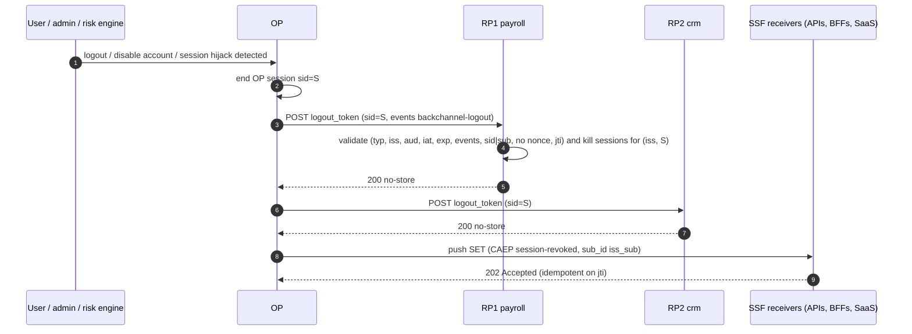

# Distributed Session Termination: Front-Channel vs Back-Channel Logout, and CAEP

> Folder 03 · File 03 of 03 · Identity, AuthN/AuthZ, OAuth 2.1/OIDC/FAPI 2.0 L7 Reference
> Previous: [02 · Federation](02-federation-showdown-oidc-vs-saml2-assertions-and-scim2-Automated-provisioning.md) · First: [01 · OIDC Core](01-oidc-core-id-token-vs-access-token-userinfo-discovery-and-at-hash-c-hash.md)

| Listing | What it proves | Oracle |
|---|---|---|
| L24 `LogoutCaepLab.java` | Back-Channel Logout 1.0 tokens: an L5 RP (signature only) lets 4 confused or replayed tokens log Alice out, including a POSTed ID token and a token for another RP; the L7 RP (`typ logout+jwt`, `iss`, `aud`, `iat` window, `exp` required, `events`, `sid`/`sub`, no `nonce`, `jti` idempotence) accepts only the genuine one. The front-channel cookie matrix (logout works in 1 of 8 combinations). A CAEP `session-revoked` SET receiver per RFC 8935 (202, error codes, `jti` dedupe) | OpenID Back-Channel Logout 1.0 §2.4–2.8, RFC 8417, RFC 8935, CAEP 1.0 |
| L25 `SpringBackChannelLogoutLab.java` | The **real** Spring Security 7.1.2 back-channel logout provider (the package-private class `oidcLogout().backChannel()` installs), fetching JWK Sets over HTTP from an in-process server and driving the public `InMemoryOidcSessionRegistry`. It accepts a redelivered token, an untyped token, and an `exp`-less 2-hour-old `sub`-only token (both sessions removed). It throws `AuthenticationServiceException` on an ID token rather than answering 400, and it rejects a genuine ES256 logout token. There is no public hook to change any of this. A hardened endpoint built from public API only decides all 7 tokens correctly | Back-Channel Logout 1.0 §2.4, §2.6, §4.1; spring-security 7.1.2 sources |

**Verification.** Compiled with Folders 01–03 by `javac --release 21 -Xlint:all -Werror` on JDK 25.0.4.1. L24's ES256 tokens use the JOSE code from Folder 01. L25 runs the spring-security-config / -oauth2-client / -oauth2-jose 7.1.2 jars and Nimbus JOSE + JWT 10.9.1 against `com.sun.net.httpserver` on 127.0.0.1 (random port, masked). The gate re-runs both outputs and requires them byte-identical. Spring behaviour marked [D] was read from spring-security 7.1.2 sources (`OidcBackChannelLogoutTokenValidator`, `OidcBackChannelLogoutAuthenticationProvider`, `OidcBackChannelLogoutFilter`, `LogoutTokenClaimAccessor`, `OidcLogoutConfigurer`). Behaviour marked [M] was measured by L24 or L25. Specification text is from the OpenID logout specifications, CAEP 1.0 and SSF 1.0 (approved as Final Specifications in September 2025; linked in §9), and RFC 8417, 8725, 8935 and 8936 (in [`fixtures/`](fixtures/)).

Labels: **[D]** documented · **[M]** measured by a listing · **[E]** engineering judgment · **⚠** trap.

---

## 0. Orientation

Logging in is a single transaction. Logging *out* is a distributed-systems problem. One user's single sign-on session at the OP fans out into sessions at N relying parties, each with its own cookies, refresh tokens and cached access tokens. "Sign out", "this employee was fired" and "this session was hijacked" all have to reach every one of them, quickly and reliably, without letting an attacker log users out at will. OIDC offers three logout mechanisms of very different strength. CAEP generalizes the strong one into a continuous signal bus.

Results:
- **[M]** A back-channel endpoint that only verifies the signature accepts confused tokens. Alice has two sessions before each token:
  - an ID token POSTed as `logout_token` kills both;
  - a token addressed to another RP kills both;
  - a 2-hour-old `sub`-only token kills both;
  - a redelivered valid token kills a session created after the original logout.
  
  The L7 endpoint rejects all of them with precise reasons and treats the redelivery idempotently (L24).
- **[M]** Front-channel logout (hidden iframes) delivers the RP's session cookie in **1 of 8** cookie and browser combinations, only `SameSite=None`, unpartitioned, in a browser that still allows third-party cookies. That is Chrome's default after Google's 2025 decision not to deprecate them; Safari and Firefox block them by default. Everywhere else it fails **silently**.
- **[M] Spring Security 7.1.2** `oidcLogout().backChannel()`, run for real (L25):
  - its validator requires `events`, `iss`, `aud` ∋ `client_id`, `iat`, `jti`, `sid` or `sub`, and the absence of `nonce`, and it rejects another RP's token with 400;
  - it **accepts an untyped token**. `JwtTypeValidator("JWT", "logout+jwt")` has `allowEmpty=true`, which is deliberate: the specification warns that requiring `typ` "will break most existing deployments";
  - it **accepts a token with no `exp`** and an `iat` 2 hours old, and that `sub`-only token removes both of Alice's sessions. `exp` is checked only *if present*, although Back-Channel Logout 1.0 lists it as REQUIRED;
  - it **accepts a redelivered token** and logs out a session created after the original logout. `jti` must be present, but replay is not tracked;
  - it **rejects a genuine ES256 logout token**. The decoder is `NimbusJwtDecoder.withJwkSetUri(...).build()`, which is RS256-only, even when the registration's ID tokens are ES256. The specification says to validate `alg` "in the same way it is validated for ID Tokens";
  - for a signed OP JWT with **no `events` claim**, such as any ID token, it throws `AuthenticationServiceException("events cannot be null")`. `LogoutTokenClaimAccessor.getEvents()` asserts non-null, so the validator's own `events == null` branch is unreachable. `OidcBackChannelLogoutFilter` rethrows that exception, so the response is not the 400 the specification requires [D];
  - **none of this is configurable.** `BackChannelLogoutConfigurer`'s public methods are `logoutHandler` and `logoutUri`, and the provider and its `setLogoutTokenDecoderFactory` are package-private.
  
  No matching upstream issue turned up in a search on 2026-11-06. The closest is [gh-11799](https://github.com/spring-projects/spring-security/issues/11799), where the reactive ID-token decoder was hard-coded to RS256.
- **[D]** CAEP 1.0, SSF 1.0 and RISC 1.0 were approved as OpenID Final Specifications in September 2025. RFC 8935 push delivery answers `202 Accepted` and uses error codes such as `invalid_audience`. RFC 8417 says `exp` is NOT RECOMMENDED in SETs. Logout tokens, by contrast, require `exp` and rely on `typ: logout+jwt` against confusion.

---

## 1. First principles: who holds what after SSO

```text
                       OP session (cookie at op.example.com, sid=S)
                                    |
          +-------------------------+--------------------------+
          |                         |                          |
   RP1 payroll.example.com    RP2 crm.example.com        RP3 mobile app
   local session (cookie)     local session              refresh token (30 d)
   sid=S recorded at login    sid=S                      no browser at all
   access token (5 min)       access token               access tokens

  "log out" must reach: the OP session, EVERY RP session for sid S (or for the user sub), every refresh token,
  and every cached access token (bounded by its lifetime unless the RS checks a revocation signal).
```

The key idea is the **`sid` claim**. The OP puts a session identifier in the ID token (when `backchannel_logout_session_supported`), and the RP stores `(iss, sid) → local sessions` at login. A logout message naming `sid` kills exactly the sessions created from that OP session. One naming only `sub` kills all of the user's sessions at that RP [D: Back-Channel Logout §2.4].

---

## 2. The three OIDC logout mechanisms

### 2.1 RP-Initiated Logout 1.0

The user clicks "log out" at one RP. That RP clears its own session and redirects to the OP's `end_session_endpoint` with `id_token_hint`, `post_logout_redirect_uri` (exactly registered: the same open-redirect rules as Folder 02) and `state`. The OP ends its session and *may* then notify the other RPs with one of the mechanisms below.

```http
GET /logout?id_token_hint=eyJhbGciOiJFUzI1NiJ9...&post_logout_redirect_uri=https%3A%2F%2Fpayroll.example.com%2Fbye&state=9a2f HTTP/1.1
Host: op.example.com
```

### 2.2 Front-Channel Logout 1.0 (browser iframes)

The OP renders a page containing a hidden iframe per RP (`frontchannel_logout_uri?iss=…&sid=…`). Each iframe must clear the RP's session **using the RP's own session cookie**, which the browser sends to the iframe only if third-party cookies are allowed and the cookie is `SameSite=None`. The specification itself has a section titled "User Agents Blocking Access to Third-Party Content" [D]. L24's matrix shows why it fails almost everywhere:

```text
  RP session cookie        3p cookies allowed (Chrome default)   3p cookies blocked (Safari/Firefox defaults)
  SameSite=Lax             SILENT failure (never sent in iframe)  SILENT failure
  SameSite=Lax+Partitioned SILENT                                 SILENT
  SameSite=None            logs out                               SILENT
  SameSite=None+Partitioned SILENT (partition keyed by OP site)   SILENT
```

⚠ Making front-channel logout work requires `SameSite=None` session cookies, which **weakens CSRF defence** (Folder 01 file 01). It is a security trade in the wrong direction [E].

### 2.3 Back-Channel Logout 1.0 (server-to-server)

The OP POSTs a signed **logout token** to each RP's registered `backchannel_logout_uri`. No browser is involved.

```http
POST /backchannel-logout HTTP/1.1
Host: payroll.example.com
Content-Type: application/x-www-form-urlencoded

logout_token=eyJhbGciOiJFUzI1NiIsImtpZCI6Ii4uLiIsInR5cCI6ImxvZ291dCtqd3QifQ.eyJpc3MiOiJodHRwczovL29wLmV4YW1wbGUuY29tIiwi...
```

```json
{"iss": "https://server.example.com", "sub": "248289761001", "aud": "s6BhdRkqt3",
 "iat": 1471566154, "exp": 1471569754, "jti": "bWJq", "sid": "08a5019c-17e1-4977-8f42-65a12843ea02",
 "events": {"http://schemas.openid.net/event/backchannel-logout": {}}}
```

That is the specification's example claims set [D]. The required claims are `iss`, `aud`, `iat`, `exp`, `jti` and `events`; `sid` or `sub` (at least one) is required; and the token "MUST NOT contain a nonce". It "is RECOMMENDED that Logout Tokens be explicitly typed" with `typ: logout+jwt`.

```http
HTTP/1.1 200 OK
Cache-Control: no-store
```



---

## 3. L24: confused tokens, the cookie matrix, and a CAEP receiver

<!-- listing:LogoutCaepLab.java -->
```java
import java.nio.charset.StandardCharsets;
import java.security.SecureRandom;
import java.util.HashMap;
import java.util.HashSet;
import java.util.LinkedHashMap;
import java.util.List;
import java.util.Locale;
import java.util.Map;
import java.util.Set;

/**
 * L24 - ending sessions everywhere: OIDC Back-Channel Logout 1.0 tokens, the front-channel logout cookie matrix,
 * and CAEP 1.0 session-revoked Security Event Tokens (RFC 8417) pushed per RFC 8935.
 *
 * <ul>
 *   <li>an L5 RP back-channel endpoint (signature only) vs L7 (typ logout+jwt, iss, aud, iat window, exp REQUIRED,
 *       jti replay, events member, sid|sub, no nonce) against five forged or confused tokens;</li>
 *   <li>front-channel logout: which cookie / browser combinations still deliver the RP session cookie to the hidden
 *       iframe (almost none);</li>
 *   <li>a CAEP receiver: 202 on success, RFC 8935 error codes otherwise, idempotent on jti; and the propagation table.</li>
 * </ul>
 */
public final class LogoutCaepLab {
    static final long NOW = 1_767_225_600L;
    static final String OP = "https://op.example.com";
    static final String BCL_EVENT = "http://schemas.openid.net/event/backchannel-logout";
    static final String CAEP_REVOKED = "https://schemas.openid.net/secevent/caep/event-type/session-revoked";

    static String jwt(Jose.Jwk key, String typ, Map<String, Object> claims) {
        Map<String, Object> h = new LinkedHashMap<>();
        h.put("alg", "ES256");
        h.put("kid", key.kid());
        if (typ != null) {
            h.put("typ", typ);
        }
        return Jose.sign(h, MiniJson.write(claims).getBytes(StandardCharsets.UTF_8), key);
    }

    static Map<String, Object> logoutClaims(String aud, long iat, String jti, String sid, String sub) {
        Map<String, Object> c = new LinkedHashMap<>();
        c.put("iss", OP);
        if (sub != null) {
            c.put("sub", sub);
        }
        c.put("aud", aud);
        c.put("iat", iat);
        c.put("exp", iat + 120);
        c.put("jti", jti);
        if (sid != null) {
            c.put("sid", sid);
        }
        c.put("events", Map.of(BCL_EVENT, Map.of()));
        return c;
    }

    /** The RP: sessions indexed by (iss, sid) and (iss, sub). */
    static final class Rp {
        final String clientId;
        final boolean l7;
        final Jose.Jwk opKey;
        final Map<String, String> sessionSid = new HashMap<>(); // local session id -> sid
        final Map<String, String> sessionSub = new HashMap<>(); // local session id -> sub
        final Set<String> seenJti = new HashSet<>();

        Rp(String clientId, boolean l7, Jose.Jwk opKey) {
            this.clientId = clientId;
            this.l7 = l7;
            this.opKey = opKey;
        }

        void login(String local, String sid, String sub) {
            sessionSid.put(local, sid);
            sessionSub.put(local, sub);
        }

        /** POST /backchannel-logout; returns "HTTP status: sessions killed" or the error. */
        String backchannel(String token) {
            Jose.Parts p = Jose.parse(token);
            if (!Jose.rawVerify("ES256", opKey, p.signingInput(), p.sig())) {
                return "400 (signature)";
            }
            Map<String, Object> c = MiniJson.object(new String(p.payload(), StandardCharsets.UTF_8));
            if (l7) {
                String why = null;
                if (!"logout+jwt".equals(p.header().get("typ"))) {
                    why = "typ " + p.header().get("typ");
                } else if (!OP.equals(c.get("iss"))) {
                    why = "iss";
                } else if (!(c.get("aud") instanceof String a ? a.equals(clientId) : c.get("aud") instanceof List<?> l && l.contains(clientId))) {
                    why = "aud " + c.get("aud");
                } else if (!(c.get("iat") instanceof Long iat) || Math.abs(NOW - iat) > 120) {
                    why = "iat outside window";
                } else if (!(c.get("exp") instanceof Long exp) || exp < NOW) {
                    why = "exp missing or past";
                } else if (!(c.get("events") instanceof Map<?, ?> ev) || !ev.containsKey(BCL_EVENT)) {
                    why = "events";
                } else if (c.containsKey("nonce")) {
                    why = "nonce present (an ID token?)";
                } else if (c.get("sid") == null && c.get("sub") == null) {
                    why = "neither sid nor sub";
                } else if (!seenJti.add(String.valueOf(c.get("jti")))) {
                    return "200 (replayed jti: already processed, nothing to do)";
                }
                if (why != null) {
                    return "400 invalid_request (" + why + ")";
                }
            }
            int killed = 0;
            Object sid = c.get("sid");
            Object sub = c.get("sub");
            for (String local : new HashSet<>(sessionSid.keySet())) {
                boolean match = sid != null ? sid.equals(sessionSid.get(local)) : sub != null && sub.equals(sessionSub.get(local));
                if (match) {
                    sessionSid.remove(local);
                    sessionSub.remove(local);
                    killed++;
                }
            }
            return "200 Cache-Control: no-store; sessions killed: " + killed;
        }
    }

    /** Does the RP session cookie reach the hidden RP iframe rendered under the OP's top-level page? */
    static boolean frontChannelWorks(String sameSite, boolean partitioned, boolean thirdPartyCookiesBlocked) {
        if (!"None".equals(sameSite)) {
            return false;               // Lax/Strict cookies are never sent in a cross-site iframe
        }
        if (partitioned) {
            return false;               // CHIPS: the partition keyed by top-level op.example.com holds no RP session
        }
        return !thirdPartyCookiesBlocked;
    }

    /** CAEP receiver per RFC 8935: 202 when accepted, 400 + err code otherwise; idempotent on jti. */
    static final class CaepReceiver {
        final Jose.Jwk transmitterKey;
        final String audience;
        final Set<String> seen = new HashSet<>();
        int sessionsRevoked;

        CaepReceiver(Jose.Jwk transmitterKey, String audience) {
            this.transmitterKey = transmitterKey;
            this.audience = audience;
        }

        String receive(String set) {
            Jose.Parts p = Jose.parse(set);
            if (!Jose.rawVerify("ES256", transmitterKey, p.signingInput(), p.sig())) {
                return "400 {\"err\":\"invalid_key\"}";
            }
            Map<String, Object> c = MiniJson.object(new String(p.payload(), StandardCharsets.UTF_8));
            if (!"secevent+jwt".equals(p.header().get("typ")) || c.containsKey("exp")) {
                return "400 {\"err\":\"invalid_request\",\"description\":\"not a SET\"}";
            }
            if (!OP.equals(c.get("iss"))) {
                return "400 {\"err\":\"invalid_issuer\"}";
            }
            if (!audience.equals(c.get("aud"))) {
                return "400 {\"err\":\"invalid_audience\"}";
            }
            if (!seen.add((String) c.get("jti"))) {
                return "202 (duplicate jti, already applied)";
            }
            if (c.get("events") instanceof Map<?, ?> ev && ev.containsKey(CAEP_REVOKED)) {
                sessionsRevoked++;
            }
            return "202 Accepted";
        }
    }

    public static void main(String[] args) throws Exception {
        SecureRandom rng = new SecureRandom();
        Jose.Jwk op = Jose.generate("ES256", rng);

        KbSupport.section("Back-Channel Logout 1.0: five confused or forged tokens, L5 (signature only) vs L7");
        Map<String, String> tokens = new LinkedHashMap<>();
        tokens.put("0 valid logout token for sid-alice-laptop", jwt(op, "logout+jwt", logoutClaims("payroll-app", NOW, "j0", "sid-alice-laptop", "alice")));
        Map<String, Object> idTok = new LinkedHashMap<>();
        idTok.put("iss", OP);
        idTok.put("sub", "alice");
        idTok.put("aud", "payroll-app");
        idTok.put("iat", NOW);
        idTok.put("exp", NOW + 300);
        idTok.put("nonce", "n-1");
        tokens.put("1 an ID token POSTed as logout_token (cross-JWT confusion)", jwt(op, "JWT", idTok));
        tokens.put("2 logout token addressed to another RP (aud=crm-app)", jwt(op, "logout+jwt", logoutClaims("crm-app", NOW, "j2", null, "alice")));
        tokens.put("3 captured 2-hour-old sub-only token replayed", jwt(op, "logout+jwt", logoutClaims("payroll-app", NOW - 7_200, "j3", null, "alice")));
        Map<String, Object> neither = logoutClaims("payroll-app", NOW, "j4", null, null);
        tokens.put("4 neither sid nor sub", jwt(op, "logout+jwt", neither));
        tokens.put("5 the valid token from case 0, delivered twice", tokens.get("0 valid logout token for sid-alice-laptop"));
        for (boolean l7 : new boolean[] {false, true}) {
            Rp rp = new Rp("payroll-app", l7, op);
            int damage = 0;
            for (Map.Entry<String, String> e : tokens.entrySet()) {
                rp.sessionSid.clear(); // before every token alice has exactly two live sessions; the jti store persists
                rp.sessionSub.clear();
                rp.login("alice-laptop", "sid-alice-laptop", "alice");
                rp.login("alice-phone", "sid-alice-phone", "alice");
                String r = rp.backchannel(e.getValue());
                boolean legit = e.getKey().startsWith("0");
                if (!legit && r.startsWith("200") && !r.endsWith(": 0") && !r.contains("replayed")) {
                    damage++;
                }
                KbSupport.info("%s %-58s -> %s", l7 ? "L7" : "L5", e.getKey(), r);
            }
            KbSupport.check(l7 ? "L7: only the genuine token logs anyone out (one session, by sid)" : "L5: " + damage
                    + " confused or replayed tokens log alice out of sessions they never named", l7 ? damage == 0 : damage == 4);
        }

        KbSupport.section("Front-Channel Logout 1.0: does the RP iframe get its session cookie?");
        String[][] browsers = {{"3p cookies allowed (Chrome default)", "false"}, {"3p cookies blocked (Safari, Firefox defaults)", "true"}};
        int works = 0;
        int total = 0;
        for (String ss : new String[] {"Lax", "None"}) {
            for (boolean part : new boolean[] {false, true}) {
                StringBuilder row = new StringBuilder();
                for (String[] b : browsers) {
                    boolean ok = frontChannelWorks(ss, part, Boolean.parseBoolean(b[1]));
                    works += ok ? 1 : 0;
                    total++;
                    row.append(String.format(Locale.ROOT, "%-46s %-7s ", b[0], ok ? "logs out" : "SILENT"));
                }
                KbSupport.info("RP cookie SameSite=%-4s Partitioned=%-5s | %s", ss, part, row.toString().trim());
            }
        }
        KbSupport.check("front-channel logout works in " + works + " of " + total
                + " combinations, and only with SameSite=None unpartitioned cookies in a browser that allows 3p cookies", works == 1);

        KbSupport.section("CAEP session-revoked SET (RFC 8417 + CAEP 1.0), pushed per RFC 8935");
        CaepReceiver rx = new CaepReceiver(op, "https://payroll.example.com/caep");
        Map<String, Object> set = new LinkedHashMap<>();
        set.put("iss", OP);
        set.put("jti", "24c63fb56e5a2d77a6b512616ca9fa24");
        set.put("iat", NOW);
        set.put("aud", "https://payroll.example.com/caep");
        set.put("txn", "8675309");
        set.put("sub_id", Map.of("format", "iss_sub", "iss", OP, "sub", "alice"));
        set.put("events", Map.of(CAEP_REVOKED, Map.of("event_timestamp", NOW - 2)));
        String good = jwt(op, "secevent+jwt", set);
        KbSupport.info("POST /caep  Content-Type: application/secevent+jwt  ->  %s", rx.receive(good));
        KbSupport.check("re-delivery of the same jti is acknowledged without re-applying: " + rx.receive(good), rx.sessionsRevoked == 1);
        Map<String, Object> wrongAud = new LinkedHashMap<>(set);
        wrongAud.put("aud", "https://crm.example.com/caep");
        wrongAud.put("jti", "other");
        KbSupport.check("SET for another receiver -> " + rx.receive(jwt(op, "secevent+jwt", wrongAud)), rx.sessionsRevoked == 1);
        KbSupport.check("an ID token pushed to the SET endpoint -> " + rx.receive(jwt(op, "JWT", idTok)), rx.sessionsRevoked == 1);

        KbSupport.section("How fast does 'log out everywhere' reach a relying party?");
        String[][] mech = {
            {"RP-Initiated Logout only (user clicks logout at ONE RP)", "other RPs: never (until their own session expires)"},
            {"Front-Channel Logout (hidden iframes)", "browser-dependent; SILENT failure in 7 of 8 cookie/browser setups"},
            {"Back-Channel Logout (OP -> RP POST, per sid/sub)", "seconds, if the OP can reach the RP"},
            {"CAEP session-revoked over SSF push (any receiver, not only OIDC RPs)", "seconds; idempotent; also token-claims-change etc."}};
        for (String[] m : mech) {
            KbSupport.info("%-72s %s", m[0], m[1]);
        }
        KbSupport.check("back-channel + CAEP are the only mechanisms that do not depend on the user's browser", true);
        KbSupport.verdict();
    }
}
```

<!-- output:LogoutCaepLab.java -->
```text

== Back-Channel Logout 1.0: five confused or forged tokens, L5 (signature only) vs L7
  L5 0 valid logout token for sid-alice-laptop                  -> 200 Cache-Control: no-store; sessions killed: 1
  L5 1 an ID token POSTed as logout_token (cross-JWT confusion) -> 200 Cache-Control: no-store; sessions killed: 2
  L5 2 logout token addressed to another RP (aud=crm-app)       -> 200 Cache-Control: no-store; sessions killed: 2
  L5 3 captured 2-hour-old sub-only token replayed              -> 200 Cache-Control: no-store; sessions killed: 2
  L5 4 neither sid nor sub                                      -> 200 Cache-Control: no-store; sessions killed: 0
  L5 5 the valid token from case 0, delivered twice             -> 200 Cache-Control: no-store; sessions killed: 1
  [PASS] L5: 4 confused or replayed tokens log alice out of sessions they never named
  L7 0 valid logout token for sid-alice-laptop                  -> 200 Cache-Control: no-store; sessions killed: 1
  L7 1 an ID token POSTed as logout_token (cross-JWT confusion) -> 400 invalid_request (typ JWT)
  L7 2 logout token addressed to another RP (aud=crm-app)       -> 400 invalid_request (aud crm-app)
  L7 3 captured 2-hour-old sub-only token replayed              -> 400 invalid_request (iat outside window)
  L7 4 neither sid nor sub                                      -> 400 invalid_request (neither sid nor sub)
  L7 5 the valid token from case 0, delivered twice             -> 200 (replayed jti: already processed, nothing to do)
  [PASS] L7: only the genuine token logs anyone out (one session, by sid)

== Front-Channel Logout 1.0: does the RP iframe get its session cookie?
  RP cookie SameSite=Lax  Partitioned=false | 3p cookies allowed (Chrome default)            SILENT  3p cookies blocked (Safari, Firefox defaults)  SILENT
  RP cookie SameSite=Lax  Partitioned=true  | 3p cookies allowed (Chrome default)            SILENT  3p cookies blocked (Safari, Firefox defaults)  SILENT
  RP cookie SameSite=None Partitioned=false | 3p cookies allowed (Chrome default)            logs out 3p cookies blocked (Safari, Firefox defaults)  SILENT
  RP cookie SameSite=None Partitioned=true  | 3p cookies allowed (Chrome default)            SILENT  3p cookies blocked (Safari, Firefox defaults)  SILENT
  [PASS] front-channel logout works in 1 of 8 combinations, and only with SameSite=None unpartitioned cookies in a browser that allows 3p cookies

== CAEP session-revoked SET (RFC 8417 + CAEP 1.0), pushed per RFC 8935
  POST /caep  Content-Type: application/secevent+jwt  ->  202 Accepted
  [PASS] re-delivery of the same jti is acknowledged without re-applying: 202 (duplicate jti, already applied)
  [PASS] SET for another receiver -> 400 {"err":"invalid_audience"}
  [PASS] an ID token pushed to the SET endpoint -> 400 {"err":"invalid_request","description":"not a SET"}

== How fast does 'log out everywhere' reach a relying party?
  RP-Initiated Logout only (user clicks logout at ONE RP)                  other RPs: never (until their own session expires)
  Front-Channel Logout (hidden iframes)                                    browser-dependent; SILENT failure in 7 of 8 cookie/browser setups
  Back-Channel Logout (OP -> RP POST, per sid/sub)                         seconds, if the OP can reach the RP
  CAEP session-revoked over SSF push (any receiver, not only OIDC RPs)     seconds; idempotent; also token-claims-change etc.
  [PASS] back-channel + CAEP are the only mechanisms that do not depend on the user's browser

verdict: OK (7 checks)
```

Why each L7 rule exists:
- **`typ: logout+jwt`, `events`, and no `nonce`.** These make a logout token structurally unlike an ID token. Without them, any ID token the OP ever issued for this RP becomes a "log the user out" weapon (the cross-JWT confusion of RFC 8725 §2.8), and conversely a logout token must never be accepted as an ID token.
  - ⚠ The specification only RECOMMENDS typing. It warns that *requiring* `typ` "will break most existing deployments", since many OPs send untyped logout tokens.
  - **The L7 rule:** require `typ` when your OP types its logout tokens, which you verify in a contract test. Otherwise accept untyped tokens and let `events` + no-`nonce` carry the cross-type defence [D: §4.1].
- **`aud`.** A logout token for `crm-app` must not log users out of `payroll-app`. Otherwise one compromised or misrouted RP endpoint becomes a logout cannon for all of them.
- **`iat` window + `exp`.** A captured `sub`-only token kills *every* session the user has at the RP. Replayed later, it kills sessions created long after the original logout. The window bounds that. The specification encourages OPs to set `exp` "at most two minutes in the future" [D: §4].
- **`jti`.** The OP retries deliveries. Processing must be idempotent, and a repeated `jti` is answered without re-applying (L24 case 5). The specification makes this check optional ("Optionally verify that another Logout Token with the same jti value has not been recently received"). L24 case 5 is why L7 treats it as mandatory.

### 3.1 L25: Spring Security 7.1.2's back-channel logout, run for real

L24 is a model. L25 runs the actual classes:
- **The stock path** is the package-private `OidcBackChannelLogoutAuthenticationProvider` that `oidcLogout().backChannel()` installs, instantiated by reflection. It fetches each OP's JWK Set over HTTP from an in-process server. Its result feeds the public `InMemoryOidcSessionRegistry`, exactly as `OidcBackChannelLogoutHandler` does (`removeSessionInformation(token.getPrincipal())`).
- **The hardened path** is an endpoint built from public API only.

<!-- listing:SpringBackChannelLogoutLab.java -->
```java
import java.lang.reflect.Constructor;
import java.lang.reflect.Method;
import java.lang.reflect.Modifier;
import java.net.InetAddress;
import java.net.InetSocketAddress;
import java.nio.charset.StandardCharsets;
import java.time.Duration;
import java.time.Instant;
import java.util.Arrays;
import java.util.Date;
import java.util.LinkedHashMap;
import java.util.List;
import java.util.Map;
import java.util.concurrent.ConcurrentHashMap;

import com.nimbusds.jose.JOSEObjectType;
import com.nimbusds.jose.JWSAlgorithm;
import com.nimbusds.jose.JWSHeader;
import com.nimbusds.jose.JWSSigner;
import com.nimbusds.jose.crypto.ECDSASigner;
import com.nimbusds.jose.crypto.RSASSASigner;
import com.nimbusds.jose.jwk.Curve;
import com.nimbusds.jose.jwk.ECKey;
import com.nimbusds.jose.jwk.JWKSet;
import com.nimbusds.jose.jwk.RSAKey;
import com.nimbusds.jose.jwk.gen.ECKeyGenerator;
import com.nimbusds.jose.jwk.gen.RSAKeyGenerator;
import com.nimbusds.jwt.JWTClaimsSet;
import com.nimbusds.jwt.SignedJWT;
import com.sun.net.httpserver.HttpServer;

import org.springframework.security.authentication.AuthenticationProvider;
import org.springframework.security.authentication.AuthenticationServiceException;
import org.springframework.security.core.Authentication;
import org.springframework.security.core.AuthenticationException;
import org.springframework.security.core.authority.AuthorityUtils;
import org.springframework.security.oauth2.client.oidc.authentication.OidcIdTokenDecoderFactory;
import org.springframework.security.oauth2.client.oidc.authentication.logout.LogoutTokenClaimAccessor;
import org.springframework.security.oauth2.client.oidc.authentication.logout.OidcLogoutToken;
import org.springframework.security.oauth2.client.oidc.session.InMemoryOidcSessionRegistry;
import org.springframework.security.oauth2.client.oidc.session.OidcSessionInformation;
import org.springframework.security.oauth2.client.oidc.session.OidcSessionRegistry;
import org.springframework.security.oauth2.client.registration.ClientRegistration;
import org.springframework.security.oauth2.core.AuthorizationGrantType;
import org.springframework.security.oauth2.core.DelegatingOAuth2TokenValidator;
import org.springframework.security.oauth2.core.OAuth2AuthenticationException;
import org.springframework.security.oauth2.core.OAuth2Error;
import org.springframework.security.oauth2.core.OAuth2TokenValidator;
import org.springframework.security.oauth2.core.OAuth2TokenValidatorResult;
import org.springframework.security.oauth2.core.oidc.OidcIdToken;
import org.springframework.security.oauth2.core.oidc.user.DefaultOidcUser;
import org.springframework.security.oauth2.jose.jws.SignatureAlgorithm;
import org.springframework.security.oauth2.jwt.Jwt;
import org.springframework.security.oauth2.jwt.JwtDecoder;
import org.springframework.security.oauth2.jwt.JwtException;
import org.springframework.security.oauth2.jwt.JwtTimestampValidator;
import org.springframework.security.oauth2.jwt.JwtTypeValidator;
import org.springframework.security.oauth2.jwt.NimbusJwtDecoder;

/**
 * L25 - Spring Security 7.1.2's OIDC Back-Channel Logout, run for real: the package-private
 * {@code OidcBackChannelLogoutAuthenticationProvider} that {@code oidcLogout().backChannel()} installs fetches the
 * OP's JWK Set over HTTP from an in-process server, and its result drives the public {@link InMemoryOidcSessionRegistry}
 * exactly as {@code OidcBackChannelLogoutHandler} does. Seven tokens show what the defaults accept (untyped,
 * exp-less and replayed tokens) and reject (ID tokens, other audiences - and a genuine ES256 logout token). A
 * hardened endpoint built only from public API (pinned algorithm per registration, typ, exp REQUIRED, iat window,
 * jti store) decides all seven correctly.
 */
public final class SpringBackChannelLogoutLab {
    static final String CFG = "org.springframework.security.config.annotation.web.configurers.oauth2.client.";
    static final String BCL_EVENT = "http://schemas.openid.net/event/backchannel-logout";
    static final String ISS_RSA = "https://op-rsa.example.com";
    static final String ISS_EC = "https://op-ec.example.com";

    static ClientRegistration registration(String id, String issuer, String jwks) {
        return ClientRegistration.withRegistrationId(id).clientId("payroll-app").clientSecret("unused")
                .authorizationGrantType(AuthorizationGrantType.AUTHORIZATION_CODE)
                .redirectUri("https://payroll.example.com/login/oauth2/code/" + id).scope("openid")
                .authorizationUri(issuer + "/authorize").tokenUri(issuer + "/token").issuerUri(issuer).jwkSetUri(jwks).build();
    }

    record Tok(String label, String value, boolean genuine) {
    }

    static String sign(JWSSigner signer, JWSAlgorithm alg, String kid, String typ, JWTClaimsSet claims) throws Exception {
        JWSHeader.Builder h = new JWSHeader.Builder(alg).keyID(kid);
        if (typ != null) {
            h.type(new JOSEObjectType(typ));
        }
        SignedJWT jwt = new SignedJWT(h.build(), claims);
        jwt.sign(signer);
        return jwt.serialize();
    }

    static JWTClaimsSet logout(String iss, String aud, Instant iat, Instant exp, String jti, String sid, String sub) {
        JWTClaimsSet.Builder b = new JWTClaimsSet.Builder().issuer(iss).audience(aud).issueTime(Date.from(iat)).jwtID(jti)
                .claim("events", Map.of(BCL_EVENT, Map.of()));
        if (exp != null) {
            b.expirationTime(Date.from(exp));
        }
        if (sid != null) {
            b.claim("sid", sid);
        }
        if (sub != null) {
            b.subject(sub);
        }
        return b.build();
    }

    // ------------------------------------------------------------------ the hardened endpoint (public API only)

    /** Back-Channel Logout 1.0 section 2.6 claim rules (what Spring's package-private validator checks). */
    record LogoutClaimsValidator(String issuer, String clientId) implements OAuth2TokenValidator<Jwt> {
        @Override
        public OAuth2TokenValidatorResult validate(Jwt jwt) {
            LogoutTokenClaimAccessor c = jwt::getClaims;
            // read the raw claim: LogoutTokenClaimAccessor.getEvents() asserts non-null and THROWS on an ID token
            String why = !(jwt.getClaims().get("events") instanceof Map<?, ?> ev) || !(ev.get(BCL_EVENT) instanceof Map<?, ?>)
                    ? "events member missing"
                    : !issuer.equals(String.valueOf(c.getIssuer())) ? "iss"
                    : c.getAudience() == null || !c.getAudience().contains(clientId) ? "aud " + c.getAudience()
                    : c.getId() == null ? "jti missing"
                    : c.getSubject() == null && c.getSessionId() == null ? "neither sid nor sub"
                    : c.hasClaim("nonce") ? "nonce present (an ID token?)" : null;
            return why == null ? OAuth2TokenValidatorResult.success()
                    : OAuth2TokenValidatorResult.failure(new OAuth2Error("invalid_request", why, null));
        }
    }

    /** iat must be recent: a captured sub-only token must not stay a "log everyone out" weapon. */
    record IatWindowValidator(Duration window) implements OAuth2TokenValidator<Jwt> {
        @Override
        public OAuth2TokenValidatorResult validate(Jwt jwt) {
            Instant iat = jwt.getIssuedAt();
            boolean ok = iat != null && Duration.between(iat, Instant.now()).abs().compareTo(window) <= 0;
            return ok ? OAuth2TokenValidatorResult.success()
                    : OAuth2TokenValidatorResult.failure(new OAuth2Error("invalid_request", "iat outside the " + window.toMinutes() + "-minute window", null));
        }
    }

    /** One decoder per registration: the SAME algorithm the registration uses for ID tokens, never a default. */
    static JwtDecoder hardenedDecoder(ClientRegistration reg, SignatureAlgorithm alg) {
        NimbusJwtDecoder d = NimbusJwtDecoder.withJwkSetUri(reg.getProviderDetails().getJwkSetUri()).jwsAlgorithm(alg).build();
        JwtTimestampValidator timestamps = new JwtTimestampValidator(Duration.ofSeconds(30));
        timestamps.setAllowEmptyExpiryClaim(false); // Back-Channel Logout 1.0: exp is REQUIRED
        d.setJwtValidator(new DelegatingOAuth2TokenValidator<>(new JwtTypeValidator("logout+jwt", "application/logout+jwt"),
                timestamps, new IatWindowValidator(Duration.ofMinutes(2)),
                new LogoutClaimsValidator(reg.getProviderDetails().getIssuerUri(), reg.getClientId())));
        d.setClaimSetConverter(OidcIdTokenDecoderFactory.createDefaultClaimTypeConverter());
        return d;
    }

    static final class HardenedEndpoint {
        final Map<String, JwtDecoder> decoders = new ConcurrentHashMap<>();
        final Map<String, Instant> seenJti = new ConcurrentHashMap<>(); // iss|jti -> exp + skew, evicted after that

        /** POST /logout/connect/back-channel/{registrationId} */
        String post(ClientRegistration reg, SignatureAlgorithm alg, String logoutToken, OidcSessionRegistry registry) {
            Jwt jwt;
            try {
                jwt = decoders.computeIfAbsent(reg.getRegistrationId(), id -> hardenedDecoder(reg, alg)).decode(logoutToken);
            } catch (JwtException e) {
                return "400 invalid_request (" + mask(e.getMessage()) + ")";
            }
            Instant now = Instant.now();
            seenJti.values().removeIf(exp -> exp.isBefore(now));
            if (seenJti.putIfAbsent(jwt.getClaimAsString("iss") + "|" + jwt.getId(), jwt.getExpiresAt().plusSeconds(30)) != null) {
                return "200 (jti already processed: nothing re-applied)";
            }
            OidcLogoutToken t = OidcLogoutToken.withTokenValue(logoutToken).claims(c -> c.putAll(jwt.getClaims())).build();
            return "200 no-store; sessions removed: " + count(registry.removeSessionInformation(t));
        }
    }

    // ------------------------------------------------------------------ helpers

    static int count(Iterable<?> it) {
        int n = 0;
        for (Object ignored : it) {
            n++;
        }
        return n;
    }

    static String mask(String s) {
        return s == null ? "" : s.replaceAll("[0-9]{4}-[0-9]{2}-[0-9T:.]+Z", "<t>").replaceAll("http://127\\.0\\.0\\.1:[0-9]+", "http://127.0.0.1:<port>");
    }

    static OidcSessionRegistry twoSessions(String issuer) {
        OidcSessionRegistry r = new InMemoryOidcSessionRegistry();
        login(r, "laptop", issuer, "sid-laptop");
        login(r, "phone", issuer, "sid-phone");
        return r;
    }

    static void login(OidcSessionRegistry reg, String localSession, String issuer, String sid) {
        Instant now = Instant.now();
        OidcIdToken id = OidcIdToken.withTokenValue("id-token").issuer(issuer).subject("alice").audience(List.of("payroll-app"))
                .issuedAt(now).expiresAt(now.plusSeconds(300)).claim("sid", sid).build();
        reg.saveSessionInformation(new OidcSessionInformation(localSession, Map.of(),
                new DefaultOidcUser(AuthorityUtils.createAuthorityList("OIDC_USER"), id)));
    }

    public static void main(String[] args) throws Exception {
        RSAKey rsa = new RSAKeyGenerator(2048).keyID("rsa-1").generate();
        ECKey ec = new ECKeyGenerator(Curve.P_256).keyID("ec-1").generate();
        HttpServer jwks = HttpServer.create(new InetSocketAddress(InetAddress.getLoopbackAddress(), 0), 0);
        Map<String, String> sets = Map.of("/rsa", new JWKSet(rsa).toPublicJWKSet().toString(), "/ec", new JWKSet(ec).toPublicJWKSet().toString());
        for (Map.Entry<String, String> e : sets.entrySet()) {
            jwks.createContext(e.getKey(), ex -> {
                byte[] b = e.getValue().getBytes(StandardCharsets.UTF_8);
                ex.getResponseHeaders().add("Content-Type", "application/jwk-set+json");
                ex.sendResponseHeaders(200, b.length);
                ex.getResponseBody().write(b);
                ex.close();
            });
        }
        jwks.start();
        String base = "http://127.0.0.1:" + jwks.getAddress().getPort();
        try {
            run(rsa, ec, registration("op-rsa", ISS_RSA, base + "/rsa"), registration("op-ec", ISS_EC, base + "/ec"));
        } finally {
            jwks.stop(0);
        }
    }

    static void run(RSAKey rsa, ECKey ec, ClientRegistration regRsa, ClientRegistration regEc) throws Exception {
        KbSupport.section("What oidcLogout().backChannel() lets you configure (spring-security-config 7.1.2, by reflection)");
        Class<?> providerClass = Class.forName(CFG + "OidcBackChannelLogoutAuthenticationProvider");
        Class<?> configurer = Class.forName(CFG + "OidcLogoutConfigurer$BackChannelLogoutConfigurer");
        String[] publicMethods = Arrays.stream(configurer.getDeclaredMethods()).filter(m -> Modifier.isPublic(m.getModifiers()))
                .map(Method::getName).sorted().distinct().toArray(String[]::new);
        Method setter = providerClass.getDeclaredMethod("setLogoutTokenDecoderFactory", org.springframework.security.oauth2.jwt.JwtDecoderFactory.class);
        KbSupport.info("BackChannelLogoutConfigurer public methods: %s", String.join(", ", publicMethods));
        KbSupport.info("OidcBackChannelLogoutAuthenticationProvider public class: %s; setLogoutTokenDecoderFactory public: %s",
                Modifier.isPublic(providerClass.getModifiers()), Modifier.isPublic(setter.getModifiers()));
        KbSupport.check("there is no public hook for the logout-token decoder (algorithm, typ, exp, iat window, jti)",
                !Modifier.isPublic(providerClass.getModifiers()) && !Modifier.isPublic(setter.getModifiers())
                        && Arrays.stream(publicMethods).noneMatch(n -> n.toLowerCase(java.util.Locale.ROOT).contains("decoder")));

        Constructor<?> pc = providerClass.getDeclaredConstructor();
        pc.setAccessible(true);
        AuthenticationProvider stock = (AuthenticationProvider) pc.newInstance();
        Constructor<?> tc = Class.forName(CFG + "OidcLogoutAuthenticationToken").getDeclaredConstructor(String.class, ClientRegistration.class);
        tc.setAccessible(true);

        Instant now = Instant.now();
        RSASSASigner rs = new RSASSASigner(rsa);
        ECDSASigner es = new ECDSASigner(ec);
        String genuine = sign(rs, JWSAlgorithm.RS256, "rsa-1", "logout+jwt", logout(ISS_RSA, "payroll-app", now, now.plusSeconds(120), "j0", "sid-laptop", "alice"));
        JWTClaimsSet idToken = new JWTClaimsSet.Builder().issuer(ISS_RSA).subject("alice").audience("payroll-app").issueTime(Date.from(now))
                .expirationTime(Date.from(now.plusSeconds(300))).claim("nonce", "n-1").claim("sid", "sid-laptop").build();
        List<Tok> toks = List.of(
            new Tok("0 genuine RS256 logout token (sid)", genuine, true),
            new Tok("1 the same token delivered again", genuine, false),
            new Tok("2 no typ header (sid)", sign(rs, JWSAlgorithm.RS256, "rsa-1", null,
                    logout(ISS_RSA, "payroll-app", now, now.plusSeconds(120), "j2", "sid-laptop", "alice")), false),
            new Tok("3 no exp, iat 2 h ago, sub only", sign(rs, JWSAlgorithm.RS256, "rsa-1", "logout+jwt",
                    logout(ISS_RSA, "payroll-app", now.minusSeconds(7_200), null, "j3", null, "alice")), false),
            new Tok("4 an ID token POSTed as logout_token", sign(rs, JWSAlgorithm.RS256, "rsa-1", "JWT", idToken), false),
            new Tok("5 logout token for another RP (aud crm-app)", sign(rs, JWSAlgorithm.RS256, "rsa-1", "logout+jwt",
                    logout(ISS_RSA, "crm-app", now, now.plusSeconds(120), "j5", null, "alice")), false),
            new Tok("6 genuine ES256 logout token (ES256 OP)", sign(es, JWSAlgorithm.ES256, "ec-1", "logout+jwt",
                    logout(ISS_EC, "payroll-app", now, now.plusSeconds(120), "j6", "sid-laptop", "alice")), true));

        KbSupport.section("Stock provider (the one oidcLogout().backChannel() installs) + InMemoryOidcSessionRegistry");
        KbSupport.info("before every token alice has two fresh sessions at the RP: laptop (sid-laptop) and phone (sid-phone)");
        Map<String, String> stockResult = new LinkedHashMap<>();
        for (Tok t : toks) {
            boolean ec6 = t.label().startsWith("6");
            OidcSessionRegistry sessions = twoSessions(ec6 ? ISS_EC : ISS_RSA);
            String r;
            try {
                Authentication a = stock.authenticate((Authentication) tc.newInstance(t.value(), ec6 ? regEc : regRsa));
                OidcLogoutToken lt = (OidcLogoutToken) a.getPrincipal(); // what OidcBackChannelLogoutHandler hands the registry
                r = "accepted; sessions removed: " + count(sessions.removeSessionInformation(lt));
            } catch (OAuth2AuthenticationException e) {
                r = "400 " + e.getError().getErrorCode() + " (" + mask(e.getError().getDescription()) + ")";
            } catch (AuthenticationServiceException e) {
                r = "AuthenticationServiceException \"" + mask(e.getMessage()) + "\" (the filter rethrows it: no 400)";
            } catch (AuthenticationException e) {
                r = "other " + e.getClass().getSimpleName() + " " + mask(e.getMessage());
            }
            stockResult.put(t.label(), r);
            KbSupport.info("stock %-44s -> %s", t.label(), r);
        }
        KbSupport.check("stock accepts a redelivered token and logs out a session created after the original logout",
                stockResult.get("1 the same token delivered again").endsWith("removed: 1"));
        KbSupport.check("stock accepts an untyped logout token (JwtTypeValidator(\"JWT\", \"logout+jwt\") with allowEmpty=true)",
                stockResult.get("2 no typ header (sid)").startsWith("accepted"));
        KbSupport.check("stock accepts a token with NO exp and a 2-hour-old iat; sub-only, it removes BOTH of alice's sessions",
                stockResult.get("3 no exp, iat 2 h ago, sub only").endsWith("removed: 2"));
        KbSupport.check("stock answers another audience with 400, but an ID token (no events) throws out of getEvents()'s assertion",
                stockResult.get("5 logout token for another RP (aud crm-app)").startsWith("400")
                        && stockResult.get("4 an ID token POSTed as logout_token").startsWith("AuthenticationServiceException \"events cannot be null\""));
        KbSupport.check("stock REJECTS a genuine ES256 logout token: withJwkSetUri(...).build() defaults to RS256 only",
                stockResult.get("6 genuine ES256 logout token (ES256 OP)").startsWith("400"));

        KbSupport.section("Hardened endpoint (public API only): alg pinned per registration, typ, exp required, iat window, jti store");
        HardenedEndpoint ep = new HardenedEndpoint();
        int correct = 0;
        for (Tok t : toks) {
            boolean ec6 = t.label().startsWith("6");
            OidcSessionRegistry sessions = twoSessions(ec6 ? ISS_EC : ISS_RSA);
            String r = ep.post(ec6 ? regEc : regRsa, ec6 ? SignatureAlgorithm.ES256 : SignatureAlgorithm.RS256, t.value(), sessions);
            boolean ok = t.genuine() ? r.endsWith("removed: 1") : r.startsWith("400") || r.contains("already processed");
            correct += ok ? 1 : 0;
            KbSupport.info("L7    %-44s -> %s", t.label(), r);
        }
        KbSupport.check("hardened: both genuine tokens remove exactly one session (by sid); the other five remove none", correct == toks.size());
        KbSupport.verdict();
    }
}
```

<!-- output:SpringBackChannelLogoutLab.java -->
```text

== What oidcLogout().backChannel() lets you configure (spring-security-config 7.1.2, by reflection)
  BackChannelLogoutConfigurer public methods: logoutHandler, logoutUri
  OidcBackChannelLogoutAuthenticationProvider public class: false; setLogoutTokenDecoderFactory public: false
  [PASS] there is no public hook for the logout-token decoder (algorithm, typ, exp, iat window, jti)

== Stock provider (the one oidcLogout().backChannel() installs) + InMemoryOidcSessionRegistry
  before every token alice has two fresh sessions at the RP: laptop (sid-laptop) and phone (sid-phone)
  stock 0 genuine RS256 logout token (sid)           -> accepted; sessions removed: 1
  stock 1 the same token delivered again             -> accepted; sessions removed: 1
  stock 2 no typ header (sid)                        -> accepted; sessions removed: 1
  stock 3 no exp, iat 2 h ago, sub only              -> accepted; sessions removed: 2
  stock 4 an ID token POSTed as logout_token         -> AuthenticationServiceException "events cannot be null" (the filter rethrows it: no 400)
  stock 5 logout token for another RP (aud crm-app)  -> 400 invalid_request (An error occurred while attempting to decode the Jwt: aud claim value must include `ClientRegistration#getClientId`)
  stock 6 genuine ES256 logout token (ES256 OP)      -> 400 invalid_request (An error occurred while attempting to decode the Jwt: Signed JWT rejected: Another algorithm expected, or no matching key(s) found)
  [PASS] stock accepts a redelivered token and logs out a session created after the original logout
  [PASS] stock accepts an untyped logout token (JwtTypeValidator("JWT", "logout+jwt") with allowEmpty=true)
  [PASS] stock accepts a token with NO exp and a 2-hour-old iat; sub-only, it removes BOTH of alice's sessions
  [PASS] stock answers another audience with 400, but an ID token (no events) throws out of getEvents()'s assertion
  [PASS] stock REJECTS a genuine ES256 logout token: withJwkSetUri(...).build() defaults to RS256 only

== Hardened endpoint (public API only): alg pinned per registration, typ, exp required, iat window, jti store
  L7    0 genuine RS256 logout token (sid)           -> 200 no-store; sessions removed: 1
  L7    1 the same token delivered again             -> 200 (jti already processed: nothing re-applied)
  L7    2 no typ header (sid)                        -> 400 invalid_request (An error occurred while attempting to decode the Jwt: the given typ value needs to be one of [logout+jwt, application/logout+jwt])
  L7    3 no exp, iat 2 h ago, sub only              -> 400 invalid_request (An error occurred while attempting to decode the Jwt: exp is required)
  L7    4 an ID token POSTed as logout_token         -> 400 invalid_request (An error occurred while attempting to decode the Jwt: the given typ value needs to be one of [logout+jwt, application/logout+jwt])
  L7    5 logout token for another RP (aud crm-app)  -> 400 invalid_request (An error occurred while attempting to decode the Jwt: aud [crm-app])
  L7    6 genuine ES256 logout token (ES256 OP)      -> 200 no-store; sessions removed: 1
  [PASS] hardened: both genuine tokens remove exactly one session (by sid); the other five remove none

verdict: OK (7 checks)
```

Reading the output:
- **Cases 1–3: three spec deviations, none of which can be configured away.**
  - Replay is not tracked. That is optional in the spec, but case 1 removes a session created *after* the original logout.
  - An untyped token is accepted. That is a deliberate, spec-endorsed compatibility choice.
  - `exp` is optional. That is a deviation: Back-Channel Logout 1.0 marks `exp` REQUIRED. Combined with no `iat` window, a captured `sub`-only token stays a "log Alice out everywhere" weapon indefinitely.
- **Case 4: an ID token fails, but in the wrong way.**
  - The validator calls `LogoutTokenClaimAccessor.getEvents()`, whose `Assert.notNull` throws `IllegalArgumentException("events cannot be null")`. The provider wraps it in `AuthenticationServiceException`, and `OidcBackChannelLogoutFilter` rethrows that type out of the filter chain instead of writing a 400 [D].
  - Anyone holding a validly signed OP JWT, including their own ID token, can make the endpoint raise a server error on demand. That means alert noise, and OP retry storms if the OP retries 5xx responses [E].
- **Case 6: a genuine ES256 logout token is rejected.** Logout therefore silently fails at an RP whose OP signs with ES256, even when the application configured `OidcIdTokenDecoderFactory.setJwsAlgorithmResolver(... ES256)` for ID tokens, because that resolver is not consulted for logout tokens.
- **The fix is the hardened endpoint (§5).** Keep `oauth2Login(l -> l.oidcSessionRegistry(registry))`, which still records `(iss, aud, sid, sub) → local session` at login without `oidcLogout()`. Serve `/logout/connect/back-channel/{registrationId}` yourself with L25's `HardenedEndpoint`: a decoder per registration pinned to the algorithm its ID tokens use, plus typ, `exp` required, an `iat` window, the §2.6 rules read from raw claims, and a `jti` store.

---

## 4. CAEP and the Shared Signals Framework: logout as a continuous signal

Back-channel logout is one event type, from one OP, for OIDC RPs. The Shared Signals Framework generalizes it:
- **SSF 1.0** defines streams between *transmitters* and *receivers*: configuration, verification, subject management, and push (RFC 8935) or poll (RFC 8936) delivery of Security Event Tokens (RFC 8417).
- **CAEP 1.0** defines session- and token-related events: `session-revoked`, `token-claims-change`, `credential-change`, `assurance-level-change`, `device-compliance-change` and others.
- **RISC 1.0** defines account events: `account-disabled`, `account-purged`, `credential-compromise` and others.

The three were approved as OpenID Final Specifications in September 2025, and early adopters include Apple, Okta and SGNL [D: OpenID Foundation coverage].

```json
{"iss": "https://idp.example.com/123456789/", "jti": "24c63fb56e5a2d77a6b512616ca9fa24", "iat": 1615305159,
 "aud": "https://sp.example.com/caep", "txn": "8675309",
 "sub_id": {"format": "opaque", "id": "dMTlD|1600802906337.16|16008.16"},
 "events": {"https://schemas.openid.net/secevent/caep/event-type/session-revoked": {"event_timestamp": 1615304991}}}
```

That is CAEP 1.0's session-revoked example (required claims plus a simple subject) [D]. Receiver rules (L24):
- **The SET is a JWS with `typ: secevent+jwt`.** RFC 8417 recommends against `exp` in SETs, partly so they cannot be confused with ID tokens.
- **RFC 8935 push** answers `202 Accepted` on success, or 400 with `{"err": "...", "description": "..."}`, where codes include `invalid_request`, `invalid_key`, `invalid_issuer`, `invalid_audience`, `authentication_failed` and `access_denied` [D].
- **Idempotence on `jti`.** Ordering is not guaranteed, so receivers use `event_timestamp` to resolve conflicts [E].

### 4.1 Where SSF beats back-channel logout

- **Non-OIDC receivers:** API gateways, BFFs, SaaS apps provisioned by SCIM (file 02's leaver timeline), and mobile backends holding refresh tokens.
- **Richer events:** a step-down in device compliance or assurance can trigger step-up at RPs rather than a full logout. That is the "continuous" in continuous access evaluation.
- **Bidirectional:** RPs can *transmit* signals back to the IdP, for example "suspicious activity on this session".

---

## 5. The vulnerable L5 implementation vs the hardened L7 zero-trust implementation

```java
// L5 - DO NOT USE: back-channel endpoint that trusts any OP-signed JWT.
@PostMapping("/backchannel-logout")
void logout(@RequestParam("logout_token") String t) {
    Jwt jwt = opJwtDecoder.decode(t);                          // same decoder as ID tokens: accepts ID tokens too
    sessions.killAllFor(jwt.getSubject());                     // ignores sid, aud, iat; not idempotent
}
```

```java
// L7 - Spring Security 7.1.2. The built-in oidcLogout().backChannel() cannot be configured (L25: no decoder hook;
// RS256 only; exp optional; no jti store; 5xx on tokens without events), so the RP keeps Spring's session mapping
// and serves the back-channel endpoint itself with L25's HardenedEndpoint.
@Bean
SecurityFilterChain web(HttpSecurity http, OidcSessionRegistry registry) throws Exception {
    http.oauth2Login(l -> l.oidcSessionRegistry(registry))   // records (iss, aud, sid, sub) -> local session at login
        .authorizeHttpRequests(a -> a.requestMatchers(HttpMethod.POST, "/logout/connect/back-channel/*").permitAll()
                                     .anyRequest().authenticated())
        .csrf(c -> c.ignoringRequestMatchers("/logout/connect/back-channel/*")); // OP -> RP POST; the signed token is the auth
    return http.build();
}

@RestController
final class BackChannelLogoutController {
    private final HardenedEndpoint endpoint;                  // L25: decoder per registration + jti store (shared, TTL exp+skew)
    private final ClientRegistrationRepository registrations;
    private final OidcSessionRegistry registry;               // shared store (not InMemory) when the RP runs >1 node
    private final SessionRepository<?> sessions;              // Spring Session: kill the HttpSession by id

    @PostMapping(path = "/logout/connect/back-channel/{registrationId}", consumes = MediaType.APPLICATION_FORM_URLENCODED_VALUE)
    ResponseEntity<Void> logout(@PathVariable String registrationId, @RequestParam("logout_token") String token) {
        ClientRegistration reg = registrations.findByRegistrationId(registrationId);
        if (reg == null) {
            return ResponseEntity.badRequest().build();
        }
        // alg = the same algorithm this registration's ID tokens use (Back-Channel Logout 1.0 section 2.6)
        String result = endpoint.post(reg, algorithmFor(reg), token, registry); // removes registry entries by (iss, aud, sid|sub)
        // production: have post() return the removed OidcSessionInformation set (L25 returns only a count), then
        // sessions.deleteById(info.getSessionId()) for each, revoke the refresh-token family at the AS, evict BFF
        // token-store entries, and publish a sid/sub denylist entry to the resource servers.
        return result.startsWith("200") ? ResponseEntity.ok().cacheControl(CacheControl.noStore()).build()
                                        : ResponseEntity.badRequest().cacheControl(CacheControl.noStore()).build();
    }
}
```

| Concern | L5 | L7 |
|---|---|---|
| Mechanism | RP-initiated only, or front-channel iframes | back-channel logout for OIDC RPs; CAEP/RISC via SSF for everything else |
| Token type | any OP JWT | `typ logout+jwt`, `events` member, no `nonce` (and SETs: `secevent+jwt`, no `exp`) |
| Targeting | `sub`, all sessions | `(iss, sid)` when present; `(iss, sub)` only when the token names no `sid` |
| Freshness and replay | none | `exp` required, `iat` window, `jti` store, idempotent 200 |
| Algorithms | whatever the decoder defaults to | pinned to the OP's actual algorithm (Spring default is RS256) |
| Cookie policy | `SameSite=None` to make iframes work | `SameSite=Lax`/`Strict` `__Host-` cookies; no reliance on front-channel logout |
| Coverage | browser sessions only | sessions + refresh tokens + BFF token stores + RS denylists, measured end to end |

---

## 6. Real-world attack vectors & mitigations

### A1 · Cross-JWT confusion at the logout endpoint

**Attack.** The attacker obtains any ID token the OP issued for the RP (their own, or a victim's from a log) and POSTs it as `logout_token`. A lax RP logs the victim out of every session, which is a targeted denial of service. In the reverse direction, a logout token accepted as an ID token at login is an impersonation risk (L24 case 1).
**Wire signature.** `logout_token` values carrying `nonce`, lacking `events`, or with `typ: JWT`.
**Root cause.** One validator for every JWT from the OP.
**Mitigation.** Explicit typing (`logout+jwt`). Require `events`. Reject `nonce`. Separate decoders and validators per token type (RFC 8725 §3.11).
**Detection.** Count rejected logout tokens by reason.

### A2 · Logout-token replay and over-broad targeting

**Attack.** A captured `sub`-only logout token is replayed hours later and logs the user out of sessions created after the original logout. Or a token for another RP is accepted because `aud` isn't checked (L24 cases 2–3).
**Wire signature.** Old `iat` values; `aud` that doesn't match; the same `jti` from different sources.
**Root cause.** No freshness, audience or replay checks; `sub`-wide kills by default.
**Mitigation.** `exp` required, an `iat` window of a couple of minutes, a `jti` store until `exp`, `aud` contains `client_id`. Target `(iss, sid)` whenever present.
**Detection.** Alerts on stale or duplicate logout tokens.

### A3 · Front-channel logout that silently does nothing

**Attack.** No attacker is needed. The user, or an incident responder, "logs out everywhere", and the RPs relying on front-channel iframes never receive their cookies (third-party blocking, `SameSite=Lax`, partitioned cookies). Sessions stay alive, including the attacker's hijacked one (L24 matrix).
**Wire signature.** OP-side logout events without corresponding RP session terminations.
**Root cause.** A browser-dependent mechanism, whose correctness depends on a cookie policy you shouldn't have.
**Mitigation.** Back-channel logout and CAEP. Measure "logout reach" by correlating OP logout events with RP session kills.
**Detection.** A reconciliation metric: logouts propagated ÷ RP sessions bound to the `sid`.

### A4 · Unreachable or unauthenticated back-channel endpoints

**Attack.**
- RPs behind private networks can't be reached by the OP, so logout silently fails.
- Endpoints that require no signature, or that accept tokens signed by any key in a broad trust store, let attackers kill sessions at will.
- Endpoints whose JWKS fetch can be pointed elsewhere let the attacker choose the key.

**Wire signature.** OP delivery failures per RP; logout tokens signed with unexpected keys.
**Root cause.** Treating the logout endpoint as low-risk plumbing.
**Mitigation.** Verify the signature with the OP's pinned issuer and JWKS. Monitor OP delivery success per RP. Use SSF poll delivery (RFC 8936) for RPs that cannot accept inbound connections.
**Detection.** Delivery-failure dashboards at the OP; receiver-side rejection logs.

### A5 · Logout that stops at the session

**Attack.** The RP kills its cookie session but leaves the refresh token (mobile, BFF) and the downstream access tokens alive. The attacker holding a copied refresh token keeps going (Folder 02 file 03).
**Wire signature.** API calls and refreshes after a logout or `session-revoked` event for the same `sid`/`sub`.
**Root cause.** Logout implemented as "delete cookie".
**Mitigation.** The logout handler revokes the refresh-token family at the AS, evicts BFF token-store entries, and pushes a `sub`/`sid` revocation to resource-server denylists. Back it with short access-token lifetimes and sender-constraining.
**Detection.** Token use after revocation timestamps.

### A6 · Signal spoofing and mis-scoped SSF streams

**Attack.** A receiver accepts SETs from any issuer, or for any audience, or with unauthenticated push. An attacker can then revoke sessions wholesale, or, worse, send `assurance-level-change` "up" events if receivers act on them.
**Wire signature.** SETs from unknown issuers; pushes from unexpected networks; event types the stream wasn't configured for.
**Root cause.** Receivers that don't bind streams to specific transmitters, audiences and event types.
**Mitigation.** Verify the SET signature against the configured transmitter's JWKS. Check `aud` equals the receiver's stream audience. Authenticate push requests (bearer or mTLS per the stream configuration). Accept only configured event types. Treat "positive" events, such as an assurance increase, as hints that still require re-authentication.
**Detection.** Rejected-SET counters by `err` code (RFC 8935).

### A7 · Trusting the framework's logout defaults

**Attack.** The RP turns on `oidcLogout().backChannel()` in Spring Security 7.1.2 and assumes the specification is enforced. L25 measures what actually happens:
- **A captured `sub`-only logout token** without `exp` is accepted hours later, and every session of the user is removed.
- **A redelivered token** removes a session created after the original logout.
- **Any OP-signed JWT without `events`,** such as the attacker's own ID token, raises a server error instead of a 400.
- **If the OP signs with ES256,** every genuine logout fails, so sessions the user believes ended stay alive.

**Wire signature.**
- Logout tokens with old `iat` values or missing `exp` that were nevertheless answered 200.
- Repeated `jti` values.
- 5xx responses at `/logout/connect/back-channel/*`.
- OP delivery logs showing 400s for every logout at one RP.

**Root cause.** The defaults can't be changed: the provider, its decoder factory setter and the token class are package-private, and the configurer exposes only `logoutHandler` and `logoutUri`. The decoder ignores the algorithm configured for ID tokens. `LogoutTokenClaimAccessor.getEvents()` asserts instead of returning null.

**Mitigation.**
- Serve the endpoint yourself with public API (§5, L25's `HardenedEndpoint`): a decoder pinned to the registration's algorithm, `exp` required, an `iat` window, `jti` store, and raw-claim `events` check.
- Keep `oauth2Login().oidcSessionRegistry(...)` for the session mapping.
- Pin the framework version, and re-run L25's stock cases on every upgrade, since a fix upstream changes these answers.

**Detection.** Contract tests with OP-signed tokens for each case in L25; alert on 5xx at the logout endpoint and on logout tokens accepted with `iat` older than the window.

---

## 7. FAANG / FinTech L7 bar-raiser Q&A chains

<details><summary><b>Q1 · "Log out everywhere" must reach 40 apps within 10 seconds. Design it.</b></summary>

**Initial Prompt.** The apps are a mix of OIDC web apps, mobile apps, a SAML SaaS and internal APIs.

**L5 Textbook Answer.** "Use RP-initiated logout and front-channel logout iframes."

**How an Attacker Bypasses L5.**
- **Front-channel logout fails silently** in most browser and cookie configurations (L24: 1 of 8 works).
- **Mobile apps have no browser session** to clear.
- **SAML SLO is front-channel and brittle.**
- **Tokens survive:** APIs keep honouring cached access tokens, and the hijacker's session survives the "logout".

**L7 Principal Defense.** An event, not a redirect:
1. **The OP** ends the SSO session and emits a back-channel logout per `sid` to each OIDC RP, plus a CAEP `session-revoked` (and RISC `account-disabled` for terminations) via SSF to every receiver: BFFs, API gateways, SaaS, mobile backends.
2. **Each receiver** kills sessions for `(iss, sid)`, revokes refresh-token families, and pushes a `sub`/`sid` denylist to resource servers (Folder 01 file 01: 2-second propagation).
3. **SAML SPs** are handled through the broker, which owns their sessions, or by SCIM deactivation plus their APIs.
4. **SLO:** the 95th percentile of the time from the logout event to the last accepted token, measured.

</details>

<details><summary><b>Q2 · Why does a logout token need `typ: logout+jwt` and an `events` claim?</b></summary>

**Initial Prompt.** The team asks why not just reuse ID-token validation.

**L5 Textbook Answer.** "Both are signed by the OP for our client, so the same validator works."

**How an Attacker Bypasses L5.** Then every ID token the attacker holds for your RP, including their own, which they get by logging in, becomes a valid logout message for its `sub`. Worse, with a `sub`-wide kill, the attacker can log any user out whose ID token they've seen (L24 case 1: both of Alice's sessions killed).

**L7 Principal Defense.**
- **Explicit typing and structural differences:** `typ: logout+jwt`, an `events` member with the back-channel logout URI, and no `nonce`, so neither token type can pass for the other (RFC 8725's cross-JWT confusion).
- **Separate validators:** the ID-token validator requires a nonce, and the logout validator forbids it.
- **In Spring 7.1.2,** the built-in logout decoder accepts `typ` `JWT`, `logout+jwt` *or none*, for compatibility, as the specification advises. Its cross-type defence is `events` + no-`nonce`, and an ID token is still refused, though with an `AuthenticationServiceException` rather than a 400 (L25 case 4).
- **Where your OP types logout tokens,** require `logout+jwt` in your own endpoint and add the `exp`/`iat`/`jti` rules (§5).

</details>

<details><summary><b>Q3 · Front-channel logout worked in testing and fails in production. Explain.</b></summary>

**Initial Prompt.** QA used Chrome; customers use Safari.

**L5 Textbook Answer.** "Safari has a bug. Tell customers to use Chrome."

**How an Attacker Bypasses L5.** It isn't a bug.
- **Safari and Firefox block third-party cookies by default**, so the hidden iframe at `payroll.example.com` under `op.example.com` gets no session cookie.
- **Even in Chrome,** it only works because the RP set `SameSite=None` on its session cookie, which re-opens CSRF.
- **Partitioned cookies (CHIPS) don't help:** the partition is keyed by the OP's site.

**L7 Principal Defense.**
- **Replace front-channel logout with back-channel logout** (and CAEP).
- **Keep `__Host-` `SameSite=Lax` session cookies.**
- **Add a reconciliation metric** for logout reach.
- **If an RP truly cannot accept inbound calls,** use SSF poll delivery (RFC 8936) or very short sessions bound to refreshes that the OP can deny.

</details>

<details><summary><b>Q4 · An attacker can log your users out at will. How did that happen, and how do you prevent it?</b></summary>

**Initial Prompt.** Support sees mass forced logouts of executives.

**L5 Textbook Answer.** "Rate-limit the logout endpoint."

**How an Attacker Bypasses L5.** Rate limits slow the attacker, they don't stop them. The endpoint accepts:
- ID tokens (case 1);
- tokens for other RPs (case 2);
- replayed old tokens (case 3).

All are signed by the OP, so they pass a signature-only check. Each `sub`-only token kills every session.

**L7 Principal Defense.**
- **Fix validation:** `typ`, `events`, no `nonce`, `aud`, an `iat` window, required `exp`, and a `jti` store.
- **Prefer `sid`-scoped logout.**
- **Log rejected tokens by reason** and alert on spikes.
- **Investigate the leak source:** where did the attacker get OP-signed tokens for those users? Look at logs and at a misconfigured SPA emitting ID tokens to third-party scripts.

</details>

<details><summary><b>Q5 · How do CAEP events reach a resource server that only validates JWTs locally?</b></summary>

**Initial Prompt.** APIs validate 5-minute JWTs with JWKS and never call the IdP.

**L5 Textbook Answer.** "They don't need to; tokens expire in 5 minutes."

**How an Attacker Bypasses L5.** Five minutes is enough for a session hijacker to exfiltrate data or move money. And the refresh token, if not revoked, re-mints access tokens indefinitely.

**L7 Principal Defense.**
- **An SSF receiver** (the gateway or a sidecar service) subscribes to `session-revoked` and `token-claims-change`.
- **It maintains a denylist:** `sub` or `sid` with `revoked_at`, distributed to every RS instance in seconds (in-memory set, pub/sub).
- **The RS rejects tokens** with `iat < revoked_at` for that subject or session. The ID token's `sid` can be carried into access tokens as a claim for this purpose [E].
- **The AS revokes refresh families** on the same event.
- **Short lifetimes bound the residual risk** if the push lags. Sender-constraining removes token replay entirely (Folder 04).

</details>

<details><summary><b>Q6 · Your OP signs logout tokens with ES256; Spring's back-channel logout rejects them. Why?</b></summary>

**Initial Prompt.** The ID tokens work fine, but logout tokens fail.

**L5 Textbook Answer.** "Spring doesn't support ES256."

**How an Attacker Bypasses L5.** No attacker is needed. Every logout silently fails at this RP, so sessions the user and the incident responder believe are dead stay alive, including a hijacker's. Teams then "fix" it by writing an endpoint that skips validation, which creates the A1/A2 logout cannon.

**L7 Principal Defense.**
- **Diagnosis [M, L25 case 6]:** `OidcBackChannelLogoutAuthenticationProvider` builds its decoder with `NimbusJwtDecoder.withJwkSetUri(jwkSetUri).build()`, whose default algorithm set is `{RS256}`. Nimbus answers "Another algorithm expected, or no matching key(s) found". The `setJwsAlgorithmResolver` you set on `OidcIdTokenDecoderFactory` applies to ID tokens only.
- **You cannot inject a decoder [M, L25 section 1].** The provider class and `setLogoutTokenDecoderFactory` are package-private, and `BackChannelLogoutConfigurer` exposes only `logoutHandler` and `logoutUri`.
- **Fix:**
  - Keep `oauth2Login(l -> l.oidcSessionRegistry(registry))` and drop `oidcLogout().backChannel()`.
  - Serve `/logout/connect/back-channel/{registrationId}` with L25's `HardenedEndpoint`. It builds one decoder per registration with `jwsAlgorithm(<the registration's ID-token algorithm>)` and adds `exp`-required, `iat`-window and `jti` rules, plus a raw-claim `events` check that answers 400 instead of throwing.
  - Short-term alternative: ask the OP to sign logout tokens with RS256. That is the specification's default when no algorithm is registered, but you still lack the `exp` and `jti` rules.
- **Prove it:** contract-test with real OP-signed logout tokens for all seven L25 cases, and file the gap upstream.


</details>

<details><summary><b>Q7 · What does "continuous access evaluation" change about session design?</b></summary>

**Initial Prompt.** Leadership wants "zero trust sessions".

**L5 Textbook Answer.** "Re-authenticate users every hour."

**How an Attacker Bypasses L5.** Hourly re-authentication annoys users. Meanwhile a hijacked session still has up to 59 minutes, and a compromised device or a changed risk level in between goes unnoticed.

**L7 Principal Defense.**
- **Sessions become *continuously conditional*.** IdP, MDM and EDR signals (CAEP `device-compliance-change`, `assurance-level-change`, `credential-change`; RISC `credential-compromise`) flow to RPs over SSF.
- **RPs react proportionally:** step-up, scope reduction, or revocation.
- **RPs transmit back:** for example "impossible travel on this session".
- **Sessions can then be long for good users and short for risky ones,** because the revocation path is fast and reliable.
- **It needs:**
  - stream management;
  - subject-identifier mapping (`iss_sub`, `email`, `opaque` formats; RFC 9493);
  - idempotent receivers;
  - measured end-to-end latency.

</details>

<details><summary><b>Q8 · How do you test logout correctness across 40 relying parties?</b></summary>

**Initial Prompt.** There's no test coverage for logout at all.

**L5 Textbook Answer.** "Click logout and check you land on the login page."

**How an Attacker Bypasses L5.** That tests only the RP you clicked. The other 39, the mobile refresh tokens and the API caches are exactly where a hijacked session survives.

**L7 Principal Defense.** A synthetic journey in staging:
1. Log a test user into every RP and app.
2. Capture every artefact: cookies, refresh tokens, access tokens.
3. Trigger a logout from the OP, and separately a `session-revoked` from the risk engine.
4. Assert that within the SLO every artefact is rejected: cookies return 401 or redirect, refresh returns `invalid_grant`, APIs return 401.

Also run L24-style negative tests at each back-channel endpoint, plus a reconciliation dashboard in production.

</details>

<details><summary><b>Q9 · Should the OP send `sid` or `sub` in logout tokens?</b></summary>

**Initial Prompt.** Your OP can include either or both.

**L5 Textbook Answer.** "`sub`, since it logs the user out everywhere, which is safer."

**How an Attacker Bypasses L5.**
- **A `sub`-only token is a skeleton key** for denial of service: replayed or misrouted, it kills all of a user's sessions (L24 cases 2–3).
- **Users with multiple devices** get logged out of all of them when they log out of one.

**L7 Principal Defense.**
- **Send `sid`** (with `backchannel_logout_session_required` registered by the RP), and include `sub` for context.
- **RPs kill `(iss, sid)` sessions.**
- **Use `sub`-wide kills for explicit "log out everywhere",** account disablement and compromise, and deliver those through RISC/CAEP with clear event semantics.
- **Validate freshness and replay** in both cases.

</details>

<details><summary><b>Q10 · How do SCIM deprovisioning and CAEP fit together?</b></summary>

**Initial Prompt.** IT says "we have SCIM, why do we need CAEP?"

**L5 Textbook Answer.** "They're the same thing."

**How an Attacker Bypasses L5.** SCIM changes *account state*, often on a sync interval, and says nothing about live sessions (file 02, L23: 40 minutes even with revocation, 30 days without). An attacker with a stolen session cookie or refresh token doesn't care that the account was marked inactive at the next sync.

**L7 Principal Defense.**
- **SCIM** is the system of record for account lifecycle: create, update, deactivate, delete.
- **CAEP/RISC** are the real-time signals for *sessions and credentials*: `session-revoked`, `credential-change`, `account-disabled`.
- **On termination,** the IdP disables the account and emits RISC `account-disabled` and CAEP `session-revoked` immediately. SCIM follows to make the state durable.
- **Receivers** revoke on the event and reconcile on the SCIM update.
- **L23 shows the combined exposure** dropping from 40 minutes to about 5.

</details>

---

## 8. Invariants checklist

- [ ] RPs record `(iss, sid)` at login and implement back-channel logout; front-channel logout is not relied on.
- [ ] Logout tokens: `typ logout+jwt`, `events` member, no `nonce`, `aud` ∋ `client_id`, `exp` required, `iat` window, `jti` replay store, alg pinned.
- [ ] Logout response: 200 with `Cache-Control: no-store`; processing idempotent; `sid`-scoped unless the token names only `sub`.
- [ ] Spring 7.1.2: `oidcLogout().backChannel()` is not configurable (RS256 only, `exp` optional, no `jti` store, 5xx without `events`). Serve the endpoint yourself from public API (`oidcSessionRegistry` + L25 `HardenedEndpoint`), and re-run L25 on every Spring upgrade.
- [ ] Session cookies stay `__Host-` + `SameSite=Lax`/`Strict`; no `SameSite=None` to make iframes work.
- [ ] SSF streams: transmitter JWKS pinned, `aud` checked, push authenticated, configured event types only, `202` + RFC 8935 errors, `jti` dedupe.
- [ ] Logout and `session-revoked` revoke refresh families and BFF token stores and push RS denylists.
- [ ] Logout reach is measured (OP events vs RP kills) with an SLO; synthetic multi-RP logout tests in staging.
- [ ] Terminations emit RISC `account-disabled` and CAEP `session-revoked` immediately; SCIM follows for durable state.

---

## 9. References

- OpenID Connect Back-Channel Logout 1.0 — <https://openid.net/specs/openid-connect-backchannel-1_0.html>
- OpenID Connect Front-Channel Logout 1.0 — <https://openid.net/specs/openid-connect-frontchannel-1_0.html>
- OpenID Connect RP-Initiated Logout 1.0 — <https://openid.net/specs/openid-connect-rpinitiated-1_0.html>
- OpenID Shared Signals Framework 1.0 — <https://openid.net/specs/openid-sharedsignals-framework-1_0.html> · CAEP 1.0 — <https://openid.net/specs/openid-caep-1_0.html>
- Help Net Security, *OpenID Foundation sets new standards for real-time security event sharing* (Sept 2025) — <https://www.helpnetsecurity.com/2025/09/22/openid-standards-real-time-security-event-sharing/>
- RFC 8417 *Security Event Token* — <https://www.rfc-editor.org/rfc/rfc8417> · RFC 8935 *Push-Based SET Delivery* — <https://www.rfc-editor.org/rfc/rfc8935> · RFC 8936 *Poll-Based SET Delivery* — <https://www.rfc-editor.org/rfc/rfc8936>
- RFC 9493 *Subject Identifiers for Security Event Tokens* — <https://www.rfc-editor.org/rfc/rfc9493>
- Spring Security, *OIDC Back-Channel Logout* — <https://docs.spring.io/spring-security/reference/servlet/oauth2/login/logout.html>
- Digiday, *Google says it won't be deprecating third-party cookies in Chrome* (2025) — <https://digiday.com/marketing/after-years-of-uncertainty-google-says-it-wont-be-deprecating-third-party-cookies-in-chrome/>
