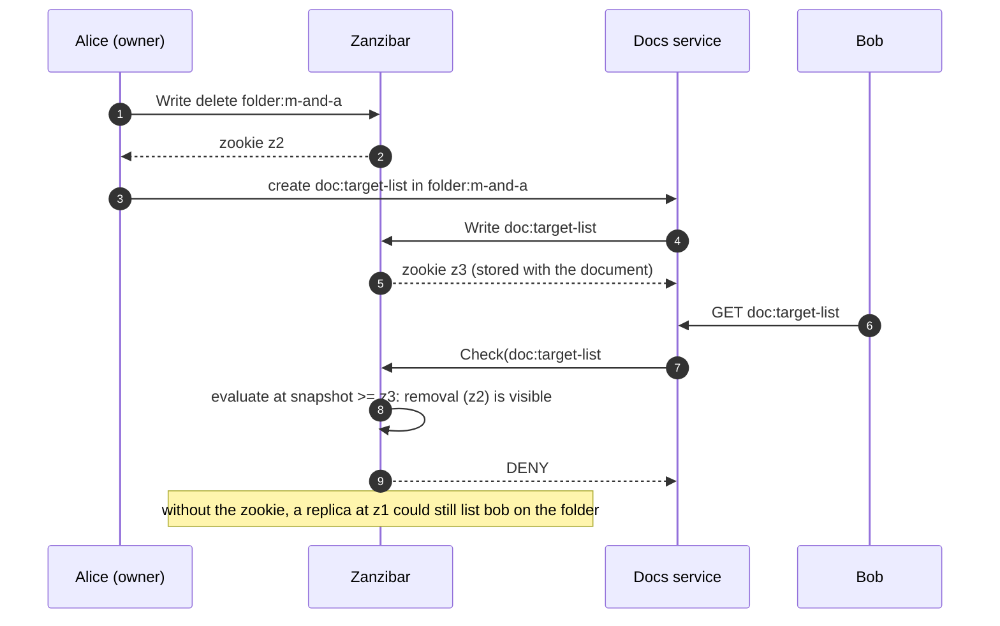

# Google Zanzibar ReBAC Internals: Relation Tuples, Usersets, the Leopard Index, and the New Enemy Problem

> Folder 05 · File 04 of 04 · Identity, AuthN/AuthZ, OAuth 2.1/OIDC/FAPI 2.0 L7 Reference
> Previous: [03 · RBAC, ABAC, OPA, Cedar, PDP/PEP](03-authorization-models-rbac-abac-policy-as-code-opa-cedar-and-pdp-pep-architecture.md) · First: [01 · Phantom token and introspection](01-gateway-patterns-phantom-token-pattern-opaque-to-jwt-introspection-and-caching.md)

| Listing | What it proves | Oracle |
|---|---|---|
| L41 `ZanzibarLab.java` | Zanzibar's model from first principles: relation tuples, namespace rewrites (`_this`, `computed_userset`, `tuple_to_userset`, exclusion), Check with cycle detection and a read counter.<br>• **Six checks are decided correctly:** alice via a group, bob via a nested group, carol as owner→editor→viewer, mallory **banned** despite a folder grant, dave denied, and an `eng↔platform` group cycle terminates.<br>• **The new-enemy problem:** with the ACL read from a replica at v1 and the content from v3, a removed user sees a document added **after** his removal. A **zookie**-bounded snapshot read denies him.<br>• **Leopard:** membership through 20 nested groups takes 22 tuple reads recursively, or 1 set lookup with the index. The index must be updated when a group edge is removed | Zanzibar paper (USENIX ATC 2019), §2.2 and §3 |

**Verification.** Compiled with Folders 01–05 by `javac --release 21 -Xlint:all -Werror` on JDK 25.0.4.1. The gate re-runs the output and requires it byte-identical, since tuple-read counts are deterministic. The model follows the Zanzibar paper: Pang et al., *Zanzibar: Google's Consistent, Global Authorization System*, USENIX ATC 2019. Section references are to the paper, which is not reproduced in `fixtures/`. The OpenFGA and SpiceDB notes describe those projects' documentation [D].

Labels: **[D]** documented · **[M]** measured by a listing · **[E]** engineering judgment · **⚠** trap.

---

## 0. Orientation

Zanzibar is Google's authorization service for Drive, YouTube, Photos, Cloud and more. The paper reports trillions of ACLs, millions of checks per second, and p95 latency under 10 ms [D: §1]. Its idea is that authorization is a **graph of relationships**, stored as tuples and evaluated with namespace-specific rewrite rules. Its hard problem is **consistency**: the answer must respect the causal order of ACL and content changes, the "new enemy" problem.

Open implementations follow the model:
- **OpenFGA** (CNCF);
- **SpiceDB** (AuthZed);
- **Ory Keto**;
- **AWS Verified Permissions**, which uses Cedar instead (file 03).

Results:
- **[M] Rewrites make relationships compose (L41).**
  - "Viewer" = direct viewers + editors + owners + viewers of the parent folder − banned.
  - One tuple (`folder:roadmap#viewer@group:eng#member`) grants every member of a nested group access to every doc in the folder.
  - Exclusion (`banned`) removes mallory even though the folder lists her.
- **[M] Checks are graph walks: count the reads (L41).** Group nesting and folder hierarchies cost tuple reads per level. 20 nested groups cost 22 reads. Cycles must terminate, so visited-set tracking is mandatory.
- **[M] The new-enemy problem is real with any replicated store (L41).**
  - Alice removes Bob from a folder at v2, then adds a document at v3.
  - An evaluation that reads the folder ACL from a lagging replica (v1) and the document placement from a fresh one (v3) lets Bob see the new document.
  - Zanzibar's **zookie** fixes it. The content write returns an opaque token encoding its snapshot, and later checks for that content are evaluated at a snapshot at least that fresh [D: §2.2].
- **[M] Leopard turns deep membership into set lookups (L41).** It precomputes the transitive closure of group-in-group edges and maintains it incrementally from the change stream [D: §3.2.4]. 22 reads become 1 lookup, but correctness depends on updating the index when edges are deleted.

---

## 1. First principles: tuples, usersets and rewrites

```text
  relation tuple   <object>#<relation>@<user>          user = user:id  |  userset = <object>#<relation>
  -------------------------------------------------------------------------------------------------
  group:eng#member@user:alice
  group:eng#member@group:platform#member               (nested group: every platform member is an eng member)
  group:platform#member@user:bob
  folder:roadmap#viewer@group:eng#member               (folder shared with a group)
  doc:q3-plan#parent@folder:roadmap                    (hierarchy as data)
  doc:q3-plan#owner@user:carol
  doc:q3-plan#banned@user:mallory

  namespace "doc":
    owner   := _this
    editor  := _this + computed_userset(owner)
    viewer  := (_this + computed_userset(editor) + tuple_to_userset(parent -> viewer)) - computed_userset(banned)

  check(doc:q3-plan#viewer @ user:bob):
    _this? no -> editor? (owner? no) no -> parent = folder:roadmap -> folder#viewer has group:eng#member
    -> group:eng#member has group:platform#member -> group:platform#member has user:bob -> yes; banned? no -> ALLOW
```

The APIs [D: §2.4]:
- **Read**/**Write** tuples, with optimistic concurrency through the zookie;
- **Check** (is user U in object#relation?);
- **Expand**, which returns the userset tree for debugging and for building indexes;
- **Watch**, a change stream for secondary indexes and caches.

OpenFGA adds `ListObjects` and `ListUsers`; SpiceDB adds `LookupResources` and `LookupSubjects`.



---

## 2. Consistency: the new enemy problem and zookies

The paper defines the new-enemy problem as what happens when the system fails to respect the order of ACL updates, or applies old ACLs to new content [D: §2.2, paraphrased]. Two examples:
1. **Neglecting update order.** Alice removes Bob from a folder ACL, then asks Charlie to move new documents into it. If the ACL check uses the old ACL with the new placement, Bob sees the new documents.
2. **Misapplying old ACLs to new content.** Alice removes Bob from a document's ACL, then edits the document. If the check runs on a snapshot from before the removal, Bob sees the new content.

How Zanzibar avoids it [D: §2.2, §3.1]:
- **External consistency** from Spanner's TrueTime.
- **Zookies.** A content-change write returns an opaque token. The client stores it with the content, and every later Check on that content passes it, so the evaluation snapshot is at least as fresh.
- **Snapshot evaluation.** Each Check is evaluated entirely at one snapshot, never with tuples mixed from different times.
- **Cache-friendly defaults.** Zanzibar may evaluate at a slightly older snapshot that it chooses, which improves cache hit rates, as long as that snapshot is no older than the zookie.

OpenFGA and SpiceDB expose the same choice as a per-request consistency mode: `MINIMIZE_LATENCY` vs `HIGHER_CONSISTENCY` in OpenFGA; `minimize_latency`, `at_least_as_fresh(zedtoken)` and `fully_consistent` in SpiceDB [D: project docs]. The zookie analogue is SpiceDB's **ZedToken**.

---

## 3. L41: Check, the new enemy, and Leopard

<!-- listing:ZanzibarLab.java -->
```java
import java.util.ArrayDeque;
import java.util.ArrayList;
import java.util.HashMap;
import java.util.HashSet;
import java.util.LinkedHashSet;
import java.util.List;
import java.util.Map;
import java.util.Set;

/**
 * L41 - Google Zanzibar's ReBAC model from first principles: relation tuples (object#relation@user or
 * object#relation@object#relation), namespace userset rewrites (this / computed_userset / tuple_to_userset, unions and
 * exclusion), Check with cycle detection and a read counter, Expand, the "new enemy" problem and zookies (snapshot
 * reads at least as fresh as the content), and the Leopard index for deeply nested groups.
 */
public final class ZanzibarLab {

    record Tuple(String object, String relation, String user, long version, boolean deleted) {
    }

    /** An MVCC tuple store: every write gets a version; a read at snapshot s sees the latest write <= s. */
    static final class Store {
        final List<Tuple> log = new ArrayList<>();
        long version;
        int reads;

        long write(String object, String relation, String user, boolean delete) {
            log.add(new Tuple(object, relation, user, ++version, delete));
            return version; // the zookie a client keeps
        }

        /** Direct users/usersets of object#relation as of snapshot s. */
        Set<String> read(String object, String relation, long s) {
            reads++;
            Map<String, Boolean> live = new HashMap<>();
            for (Tuple t : log) {
                if (t.version() <= s && t.object().equals(object) && t.relation().equals(relation)) {
                    live.put(t.user(), !t.deleted());
                }
            }
            Set<String> out = new LinkedHashSet<>();
            live.forEach((u, alive) -> {
                if (alive) {
                    out.add(u);
                }
            });
            return out;
        }
    }

    /** Namespace configs: doc and folder relations rewritten as in the Zanzibar paper; group#member is direct. */
    static boolean check(Store st, String object, String relation, String user, long s, Set<String> visiting) {
        String key = object + "#" + relation;
        if (!visiting.add(key)) {
            return false;                                              // cycle: this path proves nothing
        }
        try {
            String type = object.substring(0, object.indexOf(':'));
            // _this: direct tuples, including usersets (group:eng#member)
            for (String u : st.read(object, relation, s)) {
                if (u.equals(user)) {
                    return true;
                }
                if (u.contains("#")) {
                    String[] us = u.split("#");
                    if (check(st, us[0], us[1], user, s, visiting)) {
                        return true;
                    }
                }
            }
            if (type.equals("doc") || type.equals("folder")) {
                if (relation.equals("editor") && check(st, object, "owner", user, s, visiting)) {
                    return true;                                       // computed_userset: owners are editors
                }
                if (relation.equals("viewer")) {
                    if (check(st, object, "editor", user, s, visiting)) {
                        return true;                                   // computed_userset: editors are viewers
                    }
                    for (String parent : st.read(object, "parent", s)) { // tuple_to_userset: viewers of the parent folder
                        if (check(st, parent, "viewer", user, s, visiting)) {
                            return !check(st, object, "banned", user, s, new HashSet<>()); // exclusion applies at this level too
                        }
                    }
                }
            }
            return false;
        } finally {
            visiting.remove(key);
        }
    }

    static boolean check(Store st, String object, String relation, String user, long s) {
        boolean direct = check(st, object, relation, user, s, new HashSet<>());
        if (relation.equals("viewer") && direct && object.startsWith("doc:")) {
            return !check(st, object, "banned", user, s, new HashSet<>()); // viewer = (this + editor + parent#viewer) - banned
        }
        return direct;
    }

    /** Leopard: precomputed transitive closure group -> all descendant groups, so membership is a set lookup. */
    static Map<String, Set<String>> leopard(Store st, long s, Set<String> groups) {
        Map<String, Set<String>> memberOf = new HashMap<>(); // user -> every group they are (transitively) in
        for (String g : groups) {
            ArrayDeque<String> q = new ArrayDeque<>(List.of(g));
            Set<String> seen = new HashSet<>();
            while (!q.isEmpty()) {
                String cur = q.poll();
                if (!seen.add(cur)) {
                    continue;
                }
                for (String u : st.read(cur, "member", s)) {
                    if (u.endsWith("#member")) {
                        q.add(u.substring(0, u.indexOf('#')));
                    } else {
                        memberOf.computeIfAbsent(u, k -> new HashSet<>()).add(g);
                    }
                }
            }
        }
        return memberOf;
    }

    public static void main(String[] args) {
        KbSupport.section("Namespace rewrites and Check (doc viewer = this + editor + owner + parent#viewer - banned)");
        Store st = new Store();
        st.write("group:eng", "member", "user:alice", false);
        st.write("group:eng", "member", "group:platform#member", false);
        st.write("group:platform", "member", "user:bob", false);
        st.write("folder:roadmap", "viewer", "group:eng#member", false);
        st.write("doc:q3-plan", "parent", "folder:roadmap", false);
        st.write("doc:q3-plan", "owner", "user:carol", false);
        st.write("doc:q3-plan", "banned", "user:mallory", false);
        st.write("folder:roadmap", "viewer", "user:mallory", false);
        st.write("group:platform", "member", "group:eng#member", false); // a cycle eng -> platform -> eng
        long v = st.version;
        String[][] q = {{"user:alice", "viewer"}, {"user:bob", "viewer"}, {"user:carol", "viewer"}, {"user:carol", "editor"},
            {"user:mallory", "viewer"}, {"user:dave", "viewer"}};
        boolean[] expect = {true, true, true, true, false, false};
        int ok = 0;
        for (int i = 0; i < q.length; i++) {
            st.reads = 0;
            boolean r = check(st, "doc:q3-plan", q[i][1], q[i][0], v);
            ok += r == expect[i] ? 1 : 0;
            KbSupport.info("check(doc:q3-plan#%-6s @ %-12s) -> %-5s  (%d tuple reads)", q[i][1], q[i][0], r, st.reads);
        }
        KbSupport.check("alice (via eng), bob (via platform nested in eng), carol (owner => editor => viewer) allowed; mallory banned; dave denied; the eng<->platform cycle terminates",
                ok == q.length);

        KbSupport.section("The new-enemy problem (Zanzibar section 2.2) and zookies");
        Store s2 = new Store();
        s2.write("folder:m-and-a", "viewer", "user:bob", false);
        long aclRemoved = s2.write("folder:m-and-a", "viewer", "user:bob", true); // Alice removes Bob from the folder ...
        long contentAdded = s2.write("doc:target-list", "parent", "folder:m-and-a", false); // ... then adds a new doc to it
        long stale = 1;                                                              // a replica that has not seen the removal
        // L5: each tuple read from whichever replica answers first - ACL from the stale one, placement from the fresh one
        boolean mixed = s2.read("doc:target-list", "parent", contentAdded).contains("folder:m-and-a")
                && s2.read("folder:m-and-a", "viewer", stale).contains("user:bob");
        boolean zookie = check(s2, "doc:target-list", "viewer", "user:bob", Math.max(contentAdded, aclRemoved));
        KbSupport.info("ACL removal at v%d, new document at v%d; a replica still at v%d", aclRemoved, contentAdded, stale);
        KbSupport.info("L5 mixed-snapshot evaluation (placement fresh, ACL stale): bob can view the new document = %s", mixed);
        KbSupport.info("L7 check at snapshot >= the content's zookie (v%d): bob can view = %s", contentAdded, zookie);
        KbSupport.check("without snapshot consistency the removed user sees content added AFTER his removal; a zookie-bounded snapshot read denies him",
                mixed && !zookie);

        KbSupport.section("Leopard: nested-group membership by set lookup instead of recursive reads");
        Store s3 = new Store();
        int depth = 20;
        for (int i = 0; i < depth; i++) {
            s3.write("group:g" + i, "member", "group:g" + (i + 1) + "#member", false);
        }
        s3.write("group:g" + depth, "member", "user:zoe", false);
        s3.write("folder:wiki", "viewer", "group:g0#member", false);
        s3.reads = 0;
        boolean rec = check(s3, "folder:wiki", "viewer", "user:zoe", s3.version);
        int recursiveReads = s3.reads;
        Set<String> groups = new HashSet<>();
        for (int i = 0; i <= depth; i++) {
            groups.add("group:g" + i);
        }
        Map<String, Set<String>> index = leopard(s3, s3.version, groups);
        int lookups = 1;
        boolean viaIndex = index.getOrDefault("user:zoe", Set.of()).contains("group:g0");
        KbSupport.info("zoe is a member of g0 through %d nested groups: recursive Check = %s with %d tuple reads; Leopard lookup = %s with %d set lookup",
                depth, rec, recursiveReads, viaIndex, lookups);
        s3.write("group:g10", "member", "group:g11#member", true);                     // break the chain
        Map<String, Set<String>> rebuilt = leopard(s3, s3.version, groups);
        boolean after = check(s3, "folder:wiki", "viewer", "user:zoe", s3.version);
        KbSupport.info("after removing g10 -> g11: recursive Check = %s; Leopard (re-indexed at the new version) = %s", after,
                rebuilt.getOrDefault("user:zoe", Set.of()).contains("group:g0"));
        KbSupport.check("same answers, " + recursiveReads + " reads vs 1 lookup; the index must be updated (or versioned) with every group-edge write",
                rec && viaIndex && !after && !rebuilt.getOrDefault("user:zoe", Set.of()).contains("group:g0") && recursiveReads > depth);
        KbSupport.verdict();
    }
}
```

<!-- output:ZanzibarLab.java -->
```text

== Namespace rewrites and Check (doc viewer = this + editor + owner + parent#viewer - banned)
  check(doc:q3-plan#viewer @ user:alice  ) -> true   (9 tuple reads)
  check(doc:q3-plan#viewer @ user:bob    ) -> true   (9 tuple reads)
  check(doc:q3-plan#viewer @ user:carol  ) -> true   (4 tuple reads)
  check(doc:q3-plan#editor @ user:carol  ) -> true   (2 tuple reads)
  check(doc:q3-plan#viewer @ user:mallory) -> false  (6 tuple reads)
  check(doc:q3-plan#viewer @ user:dave   ) -> false  (10 tuple reads)
  [PASS] alice (via eng), bob (via platform nested in eng), carol (owner => editor => viewer) allowed; mallory banned; dave denied; the eng<->platform cycle terminates

== The new-enemy problem (Zanzibar section 2.2) and zookies
  ACL removal at v2, new document at v3; a replica still at v1
  L5 mixed-snapshot evaluation (placement fresh, ACL stale): bob can view the new document = true
  L7 check at snapshot >= the content's zookie (v3): bob can view = false
  [PASS] without snapshot consistency the removed user sees content added AFTER his removal; a zookie-bounded snapshot read denies him

== Leopard: nested-group membership by set lookup instead of recursive reads
  zoe is a member of g0 through 20 nested groups: recursive Check = true with 22 tuple reads; Leopard lookup = true with 1 set lookup
  after removing g10 -> g11: recursive Check = false; Leopard (re-indexed at the new version) = false
  [PASS] same answers, 22 reads vs 1 lookup; the index must be updated (or versioned) with every group-edge write

verdict: OK (3 checks)
```

Reading the run:
- **Read counts are the cost model.** Every hop in the userset tree is a tuple read. Zanzibar fans these out in parallel and caches sub-results per (object#relation, snapshot) at the serving layer, "distributed caching across servers" keyed so that consistent hashing sends the same sub-problem to the same server [D: §3.2.5]. Deep or wide graphs need that, or Leopard.
- **The new-enemy section measures the bug that eventually consistent "authorization caches" ship with.** If your relationship store is replicated (read replicas, regional copies, a Redis cache of tuples), each check must be evaluated at one snapshot no older than the content's version.
- **Leopard.** A precomputed closure answers "is U in G" in one lookup, at the cost of an index that must apply edge deletions from the change stream (Watch). If the index lags, it reintroduces the new enemy for group changes, which is why Zanzibar versions it and evaluates at a snapshot [D: §3.2.4].

---

## 4. Modelling ReBAC well

| Practice | Why [E] |
|---|---|
| Model hierarchy as tuples (`doc#parent@folder`) and inherit via `tuple_to_userset` | one write re-parents a tree; no fan-out writes |
| Prefer usersets (`folder#viewer@group:eng#member`) to per-user tuples | membership changes are one tuple, not N |
| Express exclusions (`banned`, `blocked`) as explicit subtraction | denial survives inherited grants |
| Keep relations few and named by meaning (`viewer`, `editor`, `owner`, `approver`) | permissions are computed from relations, not stored |
| Store the zookie / ZedToken with the content row | Check at ≥ that snapshot for new-enemy safety |
| Bound graph depth, detect cycles, test with Expand | latency SLOs; debugging "why can X see Y" |
| Combine with ABAC where conditions aren't relationships | OpenFGA conditions / SpiceDB caveats for amount, time, IP (file 03) |

OpenFGA's DSL for the L41 model (illustrative):

```text
  model
    schema 1.1
  type user
  type group
    relations
      define member: [user, group#member]
  type folder
    relations
      define viewer: [user, group#member]
  type doc
    relations
      define parent: [folder]
      define owner: [user]
      define banned: [user]
      define editor: [user] or owner
      define viewer: ([user, group#member] or editor or viewer from parent) but not banned
```

---

## 5. The vulnerable L5 implementation vs the hardened L7 zero-trust implementation

```java
// L5 - DO NOT USE: relationships in the app database, checked with ad-hoc joins and a 10-minute cache.
boolean canView(String user, String docId) {
    return cache.get(user + docId, () ->                        // 10-min TTL: revocations wait
        jdbc.queryForObject("select count(*) from doc_acl where doc_id=? and principal in (?, ?)", Integer.class,
            docId, user, primaryGroupOf(user)) > 0);            // one level of groups, no folder inheritance, no bans
}
```

```java
// L7 - a Zanzibar-style service (OpenFGA / SpiceDB) with consistency tokens stored with content.
public Document read(Jwt caller, String docId) {
    DocumentRow row = documents.find(docId);                     // includes the zookie/ZedToken from its last write
    boolean allowed = authz.check(CheckRequest.builder()
        .user("user:" + caller.getSubject())
        .relation("viewer")
        .object("doc:" + docId)
        .consistency(AtLeastAsFresh.of(row.zedToken()))          // new-enemy safe for this content
        .build());
    if (!allowed) {
        throw new AccessDeniedException("doc:" + docId);
    }
    return row.toDocument();
}

public void share(Jwt owner, String docId, String groupId) {
    String token = authz.write(Tuple.of("doc:" + docId, "viewer", "group:" + groupId + "#member"));
    documents.updateZedToken(docId, token);                       // later checks see at least this write
}
```

Folder 07 file 04 builds the Java 21 integration (OpenFGA client, consistency, caching, testing).

| Concern | L5 | L7 |
|---|---|---|
| Model | ACL rows + joins | tuples + namespace rewrites (`computed_userset`, `tuple_to_userset`, exclusion) |
| Groups | one level | nested usersets; Leopard-style index for deep nesting |
| Hierarchy | duplicated ACLs | `parent` tuples + inheritance |
| Bans | absent or ad hoc | explicit exclusion in the rewrite |
| Consistency | TTL cache, mixed replicas | snapshot evaluation ≥ content zookie/ZedToken |
| Cycles and depth | unbounded recursion | visited set, depth bound, Expand for debugging |
| Lists ("which docs can X see") | full scan + check | `ListObjects`/`LookupResources` + pagination |

---

## 6. Real-world attack vectors & mitigations

### A1 · The new enemy (stale ACL on new content)

**Attack.** A removed collaborator reads content created after his removal because the check used a stale snapshot or mixed replicas (L41).
**Wire signature.** Allowed checks evaluated at a snapshot older than the content's version.
**Root cause.** Eventually consistent relationship reads; no consistency token.
**Mitigation.** Store zookies or ZedTokens with content and check at least as fresh. Evaluate each check at one snapshot.
**Detection.** Log the snapshot used per check against the content version.

### A2 · Inherited grants defeating explicit denials

**Attack.** A user banned at the document level still sees it via a folder grant, because the model has no exclusion, or applies it only at one level.
**Wire signature.** Allowed checks for users with a `banned` tuple.
**Root cause.** Union-only rewrites.
**Mitigation.** Exclusion in the rewrite (`but not banned`), applied after inheritance (L41: mallory). Test banned and inherited cases.
**Detection.** Periodic audit: banned users with effective access.

### A3 · Group-nesting cycles and graph explosions (DoS)

**Attack.** An attacker who can edit groups creates cycles or very deep and wide nesting, so checks time out or exhaust the service.
**Wire signature.** Check latency spikes; very large Expand trees.
**Root cause.** No cycle detection, depth limits or write-time validation.
**Mitigation.** Visited sets (L41), depth and fan-out limits, write-time cycle rejection where possible, Leopard-style indexes, and per-tenant quotas.
**Detection.** p99 check latency and per-check read counts by tenant.

### A4 · Stale secondary indexes and caches

**Attack.** A Leopard-like index or tuple cache misses an edge deletion, so a removed group member keeps access until reindex.
**Wire signature.** Index-answered checks that disagree with a direct Check.
**Root cause.** The index isn't driven by the change stream, or isn't versioned.
**Mitigation.** Maintain indexes from Watch with versions, evaluate at a snapshot, and periodically reconcile the index against Expand.
**Detection.** Shadow checks comparing the index with a recursive evaluation on a sample.

### A5 · Over-broad usersets

**Attack.** A single tuple shares a folder with `group:all-employees#member` or a public userset. Every document under it, including future ones, becomes visible to everyone.
**Wire signature.** Tuples with very large effective usersets on sensitive objects.
**Root cause.** Inheritance without guardrails.
**Mitigation.** Policy on which usersets may be attached to which object types (a classification attribute), approval for broad shares, and expiring shares (OpenFGA conditions, SpiceDB caveats).
**Detection.** Expand-size alerts for sensitive objects.

### A6 · Bypassing Zanzibar on list endpoints

**Attack.** A "search" or "list" endpoint returns results from the database index without per-item checks, leaking titles and snippets of documents the user can't open.
**Wire signature.** List responses containing objects that fail Check.
**Root cause.** Authorization only on the detail read.
**Mitigation.** `ListObjects`/`LookupResources`, or a post-filter Check per item (with batching). Search indexes must carry ACL filters derived from the graph.
**Detection.** Sampled re-checks of list results.

### A7 · Tuple-write privilege escalation

**Attack.** An application endpoint lets users write arbitrary tuples, such as `doc:x#owner@user:me` or `group:admins#member@user:me`.
**Wire signature.** Tuple writes on relations the caller doesn't administer.
**Root cause.** The relationship API exposed without its own authorization.
**Mitigation.** Writes themselves require a Check (only owners may add viewers; only group admins may add members). Use a dedicated service account for system writes, and audit writes.
**Detection.** Alert on writes to privileged relations.

---

## 7. FAANG / FinTech L7 bar-raiser Q&A chains

<details><summary><b>Q1 · Explain the new enemy problem and how Zanzibar solves it.</b></summary>

**Initial Prompt.** A Google-style document-sharing system.

**L5 Textbook Answer.** "Use a cache with a short TTL so ACL changes propagate quickly."

**How an Attacker Bypasses L5.** Short TTLs still allow windows. More fundamentally, mixed-snapshot evaluation (the ACL from a stale replica, content placement from a fresh one) lets a removed user see content created *after* the removal (L41).

**L7 Principal Defense.**
- **One snapshot per evaluation.**
- **Zookies:** content writes return a consistency token stored with the content, and checks are evaluated at a snapshot at least that fresh. Spanner's external consistency makes "at least as fresh" meaningful globally.
- **Cache-friendly by default:** Zanzibar chooses a slightly stale snapshot unless the zookie demands fresher.
- **In OpenFGA/SpiceDB:** the consistency modes and ZedTokens.

</details>

<details><summary><b>Q2 · Model "editors can view; folder viewers can view all docs inside; banned users can't".</b></summary>

**Initial Prompt.** A whiteboard namespace design.

**L5 Textbook Answer.** "Three ACL tables and joins."

**How an Attacker Bypasses L5.** Joins rarely cover nesting (groups in groups, folders in folders) and bans after inheritance, so a banned user inherits access (A2).

**L7 Principal Defense.**
- **The rewrite:** `viewer := (_this + editor + parent->viewer) - banned`, with `editor := _this + owner`.
- **Groups** as usersets.
- **Tests:** inherited allow, banned deny, cycle termination (L41).
- **The DSL:** see §4.

</details>

<details><summary><b>Q3 · Checks for deeply nested groups are slow. What do you do?</b></summary>

**Initial Prompt.** Enterprise customers nest groups 15+ levels deep.

**L5 Textbook Answer.** "Cache check results for longer."

**How an Attacker Bypasses L5.** Longer caches lengthen revocation windows, and the cold path is still slow (L41: 22 reads for 20 levels).

**L7 Principal Defense.**
- **A Leopard-style index:** the transitive closure of group-in-group edges, maintained from the change stream and versioned, so membership is a set intersection (1 lookup).
- **Plus:** distributed sub-problem caching keyed by (object#relation, snapshot), and request hedging.
- **Bound depth and fan-out per tenant.**

</details>

<details><summary><b>Q4 · Zanzibar or Cedar/OPA for your product?</b></summary>

**Initial Prompt.** A B2B SaaS with sharing, teams and per-record permissions.

**L5 Textbook Answer.** "OPA can do everything."

**How an Attacker Bypasses L5.** Relationship-shaped authorization pushed into attribute policies means syncing huge relationship datasets into the PDP's data, which goes stale (the new enemy again) or grows huge.

**L7 Principal Defense.**
- **ReBAC (OpenFGA/SpiceDB)** for sharing, ownership and hierarchy.
- **Attribute conditions** for context (amount, time, IP) via caveats or conditions, or a Cedar/OPA layer for policy-shaped rules.
- **One PEP interface** (AuthZEN-shaped).
- **Data stays authoritative** in the relationship store, with consistency tokens.

</details>

<details><summary><b>Q5 · How do you implement "list all documents user X can see" efficiently?</b></summary>

**Initial Prompt.** Search results page.

**L5 Textbook Answer.** "Query all documents and filter with Check."

**How an Attacker Bypasses L5.** No attack: it's slow, so someone removes the filter, and titles leak (A6).

**L7 Principal Defense.**
- **Small result sets:** `ListObjects`/`LookupResources`.
- **Search:** pre-filter by an ACL-derived index (group ids, Leopard-style), then post-filter with batched Check for exactness.
- **Paginate.**
- **Never return unchecked items.**
- **Pass consistency tokens** for recently changed items.

</details>

<details><summary><b>Q6 · Who may write relationship tuples?</b></summary>

**Initial Prompt.** The team exposed a `POST /share` that writes tuples.

**L5 Textbook Answer.** "Authenticated users; it's their content."

**How an Attacker Bypasses L5.** Any user writes `group:admins#member@user:me` or makes themselves owner of others' docs (A7).

**L7 Principal Defense.**
- **Write authorization is itself a Check:** you may add a viewer only if you are owner or editor with share rights, and add group members only if you are group admin.
- **Model it:** relation `can_share`.
- **System writes** use service accounts.
- **Audit** every write.

</details>

<details><summary><b>Q7 · Your relationship store has read replicas. What breaks?</b></summary>

**Initial Prompt.** Moving OpenFGA's Postgres to primary + replicas.

**L5 Textbook Answer.** "Nothing; reads go to replicas."

**How an Attacker Bypasses L5.** Replica lag means checks evaluate stale tuples. Worse, mixed reads across replicas give the new-enemy outcome (L41).

**L7 Principal Defense.**
- **Route `HIGHER_CONSISTENCY` or at-least-as-fresh checks to a source that has the token's version.**
- **Use replicas only for minimize-latency checks** on content without fresh tokens.
- **Monitor replica lag** against token freshness.
- **Prefer engines whose datastore supports snapshot reads.**

</details>

<details><summary><b>Q8 · How do you debug "why can Bob see this?"</b></summary>

**Initial Prompt.** A customer escalation.

**L5 Textbook Answer.** "Check the ACL table."

**How an Attacker Bypasses L5.** Access comes through nested groups and folder inheritance that the ACL table doesn't show. The over-broad userset (A5) stays.

**L7 Principal Defense.**
- **`Expand(doc#viewer)`:** the userset tree with the path that grants Bob.
- **OpenFGA/SpiceDB:** check with tracing, or `LookupSubjects`.
- **Then fix the tuple:** the broad share, not a per-user deny hack.
- **Add a regression test with the exact path.**

</details>

---

## 8. Invariants checklist

- [ ] Relationships stored as tuples; permissions computed by namespace rewrites (computed_userset, tuple_to_userset, exclusion).
- [ ] Every Check evaluated at a single snapshot; content stores its zookie/ZedToken and checks use at-least-as-fresh.
- [ ] Cycle detection and depth/fan-out bounds; Leopard-style index for deep group nesting, driven by Watch and versioned.
- [ ] Exclusions applied after inheritance; tests for inherited allow, banned deny, cycles.
- [ ] Tuple writes authorized by their own checks; privileged relation writes alerted.
- [ ] List/search endpoints use ListObjects/LookupResources or per-item checks; no unchecked results.
- [ ] Read replicas used only where staleness is acceptable; consistency mode chosen per request.

---

## 9. References

- Pang et al., *Zanzibar: Google's Consistent, Global Authorization System*, USENIX ATC 2019 — <https://www.usenix.org/conference/atc19/presentation/pang>
- OpenFGA documentation (modeling, consistency) — <https://openfga.dev/docs>
- SpiceDB documentation (consistency, ZedTokens) — <https://authzed.com/docs>
- Ory Keto — <https://www.ory.sh/docs/keto>
