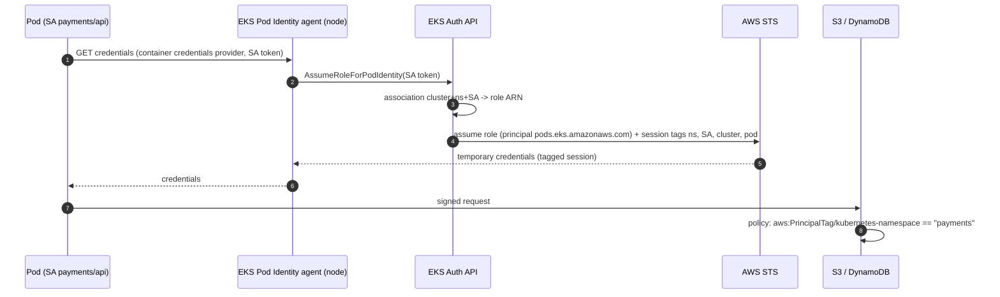

# Cloud IAM Internals: AWS STS, IRSA and EKS Pod Identity vs GCP Workload Identity Federation (and Azure)

> Folder 06 · File 01 of 03 · Identity, AuthN/AuthZ, OAuth 2.1/OIDC/FAPI 2.0 L7 Reference
> Next: [02 · Managed CIAM: Cognito vs GCP Identity Platform vs Entra vs Keycloak](02-managed-ciam-architectures-cognito-vs-gcp-identity-platform-vs-entra-vs-keycloak.md) · [03 · Securing AI agents and MCP servers](03-securing-ai-agents-and-mcp-servers-oauth21-dynamic-client-registration-and-obo.md)

| Listing | What it proves | Oracle |
|---|---|---|
| L42 `CloudFederationLab.java` | Keyless federation decided by claim conditions, using real ES256-signed GitHub Actions and EKS service-account tokens verified against their issuer keys. Six GitHub tokens are minted per cloud audience, plus two EKS tokens and one forgery:<br>• **AWS trust on `aud` only** admits **every GitHub repository** (tokens 1–5);<br>• **`StringLike repo:acme/*`** admits branches, the sandbox repo and a **re-registered `acme` org**;<br>• **exact `sub`** (AWS), **Azure federated credentials** and a **name-based GCP principalSet** all still admit the rename takeover, because GitHub's default `sub` is name-based;<br>• **GCP conditions on immutable `repository_owner_id`/`repository_id`** admit only the legitimate token;<br>• **IRSA trust on `aud` only** admits every service account in the cluster | AWS IAM condition operators; GCP WIF attribute conditions; Azure FIC matching [D] |
| L43 `ImdsSsrfLab.java` | Five SSRF capability classes against the five metadata-service configurations, modelled from their documented admission rules:<br>• IMDSv1 leaks to all 5;<br>• IMDSv2 with hop limit 1 leaks only to code already on the host;<br>• hop limit 2 re-opens the pod path;<br>• GCP's `Metadata-Flavor` and Azure's `Metadata: true` gates stop URL-only SSRF but not header-capable SSRF;<br>• nothing stops code on the host | AWS, GCP, Azure metadata docs [D] |

**Verification.** Compiled with Folders 01–06 by `javac --release 21 -Xlint:all -Werror` on JDK 25.0.4.1. The gate re-runs both outputs and requires them byte-identical. Cloud behaviour is modelled from each provider's documentation (links in §10), not called live: this KB never spends money or touches real accounts. Every modelled rule is labelled [D] with its source.

Labels: **[D]** documented · **[M]** measured by a listing · **[E]** engineering judgment · **⚠** trap.

---

## 0. Orientation

Every cloud has converged on the same idea for workloads: **no long-lived keys**. A workload proves where it runs with a signed token from an issuer the cloud trusts (an EKS cluster's OIDC issuer, GitHub Actions, another cloud), and the cloud's STS exchanges it for short-lived credentials. The security of the whole scheme then sits in one place: **the conditions on the trust relationship**.

Results:
- **[M] Trust on `aud` alone is trust in the issuer's whole population (L42).** For GitHub that is every repository on github.com. For an EKS cluster it is every service account in the cluster.
- **[M] Names are not identities (L42).** GitHub's default `sub` is `repo:<owner>/<repo>:ref:...`. Rename an org and someone else can register the old name, producing an identical `sub`. AWS exact-`sub` trust, Azure federated credentials and a name-based GCP `principalSet` all admit that token. Defences:
  - GCP attribute conditions on `repository_owner_id`/`repository_id`;
  - customizing GitHub's `sub` claim template to include the IDs, which works for all three clouds [D: GitHub OIDC docs].
- **[M] Metadata services are the credential source SSRF goes after (L43).** IMDSv1 hands credentials to a URL-only GET. IMDSv2's PUT session token, its refusal of `X-Forwarded-For`, and a hop limit of 1 stop every SSRF class except code already on the host. Hop limit 2, often set for containers, re-opens pods.
- **[D] EKS Pod Identity moves the binding from the IAM role to the EKS API.**
  - The role trusts `pods.eks.amazonaws.com` (`sts:AssumeRole`, `sts:TagSession`). EKS decides which namespace/service account gets which role, through associations, and attaches session tags (`kubernetes-namespace`, `kubernetes-service-account`, `eks-cluster-arn`, …).
  - ⚠ Whoever can create associations can hand any such role to any service account. Lock down `eks:CreatePodIdentityAssociation` and add session-tag conditions to the trust policy.

---

## 1. First principles: one pattern, three clouds

```text
   workload ----(1) proof of where I run----> external issuer           (2) exchange at the cloud STS
   (pod, CI job,                              EKS OIDC / GitHub OIDC  ---------------------------------->  short-lived credentials
    VM in other cloud)                        signs JWT {iss, sub, aud}  STS checks: signature (issuer JWKS)    (AWS: AccessKeyId + SessionToken, <= 12 h)
                                                                         + trust conditions on claims          (GCP: federated token -> SA token, 1 h)
                                                                                                               (Azure: Entra access token, ~1 h)
   AWS   AssumeRoleWithWebIdentity(RoleArn, WebIdentityToken)      trust policy: Federated principal + Condition on <iss>:sub/<iss>:aud
         EKS Pod Identity: agent -> eks-auth:AssumeRoleForPodIdentity   role trusts pods.eks.amazonaws.com; binding = EKS association
   GCP   sts.googleapis.com/v1/token (RFC 8693 token exchange)      pool provider: attribute mapping + attribute CONDITION (CEL)
         -> direct resource access (principal://, principalSet://) or SA impersonation (iamcredentials generateAccessToken)
   Azure login.microsoftonline.com/{tenant}/oauth2/v2.0/token       federated identity credential: issuer + subject + audience
         client_assertion = external JWT (client_credentials)        (exact match; audience api://AzureADTokenExchange)
```

```json
{"Version": "2012-10-17", "Statement": [{"Effect": "Allow",
  "Principal": {"Federated": "arn:aws:iam::111122223333:oidc-provider/token.actions.githubusercontent.com"},
  "Action": "sts:AssumeRoleWithWebIdentity",
  "Condition": {"StringEquals": {"token.actions.githubusercontent.com:aud": "sts.amazonaws.com",
                                 "token.actions.githubusercontent.com:sub": "repo:acme/payments:ref:refs/heads/main"}}}]}
```

That is the L7 shape of an AWS trust policy for GitHub Actions [D: AWS IAM user guide, "Configuring a role for GitHub OIDC identity provider"]. The `Condition` block **is** the authorization. Without the `sub` line, L42 shows any repository on GitHub can assume the role.

```http
POST /v1/token HTTP/1.1
Host: sts.googleapis.com
Content-Type: application/x-www-form-urlencoded

grant_type=urn%3Aietf%3Aparams%3Aoauth%3Agrant-type%3Atoken-exchange&audience=%2F%2Fiam.googleapis.com%2Fprojects%2F123456%2Flocations%2Fglobal%2FworkloadIdentityPools%2Fgithub%2Fproviders%2Facme&scope=https%3A%2F%2Fwww.googleapis.com%2Fauth%2Fcloud-platform&requested_token_type=urn%3Aietf%3Aparams%3Aoauth%3Atoken-type%3Aaccess_token&subject_token_type=urn%3Aietf%3Aparams%3Aoauth%3Atoken-type%3Ajwt&subject_token=eyJ...
```

GCP's STS *is* RFC 8693 token exchange (Folder 05 file 02) [D: GCP STS API]. The provider's attribute mapping (`google.subject = assertion.sub`, `attribute.repository_id = assertion.repository_id`) and its **attribute condition** decide admission. IAM bindings then grant roles to `principal://…/subject/…` or `principalSet://…/attribute.repository_id/1001`.

---

## 2. Kubernetes workloads: IRSA vs EKS Pod Identity vs GKE/AKS

| | AWS IRSA | AWS EKS Pod Identity | GKE Workload Identity Federation | AKS Workload Identity |
|---|---|---|---|---|
| Proof | projected SA token, `aud: sts.amazonaws.com` | agent on the node obtains credentials for the pod's SA | projected KSA token exchanged via GKE metadata server | projected SA token, `aud: api://AzureADTokenExchange` |
| Cloud call | `AssumeRoleWithWebIdentity` | `eks-auth:AssumeRoleForPodIdentity` (agent) | STS exchange; principal is the KSA | Entra client-credentials with `client_assertion` |
| Where binding lives | IAM role trust policy (`sub` = `system:serviceaccount:<ns>:<sa>`) | EKS association (cluster, namespace, SA → role) | IAM binding on `principal://…/ns/<ns>/sa/<ksa>` | federated identity credential (issuer, subject) on the identity |
| ABAC signals | `sub`/`aud` only | session tags (namespace, SA, cluster, pod) | principal attributes | FIC subject |
| Main misconfiguration | trust without `sub` (L42 case 8) | broad `CreatePodIdentityAssociation` | over-broad `principalSet` | wildcard-like reuse of one FIC |

[D: AWS EKS docs (IRSA, Pod Identity); GKE Workload Identity Federation docs; AKS Workload Identity docs.]



---

## 3. L42: trust conditions decide everything

<!-- listing:CloudFederationLab.java -->
```java
import java.nio.charset.StandardCharsets;
import java.security.SecureRandom;
import java.util.LinkedHashMap;
import java.util.List;
import java.util.Map;
import java.util.function.Predicate;
import java.util.regex.Pattern;

/**
 * L42 - keyless workload federation into AWS, GCP and Azure: the cloud STS trusts an external OIDC issuer (an EKS
 * cluster, GitHub Actions) and decides by conditions on the token's claims. Real signed tokens (ES256), real
 * signature checks against the issuer key, and the three clouds' matching rules:
 * AWS IAM trust policies (StringEquals / StringLike with * and ?, on "issuer:sub" and "issuer:aud"),
 * GCP Workload Identity Federation (attribute condition + principalSet binding), and
 * Azure federated identity credentials (exact issuer + subject + audience).
 * Eight tokens, six policies, and the misconfigurations seen in real incidents.
 */
public final class CloudFederationLab {
    static final String GH = "https://token.actions.githubusercontent.com";
    static final String EKS = "https://oidc.eks.eu-west-1.amazonaws.com/id/EXAMPLED539D4633E53DE1B71EXAMPLE";

    record Tok(String label, String issuer, String cloud, Map<String, Object> claims, String jwt) {
    }

    static final Map<String, String> AUDIENCE = Map.of("AWS", "sts.amazonaws.com",
            "GCP", "https://iam.googleapis.com/projects/123456/locations/global/workloadIdentityPools/github/providers/acme",
            "Azure", "api://AzureADTokenExchange");

    /** AWS IAM StringLike: '*' = any run of characters, '?' = exactly one; case-sensitive; whole-string match. */
    static boolean stringLike(String pattern, String value) {
        StringBuilder re = new StringBuilder();
        for (char c : pattern.toCharArray()) {
            re.append(c == '*' ? ".*" : c == '?' ? "." : Pattern.quote(String.valueOf(c)));
        }
        return value != null && value.matches(re.toString());
    }

    record Policy(String cloud, String name, String issuer, Predicate<Map<String, Object>> condition) {
        boolean audOk(Map<String, Object> c) {
            return AUDIENCE.get(cloud).equals(String.valueOf(c.get("aud")));  // every cloud checks the audience first
        }
    }

    static String str(Map<String, Object> c, String k) {
        Object v = c.get(k);
        return v == null ? null : String.valueOf(v);
    }

    public static void main(String[] args) throws Exception {
        SecureRandom rng = new SecureRandom();
        Jose.Jwk ghKey = Jose.generate("ES256", rng);
        Jose.Jwk eksKey = Jose.generate("ES256", rng);
        Map<String, Jose.Jwk> issuerKeys = Map.of(GH, ghKey, EKS, eksKey);
        Jose.Jwk forger = Jose.generate("ES256", rng);

        List<Tok> toks = new java.util.ArrayList<>();
        Object[][] gh = {
            {"1 acme/payments, main", "acme", "5001", "acme/payments", "1001", "refs/heads/main", true},
            {"2 acme/payments, feature branch", "acme", "5001", "acme/payments", "1001", "refs/heads/feature-x", true},
            {"3 acme/payments-sandbox, main", "acme", "5001", "acme/payments-sandbox", "1077", "refs/heads/main", true},
            {"4 evil-org/payments, main", "evil-org", "9009", "evil-org/payments", "6666", "refs/heads/main", true},
            {"5 'acme' re-registered after a rename", "acme", "9010", "acme/payments", "7777", "refs/heads/main", true},
            {"6 acme/payments, aud for another RP", "acme", "5001", "acme/payments", "1001", "refs/heads/main", false}};
        for (String cloud : List.of("AWS", "GCP", "Azure")) {
            for (Object[] g : gh) {
                Map<String, Object> c = new LinkedHashMap<>();
                c.put("iss", GH);
                c.put("sub", "repo:" + g[3] + ":ref:" + g[5]);
                c.put("aud", (Boolean) g[6] ? AUDIENCE.get(cloud) : "https://github.com/acme");
                c.put("repository", g[3]);
                c.put("repository_id", g[4]);
                c.put("repository_owner", g[1]);
                c.put("repository_owner_id", g[2]);
                c.put("ref", g[5]);
                c.put("exp", 1_767_226_200L);
                toks.add(new Tok((String) g[0], GH, cloud, c, sign(ghKey, c)));
            }
        }
        Object[][] eks = {{"7 EKS sa payments/api", "system:serviceaccount:payments:api"}, {"8 EKS sa default/debug", "system:serviceaccount:default:debug"}};
        for (Object[] e : eks) {
            Map<String, Object> c = new LinkedHashMap<>();
            c.put("iss", EKS);
            c.put("sub", e[1]);
            c.put("aud", "sts.amazonaws.com");
            c.put("exp", 1_767_226_200L);
            toks.add(new Tok((String) e[0], EKS, "AWS", c, sign(eksKey, c)));
        }
        Map<String, Object> fc = new LinkedHashMap<>(toks.get(0).claims());
        for (String cloud : List.of("AWS", "GCP", "Azure")) {
            Map<String, Object> f = new LinkedHashMap<>(fc);
            f.put("aud", AUDIENCE.get(cloud));
            toks.add(new Tok("9 forged token (attacker's key)", GH, cloud, f, sign(forger, f)));
        }

        String issGh = "token.actions.githubusercontent.com";
        String issEks = "oidc.eks.eu-west-1.amazonaws.com/id/EXAMPLED539D4633E53DE1B71EXAMPLE";
        List<Policy> policies = List.of(
            new Policy("AWS", "L5 trust: only " + issGh + ":aud = sts.amazonaws.com", GH, c -> true),
            new Policy("AWS", "L5 trust: StringLike " + issGh + ":sub = repo:acme/*", GH,
                c -> stringLike("repo:acme/*", str(c, "sub"))),
            new Policy("AWS", "L7 trust: StringEquals sub = repo:acme/payments:ref:refs/heads/main + aud", GH,
                c -> "repo:acme/payments:ref:refs/heads/main".equals(str(c, "sub"))),
            new Policy("GCP", "L5 WIF: no attribute condition; principalSet .../attribute.repository/acme/payments", GH,
                c -> "acme/payments".equals(str(c, "repository"))),
            new Policy("GCP", "L7 WIF: condition repository_owner_id=='5001' && repository_id=='1001' && ref=='refs/heads/main'", GH,
                c -> "5001".equals(str(c, "repository_owner_id")) && "1001".equals(str(c, "repository_id")) && "refs/heads/main".equals(str(c, "ref"))),
            new Policy("Azure", "L7 FIC: issuer + subject repo:acme/payments:ref:refs/heads/main + aud api://AzureADTokenExchange", GH,
                c -> "repo:acme/payments:ref:refs/heads/main".equals(str(c, "sub"))),
            new Policy("AWS", "L5 IRSA trust: only " + issEks + ":aud", EKS, c -> true),
            new Policy("AWS", "L7 IRSA trust: sub = system:serviceaccount:payments:api + aud", EKS,
                c -> "system:serviceaccount:payments:api".equals(str(c, "sub"))));

        KbSupport.section("Which tokens can assume the payments-deploy identity? (signature verified against the issuer's key first)");
        Map<String, Integer> accepted = new LinkedHashMap<>();
        int forgedAccepted = 0;
        for (Policy pol : policies) {
            StringBuilder row = new StringBuilder();
            int n = 0;
            for (Tok t : toks) {
                if (!t.issuer().equals(pol.issuer()) || !t.cloud().equals(pol.cloud())) {
                    continue;
                }
                Jose.Parts p = Jose.parse(t.jwt());
                boolean sig = Jose.rawVerify("ES256", issuerKeys.get(t.issuer()), p.signingInput(), p.sig());
                boolean ok = sig && pol.audOk(t.claims()) && pol.condition().test(t.claims());
                if (ok && t.label().startsWith("9")) {
                    forgedAccepted++;
                }
                if (ok) {
                    n++;
                    row.append(t.label(), 0, 1).append(' ');
                }
            }
            accepted.put(pol.name(), n);
            KbSupport.info("%-6s %-104s -> tokens %s", pol.cloud(), pol.name(), row.length() == 0 ? "none" : row.toString().trim());
        }
        KbSupport.info("tokens: %s", String.join(" | ", toks.stream().filter(t -> t.cloud().equals("AWS")).map(Tok::label).toList()));
        KbSupport.check("aud-only trust lets every GitHub repository in the world assume the role (tokens 1-5; 6 has another aud)",
                accepted.get(policies.get(0).name()) == 5);
        KbSupport.check("repo:acme/* admits branches, the sandbox repo and a re-registered 'acme' org (4 tokens)", accepted.get(policies.get(1).name()) == 4);
        KbSupport.check("name-based GCP binding admits branches and the rename-takeover token 5; id-based conditions admit only token 1",
                accepted.get(policies.get(3).name()) == 3 && accepted.get(policies.get(4).name()) == 1);
        KbSupport.check("exact AWS sub admits token 1 and also token 5 (same name!): pair names with immutable ids where the cloud allows it",
                accepted.get(policies.get(2).name()) == 2);
        KbSupport.check("Azure FIC (exact subject, aud api://AzureADTokenExchange) admits token 1 and, by name, token 5: customize GitHub's sub to include ids",
                accepted.get(policies.get(5).name()) == 2);
        KbSupport.check("IRSA aud-only trust lets any service account in the cluster in; sub-pinned trust admits only payments/api",
                accepted.get(policies.get(6).name()) == 2 && accepted.get(policies.get(7).name()) == 1);
        KbSupport.check("the forged token (9) is rejected by every policy because the signature fails", forgedAccepted == 0);
        KbSupport.verdict();
    }

    static String sign(Jose.Jwk k, Map<String, Object> claims) {
        Map<String, Object> h = new LinkedHashMap<>();
        h.put("alg", "ES256");
        h.put("typ", "JWT");
        return Jose.sign(h, MiniJson.write(claims).getBytes(StandardCharsets.UTF_8), k);
    }
}
```

<!-- output:CloudFederationLab.java -->
```text

== Which tokens can assume the payments-deploy identity? (signature verified against the issuer's key first)
  AWS    L5 trust: only token.actions.githubusercontent.com:aud = sts.amazonaws.com                               -> tokens 1 2 3 4 5
  AWS    L5 trust: StringLike token.actions.githubusercontent.com:sub = repo:acme/*                               -> tokens 1 2 3 5
  AWS    L7 trust: StringEquals sub = repo:acme/payments:ref:refs/heads/main + aud                                -> tokens 1 5
  GCP    L5 WIF: no attribute condition; principalSet .../attribute.repository/acme/payments                      -> tokens 1 2 5
  GCP    L7 WIF: condition repository_owner_id=='5001' && repository_id=='1001' && ref=='refs/heads/main'         -> tokens 1
  Azure  L7 FIC: issuer + subject repo:acme/payments:ref:refs/heads/main + aud api://AzureADTokenExchange         -> tokens 1 5
  AWS    L5 IRSA trust: only oidc.eks.eu-west-1.amazonaws.com/id/EXAMPLED539D4633E53DE1B71EXAMPLE:aud             -> tokens 7 8
  AWS    L7 IRSA trust: sub = system:serviceaccount:payments:api + aud                                            -> tokens 7
  tokens: 1 acme/payments, main | 2 acme/payments, feature branch | 3 acme/payments-sandbox, main | 4 evil-org/payments, main | 5 'acme' re-registered after a rename | 6 acme/payments, aud for another RP | 7 EKS sa payments/api | 8 EKS sa default/debug | 9 forged token (attacker's key)
  [PASS] aud-only trust lets every GitHub repository in the world assume the role (tokens 1-5; 6 has another aud)
  [PASS] repo:acme/* admits branches, the sandbox repo and a re-registered 'acme' org (4 tokens)
  [PASS] name-based GCP binding admits branches and the rename-takeover token 5; id-based conditions admit only token 1
  [PASS] exact AWS sub admits token 1 and also token 5 (same name!): pair names with immutable ids where the cloud allows it
  [PASS] Azure FIC (exact subject, aud api://AzureADTokenExchange) admits token 1 and, by name, token 5: customize GitHub's sub to include ids
  [PASS] IRSA aud-only trust lets any service account in the cluster in; sub-pinned trust admits only payments/api
  [PASS] the forged token (9) is rejected by every policy because the signature fails

verdict: OK (7 checks)
```

Reading the run:
- **Row 1 (`aud` only)** is the misconfiguration behind real incidents: "any GitHub repo can assume our deploy role" [E]. The audience proves only that the token was minted *for AWS STS*, not *by whom*.
- **`repo:acme/*`** feels scoped but admits every branch (including attacker-controlled feature branches with workflow changes), every repository in the org, and an org that re-registers the name after a rename.
- **Pin `ref`/`environment`** (deploy only from `main`, or from a protected GitHub environment) and **IDs**: GCP conditions on `repository_owner_id` and `repository_id`, or a GitHub `sub` customized to include them. GitHub supports customizing the subject claim template per repository or org [D: GitHub OIDC docs].
- **The forged token fails everywhere** because the clouds verify signatures against the issuer's JWKS. Never register an OIDC provider whose JWKS the attacker can influence.

---

## 4. L43: metadata services and SSRF

[D] Admission rules modelled:
- **AWS IMDSv2** requires `PUT /latest/api/token` with `X-aws-ec2-metadata-token-ttl-seconds`, then a `X-aws-ec2-metadata-token` header. PUTs carrying `X-Forwarded-For` are refused. The token response's IP TTL equals the configured hop limit.
- **GCP** requires `Metadata-Flavor: Google` and refuses requests with `X-Forwarded-For`.
- **Azure IMDS** requires `Metadata: true` and refuses `X-Forwarded-For`.

<!-- listing:ImdsSsrfLab.java -->
```java
import java.util.LinkedHashMap;
import java.util.List;
import java.util.Map;

/**
 * L43 - SSRF against cloud instance-metadata services, the credential source behind most cloud breaches. Each
 * metadata service is modelled by its documented admission rules, and four SSRF capability classes try to reach
 * the role credentials: a URL-only GET fetcher, a GET with attacker-chosen headers, a full proxy that adds
 * X-Forwarded-For, and code in a container one network hop away from the host.
 */
public final class ImdsSsrfLab {

    record Req(String method, String path, Map<String, String> headers, int hops) {
    }

    record Ssrf(String name, boolean canPut, boolean canSetHeaders, boolean addsXff, int hops) {
    }

    interface Mds {
        String name();

        /** Can this SSRF obtain role credentials? Returns the step that stopped it, or "LEAK". */
        String attack(Ssrf s);
    }

    static final Mds AWS_V1 = new Mds() {
        @Override
        public String name() {
            return "AWS IMDSv1";
        }

        @Override
        public String attack(Ssrf s) {
            return "LEAK";                                     // GET /latest/meta-data/iam/security-credentials/<role>
        }
    };

    /** IMDSv2: PUT /latest/api/token (with a TTL header) first; PUTs carrying X-Forwarded-For are refused; the token
     *  response's IP TTL equals the hop limit, so it dies one hop too early for a container behind a bridge. */
    static Mds awsV2(int hopLimit) {
        return new Mds() {
            @Override
            public String name() {
                return "AWS IMDSv2 (hop limit " + hopLimit + ")";
            }

            @Override
            public String attack(Ssrf s) {
                if (!s.canPut()) {
                    return "blocked: needs PUT /latest/api/token";
                }
                if (!s.canSetHeaders()) {
                    return "blocked: needs X-aws-ec2-metadata-token-ttl-seconds";
                }
                if (s.addsXff()) {
                    return "blocked: PUT with X-Forwarded-For refused";
                }
                if (s.hops() > hopLimit) {
                    return "blocked: token response TTL expires after " + hopLimit + " hop(s)";
                }
                return "LEAK";
            }
        };
    }

    static final Mds GCP = new Mds() {
        @Override
        public String name() {
            return "GCP metadata server";
        }

        @Override
        public String attack(Ssrf s) {
            if (!s.canSetHeaders()) {
                return "blocked: needs Metadata-Flavor: Google";
            }
            if (s.addsXff()) {
                return "blocked: X-Forwarded-For refused";
            }
            return "LEAK";
        }
    };

    static final Mds AZURE = new Mds() {
        @Override
        public String name() {
            return "Azure IMDS";
        }

        @Override
        public String attack(Ssrf s) {
            if (!s.canSetHeaders()) {
                return "blocked: needs Metadata: true";
            }
            if (s.addsXff()) {
                return "blocked: X-Forwarded-For refused";
            }
            return "LEAK";
        }
    };

    public static void main(String[] args) {
        List<Ssrf> ssrfs = List.of(
            new Ssrf("S1 URL-only GET (image/webhook fetcher)", false, false, false, 1),
            new Ssrf("S2 GET + attacker headers", false, true, false, 1),
            new Ssrf("S3 full request via a forwarding proxy (adds XFF)", true, true, true, 1),
            new Ssrf("S4 full request from a pod/container (2 hops)", true, true, false, 2),
            new Ssrf("S5 full request on the host itself (RCE)", true, true, false, 1));
        List<Mds> services = List.of(AWS_V1, awsV2(2), awsV2(1), GCP, AZURE);
        KbSupport.section("Can the SSRF reach role credentials?");
        Map<String, Integer> leaks = new LinkedHashMap<>();
        for (Mds m : services) {
            int n = 0;
            KbSupport.info("--- %s", m.name());
            for (Ssrf s : ssrfs) {
                String r = m.attack(s);
                n += r.equals("LEAK") ? 1 : 0;
                KbSupport.info("  %-52s -> %s", s.name(), r);
            }
            leaks.put(m.name(), n);
        }
        KbSupport.check("IMDSv1 leaks to every SSRF class (5/5)", leaks.get("AWS IMDSv1") == 5);
        KbSupport.check("IMDSv2 with hop limit 1 leaks only to code that already runs on the host (S5)", leaks.get("AWS IMDSv2 (hop limit 1)") == 1);
        KbSupport.check("hop limit 2 (the container-friendly setting) re-opens the pod path S4", leaks.get("AWS IMDSv2 (hop limit 2)") == 2);
        KbSupport.check("header-gated services (GCP, Azure) stop URL-only SSRF but not header-capable SSRF (S2, S4, S5)",
                leaks.get("GCP metadata server") == 3 && leaks.get("Azure IMDS") == 3);
        KbSupport.check("no metadata control stops code running on the host: least-privilege roles and short-lived credentials still matter",
                services.stream().allMatch(m -> m.attack(ssrfs.get(4)).equals("LEAK")));
        KbSupport.verdict();
    }
}
```

<!-- output:ImdsSsrfLab.java -->
```text

== Can the SSRF reach role credentials?
  --- AWS IMDSv1
    S1 URL-only GET (image/webhook fetcher)              -> LEAK
    S2 GET + attacker headers                            -> LEAK
    S3 full request via a forwarding proxy (adds XFF)    -> LEAK
    S4 full request from a pod/container (2 hops)        -> LEAK
    S5 full request on the host itself (RCE)             -> LEAK
  --- AWS IMDSv2 (hop limit 2)
    S1 URL-only GET (image/webhook fetcher)              -> blocked: needs PUT /latest/api/token
    S2 GET + attacker headers                            -> blocked: needs PUT /latest/api/token
    S3 full request via a forwarding proxy (adds XFF)    -> blocked: PUT with X-Forwarded-For refused
    S4 full request from a pod/container (2 hops)        -> LEAK
    S5 full request on the host itself (RCE)             -> LEAK
  --- AWS IMDSv2 (hop limit 1)
    S1 URL-only GET (image/webhook fetcher)              -> blocked: needs PUT /latest/api/token
    S2 GET + attacker headers                            -> blocked: needs PUT /latest/api/token
    S3 full request via a forwarding proxy (adds XFF)    -> blocked: PUT with X-Forwarded-For refused
    S4 full request from a pod/container (2 hops)        -> blocked: token response TTL expires after 1 hop(s)
    S5 full request on the host itself (RCE)             -> LEAK
  --- GCP metadata server
    S1 URL-only GET (image/webhook fetcher)              -> blocked: needs Metadata-Flavor: Google
    S2 GET + attacker headers                            -> LEAK
    S3 full request via a forwarding proxy (adds XFF)    -> blocked: X-Forwarded-For refused
    S4 full request from a pod/container (2 hops)        -> LEAK
    S5 full request on the host itself (RCE)             -> LEAK
  --- Azure IMDS
    S1 URL-only GET (image/webhook fetcher)              -> blocked: needs Metadata: true
    S2 GET + attacker headers                            -> LEAK
    S3 full request via a forwarding proxy (adds XFF)    -> blocked: X-Forwarded-For refused
    S4 full request from a pod/container (2 hops)        -> LEAK
    S5 full request on the host itself (RCE)             -> LEAK
  [PASS] IMDSv1 leaks to every SSRF class (5/5)
  [PASS] IMDSv2 with hop limit 1 leaks only to code that already runs on the host (S5)
  [PASS] hop limit 2 (the container-friendly setting) re-opens the pod path S4
  [PASS] header-gated services (GCP, Azure) stop URL-only SSRF but not header-capable SSRF (S2, S4, S5)
  [PASS] no metadata control stops code running on the host: least-privilege roles and short-lived credentials still matter

verdict: OK (5 checks)
```

Reading the run:
- **Enforce IMDSv2** (`HttpTokens=required`) with **hop limit 1** on nodes, and give pods their own identity (IRSA or Pod Identity) instead of the node role. Block pod access to the node metadata IP with network policy [E].
- **Header-gated metadata** (GCP, Azure) stops the most common SSRF (URL-only fetchers) but not SSRF where the attacker controls headers. Fix SSRF at the source: egress allow-lists and URL validation that resolves and rejects link-local addresses, including DNS rebinding.
- **S5 always leaks.** With code execution on the host, credentials are reachable by design. Least-privilege roles, short sessions and anomaly detection on credential use are the only defence.

---

## 5. Credential lifetimes and session controls

| Control | AWS | GCP | Azure [D] |
|---|---|---|---|
| Federated credential lifetime | `DurationSeconds` up to the role's max session (1–12 h) | federated token 1 h; SA tokens 1 h (extendable by org policy) | ~60–90 min tokens |
| Down-scoping | session policies (inline, ARNs) on AssumeRole* | Credential Access Boundaries | — (scope per resource) |
| ABAC | session tags (`aws:PrincipalTag/...`) | IAM Conditions, principal attributes | conditions on role assignments (ABAC on storage) |
| Detection | CloudTrail `AssumeRoleWithWebIdentity` (`sub` in `userIdentity`) | Cloud Audit Logs (STS, IAM credentials) | sign-in logs (workload identities) |

---

## 6. The vulnerable L5 implementation vs the hardened L7 zero-trust implementation

```json
{"Version": "2012-10-17", "Statement": [{"Effect": "Allow",
  "Principal": {"Federated": "arn:aws:iam::111122223333:oidc-provider/token.actions.githubusercontent.com"},
  "Action": "sts:AssumeRoleWithWebIdentity",
  "Condition": {"StringEquals": {"token.actions.githubusercontent.com:aud": "sts.amazonaws.com"}}}]}
```

That is the L5 trust policy: "deploy role for our repo", which in fact admits every GitHub repository (L42 row 1).

```json
{"Version": "2012-10-17", "Statement": [{"Effect": "Allow",
  "Principal": {"Service": "pods.eks.amazonaws.com"},
  "Action": ["sts:AssumeRole", "sts:TagSession"],
  "Condition": {"StringEquals": {"aws:RequestTag/kubernetes-namespace": "payments",
                                 "aws:RequestTag/kubernetes-service-account": "api",
                                 "aws:RequestTag/eks-cluster-arn": "arn:aws:eks:eu-west-1:111122223333:cluster/prod"}}}]}
```

That is the L7 EKS Pod Identity trust: the role trusts the service principal only for this cluster, namespace and service account, using the session tags EKS attaches [D: EKS Pod Identity docs, session tags]. It holds even if someone creates an association to the wrong service account.

```text
  # L7 GCP Workload Identity provider (gcloud), attribute condition on immutable ids:
  gcloud iam workload-identity-pools providers create-oidc acme \
    --location=global --workload-identity-pool=github \
    --issuer-uri=https://token.actions.githubusercontent.com \
    --attribute-mapping="google.subject=assertion.sub,attribute.repository_id=assertion.repository_id,attribute.ref=assertion.ref" \
    --attribute-condition="assertion.repository_owner_id == '5001' && assertion.repository_id == '1001' && assertion.ref == 'refs/heads/main'"
```

| Concern | L5 | L7 |
|---|---|---|
| Long-lived keys | access keys in CI secrets | none: OIDC federation |
| AWS trust | `aud` only, or `sub` wildcards | exact `sub` incl. `ref`/environment; IDs via a customized `sub`; one role per repo/workload |
| GCP | no attribute condition; name-based principalSet | condition on owner/repo IDs + ref; one pool per provider; principal IDs in bindings |
| Azure | one FIC reused broadly | one FIC per exact subject; audience `api://AzureADTokenExchange` |
| Kubernetes | node role for all pods | IRSA/Pod Identity per SA; session-tag conditions; associations locked down |
| Metadata | IMDSv1; hop limit 2 everywhere | IMDSv2 required, hop limit 1; pods blocked from node IMDS; SSRF egress controls |
| Sessions | 12 h, broad role | short sessions, session policies / access boundaries, ABAC |

---

## 7. Real-world attack vectors & mitigations

### A1 · Audience-only OIDC trust

**Attack.** An attacker's GitHub workflow requests a token with `aud: sts.amazonaws.com` and assumes your role (L42 row 1).
**Wire signature.** CloudTrail `AssumeRoleWithWebIdentity` events whose `sub` is a repo you don't own.
**Root cause.** A missing `sub` condition.
**Mitigation.** Exact `sub`, pinned branch or environment, one role per repo, and periodic trust-policy scanning (IAM Access Analyzer) [E].
**Detection.** Alert on unknown `sub` values in CloudTrail.

### A2 · Wildcards and name reuse

**Attack.** `repo:acme/*` admits a feature branch or sandbox repo. An org rename lets an attacker re-register the old name and present an identical `sub` (L42 rows 2–5).
**Wire signature.** New `repository_id`/`repository_owner_id` values behind a known name.
**Root cause.** Name-based identity.
**Mitigation.** Conditions on immutable IDs (GCP), a GitHub `sub` customized with IDs (AWS/Azure), and protected environments for deploy roles.
**Detection.** Compare token ID claims against a registry.

### A3 · Cluster-wide service-account trust

**Attack.** A compromised pod in any namespace obtains a projected token and assumes an IRSA role whose trust checks only `aud` (L42 case 8).
**Wire signature.** `sub` = `system:serviceaccount:<unexpected ns>:<sa>` in CloudTrail.
**Root cause.** Missing `sub` condition.
**Mitigation.** Exact `sub` per role, or Pod Identity with session-tag conditions; restrict who can create service accounts and associations.
**Detection.** Alert on unexpected namespaces in role sessions.

### A4 · Association hijack (EKS Pod Identity)

**Attack.** A principal with `eks:CreatePodIdentityAssociation` binds a privileged role to its own service account.
**Wire signature.** New associations to privileged roles.
**Root cause.** The binding moved to the EKS API; IAM on that API is broad.
**Mitigation.** Least privilege on association APIs, plus trust-policy session-tag conditions (§6) so the role refuses unexpected namespaces and service accounts.
**Detection.** CloudTrail on association changes.

### A5 · SSRF to instance metadata

**Attack.** A URL fetcher retrieves `169.254.169.254/latest/meta-data/iam/security-credentials/<role>` (IMDSv1), and the attacker uses the node role (L43).
**Wire signature.** Metadata access from application processes; the node role's credentials used from outside the VPC.
**Root cause.** IMDSv1, permissive hop limits, URL fetchers without egress control.
**Mitigation.** IMDSv2 required with hop limit 1, per-workload identities, egress allow-lists, link-local blocking, and GuardDuty-style detections [E].
**Detection.** Credential use from unexpected networks; IMDSv1 usage metrics (`MetadataNoToken`).

### A6 · Over-broad GCP principalSet bindings

**Attack.** A binding on `principalSet://…/*` (the whole pool), or a pool without an attribute condition, admits any identity the provider issues.
**Wire signature.** Federated principals from unexpected repositories in audit logs.
**Root cause.** No attribute condition; bindings at pool scope.
**Mitigation.** A mandatory attribute condition, bindings on specific `principal://` or attribute values with IDs, and one pool per provider [D: Google Cloud guidance].
**Detection.** Audit-log queries on `principalSubject`.

### A7 · Long sessions and missing down-scoping

**Attack.** Stolen session credentials (from a build log or a compromised runner) are valid for 12 hours with the role's full permissions.
**Wire signature.** Credential use long after the job ended.
**Root cause.** Maximum session durations; one broad role.
**Mitigation.** Short `DurationSeconds`, session policies or Credential Access Boundaries, per-job roles, and `aws:SourceVpc`/IP conditions where possible.
**Detection.** Correlate session use with job lifetimes.

---

## 8. FAANG / FinTech L7 bar-raiser Q&A chains

<details><summary><b>Q1 · Design keyless CI/CD deploys to AWS, GCP and Azure from GitHub Actions.</b></summary>

**Initial Prompt.** 300 repositories, three clouds.

**L5 Textbook Answer.** "Configure OIDC providers and roles that trust GitHub."

**How an Attacker Bypasses L5.** Trust on `aud` alone, or wildcards: any repo, branch, or a re-registered org assumes the deploy role (L42).

**L7 Principal Defense.**
- **One role or identity per repository and environment.**
- **AWS:** exact `sub` with `environment:prod` from protected environments.
- **GCP:** attribute conditions on `repository_owner_id`, `repository_id` and ref.
- **Azure:** FIC with exact subject.
- **GitHub `sub` customized** to include IDs.
- **Short sessions and least-privilege policies.**
- **Continuous scanning** of trust policies, and alerting on unknown subjects.

</details>

<details><summary><b>Q2 · IRSA or EKS Pod Identity?</b></summary>

**Initial Prompt.** A new EKS platform.

**L5 Textbook Answer.** "Pod Identity: it's newer and simpler."

**How an Attacker Bypasses L5.** With Pod Identity the role trusts `pods.eks.amazonaws.com`, and *EKS associations* decide who gets it. Anyone with `CreatePodIdentityAssociation` can hand the role to any service account (A4).

**L7 Principal Defense.**
- **Pod Identity's strengths:** no per-cluster OIDC provider, role reuse across clusters, and session tags for ABAC.
- **Its requirements:**
  - lock down association APIs;
  - add session-tag conditions to trust policies (cluster, namespace, SA);
  - monitor associations.
- **IRSA** remains fine with exact `sub` conditions, and is needed where Pod Identity isn't supported (for example Fargate at the time of writing; check current docs) [E].

</details>

<details><summary><b>Q3 · How do SSRF bugs become cloud account compromise, and how do you stop it?</b></summary>

**Initial Prompt.** A Capital One-style incident review.

**L5 Textbook Answer.** "Validate URLs in the fetcher."

**How an Attacker Bypasses L5.** URL validation is bypassed with redirects, DNS rebinding, decimal IPs or IPv6-mapped addresses. IMDSv1 then hands over the node role's credentials to a plain GET (L43).

**L7 Principal Defense.** Layered:
1. IMDSv2 required, hop limit 1.
2. Per-workload identities, so there is no powerful node role.
3. Egress allow-lists and proxying for fetchers.
4. Link-local blocking after DNS resolution.
5. Least-privilege roles and short sessions.
6. Detection of credentials used outside their VPC.

</details>

<details><summary><b>Q4 · GCP Workload Identity Federation: what must the attribute condition contain?</b></summary>

**Initial Prompt.** A provider for GitHub Actions.

**L5 Textbook Answer.** "Nothing; the IAM binding restricts the repository."

**How an Attacker Bypasses L5.** Without a condition, the pool admits *every* GitHub token. A name-based binding then admits the rename takeover (L42).

**L7 Principal Defense.**
- **An attribute condition on immutable IDs:** `assertion.repository_owner_id`, `assertion.repository_id`, plus ref or environment.
- **Bindings on specific principals or attribute values.**
- **One pool per provider.**
- **Prefer direct resource access, or tightly scoped SA impersonation.**
- **Audit `principalSubject`.**

</details>

<details><summary><b>Q5 · Why does GitHub's default `sub` worry you?</b></summary>

**Initial Prompt.** A security review of OIDC trust.

**L5 Textbook Answer.** "It includes the repo name and branch, so it's precise."

**How an Attacker Bypasses L5.** Names can be re-registered after renames or deletions, so an identical `sub` can come from a different owner (L42 token 5 passes AWS exact-`sub` and Azure FIC).

**L7 Principal Defense.**
- **Customize the OIDC `sub` template** to include `repository_owner_id` and `repository_id` (GitHub supports this per org or repo), and match the new format exactly.
- **On GCP,** condition on the ID claims directly.
- **Keep an inventory** of org and repository IDs.

</details>

<details><summary><b>Q6 · Cross-cloud: an AWS workload needs GCP and Azure access. How?</b></summary>

**Initial Prompt.** No service-account keys allowed.

**L5 Textbook Answer.** "Store a GCP SA key and an Azure client secret in Secrets Manager."

**How an Attacker Bypasses L5.** Static keys leak through logs, backups and ex-employees, and they never expire.

**L7 Principal Defense.**
- **GCP:** WIF with an AWS provider. The workload signs a `GetCallerIdentity` request as the subject token, and the attribute condition pins `assertion.arn` to the role.
- **Azure:** an FIC trusting an OIDC issuer you control, or Entra workload identity federation with the AWS identity via an OIDC broker.
- **Everywhere:** short tokens and per-role mappings.

</details>

<details><summary><b>Q7 · How do you detect abuse of federated cloud credentials?</b></summary>

**Initial Prompt.** A SOC use case.

**L5 Textbook Answer.** "Alert on failed AssumeRole calls."

**How an Attacker Bypasses L5.** Successful abuse (A1–A5) generates *successful* calls.

**L7 Principal Defense.**
- **Baseline** `sub`/`principalSubject` per role.
- **Alert on** new subjects, new source networks, and use after job end.
- **Watch** IMDSv1 calls, and node-role credentials used outside the VPC.
- **Track** changes to trust policies, pools and associations.

</details>

<details><summary><b>Q8 · Session tags or separate roles for multi-tenant workloads?</b></summary>

**Initial Prompt.** One service handles many tenants' S3 prefixes.

**L5 Textbook Answer.** "One role with access to all tenant prefixes; the app filters."

**How an Attacker Bypasses L5.** An app bug (IDOR) or SSRF gives access to every tenant's data, because the credentials allow it.

**L7 Principal Defense.**
- **ABAC:** session tags (`tenant`) set at AssumeRole, and resource policies on `aws:PrincipalTag/tenant` matching the object prefix.
- **Or per-request down-scoped credentials** (session policies, GCP Credential Access Boundaries).
- **The credentials then enforce tenant isolation** even when the app fails.

</details>

---

## 9. Invariants checklist

- [ ] No long-lived cloud keys for workloads or CI; federation only.
- [ ] Every OIDC trust pins `aud` AND an exact subject (repo + ref/environment; namespace + SA); one role per workload.
- [ ] Immutable IDs in conditions (GCP) or in a customized GitHub `sub` (AWS/Azure).
- [ ] GCP pools: mandatory attribute condition; one pool per provider; specific principal bindings.
- [ ] EKS Pod Identity: association APIs least-privilege; trust policies conditioned on session tags.
- [ ] IMDSv2 required, hop limit 1, pods blocked from node metadata; SSRF egress controls.
- [ ] Short sessions, down-scoping (session policies / access boundaries), ABAC for tenancy.
- [ ] Alerts on new subjects, trust-policy changes, IMDSv1 use, and credential use from unexpected networks.

---

## 10. References

- AWS STS `AssumeRoleWithWebIdentity` — <https://docs.aws.amazon.com/STS/latest/APIReference/API_AssumeRoleWithWebIdentity.html>
- AWS IAM, *Configuring a role for GitHub OIDC identity provider* — <https://docs.aws.amazon.com/IAM/latest/UserGuide/id_roles_create_for-idp_oidc.html>
- Amazon EKS, *IAM roles for service accounts* — <https://docs.aws.amazon.com/eks/latest/userguide/iam-roles-for-service-accounts.html> · *EKS Pod Identity* — <https://docs.aws.amazon.com/eks/latest/userguide/pod-identities.html>
- Amazon EC2, *Use IMDSv2* — <https://docs.aws.amazon.com/AWSEC2/latest/UserGuide/configuring-instance-metadata-service.html>
- Google Cloud, *Workload Identity Federation* — <https://cloud.google.com/iam/docs/workload-identity-federation> · *Secure your use of third-party tools with identity federation* — <https://cloud.google.com/blog/products/identity-security/secure-your-use-of-third-party-tools-with-identity-federation>
- Google Cloud, *About VM metadata* — <https://cloud.google.com/compute/docs/metadata/overview>
- Microsoft Entra, *Workload identity federation* — <https://learn.microsoft.com/en-us/entra/workload-id/workload-identity-federation> · Azure IMDS — <https://learn.microsoft.com/en-us/azure/virtual-machines/instance-metadata-service>
- GitHub, *About security hardening with OpenID Connect* — <https://docs.github.com/en/actions/security-for-github-actions/security-hardening-your-deployments/about-security-hardening-with-openid-connect>
