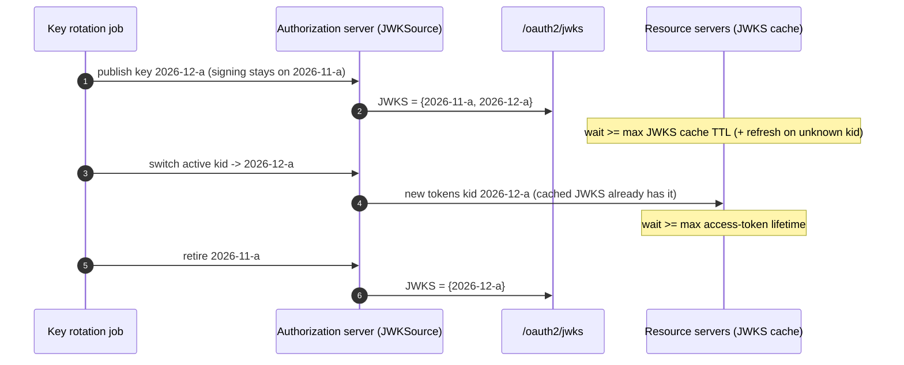

# Spring Authorization Server: Custom RFC 9068 JWTs, PKCE, and Key Rotation (Code)

> Folder 07 · File 01 of 04 · Identity, AuthN/AuthZ, OAuth 2.1/OIDC/FAPI 2.0 L7 Reference
> Next: [02 · BFF and token relay](02-spring-cloud-gateway-bff-oauth2-client-redis-session-and-token-relay-code.md) · [03 · Multi-tenant resource server](03-spring-security-resource-server-multi-tenant-jwks-dpop-and-method-security-code.md) · [04 · OpenFGA and OPA in Java 21](04-openfga-zanzibar-and-opa-integration-in-java21-microservices.md)

| Listing | What it proves | Oracle |
|---|---|---|
| L46 `SasJwtBlueprint.java` | On Spring Authorization Server 7.1.2's real `JwtGenerator` and `NimbusJwtEncoder`:<br>• **The stock generator can't sign** with an EC-only key ring, because it starts from RS256.<br>• **An RFC 9068 customizer** produces `typ: at+jwt`, ES256, a pinned `kid`, `aud` = the resource (not the client id), `client_id`, a space-delimited `scope` and a 300 s lifetime.<br>• **A validator trap:** wrapping `JwtValidators.createDefaultWithIssuer(..)` and adding `JwtTypeValidator("at+jwt")` beside it **rejects every RFC 9068 token**, because the default already pins `typ` to JWT. `createDefaultWithValidators(List.of(issuer, at+jwt, aud))` fixes it.<br>• **Rotation:** publish, switch and retire over a JWK Set. Without a pinned `kid`, `NimbusJwtEncoder` refuses to choose between two ES256 keys. Both tokens verify during the overlap, and only the new one after retirement | RFC 9068; spring-security 7.1.2 |

**Verification.** Compiled with Folders 01–07 by `javac --release 21 -Xlint:all -Werror` on JDK 25.0.4.1. The gate re-runs the output and requires it byte-identical: claims are fixed, and keys are random but never printed. The listings in Folder 02 (L18, refresh tokens), Folder 04 (L29, L31: DPoP, PAR, FAPI) and Folder 05 (L37: token exchange) are the other Spring Authorization Server blueprints, and this file assembles them into one configuration.

Labels: **[D]** documented · **[M]** measured by a listing · **[E]** engineering judgment · **⚠** trap.

---

## 0. Orientation

Spring Authorization Server (now part of Spring Security 7, `spring-security-oauth2-authorization-server`) gives you a standards-complete AS. The production work is in the defaults you change. Earlier folders measured them:
- refresh reuse (Folder 02);
- 5-minute codes, non-PAR acceptance, RS256 and the client-assertion `aud` list (Folder 04);
- optional DPoP and the refresh downgrade (Folder 04);
- token-exchange scope and audience (Folder 05).

This file adds the token format and the keys.

Results:
- **[M] The default access token isn't RFC 9068 (L46).** It is RS256 with `aud` = the client id and no `typ`. With an EC-only key ring the stock generator simply fails, "Failed to select a JWK signing key". The customizer sets `typ: at+jwt`, ES256, `kid`, `aud` = resource, `client_id` and `scope`.
- **[M] The resource-server half has a trap (L46).** `JwtValidators.createDefaultWithIssuer` already includes `JwtTypeValidator.jwt()`. Adding `JwtTypeValidator("at+jwt")` *beside* it in a `DelegatingOAuth2TokenValidator` rejects every `at+jwt` token. Put the type validator *inside* `createDefaultWithValidators(...)`, which only adds the JWT default when no type validator is present [D: `JwtValidators` source]. File 03 (L48) measures a stricter composition: it also requires RFC 9068's claims and keeps the mTLS binding check, which `createAtJwtValidator()` alone drops.
- **[M] Rotation is a protocol, not a key swap (L46).**
  - Publish the new key, and wait at least the resource servers' JWKS cache TTL.
  - Switch signing, pinning `kid`, since the encoder refuses to guess between two keys of one algorithm.
  - Wait at least the maximum token lifetime, then retire.
  - Old tokens verify until retirement, then fail. Folder 01 file 03's L12 measured what big-bang rotation costs instead: 7.6% failed requests.

---

## 1. First principles: what the AS must decide for every token

```text
  AuthorizationServerSettings  issuer, endpoints (PAR, token, JWKS, introspection, revocation)
  RegisteredClient             auth method (private_key_jwt / mTLS), grants, redirect URIs (exact), scopes,
                               ClientSettings (requireProofKey, consent, jwkSetUrl, signing alg),
                               TokenSettings (code TTL 60 s, AT 5 min, refresh reuse/rotation, ID token alg)
  OAuth2TokenCustomizer        header: alg ES256 | typ at+jwt | kid = ACTIVE key
                               claims: aud = resource indicator | client_id | scope (string) | cnf (DPoP/mTLS) | act (exchange)
  JWKSource                    every published key (verification) ; one active key (signing)
  provider decorators          RequireDpopOnRefresh (Folder 04 L29), GuardedExchange (Folder 05 L37), FAPI assertion validator (Folder 04)
```

---

## 2. The RFC 9068 access token

```json
{"typ": "at+jwt", "alg": "ES256", "kid": "2026-11-a"}
```

```json
{"iss": "https://as.bank.example", "sub": "alice", "aud": ["https://payments.internal"], "client_id": "fintech-a",
 "scope": "payments:read", "iat": 1767225600, "exp": 1767225900, "jti": "6f1c...", "nbf": 1767225600}
```

What RFC 9068 requires:
- `typ` `at+jwt`, so the token can't be confused with ID tokens (Folder 01 file 03);
- `iss`, `exp`, `aud`, `sub`, `client_id`, `iat` and `jti` are REQUIRED;
- `scope` is a space-delimited string;
- `aud` identifies the resource. Use RFC 8707 resource indicators to decide it, never the client id [D: RFC 9068 §2.2].



---

## 3. L46: the generator, the customizer, the validator and rotation, run for real

<!-- listing:SasJwtBlueprint.java -->
```java
import java.security.Principal;
import java.time.Duration;
import java.time.Instant;
import java.util.List;
import java.util.Map;
import java.util.Set;
import java.util.concurrent.atomic.AtomicReference;

import com.nimbusds.jose.jwk.Curve;
import com.nimbusds.jose.jwk.ECKey;
import com.nimbusds.jose.jwk.JWKSet;
import com.nimbusds.jose.jwk.KeyUse;
import com.nimbusds.jose.jwk.gen.ECKeyGenerator;
import com.nimbusds.jose.jwk.source.JWKSource;
import com.nimbusds.jose.proc.SecurityContext;

import org.springframework.security.authentication.UsernamePasswordAuthenticationToken;
import org.springframework.security.core.Authentication;
import org.springframework.security.oauth2.core.AuthorizationGrantType;
import org.springframework.security.oauth2.core.ClientAuthenticationMethod;
import org.springframework.security.oauth2.core.DelegatingOAuth2TokenValidator;
import org.springframework.security.oauth2.core.OAuth2Token;
import org.springframework.security.oauth2.core.OAuth2TokenValidator;
import org.springframework.security.oauth2.jose.jws.SignatureAlgorithm;
import org.springframework.security.oauth2.jwt.Jwt;
import org.springframework.security.oauth2.jwt.JwtClaimValidator;
import org.springframework.security.oauth2.jwt.JwtDecoder;
import org.springframework.security.oauth2.jwt.JwtException;
import org.springframework.security.oauth2.jwt.JwtIssuerValidator;
import org.springframework.security.oauth2.jwt.JwtTypeValidator;
import org.springframework.security.oauth2.jwt.JwtValidators;
import org.springframework.security.oauth2.jwt.NimbusJwtDecoder;
import org.springframework.security.oauth2.jwt.NimbusJwtEncoder;
import org.springframework.security.oauth2.server.authorization.OAuth2Authorization;
import org.springframework.security.oauth2.server.authorization.OAuth2TokenType;
import org.springframework.security.oauth2.server.authorization.authentication.OAuth2ClientAuthenticationToken;
import org.springframework.security.oauth2.server.authorization.client.RegisteredClient;
import org.springframework.security.oauth2.server.authorization.context.AuthorizationServerContext;
import org.springframework.security.oauth2.server.authorization.context.AuthorizationServerContextHolder;
import org.springframework.security.oauth2.server.authorization.settings.AuthorizationServerSettings;
import org.springframework.security.oauth2.server.authorization.settings.ClientSettings;
import org.springframework.security.oauth2.server.authorization.settings.TokenSettings;
import org.springframework.security.oauth2.server.authorization.token.DefaultOAuth2TokenContext;
import org.springframework.security.oauth2.server.authorization.token.JwtEncodingContext;
import org.springframework.security.oauth2.server.authorization.token.JwtGenerator;
import org.springframework.security.oauth2.server.authorization.token.OAuth2TokenCustomizer;

/**
 * L46 - production Spring Authorization Server 7.1.2 pieces, run on the real {@link JwtGenerator} and
 * {@link NimbusJwtEncoder}: an RFC 9068 access-token customizer (typ at+jwt, ES256, kid of the ACTIVE key,
 * aud = the requested resource, client_id, flat scope, short lifetime), a registered client hardened for FAPI-style
 * use (PKCE, private_key_jwt, 60 s codes), and key rotation as publish -> switch -> retire over a JWK Set that the
 * resource server reads. The resource side is a strict NimbusJwtDecoder (ES256 only, at+jwt, iss, aud).
 */
public final class SasJwtBlueprint {
    static final String ISSUER = "https://as.bank.example";
    static final String RESOURCE = "https://payments.internal";

    /** The key ring: every published key verifies; exactly one is active for signing. */
    static final class KeyRing {
        final AtomicReference<JWKSet> published = new AtomicReference<>(new JWKSet());
        final AtomicReference<String> activeKid = new AtomicReference<>();

        static ECKey newKey(String kid) throws Exception {
            return new ECKeyGenerator(Curve.P_256).keyID(kid).keyUse(KeyUse.SIGNATURE).algorithm(com.nimbusds.jose.JWSAlgorithm.ES256).generate();
        }

        void publish(ECKey k) {
            published.updateAndGet(s -> new JWKSet(new java.util.ArrayList<com.nimbusds.jose.jwk.JWK>(s.getKeys()) {
                {
                    add(k);
                }
            }));
        }

        void retire(String kid) {
            published.updateAndGet(s -> new JWKSet(s.getKeys().stream().filter(k -> !kid.equals(k.getKeyID())).toList()));
        }

        JWKSource<SecurityContext> signingSource() {          // the AS: private keys
            return (selector, ctx) -> selector.select(published.get());
        }

        JWKSource<SecurityContext> verificationSource() {     // what /oauth2/jwks serves: public halves only
            return (selector, ctx) -> selector.select(published.get().toPublicJWKSet());
        }
    }

    /** RFC 9068 + data minimization; the kid of the active key is pinned so the encoder never has to guess. */
    static OAuth2TokenCustomizer<JwtEncodingContext> rfc9068(KeyRing ring) {
        return ctx -> {
            if (!OAuth2TokenType.ACCESS_TOKEN.equals(ctx.getTokenType())) {
                return;
            }
            ctx.getJwsHeader().algorithm(SignatureAlgorithm.ES256).type("at+jwt").keyId(ring.activeKid.get());
            ctx.getClaims().audience(List.of(RESOURCE))          // the resource indicator (RFC 8707), not the client id
                    .claim("client_id", ctx.getRegisteredClient().getClientId())
                    .claim("scope", String.join(" ", ctx.getAuthorizedScopes()))   // RFC 9068: space-delimited string
                    .expiresAt(Instant.now().plus(Duration.ofMinutes(5)));
        };
    }

    static RegisteredClient fintech() {
        return RegisteredClient.withId("rc-fintech-a").clientId("fintech-a")
                .clientAuthenticationMethod(ClientAuthenticationMethod.PRIVATE_KEY_JWT)
                .authorizationGrantType(AuthorizationGrantType.AUTHORIZATION_CODE).authorizationGrantType(AuthorizationGrantType.REFRESH_TOKEN)
                .redirectUri("https://fintech-a.example/cb").scope("payments:read").scope("payments:write")
                .clientSettings(ClientSettings.builder().requireProofKey(true).requireAuthorizationConsent(true)
                        .jwkSetUrl("https://fintech-a.example/jwks.json").tokenEndpointAuthenticationSigningAlgorithm(SignatureAlgorithm.ES256).build())
                .tokenSettings(TokenSettings.builder().authorizationCodeTimeToLive(Duration.ofSeconds(60))
                        .accessTokenTimeToLive(Duration.ofMinutes(5)).reuseRefreshTokens(true)       // FAPI: no rotation for confidential clients
                        .refreshTokenTimeToLive(Duration.ofHours(8)).idTokenSignatureAlgorithm(SignatureAlgorithm.ES256).build())
                .build();
    }

    static Jwt mint(JwtGenerator gen, RegisteredClient client) {
        Authentication alice = UsernamePasswordAuthenticationToken.authenticated("alice", null, List.of());
        OAuth2ClientAuthenticationToken clientAuth = new OAuth2ClientAuthenticationToken(client, ClientAuthenticationMethod.PRIVATE_KEY_JWT, null);
        OAuth2Authorization authz = OAuth2Authorization.withRegisteredClient(client).principalName("alice")
                .authorizationGrantType(AuthorizationGrantType.AUTHORIZATION_CODE).attribute(Principal.class.getName(), alice).build();
        OAuth2Token t = gen.generate(DefaultOAuth2TokenContext.builder().registeredClient(client).principal(alice)
                .authorizationServerContext(AuthorizationServerContextHolder.getContext()).authorization(authz)
                .authorizedScopes(Set.of("payments:read")).tokenType(OAuth2TokenType.ACCESS_TOKEN)
                .authorizationGrantType(AuthorizationGrantType.AUTHORIZATION_CODE).authorizationGrant(clientAuth).build());
        return (Jwt) t;
    }

    /** The resource server's view: ES256 only, typ at+jwt, exact issuer, aud = this resource. */
    static JwtDecoder resourceServer(KeyRing ring) {
        NimbusJwtDecoder d = NimbusJwtDecoder.withJwkSource(ring.verificationSource()).jwsAlgorithm(SignatureAlgorithm.ES256).build();
        // createDefaultWithValidators adds JwtTypeValidator.jwt() ONLY if the list has no JwtTypeValidator: put at+jwt inside it
        d.setJwtValidator(JwtValidators.createDefaultWithValidators(List.<OAuth2TokenValidator<Jwt>>of(new JwtIssuerValidator(ISSUER),
                new JwtTypeValidator("at+jwt"), new JwtClaimValidator<List<String>>("aud", aud -> aud != null && aud.contains(RESOURCE)))));
        return d;
    }

    /** The trap: wrapping createDefaultWithIssuer (which already contains JwtTypeValidator.jwt()) and adding at+jwt beside it. */
    static JwtDecoder trapDecoder(KeyRing ring) {
        NimbusJwtDecoder d = NimbusJwtDecoder.withJwkSource(ring.verificationSource()).jwsAlgorithm(SignatureAlgorithm.ES256).build();
        d.setJwtValidator(new DelegatingOAuth2TokenValidator<>(JwtValidators.createDefaultWithIssuer(ISSUER), new JwtTypeValidator("at+jwt")));
        return d;
    }

    static String verify(JwtDecoder d, String token) {
        try {
            Jwt j = d.decode(token);
            return "valid (kid " + j.getHeaders().get("kid") + ")";
        } catch (JwtException e) {
            return "rejected: " + e.getMessage().replace("An error occurred while attempting to decode the Jwt: ", "");
        }
    }

    public static void main(String[] args) throws Exception {
        AuthorizationServerSettings settings = AuthorizationServerSettings.builder().issuer(ISSUER).build();
        AuthorizationServerContextHolder.setContext(new AuthorizationServerContext() {
            @Override
            public String getIssuer() {
                return settings.getIssuer();
            }

            @Override
            public AuthorizationServerSettings getAuthorizationServerSettings() {
                return settings;
            }
        });
        RegisteredClient client = fintech();
        KeyRing ring = new KeyRing();
        ring.publish(KeyRing.newKey("2026-11-a"));
        ring.activeKid.set("2026-11-a");

        KbSupport.section("Stock JwtGenerator vs the RFC 9068 customizer (real classes)");
        JwtGenerator stock = new JwtGenerator(new NimbusJwtEncoder(ring.signingSource()));
        JwtGenerator hardened = new JwtGenerator(new NimbusJwtEncoder(ring.signingSource()));
        hardened.setJwtCustomizer(rfc9068(ring));
        String stockResult;
        try {
            Jwt s = mint(stock, client);
            stockResult = "alg=" + s.getHeaders().get("alg") + " typ=" + s.getHeaders().get("typ") + " aud=" + s.getAudience();
        } catch (RuntimeException e) {
            stockResult = "fails: " + e.getMessage();
        }
        Jwt t1 = mint(hardened, client);
        KbSupport.info("stock JwtGenerator with an EC-only key ring -> %s", stockResult);
        KbSupport.info("RFC 9068 customizer -> header %s; claims aud=%s client_id=%s scope=%s lifetime=%ds",
                new java.util.TreeMap<>(t1.getHeaders()), t1.getAudience(), t1.getClaimAsString("client_id"), t1.getClaimAsString("scope"),
                Duration.between(t1.getIssuedAt(), t1.getExpiresAt()).toSeconds());
        KbSupport.check("the stock generator starts from RS256 and cannot sign with an ES256-only ring (it needs an RSA key or a customizer)",
                stockResult.startsWith("fails"));
        KbSupport.check("customized: typ at+jwt, ES256, kid pinned, aud = the resource, client_id + space-delimited scope, 300 s",
                "at+jwt".equals(String.valueOf(t1.getHeaders().get("typ"))) && "ES256".equals(String.valueOf(t1.getHeaders().get("alg")))
                        && t1.getAudience().equals(List.of(RESOURCE)) && "payments:read".equals(t1.getClaimAsString("scope"))
                        && Duration.between(t1.getIssuedAt(), t1.getExpiresAt()).toSeconds() == 300);
        KbSupport.info("validator trap: DelegatingOAuth2TokenValidator(createDefaultWithIssuer(..), JwtTypeValidator(at+jwt)) -> %s",
                verify(trapDecoder(ring), t1.getTokenValue()));
        KbSupport.check("the trap rejects every RFC 9068 token; createDefaultWithValidators(issuer, at+jwt, aud) accepts it",
                verify(trapDecoder(ring), t1.getTokenValue()).startsWith("rejected: the given typ value needs to be one of [JWT]")
                        && verify(resourceServer(ring), t1.getTokenValue()).startsWith("valid"));
        KbSupport.check("client hardened: PKCE required, private_key_jwt, 60 s codes, no refresh rotation (confidential, FAPI)",
                client.getClientSettings().isRequireProofKey() && client.getTokenSettings().getAuthorizationCodeTimeToLive().toSeconds() == 60
                        && client.getTokenSettings().isReuseRefreshTokens());

        KbSupport.section("Key rotation: publish -> wait -> switch -> wait -> retire");
        JwtDecoder rs = resourceServer(ring);
        String old = t1.getTokenValue();
        ECKey next = KeyRing.newKey("2026-12-a");
        ring.publish(next);                                   // 1. publish: both keys in /jwks, still signing with the old one
        KbSupport.info("1 published 2026-12-a; old token -> %s", verify(rs, old));
        String twoKeys;
        JwtGenerator unpinned = new JwtGenerator(new NimbusJwtEncoder(ring.signingSource()));
        unpinned.setJwtCustomizer(ctx -> ctx.getJwsHeader().algorithm(SignatureAlgorithm.ES256).type("at+jwt")); // ES256, but no kid
        try {
            mint(unpinned, client);
            twoKeys = "signed";
        } catch (RuntimeException e) {
            twoKeys = "refused: " + e.getMessage().replace("An error occurred while attempting to encode the Jwt: ", "");
        }
        KbSupport.info("  a generator that sets ES256 but does NOT pin kid, two ES256 keys in the ring -> %s",
                twoKeys.length() > 100 ? twoKeys.substring(0, 100) + "..." : twoKeys);
        ring.activeKid.set("2026-12-a");                      // 2. switch (after every RS cache has had time to fetch /jwks)
        String fresh = mint(hardened, client).getTokenValue();
        KbSupport.info("2 switched to 2026-12-a; new token -> %s; old token -> %s", verify(rs, fresh), verify(rs, old));
        ring.retire("2026-11-a");                             // 3. retire (after the longest-lived old token has expired)
        KbSupport.info("3 retired 2026-11-a; new token -> %s; old token -> %s", verify(rs, fresh), verify(rs, old));
        KbSupport.check("pinning kid is required once two keys share an algorithm (NimbusJwtEncoder refuses to guess)",
                twoKeys.startsWith("refused: Failed to select a key since there are multiple for the signing algorithm [ES256]"));
        KbSupport.check("during overlap both tokens verify; after retirement only the new one does",
                verify(rs, fresh).startsWith("valid (kid 2026-12-a)") && verify(rs, old).startsWith("rejected"));
        KbSupport.verdict();
    }
}
```

<!-- output:SasJwtBlueprint.java -->
```text

== Stock JwtGenerator vs the RFC 9068 customizer (real classes)
  stock JwtGenerator with an EC-only key ring -> fails: An error occurred while attempting to encode the Jwt: Failed to select a JWK signing key
  RFC 9068 customizer -> header {alg=ES256, kid=2026-11-a, typ=at+jwt}; claims aud=[https://payments.internal] client_id=fintech-a scope=payments:read lifetime=300s
  [PASS] the stock generator starts from RS256 and cannot sign with an ES256-only ring (it needs an RSA key or a customizer)
  [PASS] customized: typ at+jwt, ES256, kid pinned, aud = the resource, client_id + space-delimited scope, 300 s
  validator trap: DelegatingOAuth2TokenValidator(createDefaultWithIssuer(..), JwtTypeValidator(at+jwt)) -> rejected: the given typ value needs to be one of [JWT]
  [PASS] the trap rejects every RFC 9068 token; createDefaultWithValidators(issuer, at+jwt, aud) accepts it
  [PASS] client hardened: PKCE required, private_key_jwt, 60 s codes, no refresh rotation (confidential, FAPI)

== Key rotation: publish -> wait -> switch -> wait -> retire
  1 published 2026-12-a; old token -> valid (kid 2026-11-a)
    a generator that sets ES256 but does NOT pin kid, two ES256 keys in the ring -> refused: Failed to select a key since there are multiple for the signing algorithm [ES256]; please s...
  2 switched to 2026-12-a; new token -> valid (kid 2026-12-a); old token -> valid (kid 2026-11-a)
  3 retired 2026-11-a; new token -> valid (kid 2026-12-a); old token -> rejected: Signed JWT rejected: Another algorithm expected, or no matching key(s) found
  [PASS] pinning kid is required once two keys share an algorithm (NimbusJwtEncoder refuses to guess)
  [PASS] during overlap both tokens verify; after retirement only the new one does

verdict: OK (6 checks)
```

Reading the run:
- **The stock failure is a feature.** An ES256-only ring forces you to state the algorithm. With an RSA key present, the stock generator would quietly mint RS256 tokens with `aud` = client id.
- **The validator trap** passes code review because each line looks right. Write the contract test from L46: an at+jwt token must decode at the resource server.
- **`kid` pinning.** The encoder's "multiple keys for the signing algorithm" refusal turns an ambiguous rotation into a startup error rather than random signatures. Keep it that way by always setting `kid` from the active key.

The rotation as key-ring states, matching L46's publish → switch → retire rows:

```text
 state                        signs with   JWKS published      tokens that verify at a resource server
 T0  steady                   2026-11-a    {11-a}              kid 11-a
 T1  publish 12-a             2026-11-a    {11-a, 12-a}        kid 11-a
     ... wait >= the resource servers' JWKS cache TTL (every RS has now seen 12-a)
 T2  switch, kid pinned       2026-12-a    {11-a, 12-a}        kid 11-a (until each token's exp) + kid 12-a
     ... wait >= the maximum access-token lifetime (every 11-a token has expired)
 T3  retire 11-a              2026-12-a    {12-a}              kid 12-a only
 big bang (T0 -> T3 at once): live 11-a tokens fail, and an RS whose cached JWKS lacks 12-a rejects new tokens
```

---

## 4. The production configuration (assembled)

```java
@Configuration(proxyBeanMethods = false)
class AuthorizationServerConfig {

    @Bean
    SecurityFilterChain authorizationServer(HttpSecurity http, OAuth2AuthorizationService authorizations,
                                            JwtClientAssertionDecoderFactory fapiAssertions) throws Exception {
        http.oauth2AuthorizationServer(as -> as
                .pushedAuthorizationRequestEndpoint(Customizer.withDefaults())                       // PAR (Folder 04 file 02)
                .authorizationEndpoint(a -> a.authorizationResponseHandler(new IssAddingResponseHandler(ISSUER))) // RFC 9207
                .clientAuthentication(c -> c.authenticationProviders(ps -> ps.forEach(p -> {
                    if (p instanceof JwtClientAssertionAuthenticationProvider j) {
                        j.setJwtDecoderFactory(fapiAssertions);                                  // aud == issuer, jti once
                    }
                })))
                .tokenEndpoint(t -> t.authenticationProviders(ps -> ps.replaceAll(p ->
                    p instanceof OAuth2RefreshTokenAuthenticationProvider ? new RequireDpopOnRefresh(p, authorizations)   // Folder 04 L29
                    : p instanceof OAuth2TokenExchangeAuthenticationProvider ? new GuardedExchange(p, authorizations, policy) // Folder 05 L37
                    : p)))
                .oidc(Customizer.withDefaults()))
            .authorizeHttpRequests(a -> a.anyRequest().authenticated())
            .exceptionHandling(e -> e.defaultAuthenticationEntryPointFor(new LoginUrlAuthenticationEntryPoint("/login"),
                new MediaTypeRequestMatcher(MediaType.TEXT_HTML)));
        return http.build();
    }

    @Bean
    JWKSource<SecurityContext> jwkSource(KeyRing ring) { return ring.signingSource(); }        // L46 KeyRing, backed by KMS

    @Bean
    OAuth2TokenCustomizer<JwtEncodingContext> accessTokens(KeyRing ring) { return SasJwtBlueprint.rfc9068(ring); }

    @Bean
    AuthorizationServerSettings settings() { return AuthorizationServerSettings.builder().issuer(ISSUER).build(); }

    @Bean
    RegisteredClientRepository clients(JdbcOperations jdbc) { return new JdbcRegisteredClientRepository(jdbc); }

    @Bean
    OAuth2AuthorizationService authorizations(JdbcOperations jdbc, RegisteredClientRepository clients) {
        return new JdbcOAuth2AuthorizationService(jdbc, clients);                                    // shared store, not in-memory
    }
}
```

`IssAddingResponseHandler`, `RequireDpopOnRefresh`, `GuardedExchange`, `KeyRing` and `fapiAssertions` are the classes from L46, Folder 04 (L29, file 02 §7) and Folder 05 (L37). Every hook used is public API in 7.1.2 [D].

```yaml
# L7 - Boot settings for the AS service (persistence and sessions shared across replicas)
spring:
  datasource:
    url: jdbc:postgresql://as-db:5432/authorization
  session:
    timeout: 15m
server:
  servlet:
    session:
      cookie:
        name: __Host-as-session
        secure: true
        http-only: true
        same-site: lax
```

---

## 5. The vulnerable L5 implementation vs the hardened L7 zero-trust implementation

```java
// L5 - DO NOT USE: tutorial defaults in production.
@Bean
JWKSource<SecurityContext> jwkSource() {
    RSAKey key = new RSAKeyGenerator(2048).generate();          // regenerated on every restart: all tokens die; replicas disagree
    return new ImmutableJWKSet<>(new JWKSet(key));
}
@Bean
RegisteredClientRepository clients() {
    return new InMemoryRegisteredClientRepository(RegisteredClient.withId("1").clientId("app").clientSecret("{noop}secret")
        .clientAuthenticationMethod(ClientAuthenticationMethod.CLIENT_SECRET_BASIC)
        .authorizationGrantType(AuthorizationGrantType.AUTHORIZATION_CODE)
        .redirectUri("http://localhost:8080/login/oauth2/code/app").scope("read").build());   // 5-min codes, RS256, aud=client
}
```

| Concern | L5 | L7 |
|---|---|---|
| Keys | generated at startup, one per replica | KMS/HSM-backed key ring; publish → switch → retire; `kid` pinned |
| Access-token format | RS256, `aud` = client id, no `typ` | ES256, `typ at+jwt`, `aud` = resource, `client_id`, `scope` string, 5 min |
| Resource-server validation | `createDefaultWithIssuer` + extra type validator (rejects all) | `createDefaultWithValidators(issuer, at+jwt, aud)`; ES256 only |
| Clients | in-memory, secrets, `{noop}` | JDBC; `private_key_jwt`/mTLS; exact redirects; PKCE required |
| Token settings | defaults | code 60 s; AT 5 min; refresh per client type (rotation for public, none for FAPI confidential) |
| FAPI pieces | absent | PAR required, `iss` response, DPoP required, `dpop_jkt` (custom), assertion `aud` = issuer |
| Persistence | in-memory authorizations | shared JDBC store; cleanup jobs; replicas consistent |

---

## 6. Real-world attack vectors & mitigations

### A1 · Signing keys lost or forked across replicas

**Attack.** No attacker is needed. Each replica generates its own key, so tokens from replica A fail at resource servers that fetched replica B's JWKS. Every restart invalidates every token, and the "fix" is a static key in source control.
**Wire signature.** `kid` churn; intermittent signature failures behind a load balancer.
**Root cause.** Tutorial `JWKSource` beans.
**Mitigation.** One key ring in KMS/HSM (or encrypted shared storage) with an explicit lifecycle (L46).
**Detection.** Alert on JWKS content changes and on signature-failure rates at resource servers.

### A2 · Big-bang key rotation outage

**Attack.** No attacker is needed. The signing key is replaced and the old public key removed at once. Cached JWKS at resource servers no longer verify new tokens, and in-flight old tokens fail (Folder 01 L12: 7.6% failures).
**Wire signature.** A spike of `kid not found` after a rotation.
**Root cause.** Rotation without overlap.
**Mitigation.** Publish → wait (cache TTL) → switch → wait (max token TTL) → retire. Resource servers refresh JWKS on an unknown `kid`.
**Detection.** Signature failures by `kid`.

### A3 · Key compromise without a revocation path

**Attack.** A leaked signing key mints tokens for any user and audience until it is retired.
**Wire signature.** Tokens with valid signatures but impossible claims (unknown `jti`, odd `iat`).
**Root cause.** Software keys on disk; no emergency-rotation runbook.
**Mitigation.**
- Keep keys in an HSM or KMS with sign-only permission.
- Have an emergency rotation that retires the key immediately, accepting the outage.
- Keep short access-token lifetimes and revocation of refresh-token families.

**Detection.** Compare issued-token logs (`jti`) with tokens seen at resource servers.

### A4 · Token-type confusion through validator composition

**Attack.** The resource-server team, unable to get `at+jwt` accepted, removes the type check entirely after hitting the trap. ID tokens and other JWTs from the AS are then accepted as access tokens (Folder 01 file 03).
**Wire signature.** Requests carrying `typ: JWT` ID tokens.
**Root cause.** The `createDefaultWithIssuer` plus extra `JwtTypeValidator` trap (L46).
**Mitigation.** `createDefaultWithValidators(List.of(issuer, new JwtTypeValidator("at+jwt"), aud))`, plus a contract test.
**Detection.** Log `typ` at resource servers.

### A5 · Audience = client id

**Attack.** Tokens issued with `aud` = the client id are valid at every resource server that checks only issuer and signature, so one leaked token works against every API.
**Wire signature.** Tokens whose `aud` is a client id.
**Root cause.** The default `JwtGenerator` audience.
**Mitigation.** `aud` = the resource (RFC 8707 indicator) via the customizer, and resource servers that require their own `aud`.
**Detection.** `aud`-mismatch rejections.

### A6 · Long-lived codes and missing PKCE on some clients

**Attack.** A leaked authorization code (logs, Referer) is redeemed within the 5-minute default window. A legacy client registered without `requireProofKey` gives an injection path.
**Wire signature.** Code redemption long after issuance; code requests without `code_challenge`.
**Root cause.** Per-client settings drift.
**Mitigation.** A 60 s code TTL and `requireProofKey(true)` on every client, enforced by a registration validator.
**Detection.** Issuance-to-redemption histograms.

### A7 · In-memory authorization state in a cluster

**Attack.** No attacker is needed. A refresh token issued by replica A is unknown to replica B, consent and authorization requests are lost between replicas, and revocation reaches only one replica.
**Wire signature.** Random `invalid_grant` errors.
**Root cause.** `InMemoryOAuth2AuthorizationService` in production.
**Mitigation.** `JdbcOAuth2AuthorizationService` (or another shared store), with expiry cleanup.
**Detection.** `invalid_grant` rates by replica.

---

## 7. FAANG / FinTech L7 bar-raiser Q&A chains

<details><summary><b>Q1 · Walk me through rotating the AS signing key with zero downtime.</b></summary>

**Initial Prompt.** 200 resource servers cache JWKS for 10 minutes; access tokens live 5 minutes.

**L5 Textbook Answer.** "Generate a new key, replace the old one, restart."

**How an Attacker Bypasses L5.** No attacker is needed: resource servers with cached JWKS reject new tokens, and old tokens die mid-flight (Folder 01 L12).

**L7 Principal Defense.**
1. Publish the new key (both in JWKS) and wait at least 10 minutes.
2. Switch signing to the new `kid`, pinned in the customizer.
3. Wait at least 5 minutes (the longest token).
4. Retire the old key.

Resource servers refresh JWKS on an unknown `kid`, rate-limited. Automate it with a schedule, and have an emergency path that skips the waits for compromise.

</details>

<details><summary><b>Q2 · Why does your resource server reject every token after you added `typ: at+jwt`?</b></summary>

**Initial Prompt.** The AS team switched to RFC 9068 and the APIs broke.

**L5 Textbook Answer.** "Spring doesn't support at+jwt; remove the type check."

**How an Attacker Bypasses L5.** Removing the check accepts ID tokens and other JWTs as access tokens (A4).

**L7 Principal Defense.**
- **The cause [M, L46]:** `createDefaultWithIssuer` already contains `JwtTypeValidator.jwt()`, so an extra at+jwt validator beside it can never pass.
- **The fix:** `createDefaultWithValidators(List.of(new JwtIssuerValidator(iss), new JwtTypeValidator("at+jwt"), audValidator))`. The default type validator is added only when none is present.
- **Add the L46 contract test.**

</details>

<details><summary><b>Q3 · What goes into an access token, and what stays out?</b></summary>

**Initial Prompt.** Product wants email, roles and the account list in the token.

**L5 Textbook Answer.** "Put everything in; services avoid lookups."

**How an Attacker Bypasses L5.** Tokens leak (logs, browsers, partners). PII and authorization data in them is disclosed and stays valid until `exp`, even after a role change.

**L7 Principal Defense.**
- **In:** the RFC 9068 minimum (`iss`, `sub`, `aud`, `client_id`, `scope`, `iat`, `exp`, `jti`), plus `cnf`, `act` and `acr`/`auth_time` when policy needs them.
- **Out:** PII and fast-changing entitlements. Fetch them from a profile API or a PDP at request time (Folder 05).
- **Per-audience claim maps.**

</details>

<details><summary><b>Q4 · Where do the AS signing keys live?</b></summary>

**Initial Prompt.** A security review of the AS deployment.

**L5 Textbook Answer.** "In a Kubernetes secret, loaded at startup."

**How an Attacker Bypasses L5.** Anyone who reads the secret (cluster admin, a leaked backup, a compromised pod with secret access) mints tokens for any user (A3).

**L7 Principal Defense.**
- **A KMS/HSM key** with sign-only permission for the AS identity. A `JWKSource` adapter delegates signing to KMS (the private key never leaves it) and publishes the public JWK.
- **Audit KMS sign calls,** and match them against issuance logs.
- **Have an emergency rotation runbook.**

</details>

<details><summary><b>Q5 · How do you set different token lifetimes per client type?</b></summary>

**Initial Prompt.** Mobile, BFF and partner server clients share one AS.

**L5 Textbook Answer.** "One global setting."

**How an Attacker Bypasses L5.** A global setting can't serve both cases. Long-lived tokens for partners leak through their logs, and public mobile clients without refresh rotation keep stolen refresh tokens working forever (Folder 02).

**L7 Principal Defense.** `TokenSettings` per `RegisteredClient`:
- **Public mobile:** AT 5 min, refresh rotation with reuse detection, DPoP-bound (Folder 04 L29 decorator).
- **BFF (confidential):** AT 5 min, refresh with client authentication.
- **FAPI partners:** AT 5 min, DPoP or mTLS required, no rotation, 60 s codes.

Validate settings at registration.

</details>

<details><summary><b>Q6 · Your AS runs three replicas. What must be shared?</b></summary>

**Initial Prompt.** A Kubernetes deployment.

**L5 Textbook Answer.** "Nothing; it's stateless."

**How an Attacker Bypasses L5.** Without shared state:
- **keys diverge** (A1);
- **authorizations live in memory**, so refresh and consent fail between replicas, and revocation is partial (A7);
- **PAR `request_uri`s and DPoP `jti` caches are per replica**, so they replay across replicas.

**L7 Principal Defense.**
- **Shared and consistent:** the key ring (KMS), `OAuth2AuthorizationService`, the consent service, client registrations, and PAR and `jti` stores (Redis/DB with atomic operations).
- **Sessions:** Spring Session for the login UI.
- **Safe to keep local:** caches only.

</details>

<details><summary><b>Q7 · How do you test an authorization server configuration before release?</b></summary>

**Initial Prompt.** A CI pipeline.

**L5 Textbook Answer.** "Log in through the UI."

**How an Attacker Bypasses L5.** Every L46 and Folder 02–05 finding is invisible in a happy-path login.

**L7 Principal Defense.** Contract tests that mint real tokens through the generator and decode them with the resource servers' decoders:
- `typ`, `aud`, `alg` and lifetime;
- the negative cases: other audience, ID token, expired;
- rotation (publish, switch, retire);
- DPoP refresh without a proof (expect rejection);
- PAR replay;
- token-exchange scope escalation.

Then run the OIDF conformance suite (OIDC, FAPI 2.0).

</details>

<details><summary><b>Q8 · Should access tokens be JWTs or opaque from Spring Authorization Server?</b></summary>

**Initial Prompt.** Internal APIs and external partners.

**L5 Textbook Answer.** "JWT everywhere."

**How an Attacker Bypasses L5.** External JWTs leak claims and can't be revoked early (Folder 05 file 01).

**L7 Principal Defense.**
- **External partners and the edge:** opaque (`OAuth2TokenFormat.REFERENCE`) with introspection at the gateway, sender-constrained.
- **Internal hops:** JWTs (phantom tokens, or token exchange per audience).
- **Spring Authorization Server supports both per client** via `TokenSettings.accessTokenFormat`. The customizer pattern is the same: `OAuth2TokenClaimsContext` for reference tokens.

</details>

---

## 8. Invariants checklist

- [ ] Access tokens follow RFC 9068: `typ at+jwt`, ES256/PS256, `kid`, `aud` = resource, `client_id`, `scope` string, `jti`, ≤ 5 min.
- [ ] Resource servers: `createDefaultWithValidators(issuer, at+jwt, aud)`; ES256-only decoder; contract test with real AS tokens.
- [ ] Signing keys in KMS/HSM; rotation = publish → wait (JWKS TTL) → switch (pinned `kid`) → wait (token TTL) → retire; emergency path.
- [ ] Shared JDBC/Redis stores for authorizations, consent, clients, PAR, `jti`; no in-memory services in production.
- [ ] Every client: PKCE required, exact redirects, `private_key_jwt`/mTLS, 60 s codes, per-type refresh policy.
- [ ] FAPI decorators installed (PAR required, `iss`, DPoP required, assertion `aud`, token-exchange guard).
- [ ] OIDF conformance suite and contract tests in CI.

---

## 9. References

- Spring Authorization Server reference — <https://docs.spring.io/spring-authorization-server/reference/>
- RFC 9068 *JWT Profile for OAuth 2.0 Access Tokens* — <https://www.rfc-editor.org/rfc/rfc9068>
- RFC 7517 *JSON Web Key (JWK)* — <https://www.rfc-editor.org/rfc/rfc7517>
- RFC 8707 *Resource Indicators for OAuth 2.0* — <https://www.rfc-editor.org/rfc/rfc8707>
- OpenID Foundation certification and conformance suite — <https://openid.net/certification/>
