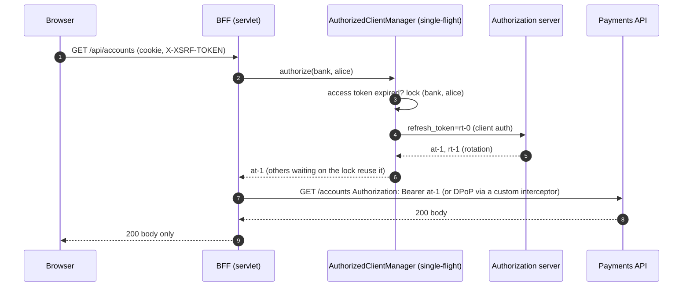

# The BFF in Code: Spring Cloud Gateway, OAuth2 Client, Redis Sessions, and Token Relay

> Folder 07 · File 02 of 04 · Identity, AuthN/AuthZ, OAuth 2.1/OIDC/FAPI 2.0 L7 Reference
> Previous: [01 · Spring Authorization Server](01-spring-authorization-server-custom-jwt-rfc9068-pkce-and-key-rotation-code.md) · Next: [03 · Multi-tenant resource server](03-spring-security-resource-server-multi-tenant-jwks-dpop-and-method-security-code.md)

| Listing | What it proves | Oracle |
|---|---|---|
| L47 `BffRelayLab.java` | Spring Security 7.1.2's real OAuth2 client as the BFF's token handler: `AuthorizedClientServiceOAuth2AuthorizedClientManager` and `OAuth2ClientHttpRequestInterceptor` on a `RestClient`, against an in-process token endpoint that **rotates refresh tokens with reuse detection** and an in-process API.<br>• **Inline refresh:** one refresh for an expired token, then reuse, and the page never sees a token.<br>• **Stampede:** **20 concurrent calls** right after expiry send more than one refresh with the same refresh token, so the AS **revokes the family** and calls fail, which logs the user out.<br>• **Single-flight:** one refresh, 20/20 calls succeed.<br>• **Upstream revocation:** a 401 `invalid_token` from the API leaves the dead token in the store unless an authorization-failure handler is registered | RFC 9700 §4.14 (rotation + reuse detection); spring-security 7.1.2 |

**Verification.** Compiled with Folders 01–07 by `javac --release 21 -Xlint:all -Werror` on JDK 25.0.4.1. The gate re-runs the output and requires it byte-identical. The stock-manager stampede row prints only timing-independent facts (more than one refresh, some failures, family revoked), because the exact counts depend on thread scheduling. The single-flight row's counts are exact.

Spring Cloud Gateway is not on this KB's classpath, so its configuration (§4) is shown from its documentation, labelled [D]: the Spring Cloud 2025.0 property prefix `spring.cloud.gateway.server.webflux.*`, and the `TokenRelay` and `SaveSession` filters. The servlet BFF code is the compiled, measured path.

Labels: **[D]** documented · **[M]** measured by a listing · **[E]** engineering judgment · **⚠** trap.

---

## 0. Orientation

Folder 04 file 03 established *why* a BFF: RFC 10017's threat analysis, where only a confidential backend stops new-token acquisition by XSS. This file is *how*, in Spring. Two stacks are viable:
- **Servlet:** `oauth2Login` plus `RestClient` with `OAuth2ClientHttpRequestInterceptor`. This is measured here.
- **Reactive:** Spring Cloud Gateway with `TokenRelay`. Remember Folder 04's finding that the reactive resource-server stack has no DPoP. That matters only if the gateway is *also* a resource server, not for its client role.

The hard parts are not the happy path. They are concurrency and failure handling.

Results:
- **[M] Inline refresh works out of the box (L47):** one refresh for an expired token, then the stored token is reused, and the browser response carries the body only.
- **[M] Concurrency breaks rotating refresh tokens (L47).**
  - Twenty parallel API calls after expiry each load the same expired authorized client and refresh with the same refresh token.
  - An AS doing rotation with reuse detection (what RFC 9700 asks for public-facing clients) sees reuse and revokes the family. The user is logged out by their own browser's parallel requests.
  - A **single-flight** manager (one refresh per principal and registration) makes one refresh and 20/20 calls succeed.
- **[M] 401 from the API isn't handled by default (L47).** The authorized client stays stored after `invalid_token`. Register an `OAuth2AuthorizationFailureHandler` (the remove-authorized-client handler) so the next request re-authenticates instead of looping.
- **[D] Spring Cloud 2025.0** renamed the WebFlux gateway properties to `spring.cloud.gateway.server.webflux.*`. 2025.0.1 disabled `X-Forwarded-*` handling by default (`trusted-proxies` re-enables it for trusted proxies), which matters for redirect URIs and `htu` (Folder 04).

---

## 1. First principles: the BFF's moving parts

```text
   browser --(__Host-Http-bff cookie)--> BFF -----------------------------------------------> APIs
                                         |  SecurityFilterChain: oauth2Login (confidential, PKCE), csrf.spa(), CORS
                                         |  Spring Session (Redis): session id -> SecurityContext
                                         |  OAuth2AuthorizedClientService (JDBC/Redis): (registration, principal) -> AT, RT
                                         |  OAuth2AuthorizedClientManager: refresh when expired  <-- single-flight here (L47)
                                         |  RestClient + OAuth2ClientHttpRequestInterceptor: attach AT, handle 401
                                         |  route table: /api/payments -> https://payments.internal (exact)
   never in the browser: access token, refresh token, ID token, DPoP key
```

The refresh race, measured in L47:

```text
   t0: access token expires
   t0+1ms  req#1 load client(rt-0) -> POST /token rt-0 -----------> AS: ok, rotate -> rt-1   (saves at-1/rt-1)
   t0+1ms  req#2 load client(rt-0) -> POST /token rt-0 -----------> AS: rt-0 already used -> REVOKE FAMILY
   t0+2ms  req#3..#20 same ------------------------------------------> AS: family revoked -> invalid_grant
   result: user logged out by their own page's parallel fetches
   fix:    single-flight per (registration, principal): req#2..#20 wait for req#1's refresh, then reuse at-1
```

---

## 2. L47: token relay, refresh, concurrency and failures on the real client

<!-- listing:BffRelayLab.java -->
```java
import java.io.ByteArrayOutputStream;
import java.net.InetAddress;
import java.net.InetSocketAddress;
import java.nio.charset.StandardCharsets;
import java.time.Instant;
import java.util.ArrayList;
import java.util.List;
import java.util.Map;
import java.util.Set;
import java.util.concurrent.ConcurrentHashMap;
import java.util.concurrent.ExecutorService;
import java.util.concurrent.Executors;
import java.util.concurrent.Future;
import java.util.concurrent.atomic.AtomicInteger;

import com.sun.net.httpserver.HttpServer;

import org.springframework.security.authentication.UsernamePasswordAuthenticationToken;
import org.springframework.security.core.Authentication;
import org.springframework.security.core.context.SecurityContextHolder;
import org.springframework.security.oauth2.client.AuthorizedClientServiceOAuth2AuthorizedClientManager;
import org.springframework.security.oauth2.client.InMemoryOAuth2AuthorizedClientService;
import org.springframework.security.oauth2.client.OAuth2AuthorizeRequest;
import org.springframework.security.oauth2.client.OAuth2AuthorizedClient;
import org.springframework.security.oauth2.client.OAuth2AuthorizedClientManager;
import org.springframework.security.oauth2.client.OAuth2AuthorizedClientProviderBuilder;
import org.springframework.security.oauth2.client.registration.ClientRegistration;
import org.springframework.security.oauth2.client.registration.InMemoryClientRegistrationRepository;
import org.springframework.security.oauth2.client.web.client.OAuth2ClientHttpRequestInterceptor;
import org.springframework.security.oauth2.client.web.client.RequestAttributeClientRegistrationIdResolver;
import org.springframework.security.oauth2.core.AuthorizationGrantType;
import org.springframework.security.oauth2.core.ClientAuthenticationMethod;
import org.springframework.security.oauth2.core.OAuth2AccessToken;
import org.springframework.security.oauth2.core.OAuth2RefreshToken;
import org.springframework.web.client.RestClient;
import org.springframework.web.client.RestClientResponseException;

/**
 * L47 - the token-handler half of a BFF on Spring Security 7.1.2's real OAuth2 client:
 * {@link AuthorizedClientServiceOAuth2AuthorizedClientManager} (refresh handled inline) and
 * {@link OAuth2ClientHttpRequestInterceptor} on a {@link RestClient}, against an in-process token endpoint (which
 * ROTATES refresh tokens with reuse detection, as RFC 9700 asks of public-client-facing ASs) and an in-process
 * resource server. Measured: inline refresh, the concurrent-refresh stampede that a rotating AS turns into a logout,
 * a single-flight fix, and what the interceptor does when the resource server answers 401 invalid_token.
 */
public final class BffRelayLab {
    static final AtomicInteger REFRESH_CALLS = new AtomicInteger();
    static final Set<String> LIVE_RT = ConcurrentHashMap.newKeySet();
    static final AtomicInteger ROTATION = new AtomicInteger();
    static volatile boolean familyRevoked;
    static volatile boolean rsRevoked;

    static void respond(com.sun.net.httpserver.HttpExchange ex, int status, String body, String wwwAuth) throws java.io.IOException {
        byte[] b = body.getBytes(StandardCharsets.UTF_8);
        ex.getResponseHeaders().add("Content-Type", "application/json");
        if (wwwAuth != null) {
            ex.getResponseHeaders().add("WWW-Authenticate", wwwAuth);
        }
        ex.sendResponseHeaders(status, b.length);
        ex.getResponseBody().write(b);
        ex.close();
    }

    static OAuth2AuthorizedClient expiredClient(ClientRegistration reg, String rt) {
        Instant now = Instant.now();
        return new OAuth2AuthorizedClient(reg, "alice", new OAuth2AccessToken(OAuth2AccessToken.TokenType.BEARER, "at-old", now.minusSeconds(600), now.minusSeconds(60)),
                new OAuth2RefreshToken(rt, now.minusSeconds(600)));
    }

    /** Single-flight: one refresh per (registration, principal) at a time; others wait and reuse the result. */
    record SingleFlight(OAuth2AuthorizedClientManager delegate, Map<String, Object> locks) implements OAuth2AuthorizedClientManager {
        @Override
        public OAuth2AuthorizedClient authorize(OAuth2AuthorizeRequest req) {
            Object lock = locks.computeIfAbsent(req.getClientRegistrationId() + "|" + req.getPrincipal().getName(), k -> new Object());
            synchronized (lock) {
                return delegate.authorize(req);
            }
        }
    }

    public static void main(String[] args) throws Exception {
        HttpServer srv = HttpServer.create(new InetSocketAddress(InetAddress.getLoopbackAddress(), 0), 0);
        srv.setExecutor(Executors.newFixedThreadPool(8));
        srv.createContext("/token", ex -> {
            ByteArrayOutputStream body = new ByteArrayOutputStream();
            ex.getRequestBody().transferTo(body);
            String form = body.toString(StandardCharsets.UTF_8);
            String rt = form.replaceAll(".*refresh_token=([^&]*).*", "$1");
            REFRESH_CALLS.incrementAndGet();
            try {
                Thread.sleep(50);                               // a real AS takes time; concurrent callers overlap
            } catch (InterruptedException e) {
                Thread.currentThread().interrupt();
            }
            synchronized (LIVE_RT) {
                if (familyRevoked || !LIVE_RT.remove(rt)) {     // rotation with reuse detection: a used RT revokes the family
                    familyRevoked = true;
                    LIVE_RT.clear();
                    respond(ex, 400, "{\"error\":\"invalid_grant\",\"error_description\":\"refresh token reuse: family revoked\"}", null);
                    return;
                }
                String next = "rt-" + ROTATION.incrementAndGet();
                LIVE_RT.add(next);
                respond(ex, 200, "{\"access_token\":\"at-" + ROTATION.get() + "\",\"token_type\":\"Bearer\",\"expires_in\":300,\"refresh_token\":\"" + next
                        + "\",\"scope\":\"accounts\"}", null);
            }
        });
        srv.createContext("/accounts", ex -> {
            String auth = ex.getRequestHeaders().getFirst("Authorization");
            if (rsRevoked) {
                respond(ex, 401, "{}", "Bearer error=\"invalid_token\", error_description=\"token revoked\"");
            } else if (auth != null && auth.startsWith("Bearer at-") && !auth.equals("Bearer at-old")) {
                respond(ex, 200, "{\"accounts\":[{\"iban\":\"DE02...8603\"}]}", null);
            } else {
                respond(ex, 401, "{}", "Bearer error=\"invalid_token\"");
            }
        });
        srv.start();
        String base = "http://127.0.0.1:" + srv.getAddress().getPort();
        try {
            run(base);
        } finally {
            srv.stop(0);
            ((ExecutorService) srv.getExecutor()).shutdownNow();
        }
        KbSupport.verdict();
    }

    static void run(String base) throws Exception {
        ClientRegistration reg = ClientRegistration.withRegistrationId("bank").clientId("web-bff").clientSecret("s3cr3t")
                .clientAuthenticationMethod(ClientAuthenticationMethod.CLIENT_SECRET_BASIC).authorizationGrantType(AuthorizationGrantType.AUTHORIZATION_CODE)
                .redirectUri("https://app.example.com/login/oauth2/code/bank").scope("accounts").authorizationUri(base + "/authorize").tokenUri(base + "/token").build();
        Authentication alice = UsernamePasswordAuthenticationToken.authenticated("alice", null, List.of());
        SecurityContextHolder.getContext().setAuthentication(alice);

        KbSupport.section("Inline refresh through OAuth2ClientHttpRequestInterceptor (stock manager)");
        InMemoryOAuth2AuthorizedClientService store = new InMemoryOAuth2AuthorizedClientService(new InMemoryClientRegistrationRepository(reg));
        LIVE_RT.add("rt-0");
        store.saveAuthorizedClient(expiredClient(reg, "rt-0"), alice);
        AuthorizedClientServiceOAuth2AuthorizedClientManager stock = new AuthorizedClientServiceOAuth2AuthorizedClientManager(
                new InMemoryClientRegistrationRepository(reg), store);
        stock.setAuthorizedClientProvider(OAuth2AuthorizedClientProviderBuilder.builder().authorizationCode().refreshToken().build());
        RestClient api = RestClient.builder().baseUrl(base).requestInterceptor(new OAuth2ClientHttpRequestInterceptor(stock)).build();
        String first = api.get().uri("/accounts").attributes(RequestAttributeClientRegistrationIdResolver.clientRegistrationId("bank")).retrieve().body(String.class);
        int afterFirst = REFRESH_CALLS.get();
        api.get().uri("/accounts").attributes(RequestAttributeClientRegistrationIdResolver.clientRegistrationId("bank")).retrieve().body(String.class);
        int afterSecond = REFRESH_CALLS.get();
        KbSupport.info("expired access token, first call -> %d refresh, response to the browser: %s; second call -> %d more refreshes",
                afterFirst, first, afterSecond - afterFirst);
        KbSupport.check("the interceptor refreshes once inline, then reuses the stored token; the page never sees a token",
                afterFirst == 1 && afterSecond == 1 && !first.contains("at-"));

        KbSupport.section("20 concurrent API calls when the access token has just expired (AS rotates refresh tokens)");
        for (boolean singleFlight : new boolean[] {false, true}) {
            REFRESH_CALLS.set(0);
            familyRevoked = false;
            LIVE_RT.clear();
            LIVE_RT.add("rt-x" + singleFlight);
            store.saveAuthorizedClient(expiredClient(reg, "rt-x" + singleFlight), alice);
            OAuth2AuthorizedClientManager mgr = singleFlight ? new SingleFlight(stock, new ConcurrentHashMap<>()) : stock;
            RestClient c = RestClient.builder().baseUrl(base).requestInterceptor(new OAuth2ClientHttpRequestInterceptor(mgr)).build();
            ExecutorService pool = Executors.newFixedThreadPool(20);
            List<Future<String>> fs = new ArrayList<>();
            for (int i = 0; i < 20; i++) {
                fs.add(pool.submit(() -> {
                    SecurityContextHolder.getContext().setAuthentication(alice);
                    try {
                        c.get().uri("/accounts").attributes(RequestAttributeClientRegistrationIdResolver.clientRegistrationId("bank")).retrieve().body(String.class);
                        return "ok";
                    } catch (RuntimeException e) {
                        return "fail";
                    }
                }));
            }
            int ok = 0;
            for (Future<String> f : fs) {
                ok += f.get().equals("ok") ? 1 : 0;
            }
            pool.shutdown();
            if (singleFlight) {
                KbSupport.info("%-24s refresh requests to the AS: %d | API calls that succeeded: %d/20 | refresh-token family revoked: %s",
                        "single-flight manager", REFRESH_CALLS.get(), ok, familyRevoked);
            } else { // exact counts depend on thread timing; print only what holds on every run
                KbSupport.info("%-24s more than one refresh request: %s | some API calls failed: %s | refresh-token family revoked: %s",
                        "stock manager", REFRESH_CALLS.get() > 1, ok < 20, familyRevoked);
            }
            if (singleFlight) {
                KbSupport.check("single-flight: one refresh, 20/20 calls succeed, the session survives", REFRESH_CALLS.get() == 1 && ok == 20 && !familyRevoked);
            } else {
                KbSupport.check("stock: parallel refreshes reuse the same refresh token, the AS revokes the family and calls fail (user logged out)",
                        REFRESH_CALLS.get() > 1 && familyRevoked && ok < 20);
            }
        }

        KbSupport.section("The resource server answers 401 invalid_token (token revoked upstream)");
        familyRevoked = false;
        LIVE_RT.clear();
        LIVE_RT.add("rt-y");
        store.saveAuthorizedClient(expiredClient(reg, "rt-y"), alice);
        rsRevoked = true;
        String r;
        try {
            api.get().uri("/accounts").attributes(RequestAttributeClientRegistrationIdResolver.clientRegistrationId("bank")).retrieve().body(String.class);
            r = "200";
        } catch (RestClientResponseException e) {
            r = e.getStatusCode().value() + " " + e.getResponseHeaders().getFirst("WWW-Authenticate");
        }
        boolean stillStored = store.loadAuthorizedClient("bank", "alice") != null;
        KbSupport.info("API call -> %s; authorized client still stored afterwards: %s", r, stillStored);
        KbSupport.check("without an authorization failure handler the dead token stays in the store: register one (removes it) and re-authenticate",
                r.startsWith("401") && stillStored);
        rsRevoked = false;
    }
}
```

<!-- output:BffRelayLab.java -->
```text

== Inline refresh through OAuth2ClientHttpRequestInterceptor (stock manager)
  expired access token, first call -> 1 refresh, response to the browser: {"accounts":[{"iban":"DE02...8603"}]}; second call -> 0 more refreshes
  [PASS] the interceptor refreshes once inline, then reuses the stored token; the page never sees a token

== 20 concurrent API calls when the access token has just expired (AS rotates refresh tokens)
  stock manager            more than one refresh request: true | some API calls failed: true | refresh-token family revoked: true
  [PASS] stock: parallel refreshes reuse the same refresh token, the AS revokes the family and calls fail (user logged out)
  single-flight manager    refresh requests to the AS: 1 | API calls that succeeded: 20/20 | refresh-token family revoked: false
  [PASS] single-flight: one refresh, 20/20 calls succeed, the session survives

== The resource server answers 401 invalid_token (token revoked upstream)
  API call -> 401 Bearer error="invalid_token", error_description="token revoked"; authorized client still stored afterwards: true
  [PASS] without an authorization failure handler the dead token stays in the store: register one (removes it) and re-authenticate

verdict: OK (4 checks)
```

Reading the run:
- **Single-flight is the production fix.** A per-key lock in one JVM suffices when sessions are sticky. Across BFF replicas, use a distributed lock (Redis `SET NX` with TTL) around refresh, or let the AS provide a short **grace period** for the just-rotated refresh token bound to the client (Folder 02 file 03) [E].
- **The 401 case.** The interceptor attaches tokens but doesn't remove them when the API reports them dead. Configure `authorizationFailureHandler` with a remove-authorized-client handler backed by your `OAuth2AuthorizedClientRepository`, so the next call triggers re-authentication instead of looping 401s.
- **Body only.** The browser received `{"accounts":[...]}`, not the upstream headers. Never forward `Authorization`, `WWW-Authenticate` or `Set-Cookie` from upstream to the page (Folder 04 L33).



---

## 3. The servlet BFF (Spring Security 7.1.2)

```java
@Configuration(proxyBeanMethods = false)
class BffConfig {

    @Bean
    SecurityFilterChain bff(HttpSecurity http) throws Exception {
        http.authorizeHttpRequests(a -> a.requestMatchers("/bff/session", "/oauth2/**", "/login/**").permitAll()
                .requestMatchers("/api/**").authenticated().anyRequest().denyAll())
            .oauth2Login(Customizer.withDefaults())                       // confidential client: private_key_jwt + PKCE
            .oauth2Client(Customizer.withDefaults())
            .csrf(c -> c.spa())                                           // XSRF-TOKEN cookie + X-XSRF-TOKEN header (7.0+)
            .logout(l -> l.logoutSuccessHandler(oidcLogout()))            // RP-initiated logout (Folder 03 file 03)
            .exceptionHandling(e -> e.defaultAuthenticationEntryPointFor(new HttpStatusEntryPoint(HttpStatus.UNAUTHORIZED),
                request -> request.getRequestURI().startsWith("/api/")));
        return http.build();
    }

    @Bean
    OAuth2AuthorizedClientManager authorizedClients(ClientRegistrationRepository registrations,
                                                    OAuth2AuthorizedClientRepository repository) {
        DefaultOAuth2AuthorizedClientManager m = new DefaultOAuth2AuthorizedClientManager(registrations, repository);
        m.setAuthorizedClientProvider(OAuth2AuthorizedClientProviderBuilder.builder()
            .authorizationCode().refreshToken(r -> r.clockSkew(Duration.ofSeconds(30))).build());
        return new BffRelayLab.SingleFlight(m, new ConcurrentHashMap<>());   // L47: one refresh per (registration, principal)
    }

    @Bean
    RestClient paymentsApi(RestClient.Builder builder, OAuth2AuthorizedClientManager clients,
                           OAuth2AuthorizedClientRepository repository) {
        OAuth2ClientHttpRequestInterceptor relay = new OAuth2ClientHttpRequestInterceptor(clients);
        relay.setAuthorizationFailureHandler(
            OAuth2ClientHttpRequestInterceptor.authorizationFailureHandler(repository));    // drop dead tokens on 401/403
        return builder.baseUrl("https://payments.internal").requestInterceptor(relay).build();
    }
}
```

[D] In the 7.1.2 sources, `OAuth2ClientHttpRequestInterceptor` has two static factories for the remove-on-failure handler: `authorizationFailureHandler(OAuth2AuthorizedClientRepository)` and `authorizationFailureHandler(OAuth2AuthorizedClientService)`. You install either with `setAuthorizationFailureHandler(...)`. L47 measures the default, in which no handler is registered, so the dead token stays stored.

```yaml
# L7 - BFF session cookie + Redis-backed Spring Session + confidential client
server:
  servlet:
    session:
      timeout: 8h
      cookie:
        name: __Host-Http-bff
        secure: true
        http-only: true
        same-site: strict
        path: /
spring:
  data:
    redis:
      host: redis.internal
      ssl:
        enabled: true
  session:
    redis:
      namespace: bff:session
  security:
    oauth2:
      client:
        registration:
          bank:
            provider: bank
            client-id: bff-web
            client-authentication-method: private_key_jwt
            authorization-grant-type: authorization_code
            scope: openid, accounts, payments
        provider:
          bank:
            issuer-uri: https://as.bank.example
```

---

## 4. The reactive alternative: Spring Cloud Gateway `TokenRelay`

```yaml
# [D] Spring Cloud 2025.0+ property prefix (spring.cloud.gateway.server.webflux.*); TokenRelay and SaveSession filters
spring:
  cloud:
    gateway:
      server:
        webflux:
          trusted-proxies: 10\.0\.0\.\d+
          default-filters:
            - SaveSession
          routes:
            - id: payments
              uri: https://payments.internal
              predicates:
                - Path=/api/payments/**
              filters:
                - StripPrefix=1
                - TokenRelay=
```

[D] What each piece does:
- **`TokenRelay`** obtains the current user's access token from the reactive `ServerOAuth2AuthorizedClientManager`, refreshing if needed, and adds it to the proxied request.
- **`SaveSession`** forces the WebSession, and so the refreshed authorized client, to be saved before forwarding.

The same concurrency concern applies [E]. Wrap the reactive manager with a single-flight (a per-key shared `Mono`, or a cache with `computeIfAbsent` of the in-flight refresh), or rely on an AS grace window. The route table is the BFF's allow-list (RFC 10017 §6.1.3.6): exact paths and fixed `uri`s, and never `uri` from request data.

---

## 5. The vulnerable L5 implementation vs the hardened L7 zero-trust implementation

```java
// L5 - DO NOT USE: a "BFF" that leaks tokens and stampedes the AS.
@GetMapping("/bff/token")
Map<String, String> token(@RegisteredOAuth2AuthorizedClient("bank") OAuth2AuthorizedClient c) {
    return Map.of("access_token", c.getAccessToken().getTokenValue());   // hands the token to the SPA: RFC 10017 5.1.1
}
// DefaultOAuth2AuthorizedClientManager without single-flight + a rotating AS (L47: family revoked)
// a generic /api/** proxy that copies every upstream header to the browser
```

| Concern | L5 | L7 |
|---|---|---|
| Token location | returned to the SPA | server-side only (authorized-client store) |
| Refresh | concurrent, unsynchronized | single-flight per (registration, principal); distributed lock across replicas, or AS grace window |
| Upstream 401 | dead token reused | failure handler removes it; re-authenticate |
| Session | default `JSESSIONID`, in-memory | `__Host-Http-bff`, Redis (TLS), 8 h ≤ refresh-token max lifetime |
| CSRF | disabled ("it's an API") | `csrf.spa()` + exact-origin CORS (or same-origin hosting) |
| Routing | dynamic proxy | exact routes, fixed upstreams, response header allow-list |
| Proxies | trusts all `X-Forwarded-*` | `trusted-proxies` (SCG) / `forward-headers-strategy` with trusted sources |
| Binding | bearer to APIs | mTLS or DPoP from the BFF (custom interceptor) |

---

## 6. Real-world attack vectors & mitigations

### A1 · Token leakage through a BFF "token endpoint"

**Attack.** A convenience endpoint returns the access token to the SPA, and XSS steals it (RFC 10017 §5.1.1), defeating the BFF.
**Wire signature.** Responses to the browser containing `eyJ`/token values.
**Root cause.** A token-mediating shortcut.
**Mitigation.** No endpoint returns tokens; the BFF proxies. DLP-check responses in CI.
**Detection.** Response scanning for token patterns.

### A2 · Refresh stampede triggers family revocation

**Attack.** No attacker is needed. Parallel requests after expiry refresh with the same refresh token, and the rotating AS revokes the family (L47).
**Wire signature.** Bursts of `refresh_token` grants with the same token, followed by `invalid_grant` family revocations.
**Root cause.** No single-flight around refresh.
**Mitigation.** Single-flight per (registration, principal), a distributed lock across replicas, or an AS grace window bound to the client.
**Detection.** Refresh rate per session; reuse-detection events at the AS.

### A3 · Session fixation and stealing via weak cookies

**Attack.** A non-`__Host-` session cookie set with a `Domain` lets a sibling subdomain plant a session id (fixation), or a non-`HttpOnly` cookie is stolen by XSS.
**Wire signature.** Session ids created outside login; cookies with `Domain=`.
**Root cause.** Default cookie settings.
**Mitigation.** `__Host-Http-` prefix, `Secure`, `HttpOnly`, `SameSite=Strict`, `Path=/`, and a new session id at login (Spring's session fixation protection).
**Detection.** Cookie-attribute checks in synthetic tests.

### A4 · Open-proxy routes

**Attack.** Route definitions with path-derived `uri`s, or a catch-all route, let an attacker direct the BFF, with the user's token attached, to an arbitrary host (Folder 04 L33).
**Wire signature.** Upstream requests to unknown hosts.
**Root cause.** Dynamic routing.
**Mitigation.** Fixed `uri` per route, egress allow-list, and `TokenRelay` only on routes to your APIs.
**Detection.** Egress logs.

### A5 · Forwarded-header spoofing

**Attack.** The BFF trusts `X-Forwarded-Host`/`Proto` from anyone. The attacker gets redirect URIs, cookie `Secure` decisions or `htu` computed for an attacker host.
**Wire signature.** Requests with forged forwarded headers reaching the BFF.
**Root cause.** Trusting forwarded headers globally. Spring Cloud Gateway disabled this by default in 2025.0.1 [D].
**Mitigation.** `trusted-proxies` (SCG) or the container's remote-IP valve with internal proxies only, and inbound copies stripped at the edge.
**Detection.** Header anomalies from non-proxy sources.

### A6 · Session store as a token vault

**Attack.** Redis holding sessions and authorized clients is reachable without TLS or authentication, so the attacker reads every user's refresh token.
**Wire signature.** Redis connections from unexpected hosts.
**Root cause.** Treating the session store as a cache rather than a credential store.
**Mitigation.**
- Redis with TLS and authentication (ACLs), network isolation, and encryption of authorized-client values at rest (an envelope key in KMS).
- A short session lifetime.
- Revocation of refresh tokens on logout.

**Detection.** Redis audit logs; unusual key scans.

### A7 · Logout that leaves tokens alive

**Attack.** Logout clears the session cookie but not the authorized client or the AS session. The refresh token remains usable from a stolen store copy, and SSO re-logs the user in silently.
**Wire signature.** Refresh grants after logout for the same session.
**Root cause.** Cookie-only logout.
**Mitigation.** Delete the session and authorized client, revoke the refresh token (RFC 7009), do RP-initiated logout at the AS, and handle back-channel logout (Folder 03 file 03, with its Spring caveats).
**Detection.** Token use after logout timestamps.

---

## 7. FAANG / FinTech L7 bar-raiser Q&A chains

<details><summary><b>Q1 · Users get randomly logged out after 5 minutes on the new BFF. Diagnose.</b></summary>

**Initial Prompt.** The AS rotates refresh tokens with reuse detection; the SPA issues bursts of parallel API calls.

**L5 Textbook Answer.** "Increase the access-token lifetime."

**How an Attacker Bypasses L5.** Not an attack, but the fix makes stolen tokens live longer and leaves the race in place.

**L7 Principal Defense.**
- **Diagnosis [M, L47]:** parallel refreshes with the same refresh token trip reuse detection, and the AS revokes the family.
- **Fix:** single-flight around refresh, distributed across replicas (a Redis lock keyed by session and registration), or an AS grace window for the immediately previous refresh token, bound to the client.
- **Keep the 5-minute access tokens.**

</details>

<details><summary><b>Q2 · Servlet BFF or Spring Cloud Gateway?</b></summary>

**Initial Prompt.** The platform team prefers SCG; the app team knows MVC.

**L5 Textbook Answer.** "SCG; it's the gateway product."

**How an Attacker Bypasses L5.** No attack as such. The risks are SCG-specific misconfigurations (catch-all routes, forwarded headers) and the reactive stack's gaps (no DPoP resource-server support) when the gateway is also used as an RS.

**L7 Principal Defense.**
- **Either works.** Choose by team skills and the proxy feature set needed.
- **Same invariants on both:** server-side tokens, single-flight refresh, exact routes, CSRF, cookies, failure handling and DPoP or mTLS to the APIs.
- **SCG gives you** `TokenRelay`, `SaveSession` and its routing DSL; the servlet stack gives `RestClient` and interceptors.
- **Measure both** with the L47-style concurrency test.

</details>

<details><summary><b>Q3 · Where do the BFF's tokens live and how are they protected?</b></summary>

**Initial Prompt.** Three BFF replicas.

**L5 Textbook Answer.** "In the HTTP session, in memory."

**How an Attacker Bypasses L5.** In-memory sessions break across replicas (sticky sessions hide it until failover). A Redis store without TLS or ACLs is a refresh-token vault for anyone on the network (A6).

**L7 Principal Defense.**
- **Spring Session on Redis** (TLS, ACL-authenticated, private network).
- **Authorized clients** in the session, or a JDBC/Redis `OAuth2AuthorizedClientService`, with values envelope-encrypted with a KMS key.
- **Session TTL** ≤ refresh-token lifetime.
- **On logout:** delete and revoke.

</details>

<details><summary><b>Q4 · An upstream API revokes a token mid-session. What should the BFF do?</b></summary>

**Initial Prompt.** The API returns 401 `invalid_token`.

**L5 Textbook Answer.** "Retry."

**How an Attacker Bypasses L5.** Retrying with the same dead token loops 401s (L47: the client stays stored), and users see errors until the session expires.

**L7 Principal Defense.**
- **A failure handler removes the authorized client** on `invalid_token`.
- **The next request triggers refresh,** if the refresh token is valid, **or re-authentication.**
- **For `insufficient_scope`,** trigger step-up rather than removal.
- **Surface 401 to the SPA** as "session expired", not as a generic error.

</details>

<details><summary><b>Q5 · How do you get DPoP-bound tokens with a Spring BFF?</b></summary>

**Initial Prompt.** The APIs require DPoP (FAPI).

**L5 Textbook Answer.** "Spring supports DPoP."

**How an Attacker Bypasses L5.** Spring 7.1.2 supports DPoP on the *resource server* and *authorization server*, not the OAuth2 *client* (Folder 04). Without a proof the AS issues bearer tokens, or rejects requests if it requires DPoP.

**L7 Principal Defense.**
- **A custom token-request customizer** adds a DPoP proof from a BFF-held key (KMS).
- **A custom `ClientHttpRequestInterceptor`** adds per-request proofs with `ath`.
- **Handle the nonce challenge.**
- **Alternatively, mTLS** from the BFF (`tls_client_auth`, certificate-bound tokens), which Spring's client and server both support.

</details>

<details><summary><b>Q6 · What must the BFF never forward to the browser?</b></summary>

**Initial Prompt.** A code review of a generic proxy.

**L5 Textbook Answer.** "Nothing sensitive is in the response."

**How an Attacker Bypasses L5.** Upstream headers (`Authorization` echoes, `Set-Cookie` for upstream domains, `WWW-Authenticate` with token details, debug headers) and token-bearing error bodies reach the page and its XSS.

**L7 Principal Defense.**
- **A response-header allow-list** (`Content-Type`, `Cache-Control` and the like).
- **Body pass-through only for JSON from your APIs,** with error bodies mapped to generic messages.
- **A test:** no `eyJ` or `Bearer` in BFF responses (Folder 04 L33).

</details>

<details><summary><b>Q7 · How does CSRF protection work in a Spring BFF for a React SPA?</b></summary>

**Initial Prompt.** The team disabled CSRF.

**L5 Textbook Answer.** "It's a JSON API; CSRF doesn't apply."

**How an Attacker Bypasses L5.** The BFF authenticates by cookie, so CSRF applies. A sibling-subdomain form POST executes (Folder 04 L33).

**L7 Principal Defense.**
- **`csrf(c -> c.spa())`:** React reads `XSRF-TOKEN` and sends `X-XSRF-TOKEN`.
- **Plus** `SameSite=Strict` `__Host-Http-` cookies.
- **Plus** exact-origin CORS with credentials, or same-origin hosting.
- **Plus** no state-changing GETs.
- **A test:** cross-site and sibling-subdomain POSTs must be rejected.

</details>

<details><summary><b>Q8 · Spring Cloud upgrade: what changed that affects the BFF?</b></summary>

**Initial Prompt.** Moving to Spring Cloud 2025.x.

**L5 Textbook Answer.** "Nothing; config is backward compatible."

**How an Attacker Bypasses L5.** The old `spring.cloud.gateway.*` keys are deprecated in favour of `spring.cloud.gateway.server.webflux.*`. If ignored, routes and filters silently stop applying. Forwarded-header trust also changed (2025.0.1 disables it by default), which breaks redirect URIs if not configured.

**L7 Principal Defense.**
- **Migrate the keys** (OpenRewrite recipe, `spring-boot-properties-migrator`).
- **Set `trusted-proxies`** to your actual proxies only.
- **Re-run route, `TokenRelay`, CSRF and redirect contract tests** after the upgrade.

</details>

---

## 8. Invariants checklist

- [ ] Tokens only server-side; no endpoint returns them; responses carry bodies only with a header allow-list.
- [ ] Refresh is single-flight per (registration, principal), distributed across replicas, or the AS offers a bound grace window.
- [ ] Authorization-failure handler removes dead tokens on 401 `invalid_token`; step-up on `insufficient_scope`.
- [ ] Session: `__Host-Http-bff`, Spring Session on Redis with TLS/ACLs, TTL ≤ refresh-token lifetime; authorized-client values encrypted.
- [ ] CSRF via `csrf.spa()` or required header + CORS; no state-changing GET.
- [ ] Exact routes with fixed upstream URIs; `TokenRelay` only to own APIs; egress allow-list.
- [ ] Forwarded headers trusted only from known proxies (`trusted-proxies` / container valves).
- [ ] Logout deletes session + authorized client, revokes the refresh token, ends the OP session; back-channel logout handled.
- [ ] DPoP or mTLS from the BFF to APIs where required (custom client-side DPoP in 7.1.2).

---

## 9. References

- Spring Security reference, *OAuth 2.0 Client* — <https://docs.spring.io/spring-security/reference/servlet/oauth2/client/index.html>
- Spring Cloud Gateway reference — <https://docs.spring.io/spring-cloud-gateway/reference/>
- Spring Cloud 2025.0 release notes (property prefix changes) — <https://github.com/spring-cloud/spring-cloud-release/wiki/Spring-Cloud-2025.0-Release-Notes>
- Spring Session reference — <https://docs.spring.io/spring-session/reference/>
- RFC 9700 *Best Current Practice for OAuth 2.0 Security* (§4.14 refresh tokens) — <https://www.rfc-editor.org/rfc/rfc9700>
- RFC 10017 *OAuth 2.0 for Browser-Based Applications* — <https://www.rfc-editor.org/rfc/rfc10017>
