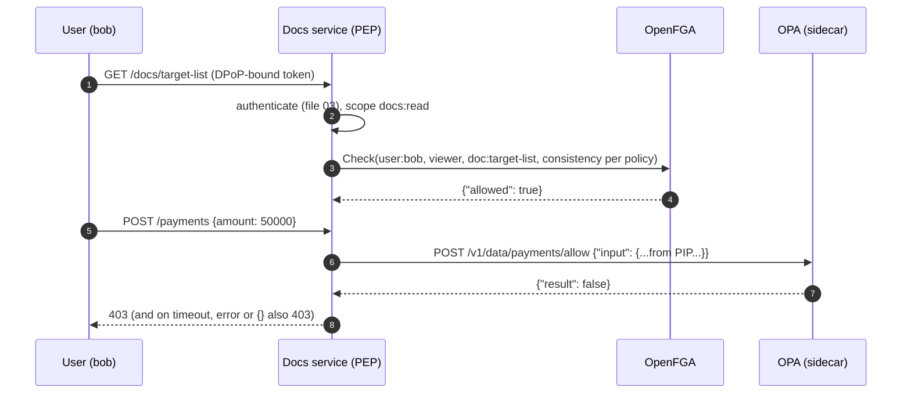

# OpenFGA (Zanzibar) and OPA Integration in Java 21 Microservices

> Folder 07 · File 04 of 04 · Identity, AuthN/AuthZ, OAuth 2.1/OIDC/FAPI 2.0 L7 Reference
> Previous: [03 · Multi-tenant resource server](03-spring-security-resource-server-multi-tenant-jwks-dpop-and-method-security-code.md) · Next: [Folder 08 · Attack playbook and bar-raiser Q&A](../08-Attack-Playbook-GitHub-References-and-L7-Bar-Raiser-QA/01-20-real-world-oauth-oidc-and-jwt-exploits-and-exact-code-defenses.md)

| Listing | What it proves | Oracle |
|---|---|---|
| L49 `FgaOpaClientLab.java` | Calling external authorization engines from a Java 21 service through `java.net.http.HttpClient` on virtual threads. Two engines run in-process:<br>• an **OpenFGA-shaped** `POST /stores/{id}/check`, backed by L41's Zanzibar evaluator (Folder 05), with the check cache enabled;<br>• an **OPA-shaped** `POST /v1/data/payments/allow`.<br><br>Measured:<br>• just after a revocation, `MINIMIZE_LATENCY` still **allows** the revoked user (cached result) and `HIGHER_CONSISTENCY` denies;<br>• a PDP stalled for 2 s yields a **DENY within 1 s** (300 ms timeouts, fail closed);<br>• OPA's undefined decision (`200 {}`) is **allowed by the L5 `!= false` reading** and denied by L7 `== true`;<br>• 200 concurrent checks on virtual threads all match the tuples | OpenFGA consistency docs; OPA REST API docs; L41 |

**Verification.** Compiled with Folders 01–07 by `javac --release 21 -Xlint:all -Werror` on JDK 25.0.4.1. The gate re-runs the output and requires it byte-identical, with the port masked.

The engines are protocol-shaped stand-ins, not OpenFGA or OPA binaries:
- They reuse the request and response shapes and the semantics that the vendors' documentation states [D].
- The OpenFGA Java SDK claims below were read from `dev.openfga:openfga-sdk:0.11.0-sources.jar` (SHA-1 checked against Maven Central).
- The Spring Boot starter claims come from its README (`dev.openfga:openfga-spring-boot-starter:0.4.1`).

Labels: **[D]** documented · **[M]** measured by a listing · **[E]** engineering judgment · **⚠** trap.

---

## 0. Orientation

Folder 05 built the engines from first principles: L39's policy engines and L41's Zanzibar evaluator. This file is about *calling* them from production Java. Three properties decide whether the integration is safe, and none of them is visible in the policy text:
1. **Freshness:** can a revoked user still pass?
2. **Failure mode:** what does the PEP do when the PDP is slow, down, or says nothing?
3. **Shape of the call:** who chooses the object, the relation and the subject, and how many calls a page makes.

Results:
- **[M][D] OpenFGA's freshness is a per-request choice (L49 §1).**
  - OpenFGA documents `MINIMIZE_LATENCY` (the default) and `HIGHER_CONSISTENCY`. Its docs say: "OpenFGA caching is disabled by default", and "When caching is disabled, all queries will have strong consistency regardless of the consistency mode specified."
  - With the check cache enabled, `MINIMIZE_LATENCY` can answer from a result cached before the revocation, which is the new-enemy window of Folder 05 file 04. `HIGHER_CONSISTENCY` skips the cache.
  - OpenFGA has **no zookie or consistency token**. Its docs list Zanzibar's zookies under "Future work".
- **[M] Fail closed, fast (L49 §2).**
  - A PDP stalled for 2 s yields a DENY within 1 s, with 300 ms connect and request timeouts.
  - [D] The OpenFGA Java SDK 0.11.0 defaults are a **10 s request timeout, a 10 s connect timeout and 3 retries** (`FgaConstants`). A stalled PDP then holds each request for at least 10 s.
- **[M][D] Undefined is not false (L49 §3).** OPA's REST API: "The server returns 200 if the path refers to an undefined document. In this case, the response will not contain a `result` property." A PEP that reads "not false" as allow lets every uncovered action through. Require `result == true`, *and* write `default allow := false` in the policy.
- **[M] Virtual threads make per-request PDP calls cheap to write (L49 §4).** They don't make them cheap for the PDP. Bound the concurrency and prefer batch APIs (§3).

---

## 1. First principles: where OpenFGA and OPA sit

```text
                         +------------------------- service (Java 21, Spring Security 7.1.2) ---------------------+
  request + token  --->  | PEP 1: authentication (resource server: issuer, aud, at+jwt, DPoP; file 03)            |
                         | PEP 2: coarse scopes  (@PreAuthorize hasAuthority('SCOPE_docs:read'))                  |
                         | PEP 3: relationship   ("can user:bob view doc:42?")  ----- HTTP/gRPC ----->  OpenFGA   |
                         |        - object type + relation fixed in code, id validated                (ReBAC PDP)|
                         |        - consistency chosen per call                                        tuples +  |
                         | PEP 4: attribute rule ("amount <= limit and mfa")   ----- HTTP ---------->  OPA       |
                         |        - input built from trusted sources (PIP), result == true            (ABAC PDP)|
                         |                                                                            signed     |
                         | data layer: tenant/owner predicates as the last line                       bundles    |
                         +----------------------------------------------------------------------------------------+
   fail closed at every PEP: timeout, error, non-200, missing field  ==> DENY
```

**Choosing an engine [E].**
- **"Who can see what, through sharing, folders and groups"** is a graph question: ReBAC (OpenFGA, SpiceDB). It answers *check* and *list* over millions of tuples.
- **"Is this action allowed given these attributes"** (amount, time, MFA, risk, data class) is a rules question: OPA/Rego or Cedar (Folder 05 file 03).
- **Most FinTech systems need both:** "Bob may view this account because he's on the team (ReBAC), and may move money from it only below his limit with fresh MFA (ABAC)".

The consistency problem, on a timeline (L49 §1):

```text
 t0  write   folder:deals#viewer@user:bob                     store version 1
 t1  check   bob viewer doc:target-list (parent folder:deals) -> true, result cached (TTL starts)
 t2  delete  folder:deals#viewer@user:bob                     store version 2   <- Alice revokes Bob
 t3  check   MINIMIZE_LATENCY    -> cache hit  -> true    <- "new enemy" window: up to the cache TTL
     check   HIGHER_CONSISTENCY  -> database   -> false
 t4  cache entry expires: MINIMIZE_LATENCY -> false
 note: the revoked tuple is on the FOLDER; the stale answer is about the DOC. "Recently written objects"
       is the wrong freshness key; the subject (and any userset) whose access shrank is the right one.
```

The OpenFGA authorization model behind L49 (OpenFGA DSL, schema 1.1):

```fga
model
  schema 1.1

type user

type folder
  relations
    define viewer: [user]

type doc
  relations
    define parent: [folder]
    define viewer: [user] or viewer from parent
```

The Check call on the wire. The store and model ids are ULIDs; the values below are placeholders:

```http
POST /stores/01J-STORE/check HTTP/1.1
Host: openfga.authz.svc:8080
Authorization: Bearer <preshared key or OIDC client-credentials token>
Content-Type: application/json

{"tuple_key":{"user":"user:bob","relation":"viewer","object":"doc:target-list"},"authorization_model_id":"01J-MODEL","consistency":"HIGHER_CONSISTENCY"}
```

```json
{"allowed": false, "resolution": ""}
```

The OPA undefined decision, exactly as the REST API documents it (200 with no `result` member):

```json
{}
```

---

## 2. L49: OpenFGA- and OPA-shaped engines, called from Java 21

<!-- listing:FgaOpaClientLab.java -->
```java
import java.io.ByteArrayOutputStream;
import java.net.InetAddress;
import java.net.InetSocketAddress;
import java.net.URI;
import java.net.http.HttpClient;
import java.net.http.HttpRequest;
import java.net.http.HttpResponse;
import java.nio.charset.StandardCharsets;
import java.time.Duration;
import java.util.ArrayList;
import java.util.List;
import java.util.Map;
import java.util.concurrent.ExecutorService;
import java.util.concurrent.Executors;
import java.util.concurrent.Future;

import com.sun.net.httpserver.HttpServer;

/**
 * L49 - calling external authorization engines from Java 21 services: an OpenFGA-shaped Check API
 * (POST /stores/{id}/check with tuple_key and a consistency preference) backed by L41's Zanzibar evaluator, and an
 * OPA-shaped decision API (POST /v1/data/payments/allow with input) - both served in-process - through
 * {@link HttpClient} on virtual threads. Measured: consistency preference vs a just-revoked share, fail-closed on a
 * stalled PDP, OPA's undefined decision ({} with no "result"), and 200 concurrent checks on virtual threads.
 */
public final class FgaOpaClientLab {

    // ------------------------------------------------------------------ the engines (in-process)

    static final ZanzibarLab.Store TUPLES = new ZanzibarLab.Store();
    /** Check cache enabled (OpenFGA: off by default): MINIMIZE_LATENCY may be answered from a result cached one write ago. */
    static volatile long cacheLag = 1;
    static volatile boolean stall;

    static void reply(com.sun.net.httpserver.HttpExchange ex, String json) throws java.io.IOException {
        byte[] b = json.getBytes(StandardCharsets.UTF_8);
        ex.getResponseHeaders().add("Content-Type", "application/json");
        ex.sendResponseHeaders(200, b.length);
        ex.getResponseBody().write(b);
        ex.close();
    }

    static String body(com.sun.net.httpserver.HttpExchange ex) throws java.io.IOException {
        ByteArrayOutputStream o = new ByteArrayOutputStream();
        ex.getRequestBody().transferTo(o);
        return o.toString(StandardCharsets.UTF_8);
    }

    // ------------------------------------------------------------------ the Java 21 client side

    static final HttpClient HTTP = HttpClient.newBuilder().connectTimeout(Duration.ofMillis(300))
            .executor(Executors.newVirtualThreadPerTaskExecutor()).build();

    /** OpenFGA Check. Any error, timeout or non-200 is a DENY (fail closed). */
    static boolean fgaCheck(String base, String user, String relation, String object, String consistency) {
        String json = "{\"tuple_key\":{\"user\":\"" + user + "\",\"relation\":\"" + relation + "\",\"object\":\"" + object
                + "\"},\"authorization_model_id\":\"01J-MODEL\",\"consistency\":\"" + consistency + "\"}";
        try {
            HttpResponse<String> r = HTTP.send(HttpRequest.newBuilder(URI.create(base + "/stores/01J-STORE/check")).timeout(Duration.ofMillis(300))
                    .header("Content-Type", "application/json").POST(HttpRequest.BodyPublishers.ofString(json)).build(), HttpResponse.BodyHandlers.ofString());
            return r.statusCode() == 200 && Boolean.TRUE.equals(MiniJson.object(r.body()).get("allowed"));
        } catch (Exception e) {
            return false;
        }
    }

    /** OPA decision: L5 treats "not false" as allow; L7 requires result == true. */
    static String opa(String base, String input, boolean l7) {
        try {
            HttpResponse<String> r = HTTP.send(HttpRequest.newBuilder(URI.create(base + "/v1/data/payments/allow")).timeout(Duration.ofMillis(300))
                    .header("Content-Type", "application/json").POST(HttpRequest.BodyPublishers.ofString("{\"input\":" + input + "}")).build(),
                    HttpResponse.BodyHandlers.ofString());
            Object result = MiniJson.object(r.body()).get("result");
            boolean allow = l7 ? Boolean.TRUE.equals(result) : !Boolean.FALSE.equals(result);
            return (allow ? "ALLOW" : "DENY") + " (body " + r.body() + ")";
        } catch (Exception e) {
            return l7 ? "DENY (PDP unreachable: fail closed)" : "ALLOW (PDP unreachable: fail open)";
        }
    }

    public static void main(String[] args) throws Exception {
        HttpServer srv = HttpServer.create(new InetSocketAddress(InetAddress.getLoopbackAddress(), 0), 0);
        srv.setExecutor(Executors.newVirtualThreadPerTaskExecutor());
        srv.createContext("/stores/01J-STORE/check", ex -> {
            if (stall) {
                try {
                    Thread.sleep(2_000);
                } catch (InterruptedException e) {
                    Thread.currentThread().interrupt();
                }
            }
            Map<String, Object> req = MiniJson.object(body(ex));
            @SuppressWarnings("unchecked")
            Map<String, Object> tk = (Map<String, Object>) req.get("tuple_key");
            long snapshot = "HIGHER_CONSISTENCY".equals(req.get("consistency")) ? TUPLES.version : TUPLES.version - cacheLag;
            boolean allowed = ZanzibarLab.check(TUPLES, (String) tk.get("object"), (String) tk.get("relation"), (String) tk.get("user"), snapshot);
            reply(ex, "{\"allowed\":" + allowed + ",\"resolution\":\"\"}");
        });
        srv.createContext("/v1/data/payments/allow", ex -> {
            Map<String, Object> in = MiniJson.object(MiniJson.write(MiniJson.object(body(ex)).get("input")));
            // policy: allow if amount <= 10000 and mfa; rules that do not apply leave the decision UNDEFINED -> {}
            if (!in.containsKey("amount")) {
                reply(ex, "{}");
                return;
            }
            boolean allow = ((Number) in.get("amount")).longValue() <= 10_000 && Boolean.TRUE.equals(in.get("mfa"));
            reply(ex, "{\"result\":" + allow + "}");
        });
        srv.start();
        String base = "http://127.0.0.1:" + srv.getAddress().getPort();
        try {
            KbSupport.section("OpenFGA-shaped Check with a consistency preference (L41 evaluator behind it; check cache enabled)");
            TUPLES.write("folder:deals", "viewer", "user:bob", false);
            TUPLES.write("doc:target-list", "parent", "folder:deals", false);
            boolean before = fgaCheck(base, "user:bob", "viewer", "doc:target-list", "HIGHER_CONSISTENCY");
            TUPLES.write("folder:deals", "viewer", "user:bob", true);          // Alice revokes Bob
            boolean fast = fgaCheck(base, "user:bob", "viewer", "doc:target-list", "MINIMIZE_LATENCY");
            boolean strong = fgaCheck(base, "user:bob", "viewer", "doc:target-list", "HIGHER_CONSISTENCY");
            KbSupport.info("before revocation: %s | right after revocation: MINIMIZE_LATENCY -> %s, HIGHER_CONSISTENCY -> %s", before, fast, strong);
            KbSupport.check("with the check cache on, a MINIMIZE_LATENCY check can still allow a just-revoked user; HIGHER_CONSISTENCY skips the cache and denies",
                    before && fast && !strong);

            KbSupport.section("Fail closed: the PDP stalls for 2 s, the client times out at 300 ms");
            stall = true;
            long t0 = System.nanoTime();
            boolean stalled = fgaCheck(base, "user:alice", "viewer", "doc:target-list", "HIGHER_CONSISTENCY");
            long ms = Duration.ofNanos(System.nanoTime() - t0).toMillis();
            stall = false;
            KbSupport.info("check during the stall -> %s within 1 s: %s", stalled ? "ALLOW" : "DENY", ms < 1_000);
            KbSupport.check("a stalled authorization engine produces a fast DENY, never an ALLOW and never a hung request thread", !stalled && ms < 1_000);

            KbSupport.section("OPA-shaped decisions: undefined is not false");
            String[][] inputs = {{"{\"user\":\"alice\",\"amount\":500,\"mfa\":true}", "within policy"},
                {"{\"user\":\"alice\",\"amount\":50000,\"mfa\":true}", "over the limit"},
                {"{\"user\":\"alice\",\"action\":\"export\"}", "an action no rule covers (OPA returns {})"}};
            int l5Allow = 0;
            int l7Allow = 0;
            for (String[] in : inputs) {
                String l5 = opa(base, in[0], false);
                String l7 = opa(base, in[0], true);
                l5Allow += l5.startsWith("ALLOW") ? 1 : 0;
                l7Allow += l7.startsWith("ALLOW") ? 1 : 0;
                KbSupport.info("%-44s L5 (!= false) -> %-34s L7 (== true) -> %s", in[1], l5, l7);
            }
            KbSupport.check("treating an undefined OPA decision as 'not false' allows the uncovered export; requiring result == true denies it",
                    l5Allow == 2 && l7Allow == 1);

            KbSupport.section("200 concurrent checks on virtual threads");
            for (int i = 0; i < 100; i++) {
                TUPLES.write("doc:d" + i, "viewer", i % 2 == 0 ? "user:alice" : "user:carol", false);
            }
            ExecutorService vt = Executors.newVirtualThreadPerTaskExecutor();
            List<Future<Boolean>> fs = new ArrayList<>();
            for (int i = 0; i < 200; i++) {
                int n = i % 100;
                String who = i < 100 ? "user:alice" : "user:carol";
                fs.add(vt.submit(() -> fgaCheck(base, who, "viewer", "doc:d" + n, "HIGHER_CONSISTENCY") == (who.equals("user:alice") == (n % 2 == 0))));
            }
            int correct = 0;
            for (Future<Boolean> f : fs) {
                correct += f.get() ? 1 : 0;
            }
            vt.shutdown();
            KbSupport.info("200 parallel checks (each on its own virtual thread): %d answered as the tuples say", correct);
            KbSupport.check("all 200 concurrent checks (at HIGHER_CONSISTENCY, just after the writes) return the expected decision", correct == 200);
        } finally {
            srv.stop(0);
        }
        KbSupport.verdict();
    }
}
```

<!-- output:FgaOpaClientLab.java -->
```text

== OpenFGA-shaped Check with a consistency preference (L41 evaluator behind it; check cache enabled)
  before revocation: true | right after revocation: MINIMIZE_LATENCY -> true, HIGHER_CONSISTENCY -> false
  [PASS] with the check cache on, a MINIMIZE_LATENCY check can still allow a just-revoked user; HIGHER_CONSISTENCY skips the cache and denies

== Fail closed: the PDP stalls for 2 s, the client times out at 300 ms
  check during the stall -> DENY within 1 s: true
  [PASS] a stalled authorization engine produces a fast DENY, never an ALLOW and never a hung request thread

== OPA-shaped decisions: undefined is not false
  within policy                                L5 (!= false) -> ALLOW (body {"result":true})       L7 (== true) -> ALLOW (body {"result":true})
  over the limit                               L5 (!= false) -> DENY (body {"result":false})       L7 (== true) -> DENY (body {"result":false})
  an action no rule covers (OPA returns {})    L5 (!= false) -> ALLOW (body {})                    L7 (== true) -> DENY (body {})
  [PASS] treating an undefined OPA decision as 'not false' allows the uncovered export; requiring result == true denies it

== 200 concurrent checks on virtual threads
  200 parallel checks (each on its own virtual thread): 200 answered as the tuples say
  [PASS] all 200 concurrent checks (at HIGHER_CONSISTENCY, just after the writes) return the expected decision

verdict: OK (4 checks)
```

Reading the run:
- **§1 is L41's new-enemy problem through a product API.**
  - Zanzibar fixes it with zookies: a write returns a token, and later checks carry it, meaning "at least as fresh as my write".
  - OpenFGA offers a coarser switch: skip the cache or don't.
  - SpiceDB has Zanzibar-style ZedTokens (`at_least_as_fresh`) [D: SpiceDB consistency docs].
  - The engineering consequence for OpenFGA: decide per call which checks are revocation-sensitive (§3).
- **§2's DENY arrives in about the client timeout, not the PDP's stall.** With the SDK defaults, the same stall would hold the request thread for 10 s or more, and under load a team "fixes" that by failing open.
- **§3's middle row is the dangerous one.**
  - OPA returns `200` for an undefined decision, so the HTTP layer reports success.
  - Only the body shows that no rule matched.
  - The L5 reading turns "no rule covers export" into ALLOW.
- **§4 runs one virtual thread per check.** It is correct at `HIGHER_CONSISTENCY` immediately after the writes. In production, the same loop on a list page is 200 PDP round trips per request (A8).



---

## 3. The production integration

**OpenFGA from Spring method security**, using the Java SDK. [D] The SDK API was read from the 0.11.0 sources:
- `OpenFgaClient(ClientConfiguration)`;
- `ClientConfiguration.apiUrl/storeId/authorizationModelId/readTimeout/connectTimeout`;
- `ClientCheckRequest.user/relation/_object`;
- `ClientCheckOptions.consistency(ConsistencyPreference)`;
- `check(..)` returning `CompletableFuture<ClientCheckResponse>`, and `getAllowed()` returning `Boolean`.

The production model extends L49's with an editor relation:

```fga
type doc
  relations
    define parent: [folder]
    define editor: [user] or editor from parent
    define viewer: [user] or editor or viewer from parent
```

In that model `folder` also defines `editor`.

```java
@Component("authz")
final class FgaAuthorizer {
    private static final Pattern ID = Pattern.compile("[A-Za-z0-9_-]{1,64}");
    private final OpenFgaClient fga;
    private final Freshness freshness;                       // subjects whose access shrank within the cache TTL (+ margin)
    private final Semaphore inflight = new Semaphore(64);    // bound PDP concurrency per instance

    FgaAuthorizer(FgaProperties p, Freshness freshness) throws FgaInvalidParameterException {
        this.fga = new OpenFgaClient(new ClientConfiguration().apiUrl(p.url()).storeId(p.storeId())
                .authorizationModelId(p.modelId())             // pin the model: a model edit is a deploy, not a surprise
                .connectTimeout(Duration.ofMillis(200)).readTimeout(Duration.ofMillis(300)));   // SDK defaults: 10 s each
        this.freshness = freshness;
    }

    /** True only on an explicit allowed=true. Timeouts, errors, nulls, saturation: false (the method returns 403). */
    public boolean can(String relation, String type, String id) {
        if (!ID.matcher(id).matches()) {
            return false;                                     // type and relation come from code; only the id is caller data
        }
        String user = "user:" + ((Jwt) SecurityContextHolder.getContext().getAuthentication().getPrincipal()).getSubject();
        ConsistencyPreference c = freshness.mustBeFresh(user) || "editor".equals(relation)
                ? ConsistencyPreference.HIGHER_CONSISTENCY : ConsistencyPreference.MINIMIZE_LATENCY;
        if (!inflight.tryAcquire()) {
            return false;                                     // shed load as DENY, never queue unboundedly
        }
        try {
            ClientCheckResponse r = fga.check(new ClientCheckRequest().user(user).relation(relation)._object(type + ":" + id),
                    new ClientCheckOptions().consistency(c)).get(400, TimeUnit.MILLISECONDS);
            return Boolean.TRUE.equals(r.getAllowed());
        } catch (InterruptedException e) {
            Thread.currentThread().interrupt();
            return false;
        } catch (Exception e) {                               // FgaInvalidParameterException, ExecutionException, TimeoutException
            return false;
        } finally {
            inflight.release();
        }
    }
}

public interface DocApi {
    @PreAuthorize("hasAuthority('SCOPE_docs:read') and @authz.can('viewer', 'doc', #docId)")
    Doc read(@P("docId") String docId);

    @PreAuthorize("hasAuthority('SCOPE_docs:write') and @authz.can('editor', 'doc', #docId)")
    void share(@P("docId") String docId, String grantee);      // the write path is authorized too (A6)
}
```

**The off-the-shelf alternative [D].** The README of `dev.openfga:openfga-spring-boot-starter:0.4.1` documents `@PreAuthorize("@fga.check('document', #docId, 'reader', 'user')")`. Here the authenticated principal's name is the user id, and an optional fifth argument passes it explicitly. Its `openfga.read-timeout` and `openfga.connect-timeout` default to **10 s**. Set them, and decide how a thrown exception should surface: a 500 is closed but noisy [E].

**OPA: policy and client.** The policy must default to deny, and the client must still require `true`. Rego v1 syntax:

```rego
package payments

default allow := false

allow if {
    input.amount <= 10000
    input.mfa == true
    input.subject.department == input.resource.department
}
```

```java
// L7 PEP for OPA: input from trusted sources only (token claims, PIP lookups), never from the request body
boolean allowPayment(Jwt caller, Payment p) {
    String input = Json.object("subject", Json.object("id", caller.getSubject(), "department", directory.department(caller.getSubject())),
                               "resource", Json.object("department", accounts.department(p.accountId())),
                               "amount", p.amount(), "mfa", mfaFresh(caller));
    try {
        HttpResponse<String> r = http.send(HttpRequest.newBuilder(OPA_ALLOW).timeout(Duration.ofMillis(150))
                .POST(HttpRequest.BodyPublishers.ofString("{\"input\":" + input + "}")).build(), HttpResponse.BodyHandlers.ofString());
        return r.statusCode() == 200 && Boolean.TRUE.equals(Json.parse(r.body()).get("result"));   // {} -> false
    } catch (IOException | RuntimeException e) {
        return false;
    } catch (InterruptedException e) {
        Thread.currentThread().interrupt();
        return false;
    }
}
```

`Json`, `directory`, `accounts` and `mfaFresh` are your classes. `Json.object` must escape values, so never build the input by string concatenation of caller data.

**Signed policy bundles [D].** OPA's bundle docs:
- **Enabling:** "A bundle is configured to verify signatures when it has a `bundles[_].signing` block".
- **A signed bundle** carries a `.signatures.json` file.
- **On failure,** "OPA activates the new bundle only if all the verification steps succeed; otherwise, it continues using its existing bundle and reports an activation failure via the status API and error logging."

```yaml
# OPA sidecar configuration - signed bundles only (verification key = the policy pipeline's public key)
services:
  - name: policy-cdn
    url: https://policy.internal.example/v1
bundles:
  payments:
    service: policy-cdn
    resource: bundles/payments.tar.gz
    persist: true
    polling:
      min_delay_seconds: 10
      max_delay_seconds: 20
    signing:
      keyid: policy_pipeline_2026
      scope: read
keys:
  policy_pipeline_2026:
    algorithm: RS256
    key: |
      -----BEGIN PUBLIC KEY-----
      (the pipeline's public key)
      -----END PUBLIC KEY-----
```

The pipeline builds with `opa build --signing-key <private.pem> --bundle <dir>` (OPA docs). It runs `opa test` on every policy change, including deny tests for every uncovered action [E].

**Freshness for OpenFGA [E].** OpenFGA has no zookie, so freshness is a policy you write:
- **On every tuple delete,** record the affected subject: the `user` of the tuple (for a userset such as `group:eng#member`, mark the whole group) for the cache TTL plus a margin. Checks for those subjects use `HIGHER_CONSISTENCY`.
- **Use `HIGHER_CONSISTENCY` unconditionally** for writes, money movement, exports and admin actions.
- **Keep the check cache's TTL short**, and treat it as the documented maximum staleness in your threat model.
- **The cache controller.** OpenFGA also documents `cache-controller-enabled` and `cache-controller-ttl` for invalidation. Read its semantics for your version before counting on it.

**Lists, not loops.**
- A page of N documents needs one call, not N:
  - **BatchCheck:** OpenFGA ≥ 1.8.0; SDK `batchCheck(ClientBatchCheckRequest)`, which the SDK README documents with `maxParallelRequests` and `maxBatchSize` options.
  - **ListObjects:** "which docs can bob view", with a limit.
- For search, put an ACL filter in the index and recheck the final page [E].

```yaml
# application.yaml - the authz clients' operating limits (values are this design's, not library defaults)
authz:
  fga:
    url: http://openfga.authz.svc:8080
    store-id: 01J-STORE
    model-id: 01J-MODEL
    connect-timeout: 200ms
    read-timeout: 300ms
    max-inflight: 64
    fresh-window: 15s          # >= the OpenFGA check-query-cache-ttl you deploy, plus margin
  opa:
    url: http://127.0.0.1:8181/v1/data/payments/allow
    timeout: 150ms
```

---

## 4. The vulnerable L5 implementation vs the hardened L7 zero-trust implementation

```java
// L5 - DO NOT USE
boolean canView(String user, String object) {                       // object = request.getParameter("object")
    try {
        return fga.check(new ClientCheckRequest().user(user).relation("viewer")._object(object)).get().getAllowed();
    } catch (Exception e) {
        log.warn("authz down, allowing", e);                         // fail open
        return true;
    }
}
boolean opaAllows(String body) {                                      // body = the client's JSON, forwarded as input
    Object result = Json.parse(post(OPA, "{\"input\":" + body + "}")).get("result");
    return !Boolean.FALSE.equals(result);                            // {} (undefined) -> true      (L49 §3)
}
```

| Concern | L5 | L7 |
|---|---|---|
| Freshness | default `MINIMIZE_LATENCY` everywhere, long cache TTL | `HIGHER_CONSISTENCY` for revocation-sensitive subjects and all writes; short TTL as documented staleness (L49 §1) |
| Failure | fail open; SDK default 10 s timeouts and 3 retries | fail closed in about 300 ms; bounded in-flight; shed as DENY (L49 §2) |
| OPA result | `!= false` | `== true` and `default allow := false` (L49 §3) |
| Inputs | object, relation and OPA input from the request | type and relation from code; id validated; OPA input from token + PIP |
| Write path | sharing endpoint checks `viewer` | sharing requires `editor`/`owner`; FGA write credentials limited to one service |
| Lists | N checks per page on unbounded threads | BatchCheck / ListObjects; semaphore-bounded virtual threads |
| Policy supply chain | unsigned bundles from a bucket | signed bundles (`signing` + `keys`), `opa test` in CI, keep-previous on failure |
| Model changes | `authorization_model_id` omitted (latest wins) | model id pinned per deploy |

---

## 5. Real-world attack vectors & mitigations

### A1 · Revoked user passes through the check cache ("new enemy")

**Attack.** Alice removes Bob from a folder, then uploads a document Bob must not see. Bob's checks hit cached results computed before the revocation (L49 §1).
**Wire signature.** ALLOW decisions for a subject shortly after a delete affecting that subject.
**Root cause.** `MINIMIZE_LATENCY` (the default) with the check cache enabled, and no freshness policy.
**Mitigation.**
- `HIGHER_CONSISTENCY` for subjects with recent deletes and for sensitive actions.
- A short cache TTL.
- An engine with consistency tokens (Zanzibar zookies, SpiceDB ZedTokens) where the guarantee must be exact.
**Detection.** Join the decision logs with the tuple changelog: an ALLOW for a subject after its delete.

### A2 · Fail-open on PDP slowness or outage

**Attack.** The attacker degrades the PDP (or waits for an incident). The PEP's catch block allows, or a 10 s default timeout exhausts threads until someone adds an allow fallback (L49 §2).
**Wire signature.** Spikes in PDP latency and errors, coinciding with authorization success rates *rising*.
**Root cause.** Exception handling that returns true; library-default timeouts.
**Mitigation.**
- Fail closed.
- Timeouts of a few hundred ms.
- Bounded in-flight with shed-as-deny.
- A PDP deployed close to the service (sidecar or node-local) and replicated.
- A degraded mode that is explicitly read-only, never "allow".
**Detection.** Alert on any allow decision recorded without a PDP response id.

### A3 · Undefined OPA decision read as allow

**Attack.** A new action (`export`) has no rule. OPA returns `200 {}`, and the PEP's `!= false` turns it into ALLOW (L49 §3).
**Wire signature.** Decision logs with no `result` for production paths.
**Root cause.** Treating HTTP success as a decision; policies without `default allow := false`.
**Mitigation.** Both a `default allow := false` in the policy and `result == true` in the PEP. Add a CI test that queries every route's decision path with an empty input and expects deny.
**Detection.** Count undefined decisions; it should be zero.

### A4 · Caller-chosen object type or relation

**Attack.** The endpoint takes `object=folder:deals` or `relation=viewer` from the request. The attacker asks about an object or relation they hold, and the PEP authorizes the action on a different resource.
**Wire signature.** Object strings in parameters; checks whose object type doesn't match the endpoint.
**Root cause.** The PEP lets the caller shape the authorization question.
**Mitigation.**
- Type and relation constants in code.
- Ids validated against a pattern.
- The object id derived from the resource actually loaded, not from a separate parameter.
**Detection.** Log the check tuple next to the resource id served, and alert on mismatches.

### A5 · Tampered or unsigned policy bundle

**Attack.** Someone with write access to the bundle bucket or CDN ships `allow := true`, or deletes a forbid.
**Wire signature.** Bundle revision changes outside the pipeline; activation without signature verification.
**Root cause.** Bundles trusted by location, not by signature.
**Mitigation.**
- `bundles[_].signing` with a pipeline key (`keys`).
- `opa build --signing-key` in CI only.
- OPA keeps the previous bundle when verification fails [D].
- Policy changes reviewed like code.
**Detection.** Monitor bundle activation status and revision; alert on activation failures and unexpected revisions.

### A6 · Privilege escalation through the tuple-write path

**Attack.** The share endpoint checks that the caller can *view* the doc, then writes `doc:42#viewer@user:mallory`, or worse, `#editor`. Any viewer can widen access.
**Wire signature.** Tuple writes by subjects who lack an owner or editor relation on the object.
**Root cause.** Writes authorized with the read relation; a service account with store-wide write rights shared across services.
**Mitigation.**
- Writes require `editor`/`owner` (or a `can_share` relation) checked at `HIGHER_CONSISTENCY`.
- One service owns writes, with its own credentials.
- Read-only credentials everywhere else.
**Detection.** Audit tuple writes by actor, and alert on writes granting relations the actor lacks.

### A7 · Public wildcard granted by accident or by attack

**Attack.** OpenFGA type-bound public access (`user:*`) lets one tuple make an object visible to everyone. A sharing UI that accepts arbitrary subject strings lets a user write `user:*`.
**Wire signature.** Tuples with `*` subjects on sensitive types.
**Root cause.** Subject strings accepted from clients; the model allowing `user:*` on types that should never be public.
**Mitigation.**
- Allow wildcards in the model only on types meant to be public.
- Validate grantees as concrete user ids.
- Require an approval workflow for public grants.
**Detection.** A daily query for wildcard tuples on restricted types.

### A8 · Check amplification and PDP denial of service

**Attack.** A list or search endpoint checks each of N items. The attacker requests large pages in parallel, the PDP saturates, and every service's checks time out. With fail-closed that is an outage; with fail-open it is A2.
**Wire signature.** PDP QPS proportional to page size × request rate; per-request check counts in the hundreds.
**Root cause.** N+1 authorization, plus unbounded per-request concurrency (virtual threads make it free to write).
**Mitigation.**
- BatchCheck or ListObjects.
- Page-size limits.
- A per-instance semaphore.
- A per-request check budget.
- Rate limits on list endpoints.
**Detection.** Histogram of checks per request; PDP saturation alerts.

---

## 6. FAANG / FinTech L7 bar-raiser Q&A chains

<details><summary><b>Q1 · OpenFGA, OPA or Cedar for a document-sharing product with payments?</b></summary>

**Initial Prompt.** Sharing via folders and groups; payments with limits and MFA.

**L5 Textbook Answer.** "Pick one engine and model everything in it."

**How an Attacker Bypasses L5.**
- **Everything in Rego:** Rego answering graph questions needs the whole graph as data. That data goes stale, and revocations lag by the bundle polling interval.
- **Everything in OpenFGA:** encoding amount thresholds as tuples or conditions invites gaps.
- **Either way,** the misfit area becomes the bypass.

**L7 Principal Defense.**
- **ReBAC (OpenFGA, or SpiceDB if exact freshness is required)** for sharing.
- **ABAC (OPA or Cedar)** for transaction rules, with input from a PIP.
- **Both called at well-defined PEPs, fail closed**, with decision logs joined by request id.
- **One owner per authorization concern**, documented in a decision register.

</details>

<details><summary><b>Q2 · "Revocation must take effect immediately." Design it on OpenFGA.</b></summary>

**Initial Prompt.** The legal team requires it for M&A data rooms.

**L5 Textbook Answer.** "Delete the tuple; OpenFGA is consistent."

**How an Attacker Bypasses L5.** Only while the cache is off. With the check cache enabled, `MINIMIZE_LATENCY` (the default) serves the pre-revocation answer until the TTL expires (L49 §1). The stale answer is about the *document*, while the deleted tuple was on the *folder*.

**L7 Principal Defense.**
- **Data rooms always use `HIGHER_CONSISTENCY`.** Their checks are few and high-value.
- **Elsewhere, a freshness set** keyed by the subjects and usersets of deletes for TTL plus a margin.
- **The cache TTL is the documented maximum staleness.**
- **If the requirement is a hard guarantee for all traffic,** an engine with consistency tokens (SpiceDB ZedTokens), or cache off.

</details>

<details><summary><b>Q3 · The PDP is down. Fail open or closed?</b></summary>

**Initial Prompt.** The VP of product says availability matters more.

**L5 Textbook Answer.** "Fail open for reads, closed for writes."

**How an Attacker Bypasses L5.** "Fail open for reads" means anyone can read anything during an outage, and outages can be induced (A8). Data exfiltration is a read.

**L7 Principal Defense.**
- **Fail closed everywhere** (L49 §2).
- **Make the PDP highly available instead:** replicas, a sidecar or node-local OPA with persisted bundles, OpenFGA close to services.
- **An explicit degraded mode** with a pre-agreed, policy-reviewed scope, such as "owners can read their own objects from a local cache". It is never a blanket allow.
- **Tested in game days.**

</details>

<details><summary><b>Q4 · OPA returns <code>{}</code>. What does your PEP do, and why does it happen?</b></summary>

**Initial Prompt.** Seen in production logs.

**L5 Textbook Answer.** "It's empty, so not false, so allow."

**How an Attacker Bypasses L5.** `{}` is OPA's documented response for an undefined document. No rule matched, or the path is wrong (a typo, or a policy renamed). Under L5, every uncovered action and every misrouted query is an ALLOW (L49 §3).

**L7 Principal Defense.**
- **The PEP requires `result == true`.**
- **The policy has `default allow := false`.**
- **CI queries every PEP's decision path** and fails if any returns undefined.
- **Decision logs alert** on undefined results.

</details>

<details><summary><b>Q5 · Show the 10,000 documents a user can see, paginated.</b></summary>

**Initial Prompt.** Latency budget 200 ms.

**L5 Textbook Answer.** "Load all documents, filter with Check in a loop."

**How an Attacker Bypasses L5.** 10,000 PDP calls per page view: the attacker's parallel page loads saturate the PDP (A8). Teams then cache aggressively (A1) or skip checks for "list views".

**L7 Principal Defense.**
- **ListObjects with a limit** for moderate cardinalities.
- **For search,** index documents with ACL-derived principals (updated from the tuple changelog) and filter in the query.
- **BatchCheck the final page** before returning it.
- **Never authorize by "it was in the list"** for subsequent actions.

</details>

<details><summary><b>Q6 · Where do the PEPs go: gateway, service, or database?</b></summary>

**Initial Prompt.** Platform team wants everything at the gateway.

**L5 Textbook Answer.** "Gateway: one place, easy to audit."

**How an Attacker Bypasses L5.**
- **The gateway doesn't know which object a request touches** after the service resolves it: ids are inside bodies, batch operations, GraphQL.
- **East-west calls skip the gateway.**
- **Object-level authorization at the gateway** degenerates into route-level checks (A4).

**L7 Principal Defense.**
- **Gateway:** authentication and coarse scopes.
- **Service:** object-level checks on the resource actually loaded (OpenFGA) and rule checks (OPA).
- **Database:** tenant and owner predicates as the last line.
- **Decision logs from all three**, correlated.

</details>

<details><summary><b>Q7 · How do you ship policy changes safely?</b></summary>

**Initial Prompt.** A Rego change took down payments last quarter.

**L5 Textbook Answer.** "Edit the policy in the bucket; OPA picks it up."

**How an Attacker Bypasses L5.** Anyone with bucket access controls authorization (A5). An untested edit can turn a forbid into dead code or make decisions undefined (A3).

**L7 Principal Defense.**
- **Policies in git with review.**
- **`opa test`** with allow *and* deny cases.
- **Shadow evaluation:** the new bundle decides alongside the old, and diffs are logged before promotion.
- **Signed bundles,** with `signing` + `keys` and the previous bundle kept on failure.
- **Staged rollout** and fast rollback by revision.
- **OpenFGA model changes** are new model ids, rolled out by config.

</details>

<details><summary><b>Q8 · Is calling the PDP from virtual threads "free" now?</b></summary>

**Initial Prompt.** Java 21 service, one virtual thread per request.

**L5 Textbook Answer.** "Yes, blocking is cheap now, so fan out freely."

**How an Attacker Bypasses L5.** Blocking is cheap for *your* service, not for the PDP: unbounded fan-out (L49 §4 times traffic) overloads it (A8). On JDK 21, blocking inside `synchronized` pins the carrier thread; JEP 491 removed that in JDK 24. Long SDK timeouts keep thousands of virtual threads parked on a dead PDP.

**L7 Principal Defense.**
- **A semaphore per PDP.**
- **Timeouts of a few hundred ms.**
- **Batch APIs.**
- **No `synchronized` around blocking calls on JDK 21** (or run JDK 24+).
- **Measure PDP QPS per request** as a first-class metric.

</details>

<details><summary><b>Q9 · Multi-tenant OpenFGA: one store per tenant, or one shared store?</b></summary>

**Initial Prompt.** 2,000 tenants.

**L5 Textbook Answer.** "One store; object ids are unique anyway."

**How an Attacker Bypasses L5.** A bug that builds an object id without the tenant prefix, or a group that spans tenants through a careless tuple, lets tenant B's user resolve to tenant A's object. The graph happily connects them.

**L7 Principal Defense.** Either works if isolation is explicit.
- **Store per tenant:** strong separation, with per-tenant credentials and store id from the token's tenant (file 03), at operational cost.
- **Shared store:** a `tenant` type, every object linked to its tenant, and checks that include a tenant relation (`member from tenant`).
- **Either way,** tests try cross-tenant checks, and the data layer still scopes by tenant.

</details>

---

## 7. Invariants checklist

- [ ] Every PEP fails closed: timeouts of a few hundred ms (not SDK defaults), errors and non-200 are DENY, saturation sheds as DENY.
- [ ] OPA: `default allow := false` in every policy package, and the PEP requires `result == true`. CI checks every decision path for undefined results.
- [ ] OPA input comes from the token and PIPs, never from the request body. JSON is built with an encoder.
- [ ] OPA bundles are signed (`bundles[_].signing`, `keys`), built only by the pipeline, and tested with deny cases.
- [ ] OpenFGA: the object type and relation are constants in code, ids are validated, and the model id is pinned.
- [ ] OpenFGA freshness: `HIGHER_CONSISTENCY` for writes, sensitive actions and subjects with recent deletes. The cache TTL is documented as the staleness bound.
- [ ] Tuple writes are authorized with an owner or editor relation, by one owning service with its own credentials. No `user:*` on restricted types.
- [ ] Lists use BatchCheck or ListObjects. PDP concurrency is bounded per instance, and a per-request check budget is enforced.
- [ ] Decision logs from OpenFGA, OPA and the service are correlated by request id.

---

## 8. References

- OpenFGA, *Query Consistency* — <https://openfga.dev/docs/interacting/consistency>
- OpenFGA, *Query consistency options* (announcement) — <https://openfga.dev/blog/query-consistency-options-announcement>
- OpenFGA Java SDK (`dev.openfga:openfga-sdk`) — <https://github.com/openfga/java-sdk>
- OpenFGA Spring Boot Starter — <https://github.com/openfga/spring-boot-starter>
- OPA, *REST API* — <https://www.openpolicyagent.org/docs/rest-api>
- OPA, *Bundles* (signing) — <https://www.openpolicyagent.org/docs/management-bundles>
- SpiceDB, *Consistency* (ZedTokens) — <https://authzed.com/docs/spicedb/concepts/consistency>
- Pang et al., *Zanzibar: Google's Consistent, Global Authorization System*, USENIX ATC 2019 — <https://www.usenix.org/conference/atc19/presentation/pang>
- JEP 444 *Virtual Threads* — <https://openjdk.org/jeps/444>; JEP 491 *Synchronize Virtual Threads without Pinning* — <https://openjdk.org/jeps/491>
