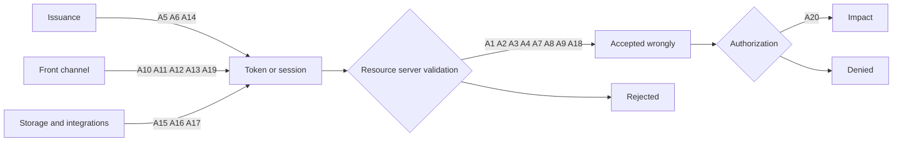

# 20 Real-World OAuth, OIDC and JWT Exploits, and the Exact Code Defenses

> Folder 08 · File 01 of 03 · Identity, AuthN/AuthZ, OAuth 2.1/OIDC/FAPI 2.0 L7 Reference
> Previous: [Folder 07 · OpenFGA and OPA in Java 21](../07-Production-Java21-Spring-Security-and-Keycloak-Blueprints/04-openfga-zanzibar-and-opa-integration-in-java21-microservices.md) · Next: [02 · 35 bar-raiser chains](02-35-faang-and-fintech-l7-security-architecture-bar-raiser-qna-chains.md)

| Listing | What it proves | Oracle |
|---|---|---|
| L50 `ExploitRegressionLab.java` | The payloads of six documented library exploits, replayed against the versions this KB pins (JDK 25, Nimbus JOSE+JWT 10.9.1, Spring Security 7.1.2 / Framework 7.0.10). Each runs beside a legitimate control, and every payload is refused:<br>• `alg: none` and HS256 keyed with the RSA public key (the CVE-2015-9235 class);<br>• a self-signed token carrying its own `jwk` (the CVE-2018-0114 class);<br>• the r = s = 0 ECDSA signature (CVE-2022-21449), refused by the JDK primitive, Nimbus and Spring;<br>• PBES2 with `p2c` = 2,000,000,000 (CVE-2023-52428), refused against Nimbus's cap of 1,000,000;<br>• a claim set nested 100,000 deep (the CVE-2025-53864 class), refused as "Malformed payload" *before* any signature check;<br>• the CVE-2025-41248 type hierarchy: `@PreAuthorize` is found through a generic interface and superclass, with JDK and CGLIB proxies | vendor advisories (GitHub Advisory Database, OpenJDK, spring.io) |
| L10, L14 (Folder 01) | the L5 vs L7 verifier behind A1–A3 | RFC 8725 |
| L15, L16, L19 (Folder 02) | redirect matching, front-channel attacks and client-assertion audience behind A10–A13 | RFC 9700; rfc7523bis |
| L20, L21, L44 (Folders 03, 06) | `(iss, sub)` identity and per-platform token conventions behind A7–A9 | OIDC Core |
| L17, L26–L29, L33, L34 (Folders 02, 04, 05) | refresh families, sender-constraining, the BFF and phantom tokens behind A14–A17 | RFC 9449, RFC 8705, RFC 10017 |
| L36, L37, L42, L45, L48 (Folders 05–07) | delegation, federation conditions, MCP rules and multi-tenant validation behind A5, A6, A18–A20 | RFC 8693, RFC 9728, MCP 2026-07-28 |

**Verification.** L50 compiles with Folders 01–08 by `javac --release 21 -Xlint:all -Werror` on JDK 25.0.4.1. The gate re-runs it and requires byte-identical output.

The incident facts were collected on 2026-11-06 from the primary sources listed under each entry:
- vendor advisories, researchers' own write-ups, GitHub advisories and official incident reports;
- each URL fetched, and checked again by this folder's gate.

Where sources disagree, both versions are given. Claims that rest only on press coverage were left out; that is why the 2019 Capital One breach is not one of the 20.

Labels: **[D]** documented · **[M]** measured by a listing · **[E]** engineering judgment · **⚠** trap.

---

## 0. Orientation

The 20 exploits are grouped by the invariant they broke:

| Group | Entries | Invariant broken |
|---|---|---|
| JOSE libraries | A1–A4 | verify with the key's algorithm, never the token's; bound parser work |
| Token validation and identity | A5–A9 | the right issuer, key scope, audience, tenant and identifier |
| Front channel and client authentication | A10–A13 | codes and assertions reach only the party they were meant for |
| Token theft and app governance | A14–A17 | stolen tokens are short-lived, bound, revocable and least-privilege |
| Workloads, agents and frameworks | A18–A20 | trust conditions, client-side metadata handling, authorization annotations |

Each entry is an attack vector in the KB's format:
- **Incident:** what happened and when, with identifiers, versions and the source;
- **Attack**, **Wire signature**, **Root cause**;
- **Mitigation**, with the exact code or configuration;
- **Detection**;
- **Regression:** the listing that keeps the fix fixed.

Two lessons recur [E]:
1. **Defaults and composition break more systems than cryptography does.** A1, A5, A9 and A18 are all validation that was never configured.
2. **Most entries are invisible to signature verification.** The tokens in A5–A9, A14–A17 and A18 had *valid* signatures.

---

## 1. First principles: where each exploit enters the token lifecycle

```text
  issue                         transport / front channel            accept (RS / RP)                 use / govern
  ─────────────────────────     ─────────────────────────────        ─────────────────────────────    ─────────────────────────
  A14 token for wrong subject   A10 loose redirect_uri               A1  alg from the token           A15 stolen integration tokens
  A6  unsigned actor tokens     A11 code/token left in the URL       A2  key from the token (jwk)     A16 over-privileged OAuth app
  A5  key scope not enforced    A12 AS redirect validation bugs      A3  ECDSA r = s = 0              A17 stolen sessions (HAR,
      (issuer/key mix)          A13 assertion aud = attacker's       A4  parser DoS (p2c, nesting)        malware)
                                    choice                           A7  token for another app        A18 trust policy without sub
                                A19 metadata URL -> OS shell         A8  mutable email as identity    A20 annotation not found
                                                                     A9  any tenant accepted
```

The kill chain most of these share, and the control that breaks each link:

```text
  attacker obtains or mints a token-like artifact
      |  (theft: A15 A17 | forgery: A1 A2 A3 A6 | mis-issuance: A5 A14 | redirection: A10 A11 A12 A13 A19)
      v
  presents it somewhere that accepts it
      |  break here: exact issuer registry + key scope (A5), alg pinned per key (A1-A3), aud/azp/tid (A7 A9),
      |              (iss, sub) identity (A8), sender-constraining (A15 A17), trust conditions on sub (A18)
      v
  uses the resulting authority
      |  break here: least privilege (A16), method/object authorization (A20), anomaly detection, revocation
      v
  impact: account takeover, mailbox access, data export, code execution
```



---

## 2. L50: the library exploits, replayed against today's pinned stack

<!-- listing:ExploitRegressionLab.java -->
```java
import java.nio.charset.StandardCharsets;
import java.security.Signature;
import java.security.SignatureException;
import java.text.ParseException;
import java.time.Instant;
import java.util.Base64;
import java.util.concurrent.CompletableFuture;
import java.util.concurrent.TimeUnit;
import java.util.concurrent.TimeoutException;

import javax.crypto.Mac;
import javax.crypto.spec.SecretKeySpec;

import com.nimbusds.jose.EncryptionMethod;
import com.nimbusds.jose.JOSEObjectType;
import com.nimbusds.jose.JWEAlgorithm;
import com.nimbusds.jose.JWEHeader;
import com.nimbusds.jose.JWEObject;
import com.nimbusds.jose.JWSAlgorithm;
import com.nimbusds.jose.JWSHeader;
import com.nimbusds.jose.Payload;
import com.nimbusds.jose.crypto.ECDSASigner;
import com.nimbusds.jose.crypto.ECDSAVerifier;
import com.nimbusds.jose.crypto.PasswordBasedDecrypter;
import com.nimbusds.jose.crypto.PasswordBasedEncrypter;
import com.nimbusds.jose.crypto.RSASSASigner;
import com.nimbusds.jose.jwk.Curve;
import com.nimbusds.jose.jwk.ECKey;
import com.nimbusds.jose.jwk.JWKSet;
import com.nimbusds.jose.jwk.RSAKey;
import com.nimbusds.jose.jwk.gen.ECKeyGenerator;
import com.nimbusds.jose.jwk.gen.RSAKeyGenerator;
import com.nimbusds.jose.jwk.source.ImmutableJWKSet;
import com.nimbusds.jose.proc.JWSVerificationKeySelector;
import com.nimbusds.jose.proc.SecurityContext;
import com.nimbusds.jose.util.Base64URL;
import com.nimbusds.jwt.JWTClaimsSet;
import com.nimbusds.jwt.SignedJWT;
import com.nimbusds.jwt.proc.DefaultJWTProcessor;

import org.springframework.aop.framework.ProxyFactory;
import org.springframework.security.access.prepost.PreAuthorize;
import org.springframework.security.authentication.UsernamePasswordAuthenticationToken;
import org.springframework.security.authorization.AuthorizationDeniedException;
import org.springframework.security.authorization.method.AuthorizationManagerBeforeMethodInterceptor;
import org.springframework.security.core.authority.AuthorityUtils;
import org.springframework.security.core.context.SecurityContextHolder;
import org.springframework.security.oauth2.jwt.JwtDecoder;
import org.springframework.security.oauth2.jwt.JwtException;
import org.springframework.security.oauth2.jwt.NimbusJwtDecoder;

/**
 * L50 - the payloads of documented JOSE/JWT library exploits, replayed against the libraries this KB pins
 * (JDK 25, Nimbus JOSE+JWT 10.9.1, Spring Security 7.1.2): alg "none" and the RS256-to-HS256 confusion (the
 * CVE-2015-9235 class), a key embedded in the JWS header (the CVE-2018-0114 class), the r = s = 0 ECDSA "psychic
 * signature" (CVE-2022-21449), an attacker-chosen PBES2 iteration count (CVE-2023-52428) and a deeply nested claim set
 * (the CVE-2025-53864 class), and the type hierarchy of CVE-2025-41248/41249 (a {@code @PreAuthorize} on a generic
 * interface, the method inherited through a generic superclass) through the real method-security interceptor. Each
 * attack runs next to a legitimate control, so "rejected" means the defense, not a broken harness. This is a
 * regression suite: pin the versions, keep the payloads, run it on every dependency bump.
 */
public final class ExploitRegressionLab {

    /** The hierarchy from the CVE-2025-41248 fix's tests: the secured method is not redeclared in the target class. */
    public interface GenericInterface<A, B> {
        @PreAuthorize("hasAuthority('thirtythree')")
        void processOneAndTwo(A value1, B value2);
    }

    public abstract static class GenericAbstractSuperclass<C> implements GenericInterface<Long, C> {
        @Override
        public void processOneAndTwo(Long value1, C value2) {
            // the secured business method
        }
    }

    public static class GenericInterfaceImpl extends GenericAbstractSuperclass<String> {
        // processOneAndTwo(Long, String) intentionally NOT redeclared
    }

    static String callAs(GenericInterface<Long, String> api, String authority) {
        SecurityContextHolder.getContext().setAuthentication(
                UsernamePasswordAuthenticationToken.authenticated("caller", "n/a", AuthorityUtils.createAuthorityList(authority)));
        try {
            api.processOneAndTwo(1L, "x");
            return "INVOKED";
        } catch (AuthorizationDeniedException e) {
            return "denied";
        } finally {
            SecurityContextHolder.clearContext();
        }
    }

    static String b64(String json) {
        return KbSupport.b64u(json.getBytes(StandardCharsets.UTF_8));
    }

    static String decodeWith(JwtDecoder d, String token) {
        try {
            d.decode(token);
            return "ACCEPTED";
        } catch (JwtException e) {
            return "rejected: " + e.getMessage();
        } catch (StackOverflowError e) {
            return "StackOverflowError";
        }
    }

    static String claimsJson(long exp) {
        return "{\"iss\":\"https://as.example\",\"sub\":\"admin\",\"exp\":" + exp + "}";
    }

    public static void main(String[] args) throws Exception {
        long exp = Instant.now().plusSeconds(300).getEpochSecond();
        String claims = b64(claimsJson(exp));
        RSAKey victim = new RSAKeyGenerator(2048).keyID("rs-1").generate();
        JwtDecoder rsDecoder = NimbusJwtDecoder.withPublicKey(victim.toRSAPublicKey()).build();   // RS256, the real Spring decoder
        SignedJWT control = new SignedJWT(new JWSHeader.Builder(JWSAlgorithm.RS256).keyID("rs-1").type(JOSEObjectType.JWT).build(),
                JWTClaimsSet.parse(claimsJson(exp)));
        control.sign(new RSASSASigner(victim));
        String controlResult = decodeWith(rsDecoder, control.serialize());

        KbSupport.section("CVE-2015-9235 class: alg none, and HS256 keyed with the victim's RSA public key (PEM)");
        String none = b64("{\"alg\":\"none\",\"typ\":\"JWT\"}") + "." + claims + ".";
        String pem = "-----BEGIN PUBLIC KEY-----\n"
                + Base64.getMimeEncoder(64, new byte[] {'\n'}).encodeToString(victim.toRSAPublicKey().getEncoded()) + "\n-----END PUBLIC KEY-----\n";
        String hsInput = b64("{\"alg\":\"HS256\",\"typ\":\"JWT\"}") + "." + claims;
        Mac mac = Mac.getInstance("HmacSHA256");
        mac.init(new SecretKeySpec(pem.getBytes(StandardCharsets.US_ASCII), "HmacSHA256"));
        String confused = hsInput + "." + KbSupport.b64u(mac.doFinal(hsInput.getBytes(StandardCharsets.US_ASCII)));
        String rNone = decodeWith(rsDecoder, none);
        String rHs = decodeWith(rsDecoder, confused);
        KbSupport.info("control RS256 -> %s%n  alg none -> %s%n  HS256 with the public key as secret -> %s", controlResult, rNone, rHs);
        KbSupport.check("the RS256 decoder accepts its own token and rejects both forgeries",
                controlResult.equals("ACCEPTED") && rNone.startsWith("rejected") && rHs.startsWith("rejected"));

        KbSupport.section("CVE-2018-0114 class: the attacker's key embedded in the JWS header (jwk), same kid");
        RSAKey attacker = new RSAKeyGenerator(2048).keyID("rs-1").generate();
        SignedJWT embedded = new SignedJWT(new JWSHeader.Builder(JWSAlgorithm.RS256).keyID("rs-1").type(JOSEObjectType.JWT)
                .jwk(attacker.toPublicJWK()).build(), JWTClaimsSet.parse(claimsJson(exp)));
        embedded.sign(new RSASSASigner(attacker));
        String rEmb = decodeWith(rsDecoder, embedded.serialize());
        KbSupport.info("self-signed token carrying its own verification key -> %s", rEmb);
        KbSupport.check("the header's jwk is never a trust anchor: the token is rejected", rEmb.startsWith("rejected"));

        KbSupport.section("CVE-2022-21449: an ES256 signature of r = s = 0 (\"psychic signature\")");
        ECKey ec = new ECKeyGenerator(Curve.P_256).keyID("ec-1").generate();
        DefaultJWTProcessor<SecurityContext> proc = new DefaultJWTProcessor<>();
        proc.setJWSKeySelector(new JWSVerificationKeySelector<>(JWSAlgorithm.ES256, new ImmutableJWKSet<>(new JWKSet(ec.toPublicJWK()))));
        JwtDecoder esDecoder = new NimbusJwtDecoder(proc);
        JWSHeader esHeader = new JWSHeader.Builder(JWSAlgorithm.ES256).keyID("ec-1").type(JOSEObjectType.JWT).build();
        SignedJWT esControl = new SignedJWT(esHeader, JWTClaimsSet.parse(claimsJson(exp)));
        esControl.sign(new ECDSASigner(ec));
        String esInput = esHeader.toBase64URL() + "." + claims;
        String psychic = esInput + "." + KbSupport.b64u(new byte[64]);
        Signature jdk = Signature.getInstance("SHA256withECDSAinP1363Format");
        jdk.initVerify(ec.toECPublicKey());
        jdk.update(esInput.getBytes(StandardCharsets.US_ASCII));
        String rJdk;
        try {
            rJdk = jdk.verify(new byte[64]) ? "ACCEPTED" : "rejected (verify returned false)";
        } catch (SignatureException e) {
            rJdk = "rejected: " + e.getMessage();
        }
        boolean nimbus = new ECDSAVerifier(ec.toECPublicKey()).verify(esHeader, esInput.getBytes(StandardCharsets.US_ASCII),
                Base64URL.encode(new byte[64]));
        String rEsControl = decodeWith(esDecoder, esControl.serialize());
        String rSpring = decodeWith(esDecoder, psychic);
        KbSupport.info("JDK %d SHA256withECDSAinP1363Format -> %s%n  Nimbus ECDSAVerifier -> %s%n  Spring decoder: control -> %s, (0,0) -> %s",
                Runtime.version().feature(), rJdk, nimbus ? "ACCEPTED" : "rejected", rEsControl, rSpring);
        KbSupport.check("the all-zero signature is rejected by the JDK primitive, by Nimbus and by the Spring decoder; the control verifies",
                rJdk.startsWith("rejected") && !nimbus && rEsControl.equals("ACCEPTED") && rSpring.startsWith("rejected"));

        KbSupport.section("CVE-2023-52428: PBES2 with an attacker-chosen iteration count (p2c = 2,000,000,000)");
        String password = "correct horse battery staple";
        JWEObject ok = new JWEObject(new JWEHeader(JWEAlgorithm.PBES2_HS256_A128KW, EncryptionMethod.A128GCM), new Payload("hello"));
        ok.encrypt(new PasswordBasedEncrypter(password, 16, 1_000));
        String[] parts = ok.serialize().split("\\.");
        JWEObject okBack = JWEObject.parse(ok.serialize());
        okBack.decrypt(new PasswordBasedDecrypter(password));
        String evilHeader = b64("{\"alg\":\"PBES2-HS256+A128KW\",\"enc\":\"A128GCM\",\"p2s\":\""
                + okBack.getHeader().getPBES2Salt() + "\",\"p2c\":2000000000}");
        String evil = evilHeader + "." + parts[1] + "." + parts[2] + "." + parts[3] + "." + parts[4];
        CompletableFuture<String> f = new CompletableFuture<>();
        Thread.ofVirtual().start(() -> {
            try {
                JWEObject.parse(evil).decrypt(new PasswordBasedDecrypter(password));
                f.complete("decrypted");
            } catch (Exception e) {
                f.complete("rejected: " + e.getMessage());
            }
        });
        String rPbes;
        try {
            rPbes = f.get(3, TimeUnit.SECONDS);
        } catch (TimeoutException e) {
            rPbes = "STILL RUNNING after 3 s (PBKDF2 burning a core per request)";
        }
        KbSupport.info("control (p2c 1,000) -> %s%n  p2c 2,000,000,000 -> %s", okBack.getPayload().toString().equals("hello") ? "decrypted" : "?", rPbes);
        KbSupport.check("the oversized iteration count is refused before any key derivation, within 3 s", rPbes.startsWith("rejected"));

        KbSupport.section("CVE-2025-53864 class: a claim nested 100,000 levels deep, unsigned (pre-authentication parse)");
        String deep = "{\"sub\":\"x\",\"exp\":" + exp + ",\"d\":" + "[".repeat(100_000) + "]".repeat(100_000) + "}";
        String rParse;
        try {
            JWTClaimsSet.parse(deep);
            rParse = "PARSED";
        } catch (ParseException e) {
            rParse = "rejected: " + e.getMessage();
        } catch (StackOverflowError e) {
            rParse = "StackOverflowError";
        }
        String deepToken = b64("{\"alg\":\"RS256\",\"kid\":\"rs-1\",\"typ\":\"JWT\"}") + "." + b64(deep) + "." + KbSupport.b64u(new byte[256]);
        String rDeep = decodeWith(rsDecoder, deepToken);
        KbSupport.info("JWTClaimsSet.parse -> %s%n  Spring decoder, garbage signature -> %s", rParse, rDeep);
        KbSupport.check("the nested claim set is refused with a parse error (no StackOverflowError), before any signature check",
                rParse.startsWith("rejected") && rDeep.startsWith("rejected"));

        KbSupport.section("CVE-2025-41248/41249: @PreAuthorize on a generic interface, method inherited via a generic superclass");
        boolean enforced = true;
        for (boolean cglib : new boolean[] {false, true}) {
            ProxyFactory pf = new ProxyFactory(new GenericInterfaceImpl());
            if (cglib) {
                pf.setProxyTargetClass(true);
            } else {
                pf.addInterface(GenericInterface.class);
            }
            pf.addAdvice(AuthorizationManagerBeforeMethodInterceptor.preAuthorize());
            @SuppressWarnings("unchecked")
            GenericInterface<Long, String> api = (GenericInterface<Long, String>) pf.getProxy();
            String without = callAs(api, "ROLE_USER");
            String with = callAs(api, "thirtythree");
            KbSupport.info("%-19s caller without 'thirtythree' -> %-8s control with it -> %s", cglib ? "CGLIB class proxy" : "JDK interface proxy",
                    without, with);
            enforced &= without.equals("denied") && with.equals("INVOKED");
        }
        KbSupport.check("on Spring Security 7.1.2 / Framework 7.0.10 the annotation is found through the generic hierarchy: denied without "
                + "the authority, invoked with it (both proxy kinds)", enforced);
        KbSupport.verdict();
    }
}
```

<!-- output:ExploitRegressionLab.java -->
```text

== CVE-2015-9235 class: alg none, and HS256 keyed with the victim's RSA public key (PEM)
  control RS256 -> ACCEPTED
  alg none -> rejected: Unsupported algorithm of none
  HS256 with the public key as secret -> rejected: An error occurred while attempting to decode the Jwt: Signed JWT rejected: Another algorithm expected, or no matching key(s) found
  [PASS] the RS256 decoder accepts its own token and rejects both forgeries

== CVE-2018-0114 class: the attacker's key embedded in the JWS header (jwk), same kid
  self-signed token carrying its own verification key -> rejected: An error occurred while attempting to decode the Jwt: Signed JWT rejected: Invalid signature
  [PASS] the header's jwk is never a trust anchor: the token is rejected

== CVE-2022-21449: an ES256 signature of r = s = 0 ("psychic signature")
  JDK 25 SHA256withECDSAinP1363Format -> rejected (verify returned false)
  Nimbus ECDSAVerifier -> rejected
  Spring decoder: control -> ACCEPTED, (0,0) -> rejected: An error occurred while attempting to decode the Jwt: Signed JWT rejected: Invalid signature
  [PASS] the all-zero signature is rejected by the JDK primitive, by Nimbus and by the Spring decoder; the control verifies

== CVE-2023-52428: PBES2 with an attacker-chosen iteration count (p2c = 2,000,000,000)
  control (p2c 1,000) -> decrypted
  p2c 2,000,000,000 -> rejected: The JWE p2c header exceeds the maximum allowed 1000000 count
  [PASS] the oversized iteration count is refused before any key derivation, within 3 s

== CVE-2025-53864 class: a claim nested 100,000 levels deep, unsigned (pre-authentication parse)
  JWTClaimsSet.parse -> rejected: Invalid JSON object
  Spring decoder, garbage signature -> rejected: An error occurred while attempting to decode the Jwt: Malformed payload
  [PASS] the nested claim set is refused with a parse error (no StackOverflowError), before any signature check

== CVE-2025-41248/41249: @PreAuthorize on a generic interface, method inherited via a generic superclass
  JDK interface proxy caller without 'thirtythree' -> denied   control with it -> INVOKED
  CGLIB class proxy   caller without 'thirtythree' -> denied   control with it -> INVOKED
  [PASS] on Spring Security 7.1.2 / Framework 7.0.10 the annotation is found through the generic hierarchy: denied without the authority, invoked with it (both proxy kinds)

verdict: OK (6 checks)
```

Reading the run:
- **Every attack sits next to a control that passes.** A suite that rejects everything proves nothing, so the RS256 and ES256 controls, the 1,000-iteration PBES2 control and the authorized method call are part of each check.
- **"Malformed payload" before "Invalid signature" matters.** The nesting payload is parsed before the signature is checked, so it is a **pre-authentication** denial-of-service surface [M].
  - The container's header-size limit keeps the 100,000-deep payload out of an `Authorization` header (Spring Boot's `server.max-http-request-header-size`, 8 KB by default) [E].
  - It doesn't keep the payload out of request bodies. Back-channel `logout_token`s, token-exchange `subject_token`s and introspection requests carry JWTs in bodies.
- **CVE-2022-21449 is rejected by the JDK primitive itself on JDK 25.** On JDK 15–18 before the April 2022 update, the primitive accepted it [D]. L50 doubles as a startup self-test you can ship (A3).
- **The CVE-2025-41248 check is a regression test, not a reproduction.** The vulnerable 6.4.x/6.5.x versions aren't on this classpath. What L50 proves is that the exact hierarchy from the fix's tests is enforced on the versions this KB pins.

---

## 3. The vulnerable L5 implementation vs the hardened L7 zero-trust implementation

The same resource server, written twice. Every line of the L5 version corresponds to at least one entry below.

```java
// L5 - DO NOT USE: each comment names the exploit it enables
JwtDecoder decoder(String tokenIssuer) {                              // A5 A9: issuer chosen by the token, any tenant
    return NimbusJwtDecoder.withJwkSetUri(tokenIssuer + "/keys")      // A5: one key list for every issuer it serves
            .jwsAlgorithms(a -> a.addAll(EnumSet.allOf(SignatureAlgorithm.class)))   // A1: every algorithm
            .build();                                                 // default validators: no aud (A7), typ JWT only
}
String userKey(Jwt jwt) {
    return jwt.getClaimAsString("email");                             // A8: mutable, unverified identifier
}
interface Accounts<K, F> {                                            // A20: annotation on a generic interface whose
    @PreAuthorize("hasAuthority('accounts:read')")                    //      implementation is inherited through a
    Account read(K key, F filter);                                    //      generic base class, on 6.4/6.5 before the fix
}
```

```java
// L7 - per-issuer registry, pinned algorithm, RFC 9068 + binding, tenant and identifier rules
JwtDecoder decoderFor(TrustedIssuer t) {                              // exact registry lookup (L48)
    NimbusJwtDecoder d = NimbusJwtDecoder.withIssuerLocation(t.issuer())
            .jwsAlgorithm(SignatureAlgorithm.ES256).build();          // A1-A3: the key's algorithm only (L50 §1-§3)
    d.setJwtValidator(JwtValidators.createDefaultWithValidators(List.of(
            new JwtTypeValidator("at+jwt"),                           // L48 row C: keeps the x5t#S256 check
            JwtValidators.createAtJwtValidator().issuer(t.issuer()).audience(t.audience()).build(),   // A7
            new JwtClaimValidator<String>("tid", t.tenantIds()::contains),                           // A9 (Entra)
            HeaderPolicy.rejectEmbeddedKeys())));                     // A2: no jwk/jku/x5u/x5c trust
    return d;
}
String userKey(Jwt jwt) {
    return jwt.getIssuer() + "|" + jwt.getSubject();                  // A8: (iss, sub); Entra: (tid, oid)
}
```

`TrustedIssuer` and `HeaderPolicy` are your classes. `HeaderPolicy.rejectEmbeddedKeys()` is shown under A2.

| Layer | L5 | L7 | Entries |
|---|---|---|---|
| Library | whatever version is resolved | pinned, advisories triaged, L50 in CI | A1–A4, A20 |
| Issuer and keys | the token names the issuer; one shared key list | exact registry; keys scoped per issuer | A5, A9 |
| Token type and audience | signature + expiry | `at+jwt`, `aud`, `azp`/`client_id`, tenant | A6, A7, A9 |
| Identity | email | `(iss, sub)` | A8 |
| Front channel | pattern redirects, `state` as a redirect target | exact redirects, PKCE, PAR, `iss`, a clean callback page | A10–A13 |
| Possession and lifetime | bearer, long refresh | sender-constrained, rotation with reuse detection, kill switches | A14–A17 |
| Workload and agent trust | `aud` only; URLs handed to the OS | `sub` + `aud` conditions; URL scheme allow-list | A18, A19 |

---

## 4. Real-world attack vectors & mitigations: the 20 exploits

### A1 · Algorithm confusion: CVE-2015-9235 (node `jsonwebtoken`) and CVE-2022-29217 (PyJWT)

**Incident.**
- **CVE-2015-9235** (GHSA-c7hr-j4mj-j2w6). `jsonwebtoken` before 4.2.2 used the algorithm named in the token header. Tim McLean described the class, together with `alg: none`, on 31 March 2015. The CVE itself covers only the HS/RS key confusion, and was published in 2018.
- **CVE-2022-29217** (GHSA-ffqj-6fqr-9h24, May 2022). It affected PyJWT ≥ 1.5.0 and < 2.4.0, and only when the application passed every algorithm (`algorithms=jwt.algorithms.get_default_algorithms()`).
  - PyJWT refused PEM and `ssh-rsa` keys as HMAC secrets, but not other OpenSSH public-key formats.
  - So an HS256 token keyed with an `ssh-ed25519` or `ecdsa-sha2-nistp256` public key verified.

[D: auth0.com McLean post; GitHub advisories]

**Attack.** Take the server's public key, sign a token with HS256 using that key's bytes as the HMAC secret, and present it. Or remove the signature and set `alg: none`.

**Wire signature.** `alg` values the issuer never uses: `HS256` from an RSA/EC issuer, or `none`.

**Root cause.** The verification algorithm came from attacker-controlled input instead of from the key.

**Mitigation.** Pin the algorithm per key, and never derive it from the token:

```java
JwtDecoder decoder = NimbusJwtDecoder.withPublicKey(rsaPublicKey)
        .signatureAlgorithm(SignatureAlgorithm.RS256)      // the only algorithm this key may verify
        .build();
// Nimbus directly: new JWSVerificationKeySelector<>(JWSAlgorithm.RS256, jwkSource) - one algorithm per selector
```

**Detection.** Count rejections by header `alg`, and alert on `none` and on HS* at asymmetric issuers.

**Regression.** L50 §1 (both payloads against Spring 7.1.2); L10 (L5 vs L7 verifier); L14.

### A2 · Trusting the key embedded in the token: CVE-2018-0114 (Cisco `node-jose`)

**Incident.**
- `node-jose` before 0.11.0 verified a JWS against a public JWK embedded in its own header, by default (CVE-2018-0114, GHSA-jfxm-w8g2-4rcv; CVE published January 2018).
- Version 0.11.0 made embedded keys fail unless `allowEmbeddedKeys: true` is set.

[D: GitHub advisory; node-jose CHANGELOG]

**Attack.** Generate a key pair, put the public half in the header's `jwk` (keeping the victim's `kid`), and sign with the private half. The token "verifies".

**Wire signature.** Tokens carrying `jwk`, `jku`, `x5u` or `x5c` headers that your issuers never send.

**Root cause.** The token supplied its own trust anchor.

**Mitigation.** Keys come only from configuration or the issuer's registered JWKS. Reject key-carrying headers outright:

```java
final class HeaderPolicy {
    private static final Set<String> KEY_HEADERS = Set.of("jwk", "jku", "x5u", "x5c");
    static OAuth2TokenValidator<Jwt> rejectEmbeddedKeys() {
        return jwt -> jwt.getHeaders().keySet().stream().anyMatch(KEY_HEADERS::contains)
                ? OAuth2TokenValidatorResult.failure(new OAuth2Error("invalid_token", "key-carrying JOSE header", null))
                : OAuth2TokenValidatorResult.success();
    }
}
```

**Detection.** Log the presence of key headers per issuer; there should be none.

**Regression.** L50 §2 (Spring ignores the header key: "Invalid signature"); L10.

### A3 · Psychic signatures: CVE-2022-21449 (Java ECDSA)

**Incident.**
- **What:** JDK 15 to 18 accepted ECDSA signatures with r = s = 0 for any message and any key. The EC code was rewritten from C++ to Java in JDK 15, and the rewrite dropped the check that r and s are in [1, n−1].
- **Fixed** in the 19 April 2022 Critical Patch Update (17.0.3, 18.0.1).
- **Disclosed** by Neil Madden, who listed forged ES256 JWTs, SAML assertions, OIDC ID tokens and WebAuthn messages among the consequences.

[D: Madden's post; OpenJDK advisory 2022-04-19]

**Attack.** Present an ES256 token whose signature is 64 zero bytes.

**Wire signature.** ECDSA signatures that are all zeros or otherwise out of range.

**Root cause.** A missing range check in the signature primitive.

**Mitigation.**
- Run a fixed JDK.
- Make the service refuse to start on a broken one, using a self-test that costs microseconds:

```java
@Bean
ApplicationRunner ecdsaSelfTest() {
    return args -> {
        KeyPairGenerator g = KeyPairGenerator.getInstance("EC");
        g.initialize(new ECGenParameterSpec("secp256r1"));
        Signature s = Signature.getInstance("SHA256withECDSAinP1363Format");
        s.initVerify(g.generateKeyPair().getPublic());
        s.update("probe".getBytes(StandardCharsets.US_ASCII));
        boolean accepted;
        try {
            accepted = s.verify(new byte[64]);
        } catch (SignatureException e) {
            accepted = false;
        }
        if (accepted) {
            throw new IllegalStateException("JDK accepts r = s = 0 ECDSA signatures (CVE-2022-21449)");
        }
    };
}
```

**Detection.** An inventory of JDK versions across fleets; the self-test failing in canaries.

**Regression.** L50 §3 (JDK 25, Nimbus and Spring all refuse); L7 (WebAuthn assertions use the same primitive).

### A4 · Parser and KDF denial of service: CVE-2023-52428 and CVE-2025-53864 (Nimbus JOSE+JWT)

**Incident.**
- **CVE-2023-52428** (GHSA-gvpg-vgmx-xg6w). Nimbus before 9.37.2 ran PBKDF2 with the attacker-chosen PBES2 `p2c` count. The fix caps it at 1,000,000.
- **CVE-2025-53864** (GHSA-xwmg-2g98-w7v9). Deeply nested JSON in a claim set caused uncontrolled recursion. It was fixed in 10.0.2 and 9.37.4, which reject nesting deeper than 255.

[D: GitHub advisories; Nimbus changelog]

**Attack.** Send one JWE with `p2c` = 2,000,000,000, which burns a core per request. Or send a token whose claims nest 100,000 deep, which crashes the parsing thread with `StackOverflowError`.

**Wire signature.** JWE headers with PBES2 algorithms at endpoints that don't use them; very long tokens in request bodies.

**Root cause.** Attacker-controlled work factors and unbounded recursion, before authentication.

**Mitigation.**
- Nimbus ≥ 10.0.2 (or 9.37.4).
- Accept JWS only, unless you use JWE. Spring's `NimbusJwtDecoder` has no JWE key selector, so it refuses encrypted tokens.
- If you need JWE, pin the algorithm:

```java
DefaultJWTProcessor<SecurityContext> p = new DefaultJWTProcessor<>();
p.setJWSKeySelector(new JWSVerificationKeySelector<>(JWSAlgorithm.ES256, issuerJwks));
p.setJWEKeySelector(new JWEDecryptionKeySelector<>(JWEAlgorithm.RSA_OAEP_256, EncryptionMethod.A256GCM, decryptionKeys));
// never PBES2 for tokens: password-based key wrapping has no place in machine-to-machine JWE
```

Cap request-body sizes on every endpoint that accepts JWTs in bodies: logout, token exchange and introspection.

**Detection.** CPU per request on token endpoints; parse-error rates.

**Regression.** L50 §4–§5 (cap of 1,000,000 enforced; nesting refused as a parse error).

### A5 · Key scope not enforced: Storm-0558 (Microsoft, 2023)

**Incident.**
- **Timeline:** activity began on 15 May 2023, and Microsoft published on 11 July 2023.
- **What:** the actor used a 2016 Microsoft account (consumer) signing key to forge tokens that Exchange Online accepted for **enterprise** mailboxes.
- **Microsoft's account:**
  - since 2018, one common metadata endpoint listed both consumer and enterprise signing keys;
  - the SDKs did not validate key scope automatically;
  - Exchange Online, after moving to the common endpoint in 2022, "would accept a request for enterprise email using a security token signed with the consumer key".
- **CSRB report (March 2024):** it concluded the intrusion was preventable. It counted 22 organizations and 503 related personal accounts, and about 60,000 State Department emails downloaded.
- **How the key was obtained** is not established. Microsoft's 12 March 2024 update says it found no crash dump containing the key.

[D: MSRC 2023-07 and 2023-09 posts; CSRB *Review of the Summer 2023 Microsoft Exchange Online Intrusion*]

**Attack.** Sign tokens for audience X with a key that the relying party trusts, but only for audience Y.

**Wire signature.** Valid signatures whose `kid` belongs to a different issuer or tenant class than the token's `iss`.

**Root cause.** A key set shared across issuers, without binding each key to the issuer allowed to use it.

**Mitigation.** One decoder per issuer, whose key source is that issuer's JWKS only. Validate `iss` against the issuer the keys came from:

```java
Map<String, JwtDecoder> byIssuer = registry.issuers().stream().collect(Collectors.toMap(TrustedIssuer::issuer, t -> {
    NimbusJwtDecoder d = NimbusJwtDecoder.withJwkSetUri(t.jwksUri()).jwsAlgorithm(SignatureAlgorithm.RS256).build();
    d.setJwtValidator(JwtValidators.createDefaultWithValidators(List.of(new JwtIssuerValidator(t.issuer()),
            new JwtClaimValidator<List<String>>("aud", aud -> aud != null && aud.contains(t.audience())))));
    return d;                                   // a key from issuer A can never verify a token that says iss = B
}));
```

**Detection.** Alert on tokens whose `kid` belongs to a different issuer's key set. Alert on any accepted token with no matching issuance log at the AS, where you own the AS.

**Regression.** L48 (exact issuer registry, per-tenant decoders); L44 (platform-specific conventions).

### A6 · Unsigned actor tokens and missing tenant checks: CVE-2025-55241 (Entra ID)

**Incident.**
- **Who and when:** reported by Dirk-jan Mollema on 14 July 2025, fixed by Microsoft on 17 July, published 17 September 2025.
- **Mechanism:**
  - Actor tokens from a legacy service were embedded in **unsigned** (`alg: none`) impersonation tokens.
  - Azure AD Graph did not check that the impersonated user belonged to the token's tenant.
- **Impact:** impersonation of any user, including Global Administrators, in any tenant. Per the author, the tokens produced no issuance logs and could not be revoked within their 24-hour lifetime.

[D: Mollema's post; CVE record]

**Attack.** Obtain a service's actor token in your own tenant, wrap it in an unsigned impersonation token naming a victim tenant's user, and call the API.

**Wire signature.** Unsigned outer tokens; subject tenant ≠ token tenant.

**Root cause.** Delegation tokens accepted without signature or tenant binding of the impersonated subject.

**Mitigation.**
- Never accept `alg: none` (L50 §1 shows Spring refusing it).
- Bind every delegated subject to the tenant of the token that carries it.
- Model delegation with RFC 8693 `act` and `may_act` policies, not ad-hoc impersonation:

```java
OAuth2TokenValidator<Jwt> subjectInTokenTenant = jwt -> {
    String tokenTenant = jwt.getClaimAsString("tid");
    String subjectTenant = directory.tenantOf(jwt.getSubject());       // PIP lookup, never a claim the caller chose
    return tokenTenant != null && tokenTenant.equals(subjectTenant)
            ? OAuth2TokenValidatorResult.success()
            : OAuth2TokenValidatorResult.failure(new OAuth2Error("invalid_token", "subject outside token tenant", null));
};
```

**Detection.** Accepted tokens without an issuance-log match; impersonation across tenants.

**Regression.** L36 (current actor vs prior actors), L37 (`GuardedExchange`), L48 (tenant binding).

### A7 · Tokens issued to another app accepted: Salt Labs "Oh-Auth" (2023)

**Incident.**
- **Published** by Salt Labs on 24 October 2023.
- **Vidio and Bukalapak** accepted a Facebook access token issued to a *different* app id, without checking the token's `app_id`.
- **Grammarly** accepted an `access_token` where it expected a `code`, skipping the code exchange that would have bound the token to its app.
- **Impact:** full account takeover. The sites fixed it in June–July 2023.

[D: Salt Labs post]

**Attack.** Run any app with "Login with Facebook", collect users' tokens for *your* app, and replay them to the victim site's login endpoint.

**Wire signature.** Tokens whose app/client id is not yours.

**Root cause.** "Valid token" was treated as "token for us".

**Mitigation.**
- Do the authorization code exchange server-side only.
- For JWTs, validate `aud` and `azp`/`client_id`.
- For opaque provider tokens, call the provider's token-debug or introspection endpoint and check the app id:

```java
OAuth2TokenValidator<Jwt> ourClient = new JwtClaimValidator<String>("azp", "web-app-prod"::equals);   // OIDC azp
OAuth2TokenValidator<Jwt> ourApi = new JwtClaimValidator<List<String>>("aud", aud -> aud != null && aud.contains(AUDIENCE));
// and never accept an access_token parameter on a login endpoint: login is code -> token exchange, server-side
```

**Detection.** Rejections by `aud`/`azp` mismatch per client.

**Regression.** L44 (7 of 7 wrong tokens accepted by a generic validator), L14, L21.

### A8 · Mutable email as identity: "nOAuth" (Descope, 2023)

**Incident.**
- **Published** on 20 June 2023 (Descope with Microsoft).
- **Mechanism:**
  - in Entra ID (then Azure AD), the `email` claim is mutable and unverified, so a tenant administrator can set any user's email to a victim's address;
  - applications that used `email` as the identifier, or merged accounts on it, logged the attacker into the victim's account.
- **Microsoft's response:** it documented the risk and now omits unverified-domain email claims for most apps.

[D: Descope post; MSRC 2023-06 post]

**Attack.** Create a tenant, set your user's email to the victim's, and "Sign in with Microsoft" to a multi-tenant app that keys on email.

**Wire signature.** The same email from a new `(iss/tid, sub/oid)`.

**Root cause.** The account key was a mutable attribute.

**Mitigation.**
- Key accounts by `(iss, sub)`. For Entra, use `(tid, oid)`.
- Link to an existing account only after the user proves control of it.

```java
String accountKey(OidcUser u) {
    return u.getIssuer() + "|" + u.getSubject();                 // never u.getEmail()
}
```

**Detection.** Identity-link events where the email matches but the `(iss, sub)` is new.

**Regression.** L20 (ID-token claims), L21 (validator gaps), L44 (Entra conventions).

### A9 · Multi-tenant app without a tenant check: Wiz "BingBang" (2023)

**Incident.**
- **Published** on 29 March 2023 (Hillai Ben-Sasson). Wiz reported it on 31 January 2023, and MSRC fixed the affected apps by 20 March.
- **Mechanism:** Microsoft's "Bing Trivia" Entra application was multi-tenant and didn't check the caller's tenant, so any Entra user could sign in.
- **Impact:** it let them alter Bing results, and an XSS could steal Bing users' Microsoft 365 tokens.
- **Prevalence:** Wiz found 25% of the multi-tenant apps it scanned vulnerable.

[D: Wiz post; MSRC 2023-03 guidance]

**Attack.** Sign in from any tenant to an app meant for one tenant.

**Wire signature.** Successful logins from unexpected `tid` values.

**Root cause.** The issuer was validated only as "some Entra tenant".

**Mitigation.** An allow-list of tenants (or single-tenant registration), with the issuer checked per tenant:

```java
OAuth2TokenValidator<Jwt> allowedTenant = new JwtClaimValidator<String>("tid", Set.of("8f1d...-tenant-prod")::contains);
```

**Detection.** Logins per `tid`; alert on new tenants.

**Regression.** L48 (exact issuers, tenant binding), L44.

### A10 · Redirect URI and response type abuse: Salt Labs, Booking.com and Kayak (2023)

**Incident.**
- **Published** on 2 March 2023.
- **The redirect:** Booking.com's Facebook login accepted any path under its origin as `redirect_uri`.
- **The leak:** an open redirect, driven by base64 JSON in `state`, combined with `response_type=code,token`, put the credential in the fragment and delivered it to the attacker.
- **The mobile flow** let the attacker supply the original `redirect_uri` at code exchange.
- **Impact:** account takeover on Booking.com and Kayak. It was reported in November 2022 and fixed by December 2022.

[D: Salt Labs post]

**Attack.** Craft an authorization URL with a registered origin but an attacker-influenced path or `state`, and harvest the code or token.

**Wire signature.** Authorization requests with unusual paths, hybrid response types, or `state` values carrying URLs.

**Root cause.** Origin-level redirect registration, `state` used for navigation, and hybrid response types.

**Mitigation.**
- Exact redirect URIs registered at the provider.
- `response_type=code` only, with PKCE.
- `state` is an opaque CSRF value, never a navigation target.

```yaml
spring:
  security:
    oauth2:
      client:
        registration:
          facebook:
            client-id: ${FB_CLIENT_ID}
            client-secret: ${FB_CLIENT_SECRET}
            authorization-grant-type: authorization_code
            redirect-uri: "https://www.example.com/login/oauth2/code/facebook"   # registered at the provider exactly
            scope: [public_profile, email]
```

**Detection.** AS-side rejects for redirect mismatch; post-login redirects to non-allow-listed paths.

**Regression.** L15 (three production matchers vs exact match), L16 (front-channel attacks).

### A11 · Leaking codes from the landing page: Detectify, "dirty dancing" (2022)

**Incident.**
- **Published** by Frans Rosén on 6 July 2022, covering flows with Google, Apple, Facebook and Microsoft. The affected sites are anonymized.
- **Mechanism:**
  - deliberately break the flow, with an invalid `state`, a switch to `code,id_token` or redirect-URI quirks, so the code or token stays in the URL of a landing page;
  - then leak `location.href` through "gadgets": `postMessage` listeners without origin checks, third-party scripts, sandboxed XSS, or out-of-band APIs.
- **Impact:** one-click account takeover.

[D: Detectify write-up]

**Attack.** Get the victim to start a sign-in whose response lands on a page that can be read cross-origin, then read it.

**Wire signature.** Authorization responses that end on error pages carrying codes; `postMessage` traffic from callback pages.

**Root cause.** The authorization response lingered in a URL reachable by third-party code.

**Mitigation.**
- Callback pages consume the code and immediately redirect.
- No third-party scripts on callbacks.
- `Referrer-Policy: no-referrer`.
- Strict `postMessage` origin checks.
- PAR plus exact redirects to remove response-type switching (L31).

```js
window.addEventListener("message", (e) => {
  if (e.origin !== "https://www.example.com") return;      // the only origin this page talks to
  handle(e.data);
});
```

**Detection.** Codes seen in error-page URLs; CSP violation reports on callback routes.

**Regression.** L16 (code injection, mix-up), L31 (PAR), L33 (BFF callback handling).

### A12 · Authorization-server redirect validation bypasses: Keycloak CVE-2023-6927 and CVE-2024-1132

**Incident.**
- **CVE-2023-6927** (GHSA-9vm7-v8wj-3fqw, fixed in 23.0.4). It bypassed the fix for an earlier wildcard-redirect XSS by switching `response_mode=form_post` to the JARM `form_post.jwt`.
- **CVE-2024-1132** (GHSA-72vp-xfrc-42xm, April 2024; fixed in 22.0.10 and 24.0.3). A path traversal in redirect validation affected any client with a wildcard Valid Redirect URI.
- **CVE-2023-6291** (GHSA-mpwq-j3xf-7m5w, fixed in 23.0.3), related. Validation ran on the URL-decoded string, so a crafted userinfo section was parsed as the trusted host.

[D: Keycloak GitHub advisories]

**Attack.** Register or exploit a client with a wildcard redirect, then craft a redirect that the validator accepts and the browser resolves elsewhere.

**Wire signature.** Redirect URIs with encoded slashes, userinfo, `..` segments, or unusual response modes.

**Root cause.** Wildcard matching over normalized or decoded strings.

**Mitigation.**
- Upgrade.
- Remove wildcards: exact redirect URIs per client.
- Prefer PAR, so redirect parameters travel in the back channel.

```json
{
  "clientId": "web-app-prod",
  "redirectUris": ["https://www.example.com/login/oauth2/code/keycloak"],
  "webOrigins": ["https://www.example.com"],
  "attributes": {"pkce.code.challenge.method": "S256", "require.pushed.authorization.requests": "true"}
}
```

The attribute names are as in Keycloak's client representation [E: verify against your Keycloak version's admin export].

**Detection.** Audit clients with `*` in redirect URIs; AS logs of redirect-validation failures.

**Regression.** L15 (exact match with the loopback exception), L31 (PAR).

### A13 · Client-assertion audience injection: CVE-2025-27370 and CVE-2025-27371

**Incident.**
- **Found** by Pedram Hosseyni, Ralf Küsters and Tim Würtele (University of Stuttgart) during a formal analysis of OpenID Federation.
- **Disclosed** privately by the OpenID Foundation on 24 January 2025, publicly on 25 February 2025.
- **What the CVEs cover:**
  - CVE-2025-27370 covers OIDC Core's `private_key_jwt`;
  - CVE-2025-27371 covers RFC 7523 and related IETF specifications.
- **Mechanism:** a malicious AS publishes an honest AS's endpoint in its own metadata. The client signs an assertion with that value as `aud`, and the attacker replays it at the honest AS to impersonate the client.
- **Preconditions:** one key used at several ASes, and endpoint URLs used as `aud`.
- **Spec changes that followed:**
  - FAPI 2.0 requires the issuer identifier as the single `aud`.
  - rfc7523bis (draft-ietf-oauth-rfc7523bis) makes this general. It is in the RFC Editor queue per the IETF Datatracker at the time of writing.

[D: OIDF notice; IACR ePrint 2025/629; Datatracker]

**Attack.** As a malicious AS, collect assertions whose `aud` you chose, and use them at the honest AS.

**Wire signature.** Assertions whose `aud` is a URL rather than the AS issuer, or an array.

**Root cause.** The audience was taken from untrusted metadata, and ASes accepted endpoint URLs as `aud`.

**Mitigation.** The client sets `aud` to the target AS's issuer, as a single string. The AS accepts only its issuer. In the Spring OAuth2 client:

```java
NimbusJwtClientAuthenticationParametersConverter<OAuth2ClientCredentialsGrantRequest> assertions =
        new NimbusJwtClientAuthenticationParametersConverter<>(registration -> clientJwk);
assertions.setJwtClientAssertionCustomizer(ctx -> ctx.getClaims().audience(List.of(ISSUER_OF_THIS_AS)));
// Spring's default is aud = [token endpoint URI], the pre-rfc7523bis form (L19)
```

**Detection.** At the AS: assertions with non-issuer `aud`, and assertions with a `jti` you have already seen.

**Regression.** L19 (the attack and the draft's rule on the real converter).

### A14 · Tokens minted for the wrong subject: Facebook "View As" (2018)

**Incident.**
- **Discovered** on 25 September 2018. Facebook said three bugs combined:
  - "View As" exposed a video-upload composer;
  - the uploader generated a token with mobile-app permissions;
  - the token was generated for the profile being *viewed*, and embedded in the page.
- **Impact:** attackers harvested about 30 million tokens, and accessed data of 29 million users. About 90 million tokens were reset, including precautionary resets.

[D: Facebook newsroom posts, 28 September and 12 October 2018]

**Attack.** Use a feature that renders another user's context, and extract the credential it mints for that user.

**Wire signature.** Tokens issued with a subject different from the authenticated session's subject.

**Root cause.** Token issuance decoupled from the authenticated principal, inside a feature built for impersonated rendering.

**Mitigation.**
- Token issuance asserts that the subject equals the authenticated principal.
- "View as" is rendered server-side without minting credentials.
- Tokens are scoped per feature and short-lived.
- Mass revocation is rehearsed.

[E] Sketch of the issuance invariant in an SAS token customizer:

```java
OAuth2TokenCustomizer<JwtEncodingContext> sameSubject = ctx -> {
    OAuth2Authorization a = ctx.getAuthorization();
    if (a != null && !ctx.getPrincipal().getName().equals(a.getPrincipalName())) {
        throw new OAuth2AuthenticationException(OAuth2ErrorCodes.SERVER_ERROR);   // refuse to mint for anyone else
    }
};
```

**Detection.** Issuance logs where the subject ≠ the session user; spikes in token issuance per session.

**Regression.** L36 (who is the subject vs who is the actor), L17 (revocable families).

### A15 · Stolen third-party integration tokens: GitHub (2022) and Salesloft Drift (2025)

**Incident.**
- **GitHub (15 April 2022).** OAuth user tokens issued to Heroku and Travis CI integrations were stolen and used to list organizations and clone private repositories. Through a key found in private npm repositories, the attacker reached npm's production infrastructure; GitHub said no packages were modified. GitHub itself was not breached.
- **Salesloft Drift (Google Threat Intelligence, 26 August 2025).**
  - From 8 to 18 August 2025, UNC6395 used stolen OAuth access and refresh tokens for the Drift integration to bulk-export Salesforce data, then searched it for credentials.
  - The tokens were revoked on 20 August.
  - The post says it was not a Salesforce vulnerability.

[D: GitHub blog; Google Cloud threat-intelligence blog]

**Attack.** Compromise the integration vendor, take its stored tokens to many customers, and use them from attacker infrastructure.

**Wire signature.** An integration's client id calling from new networks, at bulk-export volumes, or outside its usual API mix.

**Root cause.** Long-lived, broad, unbound tokens stored centrally by a third party.

**Mitigation.**
- Integrations get least-privilege scopes and sender-constrained tokens (mTLS or DPoP, where the integration is server-side).
- Refresh tokens rotate with reuse detection.
- A per-integration kill switch exists, plus export anomaly detection.

In SAS:

```java
RegisteredClient integration = RegisteredClient.withId(UUID.randomUUID().toString())
        .clientId("crm-sync-vendor")
        .clientAuthenticationMethod(ClientAuthenticationMethod.TLS_CLIENT_AUTH)
        .authorizationGrantType(AuthorizationGrantType.AUTHORIZATION_CODE)
        .authorizationGrantType(AuthorizationGrantType.REFRESH_TOKEN)
        .redirectUri("https://vendor.example/oauth/callback")
        .scope("contacts.read")                                            // no bulk-export scope
        .clientSettings(ClientSettings.builder()
                .x509CertificateSubjectDN("CN=crm-sync-vendor,O=Vendor Inc")   // tls_client_auth: the expected certificate
                .build())
        .tokenSettings(TokenSettings.builder()
                .x509CertificateBoundAccessTokens(true)                    // RFC 8705: stolen tokens need the vendor's key
                .accessTokenTimeToLive(Duration.ofMinutes(5))
                .reuseRefreshTokens(false)                                 // rotate; pair with family revocation (L17)
                .refreshTokenTimeToLive(Duration.ofDays(7))
                .build())
        .build();
```

**Detection.**
- Export volume per client id.
- New ASNs per client id.
- Refresh reuse-detection events.

**Regression.** L17 (families), L28 (mTLS binding), L29 (binding on refresh), L34 (revocation at the edge).

### A16 · Over-privileged OAuth applications: Midnight Blizzard vs Microsoft (2024)

**Incident.**
- **Timeline:** detected on 12 January 2024. The activity began in late November 2023.
- **How the actor got in:** a password spray compromised a legacy, non-production test-tenant account without MFA.
- **How it escalated:**
  - it compromised "a legacy test OAuth application that had elevated access to the Microsoft corporate environment";
  - it created malicious OAuth applications, and a user to consent to them;
  - it used the legacy app to grant them the Exchange Online `full_access_as_app` role.
- **Impact:** access to a small percentage of corporate mailboxes, including senior leadership.

[D: Microsoft Threat Intelligence post, 25 January 2024; MSRC post, 19 January 2024]

**Attack.** Take over a forgotten app with powerful app-only permissions, and use it to mint more.

**Wire signature.** New app registrations or credentials, consent grants and app-role assignments from unusual principals; app-only mailbox access.

**Root cause.** Legacy apps with tenant-wide app permissions bridging test and production, and no MFA on the entry account.

**Mitigation.**
- An inventory of every app with app-only permissions; none in test tenants with production reach.
- MFA everywhere.
- Alerts on new credentials and role grants.
- Policy-as-code over app registrations.

[E] For example, a CI check over an exported app inventory:

```yaml
# app-governance policy (evaluated in CI against the exported app inventory)
rules:
  - id: no-app-only-mail-access
    deny_if:
      app_role: full_access_as_app
      unless_owner_group: messaging-platform-admins
  - id: no-cross-tenant-test-apps
    deny_if:
      tenant_class: test
      has_permissions_in: production
  - id: credential-rotation
    max_secret_age_days: 90
    alert_on: [new_credential, new_app_role_assignment, admin_consent]
```

**Detection.** Audit logs for consent and role assignment; app-only access to mailboxes.

**Regression.** L19 (machine-flow credentials), L37 (scope intersection on delegation), L39 (default-deny policy).

### A17 · Stolen session cookies: Okta support HAR files (2023) and CircleCI (2023)

**Incident.**
- **Okta.** From 28 September to 17 October 2023, an attacker accessed Okta's support case system.
  - The way in was a service-account credential saved in an employee's personal Google profile on a work laptop.
  - The attacker read files of 134 customers. HAR files uploaded for troubleshooting contained session tokens, which were used to hijack the sessions of 5 customers.
- **CircleCI** (disclosed 4 January 2023). Malware on an engineer's laptop stole a valid, 2FA-backed SSO session, which the attacker used to escalate into production and exfiltrate customer secrets.

[D: Okta security posts, 20 October and 3 November 2023; CircleCI incident report]

**Attack.** Lift a post-MFA session token from a file or a machine, and replay it.

**Wire signature.** A session used from a new device, network or user agent with no new authentication.

**Root cause.** Bearer sessions outlive authentication and travel in debugging artifacts.

**Mitigation.**
- Strip credentials from HAR files before they leave the browser or enter a ticket.
- Bind sessions to devices where possible (DBSC; device-bound keys).
- Short idle timeouts and re-authentication for admin actions.
- Invalidate sessions on fingerprint drift.

[E] A HAR sanitizer's rules:

```java
static final Set<String> SECRET_HEADERS = Set.of("cookie", "set-cookie", "authorization", "dpop", "x-csrf-token");
static final Set<String> SECRET_PARAMS = Set.of("code", "access_token", "id_token", "refresh_token", "state");
// walk log.entries[*].request/response: drop headers in SECRET_HEADERS, empty the cookies arrays,
// redact query and form parameters in SECRET_PARAMS, and drop postData for token endpoints entirely
```

**Detection.** Session use from new ASN/UA without re-authentication; admin sessions older than policy.

**Regression.** L4 (hashed session ids, AAL timeouts, revocation latency), L33 (BFF cookie rules), L5 (factor freshness).

### A18 · Workload federation without a subject condition: GitHub Actions → AWS (2023)

**Incident.**
- **Datadog Security Labs** (27 July 2023) found IAM trust policies for GitHub's OIDC provider that checked `aud` but not `sub`. Any repository's workflow could therefore assume the role. The researchers found more than 500 role ARNs across more than 275 accounts.
- **One case: the UK Government Digital Service.** A Terraform policy with duplicate `StringEquals` keys kept only the last, silently dropping the `sub` condition.
- **Tinder Security Labs** published the same missing-`sub` class, including roles in AWS's own repositories.
- **AWS response:** Datadog's 2025 update says AWS has blocked creating new vulnerable trust policies since June 2025.

[D: Datadog Security Labs; Tinder Security Labs]

**Attack.** From any GitHub repository, request an OIDC token with the expected audience and call `AssumeRoleWithWebIdentity`.

**Wire signature.** Role sessions whose `sub` names an unexpected repository or branch.

**Root cause.** The trust policy authenticated the *platform*, not the *workload*.

**Mitigation.** Conditions on `aud` and `sub` (repository + environment) in one condition block per operator:

```json
{
  "Version": "2012-10-17",
  "Statement": [{
    "Effect": "Allow",
    "Principal": {"Federated": "arn:aws:iam::111122223333:oidc-provider/token.actions.githubusercontent.com"},
    "Action": "sts:AssumeRoleWithWebIdentity",
    "Condition": {
      "StringEquals": {
        "token.actions.githubusercontent.com:aud": "sts.amazonaws.com",
        "token.actions.githubusercontent.com:sub": "repo:acme/payments-service:environment:production"
      }
    }
  }]
}
```

**Detection.** CloudTrail `AssumeRoleWithWebIdentity` events by `sub`; policy linting for missing `sub` and for duplicate condition keys.

**Regression.** L42 (six GitHub token cases against the per-cloud conditions).

### A19 · Malicious authorization metadata reaching the OS: CVE-2025-6514 (`mcp-remote`)

**Incident.**
- **Published** by JFrog on 9 July 2025 (CVSS 9.6). GHSA-6xpm-ggf7-wc3p.
- **Versions:** `mcp-remote` 0.0.5 to 0.1.15; fixed in 0.1.16.
- **Mechanism:** a malicious MCP server's OAuth metadata `authorization_endpoint` was passed unsanitized to the `open` package. On Windows this reached PowerShell, where `$(…)` gives command execution.
- **The fix** allows only `http:`/`https:` and URL-encodes the components.

[D: JFrog advisory; GitHub advisory]

**Attack.** Publish an MCP server whose discovery metadata names an `authorization_endpoint` containing shell syntax or a `file:` URL, and wait for a client to connect.

**Wire signature.** Discovery documents with non-HTTPS schemes or shell metacharacters in endpoint URLs.

**Root cause.** Untrusted metadata was treated as a safe URL and handed to an OS launcher.

**Mitigation.**
- Parse and validate every endpoint from discovery: `https` only, a host, no userinfo.
- Never pass it through a shell.
- Bind the client to the AS it discovered, per the MCP rules (L45).

```java
URI authorizationEndpoint(Map<String, Object> metadata) {
    URI u = URI.create((String) metadata.get("authorization_endpoint"));     // throws on syntax errors
    if (!"https".equals(u.getScheme()) || u.getHost() == null || u.getRawUserInfo() != null) {
        throw new IllegalArgumentException("refusing authorization_endpoint " + u.getScheme() + "://...");
    }
    return u;                                       // opened with Desktop.browse(u): no shell, no string concatenation
}
```

**Detection.** Client telemetry on refused endpoints; marketplace scanning of server metadata.

**Regression.** L45 (MCP 2026-07-28 client rules: RFC 9728 discovery, RFC 9207, AS binding, PKCE).

### A20 · Authorization annotations not found on generic hierarchies: CVE-2025-41248 and CVE-2025-41249 (Spring)

**Incident.**
- **Published** on spring.io on 15 September 2025 (credit: Avgustin Marinov).
- **Mechanism:** method-security annotations on a generic interface were not found when the implementing method was inherited through a generic superclass with an unresolved type variable. The method ran without authorization.
- **Affected versions**, which the sources state differently:
  - spring.io's advisory, revised on 17 September 2025, lists Spring Security 6.4.0–6.4.10 and 6.5.0–6.5.4, fixed in 6.4.11 and 6.5.5;
  - the GitHub advisory lists 6.4.10 and 6.5.4 as fixed.
- **Spring Framework** (CVE-2025-41249) is fixed in 6.2.11 (open source).
- **Workaround:** declare all secured methods in the target class.

[D: spring.io advisories; GHSA-8v5q-rhf3-jphm; GHSA-jmp9-x22r-554x]

**Attack.** Call a secured method on a bean whose class hierarchy matches the pattern. No credential is needed beyond reaching the method.

**Wire signature.** Successful calls to secured operations by principals lacking the authority, with no authorization-denied events.

**Root cause.** Annotation lookup compared generic parameter types and failed on an unresolved type variable.

**Mitigation.**
- Upgrade: this KB's Spring Security 7.1.2 / Framework 7.0.10 is not affected (L50 §6).
- Keep L50 §6's hierarchy as a regression test.
- Add an architecture test that every public method of a secured service has an effective authorization rule.

```java
// ArchUnit-style guard, run in CI: secured services must not rely on annotation inheritance through generics
@ArchTest
static final ArchRule securedMethodsDeclaredInClass = methods()
        .that().areDeclaredInClassesThat().areAnnotatedWith(Service.class).and().arePublic()
        .should().beAnnotatedWith(PreAuthorize.class).orShould().beAnnotatedWith(PermitAllForReason.class);
```

`PermitAllForReason` is your annotation for deliberately public methods. The rule inspects methods *declared* in the service class. That is exactly why it pairs with the advisory's workaround of redeclaring secured methods in the target class: an inherited method then can't escape the rule [E].

**Detection.** Authorization decision logs per secured method; a method executing with no decision event is an alert.

**Regression.** L50 §6 (the exact hierarchy, both proxy kinds), L48 (method security with tenant binding).

---

## 5. FAANG / FinTech L7 bar-raiser Q&A chains

<details><summary><b>Q1 · Walk through Storm-0558 as if you owned Exchange Online's token validation. What one change would have stopped it?</b></summary>

**Initial Prompt.** One metadata endpoint publishes keys for consumer and enterprise identity systems.

**L5 Textbook Answer.** "Protect the signing keys better: HSMs, no keys in crash dumps."

**How an Attacker Bypasses L5.** Key custody failing is a matter of when, not if. The decisive failure was *acceptance*: a consumer key verified an enterprise token, because the validator trusted any key on the shared list (A5). Better custody without scoping still leaves one stolen key worth every audience.

**L7 Principal Defense.**
- **Scope keys per issuer** and validate `iss` against the key set's issuer (L48's per-issuer decoders).
- **Separate key sets per trust domain.**
- **Alert on cross-scope `kid` use.**
- **Where you own the AS,** reconcile accepted tokens against issuance logs.
- **Then improve custody,** as a second layer.

</details>

<details><summary><b>Q2 · Your security team wants to "just upgrade the JWT library" after every advisory. Is that enough?</b></summary>

**Initial Prompt.** 300 services, mixed Nimbus and jjwt versions.

**L5 Textbook Answer.** "Yes: patching fixes the CVE."

**How an Attacker Bypasses L5.**
- **A1** survives any upgrade if the application passes every algorithm (PyJWT's CVE needed exactly that).
- **A4's nesting payload** arrives through request bodies that no header limit covers.
- **Regressions recur.**

**L7 Principal Defense.**
- **Upgrade, plus configuration that makes the class impossible:** an algorithm pinned per key, no JWE unless needed, body size caps.
- **L50 in every pipeline,** with a control per payload.

</details>

<details><summary><b>Q3 · Design "Sign in with Microsoft/Google" for a B2B SaaS so that nOAuth, BingBang and the defunct-domain problem can't hit you.</b></summary>

**Initial Prompt.** Multi-tenant app; customers bring their tenant.

**L5 Textbook Answer.** "Validate the ID token and match users by email domain."

**How an Attacker Bypasses L5.**
- **nOAuth (A8):** email is attacker-settable.
- **BingBang (A9):** any tenant can sign in.
- **The defunct-domain problem** (Truffle Security, January 2025): a buyer of a defunct customer's domain recreates its users. Email and `hd` keep matching, while `sub` changes.

**L7 Principal Defense.**
- **Allow-list tenants per customer.**
- **Account key `(iss, sub)`,** or `(tid, oid)` for Entra.
- **Link only after proof of control.**
- **Re-verify the customer relationship** when a domain's tenant changes.
- **Alert on a new `sub` for an existing email.**

</details>

<details><summary><b>Q4 · A partner integration's tokens to your platform were stolen from the partner. What should your platform have done in advance?</b></summary>

**Initial Prompt.** The GitHub 2022 and Salesloft Drift 2025 pattern.

**L5 Textbook Answer.** "Revoke the partner's tokens once notified."

**How an Attacker Bypasses L5.** Notification lags exfiltration. Refresh tokens keep minting. Bulk export works at API speed (A15).

**L7 Principal Defense.**
- **Least-privilege integration scopes,** with no bulk export by default.
- **Sender-constrained tokens** for server-side integrations (RFC 8705/9449).
- **Rotation with reuse detection.**
- **Per-integration rate and volume baselines,** with automatic suspension.
- **A tenant-visible integration inventory** with one-click revocation.

</details>

<details><summary><b>Q5 · Why did a $100k "Sign in with Apple" bug and Facebook's "View As" bug both lead to account takeover, when no signature was broken?</b></summary>

**Initial Prompt.** Both systems' tokens were genuinely signed.

**L5 Textbook Answer.** "Bugs in the provider; nothing the relying party could do."

**How an Attacker Bypasses L5.** Both minted valid credentials for the wrong subject:
- Apple issued ID tokens for any email the caller supplied (Bhavuk Jain, May 2020).
- Facebook issued tokens for the viewed profile (A14).

Relying parties that trusted "valid signature" inherited the bug in full.

**L7 Principal Defense.**
- **Providers:** assert subject = authenticated principal at issuance, plus issuance audit.
- **Relying parties:** `(iss, sub)` identity, anomaly detection on new subjects for existing accounts, and step-up for sensitive changes.
- **Everyone:** a rehearsed mass revocation.

</details>

<details><summary><b>Q6 · A malicious MCP server, a malicious authorization server, and a malicious OAuth partner: what do they have in common, and what is your client-side rule?</b></summary>

**Initial Prompt.** A19, A13 and A10 in one design review.

**L5 Textbook Answer.** "Validate TLS certificates and trust discovery documents."

**How an Attacker Bypasses L5.** In all three, the attacker controls *metadata* the client acts on:
- an endpoint URL handed to the OS (A19);
- an `aud` value for a signed assertion (A13);
- a redirect or response type (A10).

TLS proves who sent the metadata, not that it is safe.

**L7 Principal Defense.**
- **Treat discovery metadata as untrusted input:** scheme and host validation, never a shell.
- **The assertion `aud` is the issuer identifier, only.**
- **Validate `iss` in responses** (RFC 9207).
- **Bind clients to the AS they registered with.**

</details>

<details><summary><b>Q7 · Midnight Blizzard got in through a test tenant. How do you stop test from reaching production in an identity platform?</b></summary>

**Initial Prompt.** Hundreds of app registrations, some from 2015.

**L5 Textbook Answer.** "Separate tenants for test and prod."

**How an Attacker Bypasses L5.** Separation existed. A legacy *app* bridged it with tenant-wide permissions (A16). An account without MFA was the door.

**L7 Principal Defense.**
- **MFA without exceptions.**
- **An inventory of app-only permissions,** each with an owner.
- **No cross-environment grants.**
- **Alerts on consent, new credentials and role assignment.**
- **Policy-as-code over registrations.**
- **Quarterly attestation** with automatic disablement of unowned apps.

</details>

<details><summary><b>Q8 · After the Spring CVE-2025-41248, how do you prove that every secured method in 300 services is actually enforced?</b></summary>

**Initial Prompt.** Annotations are spread across interfaces, abstract classes and implementations.

**L5 Textbook Answer.** "Upgrade Spring; the annotations are there."

**How an Attacker Bypasses L5.** Annotations existing isn't the same as annotations being found. A20's hierarchy silently ran unauthorized. Self-invocation and non-bean classes bypass proxies too.

**L7 Principal Defense.**
- **Upgrade.**
- **The L50 §6 regression test.**
- **Architecture tests** that every public service method has an *effective* rule.
- **Decision logs per invocation,** with alerts on secured methods that execute with no decision.
- **Deny-by-default at routes,** as the backstop.

</details>

<details><summary><b>Q9 · An incident review says "the token was validly signed, so we trusted it". Rewrite the validation policy in one paragraph.</b></summary>

**Initial Prompt.** A post-incident action item.

**L5 Textbook Answer.** "Add expiry checks."

**How an Attacker Bypasses L5.** A5–A9 and A14 were all validly signed.

**L7 Principal Defense.** A token is accepted only if all of these hold:
- an exactly registered issuer's key, scoped to that issuer, verifies it, with that key's algorithm;
- its type is an access token (`at+jwt`), and its audience is this API;
- its client (`azp`/`client_id`) and tenant are allowed;
- if bound, the presenter proves possession;
- the subject is resolved by `(iss, sub)`;
- the action is authorized by policy on trusted attributes.

Everything is logged with a decision id, and L50 plus L48's tests guard the configuration.

</details>

---

## 6. Invariants checklist

- [ ] Algorithms pinned per key; no key-carrying headers trusted; `alg: none` impossible (A1–A3, L50).
- [ ] JOSE libraries pinned at fixed versions; JWE off unless needed; body size caps on JWT-accepting endpoints (A4).
- [ ] Exact issuer registry; keys scoped per issuer; `at+jwt`, `aud`, `azp`/`client_id` and tenant validated (A5–A7, A9; L48 row C).
- [ ] Identity by `(iss, sub)` / `(tid, oid)`; linking only with proof of control (A8).
- [ ] Exact redirect URIs, code flow with PKCE, PAR where available, clean callback pages, `iss` validated (A10–A12).
- [ ] Client assertions with `aud` = the target issuer only (A13).
- [ ] Issuance asserts subject = authenticated principal (A14).
- [ ] Integration tokens least-privilege, sender-constrained, rotated, with kill switches and export baselines (A15).
- [ ] App-only permissions inventoried and owned; MFA everywhere; consent and credential alerts (A16).
- [ ] HAR and debug artifacts sanitized; sessions short and device-bound where possible (A17).
- [ ] Federation trust policies with `sub` conditions; linting for duplicates (A18).
- [ ] Discovery metadata validated as untrusted input (A19).
- [ ] Method security verified by tests and decision logs, not by annotation presence (A20).

---

## 7. References

Each source was fetched on 2026-11-06.

- **JOSE libraries:**
  - McLean, *Critical vulnerabilities in JSON Web Token libraries* — <https://auth0.com/blog/critical-vulnerabilities-in-json-web-token-libraries/>
  - GHSA-c7hr-j4mj-j2w6 (CVE-2015-9235) — <https://github.com/advisories/GHSA-c7hr-j4mj-j2w6>
  - GHSA-ffqj-6fqr-9h24 (CVE-2022-29217) — <https://github.com/advisories/GHSA-ffqj-6fqr-9h24>
  - GHSA-jfxm-w8g2-4rcv (CVE-2018-0114) — <https://github.com/advisories/GHSA-jfxm-w8g2-4rcv>
  - Madden, *Psychic Signatures in Java* — <https://neilmadden.blog/2022/04/19/psychic-signatures-in-java/>
  - OpenJDK advisory 2022-04-19 — <https://openjdk.org/groups/vulnerability/advisories/2022-04-19>
  - GHSA-gvpg-vgmx-xg6w (CVE-2023-52428) — <https://github.com/advisories/GHSA-gvpg-vgmx-xg6w>
  - GHSA-xwmg-2g98-w7v9 (CVE-2025-53864) — <https://github.com/advisories/GHSA-xwmg-2g98-w7v9>
- **Validation and identity:**
  - MSRC, Storm-0558 (July 2023) — <https://www.microsoft.com/en-us/msrc/blog/2023/07/microsoft-mitigates-china-based-threat-actor-storm-0558-targeting-of-customer-email>
  - MSRC, *Results of major technical investigations for Storm-0558 key acquisition* — <https://www.microsoft.com/en-us/msrc/blog/2023/09/results-of-major-technical-investigations-for-storm-0558-key-acquisition>
  - Cyber Safety Review Board, *Review of the Summer 2023 Microsoft Exchange Online Intrusion* (March 2024), published by CISA
  - Mollema, *Obtaining Global Admin in every Entra ID tenant with Actor tokens* — <https://dirkjanm.io/obtaining-global-admin-in-every-entra-id-tenant-with-actor-tokens/>
  - CVE-2025-55241 — <https://www.cve.org/CVERecord?id=CVE-2025-55241>
  - Salt Labs, *Oh-Auth* — <https://salt.security/blog/oh-auth-abusing-oauth-to-take-over-millions-of-accounts>
  - Descope, *nOAuth* — <https://www.descope.com/blog/post/noauth>
  - MSRC, nOAuth guidance — <https://www.microsoft.com/en-us/msrc/blog/2023/06/potential-risk-of-privilege-escalation-in-azure-ad-applications>
  - Wiz, *BingBang* — <https://www.wiz.io/blog/azure-active-directory-bing-misconfiguration>
  - MSRC, multi-tenant guidance — <https://www.microsoft.com/en-us/msrc/blog/2023/03/guidance-on-potential-misconfiguration-of-authorization-of-multi-tenant-applications-that-use-azure-ad>
  - Truffle Security, Google OAuth and defunct domains (Q3) — <https://trufflesecurity.com/blog/millions-at-risk-due-to-google-s-oauth-flaw>
  - Jain, *Zero-day in Sign in with Apple* (Q5) — <https://bhavukjain.com/blog/2020/05/30/zeroday-signin-with-apple>
- **Front channel and client authentication:**
  - Salt Labs, Booking.com — <https://salt.security/blog/traveling-with-oauth-account-takeover-on-booking-com>
  - Detectify, *Dirty dancing* — <https://labs.detectify.com/writeups/account-hijacking-using-dirty-dancing-in-sign-in-oauth-flows/>
  - Keycloak GHSA-9vm7-v8wj-3fqw (CVE-2023-6927) — <https://github.com/keycloak/keycloak/security/advisories/GHSA-9vm7-v8wj-3fqw>
  - Keycloak GHSA-72vp-xfrc-42xm (CVE-2024-1132) — <https://github.com/keycloak/keycloak/security/advisories/GHSA-72vp-xfrc-42xm>
  - OpenID Foundation, private_key_jwt notice — <https://openid.net/notice-of-a-security-vulnerability/>
  - Hosseyni, Küsters, Würtele (IACR ePrint 2025/629) — <https://eprint.iacr.org/2025/629>
  - draft-ietf-oauth-rfc7523bis — <https://datatracker.ietf.org/doc/draft-ietf-oauth-rfc7523bis/>
- **Theft and governance:**
  - Facebook, *Security update* (Sept 2018) — <https://about.fb.com/news/2018/09/security-update/>
  - Facebook, *An update on the security issue* (Oct 2018) — <https://about.fb.com/news/2018/10/update-on-security-issue/>
  - GitHub, *Security alert: stolen OAuth user tokens* — <https://github.blog/news-insights/company-news/security-alert-stolen-oauth-user-tokens/>
  - Google Threat Intelligence, Salesloft Drift — <https://cloud.google.com/blog/topics/threat-intelligence/data-theft-salesforce-instances-via-salesloft-drift>
  - Microsoft Threat Intelligence, Midnight Blizzard guidance — <https://www.microsoft.com/en-us/security/blog/2024/01/25/midnight-blizzard-guidance-for-responders-on-nation-state-attack/>
  - MSRC, Midnight Blizzard — <https://www.microsoft.com/en-us/msrc/blog/2024/01/microsoft-actions-following-attack-by-nation-state-actor-midnight-blizzard>
  - Okta, support-system root cause — <https://sec.okta.com/articles/2023/11/unauthorized-access-oktas-support-case-management-system-root-cause>
  - CircleCI, incident report — <https://circleci.com/blog/jan-4-2023-incident-report/>
- **Workloads, agents and frameworks:**
  - Datadog Security Labs, GitHub-to-AWS keyless authentication flaws — <https://securitylabs.datadoghq.com/articles/exploring-github-to-aws-keyless-authentication-flaws/>
  - Tinder Security Labs, GitHub Actions AWS OIDC — <https://lifeattinder.com/blog/identifying-vulnerabilities-in-github-actions-aws-oidc-configurations>
  - JFrog, CVE-2025-6514 — <https://research.jfrog.com/vulnerabilities/mcp-remote-command-injection-rce-jfsa-2025-001290844/>
  - GHSA-6xpm-ggf7-wc3p — <https://github.com/advisories/GHSA-6xpm-ggf7-wc3p>
  - Spring, CVE-2025-41248 — <https://spring.io/security/cve-2025-41248>
  - Spring, CVE-2025-41249 — <https://spring.io/security/cve-2025-41249>
