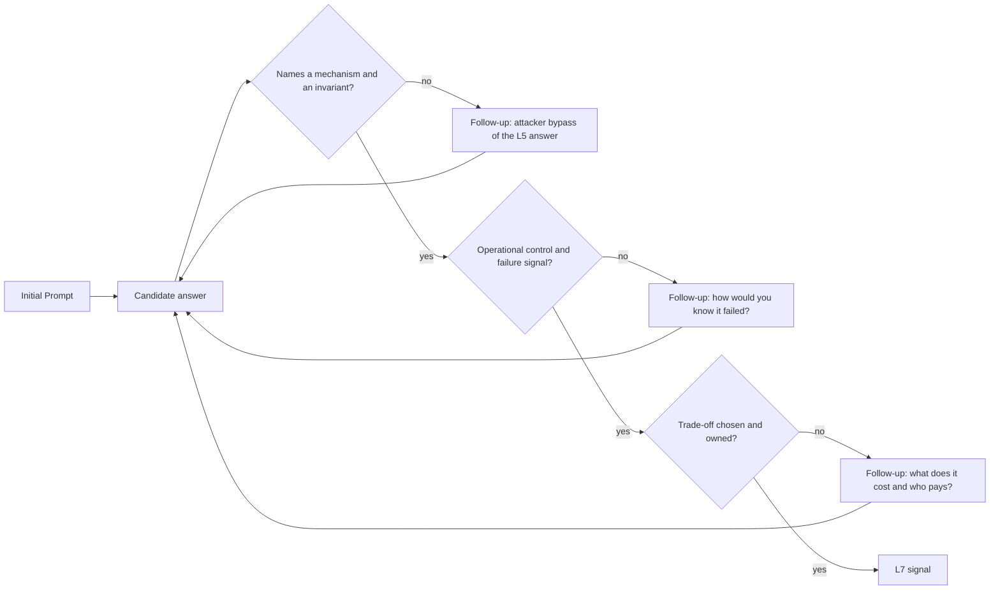

# 35 FAANG and FinTech L7 Security-Architecture Bar-Raiser Q&A Chains

> Folder 08 · File 02 of 03 · Identity, AuthN/AuthZ, OAuth 2.1/OIDC/FAPI 2.0 L7 Reference
> Previous: [01 · 20 real-world exploits and exact code defenses](01-20-real-world-oauth-oidc-and-jwt-exploits-and-exact-code-defenses.md) · Next: [03 · Study guide](03-curated-github-repositories-rfcs-and-security-blogs-study-guide.md)

| Listing | Chains that lean on it | What the chain cites from it |
|---|---|---|
| L1–L8 (Folder 01) | Q1–Q5 | Argon2id cost, bcrypt's 72-byte cliff, TOTP replay, session fixation and AAL timeouts, Spring MFA, the WebAuthn verifier and the passkey counter gap |
| L9–L14 (Folder 01) | Q18, Q32 | JWT verification as a policy, JWKS rotation (big bang: 7.6% failed requests), Spring decoder defaults |
| L15–L19 (Folder 02) | Q6–Q9 | redirect-URI matching, the eight code-flow attacks, refresh-token families, CVE-2025-27370/27371 |
| L20–L25 (Folder 03) | Q10, Q11, Q13 | ID-token validation gaps, SAML signature wrapping, back-channel logout gaps |
| L26–L33 (Folder 04) | Q14–Q17 | DPoP and mTLS binding, the SAS DPoP refresh downgrade, PAR/JAR/RAR, browser token storage, the BFF |
| L34–L41 (Folder 05) | Q12, Q19–Q25 | phantom tokens, introspection, token exchange and `act`, SPIFFE, policy engines, path confusion, Zanzibar |
| L42–L45 (Folder 06) | Q26–Q30 | keyless federation conditions, IMDS SSRF classes, CIAM token conventions, MCP authorization |
| L46–L50 (Folders 07–08) | Q31–Q35 | SAS JWT and rotation, the BFF refresh stampede, multi-tenant validation, OpenFGA/OPA integration, the exploit regression suite |

**Verification.** This file adds no listing. Every **[M]** in a chain points to a listing whose output is regenerated and byte-compared by its own folder's gate. L50 (file 01) is the regression suite that replays documented exploit payloads against the pinned libraries. The questions are original compositions for this KB; none is a reported real interview question.

Labels: **[D]** documented · **[M]** measured by a listing · **[E]** engineering judgment · **⚠** trap.

---

## 0. Orientation

Folders 01–07 end with chains scoped to one topic each. These 35 are **cross-cutting system-design chains**, the kind a bar raiser uses to test whether a candidate can hold the whole identity stack in their head at once:
- browser, mobile, AS, gateway, services, policy engines, cloud federation and agents;
- under adversarial pressure.

How to use them:
1. **Answer the Initial Prompt aloud first,** then read the L5 answer. If yours matches it, the "How an Attacker Bypasses L5" paragraph is the follow-up a bar raiser would ask.
2. **An L7 answer names the mechanism, the measured failure and the operational control.** "Use DPoP" is L5. "DPoP with a shared, sized replay cache, because the default refuses a single key's 1,001st proof per 30 s and per-node caches allow one replay per node (L27)" is L7.
3. **Every chain cites the listing that proves its key claim.** Re-run it before an interview; numbers you have produced yourself survive follow-ups.

---

## 1. First principles: what each chain is testing

```text
  Initial Prompt         a realistic system and a constraint (scale, regulation, legacy, latency)
        |
  L5 Textbook Answer     correct nouns, default configuration, one happy path
        |                (passes a checklist; fails an adversary)
  How an Attacker        a concrete exploit path against exactly that answer:
  Bypasses L5            wire-level, versioned, ideally measured (Lnn) or documented (CVE, incident)
        |
  L7 Principal Defense   mechanism + invariant + operational control + how you would know it failed
                         (metric, alert, regression test), and the trade-off you accept
```

What moves an answer up a level [E]:

```text
  signal                 L5                         L6                              L7
  scope                  one component              the service and its clients     the platform, its tenants, its failure modes
  correctness            "use library X"            "configure X like this"         "X's default does Y (measured); invariant Z holds because ..."
  adversary              generic ("attacker")       named attack                    attack path, preconditions, blast radius
  operations             absent                     monitoring mentioned            SLOs: revocation latency, bound-token %, PDP p99
  trade-offs             absent                     listed                          chosen, with the cost stated and owned
  change                 absent                     migration steps                 migration with a measurable kill switch
```



---

## 2. Using the chains in a mock loop

- **Pairing.** One person plays the bar raiser and reads only the prompt and the bypass paragraph. The candidate answers. Compare with the L7 defense afterwards.
- **Time-box.** Spend 10 minutes per chain and 4 chains per session. Rotate across the groups below, because real loops mix them.
- **Score** against the rubric in §1: mechanism, adversary, operations, trade-off. "Correct but generic" is an L5 score, however long the answer.

---

## 3. The vulnerable L5 implementation vs the hardened L7 zero-trust implementation

Most chains reduce to two pieces of code a candidate should be able to write on a whiteboard: accepting a token, and authorizing an action. These sketches use only APIs exercised by listings L14, L48 and L49.

```java
// L5 - the whiteboard answer that loses the round
Jwt accept(String token) {
    return NimbusJwtDecoder.withJwkSetUri(jwksFrom(issuerOf(token))).build().decode(token);   // issuer chosen by the token
}
boolean authorize(Jwt jwt, String docId) {
    return jwt.getClaimAsStringList("roles").contains("viewer");                               // role claim, no object, no tenant
}
```

```java
// L7 - what the same two functions look like when the adversary is in the room
JwtDecoder decoderFor(Tenant t) {                                          // registry lookup by exact issuer (L48)
    NimbusJwtDecoder d = NimbusJwtDecoder.withIssuerLocation(t.issuer()).jwsAlgorithm(SignatureAlgorithm.ES256).build();
    d.setJwtValidator(JwtValidators.createDefaultWithValidators(List.of(  // L48 row C: at+jwt, RFC 9068 claims, aud, x5t#S256
        new JwtTypeValidator("at+jwt"),
        JwtValidators.createAtJwtValidator().issuer(t.issuer()).audience(t.audience()).build())));
    return d;                                                              // + DPoP proof verification at the filter (L27)
}
boolean authorize(Jwt jwt, Tenant t, String docId) {
    return jwt.getClaimAsStringList("scope") != null                       // coarse: the client may ask at all
        && t.id().equals(tenantOf(jwt))                                    // tenant from the registry, never from the request
        && fga.can("viewer", "doc", docId);                                // fine: relationship, fail closed, freshness policy (L49)
}
```

| Dimension | L5 | L7 |
|---|---|---|
| Trust root | the token names its issuer | an exact registry names the issuers |
| Token type | any JWT | `at+jwt`, RFC 9068 claims, `aud` = this API |
| Possession | bearer | DPoP or mTLS, binding checked |
| Authorization | role claim | scope + tenant + relationship; PDP fails closed |
| Failure | exceptions bubble, or allow | deny, logged with a decision id |

---

## 4. Real-world attack vectors & mitigations

These eight attack shapes recur across the 35 chains. File 01 maps each to documented incidents.

### A1 · Token accepted by the wrong audience or issuer

**Attack.** A token minted for another app, another tenant or another key scope is accepted. Examples: an ID token used as an access token, a consumer key accepted for enterprise tokens, or a look-alike issuer (L44: a generic validator accepts all 7 wrong tokens; L48).
**Wire signature.** Valid signatures with unexpected `iss`, `aud`, `tid` or `typ`.
**Root cause.** Signature-only validation.
**Mitigation.** An exact issuer registry, `aud` = this API, `at+jwt`, and per-issuer key scoping (L48 row C).
**Detection.** Rejection counters by reason; alerts on new issuers.

### A2 · Stolen bearer artifacts replayed

**Attack.** Session cookies, refresh tokens or access tokens are stolen (infostealers, HAR files, integration breaches) and replayed from attacker infrastructure.
**Wire signature.** The same token from new ASN/device fingerprints; refresh tokens used from two places.
**Root cause.** Unbound tokens, long lifetimes, no reuse detection.
**Mitigation.**
- DPoP/mTLS (L26–L28).
- Refresh families with reuse detection (L17).
- BFF sessions (L33).
- Short lifetimes and revocation.

**Detection.** Reuse-detection events; impossible-travel on sessions.

### A3 · Redirect and response manipulation in the front channel

**Attack.** Loose redirect-URI matching, mix-up, a missing `state`/PKCE, or a response-mode switch leaks a code or token to the attacker (L15, L16).
**Wire signature.** Authorization responses to unregistered paths; codes redeemed by the wrong client.
**Root cause.** Pattern-matched redirect URIs; optional PKCE; no `iss` in responses.
**Mitigation.** Exact redirect match, PKCE S256 required, RFC 9207 `iss`, PAR (L31).
**Detection.** Mismatched-redirect rejects; code redemption failures.

### A4 · Authorization decided on attacker-controlled input

**Attack.** The tenant, role, object id or policy input comes from the request. Path-confusion URIs reach admin handlers (L39, L40, L48, L49).
**Wire signature.** Path or parameter tenant ≠ token tenant; encoded traversal sequences.
**Root cause.** The PEP trusts the request.
**Mitigation.**
- Attributes from token + PIP.
- `StrictHttpFirewall`.
- Method-level authorization bound to the loaded resource.

**Detection.** Mismatch logs; firewall rejects.

### A5 · Stale authorization (revocation that doesn't revoke)

**Attack.** Decision caches, check caches, long-lived JWTs and per-node replay caches keep a revoked principal working (L34, L39: until t = 570 s; L41; L49).
**Wire signature.** Allows after a revocation event.
**Root cause.** Freshness not designed.
**Mitigation.** Version-keyed caches, consistency tokens or `HIGHER_CONSISTENCY`, short token lifetimes, phantom tokens for revocable sessions.
**Detection.** Join decision logs with revocation events.

### A6 · Confused deputy in delegation and federation

**Attack.** Token exchange escalates scope or audience (L37). A CI or workload token is accepted by a trust policy without a `sub` condition (L42). An agent forwards a user's token to a third party (L45).
**Wire signature.** Exchanged tokens with wider scope than the subject token; role assumptions from unexpected repos or namespaces.
**Root cause.** Delegation without a policy on who may act for whom.
**Mitigation.**
- `may_act` and `act`, with scope intersection (L36, L37).
- Exact `sub`/`aud` conditions (L42).
- No token passthrough (L45).

**Detection.** Audit `act` chains; alert on wildcard trust policies.

### A7 · Fail-open on dependency failure

**Attack.** A PDP, JWKS endpoint or introspection endpoint is slowed down, and the PEP allows (L49: a fast DENY is the fix).
**Wire signature.** Authorization success rising during dependency incidents.
**Root cause.** Catch blocks returning true; library-default timeouts.
**Mitigation.** Fail closed, timeouts of a few hundred ms, bounded concurrency, explicit degraded modes.
**Detection.** Allows without a PDP response id.

### A8 · Library and framework regressions

**Attack.** A dependency bump (or failing to bump) reintroduces a parsing, verification or annotation-detection flaw. Examples: alg confusion, psychic signatures, PBES2 iteration DoS, nested-JSON DoS (L50).
**Wire signature.** Exploit payloads succeeding after an upgrade.
**Root cause.** No regression suite of exploit payloads.
**Mitigation.** L50 in CI against pinned versions; advisory monitoring; upgrade SLAs.
**Detection.** CI failure on the regression suite.

---

## 5. FAANG / FinTech L7 bar-raiser Q&A chains

### A. Authentication, credentials and sessions

<details><summary><b>Q1 · Roll out passkeys to 100 million consumer accounts without creating an account-takeover path.</b></summary>

**Initial Prompt.** Passwords stay as a fallback for two years; SMS OTP exists today.

**L5 Textbook Answer.** "Add WebAuthn registration and login, make passkeys the default, keep password + SMS for recovery."

**How an Attacker Bypasses L5.** The attacker ignores the passkey and walks through the fallback: SMS OTP (SIM swap, relay phishing) or a password reset email. Recovery is now the weakest path, and it inherits the passkey's "trusted" label. On the server, a verifier that doesn't check the signature counter can't flag a cloned non-syncable authenticator. L8 measured Spring Security 7.1.2 accepting a counter regression.

**L7 Principal Defense.**
- **Recovery is designed as an authentication ceremony** with its own assurance level:
  - a second registered passkey;
  - a recovery code;
  - for high-value accounts, step-up with identity proofing and a delay.
- **Downgrade signals are risk events:** a passkey user logging in with a password.
- **Server:** a WebAuthn verifier with rpId/origin/UV/counter checks (L7), plus a monotonic-counter repository (L8) for device-bound keys.
- **Metrics:** passkey coverage, fallback rate, recovery-to-ATO ratio.

</details>

<details><summary><b>Q2 · Infostealers are lifting your users' session cookies. Design the session layer so a stolen cookie is worth little.</b></summary>

**Initial Prompt.** Web app, 30-day "remember me", MFA at login.

**L5 Textbook Answer.** "Secure, HttpOnly, SameSite cookies, plus MFA."

**How an Attacker Bypasses L5.** Cookie flags stop scripts and cross-site sends, not theft from disk or memory. MFA happened at login; the stolen cookie *is* the post-MFA state. A 30-day lifetime makes it a 30-day credential.

**L7 Principal Defense.**
- **Sessions are server-side ids,** hashed at rest (L4), with AAL-based idle and absolute timeouts (L4: NIST 800-63B-4 AAL2 is 1 h idle / 24 h absolute).
- **Bind the session to the device** where the platform allows: DBSC in Chrome on Windows, or a device-bound key.
- **Re-authenticate for sensitive actions** (L5: factor freshness).
- **Detect** on IP/ASN/UA drift.
- **The BFF pattern** keeps OAuth tokens out of the browser altogether (L33).
- **Incident lever:** revoke all sessions per user and per tenant, within seconds.

</details>

<details><summary><b>Q3 · A user authenticated 3 hours ago now initiates a $50,000 wire. What happens?</b></summary>

**Initial Prompt.** OIDC login via your IdP; the app holds a session.

**L5 Textbook Answer.** "They're logged in with MFA, so allow it."

**How an Attacker Bypasses L5.** Session theft (Q2) or an unattended device turns a 3-hour-old MFA into a wire. The app also can't tell what the IdP actually verified: Spring's `OidcIdTokenValidator` accepts a stale `auth_time` and a weak `acr` unless you add validators (L21).

**L7 Principal Defense.**
- **Step-up:** the RP requests `max_age` and `acr_values` and validates `auth_time` and `acr` (L21's validators).
- **Phishing-resistant authentication within N minutes** for the wire (L5's `RequiredFactor.validDuration`).
- **Bind the approval to the payment details:** RAR `authorization_details` (L30) or a signed transaction confirmation.
- **Audit:** the amount, the beneficiary and the authentication event id.

</details>

<details><summary><b>Q4 · Your password table was exfiltrated. Respond, and redesign storage.</b></summary>

**Initial Prompt.** bcrypt cost 10, 40 million rows.

**L5 Textbook Answer.** "bcrypt is fine; force a reset."

**How an Attacker Bypasses L5.**
- **Offline cracking** of weak passwords proceeds at GPU speed.
- **bcrypt silently truncates at 72 bytes** (L2: `matches()` truncates while `encode()` throws).
- **Without a pepper,** the dump is all an attacker needs.
- **Forced resets via email** are a phishing season.

**L7 Principal Defense.**
- **Incident:** invalidate sessions, force step-up on next login (not email links), and monitor credential stuffing against other properties.
- **Storage:** Argon2id at or above the OWASP floor (L1: ≈36 ms per hash on the lab machine), a pepper held in a KMS/HSM as an encryption key with rotation (L2), and rehash on login (L2's upgrade policy).
- **Policy:** NIST 800-63B-4 lengths and breached-password screening.
- **Strategic:** passkeys (Q1) make the next dump far less useful.

</details>

<details><summary><b>Q5 · Design TOTP for a broker app that regulators audit.</b></summary>

**Initial Prompt.** RFC 6238 defaults; users complain about clock drift.

**L5 Textbook Answer.** "Accept ±2 time steps for drift."

**How an Attacker Bypasses L5.**
- **A ±2 window** accepts codes for 2.5 minutes.
- **Without replay tracking,** a phished code is reusable within the window.
- **Relay phishing** defeats TOTP entirely (L3).
- **No attempt limit** makes 10⁶ codes brute-forceable across windows.

**L7 Principal Defense.**
- **Window ±1** with per-user drift learning.
- **Last-used-step replay prevention**, and attempt limits with lockout (L3).
- **Secrets** of 160 bits or more, encrypted at rest.
- **Treat TOTP as AAL2, not phishing-resistant:** passkeys are the path for high-value actions.
- **Audit records** of verification events for the regulator.

</details>

### B. OAuth and OIDC protocol design

<details><summary><b>Q6 · Migrate a banking SPA that keeps tokens in localStorage to a design that survives XSS, without downtime.</b></summary>

**Initial Prompt.** 2 million monthly users, a React SPA, a public client with refresh tokens.

**L5 Textbook Answer.** "Move tokens to memory and use short lifetimes."

**How an Attacker Bypasses L5.** XSS in the page can call the API with in-memory tokens, run a silent refresh, or proxy requests. Memory storage only stops *persistence* (L32: of the six architectures, only the BFF removes tokens from the browser's reach).

**L7 Principal Defense.**
- **BFF (RFC 10017):** a confidential client and a `__Host-Http-` session cookie (L33).
- **Token relay** through Spring's OAuth2 client with single-flight refresh (L47).
- **Migration:** run both paths behind a flag, move cohorts, then revoke the SPA's refresh-token families and remove the public client.
- **CSP and Trusted Types** reduce XSS itself.

</details>

<details><summary><b>Q7 · Specify OAuth for a mobile banking app.</b></summary>

**Initial Prompt.** iOS and Android; deep links today.

**L5 Textbook Answer.** "Authorization code + PKCE with a custom scheme redirect."

**How an Attacker Bypasses L5.**
- **A malicious app registers the same custom scheme** and receives the code.
- **PKCE only helps if** the AS requires S256 and refuses `plain` or a missing challenge (L16: a downgrade succeeds against a lenient AS).
- **Loose redirect matching** accepts look-alikes (L15).

**L7 Principal Defense.**
- **Claimed HTTPS redirects** (universal/app links) with exact match (L15).
- **PKCE S256 required** at the AS.
- **PAR** so the request can't be tampered with (L31).
- **DPoP-bound tokens** from a hardware-backed key (L26).
- **Refresh rotation with reuse detection** (L17).
- **App attestation** as a risk signal, not an authenticator.

</details>

<details><summary><b>Q8 · Write the refresh-token policy for SPA-via-BFF, mobile, and server-to-server clients.</b></summary>

**Initial Prompt.** One AS (Spring Authorization Server), three client classes.

**L5 Textbook Answer.** "Rotate refresh tokens everywhere, 30-day lifetime."

**How an Attacker Bypasses L5.**
- **SAS defaults to `reuseRefreshTokens(true)`,** which means no rotation (L18).
- **With rotation on,** a replayed old token is only `invalid_grant`, and the family survives (L18).
- **A DPoP-bound public-client refresh token presented without a proof mints a Bearer token** in SAS 7.1.2 (L29).
- **BFF refresh under concurrency stampedes** a rotating AS (L47).

**L7 Principal Defense.**
- **Mobile:** rotation with family revocation on reuse (L17's policy), DPoP-bound, sliding plus absolute lifetime.
- **BFF:** a confidential client, single-flight refresh (L47), and no rotation if the AS can't tolerate races, compensated by sender-constraining.
- **Server-to-server:** no refresh tokens; `private_key_jwt` or mTLS client credentials.
- **SAS:** the L29 decorator requiring proofs.

</details>

<details><summary><b>Q9 · Your platform federates with 200 partner authorization servers. One is malicious.</b></summary>

**Initial Prompt.** Clients use `private_key_jwt` towards each AS.

**L5 Textbook Answer.** "Signed client assertions are safe; the AS can't forge them."

**How an Attacker Bypasses L5.**
- **Audience injection (CVE-2025-27370/27371):** the malicious AS publishes another AS's endpoint as its own. Your client signs an assertion with that `aud`, and the attacker replays it at the honest AS (L19).
- **Mix-up:** without RFC 9207 `iss`, the client sends a code to the wrong AS (L16).

**L7 Principal Defense.**
- **Assertion `aud` = the target AS's issuer, only** (rfc7523bis). This is not Spring's default token-URI audience (L19).
- **Validate `iss` in authorization responses.**
- **Per-AS client keys.**
- **Discovery metadata pinned per AS** and checked against the issuer.

</details>

<details><summary><b>Q10 · Add "Sign in with" five social and enterprise IdPs to a marketplace with existing accounts.</b></summary>

**Initial Prompt.** Accounts are keyed by email today.

**L5 Textbook Answer.** "Match on the email claim and link accounts automatically."

**How an Attacker Bypasses L5.** Email is mutable and, at some IdPs, unverified or tenant-controlled. An attacker sets a victim's address in their own tenant or IdP profile and is merged into the victim's account. File 01 documents this class in production.

**L7 Principal Defense.**
- **The identity key is (`iss`, `sub`)** (L20).
- **Link only after proving control of the existing account:** log in with its current method.
- **Use `email_verified` only from IdPs that assert it authoritatively,** and never for merging alone.
- **Per-IdP token conventions validated** (L44).

</details>

<details><summary><b>Q11 · A user disables their account at the enterprise IdP. How fast are they out of 40 RPs?</b></summary>

**Initial Prompt.** RPs hold local sessions; tokens last 1 hour.

**L5 Textbook Answer.** "Within the token lifetime: one hour."

**How an Attacker Bypasses L5.** RP sessions outlive tokens: days, with remember-me. Refresh tokens keep minting. Back-channel logout as implemented in Spring Security 7.1.2:
- accepts `exp`-less and replayed logout tokens;
- is RS256-only;
- isn't configurable (L25).

Either legitimate logouts fail, or forged ones log users out.

**L7 Principal Defense.**
- **Back-channel logout** validated per spec (L24: `typ`, `events`, `jti` replay, `aud`) at your own endpoint (the L25 fix).
- **CAEP/SSF session-revoked events** for sessions and refresh tokens.
- **An SLO:** p99 time from IdP disable to RP lockout, measured.

</details>

<details><summary><b>Q12 · 2,000 services validate tokens. JWT everywhere, or introspection?</b></summary>

**Initial Prompt.** The CISO wants revocation within 60 s.

**L5 Textbook Answer.** "Self-contained JWTs; they're fast."

**How an Attacker Bypasses L5.** A stolen JWT works until it expires. Introspecting on every call puts the AS on every request path. Spring's introspector checks only `active`: no `aud` or `exp` checks, no cache, no timeouts (L35).

**L7 Principal Defense.**
- **Phantom token at the edge:** opaque outside, introspected once per token at the gateway with a cache bounded by the revocation SLO, and a short JWT inside (L34).
- **Inside, JWTs live under 5 minutes.**
- **The introspection client** checks `aud`/`exp`, caches, and has timeouts (L35's fix).

</details>

<details><summary><b>Q13 · 300 enterprise customers still use SAML. Keep it safe while migrating to OIDC.</b></summary>

**Initial Prompt.** An in-house SAML SP library from 2016.

**L5 Textbook Answer.** "Verify the signature on the Response."

**How an Attacker Bypasses L5.** XML signature wrapping: the signature verifies over one element while the application reads another (L22). Unsigned assertions inside signed responses, and comment-truncated NameIDs, round out the classics.

**L7 Principal Defense.**
- **Use a maintained SP library.**
- **Read identity only from the verified element** (L22's L7 SP).
- **Require signed assertions**, with strict audience, recipient and time checks.
- **Run SAML at an edge broker** (Keycloak or a managed IdP) that emits OIDC to apps, then retire per customer.

</details>

### C. FAPI, sender-constraining and high-value APIs

<details><summary><b>Q14 · Build an open-banking API to FAPI 2.0 on Spring.</b></summary>

**Initial Prompt.** 3,000 third-party providers; regulator-mandated.

**L5 Textbook Answer.** "Spring Authorization Server with PKCE and JWTs."

**How an Attacker Bypasses L5.** SAS 7.1.2 meets 3 of 10 FAPI 2.0 requirements out of the box (Folder 04). Gaps include:
- a 5-minute code lifetime;
- non-PAR requests served;
- assertion `aud` arrays accepted, with no replay check;
- no `iss` in the response;
- RS256 access tokens.

Each is a conformance failure, and some are attack paths.

**L7 Principal Defense.**
- **PAR required** (L31).
- **60 s codes.**
- **Strict assertion audience with `jti` replay.**
- **An `iss` response handler.**
- **ES256 `at+jwt`** (L46).
- **DPoP or mTLS on every token,** including refresh (L29).
- **The OpenID conformance suite in CI.**

</details>

<details><summary><b>Q15 · DPoP or mTLS for a payments API?</b></summary>

**Initial Prompt.** TPPs are server-side; some are small companies.

**L5 Textbook Answer.** "mTLS is stronger, so use mTLS."

**How an Attacker Bypasses L5.** mTLS terminated at a load balancer and forwarded as a header is only as strong as that header's trust boundary. L28: a copied *public* certificate defeats a header trusted from anyone. DPoP with Spring's defaults has a node-local replay cache and per-key caps (L27).

**L7 Principal Defense.** Either, engineered.
- **mTLS:** the certificate header only from the LB's own authenticated connection, and `x5t#S256` binding validated (L28). Beware `createAtJwtValidator()` alone (L48).
- **DPoP:** a FAPI algorithm policy, a shared atomic replay cache, nonces if needed, and htu normalization behind proxies (L27).
- **Pick per client class:** operational cost vs PKI maturity.

</details>

<details><summary><b>Q16 · Bind a payment consent to exactly the payment the user approved.</b></summary>

**Initial Prompt.** Scopes today: `payments`.

**L5 Textbook Answer.** "A `payments:write` scope and a consent screen."

**How an Attacker Bypasses L5.** A scope authorizes any payment. A compromised TPP changes the beneficiary or amount after consent.

**L7 Principal Defense.**
- **RAR** `authorization_details` (L30: RFC 9396's example parses and its IBAN passes mod-97), shown verbatim on the consent screen and carried in the token.
- **The resource server compares** the payment request with the token's details.
- **One-time-use consent ids.**
- **PAR with a signed request object (JAR)** so details can't be altered in the front channel (L30, L31).

</details>

<details><summary><b>Q17 · Your FAPI conformance run fails. Where do you look first?</b></summary>

**Initial Prompt.** SAS-based AS, Spring resource servers.

**L5 Textbook Answer.** "Upgrade Spring."

**How an Attacker Bypasses L5.** The failures are defaults, not bugs:
- code TTL;
- served non-PAR requests;
- the `iss` response parameter;
- the assertion audience;
- the refresh downgrade (L29).

An upgrade doesn't change defaults, and some are not configurable.

**L7 Principal Defense.** Map each failing test to a provider or customizer:
- PAR required (L31);
- the `iss` handler;
- the assertion validator;
- the L29 decorator;
- the L46 customizer.

Then:
- **Lock the configuration with tests** that reproduce each conformance check.
- **Track upstream issues;** report gaps responsibly (Q33).

</details>

<details><summary><b>Q18 · The AS signing key may have leaked. Run the incident.</b></summary>

**Initial Prompt.** One RSA key, 1-hour access tokens, JWKS cached 24 h by some resource servers.

**L5 Textbook Answer.** "Rotate the key."

**How an Attacker Bypasses L5.** A big-bang rotation breaks every live token and every RS with a stale JWKS (L12: 7.6% of requests failed in the simulation). A 24-hour JWKS cache keeps the *compromised* key trusted for a day after you remove it. Forged tokens are indistinguishable from real ones.

**L7 Principal Defense.**
- **Emergency rotation:**
  - publish the new key, switch signing, and remove the old key immediately (accept the outage);
  - force JWKS refresh on resource servers (an admin endpoint or short cache);
  - revoke refresh tokens issued during the window.
- **Hunt:** tokens with valid signatures but no matching issuance log.
- **Prevention:** keys in an HSM/KMS, JWKS caches capped and refreshed on unknown `kid` (L12), and a rotation runbook rehearsed (L46).

</details>

### D. Microservices, zero trust and authorization

<details><summary><b>Q19 · Design east-west identity for 2,000 services across three clusters.</b></summary>

**Initial Prompt.** The user's JWT is forwarded through every hop today.

**L5 Textbook Answer.** "Forward the user token; every service validates it."

**How an Attacker Bypasses L5.** Any compromised service holds a token valid at every other service: the audience is everyone. Services can't tell *who* called them, only *for whom*.

**L7 Principal Defense.**
- **Workload identity:** SPIFFE SVIDs over mTLS (L38).
- **User context:** RFC 8693 token exchange per hop, with narrowed audience and scope and an `act` chain (L36).
- **Watch SAS's token exchange:** it escalates scope and ignores audience unless guarded (L37's `GuardedExchange`).
- **Authorization** on both identities: "service A may call B's `/payments` for users of tenant T".

</details>

<details><summary><b>Q20 · Design sharing authorization for a document product with 10 billion tuples.</b></summary>

**Initial Prompt.** Folders, groups, link sharing; 100k checks/s.

**L5 Textbook Answer.** "ACL table per document, cached."

**How an Attacker Bypasses L5.**
- **Inheritance** through folders and groups makes ACL tables explode or go stale.
- **Caches keep revoked users in:** the new-enemy problem (L41).
- **Link sharing via `user:*`** is a public-exposure footgun.

**L7 Principal Defense.**
- **A Zanzibar-style ReBAC system** (L41): tuples, rewrites, a Leopard-style index for groups.
- **Consistency tokens** (zookies) for content-after-revocation, or OpenFGA with `HIGHER_CONSISTENCY` for revocation-sensitive checks (L49).
- **Batch and list APIs** for listing pages.
- **Wildcard grants** restricted by model.

</details>

<details><summary><b>Q21 · A bank has 14,000 roles. Fix authorization.</b></summary>

**Initial Prompt.** Roles encode department × product × limit × region.

**L5 Textbook Answer.** "Clean up roles and add role hierarchy."

**How an Attacker Bypasses L5.** Role explosion breeds mis-assignment. Separation of duty ("not your own payment") isn't a role. First-match rule engines with default allow let 6 of 6 attacks through (L39).

**L7 Principal Defense.**
- **Coarse roles plus ABAC rules** for limits, SoD and MFA.
- **A default-deny engine** with forbid-overrides (L39: Cedar semantics).
- **Attributes from a PIP**, never the request.
- **Decision caches keyed by attribute versions** (L39: a version-blind 10-minute cache allows until t = 570 s).

</details>

<details><summary><b>Q22 · A pentest found `/admin` reachable through an encoded path. Fix it systemically.</b></summary>

**Initial Prompt.** Spring MVC behind a gateway with its own path rules.

**L5 Textbook Answer.** "Add a rule for the encoded path."

**How an Attacker Bypasses L5.** There is always another encoding. The gateway, the security matcher and the dispatcher each normalize differently. L40: four traversal/encoding paths were GRANTED by a raw-URI matcher yet reached `/admin` after normalization.

**L7 Principal Defense.**
- **Normalize once and reject ambiguity:** `StrictHttpFirewall` rejects all four (L40).
- **Deny by default**, then allow-list routes.
- **Authorize at the method or handler** (L48), not only by URL.
- **Fuzz paths in CI** across the gateway and the app.

</details>

<details><summary><b>Q23 · Prove tenant isolation for a multi-tenant SaaS to a bank's auditors.</b></summary>

**Initial Prompt.** One database, a tenant column.

**L5 Textbook Answer.** "Every query filters by tenant id from the URL."

**How an Attacker Bypasses L5.** The URL is attacker input: a tenant-B user requests tenant A's path with a valid token (L48 shows `@PreAuthorize` denying it). A prefix-matched issuer list admits an attacker's IdP (L48).

**L7 Principal Defense.**
- **Exact issuer registry.**
- **Tenant from token or registry.**
- **Method security binding** the requested tenant to the caller's.
- **Tenant-scoped repositories and row-level security.**
- **Cross-tenant tests** generated per endpoint.
- **Evidence for auditors:** test reports, decision logs and the registry change history.

</details>

<details><summary><b>Q24 · Authorization must add under 5 ms at p99, at 1 million requests/s.</b></summary>

**Initial Prompt.** A central PDP today; p99 is 40 ms.

**L5 Textbook Answer.** "Cache decisions for 10 minutes."

**How an Attacker Bypasses L5.** A 10-minute decision cache is a 10-minute revocation delay (L39). Under load the PDP times out and someone adds fail-open (L49 §2).

**L7 Principal Defense.**
- **Local evaluation:** an OPA/Cedar sidecar with signed bundles.
- **Version-keyed caches** that invalidate on attribute change.
- **ReBAC checks batched,** with `HIGHER_CONSISTENCY` only where revocation matters.
- **Short timeouts with fail-closed**, and a semaphore per PDP.
- **SLOs** on p99 and on decision freshness.

</details>

<details><summary><b>Q25 · Regulators ask: who approved this payment, through which systems, on whose behalf?</b></summary>

**Initial Prompt.** An agent, a batch service and a human were involved.

**L5 Textbook Answer.** "We log the user id from the token."

**How an Attacker Bypasses L5.** Forwarded user tokens erase the actors. Impersonation without `act` hides which service did what (L37: no `actor_token` means impersonation with no `act`).

**L7 Principal Defense.**
- **Delegation via token exchange with `act` chains** (L36: the current actor vs prior actors).
- **Decision logs** with request id, subject, actor chain, policy version and decision id at each PEP.
- **Tamper-evident storage.**
- **A query path** that reconstructs the chain for a payment id.

</details>

### E. Cloud, federation and AI agents

<details><summary><b>Q26 · Eliminate long-lived cloud keys from CI/CD.</b></summary>

**Initial Prompt.** 600 repositories deploy to AWS, GCP and Azure.

**L5 Textbook Answer.** "Use GitHub OIDC federation."

**How an Attacker Bypasses L5.** Trust policies that check only `aud`, or a `repo:org/*` wildcard, let any repository or fork-triggered workflow assume production roles. L42 measured these conditions across six GitHub token cases.

**L7 Principal Defense.** Per-cloud conditions on immutable identifiers:
- **AWS:** `sub` with repo + environment, plus `aud`.
- **GCP:** attribute conditions on repository ids.
- **Azure:** an exact-subject federated identity credential.

Then:
- **Production only from protected environments.**
- **Policy-as-code checks** that reject wildcard trust.
- **Inventory and alerts** on role assumptions.

</details>

<details><summary><b>Q27 · An SSRF was found in your PDF renderer on Kubernetes. What's the blast radius?</b></summary>

**Initial Prompt.** EKS and GKE workloads; IRSA and Workload Identity are partly adopted.

**L5 Textbook Answer.** "Block 169.254.169.254 in the app."

**How an Attacker Bypasses L5.** Alternate encodings, redirects and DNS rebinding reach the metadata service anyway. L43: IMDSv1 leaks to all five SSRF capability classes. Node credentials then reach everything the node role can.

**L7 Principal Defense.**
- **IMDSv2 with hop limit 1** (L43).
- **Pod-level identity** (IRSA / Pod Identity / Workload Identity), with node roles minimal.
- **Egress policies,** and the renderer sandboxed in its own namespace with no cloud identity.
- **Detection:** metadata access from unexpected pods.

</details>

<details><summary><b>Q28 · You must accept tokens from Cognito, Entra External ID, Firebase and Keycloak in one API.</b></summary>

**Initial Prompt.** An acquisition brought four CIAM stacks.

**L5 Textbook Answer.** "Validate signature, issuer prefix and expiry for all."

**How an Attacker Bypasses L5.** Each platform marks token type and audience differently:
- Cognito: `token_use` and `client_id`;
- Entra: `tid` and `aud`;
- Firebase: project `aud`/`iss`;
- Keycloak: `azp` and the audience mapper.

A generic validator accepts all 7 wrong tokens in L44.

**L7 Principal Defense.**
- **Per-platform validators** (L44) behind one registry (L48).
- **Exact issuers.**
- **Platform-specific type and audience rules.**
- **A plan to converge** on one AS via federation.

</details>

<details><summary><b>Q29 · An AI agent will read users' email and initiate payments on their behalf. Design its authorization.</b></summary>

**Initial Prompt.** MCP servers for email and payments; an LLM orchestrator.

**L5 Textbook Answer.** "Give the agent the user's access token."

**How an Attacker Bypasses L5.** Prompt injection in an email makes the agent call the payment tool. Token passthrough lets any tool server replay the user's token elsewhere. The MCP 2026-07-28 spec forbids that (L45).

**L7 Principal Defense.**
- **MCP authorization:** RFC 9728 discovery, RFC 8707 `resource`-bound tokens, no passthrough (L45).
- **Per-tool scopes.**
- **Token exchange with `act`** = the agent (L36).
- **Step-up and human approval** for payments, bound to RAR details (L30).
- **Policy limits** on amounts and payees.
- **Audit** of every tool call.

</details>

<details><summary><b>Q30 · A malicious MCP server is listed in your marketplace. What can it do, and what stops it?</b></summary>

**Initial Prompt.** Desktop and server MCP clients connect to user-chosen servers.

**L5 Textbook Answer.** "OAuth protects it; the server can't get the user's tokens."

**How an Attacker Bypasses L5.** The server controls its own discovery metadata. It can:
- point the client at an attacker AS;
- inject malicious URLs into the client's auth flow (file 01 documents such a client vulnerability);
- request broad scopes;
- receive tokens if the client doesn't bind them to the resource.

**L7 Principal Defense.**
- **Clients validate metadata:** RFC 9207, AS binding, PKCE required (L45).
- **Never pass metadata URLs to a shell or OS handler unvalidated.**
- **Audience-bound tokens.**
- **Per-server consent.**
- **Marketplace review and signing.**

</details>

<details><summary><b>Q31 · A SaaS integration vendor you use is breached and its OAuth tokens to your tenant are stolen. Design for survivability.</b></summary>

**Initial Prompt.** Dozens of third-party apps hold refresh tokens to your CRM.

**L5 Textbook Answer.** "Revoke the vendor's tokens when they tell us."

**How an Attacker Bypasses L5.** You hear about it days later. Refresh tokens keep minting access tokens. Exports run at API speed, from the attacker's infrastructure. File 01 documents this pattern.

**L7 Principal Defense.**
- **Third-party apps get least-privilege scopes**, with no offline access for bulk export.
- **Sender-constrained tokens** or IP allow-lists per integration.
- **Rotation with reuse detection** (L17).
- **Anomaly detection** on export volume per client id.
- **A kill switch per integration**, plus tenant-wide revocation and rehearsal.

</details>

### F. Platform engineering and leadership

<details><summary><b>Q32 · Own Spring Security upgrades for 300 services.</b></summary>

**Initial Prompt.** Versions range from 5.8 to 7.1.

**L5 Textbook Answer.** "Upgrade to the latest annually."

**How an Attacker Bypasses L5.** Old versions miss fixes for advisories (file 01). New versions change defaults silently. An "upgrade" that breaks `at+jwt` validation (L46's trap) gets reverted to something weaker.

**L7 Principal Defense.**
- **A shared starter** with the hardened configuration (L46–L48).
- **The exploit regression suite in every pipeline** (L50).
- **Contract tests** for token formats.
- **An upgrade SLA per CVSS band.**
- **Inventory** from SBOMs.
- **Canary rollouts** with authentication-error SLOs.

</details>

<details><summary><b>Q33 · You've found what looks like a security gap in Spring Authorization Server. What do you do?</b></summary>

**Initial Prompt.** Your FAPI deployment depends on it.

**L5 Textbook Answer.** "Open a GitHub issue with a reproducer."

**How an Attacker Bypasses L5.** A public issue is a public exploit before a fix exists, for everyone running the version.

**L7 Principal Defense.**
- **Report privately per the project's security policy** (spring.io/security-policy), with a minimal reproducer (like L29).
- **Mitigate locally meanwhile** (L29's decorator).
- **Add a regression test.**
- **Coordinate disclosure.**
- **Inform internal owners** without leaking details.

</details>

<details><summary><b>Q34 · Build or buy the identity platform?</b></summary>

**Initial Prompt.** A FinTech with 40 engineers and a regulator.

**L5 Textbook Answer.** "Build on Keycloak or SAS; it's free."

**How an Attacker Bypasses L5.** Security of an AS is mostly operations: key management, patching, conformance, abuse detection, recovery flows. An under-staffed self-hosted AS accumulates gaps (Q14, Q17).

**L7 Principal Defense.**
- **Decide by capability and staffing:** conformance (FAPI), key custody (HSM), uptime SLOs, recovery and abuse operations.
- **Buy the commodity** (CIAM login, MFA, passkeys).
- **Build the differentiating authorization** (ReBAC/ABAC).
- **Either way,** own validation at your resource servers (L48) and your exploit regression suite (L50).

</details>

<details><summary><b>Q35 · What are the security SLOs of an identity platform?</b></summary>

**Initial Prompt.** The board wants a dashboard.

**L5 Textbook Answer.** "Login success rate and MFA adoption."

**How an Attacker Bypasses L5.** Those measure convenience. A platform can show 99.9% login success while stolen refresh tokens mint forever.

**L7 Principal Defense.**
- **Revocation latency** (p99, disable to lockout).
- **The share of tokens sender-constrained.**
- **Maximum access-token lifetime.**
- **Refresh reuse-detection events.**
- **Phishing-resistant authentication coverage** for privileged users.
- **The share of PEPs failing closed** (chaos-tested).
- **Decision freshness.**
- **Time-to-patch** for identity CVEs.
- **Regression-suite pass rate** (L50).

</details>

---

## 6. Invariants checklist

Every L7 answer in this file has the following, and a bar raiser will probe for any one that is missing:
- [ ] A **trust root** stated exactly: which issuers, keys and audiences, and where the list lives.
- [ ] A **possession** story: bearer is a decision, sender-constraining is the default for high value.
- [ ] A **freshness** story: how long a revoked principal keeps working, and why that number.
- [ ] A **failure mode**: what happens when the AS, the JWKS endpoint, the PDP or the IdP is slow or down. Fail closed by default.
- [ ] **Inputs from trusted sources**: tenant, roles and policy inputs never come from the request.
- [ ] A **measurement** or documented source behind the key claim (listing, RFC section, advisory).
- [ ] An **operational control**: metric, alert, regression test, runbook.
- [ ] A **trade-off** named, with an owner.

---

## 7. References

- RFC 9700 *Best Current Practice for OAuth 2.0 Security* — <https://www.rfc-editor.org/rfc/rfc9700>
- OpenID Foundation, *FAPI 2.0 Security Profile* — <https://openid.net/specs/fapi-security-profile-2_0-final.html>
- NIST SP 800-63B-4 — <https://pages.nist.gov/800-63-4/sp800-63b.html>
- Spring Security reference — <https://docs.spring.io/spring-security/reference/>
- Spring security policy (vulnerability reporting) — <https://spring.io/security-policy>
- Model Context Protocol, *Authorization* (2026-07-28) — <https://modelcontextprotocol.io/specification/2026-07-28/basic/authorization>
