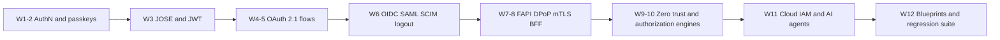

# Curated GitHub Repositories, RFCs and Security Blogs: a Study Guide

> Folder 08 · File 03 of 03 · Identity, AuthN/AuthZ, OAuth 2.1/OIDC/FAPI 2.0 L7 Reference
> Previous: [02 · 35 bar-raiser chains](02-35-faang-and-fintech-l7-security-architecture-bar-raiser-qna-chains.md) · Up: [KB README](../README.md)

| Listing | Study week | Why you run it that week |
|---|---|---|
| L1–L8 | 1–2 | password hashing, TOTP, sessions, MFA and WebAuthn from first principles, then on Spring Security 7.1.2 |
| L9–L14 | 3 | JOSE by hand, JWT attacks as policy, rotation, signature performance, Spring decoder defaults |
| L15–L19 | 4–5 | redirect URIs, the code flow's eight attacks, refresh families, SAS refresh behaviour, client assertions |
| L20–L25 | 6 | ID tokens, Spring's OIDC validator gaps, SAML wrapping, SCIM, logout |
| L26–L33 | 7–8 | DPoP, mTLS, the SAS refresh downgrade, PAR/JAR/RAR, browser storage, BFF |
| L34–L41 | 9–10 | phantom tokens, introspection, token exchange, SPIFFE, policy engines, path confusion, Zanzibar |
| L42–L45 | 11 | cloud federation conditions, IMDS SSRF, CIAM conventions, MCP authorization |
| L46–L50 | 12 | the production blueprints and the exploit regression suite |

**Verification.** This file adds no listing. Every external link is fetched by the folder gate (`--urls`). Repository pointers name the files or packages this KB read, at the versions pinned in the KB README (Spring Security 7.1.2, Nimbus 10.9.1, OpenFGA Java SDK 0.11.0, MCP spec 2026-07-28).

Labels: **[D]** documented · **[M]** measured by a listing · **[E]** engineering judgment · **⚠** trap.

---

## 0. Orientation

This guide turns the KB into a 12-week plan. It differs from a reading list in three ways [E]:
1. **Source over summary.** For every mechanism you read the RFC section *and* the code that implements it. The KB's sharpest findings came from reading Spring's sources against the RFC, then measuring the gap: the at+jwt validator trap (L46), the `createAtJwtValidator()` binding gap (L48), the SAS refresh downgrade (L29).
2. **Run before you believe.** Each week ends by running that week's listings and changing one input to watch a defense fail.
3. **Attack in a lab.** Each week has an attack to reproduce against your own code (§7), never against systems you don't own.

---

## 1. First principles: how to study a security protocol

```text
   spec (MUST/SHOULD, threat model)            "what must be true"
        |
   implementation source (defaults, branches)  "what is actually checked"      <- most L7 findings live here
        |
   executable oracle (listing, test vectors)   "what happens on the wire"
        |
   attack (payload, precondition, blast radius) "how it fails"
        |
   defense + regression test + metric          "how you keep it fixed"
        +--> back to the spec: did the defense break a MUST elsewhere?
```

How the standards depend on one another, and so the order to read them:

```text
 RFC 6749 core ── RFC 6750 bearer ── RFC 9700 BCP ── OAuth 2.1 (draft)
   |                 |                    |
   |            RFC 7519 JWT ── 7515 JWS ─┴─ 7517 JWK ── 7518 JWA ── 8725 JWT BCP ── 9068 at+jwt
   |                                                                           |
   ├── 7636 PKCE ── 9207 iss ── 9126 PAR ── 9101 JAR ── 9396 RAR ──┐            |
   ├── 7662 introspection ── 9701 JWT introspection                ├── FAPI 2.0 Security Profile
   ├── 8705 mTLS ── 9449 DPoP ─────────────────────────────────────┘
   ├── 8693 token exchange ── 8707 resource indicators ── 9728 protected-resource metadata ── MCP
   └── OIDC Core ── Discovery ── Back-Channel Logout ── SSF/CAEP
 WebAuthn L3 / NIST 800-63B-4 (authentication)      Zanzibar paper / OPA / Cedar (authorization)
```

---

## 2. The 12-week plan



| Week | Read | Run | Reproduce (own lab) |
|---|---|---|---|
| 1–2 | NIST 800-63B-4; WebAuthn L3 §7; OWASP Password Storage | L1–L8 | TOTP replay inside the window; session fixation |
| 3 | RFC 7515/7517/7519, RFC 8725; Neil Madden's ECDSA post | L9–L14, L50 | alg confusion and `none` against an L5 verifier |
| 4–5 | RFC 6749 §4.1/§10, RFC 7636, RFC 9700, OAuth 2.1 draft | L15–L19 | redirect-URI prefix bypass; code injection without PKCE |
| 6 | OIDC Core §3.1.3.7 and §15; Back-Channel Logout 1.0 | L20–L25 | ID token used as an access token; replayed logout token |
| 7–8 | RFC 9449, RFC 8705, RFC 9126, RFC 9396, FAPI 2.0 SP, RFC 10017 | L26–L33 | DPoP proof replay across two nodes; XSS reading a token |
| 9–10 | RFC 7662, RFC 8693, SPIFFE standards, Zanzibar paper, OPA docs | L34–L41, L49 | path-confusion bypass; stale decision cache |
| 11 | Cloud federation docs; RFC 9728; MCP authorization spec | L42–L45 | SSRF to a local IMDS emulator; wildcard trust policy |
| 12 | This folder | L46–L50 | your own service against L50's payloads |

---

## 3. Curated GitHub repositories (what to read in each)

| Repository | Read these parts | Why |
|---|---|---|
| [spring-projects/spring-security](https://github.com/spring-projects/spring-security) | `oauth2-jose` `JwtValidators`, `NimbusJwtDecoder`; `oauth2-resource-server` `JwtIssuerAuthenticationManagerResolver`, `DPoPAuthenticationProvider`; `config` `OAuth2ResourceServerConfigurer`; `oauth2-authorization-server` providers | The authorization server lives in this repository from 7.0. Every [D] Spring claim in the KB came from these sources. |
| [spring-projects/spring-authorization-server](https://github.com/spring-projects/spring-authorization-server) | history up to 1.5.x | For older deployments; read the migration notes |
| [keycloak/keycloak](https://github.com/keycloak/keycloak) | `services/.../protocol/oidc`, redirect-URI validation, token exchange | The most-deployed open-source AS; its advisories are a curriculum (file 01) |
| [panva/node-oidc-provider](https://github.com/panva/node-oidc-provider) | feature flags for PAR, DPoP, JAR, RAR, FAPI 2.0 | A certified OP whose configuration surface maps onto FAPI requirements |
| [panva/jose](https://github.com/panva/jose) | key import, algorithm allow-lists | A JOSE library designed around explicit algorithm policy |
| [openfga/openfga](https://github.com/openfga/openfga) | check resolution, cache, consistency | Zanzibar-style ReBAC; L49's semantics |
| [authzed/spicedb](https://github.com/authzed/spicedb) | ZedTokens and consistency | Zanzibar's zookies in a product |
| [open-policy-agent/opa](https://github.com/open-policy-agent/opa) | bundles, signing, decision logs, `server` REST API | The undefined-decision and signed-bundle behaviour of L49 |
| [cedar-policy/cedar](https://github.com/cedar-policy/cedar) | authorizer semantics, validator | Default deny, forbid overrides (L39) |
| [spiffe/spire](https://github.com/spiffe/spire) | the server/agent attestation plugins | Workload identity behind L38 |
| [webauthn4j/webauthn4j](https://github.com/webauthn4j/webauthn4j) | `WebAuthnManager`, counter handling | The verifier under Spring passkeys (L8's counter gap) |
| [openfga/java-sdk](https://github.com/openfga/java-sdk) | `OpenFgaClient`, `ClientCheckOptions`, `FgaConstants` | The defaults L49 warns about (10 s timeouts) |
| [modelcontextprotocol/modelcontextprotocol](https://github.com/modelcontextprotocol/modelcontextprotocol) | the authorization spec pages | The MCP rules behind L45 |
| [oauth-wg/oauth-v2-1](https://github.com/oauth-wg/oauth-v2-1) | the draft source and issue tracker | Where OAuth 2.1 decisions are argued |
| [ticarpi/jwt_tool](https://github.com/ticarpi/jwt_tool) | attack modes | Reproduce JWT attacks against your own lab only |
| [OWASP/CheatSheetSeries](https://github.com/OWASP/CheatSheetSeries) | OAuth2, JSON Web Token, Session, Authorization sheets | Checklists to compare against the KB's invariants |

⚠ **Repository hygiene for study.** Clone into a scratch directory and build with your own toolchain. Read code before running anything from it. This KB reads source jars and never executes freshly downloaded binaries.

---

## 4. RFCs and specifications

| Document | Read first | KB folder |
|---|---|---|
| [RFC 6749](https://www.rfc-editor.org/rfc/rfc6749) OAuth 2.0 | §4.1, §10 | 02 |
| [RFC 9700](https://www.rfc-editor.org/rfc/rfc9700) OAuth 2.0 Security BCP | §2, §4.1–4.5, §4.14 | 02, 04 |
| [OAuth 2.1 draft](https://datatracker.ietf.org/doc/draft-ietf-oauth-v2-1/) | the differences from 6749 | 02 |
| [RFC 7636](https://www.rfc-editor.org/rfc/rfc7636) PKCE | §4, §7 | 02 |
| [RFC 9207](https://www.rfc-editor.org/rfc/rfc9207) Authorization server issuer identification | all | 02 |
| [RFC 7519](https://www.rfc-editor.org/rfc/rfc7519) JWT · [RFC 7515](https://www.rfc-editor.org/rfc/rfc7515) JWS · [RFC 7517](https://www.rfc-editor.org/rfc/rfc7517) JWK | 7515 §5.2, §10 | 01 |
| [RFC 8725](https://www.rfc-editor.org/rfc/rfc8725) JWT BCP | §2, §3 | 01 |
| [RFC 9068](https://www.rfc-editor.org/rfc/rfc9068) JWT access tokens | §2, §4 | 01, 07 |
| [OpenID Connect Core 1.0](https://openid.net/specs/openid-connect-core-1_0.html) | §3.1.3.7, §16 | 03 |
| [Back-Channel Logout 1.0](https://openid.net/specs/openid-connect-backchannel-1_0.html) | §2.6 | 03 |
| [RFC 9449](https://www.rfc-editor.org/rfc/rfc9449) DPoP | §4.3, §5, §11 | 04 |
| [RFC 8705](https://www.rfc-editor.org/rfc/rfc8705) mTLS | §3 | 04 |
| [RFC 9126](https://www.rfc-editor.org/rfc/rfc9126) PAR · [RFC 9101](https://www.rfc-editor.org/rfc/rfc9101) JAR · [RFC 9396](https://www.rfc-editor.org/rfc/rfc9396) RAR | PAR §2, §7 | 04 |
| [FAPI 2.0 Security Profile](https://openid.net/specs/fapi-security-profile-2_0-final.html) · [Attacker Model](https://openid.net/specs/fapi-attacker-model-2_0-final.html) | SP §5 | 04 |
| [RFC 10017](https://www.rfc-editor.org/rfc/rfc10017) OAuth for browser-based applications | §6 | 04 |
| [RFC 7662](https://www.rfc-editor.org/rfc/rfc7662) introspection · [RFC 8693](https://www.rfc-editor.org/rfc/rfc8693) token exchange | 8693 §4.1, §4.4 | 05 |
| [RFC 8707](https://www.rfc-editor.org/rfc/rfc8707) resource indicators · [RFC 9728](https://www.rfc-editor.org/rfc/rfc9728) protected-resource metadata | all | 05, 06 |
| [MCP Authorization (2026-07-28)](https://modelcontextprotocol.io/specification/2026-07-28/basic/authorization) | all | 06 |
| [Web Authentication Level 3](https://www.w3.org/TR/webauthn-3/) | §7.1, §7.2 | 01 |
| [NIST SP 800-63B-4](https://pages.nist.gov/800-63-4/sp800-63b.html) | AAL sections | 01 |
| [Zanzibar (USENIX ATC 2019)](https://www.usenix.org/conference/atc19/presentation/pang) | §2–3 | 05 |

---

## 5. Security blogs, research and courses

| Source | Start with | Why |
|---|---|---|
| [Neil Madden](https://neilmadden.blog/) | "Psychic Signatures in Java" | How a single missing range check broke ECDSA (L50 replays it) |
| [PortSwigger Research](https://portswigger.net/research/hidden-oauth-attack-vectors) | "Hidden OAuth attack vectors" | Dynamic registration and metadata as attack surface |
| [PortSwigger Web Security Academy: OAuth](https://portswigger.net/web-security/oauth) · [JWT](https://portswigger.net/web-security/jwt) | the labs | Hands-on attacks in a legal sandbox |
| [Aaron Parecki](https://aaronparecki.com/) · [oauth.net 2.1](https://oauth.net/2.1/) | OAuth 2.1 overview | From an editor of OAuth 2.1 |
| [Pragmatic Web Security (Philippe De Ryck)](https://pragmaticwebsecurity.com/) | browser token storage | The reasoning behind RFC 10017's BFF |
| [Dirk-jan Mollema](https://dirkjanm.io/) | Entra ID research | Deep, reproducible cloud-identity findings |
| [Spring blog](https://spring.io/blog) | Spring Security release posts | What changed in defaults per release |
| [OWASP OAuth 2.0 Cheat Sheet](https://cheatsheetseries.owasp.org/cheatsheets/OAuth2_Cheat_Sheet.html) | all | A checklist to diff against Folder 02 |
| [OWASP JSON Web Token Cheat Sheet](https://cheatsheetseries.owasp.org/cheatsheets/JSON_Web_Token_Cheat_Sheet.html) | the Java sections | A checklist to diff against Folder 01 (formerly the "JWT for Java" sheet) |
| [Fett, Küsters, Schmitz: formal analysis of OAuth 2.0 (CCS 2016)](https://arxiv.org/abs/1601.01229) | the mix-up attack | The origin of the defenses in RFC 9207 |
| [Fett, Küsters, Schmitz: formal analysis of OpenID Connect](https://arxiv.org/abs/1704.08539) | the attacker model | How to reason about OIDC formally |

---

## 6. The vulnerable L5 implementation vs the hardened L7 zero-trust implementation

The habit that separates the levels is turning every finding into a test that fails if the defense regresses. A JUnit 5 sketch over the L50 payloads (`Payloads` holds the strings L50 builds):

```java
// L5 - one happy-path test; it stays green while every exploit in file 01 succeeds
@Test
void decodesValidToken() {
    assertDoesNotThrow(() -> decoder.decode(validToken()));
}
```

```java
// L7 - a regression suite of exploit payloads, run on every dependency bump (L50 as tests)
@ParameterizedTest(name = "{0} is rejected")
@MethodSource("exploits")
void exploitPayloadIsRejected(String name, String token) {
    assertThrows(JwtException.class, () -> decoder.decode(token), name);
}

static Stream<Arguments> exploits() {
    return Stream.of(
        Arguments.of("alg none (CVE-2015-9235 class)", Payloads.algNone()),
        Arguments.of("HS256 keyed with the RSA public key", Payloads.hsWithPublicKey()),
        Arguments.of("embedded jwk (CVE-2018-0114 class)", Payloads.embeddedJwk()),
        Arguments.of("ECDSA r = s = 0 (CVE-2022-21449)", Payloads.psychicEs256()),
        Arguments.of("100,000-deep claims (CVE-2025-53864 class)", Payloads.deeplyNested()),
        Arguments.of("ID token as access token (typ)", Payloads.idTokenAsAccessToken()),
        Arguments.of("foreign audience", Payloads.foreignAudience()),
        Arguments.of("mTLS-bound token without certificate (L48 row A)", Payloads.boundNoCert()));
}

@Test
void controlStillVerifies() {                       // a suite that rejects everything proves nothing
    assertDoesNotThrow(() -> decoder.decode(Payloads.control()));
}
```

| Habit | L5 | L7 |
|---|---|---|
| Reading | blog summaries | RFC section + implementation source + changelog |
| Defaults | assumed safe | read in source, then measured (the at+jwt trap, L46; the binding gap, L48) |
| Tests | happy path | exploit payloads + a control, per dependency bump |
| Claims | "library X handles it" | "X 7.1.2 does Y; here is the run" |
| Findings | public issue | private report per security policy, plus a local mitigation |

---

## 7. Real-world attack vectors & mitigations

Attacks to reproduce in your own lab, one per study block. Use only systems you own or legal training labs.

### A1 · JWT algorithm confusion and `none`

**Attack.** Re-sign a token with HS256 using the RSA public key as the secret, or strip the signature with `alg: none`, against a verifier that trusts the header (L10's L5 verifier; L50's payloads).
**Wire signature.** `alg` values the issuer never uses.
**Root cause.** The algorithm is taken from the token instead of the key.
**Mitigation.** Pin the algorithm per key (L10, L14); run L50 in CI.
**Detection.** Rejection counters by `alg`.

### A2 · Redirect-URI prefix bypass

**Attack.** Register `https://app.example/cb` and send `https://app.example/cb/../../attacker` or `https://app.example.attacker.test/cb` against prefix or regex matchers (L15).
**Wire signature.** Authorization requests with near-miss redirect URIs.
**Root cause.** Pattern matching instead of exact string comparison.
**Mitigation.** RFC 9700 exact match, with the loopback port exception (L15).
**Detection.** Redirect mismatch logs at the AS.

### A3 · Refresh-token replay after theft

**Attack.** Replay a stolen refresh token before and after the victim uses it (L17: attacker-first and victim-first).
**Wire signature.** Two refreshes from one family from different clients.
**Root cause.** No rotation, or rotation without family revocation (L18 on SAS).
**Mitigation.** Rotation with reuse detection, or sender-constraining (L17, L29).
**Detection.** Reuse-detection events.

### A4 · DPoP proof replay across nodes

**Attack.** Capture a proof and replay it once on each resource-server node (L27 §4).
**Wire signature.** The same `jti` accepted on several nodes.
**Root cause.** Node-local replay caches.
**Mitigation.** A shared atomic replay cache (L27), and nonces where needed.
**Detection.** Cross-node `jti` duplicates in logs.

### A5 · Path-confusion authorization bypass

**Attack.** Encoded traversal and segment tricks that a raw-URI matcher grants but the dispatcher normalizes to `/admin` (L40).
**Wire signature.** `%2e`, `%2f`, `;` and `//` in request paths.
**Root cause.** Different normalization in matcher and dispatcher.
**Mitigation.** `StrictHttpFirewall`, deny by default, method-level authorization (L40, L48).
**Detection.** Firewall rejection counts.

### A6 · SSRF to instance metadata

**Attack.** Make a server-side fetcher request the metadata endpoint, with redirects or alternate encodings, against a local emulator (L43's five capability classes).
**Wire signature.** Egress to link-local addresses.
**Root cause.** IMDSv1, a permissive hop limit, broad node roles.
**Mitigation.** IMDSv2 with hop limit 1, pod-level identity, egress policies (L43).
**Detection.** Metadata access from unexpected workloads.

---

## 8. FAANG / FinTech L7 bar-raiser Q&A chains

<details><summary><b>Q1 · How do you find out what your security library actually checks?</b></summary>

**Initial Prompt.** A team says "Spring validates our tokens".

**L5 Textbook Answer.** "Read the reference docs."

**How an Attacker Bypasses L5.** Docs describe features, not every default. Spring 7.1.2's `createAtJwtValidator()` is documented as RFC 9068 validation, yet it drops the mTLS binding check, which only the source shows (L48). The attacker reads the source.

**L7 Principal Defense.**
- **Read the validator chain in source** for the pinned version.
- **Write an oracle test** (L48 §4) with an unbound token, a bound token without a certificate, and a missing `jti`.
- **Keep the tests in CI.**
- **Repeat on every upgrade.**

</details>

<details><summary><b>Q2 · An RFC says MUST. How do you verify your stack complies?</b></summary>

**Initial Prompt.** RFC 9449 §5: the AS MUST validate refresh-token binding.

**L5 Textbook Answer.** "The vendor claims DPoP support."

**How an Attacker Bypasses L5.** "Support" can mean optional. SAS 7.1.2 mints a Bearer token when a public client's DPoP-bound refresh token arrives without a proof (L29).

**L7 Principal Defense.**
- **Turn each MUST into a test case** against the real classes (L29).
- **Fix locally with a decorator.**
- **Report privately.**
- **Track the upstream fix.**

</details>

<details><summary><b>Q3 · Which RFCs should a new identity engineer read first, and in what order?</b></summary>

**Initial Prompt.** A team of five starts on the identity platform.

**L5 Textbook Answer.** "RFC 6749, then OIDC Core."

**How an Attacker Bypasses L5.** RFC 6749 alone teaches the implicit grant and lax redirect matching, which RFC 9700 deprecates. Engineers ship 2012 patterns.

**L7 Principal Defense.** Follow §1's dependency order:
- 6749 §4.1 *with* RFC 9700 side by side;
- then PKCE and RFC 9207;
- then JWT/JWS with RFC 8725;
- then RFC 9068;
- then the FAPI 2.0 Security Profile.

Each week runs the matching listings.

</details>

<details><summary><b>Q4 · How do you keep up with identity vulnerabilities without drowning?</b></summary>

**Initial Prompt.** 40 dependencies, three IdPs, two clouds.

**L5 Textbook Answer.** "Subscribe to a CVE feed."

**How an Attacker Bypasses L5.** Generic feeds bury the 3 relevant items among 3,000. Vendor posts (Spring, Keycloak, Microsoft MSRC) and researcher blogs often explain the mechanism before scanners map it.

**L7 Principal Defense.**
- **Watch advisories per dependency** (GitHub advisories for the pinned artifacts).
- **Follow the vendor security pages and a short list of researchers** (§5).
- **Triage each item into "payload for L50" or "not applicable, and why".**

</details>

<details><summary><b>Q5 · Is reproducing attacks in a lab worth the time for an architect?</b></summary>

**Initial Prompt.** Leadership wants designs, not exploits.

**L5 Textbook Answer.** "No: rely on pentesters."

**How an Attacker Bypasses L5.** Designs reviewed without exploit intuition miss the precondition that matters. A node-local replay cache looks fine on a diagram; L27 shows it permits one replay per node.

**L7 Principal Defense.**
- **Small, deterministic labs** (the listings) for the attacks that change design decisions.
- **Pentesters for breadth.**
- **Every lab ends as a regression test.**

</details>

<details><summary><b>Q6 · How do you evaluate an open-source authorization server before adopting it?</b></summary>

**Initial Prompt.** The candidates are Keycloak, SAS, and node-oidc-provider.

**L5 Textbook Answer.** "Feature matrix and GitHub stars."

**How an Attacker Bypasses L5.** Features don't show defaults or gaps: SAS meets 3 of 10 FAPI 2.0 requirements by default (Folder 04). Stars don't show advisory response times.

**L7 Principal Defense.**
- **The OpenID conformance suite** against your configuration.
- **Advisory history and time-to-fix.**
- **The source of the token, PAR and DPoP paths.**
- **Key-management integration (HSM/KMS).**
- **Upgrade cadence.**
- **A threat-model walkthrough** with the L50 payloads.

</details>

<details><summary><b>Q7 · A blog post claims a library is vulnerable. What do you do in the first hour?</b></summary>

**Initial Prompt.** It's Friday evening; your services use the library.

**L5 Textbook Answer.** "Upgrade everything now."

**How an Attacker Bypasses L5.** A rushed upgrade can break authentication (L46's validator trap) or not address the issue. Meanwhile the real precondition (a configuration you may not use) goes unchecked.

**L7 Principal Defense.**
- **Reproduce the payload** against your pinned version in the lab, as an L50-style test.
- **Determine the precondition and your exposure.**
- **Mitigate** with configuration or a WAF rule if exposed.
- **Upgrade through canaries with the regression suite.**

</details>

<details><summary><b>Q8 · How do you know your team has actually learned the material?</b></summary>

**Initial Prompt.** Twelve weeks of study are done.

**L5 Textbook Answer.** "A quiz on RFC contents."

**How an Attacker Bypasses L5.** Recall isn't judgment. Engineers who can recite DPoP's checks still deploy node-local caches.

**L7 Principal Defense.** Each engineer:
- **breaks one listing's defense and explains the result** (§7);
- **answers four chains from file 02** to the rubric;
- **adds one exploit payload** to the shared regression suite.

Then track production signals: bound-token share, revocation latency.

</details>

---

## 9. Invariants checklist

- [ ] For each mechanism studied: the RFC section, the implementation source and a run of its listing.
- [ ] Every finding becomes a regression test with a control (§6).
- [ ] Attacks are reproduced only against your own labs or legal training environments.
- [ ] Advisories for pinned identity dependencies are triaged into L50-style payloads within a week.
- [ ] Downloaded code is read before it is run; study builds use your own toolchain.

---

## 10. References

- KB README — [../README.md](../README.md)
- RFC Editor — <https://www.rfc-editor.org/>
- OpenID Foundation specifications — <https://openid.net/developers/specs/>
- GitHub Advisory Database — <https://github.com/advisories>
- Spring security advisories — <https://spring.io/security>
