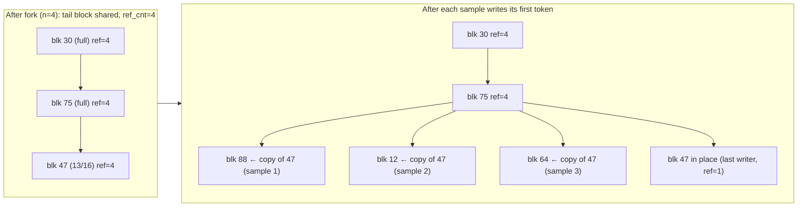
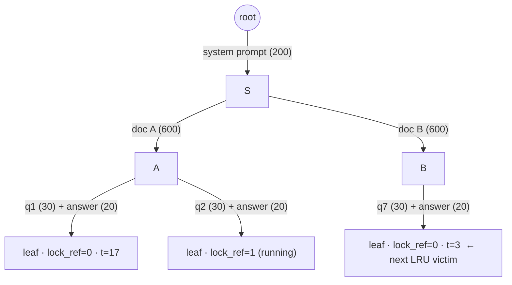

# 03 · PagedAttention: Block Tables, Copy-on-Write, Prefix Caching, and RadixAttention

> **Folder:** `01-LLM-Inference-Physics-and-KV-Cache/` · **File 3 of 3**
> **Anchoring papers:** Kwon et al., *Efficient Memory Management for Large Language Model Serving with PagedAttention*
> (SOSP 2023) · Zheng et al., *SGLang: Efficient Execution of Structured Language Model Programs* (NeurIPS 2024;
> RadixAttention) · Yu et al., *Orca* (OSDI 2022) · Prabhu et al., *vAttention: Dynamic Memory Management for Serving LLMs
> without PagedAttention* (ASPLOS 2025) · Ye et al., *FlashInfer* (MLSys 2025) · Qin et al., *Mooncake: A KVCache-centric
> Architecture for Serving LLM Chatbot* (FAST 2025) · Wu et al., *I Know What You Asked: Prompt Leakage via KV-Cache
> Sharing in Multi-Tenant LLM Serving* (NDSS 2025, ⚠ verify citation details).
> **Code baseline:** Python 3.10+ (verified on CPython 3.14.5 + NumPy 2.5.4) · Java 21 (JDK 25.0.4, `--release 21`).
> **Previous:** [02 · KV cache math and FlashAttention](02-kv-cache-math-mha-gqa-mla-and-flashattention-sram-tiling.md) ·
> **Next folder:** `02-High-Throughput-Serving-and-Distributed-Inference/` (continuous batching, chunked prefill,
> disaggregation)

---

## 0. The thesis in one paragraph

A request's KV cache is a **growing allocation of unknown final size**. Its length depends on tokens the model hasn't
generated yet. Contiguous allocation forces a choice between reserving the worst case (wasting most of HBM) and moving
tensors when they outgrow their slot (stalling the GPU). PagedAttention applies the operating-system answer: fixed-size
**blocks**, a per-sequence **block table** mapping logical to physical blocks, and an attention kernel that walks the
table. Once memory is paged, everything an OS does with pages becomes cheap. Forking a sequence shares its blocks with
**copy-on-write**. Identical prefixes across requests share blocks through **content hashing**. Freed blocks keep their
contents as a **cache** until reallocated. RadixAttention (SGLang) generalizes sharing from hash chains of blocks to a
**radix tree of tokens**, and makes the *scheduler* cache-aware. Fleet routers (SGLang router, llm-d, NVIDIA Dynamo)
extend the same tree across replicas. The physics from Files 01–02 says KV bytes are the scarcest resource in serving,
and this file is about never storing, computing, or moving the same KV byte twice.

---

## 1. The memory-waste problem, quantified

### 1.1 Three kinds of waste in contiguous KV allocation

Pre-vLLM systems (FasterTransformer, Orca) stored each request's KV in a contiguous tensor sized at admission. Kwon et
al. identify three wastes:

```
  one request's contiguous slot, reserved for max_len = 2048 tokens
  ┌──────────────────────┬───────────────────────────────┬──────────────────────────────┐
  │ prompt + generated   │ reserved: future tokens       │ internal fragmentation:      │
  │ (actually used)      │ (used later... or never)      │ max_len - final_len          │
  └──────────────────────┴───────────────────────────────┴──────────────────────────────┘
  + external fragmentation between slots of different sizes in the allocator (buddy/caching allocator)
```

The paper measures that in such systems **only 20.4%–38.2% of KV memory holds actual token states**.

### 1.2 Reproduced: held vs used, 20,000 requests

`paged_kv_manager.fragmentation()` snapshots requests at a random point of their life. Lengths come from a synthetic
ShareGPT-like lognormal: mean prompt ~160 tokens, mean output ~340, `max_len = 2048`.

| Allocation policy | Utilization (used / held) | Waste |
|-------------------|--------------------------:|------:|
| Contiguous, reserve `max_len` | **14.5%** | 85.5% |
| Contiguous, oracle final length (impossible in practice: the output length is unknown) | 66.1% | 33.9% |
| **Paged, block_size = 16** | **97.5%** | **2.5%** |

Even an *oracle* that knew every output length wastes a third of memory on reserved-but-not-yet-used slots. Paging
wastes only the unfilled tail of each sequence's last block, at most `block_size − 1` tokens. Batch size is bounded by
memory (File 01 §1.7), so a 97.5% vs 14.5% utilization gap is a **6.7× larger batch on the same GPU**. That is the
mechanism behind the paper's **2–4× throughput** gains over FasterTransformer and Orca at equal latency.

---

## 2. PagedAttention mechanics

### 2.1 Blocks, block tables, slot mapping

```
  Logical view (per sequence)                 Physical KV pool (one per layer; K and V)
                                              block id:   0     1     2     3     4     5     6     7
  Seq A: "The cat sat on the mat and ..."               ┌─────┬─────┬─────┬─────┬─────┬─────┬─────┬─────┐
    logical 0 [The cat sat on]  ───────────────────────▶ │     │  A0 │     │     │  A1 │     │ A2* │     │
    logical 1 [the mat and it]  ──────────────┐          └─────┴──▲──┴─────┴─────┴──▲──┴─────┴──▲──┴─────┘
    logical 2 [purred ▢ ▢ ▢]  (2/4 filled)    └──────────────────────────────────────┘           │
                                                                                                │
  Block table A: [1, 4, 6]  + "filled in last block = 2"  ────────────────────────────────────────┘

  slot(pos) = block_table[pos // block_size] * block_size + pos % block_size
  e.g. pos 9 -> block_table[2] = 6 -> slot 6*4 + 1 = 25        (block_size = 4 in this sketch)
```

- The **scheduler** owns block tables and a free pool. Each step it ensures every running sequence has a writable slot
  for its next token.
- The **worker** receives, per step, a flattened `slot_mapping`: one physical slot per new token, which the
  `reshape_and_cache` kernel uses to scatter K/V into the pool. It also receives `block_tables`, one row per sequence,
  which the attention kernel reads.
- Logical contiguity is preserved. Physical contiguity is irrelevant, and `paged_attention_ref.py` deliberately
  scrambles physical placement (blocks `[30, 75, 47, 77, 60]` for one sequence) and still matches contiguous attention
  to 5.6e-16.

**Physical layouts in vLLM** (⚠ verify for your version):

- The legacy PagedAttention CUDA kernel used `key_cache[num_blocks, num_kv_heads, head_size/x, block_size, x]`, with
  `x` = 16 bytes / element size, for vectorized 16-byte loads. It used
  `value_cache[num_blocks, num_kv_heads, head_size, block_size]`.
- The V1 engine's FlashAttention/FlashInfer backends use
  `[2, num_blocks, block_size, num_kv_heads, head_size]`, so a block is one contiguous chunk per K/V per layer, which
  makes it easy to DMA or RDMA.

### 2.2 Choosing the block size

| Smaller blocks (e.g. 1–8 tokens) | Larger blocks (e.g. 64–128 tokens) |
|----------------------------------|------------------------------------|
| less tail waste (≤ B−1 tokens per sequence) | fewer table entries, so less indirection per token |
| finer-grained prefix sharing (prefixes rarely align to big blocks) | better kernel efficiency: longer contiguous loads, fewer gathers |
| more metadata, more hash computations (prefix caching) | better for KV transfer (RDMA/NVMe: larger, fewer transfers; Folder 02) |

Defaults reflect workloads and kernels: vLLM **16**; SGLang **1** (token-granular radix, with page sizes > 1
supported); FlashMLA uses **64**; TensorRT-LLM's `tokens_per_block` is larger (⚠ verify default). The waste bound is
explicit. With 16-token blocks and a 1,000-token average sequence, expected tail waste is ~7.5/1000 ≈ 0.75%. With 128,
it is ~6.4%.

**Disaggregated serving constraint:** if prefill and decode instances use different block sizes, every KV transfer
needs a re-layout. Pick one block size per model across the fleet (Folder 02).

### 2.3 The kernel: walking the block table

The decode kernel loads blocks in logical order through the table and runs the online softmax across them (File 02
§3.2). It never gathers the context into a contiguous buffer. In `paged_decode_attention()` (§4.2), each iteration is
one physical block. Masking happens only in the last, partially filled block. GQA is handled by indexing
`kv_head = q_head // g` rather than replicating K/V. Production kernels add split-KV partitioning for long contexts
(vLLM's PagedAttention V2 kernel, Flash-Decoding), CUDA-graph-friendly fixed-size metadata, and FP8 dequantization in
registers.

### 2.4 Memory budgeting: how vLLM decides how many blocks exist

At startup the engine loads weights and runs a **profiling forward pass** at the maximum batched-token budget to
measure peak activation memory. It then gives the rest to KV:

$$
N_{\text{blocks}} = \left\lfloor \frac{U \cdot M_{\text{HBM}} - M_{\text{weights}} - M_{\text{activations,peak}} - M_{\text{non-torch}}}
{\text{block\_size} \times \kappa_{\text{rank}}} \right\rfloor,
\qquad \kappa_{\text{rank}} = 2\, n_{\text{layers}}\, n_{\text{kv,rank}}\, d_{\text{head}}\, b_{kv},
$$

where $U$ is `gpu_memory_utilization` (default 0.9). For Llama-3-70B at TP=8 on H100 (File 01's planner, 3 GiB
activation reserve), $\kappa_{\text{rank}} = 40{,}960$ B and a block is 655,360 B, giving **84,808 blocks = 1,356,942
tokens**. Operational consequences:

- The engine's startup log line reporting KV capacity in tokens and the maximum concurrency at `max_model_len` is the
  ground truth. Assert it against your planner in CI.
- `max_num_batched_tokens` (the chunked-prefill budget) raises the profiled activation peak. At this geometry,
  **every extra GiB of activation reserve per GPU costs ~26K tokens of KV capacity for the TP=8 group** (1 GiB /
  40,960 B).
- CUDA graphs, NCCL buffers and the allocator's fragmentation sit in $M_{\text{non-torch}}$. Setting $U$ = 0.95+
  invites OOMs under load. Setting 0.8 strands capacity.

### 2.5 Forking and copy-on-write

Parallel sampling (`n > 1`), beam search, and agent "branching" all fork a sequence. Paging makes a fork O(#blocks):
copy the *table*, bump each block's reference count. Writes go only to the **tail**. When a sequence must write into a
tail block whose `ref_cnt > 1`, the manager allocates a fresh block, schedules a **block copy** (src → dst) for the
worker, drops one reference on the old block, and swaps the table entry. Full blocks are immutable and stay shared
forever.



Verified by `paged_attention_ref.py`. A 45-token prompt forked into 4 samples for 20 decode steps issues **exactly 3
CoW copies**: the last sharer writes in place because its `ref_cnt` has dropped to 1. All 4 samples keep the 2 full
prefix blocks shared, they hold **14 distinct blocks instead of 20**, and every sample's attention matches an
independent contiguous computation to 1.1e-15. The **naive** engine, which shares blocks on fork but writes in place,
silently corrupts **3 of 4** samples: max errors of 0.08 / 0.13 / 0.25, with only the last writer correct. No exception
is raised. That is the most dangerous kind of KV bug.

The paper reports memory savings from sharing that grow with the degree of sharing. Its numbers are modest for parallel
sampling (most of a sample is its own output) and large for beam search, roughly 6–10% vs 38–55% on its Alpaca-based
traces (⚠ verify the exact figures in §6.3 of the paper).

> **vLLM V1 note (⚠ verify for your version):** V1 dropped the in-engine CoW and beam-search machinery. Parallel
> sampling fans out into sibling requests at the front end, and the shared prompt is deduplicated through automatic
> prefix caching of **full** blocks. Each sibling recomputes only the partial tail block, which is less than one block
> of prefill and cheap. The mechanism changed. The physics didn't.

### 2.6 Preemption: swap vs recompute, and the storm

When a running sequence needs a new block and none is free, the scheduler must **preempt**:

- **All-or-nothing per sequence group.** A sequence without its full context is useless, so partial eviction is
  pointless.
- **LIFO victim selection:** the most recently admitted request is evicted first, preserving FCFS fairness for older
  requests.
- **Two recovery modes:**

| | Swap (copy blocks to host DRAM, copy back later) | Recompute (free blocks; re-prefill prompt + generated tokens on readmission) |
|-|----|----|
| Cost for one 4K-token Llama-3-70B sequence, TP=8 | 167.8 MB per GPU over PCIe Gen5 (~50 GB/s effective) → **~3.4 ms each way** | Re-prefill ≈ **201 ms** of 8-GPU time (File 01 planner, incl. 54 ms of all-reduce) |
| Resources consumed | PCIe bandwidth, pinned host memory, copy streams | GPU compute in the prefill path, which stalls co-scheduled decodes (ITL spikes) |
| Interaction with prefix caching | none | **freed blocks remain cached**, so readmission often hits its own prefix |
| Who uses it | vLLM V0 (swap for multi-sequence groups such as beam search) | vLLM V0 default for single sequences; **V1: recompute only** (⚠ verify), with KV-offload connectors restoring swap-like tiers |

Raw swap is ~30× cheaper per sequence. Recompute won the V1 design anyway, for simplicity: no host-side block
manager, no swap streams, no fragmentation of pinned memory. Prefix caching then recovers much of the recompute cost.
The simulator below shows **129,059 vs 218,755 recomputed tokens (−41%)** under identical preemptions, only because
preempted requests hit their own freed-but-cached blocks.

**The storm.** If admission is greedy, the engine admits until blocks run out. Every running sequence then grows by
one token per step, and blocks run out *again*. It evicts, re-admits the victim, evicts... Each re-admission is a
prefill that stalls every decode in its step. From `paged_kv_manager.simulate()` (400 requests, 2,000 × 16-token
blocks, Llama-3-8B-class step-time model from File 01):

| Admission policy | Steps | Preemptions | Recomputed tokens | Makespan | ITL p50 | ITL p99 |
|------------------|------:|------------:|------------------:|---------:|--------:|--------:|
| Greedy, no prefix cache | 8,476 | **290** | **218,755** | 61.8 s | 5.7 ms | **56.3 ms** |
| Greedy, prefix cache | 8,476 | 290 | 129,059 | 59.1 s | 5.7 ms | 47.8 ms |
| **10% headroom, prefix cache** | 9,111 | **17** | **13,668** | **58.5 s** | 5.6 ms | **40.6 ms** |
| 30% headroom, prefix cache | 11,383 | 14 | 11,159 | 68.6 s | 5.4 ms | 37.1 ms |

10% headroom cuts preemptions 17× and gives the best makespan. 30% buys almost nothing more against preemptions and
costs 17% makespan, because the headroom strands capacity. The p99 ITL that remains (~40 ms) comes from **unchunked
prefills**: every admission's prompt rides in a decode step. That is exactly the problem chunked prefill solves
(Folder 02).

### 2.7 The alternative to paging: vAttention

vAttention (Prabhu et al.) keeps each request's KV **virtually contiguous** and maps physical memory on demand with
CUDA's virtual memory management APIs (`cuMemCreate` / `cuMemMap`). The OS-style paging moves from the attention kernel
into the driver. Unmodified kernels such as FlashAttention work without block-table support, and the cost moves to
page-mapping latency and page granularity: 2 MiB native pages, with smaller pages requiring driver changes. It is a
real design alternative worth naming in an interview. The ecosystem has nonetheless standardized on block tables
(FlashAttention, FlashInfer and FlashMLA all accept paged KV natively).

---

## 3. Automatic prefix caching (vLLM-style)

### 3.1 Content-addressed blocks, chained hashes

A full block's identity must capture **everything that determines its K/V**: its tokens *and* every token before it,
because K/V at position $t$ depends on the whole prefix through all lower layers, plus anything else that changes the
computation:

$$
h_i = H\big(h_{i-1} \,\|\, \text{tokens}[iB : (i+1)B] \,\|\, \text{extra\_keys}\big),\qquad h_{-1} = 0,
$$

where `extra_keys` include the **LoRA adapter id**, **multimodal input hashes** (an image placeholder token is the same
id for different images), and a per-tenant **`cache_salt`**. The cache is a map `hash → physical block`. Lookup walks
the prompt's full blocks in order and stops at the first miss.

Rules that the code (§4.1) enforces and tests:

1. **Only full blocks are cached.** A partial block is mutable, so its hash is undefined.
2. **The last prompt token is always recomputed.** Sampling needs its logits, so a fully cached prompt still computes
   ≥ 1 token: `(len(tokens) − 1) // block_size` blocks maximum.
3. **Freed blocks stay cached.** On `ref_cnt → 0` a block goes to the **tail** of the free queue with its hash intact.
   A later hit "revives" it (`touch`). Only when reallocation pops it from the **head** is the hash evicted. Eviction
   is LRU, lazy, and O(1).
4. **Tail-first within a sequence.** Freeing in **reverse** block order puts a sequence's tail nearest the eviction end,
   so the shared prefix (system prompt, document) survives longest.
5. **Blocks without a hash are reused first.** The listing moves them to the eviction end: a small refinement that
   avoids evicting valid cache entries while content-free blocks exist.

### 3.2 Security: the KV cache is a side channel

A prefix-cache hit is **faster** (lower TTFT). An attacker who shares a cache with a victim can probe candidate
prefixes and time the responses, recovering the victim's prompt token by token. This class of attack has been
demonstrated against multi-tenant serving (Wu et al., NDSS 2025; ⚠ verify). Mitigations:

- **`cache_salt` per tenant or per security domain.** It is part of the hash, so cross-tenant hits are impossible. The
  unit test asserts that a salted request with identical tokens gets **zero** hits.
- Use a **collision-resistant hash** (SHA-256). A weak or seeded hash lets crafted inputs collide and *read another
  tenant's KV*, which is a correctness and confidentiality failure, not just a performance one. vLLM exposes the hash
  algorithm as a config option (⚠ verify the default in your version).
- Never share caches across trust boundaries "for hit rate". Per-tenant salting typically costs little, because
  cross-tenant prefixes are rare except for vendor-wide system prompts. Those can be pre-warmed under a shared, public
  salt on purpose.

### 3.3 Operating it

- Hit rate = cached prompt tokens / queried prompt tokens. vLLM exports prefix-cache query and hit counters
  (⚠ metric names differ across versions).
- **Prompt-template discipline is the biggest lever.** Anything dynamic at the *start* of a prompt (timestamp, request
  ID, user name, shuffled tool list) changes $h_0$, and every block after it misses (§5, F2). Put static content
  first: system prompt → tools → documents → conversation → the volatile suffix.
- **Measure TTFT by hit/miss cohort.** Hits should show TTFT roughly proportional to the *uncached* suffix only.

---

## 4. RadixAttention (SGLang)

### 4.1 The data structure

A **radix tree** (compressed trie) whose edges are labeled with token sequences. Each node owns the KV slots for its
edge's tokens. SGLang's default page size is 1, so sharing is token-granular. Requests that share a prefix share the
path from the root.



| Operation | What it does | Notes |
|-----------|--------------|-------|
| `match_prefix(tokens)` | walks the tree; on a partial edge match, **splits** the node so the match ends at a node boundary; returns cached slot ids + deepest node | updates `last_access` along the path |
| `inc_lock_ref(node)` / `dec_lock_ref` | pins/unpins the whole path to the root for a running request | maintains `evictable` vs `protected` token counts |
| `insert(tokens, slots)` | adds the finished sequence; returns how many leading tokens were **already** present | the caller **frees its duplicate slots** for that span, because another request may have inserted the same prefix concurrently |
| `evict(n)` | pops unlocked **leaves** in LRU order, frees their slots; a parent that becomes an unlocked leaf joins the heap | never evicts a node on a running request's path |

`radix_cache.py` (§4.3) implements all four and tests split correctness, duplicate-insert accounting, lock pinning,
LRU leaf eviction, and slot conservation (`free + cached == pool size` after every schedule).

### 4.2 Cache-aware scheduling: longest-prefix-match

The SGLang paper's key observation: **the order in which waiting requests run determines the hit rate**, and an order
that visits the radix tree depth-first maximizes it. The paper proves DFS order optimal for a batch of requests when the
cache can hold the longest request. Its practical form is **longest-prefix-match (LPM)**: sort the waiting queue by
matched-prefix length. Reproduced (128 requests = 8 documents × 16 questions, 830-token prompts, shuffled arrival,
batch of 4):

| KV pool (tokens) | FCFS hit rate | **LPM hit rate** | Upper bound |
|-----------------:|--------------:|-----------------:|------------:|
| 2,400 | 47.4% | **91.5%** | 91.7% |
| 3,200 | 52.3% | 89.0% | 91.7% |
| 6,400 | 87.7% | 88.9% | 91.7% |

Three lessons, each an interview follow-up:

1. **LPM matters when the cache is small relative to the working set.** At 6,400 tokens everything fits and order
   barely matters. At 2,400 tokens LPM is within 0.2 points of optimal while FCFS thrashes.
2. **LPM scores lower at 3,200 than at 2,400 because of in-batch duplicates.** A bigger pool admits more cold requests
   in the first batch. Two requests for the *same* document in one batch both miss, because neither is inserted until
   its prefill completes. SGLang's scheduler includes an in-batch prefix check that deprioritizes such duplicates
   (⚠ verify thresholds).
3. **LPM is O(waiting × prompt) per scheduling round** and can starve requests with unique prefixes. SGLang falls back
   to FCFS when the queue is long, and production schedulers add aging and priority.

### 4.3 vLLM APC vs SGLang RadixAttention

| Dimension | vLLM automatic prefix caching | SGLang RadixAttention |
|-----------|-------------------------------|------------------------|
| Granularity | full blocks (16 tokens default); partial blocks never shared | tokens (page size 1 default) or pages |
| Index | hash map `chained_hash → block` | radix tree of token sequences |
| Lookup cost | one hash per full block (hashing dominates for long prompts) | tree walk with token comparisons; splits on divergence |
| Eviction | LRU over free blocks (lazy; O(1) via the free queue) | LRU over unlocked leaves (heap) |
| Scheduler integration | FCFS/priority with prefix-cache-aware admission | LPM/DFS-style ordering, in-batch dedup |
| Multi-tenant isolation | `cache_salt` in the hash | namespace/extra keys (⚠ verify) |
| Best for | chat/RAG with long, block-aligned shared prefixes; huge request rates | program-like workloads (agents, tree-of-thought, few-shot fan-out) with many branch points |

### 4.4 From one engine to a fleet: cache-aware routing

Each replica has its own cache, so a **round-robin load balancer destroys locality**: a tenant's prefix ends up cached
everywhere, or effectively nowhere. Fleet routers keep an **approximate** radix tree per replica (what that replica has
probably cached) and route by match. `PrefixAwareRouter.java` (§4.4) implements the SGLang-router-style policy:

1. **Load guard:** if `max_load − min_load > abs_threshold` **and** `max_load > rel_threshold × min_load`, send to the
   least-loaded replica.
2. Otherwise, **affinity:** send to the replica with the highest match rate if it exceeds `cache_threshold`.
3. Otherwise, **most free cache:** send to the replica with the smallest tree.
4. A **periodic LRU sweep** keeps each tree under a budget that approximates the replica's KV capacity.

Results (6 tenants with 2,000-token system prompts, 4 replicas, budget ≈ 2 tenants per replica; one measured run):

| Scenario | Policy | Prefix hit rate | Max replica share |
|----------|--------|----------------:|------------------:|
| Even tenant mix | round-robin | 67.2% | 25.0% |
| Even tenant mix | **cache-aware** | **93.7%** | 30.6% |
| Hot tenant (70% of traffic) | affinity only | 94.0% | **75.3%** (one replica melts) |
| Hot tenant (70% of traffic) | **affinity + load guard** | 91.3% | **28.8%** |

The load guard trades **2.7 points of hit rate for a 2.6× lower hot-spot share**, and that trade is the whole design.
Approximate trees drift from reality: the engine evicts on its own schedule, and the router can't see it. Precise
routers consume **KV events** from the engines instead. vLLM can publish block-stored and block-removed events (⚠
verify `--kv-events-config`), consumed by llm-d's inference scheduler and NVIDIA Dynamo's KV-aware router.

---

## 5. Production code blueprints

### 5.1 Python: the block manager (paging, CoW, prefix caching, preemption simulator)

Contrasts inside one listing: `fragmentation()` prices the **naive contiguous** reservation, and `simulate()` compares
**greedy admission** with headroom-gated admission.

```python
"""paged_kv_manager.py - a PagedAttention KV block manager (stdlib only, Python 3.10+).

Semantics follow Kwon et al. (SOSP'23) plus vLLM-V1-style automatic prefix caching:
  * a fixed pool of physical blocks, each holding `block_size` token slots;
  * per-sequence block tables (logical block i -> physical block id);
  * reference counts + copy-on-write for fork()ed sequences (parallel sampling, beam search);
  * hash-chained prefix caching over FULL blocks; freed blocks keep their content in an LRU free
    queue until reallocation evicts them;
  * recompute preemption, and an iteration-level scheduler that reproduces preemption storms.
"""
from __future__ import annotations

import hashlib
import math
import random
import struct
from collections import OrderedDict, deque
from dataclasses import dataclass, field


@dataclass(eq=False)
class KVBlock:
    block_id: int
    ref_cnt: int = 0
    block_hash: bytes | None = None      # set when the block is full, i.e. immutable and shareable


def hash_block(parent: bytes | None, tokens: tuple[int, ...], extra_key: bytes = b"") -> bytes:
    """Chained content hash: a block's identity is its tokens AND everything before it.
    extra_key carries LoRA id, multimodal input hashes, and a per-tenant cache_salt."""
    h = hashlib.sha256()
    h.update(parent or bytes(32))
    h.update(struct.pack(f"<I{len(tokens)}I", len(tokens), *tokens))
    h.update(extra_key)
    return h.digest()


class BlockPool:
    def __init__(self, num_blocks: int, enable_caching: bool = True):
        self.blocks = [KVBlock(i) for i in range(num_blocks)]
        # Free queue in eviction order: index 0 is the next victim. Ref-0 blocks with a hash are
        # still a valid cache entry until they are popped.
        self.free_queue: OrderedDict[int, KVBlock] = OrderedDict((b.block_id, b) for b in self.blocks)
        self.cached: dict[bytes, KVBlock] = {}
        self.enable_caching = enable_caching
        self.evictions = 0

    @property
    def num_free(self) -> int:
        return len(self.free_queue)

    def allocate(self) -> KVBlock:
        if not self.free_queue:
            raise MemoryError("no free KV blocks")
        _, blk = self.free_queue.popitem(last=False)
        if blk.block_hash is not None:                     # reallocation evicts the cached content
            if self.cached.get(blk.block_hash) is blk:
                del self.cached[blk.block_hash]
            blk.block_hash = None
            self.evictions += 1
        blk.ref_cnt = 1
        return blk

    def touch(self, blk: KVBlock) -> None:
        """Take a reference on a cache hit; revives the block if it was sitting in the free queue."""
        if blk.ref_cnt == 0:
            del self.free_queue[blk.block_id]
        blk.ref_cnt += 1

    def release(self, blk: KVBlock) -> None:
        if blk.ref_cnt <= 0:
            raise AssertionError(f"double free of block {blk.block_id}")
        blk.ref_cnt -= 1
        if blk.ref_cnt == 0:
            self.free_queue[blk.block_id] = blk            # MRU end: evicted last
            if not (self.enable_caching and blk.block_hash is not None):
                blk.block_hash = None
                self.free_queue.move_to_end(blk.block_id, last=False)   # no content: reuse first


@dataclass(eq=False)
class Sequence:
    seq_id: int
    tokens: list[int]
    extra_key: bytes = b""
    max_new_tokens: int = 0
    block_table: list[KVBlock] = field(default_factory=list)
    block_hashes: list[bytes] = field(default_factory=list)   # chained hashes of full blocks
    num_computed: int = 0                                     # tokens whose KV is in block_table
    prompt_len: int = 0

    def __post_init__(self) -> None:
        self.prompt_len = self.prompt_len or len(self.tokens)

    @property
    def generated(self) -> int:
        return len(self.tokens) - self.prompt_len

    @property
    def finished(self) -> bool:
        return self.generated >= self.max_new_tokens


class KVCacheManager:
    def __init__(self, num_blocks: int, block_size: int = 16, enable_caching: bool = True):
        self.pool = BlockPool(num_blocks, enable_caching)
        self.bs = block_size
        self.pending_copies: list[tuple[int, int]] = []   # (src, dst) copy-on-write jobs for the worker
        self.query_tokens = 0
        self.hit_tokens = 0

    # ------------------------------------------------------------------ prefix caching
    def get_computed_blocks(self, seq: Sequence) -> list[KVBlock]:
        """Longest cached run of FULL blocks. Never the entire prompt: the last prompt token must be
        recomputed, because sampling needs its logits."""
        if not self.pool.enable_caching:
            return []
        hits: list[KVBlock] = []
        parent: bytes | None = None
        for i in range((len(seq.tokens) - 1) // self.bs):
            h = hash_block(parent, tuple(seq.tokens[i * self.bs:(i + 1) * self.bs]), seq.extra_key)
            blk = self.pool.cached.get(h)
            if blk is None:
                break
            hits.append(blk)
            parent = h
        return hits

    def allocate_prefill(self, seq: Sequence, reserve_blocks: int = 0) -> bool:
        """Admit `seq` (fresh, or a preempted one being recomputed). Shares cached prefix blocks and
        allocates the rest. Fails without side effects if fewer than `reserve_blocks` would remain."""
        hits = self.get_computed_blocks(seq)
        need = math.ceil(len(seq.tokens) / self.bs) - len(hits)
        revived = sum(1 for b in hits if b.ref_cnt == 0)        # touching these consumes free slots
        if self.pool.num_free - revived - need < reserve_blocks:
            return False
        for b in hits:
            self.pool.touch(b)
        seq.block_table = list(hits) + [self.pool.allocate() for _ in range(need)]
        seq.block_hashes = [b.block_hash for b in hits]          # type: ignore[misc]
        seq.num_computed = len(hits) * self.bs
        self.query_tokens += len(seq.tokens)
        self.hit_tokens += seq.num_computed
        return True

    def commit(self, seq: Sequence, upto: int) -> None:
        """The forward pass wrote KV for tokens [num_computed, upto); seal any block that became full."""
        seq.num_computed = upto
        while len(seq.block_hashes) < seq.num_computed // self.bs:
            i = len(seq.block_hashes)
            parent = seq.block_hashes[-1] if seq.block_hashes else None
            h = hash_block(parent, tuple(seq.tokens[i * self.bs:(i + 1) * self.bs]), seq.extra_key)
            seq.block_hashes.append(h)
            blk = seq.block_table[i]
            if self.pool.enable_caching and blk.block_hash is None:
                blk.block_hash = h
                self.pool.cached.setdefault(h, blk)   # identical content elsewhere: first copy wins

    # ------------------------------------------------------------------ decode growth + CoW
    def append_slot(self, seq: Sequence) -> bool:
        """Make slot `num_computed` writable for this step's token. Returns False if out of blocks."""
        pos = seq.num_computed
        idx = pos // self.bs
        if idx == len(seq.block_table):                        # tail block full: grow the table
            if self.pool.num_free == 0:
                return False
            seq.block_table.append(self.pool.allocate())
            return True
        tail = seq.block_table[idx]
        if tail.ref_cnt > 1:                                   # shared partial block: copy-on-write
            if self.pool.num_free == 0:
                return False
            fresh = self.pool.allocate()
            self.pending_copies.append((tail.block_id, fresh.block_id))
            self.pool.release(tail)
            seq.block_table[idx] = fresh
        return True

    def slot(self, seq: Sequence, pos: int) -> int:
        """Physical slot id for token position `pos` (vLLM's slot_mapping entry)."""
        return seq.block_table[pos // self.bs].block_id * self.bs + pos % self.bs

    def fork(self, parent: Sequence, child_id: int) -> Sequence:
        child = Sequence(child_id, list(parent.tokens), parent.extra_key, parent.max_new_tokens,
                         prompt_len=parent.prompt_len)
        for b in parent.block_table:
            self.pool.touch(b)
        child.block_table = list(parent.block_table)
        child.block_hashes = list(parent.block_hashes)
        child.num_computed = parent.num_computed
        return child

    def free(self, seq: Sequence) -> None:
        # Reverse order: the tail lands nearest the eviction end, so shared prefixes survive longest.
        for b in reversed(seq.block_table):
            self.pool.release(b)
        seq.block_table, seq.block_hashes, seq.num_computed = [], [], 0


# ---------------------------------------------------------------------- scheduler simulation
# Step-time model for a Llama-3-8B-class model on one H100 (numbers from roofline.py):
WEIGHT_STREAM_MS = 4.5          # every step streams ~16 GB of weights
PREFILL_MS_PER_TOKEN = 0.03     # ~15 GFLOP/token at ~50% of 989 TFLOP/s
KV_READ_MS_PER_TOKEN = 3.9e-5   # 128 KiB of KV per cached token at 3.35 TB/s


@dataclass
class SimResult:
    steps: int
    preemptions: int
    recomputed_tokens: int
    generated_tokens: int
    peak_running: int
    total_s: float
    itl_p50_ms: float
    itl_p99_ms: float


def simulate(requests: list[tuple[int, int]], num_blocks: int, block_size: int = 16,
             reserve_frac: float = 0.0, max_running: int = 256, caching: bool = True,
             seed: int = 0) -> SimResult:
    """Iteration-level scheduling (Orca/vLLM): every step, decode all running sequences; preempt the
    most recently admitted one (recompute mode) whenever a decode slot cannot be found; then admit
    waiting requests FCFS while `reserve_frac` of the pool stays free. Prefills are NOT chunked here,
    so every admitted prompt (fresh or recomputed) stalls the decodes sharing its step."""
    rng = random.Random(seed)
    mgr = KVCacheManager(num_blocks, block_size, caching)
    waiting: deque[Sequence] = deque(
        Sequence(i, [rng.randrange(32000) for _ in range(p)], max_new_tokens=o)
        for i, (p, o) in enumerate(requests))
    running: list[Sequence] = []
    reserve = int(reserve_frac * num_blocks)
    steps = preemptions = recomputed = generated = peak = 0
    step_ms: list[float] = []
    while waiting or running:
        steps += 1
        if steps > 1_000_000:
            raise RuntimeError("livelock")
        # 1) reserve one slot per running sequence; preempt from the back on failure.
        i = 0
        while i < len(running):
            seq = running[i]
            if mgr.append_slot(seq):
                i += 1
                continue
            victim = running.pop()                          # LIFO victim (latest admitted)
            mgr.free(victim)
            waiting.appendleft(victim)
            preemptions += 1
        # 2) admit (fresh or preempted) prefills while headroom remains.
        new: list[Sequence] = []
        while waiting and len(running) + len(new) < max_running:
            seq = waiting[0]
            if not mgr.allocate_prefill(seq, reserve if running else 0):
                break
            waiting.popleft()
            recomputed += len(seq.tokens) - seq.num_computed if seq.generated else 0
            new.append(seq)
        # 3) "run" the step: prefills compute their prompt and sample a token; decodes append one.
        prefill_tokens = sum(len(s.tokens) - s.num_computed for s in new)
        context_tokens = sum(s.num_computed for s in running)
        t = WEIGHT_STREAM_MS + PREFILL_MS_PER_TOKEN * prefill_tokens + KV_READ_MS_PER_TOKEN * context_tokens
        if running:
            step_ms.append(t)                               # what every running user sees as ITL
        for seq in running:
            mgr.commit(seq, seq.num_computed + 1)
            seq.tokens.append(rng.randrange(32000))
            generated += 1
        for seq in new:
            mgr.commit(seq, len(seq.tokens))
            seq.tokens.append(rng.randrange(32000))
            generated += 1
        running += new
        peak = max(peak, len(running))
        for seq in [s for s in running if s.finished]:
            running.remove(seq)
            mgr.free(seq)
    step_ms.sort()
    pct = lambda q: step_ms[min(len(step_ms) - 1, int(q * len(step_ms)))]  # noqa: E731
    return SimResult(steps, preemptions, recomputed, generated, peak,
                     sum(step_ms) / 1e3, pct(0.50), pct(0.99))


# ---------------------------------------------------------------------- fragmentation analysis
def fragmentation(n: int = 20_000, max_len: int = 2048, block_size: int = 16, seed: int = 1):
    """Snapshot of KV slots HELD vs slots USED for requests caught at a random point of their life.
    Lengths are a synthetic ShareGPT-like lognormal (mean prompt ~160, mean output ~340 tokens)."""
    rng = random.Random(seed)
    used = held_max = held_oracle = held_paged = 0
    for _ in range(n):
        prompt = min(max_len // 2, max(4, int(rng.lognormvariate(4.6, 0.9))))
        out = min(max_len - prompt, max(1, int(rng.lognormvariate(5.4, 0.8))))
        cur = prompt + int(rng.random() * out)
        used += cur
        held_max += max_len                                   # reserve the model's max length
        held_oracle += prompt + out                           # reserve exactly the final length
        held_paged += math.ceil(cur / block_size) * block_size
    return {"contiguous, reserve max_len": used / held_max,
            "contiguous, oracle length": used / held_oracle,
            f"paged, block_size={block_size}": used / held_paged}


# ---------------------------------------------------------------------- self-test
def _tests() -> None:
    bs = 4
    m = KVCacheManager(num_blocks=16, block_size=bs)
    sys_prompt = list(range(100, 110))                         # 10 tokens = 2 full blocks + 2
    a = Sequence(1, sys_prompt + [1, 2], max_new_tokens=4)     # 12 tokens = 3 full blocks
    assert m.allocate_prefill(a) and len(a.block_table) == 3 and a.num_computed == 0
    m.commit(a, len(a.tokens))
    assert len(a.block_hashes) == 3 and len(m.pool.cached) == 3

    b = Sequence(2, sys_prompt + [7, 8, 9], max_new_tokens=4)  # shares the first 2 blocks
    assert m.allocate_prefill(b)
    assert b.num_computed == 8 and b.block_table[:2] == a.block_table[:2]
    assert a.block_table[0].ref_cnt == 2 and b.block_table[2] is not a.block_table[2]

    salted = Sequence(3, sys_prompt + [7, 8, 9], extra_key=b"tenant-B")
    assert m.get_computed_blocks(salted) == [], "cache_salt must isolate tenants"

    exact = Sequence(4, sys_prompt + [1, 2])                   # whole prompt cached -> last block recomputed
    assert len(m.get_computed_blocks(exact)) == 2

    # Fork + copy-on-write: parent has a partially filled tail block (13 tokens = 3 full + 1).
    p = Sequence(10, list(range(13)), max_new_tokens=8)
    assert m.allocate_prefill(p)
    m.commit(p, 13)
    kids = [m.fork(p, 11 + i) for i in range(3)]
    tail = p.block_table[3]
    assert tail.ref_cnt == 4
    for s in [p] + kids:
        s.tokens.append(500 + s.seq_id)                        # each sample picks a different token
        assert m.append_slot(s)
    assert len(m.pending_copies) == 3, m.pending_copies        # 3 copies; the last writer reuses in place
    assert len({s.block_table[3].block_id for s in [p] + kids}) == 4
    assert all(s.block_table[3].ref_cnt == 1 for s in [p] + kids)
    assert p.block_table[0].ref_cnt == 4                       # full blocks stay shared

    # Free + LRU revival: a freed block keeps its content until reallocated.
    for s in [p] + kids + [a, b]:
        m.free(s)
    again = Sequence(20, sys_prompt + [1, 2, 3])
    assert len(m.get_computed_blocks(again)) == 3, "freed blocks are still a cache hit"
    while m.pool.num_free:
        m.pool.allocate()
    assert m.pool.cached == {} and m.get_computed_blocks(again) == [], "reallocation evicts"

    try:
        m.pool.release(KVBlock(99))
        raise AssertionError("expected double-free detection")
    except AssertionError as e:
        assert "double free" in str(e)


def main() -> None:
    _tests()
    print("block-manager unit tests passed (sharing, cache_salt, CoW x3, LRU revival, eviction)")

    print("\n== Memory held vs used (snapshot of 20k requests) ==")
    for k, v in fragmentation().items():
        print(f"  {k:30s} utilization {v:6.1%}   waste {1 - v:6.1%}")

    rng = random.Random(42)
    reqs = [(rng.randint(200, 1200), rng.randint(300, 900)) for _ in range(400)]
    print("\n== Preemption storm: 400 requests, 2,000 blocks x 16 tokens (32k slots) ==")
    print(f"  {'policy':32s} {'steps':>6s} {'preempt':>7s} {'recomputed':>10s} {'makespan':>9s} "
          f"{'ITL p50':>8s} {'ITL p99':>8s}")
    results = {}
    for label, frac, cache in (("greedy admit, no prefix cache", 0.0, False),
                               ("greedy admit, prefix cache", 0.0, True),
                               ("10% headroom, prefix cache", 0.10, True),
                               ("30% headroom, prefix cache", 0.30, True)):
        r = results[label] = simulate(reqs, num_blocks=2000, reserve_frac=frac, caching=cache)
        print(f"  {label:32s} {r.steps:6d} {r.preemptions:7d} {r.recomputed_tokens:10,d} "
              f"{r.total_s:8.1f}s {r.itl_p50_ms:7.1f}ms {r.itl_p99_ms:7.1f}ms")
    g, h = results["greedy admit, no prefix cache"], results["10% headroom, prefix cache"]
    assert h.preemptions * 10 < g.preemptions and h.recomputed_tokens * 10 < g.recomputed_tokens
    assert results["greedy admit, prefix cache"].recomputed_tokens < g.recomputed_tokens
    print("\nall paged KV manager self-checks passed")


if __name__ == "__main__":
    main()
```

Output (verified, deterministic):

```text
block-manager unit tests passed (sharing, cache_salt, CoW x3, LRU revival, eviction)

== Memory held vs used (snapshot of 20k requests) ==
  contiguous, reserve max_len    utilization  14.5%   waste  85.5%
  contiguous, oracle length      utilization  66.1%   waste  33.9%
  paged, block_size=16           utilization  97.5%   waste   2.5%

== Preemption storm: 400 requests, 2,000 blocks x 16 tokens (32k slots) ==
  policy                            steps preempt recomputed  makespan  ITL p50  ITL p99
  greedy admit, no prefix cache      8476     290    218,755     61.8s     5.7ms    56.3ms
  greedy admit, prefix cache         8476     290    129,059     59.1s     5.7ms    47.8ms
  10% headroom, prefix cache         9111      17     13,668     58.5s     5.6ms    40.6ms
  30% headroom, prefix cache        11383      14     11,159     68.6s     5.4ms    37.1ms

all paged KV manager self-checks passed
```

### 5.2 Python + NumPy: the PagedAttention decode kernel, driven by the real block manager

K/V for position $t$ is a deterministic function of `tokens[:t+1]`, as in a real transformer. A prefix-cache hit
therefore produces correct attention *only if* the hash chain is correct. A non-chained hash would make this test fail.
The `Engine(cow=False)` path is the naive in-place-write bug.

```python
"""paged_attention_ref.py - PagedAttention decode semantics in NumPy, driven by paged_kv_manager.

* Physical pools use the vLLM FlashAttention-backend layout: K, V = [num_blocks, block_size, n_kv, d].
* reshape_and_cache() scatters new K/V through slot_mapping (slot = block_id * block_size + offset).
* paged_decode_attention() walks the block table one physical block at a time with online softmax,
  exactly like the kernel: it never gathers the context into a contiguous tensor.
* K/V for position t is a deterministic function of tokens[:t+1] (as in a real transformer), so a
  prefix-cache hit is only correct if the hash chain is correct.
"""
from __future__ import annotations

import hashlib
import math
import random
import struct

import numpy as np

from paged_kv_manager import KVCacheManager, Sequence

N_KV, HQ, D = 2, 8, 32


def kv_for(prefix: list[int]) -> tuple[np.ndarray, np.ndarray]:
    """Stand-in for one layer's K/V of the last token in `prefix` (depends on the whole prefix)."""
    seed = int.from_bytes(hashlib.blake2b(struct.pack(f"<{len(prefix)}I", *prefix), digest_size=8).digest(),
                          "little")
    r = np.random.default_rng(seed)
    return r.standard_normal((N_KV, D)), r.standard_normal((N_KV, D))


def q_for(tokens: list[int]) -> np.ndarray:
    return np.random.default_rng(len(tokens) * 7919 + tokens[-1]).standard_normal((HQ, D))


class PagedKVCache:
    def __init__(self, num_blocks: int, block_size: int):
        self.k = np.zeros((num_blocks, block_size, N_KV, D))
        self.v = np.zeros_like(self.k)
        self.bs = block_size

    def reshape_and_cache(self, key: np.ndarray, value: np.ndarray, slot_mapping: list[int]) -> None:
        blocks, offs = np.divmod(np.asarray(slot_mapping), self.bs)
        self.k[blocks, offs] = key
        self.v[blocks, offs] = value

    def copy_blocks(self, pairs: list[tuple[int, int]]) -> None:
        for src, dst in pairs:                       # vLLM: one batched copy_blocks kernel per step
            self.k[dst] = self.k[src]
            self.v[dst] = self.v[src]


def paged_decode_attention(q: np.ndarray, cache: PagedKVCache, block_table: list[int], ctx_len: int) -> np.ndarray:
    hq, d = q.shape
    kv_of_head = np.arange(hq) // (hq // cache.k.shape[2])        # GQA mapping, no K/V duplication
    m, l, acc = np.full(hq, -np.inf), np.zeros(hq), np.zeros((hq, d))
    for lb in range(math.ceil(ctx_len / cache.bs)):
        pb, valid = block_table[lb], min(cache.bs, ctx_len - lb * cache.bs)
        kb = cache.k[pb, :valid][:, kv_of_head]                     # [valid, hq, d]
        vb = cache.v[pb, :valid][:, kv_of_head]
        s = np.einsum("hd,thd->ht", q, kb) / math.sqrt(d)
        m_new = np.maximum(m, s.max(axis=1))
        p = np.exp(s - m_new[:, None])
        alpha = np.exp(m - m_new)
        l = alpha * l + p.sum(axis=1)
        acc = alpha[:, None] * acc + np.einsum("ht,thd->hd", p, vb)
        m = m_new
    return acc / l[:, None]


def contiguous_reference(q: np.ndarray, tokens: list[int]) -> np.ndarray:
    ks, vs = zip(*(kv_for(tokens[:t + 1]) for t in range(len(tokens))))
    k, v = np.stack(ks), np.stack(vs)                               # [L, n_kv, d]
    g = q.shape[0] // N_KV
    k, v = np.repeat(k, g, axis=1), np.repeat(v, g, axis=1)         # [L, hq, d]
    s = np.einsum("hd,thd->ht", q, k) / math.sqrt(q.shape[1])
    p = np.exp(s - s.max(axis=1, keepdims=True))
    return np.einsum("ht,thd->hd", p / p.sum(axis=1, keepdims=True), v)


class Engine:
    """Minimal model runner: scheduler-side manager + worker-side physical cache."""

    def __init__(self, num_blocks: int = 96, block_size: int = 16, scramble: bool = True, cow: bool = True):
        self.mgr = KVCacheManager(num_blocks, block_size)
        self.cache = PagedKVCache(num_blocks, block_size)
        self.cow = cow
        self.copies_executed = 0
        if scramble:                                   # make physical placement non-contiguous
            blocks = [self.mgr.pool.allocate() for _ in range(num_blocks)]
            random.Random(3).shuffle(blocks)
            for b in blocks:
                self.mgr.pool.release(b)

    def forward(self, seq: Sequence) -> np.ndarray:
        """Compute KV for every not-yet-computed position, then attend for the newest token."""
        if self.cow:
            self.cache.copy_blocks(self.mgr.pending_copies)     # worker runs CoW copies BEFORE writes
            self.copies_executed += len(self.mgr.pending_copies)
        self.mgr.pending_copies.clear()
        start = seq.num_computed
        for pos in range(start, len(seq.tokens)):
            k, v = kv_for(seq.tokens[:pos + 1])
            self.cache.reshape_and_cache(k[None], v[None], [self.mgr.slot(seq, pos)])
        self.mgr.commit(seq, len(seq.tokens))
        table = [b.block_id for b in seq.block_table]
        return paged_decode_attention(q_for(seq.tokens), self.cache, table, len(seq.tokens))

    def decode(self, seq: Sequence, token: int) -> np.ndarray:
        seq.tokens.append(token)
        if not self.cow:                                         # the naive bug: write in place
            pos = seq.num_computed
            if pos // self.mgr.bs == len(seq.block_table):
                seq.block_table.append(self.mgr.pool.allocate())
        elif not self.mgr.append_slot(seq):
            raise MemoryError("preempt")
        return self.forward(seq)


def main() -> None:
    rng = random.Random(11)
    sys_prompt = [rng.randrange(32000) for _ in range(40)]       # 2 full blocks + 8 tokens

    eng = Engine()
    a = Sequence(1, sys_prompt + [rng.randrange(32000) for _ in range(9)])
    assert eng.mgr.allocate_prefill(a)
    worst = np.abs(eng.forward(a) - contiguous_reference(q_for(a.tokens), a.tokens)).max()
    b = Sequence(2, sys_prompt + [rng.randrange(32000) for _ in range(30)])
    assert eng.mgr.allocate_prefill(b)
    reused = b.num_computed
    assert reused == 32                                          # 2 shared blocks reused, not recomputed
    worst = max(worst, np.abs(eng.forward(b) - contiguous_reference(q_for(b.tokens), b.tokens)).max())
    table = [blk.block_id for blk in b.block_table]
    print(f"prefix-cache hit: seq 2 reused {reused} of {len(b.tokens)} tokens; physical blocks {table}; "
          f"max|err| vs contiguous = {worst:.1e}")
    assert worst < 1e-12

    # Parallel sampling n=4 with copy-on-write, 20 decode steps each.
    root = Sequence(10, sys_prompt + [1, 2, 3, 4, 5])           # 45 tokens: tail block holds 13
    assert eng.mgr.allocate_prefill(root)
    eng.forward(root)
    samples = [root] + [eng.mgr.fork(root, 11 + i) for i in range(3)]
    worst = 0.0
    for step in range(20):
        for s in samples:
            out = eng.decode(s, 1000 * s.seq_id + step)
            worst = max(worst, np.abs(out - contiguous_reference(q_for(s.tokens), s.tokens)).max())
    shared = sum(1 for i, blk in enumerate(root.block_table) if all(s.block_table[i] is blk for s in samples))
    distinct = len({id(blk) for s in samples for blk in s.block_table})
    print(f"parallel sampling n=4 x 20 steps: {shared} blocks shared by all 4, {eng.copies_executed} CoW copies, "
          f"{distinct} distinct blocks held vs {sum(len(s.block_table) for s in samples)} without sharing, "
          f"max|err| = {worst:.1e}")
    assert worst < 1e-12 and shared == 2 and eng.copies_executed == 3

    # The naive engine: share blocks on fork but write the tail in place (no copy-on-write).
    bad = Engine(cow=False)
    r2 = Sequence(20, sys_prompt + [1, 2, 3, 4, 5])
    assert bad.mgr.allocate_prefill(r2)
    bad.forward(r2)
    kids = [r2] + [bad.mgr.fork(r2, 21 + i) for i in range(3)]
    errs = []
    for s in kids:
        bad.decode(s, 1000 * s.seq_id)
    for s in kids:   # re-read after all siblings wrote: earlier writers were clobbered
        table = [blk.block_id for blk in s.block_table]
        got = paged_decode_attention(q_for(s.tokens), bad.cache, table, len(s.tokens))
        errs.append(np.abs(got - contiguous_reference(q_for(s.tokens), s.tokens)).max())
    print(f"naive in-place writes to a shared tail block: per-sample max|err| = "
          f"{[f'{e:.2f}' for e in errs]}  (only the last writer is correct)")
    assert sum(e > 1e-6 for e in errs) == 3 and errs[-1] < 1e-12
    print("\nall PagedAttention reference self-checks passed")


if __name__ == "__main__":
    main()
```

Output (verified):

```text
prefix-cache hit: seq 2 reused 32 of 70 tokens; physical blocks [30, 75, 47, 77, 60]; max|err| vs contiguous = 5.6e-16
parallel sampling n=4 x 20 steps: 2 blocks shared by all 4, 3 CoW copies, 14 distinct blocks held vs 20 without sharing, max|err| = 1.1e-15
naive in-place writes to a shared tail block: per-sample max|err| = ['0.08', '0.13', '0.25', '0.00']  (only the last writer is correct)

all PagedAttention reference self-checks passed
```

### 5.3 Python: RadixAttention cache and LPM scheduling

```python
"""radix_cache.py - SGLang-style RadixAttention prefix cache (stdlib only, Python 3.10+).

A radix tree whose edges are token sequences and whose nodes own the KV slots of those tokens
(page size 1, so sharing is token-granular). Running requests pin their path with lock_ref; only
unlocked leaves are evictable, least-recently-used first. The scheduler demo reproduces the paper's
claim that longest-prefix-match (LPM, ~DFS order) beats FCFS on cache hit rate.
"""
from __future__ import annotations

import heapq
import itertools
import random


class TokenSlotPool:
    """One KV slot per token (SGLang's token_to_kv_pool, simplified)."""

    def __init__(self, size: int):
        self.size = size
        self.free = list(range(size - 1, -1, -1))

    @property
    def available(self) -> int:
        return len(self.free)

    def alloc(self, n: int) -> list[int] | None:
        if n > len(self.free):
            return None
        return [self.free.pop() for _ in range(n)]

    def release(self, slots) -> None:
        self.free.extend(slots)


class Node:
    __slots__ = ("children", "parent", "key", "value", "lock_ref", "last_access")

    def __init__(self, parent: "Node | None" = None, key: tuple = (), value: tuple = ()):
        self.children: dict[int, Node] = {}
        self.parent = parent
        self.key = key            # token ids on the edge into this node
        self.value = value        # KV slot ids, same length as key
        self.lock_ref = 0
        self.last_access = 0


def _common(a, b) -> int:
    n = min(len(a), len(b))
    i = 0
    while i < n and a[i] == b[i]:
        i += 1
    return i


class RadixCache:
    def __init__(self, pool: TokenSlotPool):
        self.pool = pool
        self.root = Node()
        self.root.lock_ref = 1
        self.clock = itertools.count(1)
        self.evictable = 0        # tokens in unlocked nodes
        self.protected = 0        # tokens pinned by running requests

    # -------------------------------------------------------------- lookup / insert
    def match_len(self, key) -> int:
        """Read-only probe used by the scheduler (no splits, no LRU update)."""
        node, i = self.root, 0
        while i < len(key) and (child := node.children.get(key[i])) is not None:
            n = _common(child.key, key[i:])
            i += n
            if n < len(child.key):
                break
            node = child
        return i

    def match_prefix(self, key) -> tuple[list[int], Node]:
        """Return the cached KV slots of the longest prefix of `key` and the deepest node covering it.
        Splits an edge on a partial match so the returned node ends exactly at the match."""
        node, i, slots, now = self.root, 0, [], next(self.clock)
        while i < len(key) and (child := node.children.get(key[i])) is not None:
            child.last_access = now
            n = _common(child.key, key[i:])
            if n < len(child.key):
                child = self._split(child, n)
            slots.extend(child.value)
            node, i = child, i + n      # after a split the next lookup misses, ending the walk
        return slots, node

    def _split(self, child: Node, n: int) -> Node:
        upper = Node(child.parent, child.key[:n], child.value[:n])
        upper.lock_ref, upper.last_access = child.lock_ref, child.last_access
        child.parent.children[child.key[0]] = upper
        child.key, child.value, child.parent = child.key[n:], child.value[n:], upper
        upper.children[child.key[0]] = child
        return upper

    def insert(self, key, value) -> int:
        """Insert key -> value. Returns how many leading tokens were ALREADY cached; the caller must
        free value[its_own_prefix_len:returned] because those slots are now duplicates."""
        node, i, now = self.root, 0, next(self.clock)
        while i < len(key):
            child = node.children.get(key[i])
            if child is None:
                leaf = Node(node, tuple(key[i:]), tuple(value[i:]))
                leaf.last_access = now
                node.children[key[i]] = leaf
                self.evictable += len(leaf.key)
                return i
            child.last_access = now
            n = _common(child.key, key[i:])
            if n < len(child.key):
                child = self._split(child, n)
            node, i = child, i + n
        return i

    # -------------------------------------------------------------- pinning / eviction
    def inc_lock_ref(self, node: Node) -> None:
        while node is not self.root:
            if node.lock_ref == 0:
                self.evictable -= len(node.key)
                self.protected += len(node.key)
            node.lock_ref += 1
            node = node.parent

    def dec_lock_ref(self, node: Node) -> None:
        while node is not self.root:
            if node.lock_ref == 1:
                self.evictable += len(node.key)
                self.protected -= len(node.key)
            node.lock_ref -= 1
            node = node.parent

    def _leaves(self):
        stack = [self.root]
        while stack:
            n = stack.pop()
            if not n.children and n is not self.root:
                yield n
            stack.extend(n.children.values())

    def evict(self, num_tokens: int) -> int:
        heap = [(n.last_access, id(n), n) for n in self._leaves() if n.lock_ref == 0]
        heapq.heapify(heap)
        freed = 0
        while freed < num_tokens and heap:
            _, _, n = heapq.heappop(heap)
            self.pool.release(n.value)
            freed += len(n.key)
            self.evictable -= len(n.key)
            parent = n.parent
            del parent.children[n.key[0]]
            if parent is not self.root and not parent.children and parent.lock_ref == 0:
                heapq.heappush(heap, (parent.last_access, id(parent), parent))
        return freed

    def cached_tokens(self) -> int:
        return self.evictable + self.protected


# ---------------------------------------------------------------------- engine-side request flow
def run_batch(cache: RadixCache, batch: list[tuple[list[int], int]], rng: random.Random):
    """Serve a batch concurrently: match + lock each request, allocate (evicting if needed), then
    'generate', insert the full sequence, and unlock. Requests that do not fit even after eviction
    are handed back, like SGLang's PrefillAdder budget. Returns (hit_tokens, prompt_tokens, deferred)."""
    live = []
    hits = prompt_total = 0
    for idx, (prompt, out_len) in enumerate(batch):
        slots, node = cache.match_prefix(prompt)
        cache.inc_lock_ref(node)
        need = len(prompt) - len(slots) + out_len
        new = cache.pool.alloc(need)
        if new is None:
            cache.evict(need - cache.pool.available)
            new = cache.pool.alloc(need)
        if new is None:
            cache.dec_lock_ref(node)
            if not live:
                raise MemoryError("a single request does not fit in the KV pool")
            deferred = batch[idx:]
            break
        hits += len(slots)
        prompt_total += len(prompt)
        live.append((prompt, out_len, slots, node, new))
    else:
        deferred = []
    for prompt, out_len, slots, node, new in live:
        full = list(prompt) + [rng.randrange(50_000, 60_000) for _ in range(out_len)]
        all_slots = slots + new
        already = cache.insert(full, all_slots)
        cache.pool.release(all_slots[len(slots):already])    # another request cached these meanwhile
        cache.dec_lock_ref(node)
    return hits, prompt_total, deferred


def make_workload(seed: int = 5):
    rng = random.Random(seed)
    system = [rng.randrange(1, 32000) for _ in range(200)]
    reqs = []
    for _ in range(8):                                        # 8 documents x 16 questions each
        doc = [rng.randrange(1, 32000) for _ in range(600)]
        for _ in range(16):
            q = [rng.randrange(1, 32000) for _ in range(30)]
            reqs.append((system + doc + q, 20))
    rng.shuffle(reqs)                                         # arrival order interleaves documents
    return reqs


def schedule(reqs, policy: str, pool_tokens: int = 3200, batch: int = 4, seed: int = 9) -> float:
    cache = RadixCache(TokenSlotPool(pool_tokens))
    rng = random.Random(seed)
    waiting = list(reqs)
    hits = total = 0
    while waiting:
        if policy == "lpm":   # longest prefix match first (stable: ties keep arrival order)
            order = sorted(range(len(waiting)), key=lambda i: -cache.match_len(waiting[i][0]))
            pick = [waiting[i] for i in order[:batch]]
            for i in sorted(order[:batch], reverse=True):
                waiting.pop(i)
        else:                 # fcfs
            pick, waiting = waiting[:batch], waiting[batch:]
        h, t, deferred = run_batch(cache, pick, rng)
        hits, total = hits + h, total + t
        waiting = deferred + waiting
    assert cache.pool.available + cache.cached_tokens() == pool_tokens, "slot leak"
    assert cache.protected == 0
    return hits / total


def _tests() -> None:
    pool = TokenSlotPool(64)
    c = RadixCache(pool)
    a = [1, 2, 3, 4, 5, 6]
    assert c.insert(a, pool.alloc(6)) == 0 and c.cached_tokens() == 6
    slots, node = c.match_prefix([1, 2, 3, 9])               # partial edge match -> split at 3
    assert len(slots) == 3 and node.key == (1, 2, 3) and len(c.root.children[1].children) == 1
    b = [1, 2, 3, 7, 8]
    b_slots = slots + pool.alloc(2)
    assert c.insert(b, b_slots) == 3 and c.cached_tokens() == 8    # 3 shared + 3 + 2
    s2, n2 = c.match_prefix(b)
    c.inc_lock_ref(n2)
    assert c.protected == 5 and c.evictable == 3
    freed = c.evict(100)                                     # only the unlocked [4,5,6] leaf can go
    assert freed == 3 and c.match_len(a) == 3 and c.match_len(b) == 5
    c.dec_lock_ref(n2)
    assert c.evict(100) == 5 and c.cached_tokens() == 0 and pool.available == 64


def main() -> None:
    _tests()
    print("radix tree unit tests passed (split, dedup insert, lock_ref pinning, LRU leaf eviction)")
    reqs = make_workload()
    prompt_tokens = sum(len(p) for p, _ in reqs)
    ideal = 1 - (200 + 8 * 600 + 128 * 30) / prompt_tokens
    print(f"\n128 requests = 8 docs x 16 questions, 830-token prompts ({prompt_tokens:,} prompt tokens)")
    print(f"  upper bound (every shared token computed once): hit rate {ideal:.1%}")
    for pool_tokens in (2400, 3200, 6400):
        fcfs = schedule(reqs, "fcfs", pool_tokens)
        lpm = schedule(reqs, "lpm", pool_tokens)
        print(f"  KV pool {pool_tokens:5d} tokens: FCFS hit rate {fcfs:6.1%}   LPM hit rate {lpm:6.1%}")
        assert lpm > fcfs
    print("\nall RadixAttention self-checks passed")


if __name__ == "__main__":
    main()
```

Output (verified, deterministic):

```text
radix tree unit tests passed (split, dedup insert, lock_ref pinning, LRU leaf eviction)

128 requests = 8 docs x 16 questions, 830-token prompts (106,240 prompt tokens)
  upper bound (every shared token computed once): hit rate 91.7%
  KV pool  2400 tokens: FCFS hit rate  47.4%   LPM hit rate  91.5%
  KV pool  3200 tokens: FCFS hit rate  52.3%   LPM hit rate  89.0%
  KV pool  6400 tokens: FCFS hit rate  87.7%   LPM hit rate  88.9%

all RadixAttention self-checks passed
```

### 5.4 Java 21: KV-cache-aware routing at the gateway

A Java gateway (Spring Cloud Gateway / WebFlux in Folders 06–07) fronts many engine replicas. The listing keeps
per-replica approximate trees behind `ReentrantLock` (no virtual-thread pinning on JDK 21–23), uses `AtomicInteger`
in-flight counters, and is stress-tested by 20,000 virtual-thread routes. `routeRoundRobin` is the naive baseline.
Tokens are character codes in the self-test, the same approximation SGLang's router makes on raw text. A precise router
would hash **token blocks** exactly as the engine does (§3.1) and reconcile with KV events.

```java
// PrefixAwareRouter.java - Java 21 KV-cache-aware request router for a fleet of vLLM/SGLang replicas.
// Keeps one APPROXIMATE radix tree per replica (what that replica has probably cached) and applies the
// SGLang-router-style policy: balance load when skew is large, otherwise route to the best prefix match,
// otherwise to the replica with the most free cache.
// Build & self-test:  javac --release 21 -Xlint:all -Werror -d out PrefixAwareRouter.java
//                     java -ea -cp out dev.l7.ai.inference.PrefixAwareRouter
package dev.l7.ai.inference;

import java.util.ArrayDeque;
import java.util.Arrays;
import java.util.Comparator;
import java.util.HashMap;
import java.util.List;
import java.util.PriorityQueue;
import java.util.Random;
import java.util.concurrent.ExecutorService;
import java.util.concurrent.Executors;
import java.util.concurrent.atomic.AtomicInteger;
import java.util.concurrent.atomic.AtomicLong;
import java.util.concurrent.locks.ReentrantLock;
import java.util.stream.IntStream;

public final class PrefixAwareRouter {

    /** Per-replica approximate prefix tree over token ids. Guarded by a ReentrantLock, so a virtual
     *  thread that blocks on it unmounts instead of pinning its carrier (JDK 21-23 synchronized pins). */
    static final class ApproxRadixTree {
        private static final class Node {
            final HashMap<Integer, Node> children = new HashMap<>();
            int[] key;
            Node parent;
            long lastAccess;

            Node(Node parent, int[] key) {
                this.parent = parent;
                this.key = key;
            }
        }

        private final Node root = new Node(null, new int[0]);
        private final ReentrantLock lock = new ReentrantLock();
        private long tokens;
        private long clock;

        private static int common(int[] edge, int[] q, int off) {
            int n = Math.min(edge.length, q.length - off), i = 0;
            while (i < n && edge[i] == q[off + i]) i++;
            return i;
        }

        /** Longest cached prefix. {@code touch} refreshes LRU stamps (only for the replica we pick). */
        int matchLength(int[] q, boolean touch) {
            lock.lock();
            try {
                Node node = root;
                int i = 0;
                long now = ++clock;
                while (i < q.length) {
                    Node c = node.children.get(q[i]);
                    if (c == null) break;
                    if (touch) c.lastAccess = now;
                    int n = common(c.key, q, i);
                    i += n;
                    if (n < c.key.length) break;
                    node = c;
                }
                return i;
            } finally {
                lock.unlock();
            }
        }

        void insert(int[] q) {
            lock.lock();
            try {
                Node node = root;
                int i = 0;
                long now = ++clock;
                while (i < q.length) {
                    Node c = node.children.get(q[i]);
                    if (c == null) {
                        Node leaf = new Node(node, Arrays.copyOfRange(q, i, q.length));
                        leaf.lastAccess = now;
                        node.children.put(q[i], leaf);
                        tokens += leaf.key.length;
                        return;
                    }
                    c.lastAccess = now;
                    int n = common(c.key, q, i);
                    if (n < c.key.length) c = split(c, n);
                    node = c;
                    i += n;
                }
            } finally {
                lock.unlock();
            }
        }

        private Node split(Node c, int n) {
            Node upper = new Node(c.parent, Arrays.copyOfRange(c.key, 0, n));
            upper.lastAccess = c.lastAccess;
            c.parent.children.put(c.key[0], upper);
            c.key = Arrays.copyOfRange(c.key, n, c.key.length);
            c.parent = upper;
            upper.children.put(c.key[0], c);
            return upper;
        }

        long size() {
            lock.lock();
            try {
                return tokens;
            } finally {
                lock.unlock();
            }
        }

        /** Evict least-recently-used leaves until the tree holds at most {@code maxTokens}. */
        void evictTo(long maxTokens) {
            lock.lock();
            try {
                if (tokens <= maxTokens) return;
                PriorityQueue<Node> heap = new PriorityQueue<>(Comparator.comparingLong((Node nd) -> nd.lastAccess));
                ArrayDeque<Node> stack = new ArrayDeque<>();
                stack.push(root);
                while (!stack.isEmpty()) {                       // iterative: no recursion-depth limit
                    Node n = stack.pop();
                    if (n != root && n.children.isEmpty()) heap.add(n);
                    n.children.values().forEach(stack::push);
                }
                while (tokens > maxTokens && !heap.isEmpty()) {
                    Node leaf = heap.poll();
                    Node p = leaf.parent;
                    p.children.remove(leaf.key[0]);
                    tokens -= leaf.key.length;
                    if (p != root && p.children.isEmpty()) heap.add(p);
                }
            } finally {
                lock.unlock();
            }
        }
    }

    public static final class Replica {
        private final String id;
        private final AtomicInteger inFlight = new AtomicInteger();
        private final ApproxRadixTree tree = new ApproxRadixTree();

        Replica(String id) { this.id = id; }

        public String id() { return id; }

        public int inFlight() { return inFlight.get(); }
    }

    public enum Reason { CACHE_AFFINITY, LOAD_BALANCE, MOST_FREE_CACHE, ROUND_ROBIN }

    public record Route(Replica replica, Reason reason, int matchedTokens, int promptTokens) {
        public double matchRate() { return promptTokens == 0 ? 0.0 : (double) matchedTokens / promptTokens; }
    }

    /**
     * @param cacheThreshold      minimum match rate before affinity beats "most free cache"
     * @param balanceAbsThreshold max-min in-flight gap that may trigger load balancing
     * @param balanceRelThreshold max must also exceed rel * min (both must hold)
     * @param maxTreeTokens       per-replica tree budget, approximating that replica's KV capacity
     */
    public record Policy(double cacheThreshold, int balanceAbsThreshold, double balanceRelThreshold,
                         long maxTreeTokens) {}

    private final List<Replica> replicas;
    private final Policy policy;
    private final AtomicLong rr = new AtomicLong();

    public PrefixAwareRouter(int n, Policy policy) {
        this.replicas = IntStream.range(0, n).mapToObj(i -> new Replica("replica-" + i)).toList();
        this.policy = policy;
    }

    public List<Replica> replicas() { return replicas; }

    /** The naive gateway: spread evenly, ignore what each replica has cached. */
    public Route routeRoundRobin(int[] prompt) {
        Replica r = replicas.get((int) Math.floorMod(rr.getAndIncrement(), (long) replicas.size()));
        return admit(r, Reason.ROUND_ROBIN, prompt);
    }

    /** The cache-aware gateway. */
    public Route route(int[] prompt) {
        Replica least = replicas.get(0);
        int min = Integer.MAX_VALUE, max = 0;
        for (Replica r : replicas) {
            int load = r.inFlight();
            if (load < min) {
                min = load;
                least = r;
            }
            max = Math.max(max, load);
        }
        if (max - min > policy.balanceAbsThreshold() && max > policy.balanceRelThreshold() * min) {
            return admit(least, Reason.LOAD_BALANCE, prompt);
        }
        Replica best = null, roomiest = null;
        int bestMatch = -1;
        long smallest = Long.MAX_VALUE;
        for (Replica r : replicas) {
            int m = r.tree.matchLength(prompt, false);
            if (m > bestMatch || (m == bestMatch && r.inFlight() < best.inFlight())) {
                bestMatch = m;
                best = r;
            }
            long size = r.tree.size();
            if (size < smallest) {
                smallest = size;
                roomiest = r;
            }
        }
        if (prompt.length > 0 && (double) bestMatch / prompt.length > policy.cacheThreshold()) {
            return admit(best, Reason.CACHE_AFFINITY, prompt);
        }
        return admit(roomiest, Reason.MOST_FREE_CACHE, prompt);
    }

    private Route admit(Replica r, Reason reason, int[] prompt) {
        int matched = r.tree.matchLength(prompt, true);
        r.tree.insert(prompt);                 // assume the engine will cache what it prefills
        r.inFlight.incrementAndGet();
        return new Route(r, reason, matched, prompt.length);
    }

    public void complete(Route route) { route.replica().inFlight.decrementAndGet(); }

    /** Background maintenance (a ScheduledExecutorService in production; called inline in the test). */
    public void evict() { replicas.forEach(r -> r.tree.evictTo(policy.maxTreeTokens())); }

    // ------------------------------------------------------------------ self-test

    private static int[] text(Random rnd, int len) {
        return rnd.ints(len, 'a', 'z' + 1).toArray();       // char-level "tokens", as in SGLang's router
    }

    private static int[] concat(int[] a, int[] b) {
        int[] out = Arrays.copyOf(a, a.length + b.length);
        System.arraycopy(b, 0, out, a.length, b.length);
        return out;
    }

    /** Deterministic replay: each request stays in flight for {@code duration} arrivals. */
    record Result(double hitRate, double maxShare, long balanced) {}

    static Result replay(PrefixAwareRouter router, boolean roundRobin, int[][] prompts, int duration) {
        ArrayDeque<Route> live = new ArrayDeque<>();
        long matched = 0, total = 0, balanced = 0;
        HashMap<String, Integer> perReplica = new HashMap<>();
        for (int i = 0; i < prompts.length; i++) {
            if (live.size() >= duration) router.complete(live.poll());
            Route r = roundRobin ? router.routeRoundRobin(prompts[i]) : router.route(prompts[i]);
            live.add(r);
            matched += r.matchedTokens();
            total += r.promptTokens();
            if (r.reason() == Reason.LOAD_BALANCE) balanced++;
            perReplica.merge(r.replica().id(), 1, Integer::sum);
            if (i % 50 == 49) router.evict();
        }
        live.forEach(router::complete);
        int top = perReplica.values().stream().mapToInt(Integer::intValue).max().orElse(0);
        return new Result((double) matched / total, (double) top / prompts.length, balanced);
    }

    static int[][] workload(int n, int tenants, double hotShare, long seed) {
        Random rnd = new Random(seed);
        int[][] system = new int[tenants][];
        for (int t = 0; t < tenants; t++) system[t] = text(rnd, 2_000);
        int[][] out = new int[n][];
        for (int i = 0; i < n; i++) {
            int t = rnd.nextDouble() < hotShare ? 0 : rnd.nextInt(tenants);
            out[i] = concat(system[t], text(rnd, 50 + rnd.nextInt(150)));
        }
        return out;
    }

    private static void check(boolean ok, String what) {
        if (!ok) throw new AssertionError(what);
    }

    public static void main(String[] args) throws Exception {
        Policy policy = new Policy(0.5, 16, 1.5, 5_000);        // each replica "caches" ~2 tenants
        int[][] even = workload(4_000, 6, 0.0, 42);
        Result rr = replay(new PrefixAwareRouter(4, policy), true, even, 40);
        Result ca = replay(new PrefixAwareRouter(4, policy), false, even, 40);
        System.out.printf("6 tenants, 4 replicas, cache ~2 tenants/replica:%n");
        System.out.printf("  round-robin  prefix hit %.1f%%  max replica share %.1f%%%n", 100 * rr.hitRate(), 100 * rr.maxShare());
        System.out.printf("  cache-aware  prefix hit %.1f%%  max replica share %.1f%%  (load-balance overrides: %d)%n",
                100 * ca.hitRate(), 100 * ca.maxShare(), ca.balanced());
        check(ca.hitRate() > rr.hitRate() + 0.25, "cache-aware routing must beat round-robin");

        int[][] hot = workload(4_000, 6, 0.7, 7);
        Result affinityOnly = replay(new PrefixAwareRouter(4, new Policy(0.5, Integer.MAX_VALUE, 1.5, 5_000)), false, hot, 40);
        Result guarded = replay(new PrefixAwareRouter(4, policy), false, hot, 40);
        System.out.printf("hot tenant (70%% of traffic):%n");
        System.out.printf("  affinity only     prefix hit %.1f%%  max replica share %.1f%%%n",
                100 * affinityOnly.hitRate(), 100 * affinityOnly.maxShare());
        System.out.printf("  with load guard   prefix hit %.1f%%  max replica share %.1f%%  (overrides: %d)%n",
                100 * guarded.hitRate(), 100 * guarded.maxShare(), guarded.balanced());
        check(affinityOnly.maxShare() > 0.65 && guarded.maxShare() < affinityOnly.maxShare() - 0.15,
                "the load guard must cap the hot replica");

        PrefixAwareRouter shared = new PrefixAwareRouter(4, policy);
        int[][] burst = workload(20_000, 6, 0.3, 99);
        AtomicInteger routed = new AtomicInteger();
        try (ExecutorService vt = Executors.newVirtualThreadPerTaskExecutor()) {
            for (int[] p : burst) {
                vt.submit(() -> {
                    Route r = shared.route(p);
                    Thread.yield();
                    shared.complete(r);
                    if (routed.incrementAndGet() % 1_000 == 0) shared.evict();
                });
            }
        }
        shared.evict();
        int leftover = shared.replicas().stream().mapToInt(Replica::inFlight).sum();
        long maxTree = shared.replicas().stream().mapToLong(r -> r.tree.size()).max().orElse(0);
        System.out.printf("20,000 virtual-thread routes: routed=%d, in-flight after=%d, largest tree=%,d tokens%n",
                routed.get(), leftover, maxTree);
        check(routed.get() == 20_000 && leftover == 0 && maxTree <= policy.maxTreeTokens(), "thread safety");
        System.out.println("all PrefixAwareRouter self-checks passed");
    }
}
```

Output (one measured run; the virtual-thread section's tree size varies slightly run to run):

```text
6 tenants, 4 replicas, cache ~2 tenants/replica:
  round-robin  prefix hit 67.2%  max replica share 25.0%
  cache-aware  prefix hit 93.7%  max replica share 30.6%  (load-balance overrides: 14)
hot tenant (70% of traffic):
  affinity only     prefix hit 94.0%  max replica share 75.3%
  with load guard   prefix hit 91.3%  max replica share 28.8%  (overrides: 15)
20,000 virtual-thread routes: routed=20000, in-flight after=0, largest tree=4,992 tokens
all PrefixAwareRouter self-checks passed
```

---

## 6. Production failure modes and P99 debugging

### F1 · Preemption storm

- **Symptom:** throughput collapses at peak, ITL p99 spikes, some requests take many times their expected duration,
  and GPU "utilization" stays high.
- **Signature:** `vllm:num_preemptions_total` slope > 0, KV usage pinned at ~100%, and many re-prefills in the step
  composition (prefill tokens per step jump without new arrivals).
- **Root cause:** greedy admission plus decode growth. 290 preemptions and 219K recomputed tokens in the simulator
  (§2.6).
- **Fix:** admission headroom (10% was the sweet spot above), KV-priced gateway admission (File 01), prefix caching so
  recompute hits, chunked prefill so re-prefills don't stall decodes, and lower `max_num_seqs` for long-output
  workloads.
- **Prevention:** load tests at the real **output**-length distribution. Output length, not prompt length, drives
  growth.

### F2 · Prefix-cache hit rate drops from 80% to ~5% after an innocuous deploy

- **Symptom:** TTFT and GPU cost jump overnight, with no model change.
- **Signature:** prefix-cache hits fall to near zero across all tenants at the same moment as an app release.
- **Root cause:** the prompt template now starts with something dynamic (`"Current time: 2026-10-27T09:14:03Z"`, a
  request ID, a per-user greeting, a non-deterministically ordered tool list). $h_0$ changes, so every chained hash
  misses.
- **Fix:** move volatile content to the end, sort tool and function schemas deterministically, and freeze the system
  prompt bytes, including whitespace.
- **Prevention:** a CI check that renders the template twice with different request metadata and asserts that the
  first N tokens are identical. Alert on hit-rate step changes.

### F3 · Cross-tenant prompt leakage through cache timing

- **Symptom:** a security review (or an attacker) shows that TTFT differs measurably when a probe shares a prefix with
  another tenant's recent prompt.
- **Root cause:** a shared prefix cache across trust boundaries.
- **Fix:** a `cache_salt` per tenant/security domain, a collision-resistant hash, and optionally TTFT padding/jitter for
  high-sensitivity tiers.
- **Prevention:** threat-model the KV cache like any shared cache (CPU caches, CDN caches). Make salting the default
  and opt-in sharing explicit.

### F4 · Round-robin load balancing silently halves the hit rate

- **Symptom:** each replica reports a decent hit rate in isolation, but fleet TTFT is worse than the single-replica
  benchmark.
- **Signature:** the same tenant's prefix is resident on every replica, and per-replica cache churn is high.
- **Root cause:** a cache-oblivious L4/L7 balancer. 67.2% vs 93.7% hit rate in §4.4.
- **Fix:** cache-aware routing with a load guard, or consistent hashing on a tenant/prefix key with bounded-load
  hashing. Use precise KV-event-driven routing at scale.

### F5 · Hot-tenant meltdown under pure affinity

- **Symptom:** one replica's queue explodes, and its TTFT/ITL SLOs fail while others idle.
- **Signature:** a highly skewed request share per replica (75.3% in the affinity-only run).
- **Root cause:** an affinity policy without a load bound, so a hot prefix pins its whole tenant to one replica.
- **Fix:** the load guard (abs + rel thresholds), and deliberately replicating hot prefixes to N replicas.

### F6 · Slow KV-block leak: capacity shrinks over days

- **Symptom:** the maximum concurrent batch slowly declines, KV usage stays high even at low traffic, and restarts
  "fix" it.
- **Signature:** `kv_cache_usage` is high while `num_requests_running` is low. The gap grows with the count of
  aborted/cancelled requests (client disconnects, timeouts).
- **Root cause:** a request-abort path that doesn't release block references, typically in custom schedulers,
  forks/agents, or a KV connector that pins blocks during transfer and loses the completion callback.
- **Fix:** free on every terminal state (finished, aborted, errored, timed-out); assert
  `sum(ref_cnt) == Σ len(block_table)` in debug builds; expose a free-blocks metric and alert on its trend.
- **Prevention:** chaos tests that disconnect clients mid-stream (SSE backpressure, Folder 06) and verify the free
  count returns to baseline.

### F7 · Wrong answers after enabling LoRA or multimodal inputs with prefix caching

- **Symptom:** rare, request-specific nonsense. One user's image or adapter seems to influence another's output.
- **Root cause:** the block hash omitted an input that changes K/V (adapter id, image content hash, or a sampling-time
  system prompt variant), so two different computations shared a block.
- **Fix:** every K/V-affecting input goes into `extra_keys`. Add a regression test: same token ids, different adapter →
  zero hits.
- **Prevention:** treat the hash key as a **correctness contract**, reviewed like a database primary key.

### F8 · CoW bug in a custom fork path (agents/branching)

- **Symptom:** parallel samples or agent branches produce subtly wrong continuations. No crash.
- **Signature:** errors only in samples that wrote *before* the last sibling, which is exactly the naive engine's
  0.08 / 0.13 / 0.25 / 0.00 pattern in §5.2.
- **Fix:** enforce "write only to blocks with `ref_cnt == 1`" as an assertion in the slot-allocation path, and
  shadow-test forked decoding against independent contiguous recomputation (§5.2's harness).

---

## 7. FAANG L7 bar-raiser Q&A chains

### Q1 · "Why not allocate each request's KV contiguously at max length? GPUs have lots of memory."

- **L5 answer:** "PagedAttention is more efficient because it avoids fragmentation."
- **Why L5 fails:** it doesn't quantify, it doesn't connect memory to throughput, and it can't say what the
  alternatives cost.
- **L7 defense:**
  1. Output length is unknown, so contiguous allocation must reserve. Reserve-max gives 14.5% utilization on a
     ShareGPT-like trace, and even an oracle gives 66.1%. Paging gives 97.5%, with waste bounded by one block per
     sequence.
  2. Decode throughput is capacity-bound (File 01), so utilization *is* batch size, a 6.7× larger batch here.
  3. Alternatives: realloc-and-copy (stalls, fragmentation), or vAttention's virtual contiguity (driver-level paging
     with 2 MiB pages, which keeps unmodified kernels).
  4. Block tables won because kernels adopted them and they also enable CoW, prefix caching, and block-granular RDMA.

### Q2 · "Pick the KV block size for a new serving platform."

- **L5 answer:** "16, it's the vLLM default."
- **Why L5 fails:** a default isn't a decision. Block size interacts with kernels, sharing granularity, and network
  transfer.
- **L7 defense:**
  1. Tail waste ≈ (B−1)/2 tokens per sequence, i.e. 0.75% at B=16 vs 6.4% at B=128 for 1K-token sequences.
  2. Prefix sharing only happens on block boundaries, so smaller blocks catch more partial overlaps.
  3. Kernel efficiency and metadata favor larger blocks (FlashMLA uses 64).
  4. Disaggregated prefill→decode transfer favors large, contiguous blocks with one layout fleet-wide.
  5. Pick 16–64 depending on the attention kernel and whether KV moves over the network. Make it uniform per model
     across the fleet. Measure tail waste, hit rate and kernel time at two candidate sizes.

### Q3 · "Design prefix caching for a multi-tenant SaaS with strict isolation."

- **L5 answer:** "Enable prefix caching. Tenants' prompts are different anyway."
- **Why L5 fails:** it misses the timing side channel and the hash-collision confidentiality risk, and ignores
  template discipline.
- **L7 defense:**
  1. Chained SHA-256 over (parent, tokens, LoRA id, multimodal hashes, **tenant salt**).
  2. Vendor-wide system prompts are pre-warmed under an explicit shared public salt.
  3. Per-tenant hit-rate SLOs, enforced through template linting in CI.
  4. Eviction fairness: per-tenant quotas so one tenant's churn can't evict everyone's prefixes (a weighted LRU or
     per-tenant budget).
  5. Routing by tenant affinity with a load guard.
  6. Audit: KV reuse is a cross-request data flow, so document it for compliance.

### Q4 · "vLLM APC vs SGLang RadixAttention: when does each win?"

- **L5 answer:** "SGLang is faster."
- **Why L5 fails:** it's a vendor opinion with no workload model.
- **L7 defense:**
  - APC: block-granular hash chains, O(1) LRU, simple. Excellent for long shared prefixes (system prompts, RAG
    documents) at very high QPS.
  - Radix: token-granular and branch-friendly, with LPM scheduling. It wins for program-like workloads (few-shot
    fan-out, tree search, agents with many branch points) where shared prefixes are short or unaligned, and when queue
    depth gives the scheduler room to reorder.
  - Both need fleet-level cache-aware routing to matter at scale.
  - Benchmark with your own traces: hit rate × TTFT × throughput, at realistic queue depths.

### Q5 · "Hit rate dropped from 80% to 5% after a release. Debug it live."

- **L5 answer:** "Maybe the cache is too small now. Add GPUs."
- **Why L5 fails:** a cliff at one timestamp across all tenants is a key change, not a capacity change.
- **L7 defense:**
  1. Correlate with the deploy and diff the rendered prompts of two requests from the same tenant.
  2. Find the first differing token. If it is within the first block, the whole chain misses.
  3. Typical culprits: a timestamp, request ID or user name in the system prompt, tool-schema ordering, or whitespace
     from a template-engine upgrade.
  4. Roll back or fix ordering, then add the CI invariant (two renders, identical first N tokens).
  5. If instead the hit rate *decays gradually*, that is a capacity or eviction problem: compare cache budget vs
     working set and per-tenant churn.

### Q6 · "Design the request router for 200 replicas serving one model with prefix caching."

- **L5 answer:** "A Kubernetes Service with round-robin."
- **Why L5 fails:** 67% vs 94% hit rate in the router experiment, plus hot spots.
- **L7 defense:**
  1. Two tiers. A consistent-hash on tenant/prefix key with bounded load picks a replica *group*. Within the group,
     use a cache-aware policy (match rate, load guard, most-free-cache).
  2. State: approximate trees per replica (bounded memory, LRU), reconciled with engine KV events where available.
  3. Load signal: in-flight KV tokens, not request count (File 01).
  4. Failure handling: replica loss invalidates its tree, and its tenants redistribute by the bounded-load hash.
  5. Hot prefixes replicate deliberately.
  6. Scale: the router is CPU-bound on matching, so shard trees by tenant and run multiple router instances with sticky
     tenant assignment. The Java listing's lock-per-tree design is the unit of sharding.

### Q7 · "Swap or recompute on preemption, on H100 with PCIe Gen5?"

- **L5 answer:** "Recompute, because vLLM does it."
- **Why L5 fails:** it's a cargo-cult answer. The raw costs say the opposite.
- **L7 defense:**
  1. For a 4K-token Llama-3-70B sequence at TP=8: swap moves 167.8 MB per GPU at ~50 GB/s, ~3.4 ms each way.
     Recompute is ~201 ms of 8-GPU prefill, so swap is ~30× cheaper.
  2. Recompute wins anyway when (a) prefix caching makes much of it a hit (−41% recompute in the simulator), (b)
     simplicity and robustness matter more than tail efficiency, or (c) PCIe is busy with other transfers (KV offload,
     LoRA paging, weights).
  3. A modern answer is a **KV offload tier** (host DRAM/NVMe via a KV connector, LMCache/Mooncake-style). Evicted
     blocks are written behind, asynchronously, and preemption becomes cheap swap-in without a bespoke swap path.
  4. Prevent most preemptions with admission headroom (17 vs 290 preemptions in §2.6).

---

## 8. Invariants checklist

- [ ] Writes happen only to blocks with `ref_cnt == 1`. A shared tail triggers copy-on-write before the write.
- [ ] Every terminal request state (finished, aborted, timed out, errored) releases every block reference.
      `Σ ref_cnt == Σ |block_table|` is asserted in debug builds.
- [ ] Block hashes chain the parent hash and include **every** K/V-affecting input (LoRA id, multimodal hashes) plus a
      tenant `cache_salt`, using a collision-resistant hash.
- [ ] Only full blocks are cached, and the last prompt token is always recomputed.
- [ ] Freed blocks free in reverse order (tail first), and content-free blocks are reused before cached ones.
- [ ] Admission keeps headroom for decode growth. Preemption rate is a first-class SLO metric.
- [ ] Prompt templates put static content first. CI asserts a stable prefix across renders.
- [ ] Fleet routing is cache-aware **with a load guard**. Approximate trees are bounded and reconciled.
- [ ] One block size per model across prefill and decode pools.
- [ ] The engine's reported KV capacity is asserted against the capacity planner at startup.

## 9. References

1. W. Kwon et al. *Efficient Memory Management for Large Language Model Serving with PagedAttention.* SOSP 2023
   (arXiv:2309.06180).
2. L. Zheng et al. *SGLang: Efficient Execution of Structured Language Model Programs.* NeurIPS 2024
   (arXiv:2312.07104).
3. G.-I. Yu et al. *Orca: A Distributed Serving System for Transformer-Based Generative Models.* OSDI 2022.
4. R. Prabhu et al. *vAttention: Dynamic Memory Management for Serving LLMs without PagedAttention.* ASPLOS 2025
   (arXiv:2405.04437).
5. Z. Ye et al. *FlashInfer: Efficient and Customizable Attention Engine for LLM Inference Serving.* MLSys 2025.
6. R. Qin et al. *Mooncake: Trading More Storage for Less Computation — A KVCache-centric Architecture for Serving LLM
   Chatbot.* FAST 2025.
7. G. Wu et al. *I Know What You Asked: Prompt Leakage via KV-Cache Sharing in Multi-Tenant LLM Serving.* NDSS 2025
   (⚠ verify).
8. vLLM documentation: *Automatic Prefix Caching* design notes; *Paged Attention* kernel notes; V1 engine design
   (⚠ pin to the release you run).
9. SGLang documentation and `sgl-router` (cache-aware load balancing); llm-d inference scheduler; NVIDIA Dynamo
   KV-aware router (⚠ verify current repository locations in Folder 08's reading list).
