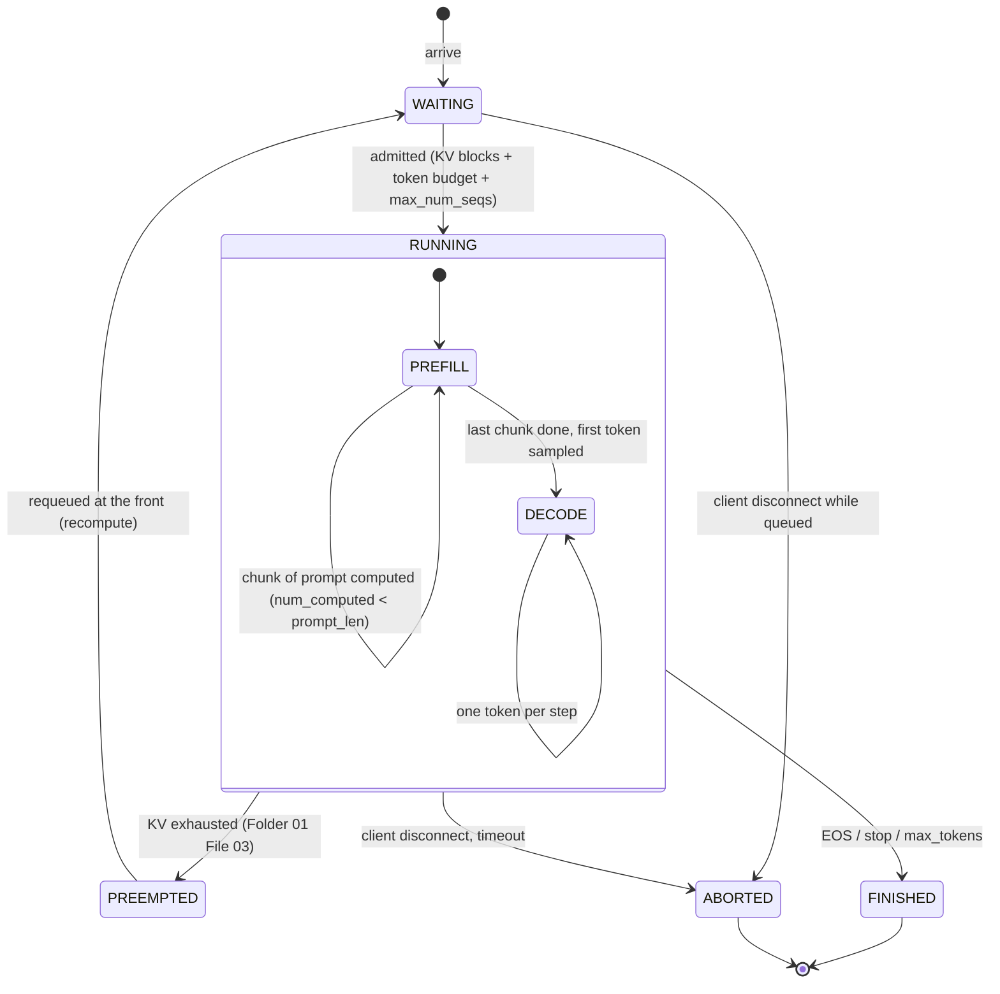

# 01 · Continuous Batching: Orca, Chunked Prefill, and Sarathi-Serve

> **Folder:** `02-High-Throughput-Serving-and-Distributed-Inference/` · **File 1 of 3**
> **Anchoring papers:** Yu et al., *Orca: A Distributed Serving System for Transformer-Based Generative Models* (OSDI
> 2022) · Kwon et al., *PagedAttention / vLLM* (SOSP 2023) · Agrawal et al., *SARATHI: Efficient LLM Inference by
> Piggybacking Decodes with Chunked Prefills* (2023) and *Taming Throughput-Latency Tradeoff in LLM Inference with
> Sarathi-Serve* (OSDI 2024) · Holmes et al., *DeepSpeed-FastGen* (2024, Dynamic SplitFuse) · Zhong et al., *DistServe*
> (OSDI 2024; the goodput metric) · Sheng et al., *Fairness in Serving Large Language Models* (OSDI 2024; VTC).
> **Code baseline:** Python 3.10+ (verified on CPython 3.14.5) · Java 21 (JDK 25.0.4, `--release 21`). The simulator
> imports Folder 01's `roofline.py`.
> **Previous folder:** [01 · PagedAttention and RadixAttention](../01-LLM-Inference-Physics-and-KV-Cache/03-pagedattention-block-tables-copy-on-write-and-radixattention.md) ·
> **Next:** [02 · Disaggregated serving and KV transfer](02-disaggregated-serving-prefill-decode-split-and-kv-cache-rdma.md)

---

## 0. The thesis in one paragraph

Folder 01 proved that a decode step is memory-bound. It streams every weight byte to produce one token per sequence,
so the only way to use the GPU is to put **more sequences into every step**. Batching is therefore not an optimization.
It is the economics of LLM serving. How you batch decides your latency. **Request-level (static) batching** holds a
batch until its slowest member finishes: new requests wait, finished rows idle, and TTFT explodes. **Iteration-level
(continuous) batching** (Orca) re-forms the batch after *every* step: finished sequences leave at once and queued ones
join at once. That opens a second problem, **prefill–decode interference**. A long prompt's compute-bound prefill
lands in the same step as everyone's memory-bound decode, and every streaming user stalls for the duration of the
prefill. **Chunked prefill with a token budget** (Sarathi-Serve, DeepSpeed-FastGen's Dynamic SplitFuse, and vLLM
V1's unified scheduler) slices prompts so that each step carries all decodes plus a bounded number of prefill tokens.
The budget then becomes the knob that trades TTFT for ITL. An L7 engineer sets that knob from the roofline and the
SLO, not from a benchmark default.

---

## 1. First principles

### 1.1 Request-level batching and the convoy effect

Static batching forms a batch of $B$ requests, prefills them together, and decodes until **all** $B$ are done. With
output lengths $O_1,\dots,O_B$:

$$
T_{\text{batch}} = T_{\text{prefill}} + \max_i O_i \cdot t_{\text{step}},\qquad
\text{useful-slot fraction} = \frac{\mathbb{E}[O]}{\mathbb{E}[\max_i O_i]} .
$$

For heavy-tailed output lengths, $\mathbb{E}[\max_i O_i]$ grows with $B$ (logarithmically for exponential tails, faster
for lognormal ones), so the bigger the batch, the larger the share of finished rows decoding **padding**. Worse, a
request that arrives one millisecond after a batch forms waits for that whole batch, often seconds. Measured on one
Llama-3-8B replica (§3.1 simulator; prompts ~1.5K tokens with a 16K tail, outputs ~180 tokens):

| Policy | QPS | TTFT p50 | TTFT p99 | ITL p99 | Throughput |
|--------|----:|---------:|---------:|--------:|-----------:|
| static (request-level, batch ≤ 64) | 4 | **2.48 s** | 6.27 s | 8.3 ms | 611 tok/s |
| static | 12 | **15.67 s** | 27.84 s | 11.4 ms | 1,205 tok/s |
| iteration-level (Orca) | 12 | 0.04 s | 0.35 s | **157.1 ms** | 1,955 tok/s |
| iteration-level + chunked prefill (budget 2048) | 12 | 0.05 s | 0.42 s | **56.4 ms** | 1,962 tok/s |

Static batching has beautiful ITL, because nothing ever interrupts a running batch. Its TTFT is unusable for
interactive traffic, and it delivers 38% less throughput at 12 QPS.

### 1.2 Iteration-level scheduling (Orca)

Orca's two ideas:

1. **Iteration-level scheduling.** The scheduler is invoked after every forward pass. Finished sequences (EOS, stop
   string, `max_tokens`) leave immediately and free their KV. Waiting requests join immediately if KV and the budget
   allow. The batch is a *set that changes every step*.
2. **Selective batching.** Requests in a step have different lengths and phases, so tensors can't be stacked
   `[batch, seq, d]` without padding. Orca **flattens** all tokens of the step into one `[Σ tokens, d]` matrix for
   every non-attention operation (QKV/O projections, MLP, norms), which are per-token and batch trivially. It splits
   back per request only for attention. Modern kernels do the split natively with varlen/paged attention
   (`cu_seqlens` offsets, or block tables from Folder 01 File 03).

Orca reported a **36.9× throughput improvement** over FasterTransformer at the same latency for a GPT-3-175B-class
model (⚠ verify the exact setup in the paper). That is the entire gap between "LLMs are too expensive to serve" and
the industry we have.

The scheduler as a state machine:



### 1.3 The token-budget view: prefill and decode are the same thing

vLLM V1 (and Sarathi-Serve before it) drops the prefill/decode distinction in the scheduler. Every request carries
`num_computed_tokens` and `num_tokens`. A step is a mapping `{request → new tokens to compute this step}` subject to:

$$
\sum_{r} n_r \le \texttt{max\_num\_batched\_tokens},\qquad
|\{r : n_r > 0\}| \le \texttt{max\_num\_seqs},\qquad
\text{KV blocks for } \sum_r n_r \text{ new tokens are available}.
$$

A decode is $n_r = 1$, a prefill chunk is $n_r = c$, and a speculative verify is $n_r = \gamma + 1$ (File 03). One
abstraction covers chunked prefill, prefix-cache hits (which simply start with a higher `num_computed_tokens`), and
speculative decoding, and the GPU sees one ragged batch.

### 1.4 Prefill–decode interference, quantified

A decode user's ITL **is** the step time. If a step also carries $c$ prefill tokens, its time grows by the marginal
cost of those tokens. From Folder 01: decode GEMMs are memory-bound below ~300 tokens per step on H100, and prefill
tokens cost compute. The simulator's marginal-cost tables (§3.1 output):

**Llama-3-8B, 1×H100, 32 decodes at 2K context (decode-only step: 8.74 ms)**

| Prefill chunk $c$ | 64 | 128 | 256 | 512 | 1,024 | 2,048 | 8,192 |
|------------------:|---:|----:|----:|----:|------:|------:|------:|
| Step time | 8.86 ms | 8.99 ms | 10.65 ms | 16.77 ms | 29.08 ms | 54.55 ms | 226.8 ms |
| Marginal ms per 1K prefill tokens | **1.9** | **1.9** | 7.5 | 15.7 | 19.9 | 22.4 | 26.6 |

**Llama-3-70B, 8×H100 TP=8, 64 decodes at 4K context (decode-only step: 12.85 ms)**

| Prefill chunk $c$ | 64 | 128 | 256 | 512 | 1,024 | 2,048 | 8,192 |
|------------------:|---:|----:|----:|----:|------:|------:|------:|
| Step time | 13.85 ms | 14.84 ms | 19.23 ms | 29.93 ms | 51.38 ms | 94.82 ms | 367.6 ms |
| Marginal ms per 1K prefill tokens | 15.6 | 15.6 | 24.9 | 33.3 | 37.6 | 40.0 | 43.3 |

Two regimes are visible:

- **The free region (TP=1).** The first ~128 prefill tokens cost only 0.25 ms, because they ride on GEMMs that are
  memory-bound anyway: the weights are streamed for the decodes, and the extra rows are nearly free FLOPs. This is
  Sarathi's "piggybacking".
- **Under TP=8 there is no free lunch.** Every extra token adds all-reduce bytes (2 per layer × 80 layers), so even
  64 tokens cost 1 ms. Communication, not GEMMs, sets the marginal cost of piggybacking at high TP. Plan budgets per
  parallelism layout, never per model.

**The pathological case.** A 32K-token prompt arrives while 64 users are streaming from Llama-3-70B on 8×H100:

| Policy | TTFT of the 32K request | Worst ITL seen by the 64 streaming users | Steps to prefill |
|--------|------------------------:|-----------------------------------------:|-----------------:|
| Orca-style whole-prompt prefill | 1.66 s | **1,661 ms** (every user freezes) | 1 |
| Chunked, budget 8,192 | 1.70 s | 474.0 ms | 5 |
| Chunked, budget 2,048 | 1.80 s | 124.7 ms | 17 |
| Chunked, budget 1,024 | 1.96 s | 65.5 ms | 35 |
| **Chunked, budget 512** | 2.29 s (+38%) | **35.2 ms** | 74 |

That is the trade in one table. A smaller budget protects every *other* user's ITL by 47× and costs the long request
38% more TTFT. The cost comes from re-streaming weights 74 times, from chunk $k$'s attention re-reading the KV of
chunks $1..k-1$ (an extra $O(L^2/c)$ KV bytes in total), and from the all-reduce per step.

### 1.5 Choosing the token budget

Let $t(B, c)$ be the step time with $B$ decodes and $c$ prefill tokens, and $S$ the ITL (TBT) SLO. The stall-free
budget is

$$
c^{*}(B) = \max\{\, c : t(B, c) \le S \,\},\qquad \texttt{max\_num\_batched\_tokens} \approx B + c^{*}(B).
$$

The planner must pick a $B$, and $c^*$ shrinks as $B$ grows because decodes consume the same step time. Rules that
fall out of the tables:

1. **Tight SLO → small budget.** At $S$ = 15 ms on Llama-3-8B with ~32 decodes, interpolating the table gives
   $c^* \approx 440$ tokens.
2. **Loose SLO → large budget.** Bigger chunks amortize weight streaming and per-step overhead, so throughput rises.
3. **The budget is per deployment** (model × GPU × TP × typical batch), and it must be re-derived when any of them
   changes.

Measured goodput on one Llama-3-8B replica (TTFT ≤ 1 s **and** TPOT ≤ SLO for ≥ 90% of requests):

| TPOT SLO | Orca (whole prompts) | Chunked, 2,048 | Chunked, 512 | Chunked, 256 |
|---------:|---------------------:|---------------:|-------------:|-------------:|
| 50 ms | 16 QPS | **18 QPS** | 16 QPS | 16 QPS |
| 25 ms | 14 QPS | 14 QPS | **16 QPS** | **16 QPS** |
| 15 ms | 8 QPS | 10 QPS | 14 QPS | **16 QPS (2×)** |

Under a loose SLO the large budget wins, because the extra throughput of big chunks matters and the stalls fit within
the SLO. Under a tight SLO the small budget **doubles** goodput over whole-prompt prefill. The table mirrors
Sarathi-Serve's headline result. That paper reports serving-capacity gains up to 2.6× (Mistral-7B, 1×A100) and 3.7×
(Yi-34B, 2×A100) under strict SLOs (⚠ verify).

### 1.6 Metrics: TTFT, ITL/TBT, TPOT, E2E, and goodput

| Metric | Definition | Dominated by |
|--------|-----------|--------------|
| **TTFT** | first token time − arrival | queueing + prefill (compute-bound) |
| **ITL / TBT** | gap between consecutive tokens of one request (a *distribution*; p99 matters) | step time = decode bytes + co-scheduled prefill |
| **TPOT** | $(t_{\text{last}} - t_{\text{first}})/(n_{\text{out}} - 1)$, a per-request mean | average step time |
| **E2E** | last token − arrival | TTFT + $n_{\text{out}} \times$ TPOT |
| **Goodput** (DistServe) | maximum request rate at which ≥ X% of requests meet **all** SLOs | everything above |

TPOT can look fine while ITL p99 is terrible: one 1.6 s stall in a 200-token response adds only 8 ms to its TPOT.
Users see stalls, not means, so **alert on ITL p99 and max ITL**, and report goodput rather than raw throughput.
Raw tokens/s rewards configurations that violate every SLO.

### 1.7 Scheduling policy beyond FCFS

- **Admission.** KV blocks with headroom (Folder 01 File 03), `max_num_seqs`, and the token budget all gate it.
  Admission order is usually FCFS with priority classes.
- **Long-prompt head-of-line blocking.** One 100K-token prompt can consume the budget for hundreds of steps. Engines
  limit how many long prompts prefill concurrently (vLLM exposes partial-prefill concurrency controls, ⚠ verify names)
  so short prompts can still start.
- **Fairness.** FCFS lets one tenant's flood starve everyone. The **Virtual Token Counter** (VTC, Sheng et al.)
  tracks weighted tokens served per client and schedules the least-served backlogged client first, which bounds
  unfairness. Token-weighted fairness matters because a request is not a unit of work: a 30K-token prompt is 100× a
  300-token one.
- **CUDA graphs.** Decode steps replay captured graphs for a fixed set of batch sizes, and batches are padded up to the
  next captured size. A batch beyond the largest captured size falls back to eager execution, with a measurable ITL
  jump (⚠ verify the capture sizes for your version).
- **Asynchronous scheduling.** Overlapping step $k+1$'s scheduling and input preparation with step $k$'s GPU work
  removes CPU time from the critical path. It matters most for small models at high batch, where a step is a few ms.

### 1.8 How engines implement it

| Engine | Batching | Prefill handling | Notes (⚠ verify against your version) |
|--------|----------|-----------------|------------------------------|
| vLLM V0 | iteration-level | prefill-prioritized whole prompts by default; chunked prefill optional | the "Orca" row in §1.5 |
| vLLM V1 | iteration-level, unified token budget | chunked prefill always on; prefix-cache hits start mid-prompt | scheduler output is `{req_id: num_tokens}` |
| SGLang | iteration-level | chunked prefill (`--chunked-prefill-size`); radix-aware ordering (Folder 01) | LPM scheduling interacts with chunking |
| TensorRT-LLM | "in-flight batching" | chunked context optional | C++ batch manager |
| DeepSpeed-FastGen | continuous | **Dynamic SplitFuse**: splits long prompts and fuses short ones to a fixed token count per step | same idea as Sarathi's budget |

---

## 2. Why the gateway has to understand this

The engine batches autoregressive decoding. But a production AI platform also serves **non-autoregressive** models
(embedding models for RAG ingestion and query encoding, cross-encoder rerankers, classifiers and guardrails), usually
fronted by a Java gateway. Their batching lives in your code, and the same physics applies:

- A per-request call pays the fixed cost of a forward pass (weight streaming, launch, network) for one item.
- Batching amortizes that fixed cost. The batch should close on a **token budget**, because cost is proportional to
  tokens, not requests.
- A **max-wait deadline** anchored to the *oldest* queued request bounds latency at low load.
- Waiting for backend availability before sealing a batch makes the batching continuous: arrivals keep joining while
  the GPU is busy.
- A **bounded queue** turns overload into fast 429s instead of unbounded latency.

The Java listing in §3.2 implements exactly that and measures it against two naive designs.

---

## 3. Production code blueprints

### 3.1 Python: static vs Orca vs chunked prefill, priced by the Folder 01 roofline

The `Engine` class is reused in File 02 (prefill/decode roles). Naive policies are first-class options so the
comparison is like-for-like: `static` is request-level batching, and `orca` is iteration-level with whole-prompt,
prefill-prioritized steps. The listing imports `roofline.py` from Folder 01, File 01; place it alongside.

```python
"""batching_sim.py - iteration-level scheduling simulator (Python 3.10+, stdlib only).

Compares request-level (static) batching, Orca-style iteration-level batching with whole-prompt
prefills (vLLM V0 default), and Sarathi-Serve-style chunked prefill with a token budget (vLLM V1
default). Every step is priced by Folder 01's per-kernel roofline (roofline.py, same directory),
derated to achieved MFU/MBU. Batches are ragged: GEMMs see the flattened token count (Orca's
"selective batching"); attention is priced per request kind.
"""
from __future__ import annotations

import math
import random
from collections import deque
from dataclasses import dataclass, field

from roofline import H100, LLAMA3_70B, LLAMA3_8B, DenseModel, Gpu, Kernel, allreduce_time, layer_gemms

MFU = 0.6               # achieved fraction of dense peak on compute-bound kernels
MBU = 0.85              # achieved fraction of peak HBM bandwidth on memory-bound kernels
STEP_OVERHEAD_S = 4e-4  # scheduler + sampling + launch per iteration, CUDA graphs on


def _t(k: Kernel, gpu: Gpu) -> float:
    return max(k.flops / (gpu.peak("bf16") * MFU), k.bytes / (gpu.hbm_bw * MBU))


@dataclass(frozen=True)
class Chunk:
    tokens: int   # prompt tokens computed this step
    prior: int    # tokens of the same request already in the KV cache


def mixed_step_time(md: DenseModel, gpu: Gpu, tp: int, n_decode: int, decode_ctx: int,
                    chunks: tuple[Chunk, ...] | list[Chunk] = (), sample_rows: int | None = None) -> float:
    """One iteration: n_decode decode tokens attending to decode_ctx cached tokens in total, plus
    prefill chunks. sample_rows overrides how many rows need logits (speculative verification needs
    all of them). Returns seconds."""
    n_tok = n_decode + sum(c.tokens for c in chunks)
    if n_tok == 0:
        return 0.0
    hq, hkv = md.n_heads // tp, max(1, md.n_kv_heads // tp)
    kv_tok = 2 * md.n_layers * hkv * md.head_dim * 2                  # BF16 KV bytes/token/rank
    t = sum(_t(k, gpu) for k in layer_gemms(md, n_tok, tp, 2, 2))
    m = n_decode + len(chunks) if sample_rows is None else sample_rows   # rows that sample a token
    t += _t(Kernel("lm_head", 2.0 * m * md.d_model * md.vocab / tp,
                   2.0 * (m * md.d_model + md.d_model * md.vocab / tp + m * md.vocab / tp)), gpu)
    if n_decode:
        t += _t(Kernel("decode_attn", 4.0 * md.n_layers * hq * md.head_dim * decode_ctx,
                       float(decode_ctx) * kv_tok), gpu)
    if chunks:
        f = sum(4.0 * md.n_layers * hq * md.head_dim * (c.tokens * c.prior + c.tokens * c.tokens / 2)
                for c in chunks)
        q = sum(c.prior * kv_tok + 4.0 * c.tokens * md.n_layers * hq * md.head_dim * 2 for c in chunks)
        t += _t(Kernel("prefill_attn", f, q), gpu)
    t += 2 * md.n_layers * allreduce_time(gpu, tp, n_tok * md.d_model * 2)
    return t + STEP_OVERHEAD_S


@dataclass(eq=False)
class Request:
    rid: int
    arrival: float
    prompt: int
    output: int
    computed: int = 0                     # prompt tokens with KV computed
    generated: int = 0
    token_times: list[float] = field(default_factory=list)

    @property
    def in_prefill(self) -> bool:
        return self.computed < self.prompt

    @property
    def done(self) -> bool:
        return self.generated >= self.output

    @property
    def context(self) -> int:
        return self.computed + self.generated


class Engine:
    """One model replica. role: 'colocated' (normal), 'prefill' (hands requests off after their first
    token), 'decode' (accepts requests whose prompt KV arrived from elsewhere)."""

    def __init__(self, md: DenseModel, gpu: Gpu, tp: int, policy: str = "chunked", token_budget: int = 2048,
                 max_seqs: int = 256, kv_capacity: int = 400_000, role: str = "colocated"):
        assert policy in ("static", "orca", "chunked") and role in ("colocated", "prefill", "decode")
        self.md, self.gpu, self.tp, self.policy, self.role = md, gpu, tp, policy, role
        self.budget, self.max_seqs, self.kv_capacity = token_budget, max_seqs, kv_capacity
        self.waiting: deque[Request] = deque()
        self.running: list[Request] = []
        self.handoff: list[Request] = []
        self.reserved = 0
        self.step_times: list[float] = []

    def has_work(self) -> bool:
        return bool(self.waiting or self.running)

    def queued_tokens(self) -> int:
        return sum(r.prompt - r.computed for r in self.waiting) + sum(r.prompt - r.computed for r in self.running)

    def load_tokens(self) -> int:
        return self.reserved + sum(r.prompt + r.output for r in self.waiting)

    def _try_admit(self) -> Request | None:
        if not self.waiting or len(self.running) >= self.max_seqs:
            return None
        r = self.waiting[0]
        need = r.prompt + (r.output if self.role != "prefill" else 1)   # reserve the full output: no preemption
        if self.reserved + need > self.kv_capacity:
            return None
        self.waiting.popleft()
        self.reserved += need
        self.running.append(r)
        return r

    def plan(self) -> tuple[list[Request], list[tuple[Request, int]]]:
        """Return (decoding requests, [(request, prompt tokens to compute this step)])."""
        if self.policy == "static":
            if not self.running:                                      # form a new batch, prefill it whole
                while self._try_admit():
                    pass
                return [], [(r, r.prompt) for r in self.running]
            return list(self.running), []                             # finished rows keep their slot (padding)
        if self.policy == "orca":
            prefills: list[tuple[Request, int]] = []
            used = 0
            while self.waiting and (not prefills or used + self.waiting[0].prompt <= self.budget):
                r = self._try_admit()
                if r is None:
                    break
                prefills.append((r, r.prompt))
                used += r.prompt
            if prefills:                                              # prefill-prioritized: decodes pause
                return [], prefills
            return [r for r in self.running if not r.in_prefill], []
        if self.role == "decode":                                     # prompt KV arrived over the network
            while self._try_admit():
                pass
            return list(self.running), []
        # chunked (Sarathi-Serve stall-free): every decode first, then fill the budget with chunks
        decodes = [r for r in self.running if not r.in_prefill]
        budget = self.budget - len(decodes)
        chunks: list[tuple[Request, int]] = []
        for r in self.running:                                        # continue partial prefills first
            if r.in_prefill and budget > 0:
                n = min(r.prompt - r.computed, budget)
                chunks.append((r, n))
                budget -= n
        while budget > 0:
            r = self._try_admit()
            if r is None:
                break
            n = min(r.prompt, budget)
            chunks.append((r, n))
            budget -= n
        return decodes, chunks

    def step_cost(self, decodes: list[Request], chunks: list[tuple[Request, int]]) -> float:
        ctx = sum(r.context for r in decodes)
        return mixed_step_time(self.md, self.gpu, self.tp, len(decodes), ctx,
                               [Chunk(n, r.computed) for r, n in chunks])

    def commit(self, decodes: list[Request], chunks: list[tuple[Request, int]], t_end: float) -> list[Request]:
        """Apply one finished step at time t_end. Returns requests that completed."""
        for r in decodes:
            if not r.done:
                r.generated += 1
                r.token_times.append(t_end)
        for r, n in chunks:
            r.computed += n
            if not r.in_prefill:                                      # prefill done: sample the 1st token
                r.generated += 1
                r.token_times.append(t_end)
        finished: list[Request] = []
        if self.policy == "static":
            if all(r.done for r in self.running):
                finished, self.running, self.reserved = list(self.running), [], 0
            return finished
        keep: list[Request] = []
        for r in self.running:
            if self.role == "prefill" and not r.in_prefill:
                self.handoff.append(r)
                self.reserved -= r.prompt + 1
            elif r.done:
                finished.append(r)
                self.reserved -= r.prompt + r.output
            else:
                keep.append(r)
        self.running = keep
        return finished


# ---------------------------------------------------------------------- single-replica driver
def workload(qps: float, duration_s: float, seed: int, prompt_mu: float = 7.0, prompt_sigma: float = 0.8,
             out_mu: float = 5.0, out_sigma: float = 0.6, max_prompt: int = 16_384, max_out: int = 1024):
    """Poisson arrivals; lognormal prompts (mean ~1.5K tokens, long tail) and outputs (mean ~180)."""
    rng = random.Random(seed)
    t, reqs = 0.0, []
    while True:
        t += rng.expovariate(qps)
        if t > duration_s:
            return reqs
        p = min(max_prompt, max(16, int(rng.lognormvariate(prompt_mu, prompt_sigma))))
        o = min(max_out, max(4, int(rng.lognormvariate(out_mu, out_sigma))))
        reqs.append(Request(len(reqs), t, p, o))


def run_single(engine: Engine, reqs: list[Request]) -> list[Request]:
    now, i, done = 0.0, 0, []
    while i < len(reqs) or engine.has_work():
        while i < len(reqs) and reqs[i].arrival <= now:
            engine.waiting.append(reqs[i])
            i += 1
        if not engine.has_work():
            now = reqs[i].arrival
            continue
        decodes, chunks = engine.plan()
        if not decodes and not chunks:                                # blocked on KV: wait for an arrival
            now = reqs[i].arrival if i < len(reqs) else now + 1e-3
            continue
        dt = engine.step_cost(decodes, chunks)
        engine.step_times.append(dt)
        now += dt
        done += engine.commit(decodes, chunks, now)
    return done


@dataclass
class Report:
    ttft: list[float]
    tpot: list[float]
    itl: list[float]
    tokens: int
    makespan: float

    @staticmethod
    def of(reqs: list[Request]) -> "Report":
        ttft = [r.token_times[0] - r.arrival for r in reqs]
        tpot = [(r.token_times[-1] - r.token_times[0]) / (len(r.token_times) - 1) for r in reqs if len(r.token_times) > 1]
        itl = [b - a for r in reqs for a, b in zip(r.token_times, r.token_times[1:])]
        span = max(r.token_times[-1] for r in reqs) - min(r.arrival for r in reqs)
        return Report(ttft, tpot, itl, sum(len(r.token_times) for r in reqs), span)

    @staticmethod
    def pct(xs: list[float], q: float) -> float:
        s = sorted(xs)
        return s[min(len(s) - 1, int(q * len(s)))]

    def attainment(self, ttft_slo: float, tpot_slo: float, reqs: list[Request]) -> float:
        ok = 0
        for r in reqs:
            tpot = (r.token_times[-1] - r.token_times[0]) / max(1, len(r.token_times) - 1)
            ok += (r.token_times[0] - r.arrival) <= ttft_slo and tpot <= tpot_slo
        return ok / len(reqs)


def goodput(policy: str, qps_grid, ttft_slo: float, tpot_slo: float, budget: int = 2048,
            duration_s: float = 40.0, seed: int = 3) -> tuple[float, dict[float, float]]:
    """Highest offered QPS whose SLO attainment is >= 90% (DistServe's goodput definition)."""
    att = {}
    for qps in qps_grid:
        reqs = workload(qps, duration_s, seed)
        done = run_single(Engine(LLAMA3_8B, H100, 1, policy, budget, kv_capacity=436_000), reqs)
        att[qps] = Report.of(done).attainment(ttft_slo, tpot_slo, done)
    best = max([q for q, a in att.items() if a >= 0.9], default=0.0)
    return best, att


# ---------------------------------------------------------------------- report
def main() -> None:
    md70 = LLAMA3_70B
    for md, tp, n_dec, ctx in ((LLAMA3_8B, 1, 32, 2048), (md70, 8, 64, 4096)):
        base = mixed_step_time(md, H100, tp, n_dec, n_dec * ctx)
        print(f"== Marginal cost of piggybacking a prefill chunk on {n_dec} decodes @{ctx} "
              f"({md.name}, {tp}xH100 TP={tp}) ==")
        print(f"{'chunk':>6} {'step ms':>8} {'+ms vs decode-only':>19} {'ms per 1K prefill tok':>22}")
        for c in (0, 64, 128, 256, 512, 1024, 2048, 4096, 8192):
            t = mixed_step_time(md, H100, tp, n_dec, n_dec * ctx, [Chunk(c, 0)] if c else [])
            extra = (t - base) * 1e3
            print(f"{c:6d} {t * 1e3:8.2f} {extra:19.2f} {extra / c * 1e3 if c else 0:22.2f}")
        print()
    free = mixed_step_time(LLAMA3_8B, H100, 1, 32, 32 * 2048, [Chunk(128, 0)]) - \
        mixed_step_time(LLAMA3_8B, H100, 1, 32, 32 * 2048)
    assert free < 0.5e-3, "at TP=1 a 128-token chunk rides almost free on a memory-bound decode step"

    print("== A 32K-token prompt arrives while 64 users stream (Llama-3-70B, 8xH100 TP=8) ==")
    print(f"{'policy':26s} {'TTFT of 32K req':>16} {'worst ITL for the 64':>21} {'steps':>6}")
    whole = mixed_step_time(md70, H100, 8, 0, 0, [Chunk(32768, 0)])
    print(f"{'orca: whole prefill':26s} {whole:15.2f}s {whole * 1e3:19.0f}ms {1:6d}")
    stall = {}
    for budget in (512, 1024, 2048, 8192):
        done, steps, worst, total = 0, 0, 0.0, 0.0
        while done < 32768:
            c = min(budget - 64, 32768 - done)
            t = mixed_step_time(md70, H100, 8, 64, 64 * (4096 + steps), [Chunk(c, done)])
            done, steps, worst, total = done + c, steps + 1, max(worst, t), total + t
        stall[budget] = worst
        print(f"{'chunked, budget ' + str(budget):26s} {total:15.2f}s {worst * 1e3:19.1f}ms {steps:6d}")
    assert whole > 1.0 and stall[512] < 0.05 and stall[512] < stall[2048] < stall[8192] < whole

    print("\n== One Llama-3-8B replica on 1xH100, Poisson load, 40 s, prompts ~1.5K (tail 16K), outputs ~180 ==")
    print(f"{'policy':8s} {'QPS':>4} {'TTFT p50':>9} {'TTFT p99':>9} {'ITL p50':>8} {'ITL p99':>8} "
          f"{'ITL max':>8} {'tok/s':>7}")
    summary = {}
    for policy in ("static", "orca", "chunked"):
        for qps in (4, 12):
            reqs = workload(qps, 40.0, 3)
            done = run_single(Engine(LLAMA3_8B, H100, 1, policy, 2048, max_seqs=64 if policy == "static" else 256,
                                     kv_capacity=436_000), reqs)
            r = Report.of(done)
            summary[(policy, qps)] = r
            print(f"{policy:8s} {qps:4d} {Report.pct(r.ttft, .5):8.2f}s {Report.pct(r.ttft, .99):8.2f}s "
                  f"{Report.pct(r.itl, .5) * 1e3:6.1f}ms {Report.pct(r.itl, .99) * 1e3:6.1f}ms "
                  f"{max(r.itl) * 1e3:6.0f}ms {r.tokens / r.makespan:7,.0f}")
    assert Report.pct(summary[("chunked", 12)].itl, .99) < Report.pct(summary[("orca", 12)].itl, .99)
    assert Report.pct(summary[("orca", 12)].ttft, .5) < Report.pct(summary[("static", 12)].ttft, .5)

    print("\n== Goodput (max QPS with >=90% of requests meeting TTFT<=1s AND TPOT<=SLO) ==")
    grid = (6, 8, 10, 12, 14, 16, 18, 20)
    results = {}
    for tpot_slo in (0.050, 0.025, 0.015):
        for policy, budget in (("orca", 8192), ("chunked", 2048), ("chunked", 512), ("chunked", 256)):
            g, att = goodput(policy, grid, 1.0, tpot_slo, budget)
            results[(tpot_slo, policy, budget)] = g
            atts = " ".join(f"{q}:{a:.0%}" for q, a in att.items())
            print(f"  TPOT<={tpot_slo * 1e3:2.0f}ms {policy:7s} budget={budget:5d}: goodput {g:4.0f} QPS  [{atts}]")
    assert results[(0.015, "chunked", 512)] > results[(0.015, "orca", 8192)]
    print("\nall batching simulator self-checks passed")


if __name__ == "__main__":
    main()
```

Output (verified, deterministic):

```text
== Marginal cost of piggybacking a prefill chunk on 32 decodes @2048 (Llama-3-8B, 1xH100 TP=1) ==
 chunk  step ms  +ms vs decode-only  ms per 1K prefill tok
     0     8.74                0.00                   0.00
    64     8.86                0.12                   1.93
   128     8.99                0.25                   1.93
   256    10.65                1.91                   7.48
   512    16.77                8.03                  15.68
  1024    29.08               20.34                  19.86
  2048    54.55               45.81                  22.37
  4096   108.26               99.52                  24.30
  8192   226.80              218.06                  26.62

== Marginal cost of piggybacking a prefill chunk on 64 decodes @4096 (Llama-3-70B, 8xH100 TP=8) ==
 chunk  step ms  +ms vs decode-only  ms per 1K prefill tok
     0    12.85                0.00                   0.00
    64    13.85                1.00                  15.55
   128    14.84                1.99                  15.55
   256    19.23                6.37                  24.89
   512    29.93               17.07                  33.34
  1024    51.38               38.53                  37.62
  2048    94.82               81.96                  40.02
  4096   183.43              170.57                  41.64
  8192   367.59              354.73                  43.30

== A 32K-token prompt arrives while 64 users stream (Llama-3-70B, 8xH100 TP=8) ==
policy                      TTFT of 32K req  worst ITL for the 64  steps
orca: whole prefill                   1.66s                1661ms      1
chunked, budget 512                   2.29s                35.2ms     74
chunked, budget 1024                  1.96s                65.5ms     35
chunked, budget 2048                  1.80s               124.7ms     17
chunked, budget 8192                  1.70s               474.0ms      5

== One Llama-3-8B replica on 1xH100, Poisson load, 40 s, prompts ~1.5K (tail 16K), outputs ~180 ==
policy    QPS  TTFT p50  TTFT p99  ITL p50  ITL p99  ITL max   tok/s
static      4     2.48s     6.27s    6.5ms    8.3ms      8ms     611
static     12    15.67s    27.84s   10.4ms   11.4ms     11ms   1,205
orca        4     0.03s     0.44s    6.1ms   36.5ms    515ms     652
orca       12     0.04s     0.35s    8.0ms  157.1ms    759ms   1,955
chunked     4     0.03s     0.46s    6.1ms   48.3ms     73ms     652
chunked    12     0.05s     0.42s    7.8ms   56.4ms     74ms   1,962

== Goodput (max QPS with >=90% of requests meeting TTFT<=1s AND TPOT<=SLO) ==
  TPOT<=50ms orca    budget= 8192: goodput   16 QPS  [6:100% 8:100% 10:100% 12:100% 14:100% 16:100% 18:72% 20:11%]
  TPOT<=50ms chunked budget= 2048: goodput   18 QPS  [6:100% 8:100% 10:100% 12:100% 14:100% 16:100% 18:99% 20:22%]
  TPOT<=50ms chunked budget=  512: goodput   16 QPS  [6:100% 8:100% 10:100% 12:100% 14:100% 16:100% 18:83% 20:15%]
  TPOT<=50ms chunked budget=  256: goodput   16 QPS  [6:100% 8:100% 10:100% 12:100% 14:100% 16:98% 18:16% 20:10%]
  TPOT<=25ms orca    budget= 8192: goodput   14 QPS  [6:100% 8:100% 10:99% 12:98% 14:90% 16:38% 18:10% 20:3%]
  TPOT<=25ms chunked budget= 2048: goodput   14 QPS  [6:100% 8:100% 10:100% 12:100% 14:98% 16:72% 18:17% 20:5%]
  TPOT<=25ms chunked budget=  512: goodput   16 QPS  [6:100% 8:100% 10:100% 12:100% 14:100% 16:100% 18:83% 20:15%]
  TPOT<=25ms chunked budget=  256: goodput   16 QPS  [6:100% 8:100% 10:100% 12:100% 14:100% 16:98% 18:16% 20:10%]
  TPOT<=15ms orca    budget= 8192: goodput    8 QPS  [6:100% 8:96% 10:85% 12:63% 14:17% 16:7% 18:3% 20:1%]
  TPOT<=15ms chunked budget= 2048: goodput   10 QPS  [6:100% 8:100% 10:93% 12:82% 14:42% 16:11% 18:4% 20:1%]
  TPOT<=15ms chunked budget=  512: goodput   14 QPS  [6:100% 8:100% 10:100% 12:98% 14:94% 16:61% 18:12% 20:4%]
  TPOT<=15ms chunked budget=  256: goodput   16 QPS  [6:100% 8:100% 10:100% 12:100% 14:100% 16:98% 18:16% 20:10%]

all batching simulator self-checks passed
```

### 3.2 Java 21: a token-budget continuous micro-batcher for embedders and rerankers

Design points visible in the code:

- **Close a batch on whichever comes first:** the token budget, `maxBatch`, or the oldest request's deadline.
- **Acquire a backend permit *before* sealing a batch.** While the GPU is busy, the queue fills, and the next batch is
  as large as the budget allows. That is continuous batching at the client.
- **Carry the item that overflowed the budget into the next batch,** preserving FIFO order.
- **Skip futures cancelled while queued** (client disconnects), so no GPU time goes to abandoned requests.
- **On backend failure, complete every future in the batch exceptionally.** A batcher that strands callers is worse
  than no batcher.
- **`close()` drains all accepted work and restores the interrupt flag rather than throwing.** That is the correct
  `AutoCloseable` contract, and `javac -Xlint:all` warns about the alternative.

```java
// TokenBudgetBatcher.java - Java 21 continuous micro-batcher for non-autoregressive GPU models
// (embedders, rerankers, classifiers) called from a gateway. The engine-side analogue of Orca/Sarathi:
// batches close on a TOKEN budget (not a request count), a max-wait deadline anchored to the oldest
// request, and backend availability; the queue is bounded (429 instead of unbounded latency).
// Build & self-test:  javac --release 21 -Xlint:all -Werror -d out TokenBudgetBatcher.java
//                     java -ea -cp out dev.l7.ai.inference.TokenBudgetBatcher
package dev.l7.ai.inference;

import java.time.Duration;
import java.util.ArrayList;
import java.util.Collections;
import java.util.List;
import java.util.concurrent.ArrayBlockingQueue;
import java.util.concurrent.BlockingQueue;
import java.util.concurrent.CompletableFuture;
import java.util.concurrent.ConcurrentLinkedQueue;
import java.util.concurrent.ExecutorService;
import java.util.concurrent.Executors;
import java.util.concurrent.RejectedExecutionException;
import java.util.concurrent.Semaphore;
import java.util.concurrent.TimeUnit;
import java.util.concurrent.atomic.AtomicInteger;
import java.util.concurrent.atomic.AtomicLong;
import java.util.concurrent.locks.ReentrantLock;

public final class TokenBudgetBatcher<T, R> implements AutoCloseable {

    @FunctionalInterface
    public interface Backend<T, R> {
        List<R> infer(List<T> batch) throws Exception;
    }

    private record Item<T, R>(T payload, int tokens, long enqueuedNanos, CompletableFuture<R> future) {}

    private final Backend<T, R> backend;
    private final BlockingQueue<Item<T, R>> queue;
    private final int tokenBudget;
    private final int maxBatch;
    private final long maxWaitNanos;
    private final Semaphore inFlight;
    private final ExecutorService workers = Executors.newVirtualThreadPerTaskExecutor();
    private final Thread dispatcher;
    private final AtomicLong batches = new AtomicLong();
    private final AtomicLong dropped = new AtomicLong();
    private volatile boolean closed;
    private Item<T, R> carry;                                 // confined to the dispatcher thread

    public TokenBudgetBatcher(Backend<T, R> backend, int queueCapacity, int tokenBudget, int maxBatch,
                              Duration maxWait, int maxInFlight) {
        this.backend = backend;
        this.queue = new ArrayBlockingQueue<>(queueCapacity);
        this.tokenBudget = tokenBudget;
        this.maxBatch = maxBatch;
        this.maxWaitNanos = maxWait.toNanos();
        this.inFlight = new Semaphore(maxInFlight);
        this.dispatcher = Thread.ofPlatform().name("token-budget-batcher").daemon(true).start(this::loop);
    }

    /** Non-blocking. A full queue fails fast: the caller maps it to HTTP 429 + Retry-After. */
    public CompletableFuture<R> submit(T payload, int tokens) {
        if (tokens <= 0 || tokens > tokenBudget) {
            return CompletableFuture.failedFuture(new IllegalArgumentException("tokens out of range: " + tokens));
        }
        if (closed) return CompletableFuture.failedFuture(new RejectedExecutionException("closed"));
        CompletableFuture<R> f = new CompletableFuture<>();
        if (!queue.offer(new Item<>(payload, tokens, System.nanoTime(), f))) {
            return CompletableFuture.failedFuture(new RejectedExecutionException("queue full"));
        }
        return f;
    }

    private Item<T, R> nextLive(long timeoutNanos) throws InterruptedException {
        while (true) {
            Item<T, R> it = timeoutNanos > 0 ? queue.poll(timeoutNanos, TimeUnit.NANOSECONDS) : queue.poll();
            if (it == null || !it.future().isDone()) return it;  // skip requests cancelled while queued
            dropped.incrementAndGet();
        }
    }

    private void loop() {
        try {
            while (!closed || carry != null || !queue.isEmpty()) {
                Item<T, R> first = carry != null ? carry : nextLive(TimeUnit.MILLISECONDS.toNanos(10));
                carry = null;
                if (first == null) continue;
                // Wait for a backend slot BEFORE sealing the batch: while the GPU is busy, arrivals pile
                // up and join the next batch. That is what makes the batching continuous.
                inFlight.acquire();
                List<Item<T, R>> batch = new ArrayList<>();
                batch.add(first);
                int tokens = first.tokens();
                long deadline = first.enqueuedNanos() + maxWaitNanos;
                while (batch.size() < maxBatch) {
                    Item<T, R> next = nextLive(deadline - System.nanoTime());
                    if (next == null) break;
                    if (tokens + next.tokens() > tokenBudget) {
                        carry = next;                          // opens the next batch; FIFO preserved
                        break;
                    }
                    batch.add(next);
                    tokens += next.tokens();
                }
                batches.incrementAndGet();
                workers.submit(() -> execute(batch));
            }
        } catch (InterruptedException e) {
            Thread.currentThread().interrupt();
        }
    }

    private void execute(List<Item<T, R>> batch) {
        try {
            List<R> out = backend.infer(batch.stream().map(Item::payload).toList());
            if (out.size() != batch.size()) throw new IllegalStateException("backend returned " + out.size());
            for (int i = 0; i < batch.size(); i++) batch.get(i).future().complete(out.get(i));
        } catch (Throwable e) {
            batch.forEach(it -> it.future().completeExceptionally(e));   // never strand a caller
        } finally {
            inFlight.release();
        }
    }

    public long batches() { return batches.get(); }

    public long droppedCancelled() { return dropped.get(); }

    @Override
    public void close() {
        closed = true;
        try {
            dispatcher.join();      // drains everything already accepted
        } catch (InterruptedException e) {
            Thread.currentThread().interrupt();   // never swallow: restore the flag for the caller
        }
        workers.close();            // waits for in-flight batches
    }

    // ------------------------------------------------------------------ naive baselines

    /** Naive #1: one backend call per request. */
    static <T, R> CompletableFuture<R> perRequest(ExecutorService vt, Backend<T, R> backend, T payload) {
        return CompletableFuture.supplyAsync(() -> {
            try {
                return backend.infer(List.of(payload)).get(0);
            } catch (Exception e) {
                throw new RuntimeException(e);
            }
        }, vt);
    }

    /** Naive #2: dispatch only when exactly n requests have arrived (no timer). */
    static final class FixedSizeBatcher<T, R> {
        private final int n;
        private final Backend<T, R> backend;
        private final ExecutorService vt;
        private final ReentrantLock lock = new ReentrantLock();
        private List<T> payloads = new ArrayList<>();
        private List<CompletableFuture<R>> futures = new ArrayList<>();

        FixedSizeBatcher(int n, Backend<T, R> backend, ExecutorService vt) {
            this.n = n;
            this.backend = backend;
            this.vt = vt;
        }

        CompletableFuture<R> submit(T p) {
            CompletableFuture<R> f = new CompletableFuture<>();
            lock.lock();
            try {
                payloads.add(p);
                futures.add(f);
                if (payloads.size() == n) flushLocked();
            } finally {
                lock.unlock();
            }
            return f;
        }

        void flush() {
            lock.lock();
            try {
                if (!payloads.isEmpty()) flushLocked();
            } finally {
                lock.unlock();
            }
        }

        private void flushLocked() {
            List<T> ps = payloads;
            List<CompletableFuture<R>> fs = futures;
            payloads = new ArrayList<>();
            futures = new ArrayList<>();
            vt.submit(() -> {
                try {
                    List<R> out = backend.infer(ps);
                    for (int i = 0; i < fs.size(); i++) fs.get(i).complete(out.get(i));
                } catch (Exception e) {
                    fs.forEach(f -> f.completeExceptionally(e));
                }
            });
        }
    }

    // ------------------------------------------------------------------ self-test

    /** One fake GPU: calls serialize; latency = 4 ms + 4 us/token (fixed cost dominates small batches). */
    static final class FakeGpu implements Backend<Integer, Integer> {
        private final Semaphore gpu = new Semaphore(1);
        final AtomicInteger calls = new AtomicInteger();
        final AtomicLong tokens = new AtomicLong();

        @Override
        public List<Integer> infer(List<Integer> batch) throws InterruptedException {
            int t = batch.stream().mapToInt(Integer::intValue).sum();
            gpu.acquire();
            try {
                calls.incrementAndGet();
                tokens.addAndGet(t);
                Thread.sleep(Duration.ofNanos(4_000_000L + 4_000L * t));
                return batch.stream().map(x -> x * 2).toList();
            } finally {
                gpu.release();
            }
        }
    }

    record Run(double seconds, double p50Ms, double p99Ms, int completed, int calls) {
        double throughput() { return completed / seconds; }
    }

    interface Submitter {
        CompletableFuture<Integer> submit(int tokens);
    }

    /** Open-loop load: `n` requests at `rate`/s; latency is measured from submit to completion. */
    static Run load(Submitter s, int n, double rate, long seed, FakeGpu gpu, Runnable flush) throws Exception {
        java.util.Random rnd = new java.util.Random(seed);
        List<Double> lat = Collections.synchronizedList(new ArrayList<>());
        List<CompletableFuture<Integer>> all = new ArrayList<>();
        long t0 = System.nanoTime();
        for (int i = 0; i < n; i++) {
            long due = t0 + (long) (i * 1e9 / rate);
            long wait = due - System.nanoTime();
            if (wait > 0) Thread.sleep(Duration.ofNanos(wait));
            int tokens = 64 + rnd.nextInt(449);
            long start = System.nanoTime();
            CompletableFuture<Integer> f = s.submit(tokens);
            all.add(f.whenComplete((v, e) -> lat.add((System.nanoTime() - start) / 1e6)));
        }
        flush.run();
        CompletableFuture.allOf(all.toArray(CompletableFuture[]::new)).get(60, TimeUnit.SECONDS);
        double secs = (System.nanoTime() - t0) / 1e9;
        List<Double> sorted = new ArrayList<>(lat);
        Collections.sort(sorted);
        return new Run(secs, sorted.get(sorted.size() / 2), sorted.get((int) (sorted.size() * 0.99)), sorted.size(),
                gpu.calls.get());
    }

    private static void check(boolean ok, String what) {
        if (!ok) throw new AssertionError(what);
    }

    public static void main(String[] args) throws Exception {
        try (ExecutorService vt = Executors.newVirtualThreadPerTaskExecutor()) {
            // 1) High load, 400 req/s: per-request calls saturate a GPU that could serve far more.
            FakeGpu g1 = new FakeGpu();
            Run naive = load(t -> perRequest(vt, g1, t), 600, 400, 1, g1, () -> {});
            FakeGpu g2 = new FakeGpu();
            Run batched;
            try (TokenBudgetBatcher<Integer, Integer> b =
                         new TokenBudgetBatcher<>(g2, 4096, 8192, 64, Duration.ofMillis(2), 2)) {
                batched = load(t -> b.submit(t, t), 600, 400, 1, g2, () -> {});
            }
            System.out.printf("high load 400 req/s: per-request  %6.0f req/s  p50 %7.1f ms  p99 %7.1f ms  (%d GPU calls)%n",
                    naive.throughput(), naive.p50Ms(), naive.p99Ms(), naive.calls());
            System.out.printf("high load 400 req/s: token-budget %6.0f req/s  p50 %7.1f ms  p99 %7.1f ms  (%d GPU calls)%n",
                    batched.throughput(), batched.p50Ms(), batched.p99Ms(), batched.calls());
            check(batched.p99Ms() * 5 < naive.p99Ms() && batched.calls() * 3 < naive.calls(), "batching wins at load");

            // 2) Low load, 25 req/s: a fixed-size batch of 32 makes early requests wait for late ones.
            FakeGpu g3 = new FakeGpu();
            FixedSizeBatcher<Integer, Integer> fixed = new FixedSizeBatcher<>(32, g3, vt);
            Run fixedRun = load(fixed::submit, 64, 25, 2, g3, fixed::flush);
            FakeGpu g4 = new FakeGpu();
            Run lowBatched;
            try (TokenBudgetBatcher<Integer, Integer> b =
                         new TokenBudgetBatcher<>(g4, 4096, 8192, 64, Duration.ofMillis(2), 2)) {
                lowBatched = load(t -> b.submit(t, t), 64, 25, 2, g4, () -> {});
            }
            System.out.printf("low load 25 req/s:   fixed-size(32) p50 %7.1f ms  p99 %7.1f ms%n", fixedRun.p50Ms(), fixedRun.p99Ms());
            System.out.printf("low load 25 req/s:   token-budget   p50 %7.1f ms  p99 %7.1f ms%n", lowBatched.p50Ms(), lowBatched.p99Ms());
            check(lowBatched.p50Ms() * 10 < fixedRun.p50Ms(), "max-wait deadline bounds latency at low load");

            // 3) Burst + backpressure + cancellation: nothing is lost, overflow is rejected fast.
            FakeGpu g5 = new FakeGpu();
            ConcurrentLinkedQueue<CompletableFuture<Integer>> accepted = new ConcurrentLinkedQueue<>();
            AtomicInteger rejected = new AtomicInteger(), cancelled = new AtomicInteger();
            long dropped;
            try (TokenBudgetBatcher<Integer, Integer> b =
                         new TokenBudgetBatcher<>(g5, 256, 8192, 64, Duration.ofMillis(2), 1)) {
                for (int i = 0; i < 5_000; i++) {
                    CompletableFuture<Integer> f = b.submit(i % 7 + 1, 100);
                    if (f.isCompletedExceptionally()) {
                        rejected.incrementAndGet();
                    } else if (i % 10 == 0 && f.cancel(false)) {
                        cancelled.incrementAndGet();             // client disconnected while queued
                    } else {
                        accepted.add(f);
                    }
                }
                CompletableFuture.allOf(accepted.toArray(CompletableFuture[]::new)).get(60, TimeUnit.SECONDS);
                dropped = b.droppedCancelled();
            }
            long served = g5.tokens.get();
            System.out.printf("burst of 5,000 into a 256-slot queue: accepted=%d rejected=%d cancelled=%d "
                    + "(skipped before the GPU: %d), all accepted completed%n",
                    accepted.size(), rejected.get(), cancelled.get(), dropped);
            check(rejected.get() > 0 && accepted.stream().allMatch(f -> f.isDone() && !f.isCompletedExceptionally()),
                    "backpressure without loss");
            check(served > 0 && dropped <= cancelled.get(), "cancelled work is not sent to the GPU");
        }
        System.out.println("all TokenBudgetBatcher self-checks passed");
    }
}
```

Output (one measured run on a Windows laptop; sleep granularity is ~1 ms, so latencies carry ~1 ms of noise):

```text
high load 400 req/s: per-request     162 req/s  p50  1135.8 ms  p99  2191.6 ms  (600 GPU calls)
high load 400 req/s: token-budget    395 req/s  p50    23.9 ms  p99    33.7 ms  (157 GPU calls)
low load 25 req/s:   fixed-size(32) p50   680.3 ms  p99  1286.0 ms
low load 25 req/s:   token-budget   p50     9.1 ms  p99    10.9 ms
burst of 5,000 into a 256-slot queue: accepted=296 rejected=4671 cancelled=33 (skipped before the GPU: 33), all accepted completed
all TokenBudgetBatcher self-checks passed
```

How to read it:

- **At 400 req/s, per-request calls saturate at ~162 req/s.** Each call pays the 4 ms fixed cost, so the queue grows
  and p99 passes 2 s. The token-budget batcher serves the full offered load with ~4× fewer GPU calls.
- **At 25 req/s, the fixed-size batcher is a latency disaster.** Early requests wait for 31 others (p50 ≈ 680 ms). The
  deadline-driven batcher stays near the backend's own latency (p50 ≈ 9 ms).
- **The burst test shows backpressure without loss.** Overflow is rejected instantly (a 429 at the HTTP layer), every
  accepted future completes, and cancelled requests never reach the GPU.

---

## 4. Production failure modes and P99 debugging

### F1 · Sawtooth ITL: every long prompt freezes every stream

- **Symptom:** users report the stream "pausing for a second or two", correlated with traffic that carries large
  documents.
- **Signature:** ITL p99 / max spikes that line up with admissions of long prompts. Step-composition logs show steps
  with 10K+ prefill tokens.
- **Root cause:** whole-prompt prefill in a shared step: a 1.66 s stall for 64 users from one 32K prompt (§1.4).
- **Fix:** chunked prefill with a budget derived from the ITL SLO, plus limits on concurrent long prefills.
  Disaggregation if SLOs are tight (File 02).
- **Prevention:** synthetic canaries that send a max-length prompt while measuring ITL on a background stream.

### F2 · TTFT measured in seconds at moderate load

- **Symptom:** TTFT p50 of seconds while the GPU looks busy, and throughput far below capacity.
- **Signature:** requests wait for an entire batch to complete before starting, and batch duration tracks the longest
  output.
- **Root cause:** request-level (static) batching, e.g. a hand-rolled `model.generate(batch)` server or an inference
  server misconfigured for static batches. 15.7 s TTFT p50 at 12 QPS in §1.1.
- **Fix:** move to an iteration-level engine (vLLM, SGLang, TensorRT-LLM, TGI). Never batch autoregressive decoding
  at request level for interactive traffic.

### F3 · "We lowered the chunk size and throughput fell"

- **Symptom:** after tuning `max_num_batched_tokens` down to fix ITL, peak throughput drops and TTFT p99 rises.
- **Signature:** more steps per prompt, and the weight-streaming share per prefill token rises. Under a loose SLO,
  goodput falls from 18 to 16 QPS (budget 2,048 → 256) in §1.5.
- **Root cause:** small chunks re-stream weights and re-read prior KV per chunk. They pay off only when the SLO is
  tight.
- **Fix:** derive the budget from $c^*(B)$ for the actual SLO. Consider separate pools (strict-ITL vs batch/offline)
  with different budgets.

### F4 · ITL cliff when the running batch crosses a size threshold

- **Symptom:** ITL jumps abruptly (not linearly) once concurrency exceeds a particular number.
- **Signature:** the jump coincides with the largest CUDA-graph capture size, and profiles show many small kernel
  launches (eager mode).
- **Fix:** raise the capture sizes to cover the operating batch, or cap `max_num_seqs` at the largest captured size.

### F5 · One tenant's document flood starves everyone

- **Symptom:** a batch-ingestion customer sends thousands of long prompts, and interactive tenants' TTFT explodes.
- **Root cause:** FCFS admission with token-blind fairness. One request is not one unit of work.
- **Fix:** token-weighted fair scheduling (VTC-style), per-tenant token budgets at the gateway, and a separate
  offline pool.

### F6 · The gateway's fixed-size micro-batcher adds hundreds of ms at night

- **Symptom:** embedding latency is fine at peak, terrible at low traffic.
- **Root cause:** batches dispatch only when full. p50 ≈ 680 ms at 25 req/s in §3.2.
- **Fix:** a max-wait deadline anchored to the oldest request, and a token budget instead of a count.

### F7 · Decode keeps generating for clients that already left

- **Symptom:** GPU busy at 100% while delivered tokens/s fall during an incident; many SSE connections closed.
- **Root cause:** client disconnects don't propagate as aborts to the engine, so abandoned sequences keep decoding and
  holding KV.
- **Fix:** propagate cancellation end to end: SSE/HTTP disconnect → gateway → engine abort (Folder 06 builds this
  with Reactor/virtual threads). Monitor aborted vs completed request ratios.

### F8 · Throughput benchmarks that violate every SLO

- **Symptom:** a configuration "wins" the benchmark and loses in production.
- **Root cause:** tokens/s measured at saturation, with unbounded queues. Every request's TTFT was 30 s, but the
  number was big.
- **Fix:** report **goodput** at stated TTFT/ITL SLOs, sweep the arrival rate, and include ITL p99 and max.

---

## 5. FAANG L7 bar-raiser Q&A chains

### Q1 · "Explain continuous batching and quantify why it matters."

- **L5 answer:** "Instead of waiting for a batch to finish, new requests are added as old ones finish, so the GPU stays
  busy."
- **Why L5 fails at scale:** it doesn't connect to the physics or quantify, and it ignores prefill interference. The
  candidate who stops there ships a server with 1.6-second stalls.
- **L7 principal defense:**
  1. Decode is memory-bound. Intensity ≈ batch size, so per-step cost is nearly flat in batch until ~300 tokens
     (Folder 01).
  2. Request-level batching wastes slots on finished rows: useful fraction $\mathbb{E}[O]/\mathbb{E}[\max O]$. Queued
     requests wait whole batches: TTFT p50 2.5 s at 4 QPS and 15.7 s at 12 QPS in the simulator.
  3. Iteration-level scheduling re-forms the batch every step. Selective batching flattens tokens for GEMMs and
     splits only attention.
  4. That raises throughput (+62% here; Orca reported 36.9× vs FasterTransformer) and drops TTFT to tens of ms.
  5. But it introduces prefill–decode interference, so the complete answer includes chunked prefill with an
     SLO-derived budget.

### Q2 · "A 32K-token prompt arrives while 64 users are streaming. What happens, and what should happen?"

- **L5 answer:** "It gets queued and processed."
- **Why L5 fails:** in a prefill-prioritized engine it runs in one step that takes ~1.7 s on 8×H100, and all 64
  streams freeze for that duration.
- **L7 defense:**
  1. Quantify: whole-prompt gives TTFT 1.66 s *and* a 1,661 ms stall for everyone.
  2. Chunk at a budget derived from the ITL SLO. At 512 the worst stall is 35 ms and the long request's TTFT is 2.29 s
     (+38%).
  3. Bound concurrent long prefills so short prompts aren't blocked behind it.
  4. Route ≥ 16K prompts to a long-context pool with a different budget, or disaggregate (File 02).
  5. Communicate the trade-off as a product decision. Long-document users accept seconds of TTFT; chat users never
     accept freezes.

### Q3 · "How do you set `max_num_batched_tokens`?"

- **L5 answer:** "Use the default, or as high as memory allows for throughput."
- **Why L5 fails:** the budget is the ITL/TTFT trade-off knob. Maximizing it maximizes stalls. Under TP=8 even small
  chunks cost all-reduce time.
- **L7 defense:**
  1. Measure $t(B, c)$ for the deployment (model × GPU × TP) with a step-time sweep (the §1.4 tables), or compute it
     with the roofline model.
  2. Pick the operating batch $B$ from KV capacity and the ITL SLO.
  3. Set $c^* = \max\{c : t(B, c) \le S\}$, then the budget $\approx B + c^*$.
  4. Validate goodput across arrival rates (the §1.5 table).
  5. Remember the activation reserve: a larger budget raises the profiled activation peak and costs KV capacity
     (~26K tokens per GiB for Llama-3-70B TP=8, Folder 01).
  6. Re-derive on every model, GPU or TP change.

### Q4 · "Our benchmark shows 2× throughput for config B over A. Ship it?"

- **L5 answer:** "Yes, 2× throughput means half the cost."
- **Why L5 fails:** throughput at saturation hides SLO violations. Config B may have achieved it with 10 s TTFTs or
  stall-heavy ITL.
- **L7 defense:** ask for **goodput** at the product SLOs (TTFT p99, ITL p99, TPOT), measured by sweeping arrival rate
  with a production-shaped length distribution. In §1.5, the "fastest" policy at a loose SLO (budget 2,048) loses
  30–40% at a tight one (10 vs 14–16 QPS). Ship only configurations that win on goodput for the tier they will serve.

### Q5 · "One enterprise tenant sends 50K-token documents in bulk. Interactive tenants complain. Fix it."

- **L5 answer:** "Rate limit that tenant by requests per second."
- **Why L5 fails:** RPS limits are token-blind. Ten 50K-token requests per second are 5,000× the work of ten
  10-token ones.
- **L7 defense:**
  1. Meter **tokens** (prompt + expected output) per tenant at the gateway, with token buckets.
  2. Use token-weighted fair scheduling in the engine (VTC-style, which bounds service difference among backlogged
     clients).
  3. Separate pools: batch/offline with large budgets and loose SLOs, interactive with small budgets.
  4. Cap concurrent long prefills.
  5. Price long-context traffic accordingly. The physics says it costs more.

### Q6 · "Design the batching layer for an embedding service behind a Java gateway."

- **L5 answer:** "Collect 32 requests and send them together."
- **Why L5 fails:** fixed-count batching adds ~680 ms p50 at low load (§3.2), ignores token-proportional cost, and has
  no backpressure.
- **L7 defense:** a token-budget batcher (§3.2):
  - **Batch formation:** the batch closes on the token budget, `maxBatch`, or a deadline anchored to the oldest
    request. It waits for a backend permit before sealing, so batches stay continuous. The overflow item is carried
    into the next batch.
  - **Load handling:** a bounded queue rejects overflow with 429 + `Retry-After`. Cancelled futures are skipped before
    reaching the GPU.
  - **Failure and shutdown:** a backend failure fails every future in the batch, and the batcher drains cleanly on
    shutdown.
  - **Threading:** virtual threads for callers and one platform dispatcher thread.
  - **Tuning:** the budget comes from the backend's cost curve (fixed + per-token), and the deadline from the latency
    SLO minus the backend p99.

### Q7 · "Why did vLLM V1 stop distinguishing prefill and decode in the scheduler?"

- **L5 answer:** "It simplified the code."
- **Why L5 fails:** it misses the systems insight that every request is "compute the next $n$ tokens", which unifies
  chunked prefill, prefix-cache hits, preemption-recompute and speculative verification under one budget.
- **L7 defense:** the scheduler emits `{request: num_new_tokens}` under one token budget, so:
  - chunked prefill is just $n = c$;
  - a prefix-cache hit starts with a higher `num_computed_tokens`;
  - a recomputed preemption is a prefill that hits its own cached blocks (Folder 01);
  - speculative verification is $n = \gamma + 1$ (File 03).

  The GPU runs one ragged batch with varlen/paged attention. That removes whole classes of policy bugs (prefill-only
  steps, decode starvation) and makes the ITL/TTFT trade-off a single knob.

---

## 6. Invariants checklist

- [ ] Autoregressive serving uses iteration-level scheduling. Request-level batching is never used for interactive
      traffic.
- [ ] Every step carries all running decodes first, then prefill chunks up to a budget derived from the ITL SLO and
      measured $t(B, c)$.
- [ ] Concurrent long prefills are bounded, and prompts above a length threshold route to a long-context pool.
- [ ] SLOs are stated as TTFT p99 + ITL p99/max + TPOT. Capacity is reported as goodput, never as saturation tokens/s.
- [ ] Fairness and rate limits are token-weighted per tenant.
- [ ] Client disconnects propagate to engine aborts. Aborted sequences free KV immediately.
- [ ] Operating batch sizes are covered by captured CUDA graphs.
- [ ] Gateway-side batchers for non-autoregressive models close on token budget + oldest-request deadline + backend
      availability, are bounded, skip cancelled work, and never strand a future.

## 7. References

1. G.-I. Yu, J. S. Jeong, G.-W. Kim, S. Kim, B.-G. Chun. *Orca: A Distributed Serving System for Transformer-Based
   Generative Models.* OSDI 2022.
2. W. Kwon et al. *Efficient Memory Management for Large Language Model Serving with PagedAttention.* SOSP 2023.
3. A. Agrawal et al. *SARATHI: Efficient LLM Inference by Piggybacking Decodes with Chunked Prefills.*
   arXiv:2308.16369, 2023.
4. A. Agrawal et al. *Taming Throughput-Latency Tradeoff in LLM Inference with Sarathi-Serve.* OSDI 2024.
5. C. Holmes et al. *DeepSpeed-FastGen: High-throughput Text Generation for LLMs via MII and DeepSpeed-Inference.*
   arXiv:2401.08671, 2024.
6. Y. Zhong et al. *DistServe: Disaggregating Prefill and Decoding for Goodput-optimized LLM Serving.* OSDI 2024.
7. Y. Sheng et al. *Fairness in Serving Large Language Models.* OSDI 2024.
8. vLLM V1 engine and scheduler design documents; SGLang and TensorRT-LLM batching documentation (⚠ pin to the release
   you run).
